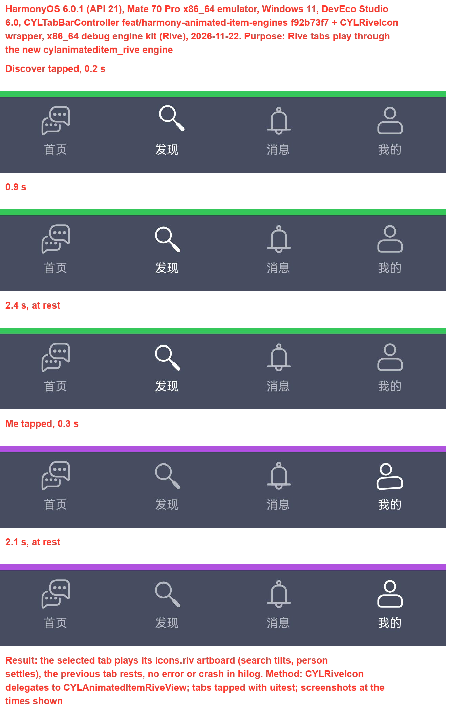
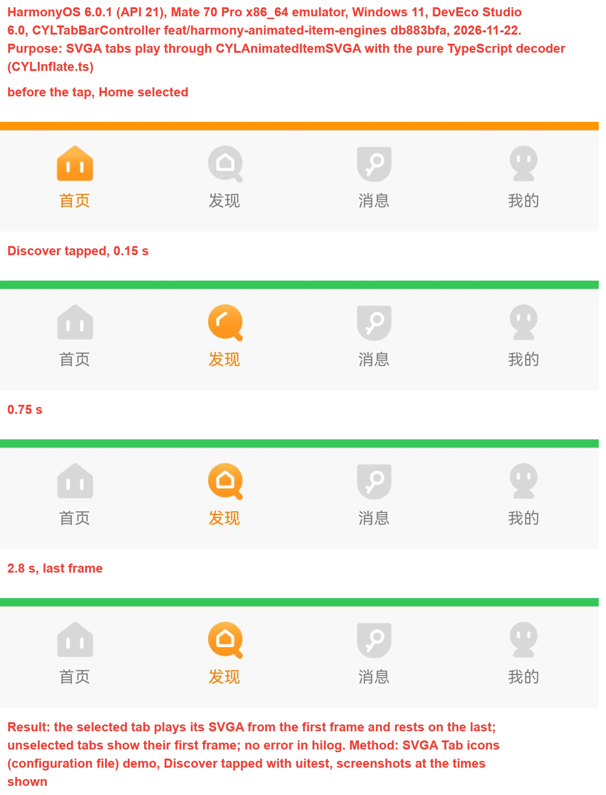

# cylanimateditem

The animated icon + title component of CYLTabBarController for HarmonyOS NEXT (`CYLAnimatedItemView`,
`CYLAnimatedItemStackView`, `CYLAnimatedItemEngines`). It depends on the lifecycle library `cyldeallocblockexecutor` (teardown blocks) and on no animation library.
Guide: [docs/Animated-Item.md](../../../docs/Animated-Item.md) in CYLTabBarController. To play `.riv` files in it with one shared
Rive view and a working Loop, add the sibling module [cylanimateditemrive](../cylanimateditemrive/README.md).

## Engine views (no `animationBuilder` needed)

[EN] The component carries the engine views, so an app no longer writes its own players. Register the engines once (for
example in `EntryAbility.onCreate`); every `CYLAnimatedItemView` without an `animationBuilder` then plays files of those
types by its selection and playback (selected: once from the start; unselected: progress 0; `animationRestartToken` /
`controller.restartAnimation()`: again; `animationSpeed`, `animationLoops` at once; `onAnimationEnd`).
[CN] 组件自带引擎视图，App 不再编写自己的播放器。注册一次引擎（例如在 `EntryAbility.onCreate` 中）后，所有未传入 `animationBuilder` 的
`CYLAnimatedItemView` 都按其选中状态与播放设置播放这些类型的文件。

| Type | Where | Register |
|:---|:---|:---|
| GIF | this module (ImageKit, no library; a frame of 10 ms or less shows for 100 ms, as browsers and the iOS / Android engines do) | `CYLAnimatedItemGIF.register()` |
| SVGA | this module (pure TypeScript decoder and renderer, `svga/`) | `CYLAnimatedItemSVGA.register()` |
| Lottie | module `cylanimateditem_lottie` (`@ohos/lottie` ^2.0.38) | `CYLAnimatedItemLottie.register()` |
| PAG | module `cylanimateditem_pag` (`@tencent/libpag` ^4.4.31; an app on another version can pin one with ohpm `overrides`) | `CYLAnimatedItemPAG.register()` |
| Rive | module `cylanimateditem_rive` (`@ohos/rive` 1.0.4) | `CYLAnimatedItemRive.register()` |

Used by: cyltabbar (Lottie and SVGA tabs through the engine views; `CYLRiveIcon` and `svga/` delegate to the modules),
CollectionViewClassifyMenu (every tag icon; no players of its own), CYLTableViewPlaceHolder and CYLSearchViewController
(switching).

- A host that drives playback itself (resting progress, Play all) sets `drivesAnimationPlayback: false` and gets the
  player in `onAnimationPlayer`: `CYLAnimatedItemPlayer` (`play()`, `stopAtProgress(p)`, `speed`, `loops`,
  `supportsSpeed` / `supportsLoops` / `supportsProgress`, `isPlaying`, `progress`, `onEnded`, `supportsColors` /
  `applyColors(colors)`).
- Writing an engine: a `@Component` that gets `state: CYLAnimatedItemEngineState` (the parsed
  `CYLAnimatedItemSource` with its `#` options, the size, the playback, the callbacks), makes a player (subclass
  `CYLAnimatedItemPlayer`, or `CYLAnimatedItemTimedPlayer` for an engine without speed), and calls
  `CYLAnimatedItemEngineBinding.ready(state, player)` / `failed(state)` / `update(state)` /
  `release()`, listening with `state.listen(...)` in `aboutToAppear` (and calling the returned function in `aboutToDisappear`); then `CYLAnimatedItemEngineViews.register(type, wrapBuilder(globalBuilder))`. `CYLAnimatedItemGIF.ets` is
  the smallest example.
- Engine views are created one at a time, 50 ms apart (a screen full of animated items froze while decoding all of them
  at once: CollectionViewClassifyMenu Z5).
- Tests: `node --test test/*.test.mjs` (`CYLAnimatedItemSource`, `CYLAnimatedItemPlayer`, GIF timing).
- SVGA: `CYLAnimatedItemSVGA.register()` (in this module: `svga/` decoder and renderer, a timed player). Rive: the
  `cylanimateditem_rive` module, `CYLAnimatedItemRive.register()`; cyltabbar's `CYLRiveIcon` is a thin wrapper over its
  `CYLAnimatedItemRiveView`. Checked on the x86_64 emulator with the debug engine kit (2026-11-22):
  
- The SVGA decoder is plain TypeScript (`svga/CYLInflate.ts`, `svga/CYLSVGADecoder.ts`), tested with Node
  (`test/CYLAnimatedItemSVGADecoder.test.mjs`). SVGA tabs on the x86_64 emulator (2026-11-22):
  

## x86_64 emulator

The local HarmonyOS emulator (Mate 70 Pro image, HarmonyOS 6.0.1) is x86_64. `@ohos/rive` 1.0.4 (`libohos_rive.so`) and
`@tencent/libpag` 4.4.31 (`libpag.so`) ship `arm64-v8a` libraries only, so a HAP that bundles them does not install
there ("install parse native so failed", error 9568347), and a HAP without them crashes at the first PAG or Rive view.
This module owns the x86_64 test path, so every app and library that depends on it (the cyltabbar example,
CollectionViewClassifyMenu, CYLTableViewPlaceHolder, CYLSearchViewController) can test fully on the x86_64 emulator.

### 1. Runtime check (in this module)

`CYLAnimatedItemEngines` reads the device's ABIs (`deviceInfo.abiList`) and knows the ABIs each engine's library ships:
PAG and Rive need `arm64-v8a`; Lottie, SVGA and GIF are pure ArkTS. On a device without them:

- `CYLAnimatedItemEngines.canPlay(url)` is false, so `CYLAnimatedItemView` never calls `animationBuilder` for that item:
  no engine view is created, nothing loads the missing `.so`, and the item shows its still image (or the placeholder).
- `CYLAnimatedItemEngines.isSupportedOnDevice('Rive')` is false and `unsupportedReason(url)` says why
  ("Rive needs a native library built for arm64-v8a; this device has x86_64"); debug builds log it once per type.
- `setRequiredNativeAbis(type, abis)` (or the fourth argument of `register`) changes what an engine needs, e.g. when a
  library version adds x86_64, or for an app's own engine with a native library; `setDeviceAbis(['x86_64'])` simulates
  the emulator in a test.

Static imports of `@ohos/rive` / `@tencent/libpag` are fine: the native library is resolved when a view is created
(checked 2026-11-22: CollectionViewClassifyMenu's animations page, which imports both statically, ran without its
`.so` files once no PAG or Rive view was built). An app that creates PAG or Rive views outside `animationBuilder`
checks `CYLAnimatedItemEngines.isSupportedOnDevice(type)` first.

### 2. A HAP for the emulator (in the app's build profile)

`entry/build-profile.json5`: an `emulator` build option that leaves out every `arm64-v8a` library (`libc++_shared.so`
too: leaving it alone still fails the install), an `emulator` target bound to it, and, for an app with an `ohosTest`
target, an `emulatorTest` build mode:

```json5
"buildOptionSet": [
  { "name": "emulator", "nativeLib": { "filter": { "excludes": ["**/arm64-v8a/*.so"] } } }
],
"buildModeBinder": [
  { "buildModeName": "debug", "mappings": [{ "targetName": "emulator", "buildOptionName": "emulator" }] },
  { "buildModeName": "release", "mappings": [{ "targetName": "emulator", "buildOptionName": "emulator" }] },
  { "buildModeName": "emulatorTest", "mappings": [{ "targetName": "ohosTest", "buildOptionName": "emulator" }] }
],
"targets": [{ "name": "default" }, { "name": "ohosTest" }, { "name": "emulator" }]
```

The root `build-profile.json5` lists the target (`{ "name": "emulator", "applyToProducts": ["default"] }`) and, with
`ohosTest`, the mode (`buildModeSet`: `{ "name": "emulatorTest" }`). Build with
`hvigorw --mode module -p module=entry@emulator -p product=default assembleHap` and install
`entry/build/default/outputs/emulator/entry-emulator-unsigned.hap`; tests with `-p buildMode=emulatorTest`. Phones,
arm64 emulators and releases keep the `default` target. The cyltabbar example (`entry/build-profile.json5`) has it.

### 3. A HAP built without it: `tools/cyl_hap_x86_64.py`

`python3 tools/cyl_hap_x86_64.py install <app.hap> [--target 127.0.0.1:5557]` asks the device for its ABIs, strips the
`libs/<abi>/` folders it cannot load, and runs `hdc install -r` (`--strip yes|no` or `CYL_HAP_STRIP_LIBS=1|0` forces
it); `strip <in.hap> [<out.hap>]` only copies the HAP without native libraries. Standard library only; tests in
`test/test_cyl_hap_x86_64.py`.

### 4. Test plan on x86_64

| Testable on the x86_64 emulator | Needs an arm64 device |
|:---|:---|
| Lottie, SVGA and GIF playback; still images and placeholders; PAG and Rive items on their still images (no crash, no blank item); Rive and PAG playback with the debug engine kit (section 5); `showsImageWhenAnimationEnds` with Lottie or SVGA; layout, dark mode, accessibility, localization, gestures, countdown, stack view | Rive and PAG without the kit; Rive's dispose crash workarounds on a real device |

Device tests (hypium): the cyltabbar example's `entry/src/ohosTest` (`CYLAnimatedItemFallback.test.ets`) checks the
ABI rules on the device (expectations follow `deviceInfo.abiList`, so it also passes on arm64), a simulated x86_64 and
arm64 device, an app engine with a native library, and a UI test whose page holds a Rive and a Lottie item with a marker
builder: without `arm64-v8a` the Rive item builds no engine view and keeps its still image, the Lottie item builds one.
On the x86_64 emulator:

```sh
hvigorw --mode module -p module=entry@emulator -p product=default assembleHap
hvigorw --mode module -p module=entry@ohosTest -p isOhosTest=true -p buildMode=emulatorTest -p product=default assembleHap
hdc install -r entry/build/default/outputs/emulator/entry-emulator-unsigned.hap
hdc install -r entry/build/default/outputs/ohosTest/entry-ohosTest-unsigned.hap
hdc shell aa test -b com.cyl.tabbar.harmony -m entry_test -s unittest OpenHarmonyTestRunner -s timeout 15000
```

Result on 2026-11-22 (x86_64 emulator, HarmonyOS 6.0.1): Tests run: 6, Failure: 0, Error: 0, Pass: 6. On Windows give hdc
backslash paths (`tools/cyl_hap_x86_64.py` does).

### 5. Rive and PAG playback on x86_64: the debug engine kit (owner's Plan 1)

`x86_64-debug-engines/rive/` holds `libohos_rive.so` of @ohos/rive 1.0.4 built for x86_64 from its sources and the x86_64
`libc++_shared.so` it links; `x86_64-debug-engines/pag/` holds `libpag.so` of @tencent/libpag 4.4.31 built for x86_64 from
GitHub Tencent/libpag `v4.4.31`, and `x86_64-debug-engines/pag-4.5.102/` the same for 4.5.102 (provenance, checksums and
licenses in each README; each folder's `kit.json` names its package and version). It is never part of a build:

- `tools/cyl_hap_x86_64.py install <app.hap>` adds the kit (`libs/x86_64/`) and the marker rawfile
  `cyl_x86_64_debug_engines.json` when the device is x86_64, only for the engines the app uses (its `libs/` files and the
  native modules its `ets/modules.abc` imports) and only in the exact package version the app's ArkTS was built with (read
  from `ets/modules.abc`; a native library of another version crashed the app, so a mismatch is skipped with a message) (`--x86-engines auto`, the default; `no` / `yes` or
  `CYL_X86_ENGINES=0|1` force it).
- `CYLAnimatedItemEngines.loadX86_64DebugEngines(context)` (called by `CYLAnimatedItemView` and `CYLTabBarController`)
  reads the marker (debug and release builds) and lets the engines it names (Rive, PAG) accept `x86_64`; `x86_64DebugEngines()` lists what it turned on.
  A HAP installed without the kit keeps the still images.
- The debug-build guard was removed with the owner's approval (2026-11-23), after Rive and PAG (4.5.102) played on the
  x86_64 emulator without crashes; the marker and the device's x86_64 ABI remain the guards.

Checked on the x86_64 emulator (2026-11-22): with the kit the Rive tab icons draw and animate, without it they keep their
still images, and the hypium suite passes 9 / 9 in both installs; in CollectionViewClassifyMenu the PAG icons play and end
on their last frame with the kit, no crash.

Say in every report and screenshot footer which part ran on x86_64 and which still needs an arm64 device.
