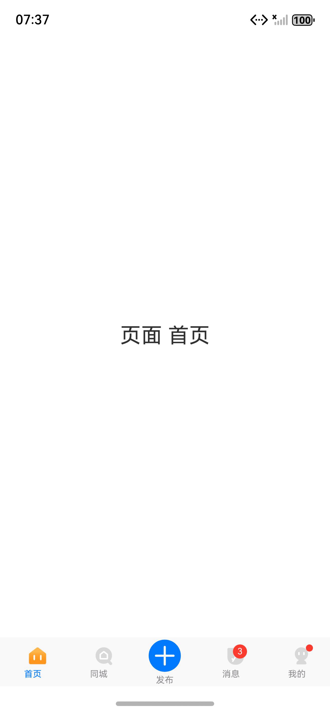
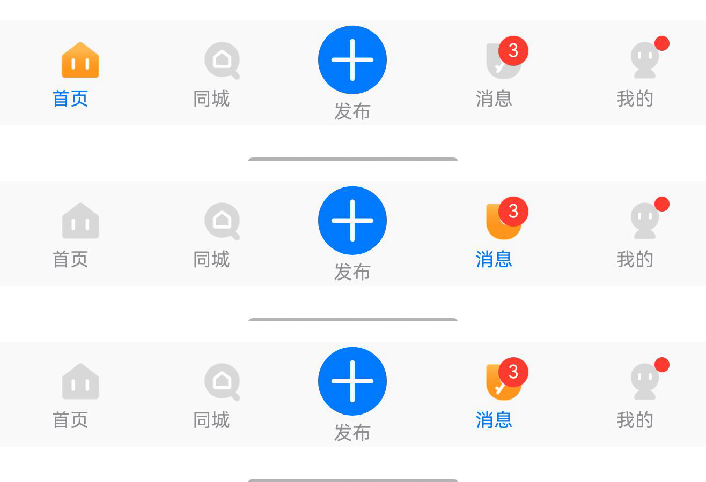

# [CN]CYLTabBarController 鸿蒙版（HarmonyOS NEXT）
# [EN]CYLTabBarController for HarmonyOS NEXT

| 中文 | English |
|:---|:---|
| `cyltabbar`：ArkTS / ArkUI 库（HAR）：`CYLTabBarController`（Tab、各 Tab 的页面、`selectedIndex`、PlusButton、外观颜色）、`CYLTabBar`、`CYLTabBarItem`（标题、图片、选中图片、标识、角标、无障碍标签）、`CYLPlusButton`。`entry`：演示 App（Objective-C 示例的首页、同城、消息、我的与 PlusButton「发布」）。与 iOS 的对应关系与完成率见 [docs/HarmonyOS-API-Map.md](../docs/HarmonyOS-API-Map.md)。 | `cyltabbar`: the ArkTS / ArkUI library (HAR): `CYLTabBarController` (tabs, a page per tab, `selectedIndex`, the plus button, the colors), `CYLTabBar`, `CYLTabBarItem` (title, image, selected image, identifier, badge, accessibility label) and `CYLPlusButton`. `entry`: the demo app (Home, Nearby, Messages, Me and the plus button "Post" of the Objective-C example). The iOS counterparts and the score: [docs/HarmonyOS-API-Map.md](../docs/HarmonyOS-API-Map.md). |
| **无障碍**：每个 Tab 对屏幕阅读器是一个元素（`accessibilityGroup`），朗读标题与角标（“消息、3 条新消息”，红点为“有新内容”），带选中状态（`accessibilitySelected`）；装饰性视图 `accessibilityLevel('no')`；标题字号使用 fp，跟随大字体设置。UI 测试通过 id 定位：`CYLTabBarItem_<identifier>`、PlusButton 的标识（默认 `CYLPlusButton`）。 | **Accessibility**: each tab is one element for the screen reader (`accessibilityGroup`), reads its title and badge ("Messages, 3 new messages", "New content" for a dot) with its selected state (`accessibilitySelected`); decorations are `accessibilityLevel('no')`; titles use fp sizes, so large-text settings apply. UI tests locate controls by id: `CYLTabBarItem_<identifier>` and the plus button's identifier (`CYLPlusButton` by default). |
| **SVGA 图标**（issue #415）：`CYLTabBarItem.svgaFilePath`（App 的 rawfile 路径，如 `svga/tab_home.svga`）或 `svgaURL`（http(s)，模块已声明 `ohos.permission.INTERNET`）与 `svgaSize`；`CYLSVGAView` 在 Tab 选中时播放一次并停在最后一帧，未选中时显示第一帧；无法加载时显示 `image`。播放器为 ArkTS 版 SVGA 2.x 解码与 Canvas 绘制（与微信小程序的 `svga-miniprogram` 相同的格式解析与绘制方式，系统 zlib 解压，PNG 转 PixelMap）。演示的 4 个 Tab 使用 Example-SwiftUI-Rive 的 SVGA 图标（`scripts/sync-svga.py` 复制到 `entry/src/main/resources/rawfile/svga`）。尚未支持：遮罩、音频、深色模式文件。 | **SVGA icons** (issue #415): `CYLTabBarItem.svgaFilePath` (a rawfile path of the app, e.g. `svga/tab_home.svga`) or `svgaURL` (http(s); the module declares `ohos.permission.INTERNET`) and `svgaSize`; `CYLSVGAView` plays once when its tab is selected and keeps the last frame, and shows the first frame otherwise; `image` shows if the file cannot load. The player is an ArkTS SVGA 2.x decoder and Canvas renderer (the same format parsing and drawing as the WeChat mini program's `svga-miniprogram`, system zlib for the inflate, PNGs as PixelMaps). The demo's 4 tabs use the SVGA icons of Example-SwiftUI-Rive (copied into `entry/src/main/resources/rawfile/svga` by `scripts/sync-svga.py`). Not yet: masks, audio, dark-mode files. |
| **本地化**：文字全部来自字符串资源，由 `scripts/sync-strings.py` 从 CYLTabBarController 的本地化文件（33 种语言）复制，只保留鸿蒙代码用到的键：`python3 HarmonyOS/scripts/sync-strings.py`（`--check` 检查是否过期）。 | **Localization**: every text comes from string resources, copied by `scripts/sync-strings.py` from CYLTabBarController's localization files (33 languages), keeping only the keys the HarmonyOS code uses: `python3 HarmonyOS/scripts/sync-strings.py` (`--check` reports stale files). |
| **构建**（不需要模拟器）：复制到 exFAT 卷之外（`._*` 文件会破坏 hvigor），然后 `ohpm install` 与 `DEVECO_SDK_HOME=/Applications/DevEco-Studio.app/Contents/sdk node /Applications/DevEco-Studio.app/Contents/tools/hvigor/bin/hvigorw.js assembleHap --no-daemon`（DevEco 自带的 node）。最低 SDK 5.0.1(13)（`accessibilitySelected`），目标 SDK 6.0.1(21)。 | **Build** (no emulator needed): copy it off the exFAT volume (`._*` files break hvigor), then `ohpm install` and `DEVECO_SDK_HOME=/Applications/DevEco-Studio.app/Contents/sdk node /Applications/DevEco-Studio.app/Contents/tools/hvigor/bin/hvigorw.js assembleHap --no-daemon` (DevEco's bundled node). Minimum SDK 5.0.1(13) (`accessibilitySelected`), target SDK 6.0.1(21). |
| **在模拟器上运行（2026-11-16）**：Mate 70 Pro 模拟器（HarmonyOS 6.0.1，API 21，中文），未签名 HAP。UI 测试 `entry/src/ohosTest/ets/test/TabBar.test.ets` 通过 id 依次点击消息、我的、同城、首页，每次检查选中状态与页面：1 项通过（`aa test`，`Tests run: 1, Failure: 0, Error: 0, Pass: 1`）。下图：启动后；点击消息（按 layout dump 中 id 的位置）0.4 秒后 SVGA 动画进行中、2 秒后停在最后一帧，首页回到第一帧。运行中发现并修复：`ForEach` 的 key 含选中状态导致每次选中都重建所有 Tab（SVGA 不播放、UI 测试找不到控件）；`Image` 无法绘制系统符号，改为 `symbol` 字段用 SymbolGlyph 绘制（PlusButton 图标原先不显示）。未检查：屏幕阅读器实际朗读的内容（layout dump 不含 accessibilityText，需开启系统屏幕阅读器）。 | **Run on an emulator (2026-11-16)**: the Mate 70 Pro emulator (HarmonyOS 6.0.1, API 21, Chinese), unsigned HAP. The UI test `entry/src/ohosTest/ets/test/TabBar.test.ets` taps Messages, Me, Nearby and Home by id, checking the selected state and the page each time: 1 test passed (`aa test`, `Tests run: 1, Failure: 0, Error: 0, Pass: 1`). Below: after launch; Messages tapped (at the position of its id in the layout dump), 0.4 s later its SVGA animation running, 2 s later resting on the last frame, Home back on its first frame. Found and fixed while running: the `ForEach` key held the selection, so every selection rebuilt all tabs (SVGA did not play, the UI test lost the control); `Image` cannot draw system symbols, so the new `symbol` fields draw them with SymbolGlyph (the plus button icon was missing). Not checked: what the screen reader actually reads (the layout dump has no accessibilityText; it needs the system screen reader on). |
|  |  |
|  |  |
| **TODO**：样式（液态玻璃、凸起 PlusButton）、其他动画库、主题与配置文件尚未实现。 | **TODO**: styles (Liquid Glass, the raised plus button), the other animation libraries, themes and configuration files are not implemented yet. |
