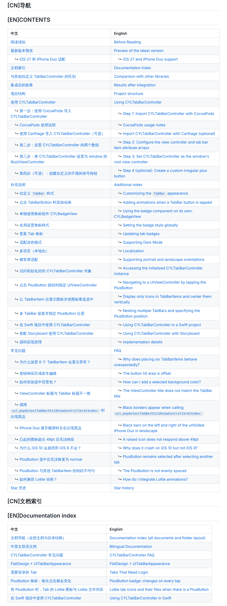
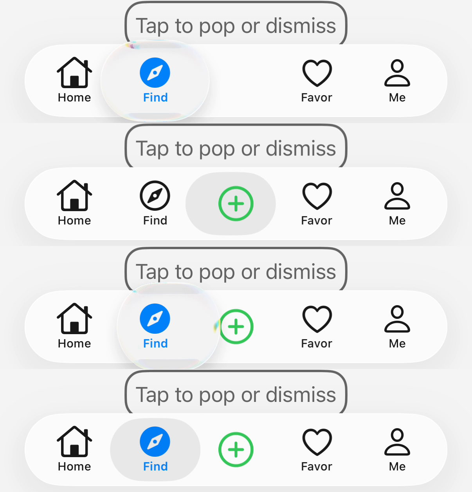
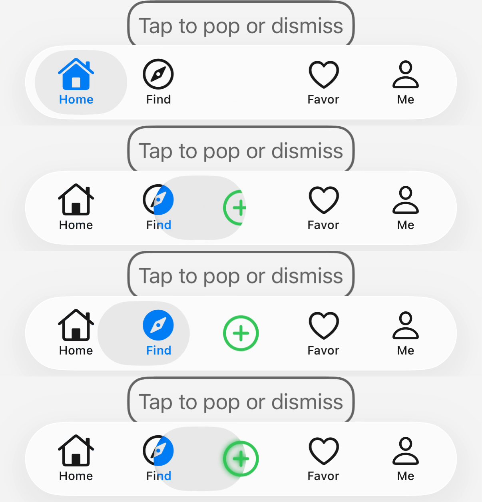

<p align="center"><a href="https://github.com/ChenYilong/CYLTabBarController"></a></p>


# [CN]CYLTabBarController【一行代码实现 Lottie 动画 TabBar】iOS27+ Tested
# [EN]CYLTabBarController [An animated tabBar supported by Lottie with one line of code]


<p align="center">
<a href="https://github.com/ChenYilong/CYLTabBarController/blob/master/CYLTabBarController.podspec"></a>
<a href=""></a>
<a href=""></a>
<a href="https://github.com/ChenYilong/CYLTabBarController/blob/master/LICENSE"></a>

</p>


<p align="center">
<a href="https://github.com/ChenYilong/iOSBlog/issues/21"></a>
</p>

<p align="center">
<a href="https://github.com/ChenYilong/CYLTabBarController/releases.atom"></a>
</p>

<p align="center">
<a href="https://github.com/ChenYilong/iOSBlog/releases.atom"></a>
</p>


<p align="center"><a href="https://mp.weixin.qq.com/s/A4e5h3xgIEh6PInf1Rjqsw"></a></p>

<p align="center">
 <a href="http://ww2.sinaimg.cn/large/006tNc79ly1g5et6q6sm5j30go0goaar.jpg"></a>
<a href="http://weibo.com/luohanchenyilong"></a>
<a href="https://twitter.com/iOSChenYilong"></a>
<a href="https://github.com/ChenYilong"></a>
<a href="https://qm.qq.com/cgi-bin/qm/qr?k=SEdIYBh52YzquCEo8cmPwgkko1VgSAlw&authKey=sGcG%2BGB81DW%2Ba8v3dCufFSNoxhykAU61Uz%2B%2BqDiKQN2BGHP2xHYVI2tc0Cah2lpu"></a>
<a href="https://t.me/iosobjc"></a>
<a href="http://s.zhihu.com/BU5Mp"></a>
</p>


--------------------------------------------

## [CN]阅读须知
## [EN]Before Reading

| 中文 | English |
|:---|:---|
| `[CN]` 表示中文内容。 | `[CN]` indicates Chinese content. |
| `[EN]` 表示英文内容。 | `[EN]` indicates English content. |
| [点此获取 QQ 群、Telegram 群交流信息](https://github.com/ChenYilong/iOSBlog/issues/21)。 | [Join the QQ or Telegram groups](https://github.com/ChenYilong/iOSBlog/issues/21). |
| 遇到使用问题，请先查阅 [常见问题（docs/FAQ.md）](docs/FAQ.md)；bug 与新需求请提交 issue。 | For usage questions, see the [FAQ (docs/FAQ.md)](docs/FAQ.md) first; report bugs and feature requests as issues. |
| 本 README 完整提供中英文：标题成对出现，正文为中英文对照表格；下方「导航」为双语目录，「文档索引」列出 `docs/` 中的全部文档，二者均由脚本自动生成。阅读方式见 [docs/Bilingual-Documentation.md](docs/Bilingual-Documentation.md)（[#42](https://github.com/ChenYilong/CYLTabBarController/issues/42)）。 | This README is fully bilingual: headings come in pairs and the text is in Chinese–English tables; "CONTENTS" below is a bilingual table of contents and "Documentation index" lists every document in `docs/`, both generated by a script. See [docs/Bilingual-Documentation.md](docs/Bilingual-Documentation.md) for how to read it ([#42](https://github.com/ChenYilong/CYLTabBarController/issues/42)). |
| 贡献代码前请阅读 [AGENTS.md](AGENTS.md)：每个新功能都需要中英文双语文档（`docs/` 中一份、README 中一份），截图与附件放在相应的 `assets/` 目录。 | Before contributing, read [AGENTS.md](AGENTS.md): every new feature needs bilingual documentation (one in `docs/`, one in the README), with screenshots and attachments in the matching `assets/` folder. |

<details>
<summary>双语目录截图 / Screenshot of the bilingual contents</summary>



</details>

## [CN]最新版本预览
## [EN]Preview of the latest version

Preview of the latest version on iOS 27+

### [CN]1.100.0 新增功能
### [EN]What's new in 1.100.0

| 中文 | English |
|:---|:---|
| 1.100.0 包含自 1.99.72 以来的全部改动。升级：`pod 'CYLTabBarController', '~> 1.100.0'`（Carthage：`github "ChenYilong/CYLTabBarController" ~> 1.100.0`）。注意 `~> 1.99.0` 只会安装 1.99.x，不会升级到 1.100.0。下面是主要内容，每项的完整说明见本节之后的列表与链接的文档。 | 1.100.0 contains every change since 1.99.72. To upgrade: `pod 'CYLTabBarController', '~> 1.100.0'` (Carthage: `github "ChenYilong/CYLTabBarController" ~> 1.100.0`). Note that `~> 1.99.0` installs 1.99.x only and never 1.100.0. The highlights are below; each one is described in full in the list after this section and in the linked documents. |
| ✅ **Tab 图标动画：Lottie、PAG、Rive、GIF**（[#782](https://github.com/ChenYilong/CYLTabBarController/pull/782)）：四种动画用法相同，各自是独立子库（`pod 'CYLTabBarController/PAG'`、`/Rive`、`/GIF`），共用 `CYLTabBarItemAnimation`，Core 不依赖它们；同一个 TabBar 中可以只有部分 Tab 有动画。页面修改自己的 `title` 时，经典 TabBar 会新建 Tab 按钮，新按钮现在会重新获得该 Tab 的动画（[#605](https://github.com/ChenYilong/CYLTabBarController/issues/605)）。先看 [Tab 动画接入指南](docs/Tab-Icon-Animation-Quick-Start.md)，再看 [Tab 图标动画](docs/Tab-Bar-Item-Animation.md)、[PAG](docs/PAG-Animation.md)、[Rive](docs/Rive-Animation.md)、[GIF](docs/GIF-Animation.md) 与 [部分 Tab 有动画](docs/Per-Tab-Animation.md)。 | ✅ **Tab icon animations: Lottie, PAG, Rive and GIF** ([#782](https://github.com/ChenYilong/CYLTabBarController/pull/782)): the four are used the same way, each is its own subspec (`pod 'CYLTabBarController/PAG'`, `/Rive`, `/GIF`), they share `CYLTabBarItemAnimation`, and Core does not depend on them; a tab bar can animate only some of its tabs. When a page changes its own `title`, the classic tab bar makes a new tab button, and the new button now gets the tab's animation back ([#605](https://github.com/ChenYilong/CYLTabBarController/issues/605)). Start with the [tab icon animation quick start](docs/Tab-Icon-Animation-Quick-Start.md), then [Tab icon animations](docs/Tab-Bar-Item-Animation.md), [PAG](docs/PAG-Animation.md), [Rive](docs/Rive-Animation.md), [GIF](docs/GIF-Animation.md) and [Animating some tabs](docs/Per-Tab-Animation.md). |
| ✅ **共用的动效 icon + title 组件**：`CYLAnimatedItemView`（iOS 独立 pod 与模块 `CYLAnimatedItem`，`import CYLAnimatedItem`；Android 模块 `cyltabbarcontroller-animateditem`，包 `com.cyl.animateditem`），不依赖 CYLTabBarController。可继承：可播放任意动效的图标、标题、自带点击的附加图标，整体支持点击 / 长按 / 拖拽。默认只支持静态图片：与扁平样式一样用编译期 guard（`CYL_ANIMATION_ENGINE_AVAILABLE`）隔离，加入组件动效引擎（如 `CYLAnimatedItemLottieSwift`，不依赖 Core：`CYLAnimatedItem` 加它不会带入 TabBar）才带入引擎与动画库并播放动效，不用动效的项目不增加包体积；TabBar 的 Core 默认依赖 `CYLAnimatedItem`，`CYLTabBarController/LottieSwift` 等子库是 Core 加对应引擎，新增动画类型只改这里。见 [接入文档](docs/Animated-Item.md)。 倒计时样式（`style = .countdown`、`startCountdown()`，短信登录的「获取验证码」按钮，按结束时间计时，后台时间也计入）：见[文档](docs/Animated-Item.md#cn倒计时样式)。 | ✅ **A shared animated icon + title component**: `CYLAnimatedItemView` (iOS: its own pod and module `CYLAnimatedItem`, `import CYLAnimatedItem`; Android module `cyltabbarcontroller-animateditem`, package `com.cyl.animateditem`), with no dependency on CYLTabBarController. Subclass it: an icon that plays any animation, a title, an accessory icon with its own tap, and tap / long press / drag on the whole view. Static images by default: like the FlatDesign tab bar, a compile-time guard (`CYL_ANIMATION_ENGINE_AVAILABLE`) brings the engine and the library only with a component engine (e.g. `CYLAnimatedItemLottieSwift`, no Core: with `CYLAnimatedItem` it brings no tab bar), so projects without animations stay small; the tab bar's Core depends on `CYLAnimatedItem` by default, and `CYLTabBarController/LottieSwift` and its siblings are Core plus the matching engine, so a new animation type changes only this. See the [integration guide](docs/Animated-Item.md). Countdown style (`style = .countdown`, `startCountdown()`, the "Get code" button of an SMS login, counted by an end date so the background counts): [Animated-Item.md](docs/Animated-Item.md#encountdown-style). |
| ✅ **多个动效引擎：自动注册，并确认接入成功**：每个引擎子库被引入时自动注册（与 PlusButton 相同的注册制），无需代码；`+[CYLTabBarItemAnimatorRegistry registrationReport]` 列出已接入的引擎（✅）、缺少的已知引擎及要加入的 pod（➖）和冲突（⚠️），DEBUG 构建在启动后自动打印一次；Android 为 `CYLTabBarItemAnimatorRegistry.registrationReport()`。见 [注册与选择动画库](docs/Tab-Bar-Item-Animation.md)。 | ✅ **Several animation engines: registered automatically, with a confirmation**: each engine subspec registers itself when installed (the same registration model as the plus button), with no code; `+[CYLTabBarItemAnimatorRegistry registrationReport]` lists the engines that are in (✅), the known ones that are missing with the pod to add (➖), and the conflicts (⚠️), and debug builds log it once after launch; Android: `CYLTabBarItemAnimatorRegistry.registrationReport()`. See [Registering and choosing a library](docs/Tab-Bar-Item-Animation.md#enregistering-and-choosing-a-library). |
| ✅ **一个配置文件生成 TabBarController**（[#754](https://github.com/ChenYilong/CYLTabBarController/pull/754)）：`-initWithConfiguration:`，同样的键可以写在 JSON、YAML、TOML、plist、XML、INI、Protobuf 等格式中，配置中也可以带皮肤；每个 Tab 只写一个跨端的页面 ID，由页面注册表创建页面。见 [配置文件](docs/Configuration-File.md)、[配置文件脚本](docs/Configuration-Scripts.md) 与 [按页面 ID 获得 Tab 页面](docs/Tab-Page-Registry.md)。 | ✅ **One configuration file creates a CYLTabBarController** ([#754](https://github.com/ChenYilong/CYLTabBarController/pull/754)): `-initWithConfiguration:`; the same keys can be written in JSON, YAML, TOML, plist, XML, INI, Protobuf and more, and a configuration can carry skins; each tab names one cross-platform page ID, and a page registry creates the page. See [Configuration file](docs/Configuration-File.md), [Configuration scripts](docs/Configuration-Scripts.md) and [Tab pages from page IDs](docs/Tab-Page-Registry.md). |
| ✅ **换肤**（[#216](https://github.com/ChenYilong/CYLTabBarController/issues/216)，[#755](https://github.com/ChenYilong/CYLTabBarController/pull/755)、[#777](https://github.com/ChenYilong/CYLTabBarController/pull/777)）：`CYLThemeManager` 一行代码切换皮肤，TabBar 在液态玻璃、系统 TabBar 与扁平样式中原地更新，颜色、图片、模糊效果与 layer 颜色可以跟随主题。见 [换肤](docs/Theme-Switching.md)。 | ✅ **Skins** ([#216](https://github.com/ChenYilong/CYLTabBarController/issues/216), [#755](https://github.com/ChenYilong/CYLTabBarController/pull/755), [#777](https://github.com/ChenYilong/CYLTabBarController/pull/777)): `CYLThemeManager` switches the skin in one line, the tab bar changes in place in Liquid Glass, the system tab bar and FlatDesign, and colors, images, blur effects and layer colors can follow the theme. See [Theme switching](docs/Theme-Switching.md). |
| ✅ **PlusButton 在液态玻璃下的替身规则**：有 PlusButton 子控制器时，选中图层中的替身只显示真实 PlusButton 普通状态的图片，并且按图标对齐，换肤前后图标完整、清晰；CI 的 “Plus child theme test” 在模拟器上检查。见 [PlusButton 的实现](docs/PlusButton.md) 与 [PlusButton 子控制器换肤测试](docs/Plus-Child-Theme-Switching-Test.md)。 | ✅ **The PlusButton's stand-in rule on Liquid Glass**: with a plus child view controller, the stand-in in the selected layer shows only the real plus button's normal image and lines up by icon, so the icon stays whole and sharp before and after a theme change; the CI workflow "Plus child theme test" checks it on a simulator. See [How the PlusButton works](docs/PlusButton.md) and [Plus child theme switching test](docs/Plus-Child-Theme-Switching-Test.md). |
| ✅ **Android 版**：Kotlin 与 Java，按 iOS 公开 API 一比一翻译，并有 PAG、GIF、Rive 示例与 Maven 发布脚本；超过五个 Tab 时与 iOS 一样显示「更多」，也可用仅 Android 的 `cyl_showsAllTabs` 显示全部 Tab。见 [Android 库](docs/Android-Library.md)、[Android 示例](docs/Android-Examples.md) 与 [iOS 与 Android API 对照](docs/Android-API-Map.md)。 | ✅ **An Android version**: Kotlin and Java, translated one to one from the iOS public API, with PAG, GIF and Rive examples and a Maven publishing script; past five tabs it shows "More" as iOS does, or every tab with the Android-only `cyl_showsAllTabs`. See [Android library](docs/Android-Library.md), [Android examples](docs/Android-Examples.md) and the [iOS–Android API map](docs/Android-API-Map.md). |
| ✅ **滚动时缩小或隐藏 TabBar**（[#13](https://github.com/ChenYilong/CYLTabBarController/issues/13)）：`cyl_hidesTabBarOnScroll = YES` 用于所有样式，只在阅读时隐藏，任何中断都会恢复。见 [滚动隐藏](docs/TabBar-Minimize-On-Scroll.md)。 | ✅ **Minimize or hide the tab bar on scroll** ([#13](https://github.com/ChenYilong/CYLTabBarController/issues/13)): `cyl_hidesTabBarOnScroll = YES` in every style; it hides only while the user reads and comes back on every interruption. See [Scroll hiding](docs/TabBar-Minimize-On-Scroll.md). |
| ✅ **Tab 交互与自定义工具集**（[#535](https://github.com/ChenYilong/CYLTabBarController/issues/535)、[#118](https://github.com/ChenYilong/CYLTabBarController/issues/118)）：点击动画、声音与触感、长按、左右滑动切换 Tab、双击、重复点击返回顶部、自定义点击操作、单个 Tab 的颜色与排列方式。见 [Tab 交互](docs/Tab-Interactions.md) 与 [TabBar 自定义工具集](docs/TabBar-Customization-Toolkit.md)。 | ✅ **Tab interactions and a customization toolkit** ([#535](https://github.com/ChenYilong/CYLTabBarController/issues/535), [#118](https://github.com/ChenYilong/CYLTabBarController/issues/118)): tap animations, sound and haptics, long press, swiping between tabs, double tap, reselecting to go back to the top, custom tab actions, and per-tab colors and positioning. See [Tab interactions](docs/Tab-Interactions.md) and the [tab bar customization toolkit](docs/TabBar-Customization-Toolkit.md). |
| ✅ **PlusButton 与 Tab 的健壮性**：PlusButton 的 slot 只按一条规则插入，所有样式的 Tab 数与下标一致（[#774](https://github.com/ChenYilong/CYLTabBarController/pull/774)）；原地更新 Tab 的标题、图标与 PlusButton，不重建 TabBar（[#601](https://github.com/ChenYilong/CYLTabBarController/issues/601)）。见 [PlusButton 的 slot](docs/PlusButton-Slot.md) 与 [原地更新 Tab](docs/Update-Tab-Bar-Items-In-Place.md)。 | ✅ **PlusButton and tab robustness**: the PlusButton's slot is inserted by one rule, so tab counts and indexes match in every style ([#774](https://github.com/ChenYilong/CYLTabBarController/pull/774)); tab titles, icons and the PlusButton are updated in place, without rebuilding the tab bar ([#601](https://github.com/ChenYilong/CYLTabBarController/issues/601)). See [PlusButton slot](docs/PlusButton-Slot.md) and [Updating tabs in place](docs/Update-Tab-Bar-Items-In-Place.md). |
| ✅ **AI 工具的 skill**：`cyl-new-project`、`cyl-plus-button` 等项目专属 skill，帮助基于本库快速创建项目。见 [AI 工具的 skill](docs/Agent-Skills.md)。 | ✅ **Skills for AI tools**: project skills such as `cyl-new-project` and `cyl-plus-button` help create a project with this library quickly. See [Agent skills](docs/Agent-Skills.md). |
| 📝 **研究报告**：通过配置与页面注册表注册 PlusButton 的设计方案（尚未实现），见 [PlusButton 注册研究](docs/PlusButton-Registration-Research.md)；配置中的 Tab 如何找到页面对象（已按其中选定的方案实现为页面注册表），见 [Tab 页面解析研究](docs/Tab-View-Controller-Resolution-Research.md)。 | 📝 **Research reports**: a design for registering the PlusButton through configurations and the page registry (not implemented yet), in [PlusButton registration research](docs/PlusButton-Registration-Research.md); how a tab in a configuration finds its page object (implemented as the page registry, with the option chosen there), in [Tab page resolution research](docs/Tab-View-Controller-Resolution-Research.md). |


| 中文 | English |
|:---|:---|
| 较早版本（1.99.x）的说明与截图（iOS 27、iPhone Duo、运行时增删 PlusButton 等）见 [历史版本亮点](docs/Version-Highlights.md)。 | Notes and screenshots of earlier versions (1.99.x: iOS 27, iPhone Duo, adding and removing the plus button at runtime) are in [highlights of earlier versions](docs/Version-Highlights.md). |

# [CN]谁在使用？已上架 App 列表
# [EN]Who is using it? Published apps


APP name link icon | image  |APP name link icon | image
:-------------:|:-------------:|:-------------:|:-------------:
海底捞  [App Store Link](https://itunes.apple.com/cn/app/%E6%B5%B7%E5%BA%95%E6%8D%9E/id553115181?l=en&mt=8)   |   | C家 [App Store Link](https://itunes.apple.com/cn/app/c%E5%AE%B6/id1123394197?l=en&mt=8)  | Lottie 效果 / Lottie effect   |
淘必中-淘宝推出的一款具有营销购物功能的APP [App Store Link](https://itunes.apple.com/cn/app/%E6%B7%98%E5%BF%85%E4%B8%AD/id399737960?l=en&mt=8)  |  | 慧诊健康  [App Store Link](https://itunes.apple.com/cn/app/%E6%85%A7%E8%AF%8A%E5%81%A5%E5%BA%B7/id1434271846?mt=8) |
究竟大学 [App Store Link](https://itunes.apple.com/us/app/%E7%A9%B6%E7%AB%9F%E5%A4%A7%E5%AD%A6/id1334531245?mt=8)   |  | 蕉片 - 短视频拍摄剪辑出电影大片   [App Store Link](https://itunes.apple.com/us/app/%E8%95%89%E7%89%87-%E7%9F%AD%E8%A7%86%E9%A2%91%E6%8B%8D%E6%91%84%E5%89%AA%E8%BE%91%E5%87%BA%E7%94%B5%E5%BD%B1%E5%A4%A7%E7%89%87/id1235972800?mt=8)  |
闪剧 - 可以玩的短视频 [App Store Link](https://itunes.apple.com/us/app/%E9%97%AA%E5%89%A7-%E5%8F%AF%E4%BB%A5%E7%8E%A9%E7%9A%84%E7%9F%AD%E8%A7%86%E9%A2%91/id1360997439?mt=8) |  | 土狗云商城 [App Store Link](https://itunes.apple.com/cn/app/%E5%9C%9F%E7%8B%97%E4%BC%98%E4%BA%AB/id1239005385?mt=8)  |
Analyst.ai [App Store Link](https://itunes.apple.com/us/app/analyst-ai/id1345754742?mt=8) |  | 美膳校园  [App Store Link](https://itunes.apple.com/us/app/%E7%BE%8E%E8%86%B3%E6%A0%A1%E5%9B%AD/id1447211131?mt=8)  | 
 全聚星 [App Store Link](https://itunes.apple.com/us/app/%E5%85%A8%E8%81%9A%E6%98%9F/id1140827531?mt=8)  | | Yesoul  [App Store Link](https://itunes.apple.com/us/app/yesoul/id1144444969?mt=8)  | 
贵州充电通 [App Store Link](https://itunes.apple.com/us/app/%E8%B4%B5%E5%B7%9E%E5%85%85%E7%94%B5%E9%80%9A/id1455932848?mt=8&app=itunes&ign-mpt=uo%3D4)  |  | 卓尔购  [App Store Link](https://itunes.apple.com/cn/app/%E5%8D%93%E5%B0%94%E8%B4%AD-%E6%89%B9%E5%8F%91%E9%87%87%E8%B4%AD%E8%BF%9B%E8%B4%A7%E9%A6%96%E9%80%89/id1063104387?mt=8)   | 
卓越管家 [App Store Link](https://itunes.apple.com/cn/app//id1268483803?mt=8)  |  | 悦守护 [App Store Link](https://itunes.apple.com/cn/app/%E6%82%A6%E5%AE%88%E6%8A%A4/id1347678565?mt=8) | 
筑集采采购端 [App Store Link](https://itunes.apple.com/cn/app//id1041802973?mt=8)   |  |  筑集采供应端  [App Store Link](https://itunes.apple.com/fr/app//id1035221629?mt=8)  |   |
桂富宝  [App Store Link](https://itunes.apple.com/nz/app/e%E8%81%94%E7%9B%9F%E5%95%86%E5%9F%8E/id979819957)   |  |  小猪奔奔  [App Store Link](https://itunes.apple.com/cn/app/%E5%B0%8F%E7%8C%AA%E5%A5%94%E5%A5%94-%E7%94%A8%E6%88%B7%E7%89%88/id1124274649?mt=8)  | 
娃娃坞（开发中 / in development） |   | 更多 APP 请访问 / More apps: [《使用 CYLTabBarController 做的 APP，来这里报道下吧》 / Apps built with CYLTabBarController](https://github.com/ChenYilong/CYLTabBarController/issues/314)  | 如果你正在使用，也请提交到这里 / Using it? Add your app here: [#314](https://github.com/ChenYilong/CYLTabBarController/issues/314)


## [CN]导航
## [EN]CONTENTS

<!-- navigation:start -->
<!-- Generated by scripts/update-docs-navigation.py; do not edit by hand. -->

| 中文 | English |
|:---|:---|
| [阅读须知](#cn阅读须知) | [Before Reading](#enbefore-reading) |
| [最新版本预览](#cn最新版本预览) | [Preview of the latest version](#enpreview-of-the-latest-version) |
| &nbsp;&nbsp;&nbsp;&nbsp;↳ [1.100.0 新增功能](#cn11000-新增功能) | &nbsp;&nbsp;&nbsp;&nbsp;↳ [What's new in 1.100.0](#enwhats-new-in-11000) |
| [文档索引](#cn文档索引) | [Documentation index](#endocumentation-index) |
| [与其他自定义 TabBarController 的区别](#cn与其他自定义-tabbarcontroller-的区别) | [Comparison with other libraries](#encomparison-with-other-libraries) |
| [集成后的效果](#cn集成后的效果) | [Results after integration](#enresults-after-integration) |
| [项目结构](#cn项目结构) | [Project structure](#enproject-structure) |
| &nbsp;&nbsp;&nbsp;&nbsp;↳ [演示工程：各自演示什么](#cn演示工程各自演示什么) | &nbsp;&nbsp;&nbsp;&nbsp;↳ [Demo projects: what each one shows](#endemo-projects-what-each-one-shows) |
| &nbsp;&nbsp;&nbsp;&nbsp;↳ [版本要求](#cn版本要求) | &nbsp;&nbsp;&nbsp;&nbsp;↳ [Version requirements](#enversion-requirements) |
| [快速开始（Swift）](#cn快速开始swift) | [Quick start (Swift)](#enquick-start-swift) |
| &nbsp;&nbsp;&nbsp;&nbsp;↳ [第一步：导入](#cn第一步导入) | &nbsp;&nbsp;&nbsp;&nbsp;↳ [Step 1: Install](#enstep-1-install) |
| &nbsp;&nbsp;&nbsp;&nbsp;↳ [第二步：创建 TabBarController](#cn第二步创建-tabbarcontroller) | &nbsp;&nbsp;&nbsp;&nbsp;↳ [Step 2: Create the tab bar controller](#enstep-2-create-the-tab-bar-controller) |
| &nbsp;&nbsp;&nbsp;&nbsp;↳ [第三步：设为根控制器](#cn第三步设为根控制器) | &nbsp;&nbsp;&nbsp;&nbsp;↳ [Step 3: Make it the root view controller](#enstep-3-make-it-the-root-view-controller) |
| &nbsp;&nbsp;&nbsp;&nbsp;↳ [第四步（可选）：凸起的 PlusButton](#cn第四步可选凸起的-plusbutton) | &nbsp;&nbsp;&nbsp;&nbsp;↳ [Step 4 (optional): A raised plus button](#enstep-4-optional-a-raised-plus-button) |
| [更多功能](#cn更多功能) | [More features](#enmore-features) |
| [跨平台](#cn跨平台) | [Cross-platform](#encross-platform) |
| [常见问题](#cn常见问题) | [FAQ](#enfaq) |
| [Star 历史](#cnstar-历史) | [Star history](#enstar-history) |

<!-- navigation:end -->

## [CN]文档索引
## [EN]Documentation index

<!-- navigation:start -->
<!-- Generated by scripts/update-docs-navigation.py; do not edit by hand. -->

| 中文 | English |
|:---|:---|
| [文档导航（全部文档与目录结构）](docs/README.md) | [Documentation index (all documents and folder layout)](docs/README.md) |
| [AI 工具的 Skill：快速基于本库创建项目](docs/Agent-Skills.md) | [Skills for AI tools: start a project on this library quickly](docs/Agent-Skills.md) |
| [Android API 对照表](docs/Android-API-Map.md) | [The Android API map](docs/Android-API-Map.md) |
| [Android 演示迁移](docs/Android-Demo-Migration.md) | [Android demo migration](docs/Android-Demo-Migration.md) |
| [Android 版 PAG、GIF、Rive 示例](docs/Android-Examples.md) | [The Android PAG, GIF and Rive examples](docs/Android-Examples.md) |
| [Android 版 CYLTabBarController](docs/Android-Library.md) | [CYLTabBarController for Android](docs/Android-Library.md) |
| [Android 液态玻璃](docs/Android-Liquid-Glass.md) | [Android Liquid Glass](docs/Android-Liquid-Glass.md) |
| [Android 库与 QMUI_Android、XUI 的 Tab 对比](docs/Android-QMUI-Comparison.md) | [The Android library compared with QMUI_Android's and XUI's tabs](docs/Android-QMUI-Comparison.md) |
| [动效 icon + title 共用组件：CYLAnimatedItem](docs/Animated-Item.md) | [The shared animated icon + title component: CYLAnimatedItem](docs/Animated-Item.md) |
| [角标调试](docs/Badge-Debugging.md) | [Badge debugging](docs/Badge-Debugging.md) |
| [中英文双语文档](docs/Bilingual-Documentation.md) | [Bilingual Documentation](docs/Bilingual-Documentation.md) |
| [CYLTableViewPlaceHolder 集成问题](docs/CYLTableViewPlaceHolder-Integration-Issues.md) | [CYLTableViewPlaceHolder Integration Issues](docs/CYLTableViewPlaceHolder-Integration-Issues.md) |
| [CYLUtils 通用工具：超出父视图响应点击、点击动画与图片加载](docs/CYLUtils-Helpers.md) | [CYLUtils helpers: responding outside the superview, a tap animation, and image loading](docs/CYLUtils-Helpers.md) |
| [Carthage 集成演示工程](docs/Carthage-Example.md) | [Carthage integration demo project](docs/Carthage-Example.md) |
| [使用 Carthage 集成](docs/Carthage.md) | [Integrating with Carthage](docs/Carthage.md) |
| [一个配置文件生成 TabBarController](docs/Configuration-File.md) | [One configuration file, one TabBarController](docs/Configuration-File.md) |
| [配置文件的本地化文本](docs/Configuration-Localization.md) | [Localized texts in a configuration file](docs/Configuration-Localization.md) |
| [TabBar 配置清单](docs/Configuration-Manifest.md) | [Tab bar configuration manifest](docs/Configuration-Manifest.md) |
| [配置文件相关脚本：导出、边界情况与测试](docs/Configuration-Scripts.md) | [Configuration scripts: export, edge cases and tests](docs/Configuration-Scripts.md) |
| [React Native 与 Flutter 组件](docs/Cross-Platform-Components.md) | [React Native and Flutter components](docs/Cross-Platform-Components.md) |
| [自定义 TabBar 功能清单](docs/Custom-Tab-Bar-Features.md) | [Custom Tab Bar Feature Checklist](docs/Custom-Tab-Bar-Features.md) |
| [Demo 测试列表：设置分组与纯 Swift 版本](docs/Demo-Test-List.md) | [The demo test list: settings groups and a pure Swift version](docs/Demo-Test-List.md) |
| [示例层修复](docs/Example-Layer-Fixes.md) | [Example-layer fixes](docs/Example-Layer-Fixes.md) |
| [CYLTabBarController 常见问题](docs/FAQ.md) | [CYLTabBarController FAQ](docs/FAQ.md) |
| [FlatDesign × UITabBarAppearance](docs/FlatDesign-StandardAppearance.md) | [FlatDesign × UITabBarAppearance](docs/FlatDesign-StandardAppearance.md) |
| [Flutter 接入：flutter_cyltabbar](docs/Flutter-Component.md) | [Flutter integration: flutter_cyltabbar](docs/Flutter-Component.md) |
| [GIF Tab 图标：循环的图片，或点击播放一次的动画](docs/GIF-Animation.md) | [GIF tab icons: a looping image, or an animation that plays once when tapped](docs/GIF-Animation.md) |
| [鸿蒙 API 对照表](docs/HarmonyOS-API-Map.md) | [The HarmonyOS API map](docs/HarmonyOS-API-Map.md) |
| [鸿蒙端问题清单](docs/HarmonyOS-Issues.md) | [HarmonyOS issues](docs/HarmonyOS-Issues.md) |
| [鸿蒙液态玻璃对标](docs/HarmonyOS-Liquid-Glass-Parity.md) | [HarmonyOS Liquid Glass parity](docs/HarmonyOS-Liquid-Glass-Parity.md) |
| [鸿蒙端对齐](docs/HarmonyOS-Parity.md) | [HarmonyOS parity](docs/HarmonyOS-Parity.md) |
| [纯图标 Tab 的自动居中](docs/Image-Only-Tabs.md) | [Automatic centering of image-only tabs](docs/Image-Only-Tabs.md) |
| [发布包中的协议声明](docs/License-Notices.md) | [License notices in published packages](docs/License-Notices.md) |
| [液态玻璃的健壮性改进](docs/Liquid-Glass-Robustness.md) | [Liquid Glass Robustness](docs/Liquid-Glass-Robustness.md) |
| [需要登录的 Tab](docs/Login-Required-Tabs.md) | [Tabs That Need Login](docs/Login-Required-Tabs.md) |
| [macOS CI/CD 调研报告：用 Mac 服务器构建本项目](docs/Mac-CI-CD.md) | [macOS CI/CD research: building this project on Mac servers](docs/Mac-CI-CD.md) |
| [PAG 动画 Tab 图标（与 Lottie 用法相同）](docs/PAG-Animation.md) | [PAG animated tab icons (used like Lottie)](docs/PAG-Animation.md) |
| [只有部分 Tab 有动画（Lottie 或 PAG）](docs/Per-Tab-Animation.md) | [Only some tabs animated (Lottie or PAG)](docs/Per-Tab-Animation.md) |
| [PlusButton 子控制器换肤测试](docs/Plus-Child-Theme-Switching-Test.md) | [Plus child theme switching test](docs/Plus-Child-Theme-Switching-Test.md) |
| [液态玻璃：标题画在背景图上的 PlusButton](docs/PlusButton-Background-Image-Liquid-Glass.md) | [Liquid Glass: a PlusButton with its title on a background image](docs/PlusButton-Background-Image-Liquid-Glass.md) |
| [PlusButton 角标：每次点击都会变化](docs/PlusButton-Badge.md) | [PlusButton badge: changes on every tap](docs/PlusButton-Badge.md) |
| [有 PlusButton 时，Tab 的 Lottie 图标与 Lottie 文件对应](docs/PlusButton-Lottie-TabIcon.md) | [Lottie tab icons and their files when there is a PlusButton](docs/PlusButton-Lottie-TabIcon.md) |
| [调研：配置文件与页面注册表中的 PlusButton 注册](docs/PlusButton-Registration-Research.md) | [Research: registering the PlusButton through configurations and the page registry](docs/PlusButton-Registration-Research.md) |
| [PlusButton 的 slot：占位与数量一致](docs/PlusButton-Slot.md) | [The PlusButton Slot: Placeholders and Matching Counts](docs/PlusButton-Slot.md) |
| [PlusButton 子控件响应各自的点击事件](docs/PlusButton-Subview-Touches.md) | [Subviews of the PlusButton receive their own touches](docs/PlusButton-Subview-Touches.md) |
| [PlusButton 点击范围：扩大、按倍数放大与调试显示](docs/PlusButton-Touchable-Area.md) | [PlusButton touchable area: grow it, scale it, and see it](docs/PlusButton-Touchable-Area.md) |
| [PlusButton 的实现：真实按钮、液态玻璃替身与选中态图片](docs/PlusButton.md) | [How the PlusButton works: the real button, its Liquid Glass stand-in and selected images](docs/PlusButton.md) |
| [在任意位置获取导航控制器并 Push](docs/Push-From-Anywhere.md) | [Get the navigation controller and push from anywhere](docs/Push-From-Anywhere.md) |
| [React Native 接入：react-native-cyltabbar](docs/React-Native-Component.md) | [React Native integration: react-native-cyltabbar](docs/React-Native-Component.md) |
| [资源路由](docs/Resource-Routes.md) | [Resource routes](docs/Resource-Routes.md) |
| [Rive 动画 Tab 图标（与 Lottie、PAG 用法相同）](docs/Rive-Animation.md) | [Rive animated tab icons (used like Lottie and PAG)](docs/Rive-Animation.md) |
| [SVGA 动画 Tab 图标（与 Rive、PAG、Lottie 用法相同）](docs/SVGA-Animation.md) | [SVGA animated tab icons (used like Rive, PAG and Lottie)](docs/SVGA-Animation.md) |
| [截图规范](docs/Screenshot-Guidelines.md) | [Screenshot guidelines](docs/Screenshot-Guidelines.md) |
| [selectedIndex 与 PlusButton：选中的文字与图片一致](docs/SelectedIndex-PlusButton.md) | [selectedIndex and the PlusButton: the selected title and image match](docs/SelectedIndex-PlusButton.md) |
| [在 Swift 中继承本库的类](docs/Subclassing-In-Swift.md) | [Subclassing the library's classes in Swift](docs/Subclassing-In-Swift.md) |
| [Swift 编码规范](docs/Swift-Coding-Style.md) | [Swift coding style](docs/Swift-Coding-Style.md) |
| [在 Swift 项目中使用 CYLTabBarController](docs/Swift-Guide.md) | [Using CYLTabBarController in Swift](docs/Swift-Guide.md) |
| [Swift 迁移第 ③ 阶段：协议、枚举与公开头文件](docs/Swift-Migration-Phase3.md) | [Swift migration phase ③: protocols, enums and the public headers](docs/Swift-Migration-Phase3.md) |
| [iOS 核心层迁移到 Swift](docs/Swift-Migration.md) | [Migrating the iOS core layer to Swift](docs/Swift-Migration.md) |
| [在 SwiftUI 项目中集成 CYLTabBarController](docs/SwiftUI-Integration.md) | [Integrating CYLTabBarController in a SwiftUI app](docs/SwiftUI-Integration.md) |
| [TODO 总览与清理进度](docs/TODO-Sweep.md) | [TODO sweep: every open TODO and its status](docs/TODO-Sweep.md) |
| [Tab 的无障碍与 UI 测试](docs/Tab-Accessibility.md) | [Tab Accessibility and UI Tests](docs/Tab-Accessibility.md) |
| [TabBar 图库](docs/Tab-Bar-Gallery.md) | [Tab Bar Gallery](docs/Tab-Bar-Gallery.md) |
| [Tab 图标动画共用子库：CYLTabBarItemAnimation（面向协议，可扩展任意动画库）](docs/Tab-Bar-Item-Animation.md) | [The shared tab icon animation subspec: CYLTabBarItemAnimation (protocol-oriented, open to any library)](docs/Tab-Bar-Item-Animation.md) |
| [自定义 Tab 点击操作](docs/Tab-Custom-Action.md) | [Custom Tab Actions](docs/Tab-Custom-Action.md) |
| [Tab 动画接入指南：Lottie、PAG、Rive](docs/Tab-Icon-Animation-Quick-Start.md) | [Tab icon animation quick start: Lottie, PAG and Rive](docs/Tab-Icon-Animation-Quick-Start.md) |
| [Tab 交互：点击动画、长按、滑动切换及其他](docs/Tab-Interactions.md) | [Tab interactions: tap animations, long press, swipe, and more](docs/Tab-Interactions.md) |
| [单个 Tab 的颜色](docs/Tab-Item-Colors.md) | [Per-tab Colors](docs/Tab-Item-Colors.md) |
| [Tab 的排列方式](docs/Tab-Item-Positioning.md) | [Tab Item Positioning](docs/Tab-Item-Positioning.md) |
| [评审：页面注册表的实现是否符合最初的架构设计](docs/Tab-Page-Registry-Review.md) | [Review: does the page registry implementation match the original design](docs/Tab-Page-Registry-Review.md) |
| [按页面 ID 获得 Tab 页面（页面注册表）](docs/Tab-Page-Registry.md) | [Tab pages from page IDs (the page registry)](docs/Tab-Page-Registry.md) |
| [重复点击已选中 Tab 的内置操作](docs/Tab-Reselect.md) | [Built-in Actions for Tapping the Selected Tab](docs/Tab-Reselect.md) |
| [调研：配置文件中的 Tab 如何对应到页面对象（跨端标识、注册表与顺序）](docs/Tab-View-Controller-Resolution-Research.md) | [Research: how a tab in a configuration file finds its page object (cross-platform IDs, registries and order)](docs/Tab-View-Controller-Resolution-Research.md) |
| [TabBar 自定义工具集](docs/TabBar-Customization-Toolkit.md) | [Tab bar customization toolkit](docs/TabBar-Customization-Toolkit.md) |
| [TabBar 的 hitTest 不再返回 nil，交给 super 处理](docs/TabBar-HitTest-Super-Fallback.md) | [The tab bar's hitTest falls back to super instead of returning nil](docs/TabBar-HitTest-Super-Fallback.md) |
| [滚动时缩小或隐藏 TabBar](docs/TabBar-Minimize-On-Scroll.md) | [Minimize or hide the TabBar on scroll](docs/TabBar-Minimize-On-Scroll.md) |
| [TabBarItem 手势：再次点击、双击与长按](docs/TabBarItem-Gestures.md) | [Tab bar item gestures: reselect, double tap and long press](docs/TabBarItem-Gestures.md) |
| [选中标题：选中的 Tab 显示不同文字（如京东「刷新」）](docs/TabBarItem-Selected-Title.md) | [Selected title: a different title on the selected tab (like JD's "Refresh")](docs/TabBarItem-Selected-Title.md) |
| [换肤实现评估：与动画组件的集成、差距与改进](docs/Theme-Switching-Evaluation.md) | [Theme switching evaluation: integration with the animation components, gaps and improvements](docs/Theme-Switching-Evaluation.md) |
| [换肤实现评估：与 QMUI 的差距、架构符合度与改进建议](docs/Theme-Switching-QMUI-Evaluation.md) | [Theme switching evaluation: the gap to QMUI, fit with the original design, and what to improve](docs/Theme-Switching-QMUI-Evaluation.md) |
| [换肤（主题切换）](docs/Theme-Switching.md) | [Theme switching (skins)](docs/Theme-Switching.md) |
| [原地更新 Tab：标题、图标、网络图标与替换页面](docs/Update-Tab-Bar-Items-In-Place.md) | [Update Tabs in Place: Titles, Icons, Network Icons and Pages](docs/Update-Tab-Bar-Items-In-Place.md) |
| [CYLTabBarController 使用指南](docs/Usage-Guide.md) | [CYLTabBarController usage guide](docs/Usage-Guide.md) |
| [CYLTabBarController 历史版本亮点](docs/Version-Highlights.md) | [CYLTabBarController highlights of earlier versions](docs/Version-Highlights.md) |
| [微信小程序版 CYLTabBarController](docs/WeChat-Mini-Program.md) | [CYLTabBarController for WeChat Mini Program](docs/WeChat-Mini-Program.md) |
| [提交前准备规则](docs/commit-readiness-2026-11-09.md) | [Commit Readiness Rules](docs/commit-readiness-2026-11-09.md) |
| [文档文件夹说明](docs/instructions.md) | [Documentation Folder Instructions](docs/instructions.md) |

<!-- navigation:end -->


## [CN]与其他自定义 TabBarController 的区别
## [EN]Comparison with other libraries

| 中文 | English |
|:---|:---|
| **一行代码支持 Lottie 动画 TabBar**<br>[使用方法](https://github.com/ChenYilong/CYLTabBarController/issues/341) | **One line of code enables an animated TabBar with Lottie.**<br>[Usage](https://github.com/ChenYilong/CYLTabBarController/issues/341) |
| **低耦合，易删除**<br>TabBar 配置与业务代码完全分离；PlusButton 由独立子类管理。 | **Loosely coupled and easy to remove.**<br>TabBar configuration is independent from business code, and PlusButton is managed by a separate subclass. |
| **使用系统原生控件**<br>`TabBar` 和 `TabBarItem` 保持系统行为，并支持外观 API。 | **Uses native system controls.**<br>`TabBar` and `TabBarItem` preserve system behavior and support the appearance APIs. |
| **自动管理 PlusButton**<br>自动检测 PlusButton、计算位置并完成布局；按钮样式和 frame 由自定义类实现。 | **Automatically manages PlusButton.**<br>The library detects the PlusButton, calculates its position, and lays it out automatically. |
| **支持动态更新**<br>可以动态添加或删除 PlusButton，并更新 TabBar 样式。 | **Supports runtime updates.**<br>Add or remove the PlusButton and update the TabBar appearance at runtime. |
| **支持超出 TabBar 区域点击**<br>PlusButton 超出 TabBar 的部分仍可响应点击。 | **Supports taps outside the TabBar bounds.**<br>The portion of PlusButton extending beyond the TabBar can still receive taps. |
| **支持指定 PlusButton 位置**<br>可指定 PlusButton 的位置，并支持 Airbnb 风格布局。 | **Supports a custom PlusButton position.**<br>Place the PlusButton at a custom index and support Airbnb-style layouts. |
| **仅显示图标并垂直居中**<br>不设置标题即可只显示图标，并可自定义 TabBar 高度。 | **Icon-only, vertically centered items.**<br>Omit the title to show only icons and customize the TabBar height. |
| **支持自定义角标 View**<br>可以使用自定义 View 展示角标。 | **Supports custom badge views.**<br>Use a custom view to display badges. |
| **支持多 TabBar 嵌套**<br>可嵌套多个 TabBar，并指定 PlusButton 所属的 context。 | **Supports nested TabBars.**<br>Nest multiple TabBars and associate a PlusButton with a specific context. |
| **CocoaPods、Carthage、Swift Package Manager**<br>核心库用 Swift 编写，保留全部 Objective-C 接口；另有 Android、React Native、Flutter、鸿蒙与微信小程序版本。 | **CocoaPods, Carthage and Swift Package Manager.**<br>The core is written in Swift and keeps its whole Objective-C API; there are Android, React Native, Flutter, HarmonyOS and WeChat mini program versions too. |
| **支持横竖屏**<br>自动适配不同屏幕方向。 | **Supports portrait and landscape orientations.**<br>Layout adapts to both orientations. |


## [CN]集成后的效果
## [EN]Results after integration

| 中文 | English |
|:---|:---|
| 默认样式 | Default style<br> |
| 自定义不规则 PlusButton | Custom irregular PlusButton<br> |
| 液态玻璃：选中的 PlusButton 在拖动放大镜时保持完整（上：修复前，PlusButton 消失；下三张：修复后选中、拖动中、拖动后）。iOS · iOS 26.1 模拟器，iPhone 17 Pro · Xcode 27.2（iOS SDK 27.2）· macOS 27.3 · 分支 `feat/cross-platform-components` · 2026-11-12 15:59 NZDT | Liquid Glass: a selected plus button stays whole while the lens is dragged (top: before the fix, the plus button is gone; next three: with the fix, selected, while dragging, after). iOS · iOS 26.1 simulator, iPhone 17 Pro · Xcode 27.2 (iOS SDK 27.2) · macOS 27.3 · branch `feat/cross-platform-components` · 2026-11-12 15:59 NZDT<br> |
| 液态玻璃：用代码选中 PlusButton 所在 Tab 时，放大镜移动期间 PlusButton 一直完整（上两张：修复前消失、被切一半；下两张：修复后）。iOS · iOS 26.1 模拟器，iPhone 17 Pro · Xcode 27.2（iOS SDK 27.2）· macOS 27.3 · 分支 `feat/cross-platform-components` · 2026-11-12 17:08 NZDT | Liquid Glass: when the plus tab is selected in code, the plus button stays whole while the lens moves to it (top two: before, gone and half cut; bottom two: with the fix). iOS · iOS 26.1 simulator, iPhone 17 Pro · Xcode 27.2 (iOS SDK 27.2) · macOS 27.3 · branch `feat/cross-platform-components` · 2026-11-12 17:08 NZDT<br> |


<p align="center"><a href="https://mp.weixin.qq.com/s/A4e5h3xgIEh6PInf1Rjqsw"></a></p>


| 中文 | English |
|:---|:---|
| 本仓库配套 Demo 的效果 | Demo included in this repository<br> |
| 另一个 Demo：[CYLTabBarControllerDemoForWeib](https://github.com/ChenYilong/CYLTabBarControllerDemoForWeib) | Another demo: [CYLTabBarControllerDemoForWeib](https://github.com/ChenYilong/CYLTabBarControllerDemoForWeib)<br> |


## [CN]项目结构
## [EN]Project structure

```text
├── CYLTabBarController   # 核心库（Swift，保留 Objective-C 接口）与可选子库 / The library (Swift, keeping its Objective-C API) and its optional subspecs
├── Example*/             # iOS 演示工程，见下表 / iOS demo projects, see the table below
├── Example-Android/      # Android 库（Kotlin）与示例 / The Android library (Kotlin) and its examples
├── CrossPlatform/        # React Native、Flutter、鸿蒙、微信小程序组件与示例 / React Native, Flutter, HarmonyOS and WeChat mini program components and examples
└── docs/                 # 每个功能一份双语文档 / One bilingual document per feature
```

### [CN]演示工程：各自演示什么
### [EN]Demo projects: what each one shows

| 中文 | English |
|:---|:---|
| 先打开 `Example-Swift-04`（最小的 Swift 工程）；要看全部功能，打开 Objective-C 示例 `CYLTabBarController.xcodeproj`。 | Start with `Example-Swift-04` (the smallest Swift project); to see every feature, open the Objective-C example `CYLTabBarController.xcodeproj`. |

| 工程 / Project | 演示内容 / What it shows | 集成方式 / Integration | iOS |
|:---|:---|:---|:---|
| `CYLTabBarController.xcodeproj` + `Example/` | 全部功能的参考示例：语言、换肤、角标、点击动画、PlusButton 子类、液态玻璃与扁平样式，以及 Tab Bar Gallery 场景合集 / The reference for every feature: languages, skins, badges, tap animations, plus button subclasses, Liquid Glass and FlatDesign, and the Tab Bar Gallery of scenes | CocoaPods（本地路径 / local path） | 15.0 |
| `Example-Swift-04` | 最小的 Swift UIKit 工程：配置文件（JSON / YAML）创建 TabBar、凸起的 PlusButton、PlusButton 角标 / The smallest Swift UIKit project: a tab bar from a configuration file (JSON / YAML), a raised plus button, its badge | CocoaPods，只用 Core / Core only | 15.0 |
| `Example-Swift-03` | Swift 健康类 App（HealthyHome），其源码也被 SwiftUI、Carthage、PAG、SPM 示例共用 / A Swift health app (HealthyHome) whose sources the SwiftUI, Carthage, PAG and SPM demos share | CocoaPods，只用 Core / Core only | 15.0 |
| `Example-Swift` | Lottie 4.x 动画 Tab 图标 / Lottie 4.x animated tab icons | CocoaPods + `Lottie` | 15.0 |
| `Example-Swift-02` | Lottie 2.5（Objective-C 版 Lottie）动画 Tab 图标 / Lottie 2.5 (the Objective-C Lottie) animated tab icons | CocoaPods + `LottieObjectiveC` | 15.0 |
| `Example-SwiftUI` | 在 SwiftUI App 中使用 CYLTabBarController / CYLTabBarController in a SwiftUI app | CocoaPods，只用 Core / Core only | 15.0 |
| `Example-PAG` | PAG 动画 Tab 图标 / PAG animated tab icons | CocoaPods + `PAG` | 15.0 |
| `Example-Rive` | Rive 动画 Tab 图标、Rive PlusButton、SVGA 配置文件 / Rive animated tab icons, a Rive plus button, an SVGA configuration file | CocoaPods + `Rive`、`SVGA` | 15.0 |
| `Example-SwiftUI-Rive` | SwiftUI 课程 App：Rive 与 SVGA Tab 图标 / A SwiftUI course app: Rive and SVGA tab icons | CocoaPods + `Rive`、`SVGA` | 15.0 |
| `Example-GIF` | GIF 动画 Tab 图标，与循环播放的图片对比 / GIF animated tab icons, next to a looping image | CocoaPods + `GIF` | 15.0 |
| `Example-network-download` | 扁平样式，Tab 图标从网络下载 / FlatDesign, tab icons downloaded from the network | CocoaPods + `CYLFlatDesignTabBar` | 15.0 |
| `Example-Swift-SwiftManager` | 用 Swift Package Manager 集成（HealthyHome） / Integration with Swift Package Manager (HealthyHome) | SPM | 26.0 |
| `Example-Swift-SwiftManager-FlatDesign` | SPM 集成的扁平样式 / FlatDesign through SPM | SPM | 15.0 |
| `Example-Swift-Gallery` | 纯 Swift 的 TabBar 场景合集 / A pure Swift gallery of tab bar scenes | SPM | 15.0 |
| `Example-Swift-Carthage` | 用 Carthage 集成预编译的 XCFramework / Integration of the prebuilt XCFramework with Carthage | Carthage | 15.0 |
| `Example-Shared` | 各 Swift 示例共用的源码与配置文件，不是独立工程 / Sources and configuration files shared by the Swift demos, not a project | - | - |
| `Example-Android` | Android 库（Kotlin）与示例：主示例、GIF、PAG、Rive（[文档](docs/Android-Examples.md)）/ The Android library (Kotlin) and its examples: main, GIF, PAG, Rive ([doc](docs/Android-Examples.md)) | Gradle | Android |
| `CrossPlatform/react-native-cyltabbar/example`、`example-pag`、`example-rive` | React Native 组件示例；后两个是 `Example-PAG`、`Example-Rive` 的 React Native 版本（[文档](docs/Cross-Platform-Components.md)）/ The React Native component's examples; the last two are React Native versions of `Example-PAG` and `Example-Rive` ([doc](docs/Cross-Platform-Components.md)) | npm | 15.1 |
| `CrossPlatform/flutter_cyltabbar/example`、`example_pag`、`example_rive` | Flutter 组件示例；后两个是 `Example-PAG`、`Example-Rive` 的 Flutter 版本（[文档](docs/Cross-Platform-Components.md)）/ The Flutter component's examples; the last two are Flutter versions of `Example-PAG` and `Example-Rive` ([doc](docs/Cross-Platform-Components.md)) | pub | 15.0 |
| `CrossPlatform/harmonyos-cyltabbar/entry` | 鸿蒙组件示例，一比一复刻 Objective-C 示例（[文档](docs/HarmonyOS-Parity.md)）/ The HarmonyOS component's example, a one-to-one replica of the Objective-C example ([doc](docs/HarmonyOS-Parity.md)) | ohpm | HarmonyOS 6.0.1 |
| `CrossPlatform/wechat-miniprogram-cyltabbar/example` | 微信小程序组件示例（[文档](docs/WeChat-Mini-Program.md)）/ The WeChat mini program component's example ([doc](docs/WeChat-Mini-Program.md)) | npm | WeChat |

### [CN]版本要求
### [EN]Version requirements

| 中文 | English |
|:---|:---|
| podspec 最低 iOS 15.0（2026-11-20 起，原为 12.0；所有子库均为 15.0）；SPM 需要 iOS 15。Xcode 27 只能构建 iOS 15.0 及以上，因此新工程使用 15.0。 | The podspec's minimum is iOS 15.0 (since 2026-11-20, was 12.0; every subspec is 15.0); SPM needs iOS 15. Xcode 27 only builds for iOS 15.0 and later, so new projects use 15.0. |
| iOS 26 及以上默认显示液态玻璃；`CYLTabBarStyleTypeFlatDesign` 在所有系统上保持经典布局。使用 iOS 27 SDK 构建必须采用 UIScene 生命周期。 | iOS 26 and later show Liquid Glass by default; `CYLTabBarStyleTypeFlatDesign` keeps the classic layout on every system. Building with the iOS 27 SDK requires the UIScene life cycle. |
| 用 AI 工具创建新项目时，可直接使用 [`.agents/skills`](.agents/skills) 中的 `cyl-new-project` 等 skill，见 [docs/Agent-Skills.md](docs/Agent-Skills.md)。 | When creating a new project with an AI tool, use the skills in [`.agents/skills`](.agents/skills), starting with `cyl-new-project`. See [docs/Agent-Skills.md](docs/Agent-Skills.md). |

## [CN]快速开始（Swift）
## [EN]Quick start (Swift)

| 中文 | English |
|:---|:---|
| 四步搭建主流 App 结构。代码取自 Swift 示例（`Example-Swift-04`、`Example-Rive`）。全部参数、PlusButton 协议与更多自定义见 [使用指南](docs/Usage-Guide.md)（同样为 Swift）。 | Four steps build a mainstream app structure. The code comes from the Swift demos (`Example-Swift-04`, `Example-Rive`). For every parameter, the plus button protocol and more customization, see the [usage guide](docs/Usage-Guide.md) (Swift too). |

### [CN]第一步：导入
### [EN]Step 1: Install

```ruby
pod 'CYLTabBarController', '~> 1.100.0'          # Core
pod 'CYLTabBarController/Lottie', '~> 1.100.0'   # optional animated icons: /Lottie, /PAG, /Rive, /SVGA, /GIF
```

| 中文 | English |
|:---|:---|
| Carthage、Swift Package Manager 与子库的完整说明见 [使用指南：安装](docs/Usage-Guide.md)。 | For Carthage, Swift Package Manager and the full list of subspecs, see the [usage guide: installation](docs/Usage-Guide.md). |

### [CN]第二步：创建 TabBarController
### [EN]Step 2: Create the tab bar controller

```swift
import UIKit
import CYLTabBarController

final class MainTabBarController: CYLTabBarController {
    convenience init() {
        self.init(viewControllers: [
            UINavigationController(rootViewController: HomeViewController()),
            UINavigationController(rootViewController: MessageViewController()),
        ], tabBarItemsAttributes: [
            [CYLTabBarItemTitle: "Home",
             CYLTabBarItemImage: "home_normal",           // an image name (recommended) or a UIImage
             CYLTabBarItemSelectedImage: "home_highlight",
             CYLTabBarItemDarkImage: "home_normal_night"], // optional: Dark Mode
            [CYLTabBarItemTitle: "Messages",
             CYLTabBarItemImage: "message_normal",
             CYLTabBarItemSelectedImage: "message_highlight"],
        ])
    }
}
```

| 中文 | English |
|:---|:---|
| 或者用一个配置文件（JSON、YAML、plist 等）描述 Tab、PlusButton 与皮肤：`try CYLTabBarController(configurationFile: path)`，见 [配置文件](docs/Configuration-File.md)。 | Or describe the tabs, the plus button and skins in one configuration file (JSON, YAML, plist and more): `try CYLTabBarController(configurationFile: path)`; see [Configuration file](docs/Configuration-File.md). |
| 不写 `CYLTabBarItemTitle` 时只显示图标并垂直居中。 | Leave out `CYLTabBarItemTitle` to show only the icon, centered vertically. |

### [CN]第三步：设为根控制器
### [EN]Step 3: Make it the root view controller

```swift
// SceneDelegate (an app built with the iOS 27 SDK must use the UIScene life cycle)
func scene(_ scene: UIScene, willConnectTo session: UISceneSession,
           options connectionOptions: UIScene.ConnectionOptions) {
    guard let windowScene = scene as? UIWindowScene else { return }
    let window = UIWindow(windowScene: windowScene)
    window.cyl_setRootViewControllerProvider { MainTabBarController() }
    window.makeKeyAndVisible()
    self.window = window
}
```

### [CN]第四步（可选）：凸起的 PlusButton
### [EN]Step 4 (optional): A raised plus button

```swift
final class PlusButton: CYLPlusButton, CYLPlusButtonSubclassing {
    static func plusButton() -> Any {
        PlusButton.cyl_plusButton(with: UIImage(named: "post_normal")!, title: "Post",
                                  selectedTitle: nil, selectedTitleColor: nil)
    }
    static func indexOfPlusButtonInTabBar() -> UInt { 2 }
    // Raised above the bar's top edge.
    static func constantOfPlusButtonCenterYOffset(forTabBarHeight _: CGFloat) -> CGFloat { -14 }
    // Optional: a page of its own, selected like a tab.
    static func plusChildViewController() -> UIViewController {
        UINavigationController(rootViewController: PublishViewController())
    }
}

// Register it before the first CYLTabBarController is created (AppDelegate, or the SwiftUI App's init).
PlusButton.register()
```

| 中文 | English |
|:---|:---|
| 不要在 `+load` 中注册。PlusButton 的全部协议方法、图片规则与限制见 [使用指南：PlusButton](docs/Usage-Guide.md) 与 [PlusButton](docs/PlusButton.md)。 | Do not register it in `+load`. For every protocol method, the image rules and the limits, see the [usage guide: plus button](docs/Usage-Guide.md) and [PlusButton](docs/PlusButton.md). |

## [CN]更多功能
## [EN]More features

| 功能 / Feature | 文档 / Document |
|:---|:---|
| 自定义 TabBar 外观、液态玻璃与扁平样式 / Tab bar appearance, Liquid Glass and FlatDesign | [使用指南](docs/Usage-Guide.md)、[扁平样式外观](docs/FlatDesign-StandardAppearance.md) |
| 点击动画、声音、触感与手势 / Tap animations, sounds, haptics and gestures | [使用指南](docs/Usage-Guide.md)、[Tab 交互](docs/TabBarItem-Gestures.md) |
| Lottie、PAG、Rive、SVGA、GIF 动画图标 / Lottie, PAG, Rive, SVGA and GIF animated icons | [动画图标快速上手](docs/Tab-Icon-Animation-Quick-Start.md) |
| 角标（CYLBadgeView）/ Badges (CYLBadgeView) | [使用指南](docs/Usage-Guide.md) |
| 深色模式、本地化、横竖屏 / Dark Mode, localization, orientation | [使用指南](docs/Usage-Guide.md) |
| 换肤 / Skins | [换肤](docs/Theme-Switching.md) |
| 滚动时缩小或隐藏 TabBar / Minimize or hide the bar on scroll | [滚动隐藏](docs/TabBar-Minimize-On-Scroll.md) |
| 全部文档 / Every document | 见上方「文档索引」/ see the documentation index above |

## [CN]跨平台
## [EN]Cross-platform

| 平台 / Platform | 位置 / Where | 文档 / Document |
|:---|:---|:---|
| Android（Kotlin，Java 可用 / usable from Java） | `Example-Android/cyltabbar` | [Android 库](docs/Android-Library.md) |
| React Native | `CrossPlatform/react-native-cyltabbar` | [跨端组件](docs/Cross-Platform-Components.md) |
| Flutter | `CrossPlatform/flutter_cyltabbar` | [跨端组件](docs/Cross-Platform-Components.md) |
| 鸿蒙 / HarmonyOS（ArkTS / ArkUI） | `CrossPlatform/harmonyos-cyltabbar` | [鸿蒙对照](docs/HarmonyOS-Parity.md) |
| 微信小程序 / WeChat mini program | `CrossPlatform/wechat-miniprogram-cyltabbar` | [微信小程序](docs/WeChat-Mini-Program.md) |

## [CN]常见问题
## [EN]FAQ

| 中文 | English |
|:---|:---|
| 常见问题已移到 [docs/FAQ.md](docs/FAQ.md)，包括原 README 中的问答（第 11 节）。 | The FAQ lives in [docs/FAQ.md](docs/FAQ.md), including the questions that used to be in this README (section 11). |


## [CN]Star 历史
## [EN]Star history

<a href="https://star-history.dera.page/ChenYilong/CYLTabBarController">
 <picture>
   <source media="(prefers-color-scheme: dark)" srcset="https://star-history.dera.page/svg?repos=ChenYilong/CYLTabBarController&theme=dark" />
   <source media="(prefers-color-scheme: light)" srcset="https://star-history.dera.page/svg?repos=ChenYilong/CYLTabBarController" />
   
 </picture>
</a>

| 中文 | English |
|:---|:---|
| （更多 iOS 开发干货，欢迎关注 [微博@iOS程序犭袁](http://weibo.com/luohanchenyilong/)） | (For more iOS development tips, follow [@iOS程序犭袁 on Weibo](http://weibo.com/luohanchenyilong/).) |

--------------------------------------------

| 中文 | English |
|:---|:---|
| 发布者：[微博@iOS程序犭袁](http://weibo.com/luohanchenyilong/) & [公众号@iTeaTime技术清谈](https://mp.weixin.qq.com/s/A4e5h3xgIEh6PInf1Rjqsw) | Posted by [@iOS程序犭袁 on Weibo](http://weibo.com/luohanchenyilong/) & [@iTeaTime技术清谈 on WeChat](https://mp.weixin.qq.com/s/A4e5h3xgIEh6PInf1Rjqsw) |

| 中文 | English |
|:---|:---|
| 原创作品，版权声明：License MIT | Original work. Copyright license: MIT. |

<p align="center"><a href="http://weibo.com/u/1692391497?s=6uyXnP" target="_blank"></a></p>
