<p align="center"><a href="https://github.com/ChenYilong/CYLTabBarController"></a></p>


# [CN]CYLTabBarController【一行代码实现 Lottie 动画 TabBar】iOS27+ Tested
# [EN]CYLTabBarController [An animated tabBar supported by Lottie with one line of code]


<p align="center">
<a href="https://github.com/ChenYilong/CYLTabBarController/blob/master/CYLTabBarController.podspec"></a>
<a href=""></a>
<a href=""></a>
<a href="https://github.com/ChenYilong/CYLTabBarController/blob/master/LICENSE"></a>

</p>


<p align="center">
<a href="https://github.com/ChenYilong/iOSBlog/issues/21"></a>
</p>

<p align="center">
<a href="https://github.com/ChenYilong/CYLTabBarController/releases.atom"></a>
</p>

<p align="center">
<a href="https://github.com/ChenYilong/iOSBlog/releases.atom"></a>
</p>


<p align="center"><a href="https://mp.weixin.qq.com/s/A4e5h3xgIEh6PInf1Rjqsw"></a></p>

<p align="center">
 <a href="http://ww2.sinaimg.cn/large/006tNc79ly1g5et6q6sm5j30go0goaar.jpg"></a>
<a href="http://weibo.com/luohanchenyilong"></a>
<a href="https://twitter.com/iOSChenYilong"></a>
<a href="https://github.com/ChenYilong"></a>
<a href="https://qm.qq.com/cgi-bin/qm/qr?k=SEdIYBh52YzquCEo8cmPwgkko1VgSAlw&authKey=sGcG%2BGB81DW%2Ba8v3dCufFSNoxhykAU61Uz%2B%2BqDiKQN2BGHP2xHYVI2tc0Cah2lpu"></a>
<a href="https://t.me/iosobjc"></a>
<a href="http://s.zhihu.com/BU5Mp"></a>
</p>


--------------------------------------------

## [CN]阅读须知
## [EN]Before Reading

| 中文 | English |
|:---|:---|
| `[CN]` 表示中文内容。 | `[CN]` indicates Chinese content. |
| `[EN]` 表示英文内容。 | `[EN]` indicates English content. |
| [点此获取 QQ 群、Telegram 群交流信息](https://github.com/ChenYilong/iOSBlog/issues/21)。 | [Join the QQ or Telegram groups](https://github.com/ChenYilong/iOSBlog/issues/21). |
| 遇到使用问题，请先查阅 [常见问题（docs/FAQ.md）](docs/FAQ.md)；bug 与新需求请提交 issue。 | For usage questions, see the [FAQ (docs/FAQ.md)](docs/FAQ.md) first; report bugs and feature requests as issues. |
| 本 README 完整提供中英文：标题成对出现，正文为中英文对照表格；下方「导航」为双语目录，「文档索引」列出 `docs/` 中的全部文档，二者均由脚本自动生成。阅读方式见 [docs/Bilingual-Documentation.md](docs/Bilingual-Documentation.md)（[#42](https://github.com/ChenYilong/CYLTabBarController/issues/42)）。 | This README is fully bilingual: headings come in pairs and the text is in Chinese–English tables; "CONTENTS" below is a bilingual table of contents and "Documentation index" lists every document in `docs/`, both generated by a script. See [docs/Bilingual-Documentation.md](docs/Bilingual-Documentation.md) for how to read it ([#42](https://github.com/ChenYilong/CYLTabBarController/issues/42)). |
| 贡献代码前请阅读 [AGENTS.md](AGENTS.md)：每个新功能都需要中英文双语文档（`docs/` 中一份、README 中一份），截图与附件放在相应的 `assets/` 目录。 | Before contributing, read [AGENTS.md](AGENTS.md): every new feature needs bilingual documentation (one in `docs/`, one in the README), with screenshots and attachments in the matching `assets/` folder. |

<details>
<summary>双语目录截图 / Screenshot of the bilingual contents</summary>

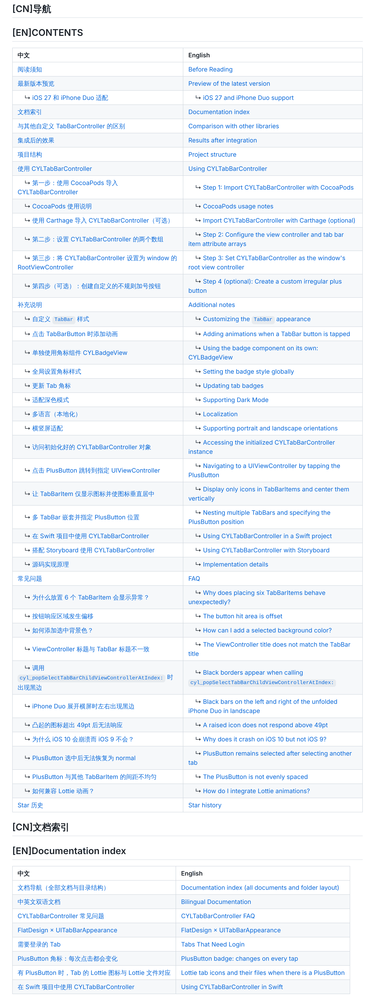

</details>

## [CN]最新版本预览
## [EN]Preview of the latest version

Preview of the latest version on iOS 27+


### [CN]iOS 27 和 iPhone Duo 适配
### [EN]iOS 27 and iPhone Duo support

CYLTabBarController 现已适配 iOS 27，新增如下功能：
CYLTabBarController now supports iOS 27 with the following improvements:


现在已适配 iPhone Duo 的横向布局与竖向布局，请更新至 CYLTabBarController 1.99.66 查看。
It also supports both landscape and portrait layouts on iPhone Duo. Update to CYLTabBarController 1.99.66 to try it.

CYLTabBarController 现已适配 iOS 27 和 iPhone Duo，更新内容如下：
CYLTabBarController now supports iOS 27 and iPhone Duo with the following features:

| 中文 | English |
|:---|:---|
| ✅ 支持横向布局与竖向布局 | ✅ Supports landscape and portrait layouts. |
| ✅ 支持扁平样式与液态玻璃样式 | ✅ Supports flat and Liquid Glass styles. |
| ✅ 所有样式均支持加号按钮居中显示。 | ✅ The plus button can be centered in every style. |
| ✅ 零代码适配：已经接入 CYLTabBar 液态玻璃样式或扁平样式的代码，无需修改代码，更新版本即可适配 iPhone Duo。 | ✅ Zero-code adaptation: apps already using the CYLTabBar Liquid Glass or flat style require no code changes to support iPhone Duo. |
| ✅ 审核友好，适配代码均为纯原生公开 API，无审核风险。 | ✅ Review-friendly: the adaptation uses only public native APIs. |

请更新 CYLTabBarController 1.99.66 查看演示：
Update to CYLTabBarController 1.99.66 to see the demo:


| 中文 | English |
|:---|:---|
| ✅ iOS 27 下无需新增代码即可启用扁平风格；保留 `UIDesignRequiresCompatibility` 时会自动切换到扁平样式。 | ✅ Enable the flat style on iOS 27 without adding code; `UIDesignRequiresCompatibility` automatically selects the flat style. |
| ✅ 扁平风格作为独立组件集成，降低耦合并减小包体积。 | ✅ The flat style is integrated as an independent component for lower coupling and a smaller package size. |
| ✅ 扁平风格与液态玻璃样式共享 API，只需修改样式属性即可切换。 | ✅ The flat and Liquid Glass styles share the same APIs; switch styles by changing the appearance property. |
| ✅ 一个 `UITabBarAppearance` 同时控制液态玻璃与扁平样式：设置 `tabBar.standardAppearance` 即可自定义扁平样式 TabBar 的背景、阴影、标题、图标与角标等，详见 [docs/FlatDesign-StandardAppearance.md](docs/FlatDesign-StandardAppearance.md)。 | ✅ One `UITabBarAppearance` styles both Liquid Glass and FlatDesign: set `tabBar.standardAppearance` to customize the flat design tab bar's background, shadow, titles, icons, badges and more, see [docs/FlatDesign-StandardAppearance.md](docs/FlatDesign-StandardAppearance.md). |
| ✅ 需要登录的 Tab：未登录时点击会先弹出登录页（不切换、无动画），登录后自动切换到该 Tab；登录状态缓存在本地，支持 block 与代理，详见 [docs/Login-Required-Tabs.md](docs/Login-Required-Tabs.md)（[#19](https://github.com/ChenYilong/CYLTabBarController/issues/19)）。 | ✅ Tabs that need login: while logged out, a tap shows the login screen first (no switch, no animation), then selects that tab after logging in; the login state is cached locally, with block and delegate APIs, see [docs/Login-Required-Tabs.md](docs/Login-Required-Tabs.md) ([#19](https://github.com/ChenYilong/CYLTabBarController/issues/19)). |
| ✅ 原地更新 Tab：不重建 TabBar 修改标题、图标、PlusButton；图标可来自网络（`CYLTabBarItemImageURL`，内存与沙盒缓存，`CYLImageCache` 可调整过期时间与容量）或本地（图片名、路径、UIImage、GIF）；`-performWhenTabBarItemsReady:` 在 `tabBar.items` 生成后执行（[#22](https://github.com/ChenYilong/CYLTabBarController/issues/22)）；`-replaceViewControllerAtIndex:withViewController:attributes:` 运行时替换 Tab 的页面（[#481](https://github.com/ChenYilong/CYLTabBarController/issues/481)），详见 [docs/Update-Tab-Bar-Items-In-Place.md](docs/Update-Tab-Bar-Items-In-Place.md)（[#601](https://github.com/ChenYilong/CYLTabBarController/issues/601)）。 | ✅ Update tabs in place: change titles, icons and the PlusButton without rebuilding the tab bar; icons from the network (`CYLTabBarItemImageURL`, cached in memory and in the sandbox, with expiration and size set on `CYLImageCache`) or local (a name, a path, a UIImage, a GIF); `-performWhenTabBarItemsReady:` runs once `tabBar.items` exist ([#22](https://github.com/ChenYilong/CYLTabBarController/issues/22)); `-replaceViewControllerAtIndex:withViewController:attributes:` replaces a tab's page at runtime ([#481](https://github.com/ChenYilong/CYLTabBarController/issues/481)). See [docs/Update-Tab-Bar-Items-In-Place.md](docs/Update-Tab-Bar-Items-In-Place.md) ([#601](https://github.com/ChenYilong/CYLTabBarController/issues/601)). |
| ✅ SwiftUI 集成：用 `UIViewControllerRepresentable` 在 SwiftUI App 中使用 CYLTabBarController，各 Tab 与 PlusButton 页面可以是 SwiftUI 视图，示例 `Example-SwiftUI`，详见 [docs/SwiftUI-Integration.md](docs/SwiftUI-Integration.md)。 | ✅ SwiftUI integration: use CYLTabBarController in a SwiftUI app with `UIViewControllerRepresentable`; tabs and the plus button's page can be SwiftUI views. Example: `Example-SwiftUI`; see [docs/SwiftUI-Integration.md](docs/SwiftUI-Integration.md). |
| ✅ PAG 动画 Tab 图标（腾讯 libpag）：与 Lottie 用法相同，`pod 'CYLTabBarController/PAG'`，使用 `CYLTabBarPAGURL` / `CYLTabBarPAGFilePath` 等 key 或 `CYLTabBarItemsAttributesAddingPAGFiles()`，示例 `Example-PAG`，详见 [docs/PAG-Animation.md](docs/PAG-Animation.md)（[#604](https://github.com/ChenYilong/CYLTabBarController/issues/604)）。 | ✅ PAG animated tab icons (Tencent libpag), used like Lottie: `pod 'CYLTabBarController/PAG'`, with the `CYLTabBarPAGURL` / `CYLTabBarPAGFilePath` keys or `CYLTabBarItemsAttributesAddingPAGFiles()`; example `Example-PAG`; see [docs/PAG-Animation.md](docs/PAG-Animation.md) ([#604](https://github.com/ChenYilong/CYLTabBarController/issues/604)). |
| ✅ Rive 动画 Tab 图标：与 Lottie、PAG 用法相同，`pod 'CYLTabBarController/Rive'`（RiveRuntime 6.29+，iOS 14+），使用 `CYLTabBarRiveURL` 等 key，通用的 `CYLTabBarAnimationURLWithOptions()` 可指定画板与状态机，一个 `.riv` 文件即可包含所有 Tab 的图标，也支持没有 view model 的旧版文件（状态机输入）；Rive 通过共用子库的「可播放视图」方式接入，Core 无需修改；示例 `Example-SwiftUI-Rive`（由 Design+Code「SwiftUI Animations」课程改造）与其 UIKit 版本 `Example-Rive`，详见 [docs/Rive-Animation.md](docs/Rive-Animation.md)。 | ✅ Rive animated tab icons, used like Lottie and PAG: `pod 'CYLTabBarController/Rive'` (RiveRuntime 6.29+, iOS 14+), with the `CYLTabBarRiveURL` keys; the generic `CYLTabBarAnimationURLWithOptions()` picks an artboard and a state machine, so one `.riv` file can hold every tab's icon; legacy files without a view model (state machine inputs) work too. Rive plugs in through the shared subspec's "playable view" way, with no change to Core; examples `Example-SwiftUI-Rive` (reworked from Design+Code's "SwiftUI Animations" course) and its UIKit version `Example-Rive`; see [docs/Rive-Animation.md](docs/Rive-Animation.md). |
| ✅ GIF Tab 图标（[#605](https://github.com/ChenYilong/CYLTabBarController/issues/605)）：作为图片传入时循环；`pod 'CYLTabBarController/GIF'` 并使用 `CYLTabBarGIFURL` / `CYLTabBarGIFFilePath` 时，与 Lottie、PAG、Rive 一样，选中时播放一次。配置文件与 Android 版同样支持这些 key。详见 [docs/GIF-Animation.md](docs/GIF-Animation.md)。 | ✅ GIF tab icons ([#605](https://github.com/ChenYilong/CYLTabBarController/issues/605)): given as an image, a GIF loops; with `pod 'CYLTabBarController/GIF'` and `CYLTabBarGIFURL` / `CYLTabBarGIFFilePath`, it plays once when selected, like Lottie, PAG and Rive. Configuration files and the Android version take the same keys. See [docs/GIF-Animation.md](docs/GIF-Animation.md). |
| ✅ Tab 图标动画共用子库 `CYLTabBarItemAnimation`：面向协议、依赖反转，只在引入动画库的子库时引入（Core 不依赖它）。Lottie 与 PAG 都是通过公开协议 `CYLTabBarItemAnimator` 自行注册的插件，以后新增动画库只需新增一个 animator 与子库，无需修改其他代码；新增通用 key `CYLTabBarAnimationURL` 等，以及通用通知名称 `CYLTabBarItemAnimationPlayingNotification`、`CYLTabBarItemAnimationViewDidAddNotification`（与 Lottie 名称取值相同）；原来只为 Lottie 设计的通用 API（`lottieAnimationSpeed`、`-cyl_lottieAnimationView` 等）已废弃，改用通用名称（`tabBarItemAnimationSpeed`、`-cyl_tabBarItemAnimationView` 等，旧名称仍可用）；引擎的依赖（注册表、工厂、风格来源、宿主）都通过协议注入，详见 [docs/Tab-Bar-Item-Animation.md](docs/Tab-Bar-Item-Animation.md)（[#604](https://github.com/ChenYilong/CYLTabBarController/issues/604)）。 PAG 与 Rive 的 key 只在引入对应动画库时存在（开关 `CYL_PAG_AVAILABLE`、`CYL_RIVE_AVAILABLE`），未引入时使用即编译失败。没有 Lottie 时使用 Lottie key 会给出编译警告并提示所需的 pod（key 已发布，保持可用）。 | ✅ The shared tab icon animation subspec `CYLTabBarItemAnimation`: protocol-oriented with dependency inversion, pulled in only by an animation library's subspec (Core does not depend on it). Lottie and PAG are plugins that register themselves through the public `CYLTabBarItemAnimator` protocol, so a library added later is one more animator and subspec with no change elsewhere; new generic keys such as `CYLTabBarAnimationURL`, and library-neutral notification names `CYLTabBarItemAnimationPlayingNotification` and `CYLTabBarItemAnimationViewDidAddNotification` (same values as the Lottie names); the generic API that was named for Lottie only (`lottieAnimationSpeed`, `-cyl_lottieAnimationView`…) is deprecated in favour of neutral names (`tabBarItemAnimationSpeed`, `-cyl_tabBarItemAnimationView`…; the old names keep working); the engine gets its dependencies (registry, factory, style source, host) injected through protocols; see [docs/Tab-Bar-Item-Animation.md](docs/Tab-Bar-Item-Animation.md) ([#604](https://github.com/ChenYilong/CYLTabBarController/issues/604)). The PAG and Rive keys exist only when their library does (switches `CYL_PAG_AVAILABLE`, `CYL_RIVE_AVAILABLE`); without it, using one fails to build. Using a Lottie key in a build without Lottie gives a compile warning naming the pod to add (the keys are released, so they stay usable). |
| ✅ 只有部分 Tab 有动画：同一个 TabBar 中可以混用有动画与无动画的 Tab，以及 Lottie 与 PAG 的 Tab（三种样式均支持）；新增 `CYLTabBarItemAttributesAddingAnimationFile()` 为单个 Tab 添加动画，详见 [docs/Per-Tab-Animation.md](docs/Per-Tab-Animation.md)（[#477](https://github.com/ChenYilong/CYLTabBarController/issues/477)）。 | ✅ Only some tabs animated: one tab bar can mix animated and static tabs, and Lottie and PAG tabs (all three styles); the new `CYLTabBarItemAttributesAddingAnimationFile()` adds an animation to one tab; see [docs/Per-Tab-Animation.md](docs/Per-Tab-Animation.md) ([#477](https://github.com/ChenYilong/CYLTabBarController/issues/477)). |
| ✅ PlusButton 子控件响应各自的点击：在加号按钮上添加的按钮或带手势的视图（如直播间封面与关闭按钮）不再被加号按钮拦截；Demo 中“消息”页第 2 行可体验带 X 子按钮的 PlusButton，详见 [docs/PlusButton-Subview-Touches.md](docs/PlusButton-Subview-Touches.md)。 | ✅ Subviews of the PlusButton get their own touches: buttons and views with gesture recognizers added to the plus button (e.g. a live room's cover and close button) are no longer swallowed by it; try the PlusButton with an X subview from row 2 of the demo's Message tab. See [docs/PlusButton-Subview-Touches.md](docs/PlusButton-Subview-Touches.md). |
| ✅ TabBarItem 手势：再次点击、双击（如双击刷新）与长按 Tab 按钮或 PlusButton，支持 block 与代理方法，适用于所有样式，详见 [docs/TabBarItem-Gestures.md](docs/TabBarItem-Gestures.md)（[#152](https://github.com/ChenYilong/CYLTabBarController/issues/152)）。 | ✅ Tab bar item gestures: reselect, double tap (e.g. double tap to refresh) and long press on a tab button or the plus button, as a block and a delegate method, in every style; see [docs/TabBarItem-Gestures.md](docs/TabBarItem-Gestures.md) ([#152](https://github.com/ChenYilong/CYLTabBarController/issues/152)). |
| ✅ 选中标题：`CYLTabBarItemSelectedTitle` 让选中的 Tab 显示不同文字（如京东「首页」选中后显示「刷新」），搭配选中图标、再次点击重播的 Lottie 动画与再次点击手势，实现再次点击刷新，适用于所有样式，详见 [docs/TabBarItem-Selected-Title.md](docs/TabBarItem-Selected-Title.md)（[#433](https://github.com/ChenYilong/CYLTabBarController/issues/433)）。 | ✅ Selected title: `CYLTabBarItemSelectedTitle` gives the selected tab a different title (like JD's "Home" tab that reads "Refresh" when selected); with the selected icon, the Lottie animation that replays on a re-tap and the reselect gesture, a re-tap refreshes, in every style; see [docs/TabBarItem-Selected-Title.md](docs/TabBarItem-Selected-Title.md) ([#433](https://github.com/ChenYilong/CYLTabBarController/issues/433)). |
| ✅ 纯图标 Tab 的自动居中不再覆盖自定义值：App 设置的 `imageInsets` / `titlePositionAdjustment` 与有标题的 Tab 保持不变，布局时不再反复写入导致图标跳动；新增 `automaticallyAdjustsImageOnlyTabs` 可完全关闭；新增 `updateImageInsets:`，与 `titlePositionAdjustment` 一样可在控制器创建后设置，详见 [docs/Image-Only-Tabs.md](docs/Image-Only-Tabs.md)（[#257](https://github.com/ChenYilong/CYLTabBarController/issues/257)、[#522](https://github.com/ChenYilong/CYLTabBarController/issues/522)、[#95](https://github.com/ChenYilong/CYLTabBarController/issues/95)）。 | ✅ The automatic centering of image-only tabs no longer overrides custom values: the app's `imageInsets` / `titlePositionAdjustment` and tabs with a title are left alone, and layout passes no longer write the items again and make the icons jump; the new `automaticallyAdjustsImageOnlyTabs` turns it off completely; the new `updateImageInsets:` can, like `titlePositionAdjustment`, be set after the controller is created. See [docs/Image-Only-Tabs.md](docs/Image-Only-Tabs.md) ([#257](https://github.com/ChenYilong/CYLTabBarController/issues/257), [#522](https://github.com/ChenYilong/CYLTabBarController/issues/522), [#95](https://github.com/ChenYilong/CYLTabBarController/issues/95)). |
| ✅ TabBar 的 `-hitTest:withEvent:` 不再返回 nil，没有命中时交给 `[super hitTest:withEvent:]`，同样拦截 `hitTest` 的第三方库与 TabBar 上的自定义视图可以正常收到触摸，详见 [docs/TabBar-HitTest-Super-Fallback.md](docs/TabBar-HitTest-Super-Fallback.md)（[#474](https://github.com/ChenYilong/CYLTabBarController/issues/474)）。 | ✅ The tab bar's `-hitTest:withEvent:` never returns nil: when nothing matches it falls back to `[super hitTest:withEvent:]`, so third-party libraries that also intercept `hitTest`, and custom views on the tab bar, get their touches. See [docs/TabBar-HitTest-Super-Fallback.md](docs/TabBar-HitTest-Super-Fallback.md) ([#474](https://github.com/ChenYilong/CYLTabBarController/issues/474)). |
| ✅ 在任意位置 push：`[UIViewController cyl_currentNavigationController]` 返回当前可见页面所在的导航控制器（屏幕上有弹窗时也能拿到），配合 `cyl_pushViewController:animated:` 防重复 push，详见 [docs/Push-From-Anywhere.md](docs/Push-From-Anywhere.md)；点击某个 Tab 时 push 页面而不切换（[#283](https://github.com/ChenYilong/CYLTabBarController/issues/283)、[#232](https://github.com/ChenYilong/CYLTabBarController/issues/232)）。 | ✅ Push from anywhere: `[UIViewController cyl_currentNavigationController]` returns the navigation controller of the visible page (also while an alert is on screen); combine it with `cyl_pushViewController:animated:` to avoid double pushes. See [docs/Push-From-Anywhere.md](docs/Push-From-Anywhere.md). Also: push a page on a tab tap instead of switching ([#283](https://github.com/ChenYilong/CYLTabBarController/issues/283), [#232](https://github.com/ChenYilong/CYLTabBarController/issues/232)). |
| ✅ 自定义 PlusButton 位置时 `setSelectedIndex:` 选中的文字与图片一致（#515），并新增 `cyl_selectedIndexIgnoringPlusButton`，按不含 PlusButton 的下标在所有样式下选中同一个 Tab，详见 [docs/SelectedIndex-PlusButton.md](docs/SelectedIndex-PlusButton.md)。 | ✅ With a custom PlusButton position, `setSelectedIndex:` selects the matching title and image (#515), and the new `cyl_selectedIndexIgnoringPlusButton` selects the same tab in every style by its index without the PlusButton. See [docs/SelectedIndex-PlusButton.md](docs/SelectedIndex-PlusButton.md). |
| ✅ PlusButton 的 slot（占位控制器或 PlusButton 子控制器）只在一处按一条规则插入：重新赋值 `viewControllers` 不再丢失或重复 slot，扁平样式 PlusButton 在末尾或 Tab 数为奇数时不再数组越界，所有样式读取同一个 PlusButton 下标，详见 [docs/PlusButton-Slot.md](docs/PlusButton-Slot.md)。 | ✅ The PlusButton's slot (its placeholder or plus child view controller) is inserted in one place by one rule: re-assigning `viewControllers` no longer loses or duplicates it, FlatDesign no longer goes out of range with the PlusButton at the end or an odd tab count, and every style reads the same PlusButton index. See [docs/PlusButton-Slot.md](docs/PlusButton-Slot.md). |
| ✅ Tab 交互（#535）：Tab 与 PlusButton 的点击动画（放大再缩小、弹性、旋转、翻转等，或自定义）、长按回调、点击声音与触感反馈、左右滑动切换 Tab，以及超出父视图响应点击、从任意位置加载图片、无需继承基类的导航栏设置；全部默认关闭，适用于所有样式，详见 [docs/Tab-Interactions.md](docs/Tab-Interactions.md) 与 [docs/CYLUtils-Helpers.md](docs/CYLUtils-Helpers.md)。 | ✅ Tab interactions (#535): tap animations for the tabs and the PlusButton (scale, bounce, rotation, flip and more, or your own), a long press callback, a tap sound and haptics, swiping to switch tabs, plus subviews that respond outside their superview, images from anywhere, and navigation bar settings without base classes; all off by default, in every style. See [docs/Tab-Interactions.md](docs/Tab-Interactions.md) and [docs/CYLUtils-Helpers.md](docs/CYLUtils-Helpers.md). |
| ✅ 液态玻璃：标题画在背景图上的 PlusButton（只用 `setBackgroundImage`）现在居中于它的 Tab，按 `+multiplierOfTabBarHeight:` 定位，选中时放大镜中的副本与按钮对齐；加载给 PlusButton 的所有图片在所有样式下都自动按原图绘制，不会被 tint 染色；图片之后才加载时与启动时就设置的图片位置、尺寸与角标完全一致；扁平样式与经典 TabBar 下图片位于标题上方，不再与标题重叠（各种重叠情况的说明见文档），详见 [docs/PlusButton-Background-Image-Liquid-Glass.md](docs/PlusButton-Background-Image-Liquid-Glass.md)。 | ✅ Liquid Glass: a PlusButton with its title on a background image (`setBackgroundImage` only) is now centered on its tab and placed by `+multiplierOfTabBarHeight:`, and the copy in the lens lines up with it when selected; every image given to a PlusButton is drawn as is, in every style, never tinted; an image set later lands exactly where the same image set at launch does (position, size, badge); in FlatDesign and the classic tab bar the image sits above the title instead of covering it (when overlap can still happen is explained in the doc). See [docs/PlusButton-Background-Image-Liquid-Glass.md](docs/PlusButton-Background-Image-Liquid-Glass.md). |
| ✅ Demo 测试列表分组：库提供 `CYLSettingsGroup` 与 `-cyl_settingsRowsInGroup:` 等分组 API，ObjC Demo 与新增的纯 Swift 测试列表（`Example-Shared/CYLSettingsDemoTableViewController.swift`，用于 Example-Rive、Example-SwiftUI-Rive、Example-PAG）使用同一套分组，详见 [docs/Demo-Test-List.md](docs/Demo-Test-List.md)。 | ✅ Grouped demo test list: the library provides group APIs such as `CYLSettingsGroup` and `-cyl_settingsRowsInGroup:`, and the ObjC demo and the new pure Swift test list (`Example-Shared/CYLSettingsDemoTableViewController.swift`, used by Example-Rive, Example-SwiftUI-Rive and Example-PAG) share the groups; see [docs/Demo-Test-List.md](docs/Demo-Test-List.md). |
| ✅ 滚动时缩小或隐藏 TabBar（[#13](https://github.com/ChenYilong/CYLTabBarController/issues/13)）：一行 `tabBarController.cyl_hidesTabBarOnScroll = YES;` 用于所有样式与系统（需要全部取值时用 `cyl_tabBarMinimizeBehavior`；iOS 26+ 也可以直接使用 Apple 的 `tabBarMinimizeBehavior`，效果相同），液态玻璃（iOS 26+）使用系统原生的 `tabBarMinimizeBehavior` 缩小 TabBar，扁平样式在页面滚动时隐藏、显示 TabBar，经典样式（iOS 25 及以前、iOS 26 UI 兼容模式）隐藏、显示 TabBar（连同 PlusButton）；扁平样式与经典样式都通过同一个公开接口 `-setTabBarHidden:animated:` 隐藏；想知道 TabBar 为何恢复或没有隐藏时，把环境变量 `CYL_TAB_BAR_MINIMIZE_LOG` 设为 `1` 打开[诊断日志](docs/TabBar-Minimize-On-Scroll.md#cn诊断日志cyl_tab_bar_minimize_log)；Demo 中「滚动隐藏：模拟意外情况」的近 40 个模拟默认收起，可用操作表选择，或点击「展开全部 N 个模拟」逐行查看。详见 [docs/TabBar-Minimize-On-Scroll.md](docs/TabBar-Minimize-On-Scroll.md)。 | ✅ Minimize or hide the TabBar on scroll ([#13](https://github.com/ChenYilong/CYLTabBarController/issues/13)): one line, `tabBarController.cyl_hidesTabBarOnScroll = YES;`, for every style and system (`cyl_tabBarMinimizeBehavior` for every value; on iOS 26+ Apple's `tabBarMinimizeBehavior` does the same). Liquid Glass (iOS 26+) minimizes the tab bar with the native `tabBarMinimizeBehavior`; FlatDesign hides and shows it while the page scrolls; the classic style (iOS 25 and earlier, iOS 26 UI compatibility mode) hides and shows it with its PlusButton; FlatDesign and classic both hide through the same public `-setTabBarHidden:animated:`. To find out why the bar came back or did not hide, set the environment variable `CYL_TAB_BAR_MINIMIZE_LOG` to `1` for the [diagnostic log](docs/TabBar-Minimize-On-Scroll.md#endiagnostic-log-cyl_tab_bar_minimize_log). In the demo, the almost 40 "Scroll hiding: simulate interruptions" rows are collapsed by default: pick one from the action sheet, or tap "Show all N simulations" to see them row by row. See [docs/TabBar-Minimize-On-Scroll.md](docs/TabBar-Minimize-On-Scroll.md). |
| ✅ 一个配置文件生成 TabBarController：新增 `-initWithConfiguration:`，一个字典包含所有初始化参数（现有初始化方法都调用它）；同样的键可写在 JSON、JSON5 / JSONC、plist（XML / 二进制 / OpenStep / .strings）、YAML、TOML、INI、.properties、.env、XML、Protocol Buffers（文本与二进制）文件中，`+tabBarControllerWithConfigurationFile:error:` 读取本地文件，`+loadTabBarControllerWithConfigurationURL:completion:` 从网络加载；页面按跨端页面 ID 获得（见下一条），图标可用 SF Symbol（`system:house`），Demo 中“跳转与对比”第一行可体验 17 个示例文件；`scripts/export-tabbar-configurations.py` 把代码中的配置导出为文件（已对所有 Example 运行）；68 种边界情况（空文件、嵌套过深、超大文件、HTML 页面、NaN、错误类型、超时等）经 11 轮修复全部处理，“模拟意外情况”分组可逐一演示，详见 [docs/Configuration-File.md](docs/Configuration-File.md)；导出、评分与测试脚本的用法见 [docs/Configuration-Scripts.md](docs/Configuration-Scripts.md)。；合并 #752 后支持动效键：通用动画键、`CYLTabBarAnimationOptions`（写入动画 URL 的选项）、PAG / Rive 键与顶层 `CYLTabBarControllerTabBarItemAnimationSpeed` | ✅ One configuration file, one TabBarController: the new `-initWithConfiguration:` takes every initializer parameter in one dictionary (every existing initializer calls it); the same keys work in JSON, JSON5 / JSONC, plist (XML / binary / OpenStep / .strings), YAML, TOML, INI, .properties, .env, XML and Protocol Buffers (text and binary) files; `+tabBarControllerWithConfigurationFile:error:` reads a local file and `+loadTabBarControllerWithConfigurationURL:completion:` downloads one; pages come from cross-platform page IDs (see the next entry), icons can be SF Symbols (`system:house`); try the 17 sample files from the first row of the demo's "Navigation and comparisons" section; `scripts/export-tabbar-configurations.py` exports the configuration written in code to files (run on every Example); 68 edge cases (empty files, deep nesting, huge files, HTML pages, NaN, wrong types, timeouts...) are all handled after 11 rounds of fixes, each one shown in the "simulated failures" section. See [docs/Configuration-File.md](docs/Configuration-File.md); how to use the export, scoring and test scripts: [docs/Configuration-Scripts.md](docs/Configuration-Scripts.md).; after #752 the animation keys are supported: the generic animation keys, `CYLTabBarAnimationOptions` (options written into the animation URL), the PAG / Rive keys and the top-level `CYLTabBarControllerTabBarItemAnimationSpeed` |
| ✅ 配置文件中的皮肤（[配置文件：皮肤](docs/Configuration-File.md#cn皮肤)），参照 QMUI 的换肤：`CYLTabBarControllerThemes` 带多套皮肤，Tab 的值写成 `"@name"` 引用当前皮肤中的值，保留名称（`CYLTabBarBackgroundColor`、`CYLTabBarItemSelectedTitleColor` 等）决定整个 TabBar；`CYLTabBarControllerDarkThemeIdentifier` 跟随深色模式。每个皮肤是 `CYLTabBarConfigurationTheme`（`CYLTabBarTheme`），切换沿用原地更新与恢复；App 的视图用 `colorNamed:`（Android 还可用 `cyl_themeValue`）跟随同样的皮肤。iOS 与 Android 读取同一个文件。 | ✅ Skins in a configuration file ([configuration file: skins](docs/Configuration-File.md#enskins)), after QMUI's skins: `CYLTabBarControllerThemes` carries several skins, a tab value written `"@name"` refers to a value of the current skin, and reserved names (`CYLTabBarBackgroundColor`, `CYLTabBarItemSelectedTitleColor`...) style the whole bar; `CYLTabBarControllerDarkThemeIdentifier` follows Dark Mode. Each skin is a `CYLTabBarConfigurationTheme` (a `CYLTabBarTheme`), so switching reuses the in-place update and restore; the app's views follow the same skins with `colorNamed:` (and `cyl_themeValue` on Android). iOS and Android read the same file. |
| ✅ 按页面 ID 获得 Tab 页面（跨端）：配置文件中每个 Tab 只写一个页面 ID（`CYLTabBarItemPageIdentifier`，默认取 `CYLTabBarItemIdentifier`），iOS 用 `CYLTabBarPageRegistry` 注册该 ID 创建什么页面（全局注册表与每个 TabBar 自己的注册表、`CYLTabBarControllerPageResolver` 解析回调、遵守 `CYLTabBarPage` 的类自动注册），Android 演示用同一份配置文件与同样的 ID；Tab 顺序只由配置决定，找不到页面的 Tab 被跳过；新增远程配置字段 `CYLTabBarItemPlatforms`、`CYLTabBarItemMinimumAppVersion`、`CYLTabBarItemPageParameters`。详见 [按页面 ID 获得 Tab 页面](docs/Tab-Page-Registry.md)。；控制器保留页面来源，`-reloadTabBarItemsWithAttributes:` 按 ID 解析新 Tab 并复用已有页面，`cyl_skippedTabs` 列出没有页面的 Tab 及原因（[评审与改造](docs/Tab-Page-Registry-Review.md)） | ✅ Tab pages from page IDs (cross-platform): each tab in a configuration names one page ID (`CYLTabBarItemPageIdentifier`, by default `CYLTabBarItemIdentifier`); iOS registers what the ID creates with `CYLTabBarPageRegistry` (a shared registry and one per tab bar, a `CYLTabBarControllerPageResolver` block, automatic registration of `CYLTabBarPage` classes), and the Android demo uses the same file and the same IDs; the order comes only from the configuration, and a tab without a page is skipped; new remote keys `CYLTabBarItemPlatforms`, `CYLTabBarItemMinimumAppVersion`, `CYLTabBarItemPageParameters`. See [Tab pages from page IDs](docs/Tab-Page-Registry.md).; the controller keeps its page sources, `-reloadTabBarItemsWithAttributes:` resolves new tabs by ID and reuses existing pages, and `cyl_skippedTabs` lists the tabs without a page and why ([review and refactoring](docs/Tab-Page-Registry-Review.md)) |
| ✅ Android 版 CYLTabBarController（[Android 库](docs/Android-Library.md)）：`Example-Android/cyltabbar`，Kotlin 与 Java，按 iOS 公开 API 一比一翻译（`CYLTabBarController`、`CYLTabBar`、`CYLPlusButton`、角标、主题、登录拦截、手势、点击动画对象与转场、Lottie / PAG / Rive 动画图标、页面注册表、全部配置文件格式）；每个 iOS 符号的对应项与迁移完成率（100 / 100）见 [Android API 对照表](docs/Android-API-Map.md)，由脚本生成。 | ✅ CYLTabBarController for Android ([Android library](docs/Android-Library.md)): `Example-Android/cyltabbar`, Kotlin and Java, the iOS public API translated one to one (`CYLTabBarController`, `CYLTabBar`, `CYLPlusButton`, badges, themes, login interception, gestures, tap animation objects and transitions, Lottie / PAG / Rive icons, the page registry, every configuration format); the twin of every iOS symbol and the migration score (100 / 100) are in the generated [Android API map](docs/Android-API-Map.md). |
| ✅ Android 演示迁移（[Android 演示迁移](docs/Android-Demo-Migration.md)）：iOS `Example` 中演示用的每个列表行都移植到 `Example-Android/app`（设置分组、扁平样式行、39 个滚动隐藏模拟、17 个皮肤、46 个配置意外情况、角标行、44 个 TabBar 场景），文档先列出 iOS 演示了什么，再列出 Android 的实现、状态与完成率（100 / 100）；Android 库新增滚动隐藏在意外情况后的恢复，并修复 Lottie 无法加载文件时的崩溃。 | ✅ Android demo migration ([Android demo migration](docs/Android-Demo-Migration.md)): every demo table row of the iOS `Example` is ported to `Example-Android/app` (the settings groups, the FlatDesign rows, 39 scroll hiding simulations, 17 skins, 46 configuration failures, the badge rows, 44 gallery scenes); the document lists what iOS shows, then the Android implementation, status and score (100 / 100); the Android library now restores a bar hidden by scrolling after interruptions and no longer crashes when Lottie cannot load a file. |
| ✅ Android 版 PAG、GIF、Rive 示例（[Android 示例](docs/Android-Examples.md)）：`Example-PAG`、`Example-GIF`、`Example-Rive` 在 `Example-Android` 中各有 Android 版本（`example-pag`、`example-gif`、`example-rive`），Tab、PlusButton、页面与 iOS 相同，直接读取 iOS 示例的动画文件；共用 `demokit` 中的设置列表与 PlusButton 角标演示。Android 库新增 `CYLGIFDrawable`：作为图片传入的 GIF 循环播放。 | ✅ The Android PAG, GIF and Rive examples ([Android examples](docs/Android-Examples.md)): `Example-PAG`, `Example-GIF` and `Example-Rive` each have an Android version in `Example-Android` (`example-pag`, `example-gif`, `example-rive`) with the same tabs, plus buttons and pages, reading the iOS examples' own animation files; they share the settings list and the plus button badge demo of `demokit`. New in the Android library: `CYLGIFDrawable`, a GIF given as an image loops. |
| ✅ Android 独有的扩展，改编自 QMUI_Android（[Android 库](docs/Android-Library.md#cn仅-android-的扩展)，[对比与评分](docs/Android-QMUI-Comparison.md)）：选中指示条（`CYLTabBarIndicator`）、可滚动模式（`cyl_scrollMode`）、滑动翻页（`cyl_swipesBetweenPages`），以及主题值：`View.cyl_themeValue` 规则、`app:cyl_theme…` 布局属性、style / Map 主题、Span 与列表分割线、拦截与 `register`。全部默认关闭，iOS 一致的 API 不变；Tab 评分 79 → 86，换肤 77 → 83（QMUI 60 / 61）。 | ✅ Android-only extensions adapted from QMUI_Android ([Android library](docs/Android-Library.md#enandroid-only-extensions), [comparison and scores](docs/Android-QMUI-Comparison.md)): a selection indicator (`CYLTabBarIndicator`), the scrollable mode (`cyl_scrollMode`), swiping between pages (`cyl_swipesBetweenPages`), and theme values: `View.cyl_themeValue` rules, `app:cyl_theme…` layout attributes, style / Map themes, spans and list decorations, interception and `register`. All off by default, with the iOS-matching API unchanged; tab score 79 → 86, skins 77 → 83 (QMUI 60 / 61). |
| ✅ Android 库一键发布到 Maven（[Android 库：发布到 Maven](docs/Android-Library.md#cn发布到-maven)）：`scripts/publish-android.sh` 用 Gradle 发布 `io.github.chenyilong:cyltabbarcontroller` 与 `cyltabbarcontroller-pages`（源码、javadoc、POM、签名），目标为 Maven Local、Maven Central（Central Portal，上传前检查）或 GitHub Packages；版本与 podspec 一致。 | ✅ One script publishes the Android library to Maven ([Android library: publishing to Maven](docs/Android-Library.md#enpublishing-to-maven)): `scripts/publish-android.sh` publishes `io.github.chenyilong:cyltabbarcontroller` and `cyltabbarcontroller-pages` with Gradle (sources, javadoc, POM, signatures) to Maven Local, Maven Central (the Central Portal, checked before uploading) or GitHub Packages; the version follows the podspec. |
| ✅ React Native 与 Flutter 组件（[总览](docs/Cross-Platform-Components.md)、[React Native 接入](docs/React-Native-Component.md)、[Flutter 接入](docs/Flutter-Component.md)）：`CrossPlatform/react-native-cyltabbar`（Fabric 原生组件）与 `CrossPlatform/flutter_cyltabbar`（平台视图，iOS 使用 Swift Package Manager），iOS 与 Android 共用一份配置，组件只绘制原生 TabBar，页面由 JS / Dart 绘制；示例直接引用本仓库的 iOS 与 Android 库源码，方便调试。两者都基于新增的 `CYLTabBarHostView`（iOS 与 Android），原生 App 也可以直接使用它。配置文件新增 `CYLTabBarControllerPlusButton` 与 `CYLTabBarControllerPlusButtonAction`（Protobuf 字段 12），只用配置也能显示 PlusButton，每个 context 一个；PlusButton 的背景图、位置、标题样式与自己的页面，以及顶层键 `CYLTabBarControllerUserInterfaceStyle`、`CYLTabBarControllerTabButtonTapAnimation`、`CYLTabBarControllerSwipeToSwitchTab`。`Example-PAG` 与 `Example-Rive` 各有 React Native 与 Flutter 版本，页面动画用 `CYLAnimationView`。 | ✅ React Native and Flutter components ([overview](docs/Cross-Platform-Components.md), [React Native integration](docs/React-Native-Component.md), [Flutter integration](docs/Flutter-Component.md)): `CrossPlatform/react-native-cyltabbar` (a Fabric native component) and `CrossPlatform/flutter_cyltabbar` (a platform view, Swift Package Manager on iOS) share one configuration on iOS and Android; the component draws only the native tab bar and JS / Dart draws the pages. The examples use this repository's iOS and Android library sources, for debugging. Both are built on the new `CYLTabBarHostView` (iOS and Android), which native apps can use directly. New configuration keys `CYLTabBarControllerPlusButton` and `CYLTabBarControllerPlusButtonAction` (Protobuf field 12) show a plus button from a configuration alone, one per context; the plus button's background image, position, title style and own page, and the top-level keys `CYLTabBarControllerUserInterfaceStyle`, `CYLTabBarControllerTabButtonTapAnimation`, `CYLTabBarControllerSwipeToSwitchTab`. `Example-PAG` and `Example-Rive` each have a React Native and a Flutter version, with `CYLAnimationView` for animations in a page. |
| ✅ 换肤（主题切换，[#216](https://github.com/ChenYilong/CYLTabBarController/issues/216)、[#136](https://github.com/ChenYilong/CYLTabBarController/issues/136)）：`CYLUtils` 新增换肤组件 `CYLThemeManager`（位于 `CYLUtils/CYLComponents/CYLTheme/`），一行 `CYLThemeManagerCenter.defaultThemeManager.currentThemeIdentifier = @"Spring Festival";` 即可切换皮肤；主题对象遵守 `CYLTabBarTheme` 后，TabBar 的背景、item 颜色、标题与图标（例如节日图标）在液态玻璃、系统 TabBar、扁平样式中原地更新，无需重建 TabBar；支持跟随系统深色模式、跟随主题的颜色 `+[UIColor cyl_colorWithThemeProvider:]`，示例新增“换肤”按钮，并单独列出十六套主题（五个配色主题与圣诞节、万圣节、春节等十一个节日皮肤，图标为 MIT 许可的 Fluent Emoji），详见 [docs/Theme-Switching.md](docs/Theme-Switching.md)。 | ✅ Skins (theme switching, [#216](https://github.com/ChenYilong/CYLTabBarController/issues/216), [#136](https://github.com/ChenYilong/CYLTabBarController/issues/136)): `CYLUtils` gets a theme component, `CYLThemeManager` (in `CYLUtils/CYLComponents/CYLTheme/`); one line, `CYLThemeManagerCenter.defaultThemeManager.currentThemeIdentifier = @"Spring Festival";`, switches the skin. With theme objects that adopt `CYLTabBarTheme`, the tab bar's background, item colors, titles and icons (e.g. holiday icons) change in place in Liquid Glass, the system tab bar and FlatDesign, without rebuilding the tab bar; themes can follow the system Dark Mode, colors can follow the theme (`+[UIColor cyl_colorWithThemeProvider:]`), and the examples get a "Skin" button and a section that lists sixteen themes (five color themes and eleven holiday skins such as Christmas, Halloween and Spring Festival, with MIT-licensed Fluent Emoji icons). See [docs/Theme-Switching.md](docs/Theme-Switching.md). |
| ✅ Tab 动画接入指南：Lottie、PAG、Rive 三种动画的接入步骤、注意事项与 Demo 地址，先运行 Demo 体验再接入，见 [docs/Tab-Icon-Animation-Quick-Start.md](docs/Tab-Icon-Animation-Quick-Start.md)。 | ✅ Tab icon animation quick start: steps, things to watch for and demo links for Lottie, PAG and Rive; try a demo first, then integrate. See [docs/Tab-Icon-Animation-Quick-Start.md](docs/Tab-Icon-Animation-Quick-Start.md). |
| ✅ AI 工具的 skill：`cyl-new-project`、`cyl-plus-button` 等项目专属 skill，以及精选的第三方 iOS skill，帮助快速基于本库创建项目，见 [docs/Agent-Skills.md](docs/Agent-Skills.md)。 | ✅ Skills for AI tools: project skills such as `cyl-new-project` and `cyl-plus-button`, and selected third-party iOS skills, to start a project on this library quickly. See [docs/Agent-Skills.md](docs/Agent-Skills.md). |
| ✅ 换肤（主题切换，[#216](https://github.com/ChenYilong/CYLTabBarController/issues/216)、[#136](https://github.com/ChenYilong/CYLTabBarController/issues/136)）：`CYLUtils` 新增换肤组件 `CYLThemeManager`（位于 `CYLUtils/CYLComponents/CYLTheme/`），一行 `CYLThemeManagerCenter.defaultThemeManager.currentThemeIdentifier = @"Spring Festival";` 即可切换皮肤；主题对象遵守 `CYLTabBarTheme` 后，TabBar 的背景、item 颜色、标题与图标（例如节日图标）在液态玻璃、系统 TabBar、扁平样式中原地更新，无需重建 TabBar；支持跟随系统深色模式、跟随主题的颜色 `+[UIColor cyl_colorWithThemeProvider:]`，示例新增“换肤”按钮，并单独列出十六套主题（五个配色主题与圣诞节、万圣节、春节等十一个节日皮肤，图标为 MIT 许可的 Fluent Emoji）；图片（`+[UIImage cyl_imageWithThemeProvider:]`）、模糊效果与 layer 的 `CGColor` 同样跟随主题，不在 window 中的视图也会更新，全程不 hook UIKit，详见 [docs/Theme-Switching.md](docs/Theme-Switching.md)；换肤与 Lottie / PAG / Rive 动画组件集成方式的评分、差距与改进见 [docs/Theme-Switching-Evaluation.md](docs/Theme-Switching-Evaluation.md)。 | ✅ Skins (theme switching, [#216](https://github.com/ChenYilong/CYLTabBarController/issues/216), [#136](https://github.com/ChenYilong/CYLTabBarController/issues/136)): `CYLUtils` gets a theme component, `CYLThemeManager` (in `CYLUtils/CYLComponents/CYLTheme/`); one line, `CYLThemeManagerCenter.defaultThemeManager.currentThemeIdentifier = @"Spring Festival";`, switches the skin. With theme objects that adopt `CYLTabBarTheme`, the tab bar's background, item colors, titles and icons (e.g. holiday icons) change in place in Liquid Glass, the system tab bar and FlatDesign, without rebuilding the tab bar; themes can follow the system Dark Mode, colors can follow the theme (`+[UIColor cyl_colorWithThemeProvider:]`), and the examples get a "Skin" button and a section that lists sixteen themes (five color themes and eleven holiday skins such as Christmas, Halloween and Spring Festival, with MIT-licensed Fluent Emoji icons); images (`+[UIImage cyl_imageWithThemeProvider:]`), blur effects and a layer's `CGColor` follow the theme too, views out of every window update as well, and nothing hooks UIKit. See [docs/Theme-Switching.md](docs/Theme-Switching.md); the scores, gaps and improvements of theming and its integration with the Lottie / PAG / Rive animation components are in [docs/Theme-Switching-Evaluation.md](docs/Theme-Switching-Evaluation.md). |
| ✅ 换肤（主题切换，[#216](https://github.com/ChenYilong/CYLTabBarController/issues/216)、[#136](https://github.com/ChenYilong/CYLTabBarController/issues/136)）：`CYLUtils` 新增换肤组件 `CYLThemeManager`（位于 `CYLUtils/CYLComponents/CYLTheme/`），一行 `CYLThemeManagerCenter.defaultThemeManager.currentThemeIdentifier = @"Spring Festival";` 即可切换皮肤；主题对象遵守 `CYLTabBarTheme` 后，TabBar 的背景、item 颜色、标题与图标（例如节日图标）在液态玻璃、系统 TabBar、扁平样式中原地更新，无需重建 TabBar；支持跟随系统深色模式、跟随主题的颜色 `+[UIColor cyl_colorWithThemeProvider:]`、图片 `+[UIImage cyl_imageWithThemeProvider:]`、模糊效果 `+[UIVisualEffect cyl_effectWithThemeProvider:]` 与 layer 颜色 `-[CALayer cyl_setThemeColor:forKeyPath:]`（`UIImageView`、`UIButton`、`UIVisualEffectView` 无需注册，不在 window 上的页面也会更新，不 hook UIKit），主题图标与“修改所有本地图标”使用同一个底层实现（`-setTabBarItemIcon:selectedIcon:size:atIndex:`），在液态玻璃上也能替换 Lottie 图标；液态玻璃首页与扁平样式页面都有“换肤”按钮，并单独列出十七套主题（五个配色主题、圣诞节、万圣节、春节等十一个节日皮肤，以及 Tab 标题、Tab 图标与 PlusButton 图片都来自主题、图标从网络下载的网络皮肤，图标为 MIT 许可的 Fluent Emoji），详见 [docs/Theme-Switching.md](docs/Theme-Switching.md)，与 QMUI 的评分对比、架构评估与改进建议见 [docs/Theme-Switching-Evaluation.md](docs/Theme-Switching-Evaluation.md)。选中 PlusButton 子控制器后换肤、PlusButton 图标不模糊的自动化测试（CI workflow “Plus child theme test”）见 [docs/Plus-Child-Theme-Switching-Test.md](docs/Plus-Child-Theme-Switching-Test.md)。 | ✅ Skins (theme switching, [#216](https://github.com/ChenYilong/CYLTabBarController/issues/216), [#136](https://github.com/ChenYilong/CYLTabBarController/issues/136)): `CYLUtils` gets a theme component, `CYLThemeManager` (in `CYLUtils/CYLComponents/CYLTheme/`); one line, `CYLThemeManagerCenter.defaultThemeManager.currentThemeIdentifier = @"Spring Festival";`, switches the skin. With theme objects that adopt `CYLTabBarTheme`, the tab bar's background, item colors, titles and icons (e.g. holiday icons) change in place in Liquid Glass, the system tab bar and FlatDesign, without rebuilding the tab bar; themes can follow the system Dark Mode, colors, images, blur effects and layer colors can follow the theme (`+[UIColor cyl_colorWithThemeProvider:]`, `+[UIImage cyl_imageWithThemeProvider:]`, `+[UIVisualEffect cyl_effectWithThemeProvider:]`, `-[CALayer cyl_setThemeColor:forKeyPath:]`; image views, buttons and effect views need no registration, pages not in a window update too, and no UIKit method is hooked), theme icons use the same mechanism as "change all local icons" (`-setTabBarItemIcon:selectedIcon:size:atIndex:`), so they also replace Lottie icons on Liquid Glass; the Liquid Glass home page and the FlatDesign page both have a "Skin" button, and the examples get a section that lists seventeen themes (five color themes, eleven holiday skins such as Christmas, Halloween and Spring Festival, and a network skin whose tab titles, tab icons and plus button images come from the theme, the icons downloaded from the network, with MIT-licensed Fluent Emoji icons). See [docs/Theme-Switching.md](docs/Theme-Switching.md); the scored comparison with QMUI, the architecture assessment and the improvement plan are in [docs/Theme-Switching-Evaluation.md](docs/Theme-Switching-Evaluation.md). The automated test that the plus button's icon stays sharp when the theme is switched with the plus child view controller selected (CI workflow "Plus child theme test") is in [docs/Plus-Child-Theme-Switching-Test.md](docs/Plus-Child-Theme-Switching-Test.md). |

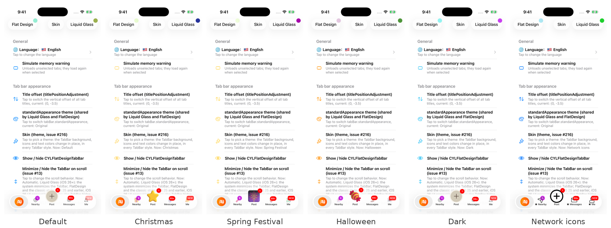

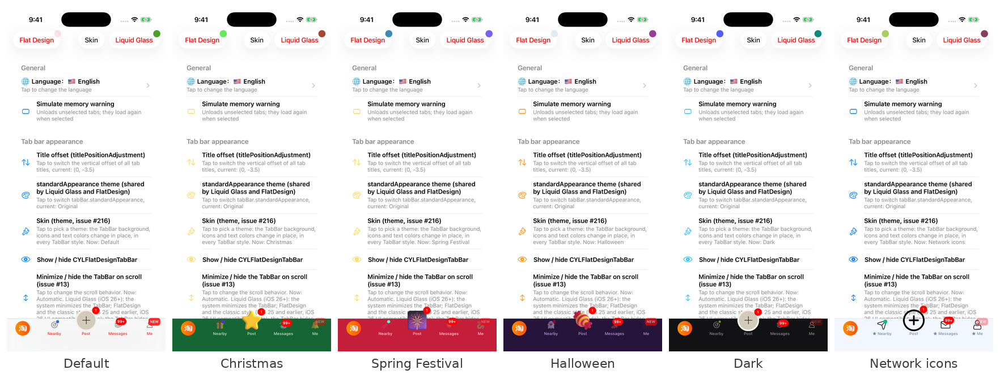

| 中文 | English |
|:---|:---|
| 选中 PlusButton 子控制器后换肤：上方六张为液态玻璃、下方六张为扁平样式；每行一个场景（默认→圣诞节、圣诞节→玫瑰粉、春节→网络皮肤），左列切换前、右列切换后。PlusButton 的图标（“+”、星星、烟花、网络图标）完整且清晰，玻璃内没有模糊的光晕，玻璃上下没有缝隙，角标仍在。截图来自 CI 的 “Plus child theme test” workflow（iOS 26 模拟器），未经修改，只裁剪了 TabBar 部分并拼合；玻璃边缘的细亮线是系统玻璃自身的边框。详见 [docs/Plus-Child-Theme-Switching-Test.md](docs/Plus-Child-Theme-Switching-Test.md)。 | Switching the theme with the plus child view controller selected: the top six images are Liquid Glass, the bottom six FlatDesign; one scenario per row (Default → Christmas, Christmas → Pink Rose, Spring Festival → Network), before the switch on the left and after it on the right. The plus button's icon ("+", the star, the fireworks, the network icon) is whole and sharp, with no blurred halo inside the glass and no seam at its edge, and the badge stays. The screenshots come from the CI workflow "Plus child theme test" (iOS 26 simulator), unedited apart from cropping to the tab bar and putting them together; the thin light line at the glass edge is the system glass's own border. See [docs/Plus-Child-Theme-Switching-Test.md](docs/Plus-Child-Theme-Switching-Test.md). |

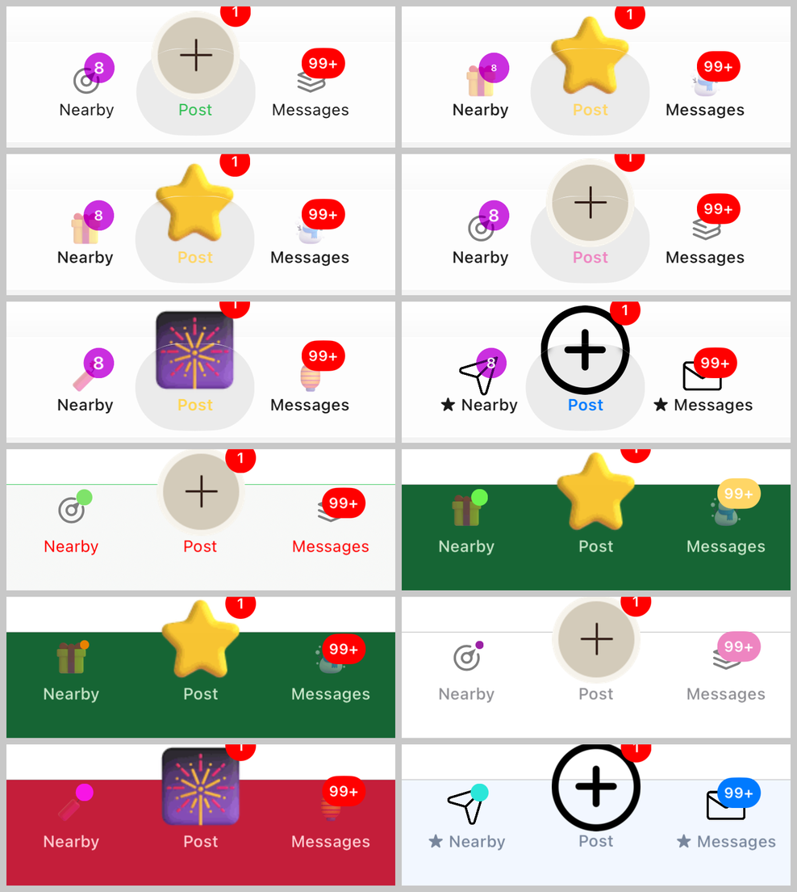

| 中文 | English |
|:---|:---|
| ✅ TabBar 自定义工具集：单个 Tab 的双击 block（`cyl_doubleTapBlock`，基于 TabBarItem 手势）、一次设置所有布局的 item 样式（`-[UITabBarAppearance cyl_applyItemAppearanceWithBlock:]`）、使用 `UITabBarAppearance` 后 `tintColor` / `barTintColor` / `shadowImage` 等经典接口仍然生效、背景模糊与阴影线（`cyl_backgroundEffect`、`cyl_shadowImageView`）、TabBar 占用的高度（`cyl_tabBarSpacingInViewCoordinator`）、屏幕方向与 Home Indicator 交给当前页面决定、修复 iOS 13/14 粗体标题被截断、Tab 按钮布局回调（`cyl_viewDidLayoutSubviewsBlock`）、在一处设置标题字体 / 颜色、图标颜色、背景与分割线（`cyl_tabBarItemTitleFont` 等）、修复不透明 TabBar 遮挡滚动视图底部等，适用于所有样式，详见 [docs/TabBar-Customization-Toolkit.md](docs/TabBar-Customization-Toolkit.md)。 | ✅ Tab bar customization toolkit: a double tap block per tab (`cyl_doubleTapBlock`, on top of the tab bar item gestures), item styles for every layout in one go (`-[UITabBarAppearance cyl_applyItemAppearanceWithBlock:]`), classic `tintColor` / `barTintColor` / `shadowImage`... that keep working next to `UITabBarAppearance`, the background blur and the shadow line (`cyl_backgroundEffect`, `cyl_shadowImageView`), the height the tab bar covers (`cyl_tabBarSpacingInViewCoordinator`), orientation and the home indicator left to the current page, bold titles no longer cut off on iOS 13/14, a tab button layout callback (`cyl_viewDidLayoutSubviewsBlock`), title fonts / colors, icon colors, the background and the separator in one place (`cyl_tabBarItemTitleFont`...), an opaque tab bar no longer covering the end of a scroll view, and more, in every style. See [docs/TabBar-Customization-Toolkit.md](docs/TabBar-Customization-Toolkit.md). |
| ✅ 重复点击已选中的 Tab 的内置操作：`cyl_reselectBehavior` 一行代码返回根页面 / 滚动到顶部，由 `CYLTabBarItemGestureReselect` 驱动，可与手势回调同时使用，适用于所有样式，详见 [docs/Tab-Reselect.md](docs/Tab-Reselect.md)。 | ✅ Built-in actions for tapping the selected tab: `cyl_reselectBehavior` pops to the root page / scrolls to the top in one line, driven by `CYLTabBarItemGestureReselect` and usable together with the gesture callbacks, in every style. See [docs/Tab-Reselect.md](docs/Tab-Reselect.md). |
| ✅ 点击动画新增重复点击与按下动画：`CYLTabButtonAnimation` 新增可选的 reselect / highlight / dehighlight 方法，按下动画适用于所有样式（含液态玻璃），并内置 `CYLTabButtonPressAnimation`，详见 [docs/Tab-Interactions.md](docs/Tab-Interactions.md)。 | ✅ Reselect and pressed animations: `CYLTabButtonAnimation` gains optional reselect / highlight / dehighlight methods, the pressed animation works in every style (Liquid Glass included), and `CYLTabButtonPressAnimation` is built in. See [docs/Tab-Interactions.md](docs/Tab-Interactions.md). |
| ✅ 任意 Tab 的自定义点击操作：`cyl_customActionTabBarItemIdentifiers` / `cyl_shouldPerformCustomTabActionHandler` 指定 Tab，点击后不切换，改为执行 `cyl_customTabActionHandler`（如模态弹出发布页），支持 block 与代理，适用于所有样式，详见 [docs/Tab-Custom-Action.md](docs/Tab-Custom-Action.md)。 | ✅ A custom action for any tab's tap: pick tabs with `cyl_customActionTabBarItemIdentifiers` / `cyl_shouldPerformCustomTabActionHandler`; a tap then runs `cyl_customTabActionHandler` (e.g. presents a publish page) instead of switching, with blocks or the delegate, in every style. See [docs/Tab-Custom-Action.md](docs/Tab-Custom-Action.md). |
| ✅ 单个 Tab 的颜色：在 `tabBarItemsAttributes` 中为每个 Tab 设置未选中 / 选中的标题颜色与图标着色（`CYLTabBarItemTitleColor` 等）、标题字体（`CYLTabBarItemTitleFont` / `CYLTabBarItemSelectedTitleFont`）以及选中背景色（`CYLTabBarItemSelectedBackgroundColor`），可与标题偏移同时使用，详见 [docs/Tab-Item-Colors.md](docs/Tab-Item-Colors.md)。 | ✅ Per-tab colors: give each tab its own unselected / selected title color and icon tint (`CYLTabBarItemTitleColor`...) title fonts (`CYLTabBarItemTitleFont` / `CYLTabBarItemSelectedTitleFont`) and a selected background (`CYLTabBarItemSelectedBackgroundColor`) in `tabBarItemsAttributes`, together with title offsets. See [docs/Tab-Item-Colors.md](docs/Tab-Item-Colors.md). |
| ✅ Tab 的无障碍与 UI 测试：每个 Tab 与 PlusButton 默认带 `accessibilityIdentifier`（取自 `CYLTabBarItemIdentifier`），可用 `app.tabBars.buttons["home"]` 定位；`CYLTabBarItemAccessibilityLabel` / `Hint` / `Identifier` 显式指定；PlusButton 与系统 Tab 一致：VoiceOver 选中状态、iPad 指针悬停、大内容查看器，适用于所有样式，详见 [docs/Tab-Accessibility.md](docs/Tab-Accessibility.md)。 | ✅ Tab accessibility and UI tests: every tab and the plus button get an `accessibilityIdentifier` by default (from `CYLTabBarItemIdentifier`), so `app.tabBars.buttons["home"]` finds them; set `CYLTabBarItemAccessibilityLabel` / `Hint` / `Identifier` explicitly; the plus button behaves like a system tab (VoiceOver selected state, iPad pointer hover, Large Content Viewer), in every style. See [docs/Tab-Accessibility.md](docs/Tab-Accessibility.md). |
| ✅ Tab 的排列方式：有 PlusButton 的经典 TabBar 现在同样遵守 `itemPositioning = .centered`、`itemWidth`、`itemSpacing`（或 `standardAppearance.stacked…`），Tab 与 PlusButton 整体居中；`cyl_itemEdgeInsets` 在两端留白，适合 iPad 等宽屏，详见 [docs/Tab-Item-Positioning.md](docs/Tab-Item-Positioning.md)。 | ✅ Tab positioning: the classic tab bar with a plus button now honors `itemPositioning = .centered`, `itemWidth` and `itemSpacing` (or `standardAppearance.stacked…`), centering the tabs and the plus button as a group, and `cyl_itemEdgeInsets` keeps space at both ends, for wide screens such as iPad. See [docs/Tab-Item-Positioning.md](docs/Tab-Item-Positioning.md). |
| ✅ TabBar 图库：ObjC Demo 首页新增「Tab Bar Gallery」，44 个 TabBar 场景（系统对照、嵌套、动画、不规则按钮、自定义点击、提醒、Lottie、每个新增接口、液态玻璃健壮性，以及超过 5 个 Tab 不出现 More）都只用公开 API 构建，点击某行即展示，详见 [docs/Tab-Bar-Gallery.md](docs/Tab-Bar-Gallery.md)。 | ✅ Tab bar gallery: the ObjC demo's home page has a new "Tab Bar Gallery" with 44 tab bar scenes (system baselines, embedding, animations, an irregular button, custom clicks, reminders, Lottie, every new API, Liquid Glass robustness, and more than five tabs without More), built with the public API only and presented from a row. See [docs/Tab-Bar-Gallery.md](docs/Tab-Bar-Gallery.md). |
| ✅ Swift 版图库与角标变化动画：`Example-Swift-Gallery` 用 Swift 重写同一个图库，通过 Swift Package Manager 集成；`CYLTabButtonAnimation` 新增可选方法 `-cyl_playBadgeChangedAnimationWithTabButton:iconView:badgeView:`，`badgeValue` 出现或变化时自动播放动画，详见 [docs/Tab-Bar-Gallery.md](docs/Tab-Bar-Gallery.md) 与 [docs/Tab-Interactions.md](docs/Tab-Interactions.md)。 | ✅ A Swift gallery and badge-changed animations: `Example-Swift-Gallery` rebuilds the same gallery in Swift, integrated with Swift Package Manager; the new optional `CYLTabButtonAnimation` method `-cyl_playBadgeChangedAnimationWithTabButton:iconView:badgeView:` plays automatically when `badgeValue` appears or changes. See [docs/Tab-Bar-Gallery.md](docs/Tab-Bar-Gallery.md) and [docs/Tab-Interactions.md](docs/Tab-Interactions.md). |
| ✅ 液态玻璃健壮性：越界读取改为先检查下标（修复 `cyl_selectedControl` 的备选从不生效），库插入 Tab 按钮的视图统一标记（`cyl_markAsInsertedForTabControl:`），PlusButton 在选中层的替身随布局安装而不是固定延迟，「More」编辑期间隐藏插入的视图，详见 [docs/Liquid-Glass-Robustness.md](docs/Liquid-Glass-Robustness.md)。 | ✅ Liquid Glass robustness: out-of-range reads check the index first (fixing the `cyl_selectedControl` fallbacks that never ran), the views the library inserts into tab buttons are marked in one way (`cyl_markAsInsertedForTabControl:`), the plus button's stand-in in the selected layer is installed with layout instead of after a fixed delay, and More editing hides the inserted views. See [docs/Liquid-Glass-Robustness.md](docs/Liquid-Glass-Robustness.md). |
| ✅ 用 block 组成 Tab 按钮动画：`CYLTabButtonBlockAnimation` 的 `selectAnimation` / `reselectAnimation` / `highlightAnimation` / `dehighlightAnimation` / `deselectAnimation` / `badgeChangedAnimation` 对应同名协议方法，Swift 用闭包即可，无需实现 `cyl_play…` 方法，详见 [docs/Tab-Interactions.md](docs/Tab-Interactions.md)。 | ✅ Tab button animations made of blocks: the `selectAnimation` / `reselectAnimation` / `highlightAnimation` / `dehighlightAnimation` / `deselectAnimation` / `badgeChangedAnimation` blocks of `CYLTabButtonBlockAnimation` play the protocol methods of the same names, so Swift uses closures and implements no `cyl_play…` method. See [docs/Tab-Interactions.md](docs/Tab-Interactions.md). |
| ✅ 无下划线的动画方法名：`CYLTabButtonAnimation` 的每个方法新增 `cylPlay…` 写法（如 `-cylPlaySelectAnimationWithTabButton:…`，Swift 中为 `cylPlaySelectAnimation(withTabButton:iconView:titleLabel:)`），与 `cyl_play…` 执行相同逻辑且优先调用；选中动画方法改为可选，已有实现不受影响，详见 [docs/Tab-Interactions.md](docs/Tab-Interactions.md)。 | ✅ Underscore-free animation method names: every `CYLTabButtonAnimation` method gains a `cylPlay…` spelling (e.g. `-cylPlaySelectAnimationWithTabButton:…`, `cylPlaySelectAnimation(withTabButton:iconView:titleLabel:)` in Swift) that runs the same logic as `cyl_play…` and is called first; the select method is optional now, and existing implementations are unaffected. See [docs/Tab-Interactions.md](docs/Tab-Interactions.md). |
| ✅ 自定义 TabBar 功能清单：逐项说明默认样式、More、混合 Item、UIKit 属性、导航嵌套、自定义外观与动画、不规则按钮与点击事件、提醒样式、Lottie、iOS 26 液态玻璃的实现方式与演示行；新增 `CYLTabBarLottieLoopsWhenUnselected`（未选中时循环播放 Lottie）与 `cyl_hidesBadgeOfSelectedTab`（选中的 Tab 隐藏角标），详见 [docs/Custom-Tab-Bar-Features.md](docs/Custom-Tab-Bar-Features.md)。 | ✅ Custom tab bar feature checklist: how the default style, More, mixed items, UIKit properties, navigation nesting, custom looks and animations, irregular buttons and click events, reminders, Lottie and iOS 26 Liquid Glass are implemented, with their demo rows; adds `CYLTabBarLottieLoopsWhenUnselected` (a Lottie that loops while unselected) and `cyl_hidesBadgeOfSelectedTab` (the selected tab hides its badge). See [docs/Custom-Tab-Bar-Features.md](docs/Custom-Tab-Bar-Features.md). |
| ✅ 支持运行期间在两种样式之间切换，适合 A/B 测试和灰度发布。 | ✅ Switch between styles at runtime for A/B testing and staged rollout. |
| ✅ 液态玻璃样式继承自 `UITabBar`，支持系统样式设置，并提供 PlusButton。 | ✅ The Liquid Glass style inherits from `UITabBar`, supports system appearance settings, and adds PlusButton support. |
| ✅ 支持同时展示 Lottie 动画、液态玻璃效果和红点角标动画。 | ✅ Display Lottie animations, Liquid Glass effects, and animated badges together. |
| ✅ 建议升级到 1.99.41 或更高版本进行 iOS 27 适配。 | ✅ Upgrade to 1.99.41 or later for iOS 27 support. |
CYLTabBarController 现已支持在 iOS 26 上实现以下效果，请更新至 1.99.39 或更高版本。
CYLTabBarController supports the following features on iOS 26. Update to version 1.99.39 or later:

| 中文 | English |
|:---|:---|
| ✅ 同时展示 Lottie 动画与液态玻璃效果。 | ✅ Display Lottie animations and the Liquid Glass effect together. |
| ✅ 支持将 PlusButton 居中显示在液态玻璃效果上，并保留旧版本的按钮逻辑。 | ✅ Center PlusButton over the Liquid Glass effect while preserving the previous button behavior. |
| ✅ 液态玻璃效果不使用私有 API，适合 Apple 审核。 | ✅ Liquid Glass uses no private APIs and is suitable for App Store review. |
| ✅ 使用纯原生液态玻璃效果，支持系统对相关属性的设置。 | ✅ Use a native Liquid Glass effect and support the system appearance settings. |
| ✅ 面向企业生产环境的开源解决方案。 | ✅ An open-source solution suitable for production environments. |
| ✅ 对现有集成友好，升级通常只需少量代码修改。 | ✅ Existing integrations can usually be upgraded with minimal code changes. |
| ✅ 不依赖 UI 兼容模式，适合 iOS 27 审核。 | ✅ Does not depend on UI compatibility mode and is review-friendly on iOS 27. |
| ✅ GitHub：<https://github.com/ChenYilong/CYLTabBarController> | ✅ GitHub: <https://github.com/ChenYilong/CYLTabBarController> |


1.99.39 版本现已支持在 iOS 26 运行期间增加或删除加号按钮。效果见下方演示，欢迎访问 [Demo](https://github.com/ChenYilong/CYLTabBarController) 进行尝试：
Version 1.99.39 supports adding or removing the plus button at runtime on iOS 26. See the demo below or visit the [Demo](https://github.com/ChenYilong/CYLTabBarController) to try it:


# [CN]谁在使用？已上架 App 列表
# [EN]Who is using it? Published apps


APP name link icon | image  |APP name link icon | image
:-------------:|:-------------:|:-------------:|:-------------:
海底捞  [App Store Link](https://itunes.apple.com/cn/app/%E6%B5%B7%E5%BA%95%E6%8D%9E/id553115181?l=en&mt=8)   |   | C家 [App Store Link](https://itunes.apple.com/cn/app/c%E5%AE%B6/id1123394197?l=en&mt=8)  | Lottie 效果 / Lottie effect   |
淘必中-淘宝推出的一款具有营销购物功能的APP [App Store Link](https://itunes.apple.com/cn/app/%E6%B7%98%E5%BF%85%E4%B8%AD/id399737960?l=en&mt=8)  |  | 慧诊健康  [App Store Link](https://itunes.apple.com/cn/app/%E6%85%A7%E8%AF%8A%E5%81%A5%E5%BA%B7/id1434271846?mt=8) |
究竟大学 [App Store Link](https://itunes.apple.com/us/app/%E7%A9%B6%E7%AB%9F%E5%A4%A7%E5%AD%A6/id1334531245?mt=8)   |  | 蕉片 - 短视频拍摄剪辑出电影大片   [App Store Link](https://itunes.apple.com/us/app/%E8%95%89%E7%89%87-%E7%9F%AD%E8%A7%86%E9%A2%91%E6%8B%8D%E6%91%84%E5%89%AA%E8%BE%91%E5%87%BA%E7%94%B5%E5%BD%B1%E5%A4%A7%E7%89%87/id1235972800?mt=8)  |
闪剧 - 可以玩的短视频 [App Store Link](https://itunes.apple.com/us/app/%E9%97%AA%E5%89%A7-%E5%8F%AF%E4%BB%A5%E7%8E%A9%E7%9A%84%E7%9F%AD%E8%A7%86%E9%A2%91/id1360997439?mt=8) |  | 土狗云商城 [App Store Link](https://itunes.apple.com/cn/app/%E5%9C%9F%E7%8B%97%E4%BC%98%E4%BA%AB/id1239005385?mt=8)  |
Analyst.ai [App Store Link](https://itunes.apple.com/us/app/analyst-ai/id1345754742?mt=8) |  | 美膳校园  [App Store Link](https://itunes.apple.com/us/app/%E7%BE%8E%E8%86%B3%E6%A0%A1%E5%9B%AD/id1447211131?mt=8)  | 
 全聚星 [App Store Link](https://itunes.apple.com/us/app/%E5%85%A8%E8%81%9A%E6%98%9F/id1140827531?mt=8)  | | Yesoul  [App Store Link](https://itunes.apple.com/us/app/yesoul/id1144444969?mt=8)  | 
贵州充电通 [App Store Link](https://itunes.apple.com/us/app/%E8%B4%B5%E5%B7%9E%E5%85%85%E7%94%B5%E9%80%9A/id1455932848?mt=8&app=itunes&ign-mpt=uo%3D4)  |  | 卓尔购  [App Store Link](https://itunes.apple.com/cn/app/%E5%8D%93%E5%B0%94%E8%B4%AD-%E6%89%B9%E5%8F%91%E9%87%87%E8%B4%AD%E8%BF%9B%E8%B4%A7%E9%A6%96%E9%80%89/id1063104387?mt=8)   | 
卓越管家 [App Store Link](https://itunes.apple.com/cn/app//id1268483803?mt=8)  |  | 悦守护 [App Store Link](https://itunes.apple.com/cn/app/%E6%82%A6%E5%AE%88%E6%8A%A4/id1347678565?mt=8) | 
筑集采采购端 [App Store Link](https://itunes.apple.com/cn/app//id1041802973?mt=8)   |  |  筑集采供应端  [App Store Link](https://itunes.apple.com/fr/app//id1035221629?mt=8)  |   |
桂富宝  [App Store Link](https://itunes.apple.com/nz/app/e%E8%81%94%E7%9B%9F%E5%95%86%E5%9F%8E/id979819957)   |  |  小猪奔奔  [App Store Link](https://itunes.apple.com/cn/app/%E5%B0%8F%E7%8C%AA%E5%A5%94%E5%A5%94-%E7%94%A8%E6%88%B7%E7%89%88/id1124274649?mt=8)  | 
娃娃坞（开发中 / in development） |   | 更多 APP 请访问 / More apps: [《使用 CYLTabBarController 做的 APP，来这里报道下吧》 / Apps built with CYLTabBarController](https://github.com/ChenYilong/CYLTabBarController/issues/314)  | 如果你正在使用，也请提交到这里 / Using it? Add your app here: [#314](https://github.com/ChenYilong/CYLTabBarController/issues/314)


## [CN]导航
## [EN]CONTENTS

<!-- navigation:start -->
<!-- Generated by scripts/update-docs-navigation.py; do not edit by hand. -->

| 中文 | English |
|:---|:---|
| [阅读须知](#cn阅读须知) | [Before Reading](#enbefore-reading) |
| [最新版本预览](#cn最新版本预览) | [Preview of the latest version](#enpreview-of-the-latest-version) |
| &nbsp;&nbsp;&nbsp;&nbsp;↳ [iOS 27 和 iPhone Duo 适配](#cnios-27-和-iphone-duo-适配) | &nbsp;&nbsp;&nbsp;&nbsp;↳ [iOS 27 and iPhone Duo support](#enios-27-and-iphone-duo-support) |
| [文档索引](#cn文档索引) | [Documentation index](#endocumentation-index) |
| [与其他自定义 TabBarController 的区别](#cn与其他自定义-tabbarcontroller-的区别) | [Comparison with other libraries](#encomparison-with-other-libraries) |
| [集成后的效果](#cn集成后的效果) | [Results after integration](#enresults-after-integration) |
| [项目结构](#cn项目结构) | [Project structure](#enproject-structure) |
| &nbsp;&nbsp;&nbsp;&nbsp;↳ [演示工程](#cn演示工程) | &nbsp;&nbsp;&nbsp;&nbsp;↳ [Demo projects](#endemo-projects) |
| &nbsp;&nbsp;&nbsp;&nbsp;↳ [版本要求](#cn版本要求) | &nbsp;&nbsp;&nbsp;&nbsp;↳ [Version requirements](#enversion-requirements) |
| [使用 CYLTabBarController](#cn使用-cyltabbarcontroller) | [Using CYLTabBarController](#enusing-cyltabbarcontroller) |
| &nbsp;&nbsp;&nbsp;&nbsp;↳ [第一步：使用 CocoaPods 导入 CYLTabBarController](#cn第一步使用-cocoapods-导入-cyltabbarcontroller) | &nbsp;&nbsp;&nbsp;&nbsp;↳ [Step 1: Import CYLTabBarController with CocoaPods](#enstep-1-import-cyltabbarcontroller-with-cocoapods) |
| &nbsp;&nbsp;&nbsp;&nbsp;↳ [CocoaPods 使用说明](#cncocoapods-使用说明) | &nbsp;&nbsp;&nbsp;&nbsp;↳ [CocoaPods usage notes](#encocoapods-usage-notes) |
| &nbsp;&nbsp;&nbsp;&nbsp;↳ [使用 Carthage 导入 CYLTabBarController（可选）](#cn使用-carthage-导入-cyltabbarcontroller可选) | &nbsp;&nbsp;&nbsp;&nbsp;↳ [Import CYLTabBarController with Carthage (optional)](#enimport-cyltabbarcontroller-with-carthage-optional) |
| &nbsp;&nbsp;&nbsp;&nbsp;↳ [第二步：设置 CYLTabBarController 的两个数组](#cn第二步设置-cyltabbarcontroller-的两个数组) | &nbsp;&nbsp;&nbsp;&nbsp;↳ [Step 2: Configure the view controller and tab bar item attribute arrays](#enstep-2-configure-the-view-controller-and-tab-bar-item-attribute-arrays) |
| &nbsp;&nbsp;&nbsp;&nbsp;↳ [第三步：将 CYLTabBarController 设置为 window 的 RootViewController](#cn第三步将-cyltabbarcontroller-设置为-window-的-rootviewcontroller) | &nbsp;&nbsp;&nbsp;&nbsp;↳ [Step 3: Set CYLTabBarController as the window's root view controller](#enstep-3-set-cyltabbarcontroller-as-the-windows-root-view-controller) |
| &nbsp;&nbsp;&nbsp;&nbsp;↳ [第四步（可选）：创建自定义的不规则加号按钮](#cn第四步可选创建自定义的不规则加号按钮) | &nbsp;&nbsp;&nbsp;&nbsp;↳ [Step 4 (optional): Create a custom irregular plus button](#enstep-4-optional-create-a-custom-irregular-plus-button) |
| [补充说明](#cn补充说明) | [Additional notes](#enadditional-notes) |
| &nbsp;&nbsp;&nbsp;&nbsp;↳ [自定义 `TabBar` 样式](#cn自定义-tabbar-样式) | &nbsp;&nbsp;&nbsp;&nbsp;↳ [Customizing the `TabBar` appearance](#encustomizing-the-tabbar-appearance) |
| &nbsp;&nbsp;&nbsp;&nbsp;↳ [点击 TabBarButton 时添加动画](#cn点击-tabbarbutton-时添加动画) | &nbsp;&nbsp;&nbsp;&nbsp;↳ [Adding animations when a TabBar button is tapped](#enadding-animations-when-a-tabbar-button-is-tapped) |
| &nbsp;&nbsp;&nbsp;&nbsp;↳ [单独使用角标组件 CYLBadgeView](#cn单独使用角标组件-cylbadgeview) | &nbsp;&nbsp;&nbsp;&nbsp;↳ [Using the badge component on its own: CYLBadgeView](#enusing-the-badge-component-on-its-own-cylbadgeview) |
| &nbsp;&nbsp;&nbsp;&nbsp;↳ [全局设置角标样式](#cn全局设置角标样式) | &nbsp;&nbsp;&nbsp;&nbsp;↳ [Setting the badge style globally](#ensetting-the-badge-style-globally) |
| &nbsp;&nbsp;&nbsp;&nbsp;↳ [更新 Tab 角标](#cn更新-tab-角标) | &nbsp;&nbsp;&nbsp;&nbsp;↳ [Updating tab badges](#enupdating-tab-badges) |
| &nbsp;&nbsp;&nbsp;&nbsp;↳ [适配深色模式](#cn适配深色模式) | &nbsp;&nbsp;&nbsp;&nbsp;↳ [Supporting Dark Mode](#ensupporting-dark-mode) |
| &nbsp;&nbsp;&nbsp;&nbsp;↳ [多语言（本地化）](#cn多语言本地化) | &nbsp;&nbsp;&nbsp;&nbsp;↳ [Localization](#enlocalization) |
| &nbsp;&nbsp;&nbsp;&nbsp;↳ [横竖屏适配](#cn横竖屏适配) | &nbsp;&nbsp;&nbsp;&nbsp;↳ [Supporting portrait and landscape orientations](#ensupporting-portrait-and-landscape-orientations) |
| &nbsp;&nbsp;&nbsp;&nbsp;↳ [访问初始化好的 CYLTabBarController 对象](#cn访问初始化好的-cyltabbarcontroller-对象) | &nbsp;&nbsp;&nbsp;&nbsp;↳ [Accessing the initialized CYLTabBarController instance](#enaccessing-the-initialized-cyltabbarcontroller-instance) |
| &nbsp;&nbsp;&nbsp;&nbsp;↳ [点击 PlusButton 跳转到指定 UIViewController](#cn点击-plusbutton-跳转到指定-uiviewcontroller) | &nbsp;&nbsp;&nbsp;&nbsp;↳ [Navigating to a UIViewController by tapping the PlusButton](#ennavigating-to-a-uiviewcontroller-by-tapping-the-plusbutton) |
| &nbsp;&nbsp;&nbsp;&nbsp;↳ [让 TabBarItem 仅显示图标并使图标垂直居中](#cn让-tabbaritem-仅显示图标并使图标垂直居中) | &nbsp;&nbsp;&nbsp;&nbsp;↳ [Display only icons in TabBarItems and center them vertically](#endisplay-only-icons-in-tabbaritems-and-center-them-vertically) |
| &nbsp;&nbsp;&nbsp;&nbsp;↳ [多 TabBar 嵌套并指定 PlusButton 位置](#cn多-tabbar-嵌套并指定-plusbutton-位置) | &nbsp;&nbsp;&nbsp;&nbsp;↳ [Nesting multiple TabBars and specifying the PlusButton position](#ennesting-multiple-tabbars-and-specifying-the-plusbutton-position) |
| &nbsp;&nbsp;&nbsp;&nbsp;↳ [在 React Native 与 Flutter 中使用 CYLTabBarController](#cn在-react-native-与-flutter-中使用-cyltabbarcontroller) | &nbsp;&nbsp;&nbsp;&nbsp;↳ [Using CYLTabBarController in React Native and Flutter](#enusing-cyltabbarcontroller-in-react-native-and-flutter) |
| &nbsp;&nbsp;&nbsp;&nbsp;↳ [在 Swift 项目中使用 CYLTabBarController](#cn在-swift-项目中使用-cyltabbarcontroller) | &nbsp;&nbsp;&nbsp;&nbsp;↳ [Using CYLTabBarController in a Swift project](#enusing-cyltabbarcontroller-in-a-swift-project) |
| &nbsp;&nbsp;&nbsp;&nbsp;↳ [搭配 Storyboard 使用 CYLTabBarController](#cn搭配-storyboard-使用-cyltabbarcontroller) | &nbsp;&nbsp;&nbsp;&nbsp;↳ [Using CYLTabBarController with Storyboard](#enusing-cyltabbarcontroller-with-storyboard) |
| &nbsp;&nbsp;&nbsp;&nbsp;↳ [源码实现原理](#cn源码实现原理) | &nbsp;&nbsp;&nbsp;&nbsp;↳ [Implementation details](#enimplementation-details) |
| [常见问题](#cn常见问题) | [FAQ](#enfaq) |
| &nbsp;&nbsp;&nbsp;&nbsp;↳ [为什么放置 6 个 TabBarItem 会显示异常？](#cn为什么放置-6-个-tabbaritem-会显示异常) | &nbsp;&nbsp;&nbsp;&nbsp;↳ [Why does placing six TabBarItems behave unexpectedly?](#enwhy-does-placing-six-tabbaritems-behave-unexpectedly) |
| &nbsp;&nbsp;&nbsp;&nbsp;↳ [按钮响应区域发生偏移](#cn按钮响应区域发生偏移) | &nbsp;&nbsp;&nbsp;&nbsp;↳ [The button hit area is offset](#enthe-button-hit-area-is-offset) |
| &nbsp;&nbsp;&nbsp;&nbsp;↳ [如何添加选中背景色？](#cn如何添加选中背景色) | &nbsp;&nbsp;&nbsp;&nbsp;↳ [How can I add a selected background color?](#enhow-can-i-add-a-selected-background-color) |
| &nbsp;&nbsp;&nbsp;&nbsp;↳ [ViewController 标题与 TabBar 标题不一致](#cnviewcontroller-标题与-tabbar-标题不一致) | &nbsp;&nbsp;&nbsp;&nbsp;↳ [The ViewController title does not match the TabBar title](#enthe-viewcontroller-title-does-not-match-the-tabbar-title) |
| &nbsp;&nbsp;&nbsp;&nbsp;↳ [调用 `cyl_popSelectTabBarChildViewControllerAtIndex:` 时出现黑边](#cn调用-cyl_popselecttabbarchildviewcontrolleratindex-时出现黑边) | &nbsp;&nbsp;&nbsp;&nbsp;↳ [Black borders appear when calling `cyl_popSelectTabBarChildViewControllerAtIndex:`](#enblack-borders-appear-when-calling-cyl_popselecttabbarchildviewcontrolleratindex) |
| &nbsp;&nbsp;&nbsp;&nbsp;↳ [iPhone Duo 展开横屏时左右出现黑边](#cniphone-duo-展开横屏时左右出现黑边) | &nbsp;&nbsp;&nbsp;&nbsp;↳ [Black bars on the left and right of the unfolded iPhone Duo in landscape](#enblack-bars-on-the-left-and-right-of-the-unfolded-iphone-duo-in-landscape) |
| &nbsp;&nbsp;&nbsp;&nbsp;↳ [凸起的图标超出 49pt 后无法响应](#cn凸起的图标超出-49pt-后无法响应) | &nbsp;&nbsp;&nbsp;&nbsp;↳ [A raised icon does not respond above 49pt](#ena-raised-icon-does-not-respond-above-49pt) |
| &nbsp;&nbsp;&nbsp;&nbsp;↳ [为什么 iOS 10 会崩溃而 iOS 9 不会？](#cn为什么-ios-10-会崩溃而-ios-9-不会) | &nbsp;&nbsp;&nbsp;&nbsp;↳ [Why does it crash on iOS 10 but not iOS 9?](#enwhy-does-it-crash-on-ios-10-but-not-ios-9) |
| &nbsp;&nbsp;&nbsp;&nbsp;↳ [PlusButton 选中后无法恢复为 normal](#cnplusbutton-选中后无法恢复为-normal) | &nbsp;&nbsp;&nbsp;&nbsp;↳ [PlusButton remains selected after selecting another tab](#enplusbutton-remains-selected-after-selecting-another-tab) |
| &nbsp;&nbsp;&nbsp;&nbsp;↳ [PlusButton 与其他 TabBarItem 的间距不均匀](#cnplusbutton-与其他-tabbaritem-的间距不均匀) | &nbsp;&nbsp;&nbsp;&nbsp;↳ [The PlusButton is not evenly spaced](#enthe-plusbutton-is-not-evenly-spaced) |
| &nbsp;&nbsp;&nbsp;&nbsp;↳ [如何兼容 Lottie 动画？](#cn如何兼容-lottie-动画) | &nbsp;&nbsp;&nbsp;&nbsp;↳ [How do I integrate Lottie animations?](#enhow-do-i-integrate-lottie-animations) |
| [Star 历史](#cnstar-历史) | [Star history](#enstar-history) |

<!-- navigation:end -->

## [CN]文档索引
## [EN]Documentation index

<!-- navigation:start -->
<!-- Generated by scripts/update-docs-navigation.py; do not edit by hand. -->

| 中文 | English |
|:---|:---|
| [文档导航（全部文档与目录结构）](docs/README.md) | [Documentation index (all documents and folder layout)](docs/README.md) |
| [AI 工具的 Skill：快速基于本库创建项目](docs/Agent-Skills.md) | [Skills for AI tools: start a project on this library quickly](docs/Agent-Skills.md) |
| [Android API 对照表](docs/Android-API-Map.md) | [The Android API map](docs/Android-API-Map.md) |
| [Android 演示迁移](docs/Android-Demo-Migration.md) | [Android demo migration](docs/Android-Demo-Migration.md) |
| [Android 版 PAG、GIF、Rive 示例](docs/Android-Examples.md) | [The Android PAG, GIF and Rive examples](docs/Android-Examples.md) |
| [Android 版 CYLTabBarController](docs/Android-Library.md) | [CYLTabBarController for Android](docs/Android-Library.md) |
| [Android 库与 QMUI_Android、XUI 的 Tab 对比](docs/Android-QMUI-Comparison.md) | [The Android library compared with QMUI_Android's and XUI's tabs](docs/Android-QMUI-Comparison.md) |
| [中英文双语文档](docs/Bilingual-Documentation.md) | [Bilingual Documentation](docs/Bilingual-Documentation.md) |
| [CYLUtils 通用工具：超出父视图响应点击、点击动画与图片加载](docs/CYLUtils-Helpers.md) | [CYLUtils helpers: responding outside the superview, a tap animation, and image loading](docs/CYLUtils-Helpers.md) |
| [Carthage 集成演示工程](docs/Carthage-Example.md) | [Carthage integration demo project](docs/Carthage-Example.md) |
| [使用 Carthage 集成](docs/Carthage.md) | [Integrating with Carthage](docs/Carthage.md) |
| [一个配置文件生成 TabBarController](docs/Configuration-File.md) | [One configuration file, one TabBarController](docs/Configuration-File.md) |
| [配置文件相关脚本：导出、边界情况与测试](docs/Configuration-Scripts.md) | [Configuration scripts: export, edge cases and tests](docs/Configuration-Scripts.md) |
| [React Native 与 Flutter 组件](docs/Cross-Platform-Components.md) | [React Native and Flutter components](docs/Cross-Platform-Components.md) |
| [自定义 TabBar 功能清单](docs/Custom-Tab-Bar-Features.md) | [Custom Tab Bar Feature Checklist](docs/Custom-Tab-Bar-Features.md) |
| [Demo 测试列表：设置分组与纯 Swift 版本](docs/Demo-Test-List.md) | [The demo test list: settings groups and a pure Swift version](docs/Demo-Test-List.md) |
| [CYLTabBarController 常见问题](docs/FAQ.md) | [CYLTabBarController FAQ](docs/FAQ.md) |
| [FlatDesign × UITabBarAppearance](docs/FlatDesign-StandardAppearance.md) | [FlatDesign × UITabBarAppearance](docs/FlatDesign-StandardAppearance.md) |
| [Flutter 接入：flutter_cyltabbar](docs/Flutter-Component.md) | [Flutter integration: flutter_cyltabbar](docs/Flutter-Component.md) |
| [GIF Tab 图标：循环的图片，或点击播放一次的动画](docs/GIF-Animation.md) | [GIF tab icons: a looping image, or an animation that plays once when tapped](docs/GIF-Animation.md) |
| [纯图标 Tab 的自动居中](docs/Image-Only-Tabs.md) | [Automatic centering of image-only tabs](docs/Image-Only-Tabs.md) |
| [液态玻璃的健壮性改进](docs/Liquid-Glass-Robustness.md) | [Liquid Glass Robustness](docs/Liquid-Glass-Robustness.md) |
| [需要登录的 Tab](docs/Login-Required-Tabs.md) | [Tabs That Need Login](docs/Login-Required-Tabs.md) |
| [macOS CI/CD 调研报告：用 Mac 服务器构建本项目](docs/Mac-CI-CD.md) | [macOS CI/CD research: building this project on Mac servers](docs/Mac-CI-CD.md) |
| [PAG 动画 Tab 图标（与 Lottie 用法相同）](docs/PAG-Animation.md) | [PAG animated tab icons (used like Lottie)](docs/PAG-Animation.md) |
| [只有部分 Tab 有动画（Lottie 或 PAG）](docs/Per-Tab-Animation.md) | [Only some tabs animated (Lottie or PAG)](docs/Per-Tab-Animation.md) |
| [PlusButton 子控制器换肤测试](docs/Plus-Child-Theme-Switching-Test.md) | [Plus child theme switching test](docs/Plus-Child-Theme-Switching-Test.md) |
| [液态玻璃：标题画在背景图上的 PlusButton](docs/PlusButton-Background-Image-Liquid-Glass.md) | [Liquid Glass: a PlusButton with its title on a background image](docs/PlusButton-Background-Image-Liquid-Glass.md) |
| [PlusButton 角标：每次点击都会变化](docs/PlusButton-Badge.md) | [PlusButton badge: changes on every tap](docs/PlusButton-Badge.md) |
| [有 PlusButton 时，Tab 的 Lottie 图标与 Lottie 文件对应](docs/PlusButton-Lottie-TabIcon.md) | [Lottie tab icons and their files when there is a PlusButton](docs/PlusButton-Lottie-TabIcon.md) |
| [调研：配置文件与页面注册表中的 PlusButton 注册](docs/PlusButton-Registration-Research.md) | [Research: registering the PlusButton through configurations and the page registry](docs/PlusButton-Registration-Research.md) |
| [PlusButton 的 slot：占位与数量一致](docs/PlusButton-Slot.md) | [The PlusButton Slot: Placeholders and Matching Counts](docs/PlusButton-Slot.md) |
| [PlusButton 子控件响应各自的点击事件](docs/PlusButton-Subview-Touches.md) | [Subviews of the PlusButton receive their own touches](docs/PlusButton-Subview-Touches.md) |
| [PlusButton 点击范围：扩大、按倍数放大与调试显示](docs/PlusButton-Touchable-Area.md) | [PlusButton touchable area: grow it, scale it, and see it](docs/PlusButton-Touchable-Area.md) |
| [PlusButton 的实现：真实按钮、液态玻璃替身与选中态图片](docs/PlusButton.md) | [How the PlusButton works: the real button, its Liquid Glass stand-in and selected images](docs/PlusButton.md) |
| [在任意位置获取导航控制器并 Push](docs/Push-From-Anywhere.md) | [Get the navigation controller and push from anywhere](docs/Push-From-Anywhere.md) |
| [React Native 接入：react-native-cyltabbar](docs/React-Native-Component.md) | [React Native integration: react-native-cyltabbar](docs/React-Native-Component.md) |
| [Rive 动画 Tab 图标（与 Lottie、PAG 用法相同）](docs/Rive-Animation.md) | [Rive animated tab icons (used like Lottie and PAG)](docs/Rive-Animation.md) |
| [selectedIndex 与 PlusButton：选中的文字与图片一致](docs/SelectedIndex-PlusButton.md) | [selectedIndex and the PlusButton: the selected title and image match](docs/SelectedIndex-PlusButton.md) |
| [在 Swift 项目中使用 CYLTabBarController](docs/Swift-Guide.md) | [Using CYLTabBarController in Swift](docs/Swift-Guide.md) |
| [在 SwiftUI 项目中集成 CYLTabBarController](docs/SwiftUI-Integration.md) | [Integrating CYLTabBarController in a SwiftUI app](docs/SwiftUI-Integration.md) |
| [Tab 的无障碍与 UI 测试](docs/Tab-Accessibility.md) | [Tab Accessibility and UI Tests](docs/Tab-Accessibility.md) |
| [TabBar 图库](docs/Tab-Bar-Gallery.md) | [Tab Bar Gallery](docs/Tab-Bar-Gallery.md) |
| [Tab 图标动画共用子库：CYLTabBarItemAnimation（面向协议，可扩展任意动画库）](docs/Tab-Bar-Item-Animation.md) | [The shared tab icon animation subspec: CYLTabBarItemAnimation (protocol-oriented, open to any library)](docs/Tab-Bar-Item-Animation.md) |
| [自定义 Tab 点击操作](docs/Tab-Custom-Action.md) | [Custom Tab Actions](docs/Tab-Custom-Action.md) |
| [Tab 动画接入指南：Lottie、PAG、Rive](docs/Tab-Icon-Animation-Quick-Start.md) | [Tab icon animation quick start: Lottie, PAG and Rive](docs/Tab-Icon-Animation-Quick-Start.md) |
| [Tab 交互：点击动画、长按、滑动切换及其他](docs/Tab-Interactions.md) | [Tab interactions: tap animations, long press, swipe, and more](docs/Tab-Interactions.md) |
| [单个 Tab 的颜色](docs/Tab-Item-Colors.md) | [Per-tab Colors](docs/Tab-Item-Colors.md) |
| [Tab 的排列方式](docs/Tab-Item-Positioning.md) | [Tab Item Positioning](docs/Tab-Item-Positioning.md) |
| [评审：页面注册表的实现是否符合最初的架构设计](docs/Tab-Page-Registry-Review.md) | [Review: does the page registry implementation match the original design](docs/Tab-Page-Registry-Review.md) |
| [按页面 ID 获得 Tab 页面（页面注册表）](docs/Tab-Page-Registry.md) | [Tab pages from page IDs (the page registry)](docs/Tab-Page-Registry.md) |
| [重复点击已选中 Tab 的内置操作](docs/Tab-Reselect.md) | [Built-in Actions for Tapping the Selected Tab](docs/Tab-Reselect.md) |
| [调研：配置文件中的 Tab 如何对应到页面对象（跨端标识、注册表与顺序）](docs/Tab-View-Controller-Resolution-Research.md) | [Research: how a tab in a configuration file finds its page object (cross-platform IDs, registries and order)](docs/Tab-View-Controller-Resolution-Research.md) |
| [TabBar 自定义工具集](docs/TabBar-Customization-Toolkit.md) | [Tab bar customization toolkit](docs/TabBar-Customization-Toolkit.md) |
| [TabBar 的 hitTest 不再返回 nil，交给 super 处理](docs/TabBar-HitTest-Super-Fallback.md) | [The tab bar's hitTest falls back to super instead of returning nil](docs/TabBar-HitTest-Super-Fallback.md) |
| [滚动时缩小或隐藏 TabBar](docs/TabBar-Minimize-On-Scroll.md) | [Minimize or hide the TabBar on scroll](docs/TabBar-Minimize-On-Scroll.md) |
| [TabBarItem 手势：再次点击、双击与长按](docs/TabBarItem-Gestures.md) | [Tab bar item gestures: reselect, double tap and long press](docs/TabBarItem-Gestures.md) |
| [选中标题：选中的 Tab 显示不同文字（如京东「刷新」）](docs/TabBarItem-Selected-Title.md) | [Selected title: a different title on the selected tab (like JD's "Refresh")](docs/TabBarItem-Selected-Title.md) |
| [换肤实现评估：与动画组件的集成、差距与改进](docs/Theme-Switching-Evaluation.md) | [Theme switching evaluation: integration with the animation components, gaps and improvements](docs/Theme-Switching-Evaluation.md) |
| [换肤实现评估：与 QMUI 的差距、架构符合度与改进建议](docs/Theme-Switching-QMUI-Evaluation.md) | [Theme switching evaluation: the gap to QMUI, fit with the original design, and what to improve](docs/Theme-Switching-QMUI-Evaluation.md) |
| [换肤（主题切换）](docs/Theme-Switching.md) | [Theme switching (skins)](docs/Theme-Switching.md) |
| [原地更新 Tab：标题、图标、网络图标与替换页面](docs/Update-Tab-Bar-Items-In-Place.md) | [Update Tabs in Place: Titles, Icons, Network Icons and Pages](docs/Update-Tab-Bar-Items-In-Place.md) |

<!-- navigation:end -->


## [CN]与其他自定义 TabBarController 的区别
## [EN]Comparison with other libraries

| 中文 | English |
|:---|:---|
| **一行代码支持 Lottie 动画 TabBar**<br>[使用方法](https://github.com/ChenYilong/CYLTabBarController/issues/341) | **One line of code enables an animated TabBar with Lottie.**<br>[Usage](https://github.com/ChenYilong/CYLTabBarController/issues/341) |
| **低耦合，易删除**<br>TabBar 配置与业务代码完全分离；PlusButton 由独立子类管理。 | **Loosely coupled and easy to remove.**<br>TabBar configuration is independent from business code, and PlusButton is managed by a separate subclass. |
| **使用系统原生控件**<br>`TabBar` 和 `TabBarItem` 保持系统行为，并支持外观 API。 | **Uses native system controls.**<br>`TabBar` and `TabBarItem` preserve system behavior and support the appearance APIs. |
| **自动管理 PlusButton**<br>自动检测 PlusButton、计算位置并完成布局；按钮样式和 frame 由自定义类实现。 | **Automatically manages PlusButton.**<br>The library detects the PlusButton, calculates its position, and lays it out automatically. |
| **支持动态更新**<br>可以动态添加或删除 PlusButton，并更新 TabBar 样式。 | **Supports runtime updates.**<br>Add or remove the PlusButton and update the TabBar appearance at runtime. |
| **支持超出 TabBar 区域点击**<br>PlusButton 超出 TabBar 的部分仍可响应点击。 | **Supports taps outside the TabBar bounds.**<br>The portion of PlusButton extending beyond the TabBar can still receive taps. |
| **支持指定 PlusButton 位置**<br>可指定 PlusButton 的位置，并支持 Airbnb 风格布局。 | **Supports a custom PlusButton position.**<br>Place the PlusButton at a custom index and support Airbnb-style layouts. |
| **仅显示图标并垂直居中**<br>不设置标题即可只显示图标，并可自定义 TabBar 高度。 | **Icon-only, vertically centered items.**<br>Omit the title to show only icons and customize the TabBar height. |
| **支持自定义角标 View**<br>可以使用自定义 View 展示角标。 | **Supports custom badge views.**<br>Use a custom view to display badges. |
| **支持多 TabBar 嵌套**<br>可嵌套多个 TabBar，并指定 PlusButton 所属的 context。 | **Supports nested TabBars.**<br>Nest multiple TabBars and associate a PlusButton with a specific context. |
| **支持 CocoaPods 和 Swift**<br>易于集成，并兼容 Swift 项目。 | **Supports CocoaPods and Swift.**<br>Easy to integrate and compatible with Swift projects. |
| **支持横竖屏**<br>自动适配不同屏幕方向。 | **Supports portrait and landscape orientations.**<br>Layout adapts to both orientations. |

学习交流群：515295083
Learning group: 515295083.


## [CN]集成后的效果
## [EN]Results after integration

| 中文 | English |
|:---|:---|
| 默认样式<br> | Default style<br> |
| 自定义不规则 PlusButton<br> | Custom irregular PlusButton<br> |

Supports portrait and landscape orientations.

<p align="center"><a href="https://mp.weixin.qq.com/s/A4e5h3xgIEh6PInf1Rjqsw"></a></p>


| 中文 | English |
|:---|:---|
| 本仓库配套 Demo 的效果<br> | Demo included in this repository<br> |
| 另一个 Demo：[CYLTabBarControllerDemoForWeib](https://github.com/ChenYilong/CYLTabBarControllerDemoForWeib)<br> | Another demo: [CYLTabBarControllerDemoForWeib](https://github.com/ChenYilong/CYLTabBarControllerDemoForWeib)<br> |


## [CN]项目结构
## [EN]Project structure


说明：
The directory structure is organized as follows:

 ```Objective-C

├── CYLTabBarController  # 核心库文件夹；不使用 CocoaPods 时可直接拖入项目 / The library; drag it into your project if you do not use CocoaPods
├── CrossPlatform        # React Native 与 Flutter 组件及示例 / The React Native and Flutter components and their examples
└── Example
    └── Classes
        ├── Module       # 模块类文件夹 / Module classes
        │   ├── Home
        │   ├── Message
        │   ├── Mine
        │   └── SameCity
        └── View         # CYLPlusButton 子类；演示自定义不规则 PlusButton / CYLPlusButton subclasses: custom irregular plus buttons


 ```


### [CN]演示工程
### [EN]Demo projects

| 工程 / Project | 集成方式与内容 / Integration and content | iOS |
|:---|:---|:---|
| `CYLTabBarController.xcodeproj` + `Example/` | Objective-C，全部功能与 Tab Bar Gallery / Objective-C, every feature and the Tab Bar Gallery | 15.0 |
| `Example-Swift-04` | Swift，最简单的 UIKit 工程，只用 Core / Swift, the smallest UIKit project, Core only | 15.0 |
| `Example-Swift-03` | Swift，只用 Core / Swift, Core only | 15.0 |
| `Example-Swift` | Swift，Lottie 4.x / Swift, Lottie 4.x | 15.0 |
| `Example-Swift-02` | Swift，Lottie 2.5（Objective-C）/ Swift, Lottie 2.5 (Objective-C) | 15.0 |
| `Example-SwiftUI` | SwiftUI App，只用 Core / SwiftUI app, Core only | 15.0 |
| `Example-PAG` | PAG 动画图标 / PAG tab icons | 15.0 |
| `Example-Rive` | Rive 动画图标 / Rive tab icons | 15.4 |
| `Example-SwiftUI-Rive` | SwiftUI + Rive | 15.4 |
| `Example-GIF` | GIF 动画图标与循环图片的对比 / GIF tab icons, next to a looping image | 15.0 |
| `Example-network-download` | 扁平样式 / FlatDesign | 15.0 |
| `Example-Swift-SwiftManager` | Swift Package Manager | 26.0 |
| `Example-Swift-SwiftManager-FlatDesign` | Swift Package Manager，扁平样式 / Swift Package Manager, FlatDesign | 15.0 |
| `Example-Swift-Gallery` | Swift Package Manager，纯 Swift 图库 / Swift Package Manager, a pure Swift gallery | 15.0 |
| `Example-Swift-Carthage` | Carthage | 15.0 |
| `Example-Shared` | Swift Demo 共用的源码，不是独立工程 / Sources shared by the Swift demos, not a project | - |
| `CrossPlatform/react-native-cyltabbar/example` | React Native 组件示例，iOS 与 Android（[文档](docs/Cross-Platform-Components.md)）/ The React Native component's example, iOS and Android ([doc](docs/Cross-Platform-Components.md)) | 15.1 |
| `CrossPlatform/flutter_cyltabbar/example` | Flutter 组件示例，iOS 与 Android（[文档](docs/Cross-Platform-Components.md)）/ The Flutter component's example, iOS and Android ([doc](docs/Cross-Platform-Components.md)) | 15.0 |
| `CrossPlatform/react-native-cyltabbar/example-pag` | `Example-PAG` 的 React Native 版本，iOS 与 Android（[文档](docs/Cross-Platform-Components.md#cn动效图标示例)）/ The React Native version of `Example-PAG`, iOS and Android ([doc](docs/Cross-Platform-Components.md#enanimated-icon-demos)) | 15.1 |
| `CrossPlatform/react-native-cyltabbar/example-rive` | `Example-Rive` 的 React Native 版本，iOS 与 Android（[文档](docs/Cross-Platform-Components.md#cn动效图标示例)）/ The React Native version of `Example-Rive`, iOS and Android ([doc](docs/Cross-Platform-Components.md#enanimated-icon-demos)) | 15.4 |
| `CrossPlatform/flutter_cyltabbar/example_pag` | `Example-PAG` 的 Flutter 版本，iOS 与 Android（[文档](docs/Cross-Platform-Components.md#cn动效图标示例)）/ The Flutter version of `Example-PAG`, iOS and Android ([doc](docs/Cross-Platform-Components.md#enanimated-icon-demos)) | 15.0 |
| `CrossPlatform/flutter_cyltabbar/example_rive` | `Example-Rive` 的 Flutter 版本，iOS 与 Android（[文档](docs/Cross-Platform-Components.md#cn动效图标示例)）/ The Flutter version of `Example-Rive`, iOS and Android ([doc](docs/Cross-Platform-Components.md#enanimated-icon-demos)) | 15.4 |

### [CN]版本要求
### [EN]Version requirements

| 中文 | English |
|:---|:---|
| podspec 最低 iOS 12.0；`LottieSwift` 与 `CYLFlatDesignTabBar` 需要 iOS 13.0，`Rive` 需要 iOS 14.0；SPM 需要 iOS 13。Xcode 27 只能构建 iOS 15.0 及以上，因此新工程建议使用 15.0。 | The podspec's minimum is iOS 12.0; `LottieSwift` and `CYLFlatDesignTabBar` need iOS 13.0, and `Rive` needs iOS 14.0; SPM needs iOS 13. Xcode 27 only builds for iOS 15.0 and later, so new projects should use 15.0. |
| iOS 26 及以上默认显示液态玻璃；`CYLTabBarStyleTypeFlatDesign` 在所有系统上保持经典布局。使用 iOS 27 SDK 构建必须采用 UIScene 生命周期。 | iOS 26 and later show Liquid Glass by default; `CYLTabBarStyleTypeFlatDesign` keeps the classic layout on every system. Building with the iOS 27 SDK requires the UIScene life cycle. |
| 用 AI 工具创建新项目时，可直接使用 [`.agents/skills`](.agents/skills) 中的 `cyl-new-project` 等 skill，见 [docs/Agent-Skills.md](docs/Agent-Skills.md)。 | When creating a new project with an AI tool, use the skills in [`.agents/skills`](.agents/skills), starting with `cyl-new-project`. See [docs/Agent-Skills.md](docs/Agent-Skills.md). |

## [CN]使用 [CYLTabBarController](https://github.com/ChenYilong/CYLTabBarController)
## [EN]Using [CYLTabBarController](https://github.com/ChenYilong/CYLTabBarController)

| 中文 | English |
|:---|:---|
| 四步完成主流 App 框架搭建： | Build a mainstream app structure in four steps: |

| 中文 | English |
|:---|:---|
| [第一步：使用 CocoaPods 导入 CYLTabBarController](#cn第一步使用-cocoapods-导入-cyltabbarcontroller) | [Step 1: Import CYLTabBarController with CocoaPods](#enstep-1-import-cyltabbarcontroller-with-cocoapods) |
| [第二步：设置控制器和 TabBar 属性数组](#cn第二步设置-cyltabbarcontroller-的两个数组) | [Step 2: Configure the view controller and tab bar item attribute arrays](#enstep-2-configure-the-view-controller-and-tab-bar-item-attribute-arrays) |
| [第三步：设置 RootViewController](#cn第三步将-cyltabbarcontroller-设置为-window-的-rootviewcontroller) | [Step 3: Set the RootViewController](#enstep-3-set-cyltabbarcontroller-as-the-windows-root-view-controller) |
| [第四步（可选）：创建自定义 PlusButton](#cn第四步可选创建自定义的不规则加号按钮) | [Step 4 (optional): Create a custom PlusButton](#enstep-4-optional-create-a-custom-irregular-plus-button) |

### [CN]第一步：使用 CocoaPods 导入 CYLTabBarController
### [EN]Step 1: Import CYLTabBarController with CocoaPods

#### [CN]1. 安装 CocoaPods
#### [EN]1. Install CocoaPods

| 中文 | English |
|:---|:---|
| 如果您的机器上已经安装了 CocoaPods，直接进入下一步即可。 | If CocoaPods is already installed, continue to the next step. |

| 中文 | English |
|:---|:---|
| 如果网络环境允许直接访问 RubyGems，请在终端运行： | If RubyGems is directly accessible, run: |

  ```
  sudo gem install cocoapods
  ```

| 中文 | English |
|:---|:---|
| 如果无法直接访问 RubyGems，可以使用 Ruby China 镜像： | If RubyGems is unavailable, use the Ruby China mirror: |

| 中文 | English |
|:---|:---|
| 在终端依次运行以下命令： | Run the following commands in sequence in the terminal: |

  ```
  gem sources --add https://gems.ruby-china.com/ --remove https://rubygems.org/
 
  sudo gem install cocoapods
  ```

#### [CN]2. 查询 CocoaPods 源
#### [EN]2. Search the CocoaPods repository

| 中文 | English |
|:---|:---|
| 在终端中运行以下命令： | Run the following command in the terminal: |

  ```
  pod search CYLTabBarController
  ```

| 中文 | English |
|:---|:---|
| 注意：该命令搜索的是本机缓存，并不会联网查询。 | Note: this command searches the local cache and does not query the network. |

| 中文 | English |
|:---|:---|
| 如果没有找到库或版本不是最新，请更新本地源： | If the library is missing or outdated, update the local repository: |

  ```
  pod repo update
  ```

#### [CN]3. 使用 CocoaPods 导入
#### [EN]3. Integrate with CocoaPods

| 中文 | English |
|:---|:---|
| 进入工程目录并初始化 Podfile： | Open your project directory and initialize a Podfile: |

  ```
  pod init
  ```

| 中文 | English |
|:---|:---|
| 如果尚未安装 CocoaPods，也可以运行： | If CocoaPods is not installed, run: |

 ```
 gem install cocoapods
 ```

| 中文 | English |
|:---|:---|
| 打开 Podfile，在目标 target 中加入以下内容。版本号请以 [podspec](https://github.com/ChenYilong/CYLTabBarController/blob/master/CYLTabBarController.podspec) 为准。 | Open the Podfile and add the following line to your target. Check the [podspec](https://github.com/ChenYilong/CYLTabBarController/blob/master/CYLTabBarController.podspec) for the latest version. |

| 中文 | English |
|:---|:---|
| 在文件 `Podfile` 中加入以下内容： | Add the following content to the `Podfile`: |

 ```
 pod 'CYLTabBarController', '~> 1.99.0'
 ```

| 中文 | English |
|:---|:---|
| 安装依赖： | Install the dependency: |

 ```
 pod install
 ```

| 中文 | English |
|:---|:---|
| 如果不希望更新 spec 仓库，可使用： | To avoid updating the spec repository, use: |

 ```
 # 禁止升级 CocoaPods 的 spec 仓库，否则会卡在 Analyzing dependencies，非常慢
 pod update --verbose --no-repo-update
 ```

| 中文 | English |
|:---|:---|
| 如果提示找不到库，请移除 `--no-repo-update`。 | If the library cannot be found, remove `--no-repo-update`. |

| 中文 | English |
|:---|:---|
| 安装完成后，CocoaPods 会在工程根目录生成 `.xcworkspace` 文件。请使用该文件打开工程，而不是 `.xcodeproj`。 | After installation, CocoaPods creates an `.xcworkspace` file in the project root. Open the project with this file instead of the `.xcodeproj`. |

### [CN]CocoaPods 使用说明
### [EN]CocoaPods usage notes

#### [CN]指定 CYLTabBarController 版本
#### [EN]Pinning the CYLTabBarController version

| 中文 | English |
|:---|:---|
| 可以使用以下版本约束： | You can use the following version constraints: |

| 中文 | English |
|:---|:---|
| `>= 1.n.X` 会根据您本地的 CocoaPods 源列表，导入不低于 `1.(n+1).X` 版本的 CYLTabBarController。 | Based on your local CocoaPods sources, imports a CYLTabBarController version no lower than `1.(n+1).X`. |

| 中文 | English |
|:---|:---|
| `~> 1.n.X` 会根据您本地的 CocoaPods 源列表，介于 1.n.X~1.(n+1).0 之前版本的 CYLTabBarController。 | Based on your local CocoaPods sources, imports a CYLTabBarController version from `1.n.X` up to but not including `1.(n+1).0`. |

| 中文 | English |
|:---|:---|
| 建议锁定版本，便于团队协作。 | Pinning a version is recommended for consistent team builds. |

| 中文 | English |
|:---|:---|
| （此处示例可能是旧版本，使用时请替换为最新版，最新版信息可以从这里获取：[podspec](https://github.com/ChenYilong/CYLTabBarController/blob/master/CYLTabBarController.podspec)。） | This example may use an older version. Replace it with the latest version when needed; the latest version is available in the [podspec](https://github.com/ChenYilong/CYLTabBarController/blob/master/CYLTabBarController.podspec). |

```
pod 'CYLTabBarController', '~> 1.99.0'
```

#### [CN]升级本地 CocoaPods 源
#### [EN]Update the local CocoaPods repository

| 中文 | English |
|:---|:---|
| CocoaPods 会在本地缓存源服务器上的版本。如果搜索不到最新版本，请运行： | CocoaPods caches versions locally. Run the following command when the latest version is unavailable: |

 ```
 pod repo update
 ```

#### [CN]升级工程中的 CYLTabBarController 版本
#### [EN]Upgrade CYLTabBarController in the project

| 中文 | English |
|:---|:---|
| 修改 Podfile 中的版本后运行： | After changing the version in the Podfile, run: |

 ```
 pod update
 ```

#### [CN]清除 CocoaPods 本地缓存
#### [EN]Clear the CocoaPods cache

| 中文 | English |
|:---|:---|
| 如果下载文件损坏，可以删除 `~/Library/Caches/CocoaPods/Pods/Release` 后重新导入。 | If downloaded files are corrupted, remove `~/Library/Caches/CocoaPods/Pods/Release` and integrate again. |

#### [CN]查看当前使用的版本
#### [EN]Check the installed version

| 中文 | English |
|:---|:---|
| 在 `Podfile.lock` 中可以查看项目使用的版本。 | The installed version is recorded in `Podfile.lock`. |

| 中文 | English |
|:---|:---|
| 更多信息请参考 [CocoaPods 文档](https://cocoapods.org/)。 | For more information, see the [CocoaPods documentation](https://cocoapods.org/). |

### [CN]使用 Carthage 导入 CYLTabBarController（可选）
### [EN]Import CYLTabBarController with Carthage (optional)

| 中文 | English |
|:---|:---|
| 除了 CocoaPods 和 Swift Package Manager，也可以通过 [Carthage](https://github.com/Carthage/Carthage) 集成本库。在 `Cartfile` 中添加： | In addition to CocoaPods and Swift Package Manager, you can integrate the library with [Carthage](https://github.com/Carthage/Carthage). Add the following to `Cartfile`: |

```
github "ChenYilong/CYLTabBarController"
```

| 中文 | English |
|:---|:---|
| 然后执行： | Then run: |

```
carthage update --use-xcframeworks --platform iOS
```

| 中文 | English |
|:---|:---|
| 构建完成后，将生成的 `CYLTabBarController.xcframework` 拖入工程，并在 "Frameworks, Libraries, and Embedded Content" 中设置为 `Embed & Sign`。 | After the build completes, drag `CYLTabBarController.xcframework` into the project and set it to `Embed & Sign` under "Frameworks, Libraries, and Embedded Content". |

| 中文 | English |
|:---|:---|
| 说明：Carthage 构建的 framework 包含核心功能、角标、扁平样式与资源包（多语言文案），不含 Lottie 动画（`LottieSwift` 目录，需要时请使用 CocoaPods 或 SPM）；最低支持 iOS 15.0（当前 Xcode 支持的最低版本）。发布新版本时，`scripts/pod-lint.sh push` 会顺便更新演示工程 `Cartfile` 中的版本。详见 [docs/Carthage.md](docs/Carthage.md)（[#384](https://github.com/ChenYilong/CYLTabBarController/issues/384)）。 | Note: the framework Carthage builds contains the core, badges, the flat design style and the resource bundle (localized strings), without Lottie animations (the `LottieSwift` folder; use CocoaPods or SPM for them); it supports iOS 15.0 and later (the lowest version current Xcode supports). On release, `scripts/pod-lint.sh push` also updates the version in the demo's `Cartfile`. See [docs/Carthage.md](docs/Carthage.md) ([#384](https://github.com/ChenYilong/CYLTabBarController/issues/384)). |
| 演示工程：`Example-Swift-Carthage`（复制自 `Example-Swift-03`，改用 Carthage 集成），运行步骤与差异见 [docs/Carthage-Example.md](docs/Carthage-Example.md)。 | Demo project: `Example-Swift-Carthage` (a copy of `Example-Swift-03` integrated with Carthage); see [docs/Carthage-Example.md](docs/Carthage-Example.md) for how to run it and what differs. |

### [CN]第二步：设置 CYLTabBarController 的两个数组
### [EN]Step 2: Configure the view controller and tab bar item attribute arrays

 ```Objective-C
 //MainTabBarController

@interface MainTabBarController : CYLTabBarController
@end


- (instancetype)init {
    /**
     * 以下两行代码目的在于手动设置让TabBarItem只显示图标，不显示文字，并让图标垂直居中。
     * 等效于在 `-tabBarItemsAttributesForTabBar` 方法中不传 `CYLTabBarItemTitle` 字段。
     * 更推荐后一种做法。
     */
    UIEdgeInsets imageInsets = UIEdgeInsetsZero;//UIEdgeInsetsMake(4.5, 0, -4.5, 0);
    UIOffset titlePositionAdjustment = UIOffsetMake(0, -3.5);
    // Initialize self through super. Don't create another CYLTabBarController and return it from -init: the app would
    // then show that plain instance, so this subclass's methods (-viewDidLoad, badge blocks, delegates) never run (#404).
    // 通过 super 初始化 self。不要在 -init 中创建另一个 CYLTabBarController 并返回它：App 显示的会是那个普通实例，
    // 本子类的方法（-viewDidLoad、角标 block、代理）都不会执行（#404）。
    if (self = [super initWithViewControllers:[self viewControllersForTabBar]
                        tabBarItemsAttributes:[self tabBarItemsAttributesForTabBar]
                                  imageInsets:imageInsets
                      titlePositionAdjustment:titlePositionAdjustment
                                      context:nil]) {
        [self customizeTabBarAppearance:self];
    }
    return self;
}

// Not named -viewControllers: that would override UITabBarController's own property.
// 不要命名为 -viewControllers：那会覆盖 UITabBarController 自身的属性。
- (NSArray *)viewControllersForTabBar {
    CYLHomeViewController *firstViewController = [[CYLHomeViewController alloc] init];
    UIViewController *firstNavigationController = [[CYLBaseNavigationController alloc]
                                                   initWithRootViewController:firstViewController];
    [firstViewController cyl_setHideNavigationBarSeparator:YES];
    CYLSameCityViewController *secondViewController = [[CYLSameCityViewController alloc] init];
    UIViewController *secondNavigationController = [[CYLBaseNavigationController alloc]
                                                    initWithRootViewController:secondViewController];
    [secondViewController cyl_setHideNavigationBarSeparator:YES];
    NSArray *viewControllers = @[
                                 firstNavigationController,
                                 secondNavigationController,
                                 ];
    return viewControllers;
}

- (NSArray *)tabBarItemsAttributesForTabBar {
    NSDictionary *firstTabBarItemsAttributes = @{
                                                 CYLTabBarItemTitle : @"首页",
                                                 CYLTabBarItemImage : @"home_normal",  /* NSString and UIImage are supported*/
                                                 CYLTabBarItemDarkImage : @"home_normal_night",  /* optional, Dark Mode */
                                                 CYLTabBarItemSelectedImage : @"home_highlight",  /* NSString and UIImage are supported*/
                                                 };
    NSDictionary *secondTabBarItemsAttributes = @{
                                                  CYLTabBarItemTitle : @"同城",
                                                  CYLTabBarItemImage : @"fishpond_normal",
                                                  CYLTabBarItemSelectedImage : @"fishpond_highlight",
                                                  };


    NSArray *tabBarItemsAttributes = @[
                                       firstTabBarItemsAttributes,
                                       secondTabBarItemsAttributes,
                                       ];
    return tabBarItemsAttributes;
}
 ```

| 中文 | English |
|:---|:---|
| 在这个字典中，`CYLTabBarItemImage` 和 `CYLTabBarItemSelectedImage` 支持 `NSString`、`UIImage` 两种格式。 | The `CYLTabBarItemImage` and `CYLTabBarItemSelectedImage` values support both `NSString` and `UIImage`. |

#### [CN]图片传名称（NSString）还是 UIImage？
#### [EN]Image names (NSString) or UIImage objects?

| 中文 | English |
|:---|:---|
| 推荐传图片名（NSString）：这是库预先处理好的形式，适用于绝大多数场景。UIImage 则原样使用，适合需要自己控制图片的场景（[#465](https://github.com/ChenYilong/CYLTabBarController/issues/465)）。 | Pass image names (NSString) when you can: it is the form the library prepares for you and fits most cases. A UIImage is used as it is, for when you want full control of the image ([#465](https://github.com/ChenYilong/CYLTabBarController/issues/465)). |

| 处理 | 图片名（NSString） | UIImage |
|:---|:---|:---|
| 渲染模式 | 按原图显示（`AlwaysOriginal`），图标保持设计稿的颜色 | 保留图片自身的模式；`imageNamed:` 得到的是 `Automatic`，在 TabBar 中会被当作模板图按 tintColor 着色 |
| 深色图片 | 自动加载：Asset Catalog 的 Dark 外观，否则 `<图片名>_dark` | 只使用图片自带的 Dark 外观，或 `CYLTabBarItemDarkImage` 指定的图片 |
| 找不到图片 | 使用透明占位图，保持布局 | 不适用 |

| Handling | Image name (NSString) | UIImage |
|:---|:---|:---|
| Rendering mode | Rendered as original (`AlwaysOriginal`), so icons keep the designed colors | Keeps the image's own mode; `imageNamed:` gives `Automatic`, which a tab bar tints as a template with the tint color |
| Dark image | Loaded for you: the asset's Dark appearance, else `<name>_dark` | Only the image's own Dark appearance, or the image named by `CYLTabBarItemDarkImage` |
| Missing image | Transparent placeholder, the layout is kept | Not applicable |

| 中文 | English |
|:---|:---|
| #465 中未选中的图标变成了灰色剪影，原因是传入的 UIImage 被系统当作模板图着色；改为传图片名后恢复正常。传 UIImage 又希望保持原色，请先调用 `imageWithRenderingMode:UIImageRenderingModeAlwaysOriginal`，或在 Asset Catalog 中把 Render As 设为 Original Image。 | In #465, unselected icons turned into gray silhouettes because the UIImage passed in was tinted as a template; passing the names fixed it. To keep a UIImage's own colors, call `imageWithRenderingMode:UIImageRenderingModeAlwaysOriginal` first, or set Render As to Original Image in the asset catalog. |
| 深色模式同理：`CYLTabBarItemDarkImage` / `CYLTabBarItemSelectedDarkImage` 传图片名时同样按原图显示，推荐使用。 | The same goes for Dark Mode: names given to `CYLTabBarItemDarkImage` / `CYLTabBarItemSelectedDarkImage` are rendered as original too, and are recommended. |

| 中文 | English |
|:---|:---|
| 深色模式图片使用可选的 `CYLTabBarItemDarkImage` / `CYLTabBarItemSelectedDarkImage`，同样支持 `NSString`、`UIImage`，会随深色模式自动切换。不要像旧示例那样在创建时判断 `darkMode` 二选一：那样只选择一次，之后切换风格不会更新。详见 [适配深色模式](#cn适配深色模式)。 | For Dark Mode, add the optional `CYLTabBarItemDarkImage` / `CYLTabBarItemSelectedDarkImage`, also `NSString` or `UIImage`; the tab switches by itself. Don't pick one image by `darkMode` when creating the items, as the old sample did: that chooses once, and the tab won't update when the style changes. See [Supporting Dark Mode](#ensupporting-dark-mode). |
| 不设置 `CYLTabBarItemTitle` 时，只显示图标并自动居中。 | Omit `CYLTabBarItemTitle` to display and center the icon only. |

### [CN]第三步：将 CYLTabBarController 设置为 window 的 RootViewController
### [EN]Step 3: Set CYLTabBarController as the window's root view controller

 ```Objective-C
 - (BOOL)application:(UIApplication *)application didFinishLaunchingWithOptions:(NSDictionary *)launchOptions {
 /* *省略部分：   * */
    [self.window setRootViewController:self.tabBarController];
 /* *省略部分：   * */
    return YES;
}
 ```

| 中文 | English |
|:---|:---|
| 使用 iOS 27 SDK 构建的 App 必须采用 UIScene 生命周期（`Info.plist` 中的 `UIApplicationSceneManifest` 与 `SceneDelegate`），此时在 `SceneDelegate` 中设置根控制器。推荐使用 provider：App 内切换语言后会自动重建。完整代码见 `Example/SceneDelegate.m`，Swift 见 [docs/Swift-Guide.md](docs/Swift-Guide.md)，SwiftUI 见 [docs/SwiftUI-Integration.md](docs/SwiftUI-Integration.md)。 | An app built with the iOS 27 SDK must use the UIScene life cycle (`UIApplicationSceneManifest` in `Info.plist`, and a `SceneDelegate`), so the root view controller is set in `SceneDelegate`. A provider is recommended: it is rebuilt after an in-app language change. Full code: `Example/SceneDelegate.m`; Swift: [docs/Swift-Guide.md](docs/Swift-Guide.md); SwiftUI: [docs/SwiftUI-Integration.md](docs/SwiftUI-Integration.md). |

 ```Objective-C
 // SceneDelegate
 - (void)scene:(UIScene *)scene willConnectToSession:(UISceneSession *)session options:(UISceneConnectionOptions *)connectionOptions {
    if (![scene isKindOfClass:[UIWindowScene class]]) { return; }
    self.window = [[UIWindow alloc] initWithWindowScene:(UIWindowScene *)scene];
    [self.window cyl_setRootViewControllerProvider:^UIViewController *{
        return [[MainTabBarController alloc] init];
    }];
    [self.window makeKeyAndVisible];
 }
 ```

| 中文 | English |
|:---|:---|
| 也可以将 CYLTabBarController 的子类设置为 RootViewController，或将其 NavigationViewController 设置为 RootViewController。 | You can also use a CYLTabBarController subclass, or its NavigationViewController, as the root view controller. |
| Demo 使用后者，便于动态更新。 | The demo uses the latter so the hierarchy can be updated dynamically. |

### [CN]第四步（可选）：创建自定义的不规则加号按钮
### [EN]Step 4 (optional): Create a custom irregular plus button

| 中文 | English |
|:---|:---|
| 创建一个继承自 `CYLPlusButton` 的类，并按以下步骤配置： | Create a `CYLPlusButton` subclass and follow these steps: |

| 中文 | English |
|:---|:---|
| 实现 `CYLPlusButtonSubclassing` 协议。 | Conform to `CYLPlusButtonSubclassing`. |

| 中文 | English |
|:---|:---|
| 注册子类：在创建任何 `CYLTabBarController` 之前调用 `[YourClass registerPlusButton]`，例如在 `application:didFinishLaunchingWithOptions:` 中（SwiftUI：`App` 的 `init`）。 | Register the subclass by calling `[YourClass registerPlusButton]` before any `CYLTabBarController` is created, e.g. in `application:didFinishLaunchingWithOptions:` (SwiftUI: the `App`'s `init`). |

| 中文 | English |
|:---|:---|
| 不要在子类的 `+load` 方法中注册，否则在 iOS 10 上可能发生崩溃。 | Do not register it from `+load`, because this may crash on iOS 10. |

 ```Objective-C
 // 错误示例 / Wrong: do not do this
 + (void)load {
    [super registerPlusButton];
 }
 ```

| 中文 | English |
|:---|:---|
| 协议提供以下可选方法： | The protocol provides the following optional methods: |

 ```Objective-C
+ (NSUInteger)indexOfPlusButtonInTabBar;
+ (CGFloat)multiplierOfTabBarHeight:(CGFloat)tabBarHeight;
+ (UIViewController *)plusChildViewController;
+ (BOOL)shouldSelectPlusChildViewController;
 ```

| 中文 | English |
|:---|:---|
| 这些方法的作用如下： | Their roles are described below. |

 ```Objective-C
 + (NSUInteger)indexOfPlusButtonInTabBar;
 ```

| 中文 | English |
|:---|:---|
| 用于自定义 PlusButton 的位置。未实现时默认居中；当 TabBarItem 数量为奇数时必须实现，否则会抛出异常。 | Use this method to customize the PlusButton index. It defaults to the center, but must be implemented when the number of TabBarItems is odd. |

| 中文 | English |
|:---|:---|
| 主要适用于如下情景： | This is mainly useful in the following situations: |

<p align="center"><a href="https://mp.weixin.qq.com/s/A4e5h3xgIEh6PInf1Rjqsw"></a></p>

| 中文 | English |
|:---|:---|
| Airbnb app 效果 / Airbnb-style layout: | Airbnb-style layout: |

<p align="center"><a href="https://mp.weixin.qq.com/s/A4e5h3xgIEh6PInf1Rjqsw"></a></p>

 ```Objective-C
+ (CGFloat)multiplierOfTabBarHeight:(CGFloat)tabBarHeight;
 ```

| 中文 | English |
|:---|:---|
| 该方法用于调整自定义按钮中心点在 Y 轴上的位置，适用于按钮超出 `TabBar` 边界的场景。 | Use this method to adjust the button center on the Y axis, especially when it extends beyond the `TabBar`. |
| 返回值为按钮中心点 Y 坐标与 `TabBar` 高度的比值；不实现时使用自动布局。 | The return value is the button center Y coordinate divided by the `TabBar` height. Automatic positioning is used when it is not implemented. |

| 中文 | English |
|:---|:---|
| 内部实现时，会使用该返回值来设置 PlusButton 的 centerY 坐标，公式如下： | `PlusButtonCenterY = multiplierOfTabBarHeight * taBarHeight + constantOfPlusButtonCenterYOffset;` |

| 中文 | English |
|:---|:---|
| 当 `constantOfPlusButtonCenterYOffset` 为 0 且 `multiplierOfTabBarHeight` 为 0.5 时，PlusButton 居中；小于 0.5 时向上，大于 0.5 时向下。 | With an offset of 0, a multiplier of 0.5 centers the PlusButton. Values below 0.5 move it upward; values above 0.5 move it downward. |

 ```Objective-C
+ (CGFloat)constantOfPlusButtonCenterYOffsetForTabBarHeight:(CGFloat)tabBarHeight;
 ```

| 中文 | English |
|:---|:---|
| 参考 `+multiplierOfTabBarHeight:` 中的公式： | `PlusButtonCenterY = multiplierOfTabBarHeight * taBarHeight + constantOfPlusButtonCenterYOffset;` |

| 中文 | English |
|:---|:---|
| `constantOfPlusButtonCenterYOffset` 大于 0 时向下偏移，小于 0 时向上偏移。 | Positive values move the button downward; negative values move it upward. |

| 中文 | English |
|:---|:---|
| 如果只实现该方法而未实现 `+multiplierOfTabBarHeight:`，偏移量会叠加到默认布局逻辑上。 | If only this method is implemented, the offset is applied on top of the default layout. |

| 中文 | English |
|:---|:---|
| 详见 Demo 中 `CYLPlusButtonSubclass` 的实现。 | See `CYLPlusButtonSubclass` in the demo for a complete implementation. |

 ```Objective-C
+ (UIViewController *)plusChildViewController;
 ```

| 中文 | English |
|:---|:---|
| 详见 [点击 PlusButton 跳转到指定 UIViewController](#cn点击-plusbutton-跳转到指定-uiviewcontroller)。 | See [Navigating to a UIViewController by tapping the PlusButton](#ennavigating-to-a-uiviewcontroller-by-tapping-the-plusbutton). |

| 中文 | English |
|:---|:---|
| 另外，如果加号按钮超出了边界，一般需要手动调用如下代码取消 tabbar 顶部默认的阴影，可在 AppDelegate 类中调用： | If the plus button extends beyond the bounds, you may need to remove the default tab bar top shadow by calling the following code from the AppDelegate: |

 ```Objective-C
    //去除 TabBar 自带的顶部阴影
    [[UITabBar appearance] setShadowImage:[[UIImage alloc] init]];
 ```
// iOS 10 and later: use -[CYLTabBarController hideTabBarShadowImageView].
// See the AppDelegate example.

#### [CN]让 PlusButton 的标题与 Tab 标题对齐
#### [EN]Align the PlusButton's title with the tab titles

| 中文 | English |
|:---|:---|
| 实现 `+alignsTitleWithTabBarItemTitles` 并返回 YES：标题与 Tab 标题同一中心线、相同字体和颜色。此时**建议为 PlusButton 设置标题**：没有标题时该方法不起作用，液态玻璃下按钮会覆盖整个 Tab。标题画在背景图上的按钮不要实现它。详见 [docs/PlusButton.md](docs/PlusButton.md)。 | Implement `+alignsTitleWithTabBarItemTitles` and return YES: the title takes the tab titles' center line, font and colors. **Give the plus button a title then**: without one the method has no effect, and on Liquid Glass the button covers the whole tab. Do not implement it for a button whose title is drawn on its background image. See [docs/PlusButton.md](docs/PlusButton.md). |

#### [CN]调整 PlusButton 与 TabBarItem 的宽度
#### [EN]Customize the PlusButton and TabBarItem widths

| 中文 | English |
|:---|:---|
| `CYLTabBarController` 使用以下计算方式： | `CYLTabBarController` uses the following formula: |

 ```Objective-C
 TabBarItem 宽度 ＝  ( TabBar 总宽度 －  PlusButton 宽度  ) / (TabBarItem 个数)
 ```

| 中文 | English |
|:---|:---|
| 因此只需修改 PlusButton 的宽度即可改变各 TabBarItem 的宽度。 | Change the PlusButton width to customize the width of the other TabBarItems. |

| 中文 | English |
|:---|:---|
| 例如，在 Demo 的 `CYLPlusButtonSubclass.m` 中： | For example, in `CYLPlusButtonSubclass.m`: |

| 中文 | English |
|:---|:---|
| 把： | Replace: |

 ```Objective-C
 [button sizeToFit];
 ```

| 中文 | English |
|:---|:---|
| 改为： | With: |

 ```Objective-C
 button.frame = CGRectMake(0.0, 0.0, 250, 100);
 button.backgroundColor = [UIColor redColor];
 ```

| 中文 | English |
|:---|:---|
| 效果如下： | The result is shown below: |

<p align="center"><a href="https://mp.weixin.qq.com/s/A4e5h3xgIEh6PInf1Rjqsw"></a></p>

| 中文 | English |
|:---|:---|
| 你也可以测试 `CYLTabBarController` 的以下特性： | You can also test this feature: |

| 中文 | English |
|:---|:---|
| 即使 PlusButton 超出 TabBar 区域，超出部分仍可响应点击事件。 | The portion of PlusButton outside the TabBar bounds can still receive taps. |

| 中文 | English |
|:---|:---|
| 你还可以在任意位置读取 `CYLPlusButtonWidth`，该 extern 定义在 `CYLTabBarController.h` 中。 | The PlusButton width is also available through the `CYLPlusButtonWidth` extern declared in `CYLTabBarController.h`. |
| 参考 `+[CYLTabBarControllerConfig customizeTabBarAppearance:]` 的用法。 | See `+[CYLTabBarControllerConfig customizeTabBarAppearance:]` for an example. |

## [CN]补充说明
## [EN]Additional notes

### [CN]自定义 `TabBar` 样式
### [EN]Customizing the `TabBar` appearance

| 中文 | English |
|:---|:---|
| 可以在 `-application:didFinishLaunchingWithOptions:` 中进一步自定义 `TabBar` 样式。 | Customize the `TabBar` appearance from `-application:didFinishLaunchingWithOptions:`: |

 ```Objective-C
 /**
 *  tabBarItem 的选中和不选中文字属性、背景图片
 */
- (void)customizeInterface {

    // 普通状态下的文字属性
    NSMutableDictionary *normalAttrs = [NSMutableDictionary dictionary];
    normalAttrs[NSForegroundColorAttributeName] = [UIColor grayColor];

    // 选中状态下的文字属性
    NSMutableDictionary *selectedAttrs = [NSMutableDictionary dictionary];
    selectedAttrs[NSForegroundColorAttributeName] = [UIColor darkGrayColor];

    // 设置文字属性
    UITabBarItem *tabBar = [UITabBarItem appearance];
    [tabBar setTitleTextAttributes:normalAttrs forState:UIControlStateNormal];
    [tabBar setTitleTextAttributes:selectedAttrs forState:UIControlStateSelected];

    // 设置背景图片
    UITabBar *tabBarAppearance = [UITabBar appearance];
    [tabBarAppearance setBackgroundImage:[UIImage imageNamed:@"tabbar_background"]];
}

 - (BOOL)application:(UIApplication *)application didFinishLaunchingWithOptions:(NSDictionary *)launchOptions {
 /* *省略部分：   * */
    [self.window makeKeyAndVisible];
    [self customizeInterface];
    return YES;
}
 ```

#### [CN]捕获 TabBar 点击事件
#### [EN]Handling TabBar selection events

| 中文 | English |
|:---|:---|
| 实现以下代理方法即可捕获点击事件。 | Implement the following delegate methods to observe selections. |

| 中文 | English |
|:---|:---|
| 下面的方法可以捕获 `TabBar` 上被点击的控件，包括 `UITabBarButton`、PlusButton 或其他 `UIControl`。 | This method reports the selected control, including `UITabBarButton`, PlusButton, or any other `UIControl`. |
| 如果 PlusButton 自身添加了点击事件，点击它时不会触发该代理方法。 | It is not called for PlusButton when PlusButton has its own action. |
| 扁平样式（`CYLTabBarStyleTypeFlatDesign`）同样会回调（[#610](https://github.com/ChenYilong/CYLTabBarController/issues/610)）：点击每个 Tab 按钮和 PlusButton（有或没有子控制器）都会调用一次，传入的 `control` 为被点击的按钮；点在有子控制器的 PlusButton 下方的占位 Tab 上时，传入的是 PlusButton。 | The flat design style (`CYLTabBarStyleTypeFlatDesign`) calls it too ([#610](https://github.com/ChenYilong/CYLTabBarController/issues/610)): once for each tap on a tab button or the plus button (with or without a child view controller), with the tapped button as `control`; a tap on the tab under a plus button with a child view controller passes the plus button. |

 ```Objective-C
//CYLTabBarController.h

@protocol CYLTabBarControllerDelegate <NSObject>

/*!
 * @param tabBarController The tab bar controller containing viewController.
 * @param control Selected UIControl in TabBar.
 * @attention If PlusButton also add an action, then this delegate method will not be invoked when the PlusButton is selected.
 */
- (void)tabBarController:(UITabBarController *)tabBarController didSelectControl:(UIControl *)control;

@end

 ```

| 中文 | English |
|:---|:---|
| 下面的方法可以捕获跳转前的控制器和即将跳转到的目标控制器。 | The following method receives the current and destination view controllers. |

 ```Objective-C
//UITabBarController.h
@protocol UITabBarControllerDelegate <NSObject>
@optional
- (BOOL)tabBarController:(UITabBarController *)tabBarController shouldSelectViewController:(UIViewController *)viewController NS_AVAILABLE_IOS(3_0);
@end

 ```

| 中文 | English |
|:---|:---|
| 注意：调用该方法时应始终调用 `[[self cyl_tabBarController] updateSelectionStatusIfNeededForTabBarController:tabBarController shouldSelectViewController:viewController];` 以确保 PlusButton 的选中状态正确。 | Always call the following method to keep the PlusButton selection state synchronized: |

 ```Objective-C
- (BOOL)tabBarController:(UITabBarController *)tabBarController shouldSelectViewController:(UIViewController *)viewController {
    [[self cyl_tabBarController] updateSelectionStatusIfNeededForTabBarController:tabBarController shouldSelectViewController:viewController];
    return YES;
}
 ```

| 中文 | English |
|:---|:---|
| 完整用法请参考 Demo。 | See the demo for a complete example. |

| 中文 | English |
|:---|:---|
| 协议声明方式如下： | Declare the protocols as follows: |

 ```Objective-C
@interface AppDelegate ()<UITabBarControllerDelegate, CYLTabBarControllerDelegate>

@end

- (BOOL)application:(UIApplication *)application didFinishLaunchingWithOptions:(NSDictionary *)launchOptions {
    //...
        tabBarControllerConfig.tabBarController.delegate = self;
    //...
    return YES;
}
 ```

#### [CN]用标识区分 Tab
#### [EN]Telling tabs apart by identifier

| 中文 | English |
|:---|:---|
| Tab 会在运行时增减（例如由后台控制隐藏第二个或第三个）时，`selectedIndex` 无法确定是哪个 Tab（[#408](https://github.com/ChenYilong/CYLTabBarController/issues/408)）。在 `tabBarItemsAttributes` 中加上 `CYLTabBarItemIdentifier`（NSString，类似 tag），之后按标识判断和查找。 | When tabs come and go at run time (e.g. the server hides the second or third one), `selectedIndex` no longer tells which tab it is ([#408](https://github.com/ChenYilong/CYLTabBarController/issues/408)). Add `CYLTabBarItemIdentifier` (an NSString, like a tag) to `tabBarItemsAttributes`, then check and look tabs up by it. |
| 读取：`control.cyl_tabBarItemIdentifier`（代理方法中的 Tab 按钮或 PlusButton）、`viewController.cyl_tabBarItemIdentifier`（`viewControllers` 中的控制器及其内容控制器）、`tabBarController.cyl_selectedTabBarItemIdentifier`。 | Read it with `control.cyl_tabBarItemIdentifier` (the tab button or plus button in the delegate methods), `viewController.cyl_tabBarItemIdentifier` (a view controller in `viewControllers` and its content view controller), or `tabBarController.cyl_selectedTabBarItemIdentifier`. |
| 查找：`-cyl_indexOfTabBarItemIdentifier:`（不存在时为 NSNotFound）、`-cyl_viewControllerWithTabBarItemIdentifier:`、`-cyl_selectTabBarItemWithIdentifier:`（选中并返回控制器）、`-cyl_controlWithTabBarItemIdentifier:`（Tab 按钮或 PlusButton）；`cyl_tabBarItemIdentifiers` 列出全部标识。 | Look up with `-cyl_indexOfTabBarItemIdentifier:` (NSNotFound when missing), `-cyl_viewControllerWithTabBarItemIdentifier:`, `-cyl_selectTabBarItemWithIdentifier:` (selects and returns the view controller) and `-cyl_controlWithTabBarItemIdentifier:` (tab button or plus button); `cyl_tabBarItemIdentifiers` lists them all. |
| Pop / Push：与 `…ForClassType:` 对应，`-cyl_popSelectTabBarChildViewControllerForTabBarItemIdentifier:`（及 `animated:`、`completion:` 版本）Pop 到当前导航栈底并选中该标识的 Tab，找不到时返回 nil 且不 pop、不切换；`-cyl_pushOrPopToViewController:animated:tabBarItemIdentifier:callback:` 在 Push 前按标识选中 Tab（completion handler 的 `index` 被忽略）。 | Pop / Push: like `…ForClassType:`, `-cyl_popSelectTabBarChildViewControllerForTabBarItemIdentifier:` (and its `animated:` and `completion:` versions) pops to the root and selects the tab with that identifier, returning nil and doing nothing when there is none; `-cyl_pushOrPopToViewController:animated:tabBarItemIdentifier:callback:` selects the tab by identifier before pushing (the completion handler's `index` is ignored). |
| PlusButton：在 `CYLPlusButtonSubclassing` 子类中实现 `+tabBarItemIdentifier`（例如返回 @"plus"）。点击 PlusButton 同样会回调 `-tabBarController:didSelectControl:`，`control.cyl_tabBarItemIdentifier` 即为该标识；有 PlusButton 子控制器时，按标识查找、选中也包括它。 | Plus button: implement `+tabBarItemIdentifier` in the `CYLPlusButtonSubclassing` subclass (e.g. return @"plus"). A tap on it also calls `-tabBarController:didSelectControl:`, where `control.cyl_tabBarItemIdentifier` is that identifier; with a plus child view controller, lookups and selection by identifier include it. |
| 多 TabBar：每个 TabBarController（不同 context，或 push 出来的）只处理自己的 Tab 和 PlusButton；每个 TabBarController 的 PlusButton 副本都带有同一个标识。不同 context 的 PlusButton 可以返回不同的标识（Demo 中为 @"plus" 和 @"camera"）。 | Several tab bar controllers: each one (another context, or a pushed one) answers for its own tabs and plus button, and every copy of the plus button carries the identifier. Plus buttons of different contexts can return different identifiers (@"plus" and @"camera" in the demo). |
| 默认值（不设置时）：普通 Tab 为内容控制器的类名（导航控制器取根控制器，Swift 类不含模块名），例如 `CYLHomeViewController`；同一 TabBar 中后续同类的 Tab 依次加 `_2`、`_3`；PlusButton 为其类名，例如 `CYLPlusButtonSubclass`；PlusButton 子控制器沿用 PlusButton 的标识。类名不会因增减 Tab 或切换语言而改变。`-cyl_defaultTabBarItemIdentifierForViewController:` 返回某个 Tab 的默认值。 | Defaults (when none is set): a tab gets its content view controller's class name (a navigation controller's root; Swift classes without the module), e.g. `CYLHomeViewController`, with `_2`, `_3`... for the next tabs of the same class in one tab bar; a plus button gets its class name, e.g. `CYLPlusButtonSubclass`, and the plus child view controller shares it. Class names do not change when tabs are added or removed, or with the language. `-cyl_defaultTabBarItemIdentifierForViewController:` returns a tab's default. |

```Objective-C
NSDictionary *messageAttributes = @{
    CYLTabBarItemTitle : @"消息",
    CYLTabBarItemImage : @"message_normal",
    CYLTabBarItemIdentifier : @"message",
};

// CYLPlusButtonSubclass.m
+ (NSString *)tabBarItemIdentifier {
    return @"plus";
}

// Called for every tab button and the plus button. 点击任意 Tab 按钮和 PlusButton 都会调用。
- (void)tabBarController:(CYLTabBarController *)tabBarController didSelectControl:(UIControl *)control {
    NSString *identifier = control.cyl_tabBarItemIdentifier;
    NSLog(@"[%@] tapped %@", tabBarController.context, identifier);
    for (NSString *eachIdentifier in tabBarController.cyl_tabBarItemIdentifiers) {
        UIControl *eachControl = [tabBarController cyl_controlWithTabBarItemIdentifier:eachIdentifier];
        NSLog(@"%@: index %@, plus button %@", eachIdentifier,
              @([tabBarController cyl_indexOfTabBarItemIdentifier:eachIdentifier]), @([eachControl cyl_isPlusButton]));
    }
    if ([identifier isEqualToString:@"plus"]) {
        // the plus button
    } else if ([identifier isEqualToString:@"message"]) {
        // the message tab, wherever it is
    }
}

[tabBarController cyl_selectTabBarItemWithIdentifier:@"message"];

// From any page: pop to the root and select the message tab, wherever it is. 从任意页面 Pop 到栈底并选中“消息”，无论它在第几个。
[self cyl_popSelectTabBarChildViewControllerForTabBarItemIdentifier:@"message" completion:^(__kindof UIViewController *selected) {
    [selected.navigationController pushViewController:detailViewController animated:YES];
}];
```

```Swift
let messageAttributes: [String: Any] = [
    CYLTabBarItemTitle: "消息",
    CYLTabBarItemImage: "message_normal",
    CYLTabBarItemIdentifier: "message",
]

// CYLPlusButtonSubclass.swift
static func tabBarItemIdentifier() -> String { "plus" }

override func tabBarController(_ tabBarController: CYLTabBarController, didSelect control: UIControl) {
    switch control.cyl_tabBarItemIdentifier {
    case "plus": break     // the plus button
    case "message": break  // the message tab, wherever it is
    default: break
    }
}

tabBarController.cyl_selectTabBarItem(withIdentifier: "message")
```

### [CN]点击 TabBarButton 时添加动画
### [EN]Adding animations when a TabBar button is tapped

| 中文 | English |
|:---|:---|
| Demo 效果： | Demo preview: |

<p align="center"><a href="https://mp.weixin.qq.com/s/A4e5h3xgIEh6PInf1Rjqsw"></a></p>

| 中文 | English |
|:---|:---|
| 实现该代理方法即可获取选中的控件，并直接为其添加动画。 | Implement this delegate method to access the selected control and animate it. |

 ```Objective-C
//CYLTabBarController.h

@protocol CYLTabBarControllerDelegate <NSObject>

/*!
 * @param tabBarController The tab bar controller containing viewController.
 * @param control Selected UIControl in TabBar.
 */
- (void)tabBarController:(UITabBarController *)tabBarController didSelectControl:(UIControl *)control;

@end

 ```

| 中文 | English |
|:---|:---|
| Demo 中的示例代码如下： | The demo uses the following code: |

| 中文 | English |
|:---|:---|
| 遵循协议： | Conform to the protocols: |

 ```Objective-C
@interface AppDelegate ()<UITabBarControllerDelegate, CYLTabBarControllerDelegate>

@end
 ```

 ```Objective-C
 //AppDelegate.m
- (void)tabBarController:(UITabBarController *)tabBarController didSelectControl:(UIControl *)control {
    UIView *animationView;
    // If PlusButton has its own action, this delegate is not called for it.
    if ([control cyl_isPlusButton]) {
        // The plus button of this tab bar controller's context (`CYLExternPlusButton` is the one registered last).
        UIButton *button = [CYLPlusButton plusButtonForOwner:tabBarController];
        animationView = button.imageView;
    } else if ([control isKindOfClass:NSClassFromString(@"UITabBarButton")]) {
        for (UIView *subView in control.subviews) {
            if ([subView isKindOfClass:NSClassFromString(@"UITabBarSwappableImageView")]) {
                animationView = subView;
            }
        }
    }

    if ([self cyl_tabBarController].selectedIndex % 2 == 0) {
        [self addScaleAnimationOnView:animationView];
    } else {
        [self addRotateAnimationOnView:animationView];
    }
}

// 缩放动画 / Scale animation
- (void)addScaleAnimationOnView:(UIView *)animationView {
    // Customize the keyframe animation as needed.
    CAKeyframeAnimation *animation = [CAKeyframeAnimation animation];
    animation.keyPath = @"transform.scale";
    animation.values = @[@1.0,@1.3,@0.9,@1.15,@0.95,@1.02,@1.0];
    animation.duration = 1;
    animation.calculationMode = kCAAnimationCubic;
    [animationView.layer addAnimation:animation forKey:nil];
}

// 旋转动画 / Rotation animation
- (void)addRotateAnimationOnView:(UIView *)animationView {
    [UIView animateWithDuration:0.32 delay:0 options:UIViewAnimationOptionCurveEaseIn animations:^{
        animationView.layer.transform = CATransform3DMakeRotation(M_PI, 0, 1, 0);
    } completion:nil];

    dispatch_after(dispatch_time(DISPATCH_TIME_NOW, (int64_t)(0.2 * NSEC_PER_SEC)), dispatch_get_main_queue(), ^{
        [UIView animateWithDuration:0.70 delay:0 usingSpringWithDamping:1 initialSpringVelocity:0.2 options:UIViewAnimationOptionCurveEaseOut animations:^{
            animationView.layer.transform = CATransform3DMakeRotation(2 * M_PI, 0, 1, 0);
        } completion:nil];
    });
}
 ```

### [CN]单独使用角标组件 CYLBadgeView
### [EN]Using the badge component on its own: CYLBadgeView

| 中文 | English |
|:---|:---|
| 角标功能是一个独立的 subspec：`CYLTabBarController/CYLBadgeView`（#535）。它不依赖 TabBar 代码，可以单独引入，为任意 `UIView`、`UIControl`（如 `UIButton`）、`UIBarButtonItem`、`UITabBarItem` 添加带动画的角标（红点、数字、文字、图片、自定义视图）。 | The badges are their own subspec, `CYLTabBarController/CYLBadgeView` (#535). It has no tab bar code, so you can use it alone to add animated badges (red dot, number, text, image, custom view) to any `UIView`, `UIControl` (e.g. `UIButton`), `UIBarButtonItem` and `UITabBarItem`. |
| Core 与 CYLBadgeView 共用的部分放在 subspec `CYLTabBarController/CYLUtils` 中，二者都依赖它：通用宏、工具方法（如 `-cyl_setHidden:`、`-cyl_valueForKey:`、`-cyl_tabButton`）、`+[CYLUtils isLiquidGlassActive]`、字符串表（`CYLLocalizedString()`）与资源包。引入 CYLBadgeView 时会自动带上 CYLUtils。 | What Core and CYLBadgeView share lives in the subspec `CYLTabBarController/CYLUtils`, which both depend on: generic macros, helpers (e.g. `-cyl_setHidden:`, `-cyl_valueForKey:`, `-cyl_tabButton`), `+[CYLUtils isLiquidGlassActive]`, the string table (`CYLLocalizedString()`) and the resource bundle. CYLBadgeView brings it in automatically. |
| Core 依赖 CYLUtils 和 CYLBadgeView，所以 `pod 'CYLTabBarController'` 以及其他所有 subspec、SPM、Carthage 都已包含它们，已有的 Podfile 和代码无需任何修改。 | Core depends on CYLUtils and CYLBadgeView, so `pod 'CYLTabBarController'`, every other subspec, SPM and Carthage include them already; existing Podfiles and code need no change. |

 ```ruby
 # 只引入角标 / badges only
 pod 'CYLTabBarController/CYLBadgeView'
 ```

 ```Objective-C
#import <CYLTabBarController/CYLBadgeView.h>   // Swift: import CYLTabBarController

[self.avatarView cyl_showBadge];                                                     // 红点 / red dot
[self.messageButton cyl_showBadgeValue:@"99+" animationType:CYLBadgeAnimationTypeShake];
[self.navigationItem.rightBarButtonItem cyl_showBadgeValue:@"new" animationType:CYLBadgeAnimationTypeNone];
[self.tabBarItem cyl_showBadgeValue:@"3" animationType:CYLBadgeAnimationTypeBounce];  // 系统 UITabBar 也可以 / a system UITabBar too
[self.messageButton cyl_clearBadge];

// 配合 CYLTabBarController 时，PlusButton 也可以显示角标，与 Tab 角标效果一致（Demo：每次点击数字加 1）。
// With CYLTabBarController, the plus button can show a badge too, like the tabs (demo: each tap adds 1).
[[CYLPlusButton plusButtonForOwner:tabBarController] cyl_showBadgeValue:@"1" animationType:CYLBadgeAnimationTypeBounce];
 ```

| 中文 | English |
|:---|:---|
| 单独使用与配合 CYLTabBarController 使用时 API 完全相同，区别只在 TabBar 相关的部分：`UIControl` 的角标显示在控件本身上（配合 CYLTabBarController 时，Tab 按钮的角标显示在图标或 Lottie 视图上，并同步到液态玻璃 platter）；`UITabBarItem` 的角标显示在 Tab 图标上。无障碍朗读文案两种情况下相同，都使用 CYLUtils 内置的 33 种语言。 | The API is the same alone or with CYLTabBarController; only the tab bar parts differ. A `UIControl` gets its badge on the control itself (with CYLTabBarController, a tab button's badge goes on its icon or Lottie view and is mirrored to the Liquid Glass platter). A `UITabBarItem` gets its badge on the tab icon. VoiceOver texts are the same either way, in CYLUtils' 33 built-in languages. |
| SPM 和 Carthage 只提供完整的 CYLTabBarController（包含角标）。 | SPM and Carthage only provide the whole of CYLTabBarController, badges included. |

### [CN]全局设置角标样式
### [EN]Setting the badge style globally

| 中文 | English |
|:---|:---|
| 大多数 App 的角标处处相同：红色背景、白色文字、同一种字体、同样的位置偏移。用 `CYLBadgeAppearance` 统一设置一次即可，不必在每个 Tab、BarButton、视图上重复设置（[#425](https://github.com/ChenYilong/CYLTabBarController/issues/425)）。 | Most apps use the same badge everywhere: a red background, white text, one font, the same offset. Set it once with `CYLBadgeAppearance` instead of on every tab, bar button and view ([#425](https://github.com/ChenYilong/CYLTabBarController/issues/425)). |
| 通常在 `-application:didFinishLaunchingWithOptions:` 中、显示角标之前设置： | Set it before showing badges, typically in `-application:didFinishLaunchingWithOptions:`: |

```Objective-C
CYLBadgeAppearance *appearance = [CYLBadgeAppearance globalAppearance];
appearance.backgroundColor = [UIColor systemPinkColor];   // default: red
appearance.textColor = [UIColor whiteColor];              // default: white
appearance.font = [UIFont boldSystemFontOfSize:10];       // default: [UIFont boldSystemFontOfSize:9]
appearance.centerOffset = CGPointMake(-5, 3);             // default: {0, 0}, from the top-right corner
```

```Swift
CYLBadgeAppearance.global.backgroundColor = .systemPink
CYLBadgeAppearance.global.centerOffset = CGPoint(x: -5, y: 3)
```

| 中文 | English |
|:---|:---|
| 优先级：对象上单独设置的值（如 `viewController.cyl_badgeBackgroundColor`）> 全局值 > 内置默认值。适用于 UIViewController、UITabBarItem、UIBarButtonItem、UIControl 和 UIView 上的所有角标。 | Precedence: a value set on an object (e.g. `viewController.cyl_badgeBackgroundColor`) > the global value > the built-in default. It covers every badge on UIViewController, UITabBarItem, UIBarButtonItem, UIControl and UIView. |
| 可设置的属性：`backgroundColor`、`textColor`、`font`、`centerOffset`、`radius`（红点半径，默认 4）、`margin`（文字四周的空间，默认 8）、`maximumBadgeNumber`（默认 99，超过显示 "99+"）、`cornerRadius`（默认 0，即胶囊形）、`borderColor`、`borderWidth`。`-reset` 恢复全部默认值。 | Properties: `backgroundColor`, `textColor`, `font`, `centerOffset`, `radius` (red dot radius, 4 by default), `margin` (space around the text, 8 by default), `maximumBadgeNumber` (99 by default; larger numbers show "99+"), `cornerRadius` (0 by default, a capsule), `borderColor`, `borderWidth`. `-reset` restores all defaults. |
| 复用的视图（如 cell）先调用 `-[UIView cyl_resetBadgeAppearance]`，清除上一次单独设置的角标属性、恢复跟随全局样式，再只设置本次不同的部分，不必把每个属性手动设回默认值。 | For reused views such as cells, call `-[UIView cyl_resetBadgeAppearance]` first: it drops the badge properties set for the previous content so they follow the global style again; then set only what differs, instead of setting every property back to a default by hand. |
| 请在显示角标之前设置。之后再修改全局值，已显示的角标会在下次显示（`-cyl_showBadgeValue:animationType:`）时使用新的颜色、字体和边框。对象上设为 nil 的颜色、字体会恢复使用全局值。 | Set it before showing badges. If you change it later, a badge already on screen uses the new colors, font and border the next time it is shown (`-cyl_showBadgeValue:animationType:`). Setting a color or font to nil on an object goes back to the global value. |
| **角标总在宿主之上、不被裁剪**：角标绘制在宿主视图所有内容之上。PlusButton 等非 Tab 按钮的控件，角标放在控件最上层的透明视图中、与图标对齐，不会被控件其他内容（如 configuration 绘制的图片）遮住；宿主会裁剪时（`clipsToBounds`、`masksToBounds` 或 `mask`，例如圆形头像），角标放在宿主之上的透明视图中，宿主仍保留自己的裁剪，角标跟随宿主的显示/隐藏与透明度。 | **Badges always above their host, never clipped**: a badge is drawn above everything in its host view. For a control that is not a tab button, such as the plus button, it sits in a transparent view at the top of the control, aligned to the icon, so the control's other content (e.g. an image drawn by a button configuration) cannot cover it. When the host clips (`clipsToBounds`, `masksToBounds` or a `mask`, e.g. a round avatar), it sits in a transparent view right above the host, which keeps its own clipping; the badge follows the host's hidden state and alpha. |
| **iOS 26+ 液态玻璃下的导航栏 / 工具栏按钮**：系统会以导航栏的 tint 单色绘制 bar button 的内容，放在其中的自定义角标颜色会被替换（例如随机色变成黑点）。因此液态玻璃生效时，`UIBarButtonItem` 的角标改用系统角标 `UIBarButtonItemBadge`，并使用 `cyl_badgeBackgroundColor`、`cyl_badgeTextColor`、`cyl_badgeFont`（未设置时取全局值），颜色不再受 tint 影响。取值规则与动画类型不变；动画在能找到系统角标视图时添加。iOS 26 以前以及设置了 `UIDesignRequiresCompatibility` 时不受影响。 | **Navigation bar / toolbar buttons on iOS 26+ with Liquid Glass**: the system draws a bar button's content monochrome in the bar's tint, so a custom badge inside it lost its colors (e.g. a random color became a black dot). With Liquid Glass active, a `UIBarButtonItem`'s badge is now the system `UIBarButtonItemBadge`, with `cyl_badgeBackgroundColor`, `cyl_badgeTextColor` and `cyl_badgeFont` (global values when unset), so the tint no longer changes its colors. Values and animation types work as before; the animation is added when the system badge view can be found. Before iOS 26, and with `UIDesignRequiresCompatibility`, nothing changes. |

### [CN]更新 Tab 角标
### [EN]Updating tab badges

| 中文 | English |
|:---|:---|
| Tab 按钮在 TabBar 布局完成后才创建，过早调用 `cyl_showBadge` 等方法，角标不会显示。用 `-reloadBadgesWithBlock:` 包裹 Tab 角标代码即可：Tab 按钮已就绪时立即执行，否则在 TabBar 布局完成后执行（[#404](https://github.com/ChenYilong/CYLTabBarController/issues/404)）。 | Tab buttons are created when the tab bar is laid out; a badge shown on a tab earlier (e.g. with `cyl_showBadge`) is dropped. Wrap the tab badge code in `-reloadBadgesWithBlock:`: it runs right away when the tab buttons exist, otherwise once the tab bar is laid out ([#404](https://github.com/ChenYilong/CYLTabBarController/issues/404)). |

```Objective-C
// In a CYLTabBarController subclass: -viewDidLoad, or whenever the badge data changes.
- (void)reloadBadge {
    [self reloadBadgesWithBlock:^(CYLTabBarController *tabBarController) {
        [tabBarController.viewControllers[0] cyl_showBadge];
        [tabBarController.viewControllers[1] cyl_showBadgeValue:@"100" animationType:CYLBadgeAnimationTypeNone];
    }];
}
```

| 中文 | English |
|:---|:---|
| 可以随时、多次调用（如在 `-viewDidLoad` 中和数据变化后）：每个 block 各执行一次，不会互相覆盖，也无需 `dispatch_after`。`-setViewDidLayoutSubViewsBlockInvokeOnce:block:` 只保存一个 block，且在 TabBar 已完成布局后设置的 block 可能不再执行，不适合用来更新角标。 | Call it at any time and as often as needed (e.g. in `-viewDidLoad` and after data changes): each block runs once, none replaces another, and no `dispatch_after` is needed. `-setViewDidLayoutSubViewsBlockInvokeOnce:block:` holds a single block, and one set after the tab bar was laid out may never run, so it does not suit badge updates. |
| 子类请按 [第二步](#cn第二步设置-cyltabbarcontroller-的两个数组) 通过 `[super initWithViewControllers:…]` 初始化。在 `-init` 中创建另一个 CYLTabBarController 并返回它，App 显示的是那个普通实例，子类中的代码（包括这里的 block）不会执行。 | Initialize a subclass through `[super initWithViewControllers:…]` as in [Step 2](#enstep-2-configure-the-view-controller-and-tab-bar-item-attribute-arrays). If `-init` creates and returns another CYLTabBarController, the app shows that plain instance and the subclass's code, these blocks included, never runs. |

### [CN]适配深色模式
### [EN]Supporting Dark Mode

| 中文 | English |
|:---|:---|
| 图片有三种方式（[#620](https://github.com/ChenYilong/CYLTabBarController/issues/620)），都会随系统设置和 `overrideUserInterfaceStyle` 自动切换： | Images, three ways ([#620](https://github.com/ChenYilong/CYLTabBarController/issues/620)); all switch with the system setting and with `overrideUserInterfaceStyle`: |
| 1. Asset Catalog（推荐）：给图片添加 Dark 外观，在 `tabBarItemsAttributes` 中传图片名。 | 1. Asset catalog (recommended): give the image a Dark appearance and pass its name in `tabBarItemsAttributes`. |
| 2. 命名规范：传图片名 `@"home_normal"` 时，如果存在名为 `home_normal_dark` 的图片（`home.png` 对应 `home_dark.png`），会自动作为深色图片。图片自带 Dark 外观时优先使用自带的，不会出现两个深色来源。后缀可通过 `UIImage.cyl_darkImageNameSuffix` 修改（如 `@"-dark"`），设为 nil 关闭。 | 2. Naming convention: when you pass `@"home_normal"` and an image named `home_normal_dark` exists (`home_dark.png` for `home.png`), it is used as the dark image. An image's own Dark appearance wins, so one image never gets two dark sources. Change the suffix with `UIImage.cyl_darkImageNameSuffix` (e.g. `@"-dark"`), or set it to nil to turn this off. |
| 3. 指定深色图片：在 `tabBarItemsAttributes` 中加上 `CYLTabBarItemDarkImage` / `CYLTabBarItemSelectedDarkImage`（图片名或 UIImage，名称任意），优先于前两种。需要 UIImage 对象时，`+[UIImage cyl_imageWithImageInfo:darkImageInfo:]` 按名称生成（与传图片名一样按原图渲染），`+cyl_lightOrDarkModeImageWithLightImage:darkImage:`（即 `+cyl_imageWithLightImage:darkImage:`，Swift 中为 `UIImage.cyl_image(withLight:dark:)`）合成任意两张图。 | 3. Name the dark image: add `CYLTabBarItemDarkImage` / `CYLTabBarItemSelectedDarkImage` (a name or a UIImage, any name) to `tabBarItemsAttributes`; it wins over the other two. For a UIImage object, `+[UIImage cyl_imageWithImageInfo:darkImageInfo:]` builds one from names (rendered as original, like names), and `+cyl_lightOrDarkModeImageWithLightImage:darkImage:` (same as `+cyl_imageWithLightImage:darkImage:`, `UIImage.cyl_image(withLight:dark:)` in Swift) combines any two images. |
| 颜色：使用动态颜色，如 `systemBackgroundColor`、库中的 `cyl_systemBackgroundColor`、`cyl_labelColor` 等，或用 `+[UIColor cyl_colorWithLightColor:darkColor:]` 指定浅色和深色（[#552](https://github.com/ChenYilong/CYLTabBarController/issues/552)）。`+[UIImage cyl_imageWithColor:size:]` 用动态颜色生成的图片（如 `shadowImage`）同样会切换。 | Colors: use dynamic colors, such as `systemBackgroundColor`, the library's `cyl_systemBackgroundColor`, `cyl_labelColor` and so on, or give a light and a dark color with `+[UIColor cyl_colorWithLightColor:darkColor:]` ([#552](https://github.com/ChenYilong/CYLTabBarController/issues/552)). Images made from a dynamic color with `+[UIImage cyl_imageWithColor:size:]` (e.g. a `shadowImage`) switch too. |

```Objective-C
NSDictionary *homeAttributes = @{
    CYLTabBarItemTitle : @"首页",
    CYLTabBarItemImage : @"home_normal",              // 2. also loads home_normal_dark, if it exists
    CYLTabBarItemSelectedImage : @"home_highlight",   // 1. an asset catalog image with a Dark appearance
};
NSDictionary *messageAttributes = @{
    CYLTabBarItemTitle : @"消息",
    CYLTabBarItemImage : @"message_normal",
    CYLTabBarItemDarkImage : @"message_normal_night",  // 3. a dark image under any name
};
// 3. or one UIImage object holding a light and a dark image
UIImage *messageImage = [UIImage cyl_imageWithImageInfo:@"message_normal" darkImageInfo:@"message_normal_night"];
tabBarController.tabBar.backgroundColor = [UIColor cyl_colorWithLightColor:UIColor.whiteColor darkColor:UIColor.blackColor];
```

| 中文 | English |
|:---|:---|
| 推荐传图片名：库会按原图渲染并自动加载深色图片。传 UIImage 对象时库不会修改其渲染模式：`imageNamed:` 得到的图片在 TabBar 中会按模板图被着色（显示为 tintColor），要显示图片本身的颜色请先调用 `imageWithRenderingMode:UIImageRenderingModeAlwaysOriginal`。两者的区别见 [图片传名称还是 UIImage](#cn图片传名称nsstring还是-uiimage)（[#465](https://github.com/ChenYilong/CYLTabBarController/issues/465)）。 | Prefer names: the library renders them as original and loads their dark images. A UIImage object keeps its rendering mode: an image from `imageNamed:` is tinted as a template in a tab bar, so call `imageWithRenderingMode:UIImageRenderingModeAlwaysOriginal` first to show its own colors. See [Image names or UIImage objects](#enimage-names-nsstring-or-uiimage-objects) for the differences ([#465](https://github.com/ChenYilong/CYLTabBarController/issues/465)). |

#### [CN]使用 CYLTabBarItemDarkImage 指定深色图片
#### [EN]Naming dark images with CYLTabBarItemDarkImage

| 键 | 值 | 作用 |
|:---|:---|:---|
| `CYLTabBarItemDarkImage` | `NSString`（图片名）或 `UIImage` | 深色模式下的未选中图片，对应 `CYLTabBarItemImage` |
| `CYLTabBarItemSelectedDarkImage` | `NSString`（图片名）或 `UIImage` | 深色模式下的选中图片，对应 `CYLTabBarItemSelectedImage` |

| Key | Value | Purpose |
|:---|:---|:---|
| `CYLTabBarItemDarkImage` | `NSString` (image name) or `UIImage` | The unselected image in Dark Mode, for `CYLTabBarItemImage` |
| `CYLTabBarItemSelectedDarkImage` | `NSString` (image name) or `UIImage` | The selected image in Dark Mode, for `CYLTabBarItemSelectedImage` |

| 中文 | English |
|:---|:---|
| 两个键都是可选的，可以只设置其中一个；没有设置的状态仍按 Asset Catalog 的 Dark 外观或 `_dark` 命名规范查找，都没有时深浅色共用同一张图。 | Both keys are optional, and either can be used alone. A state without one still uses the asset's Dark appearance or the `_dark` naming convention; without those it shows the same image in both styles. |
| 设置后优先于 Asset Catalog 的 Dark 外观和 `_dark` 命名规范，适合深色图片名称不规则、来自其他 bundle 或在代码中生成（UIImage）的情况。 | When set, it wins over the asset's Dark appearance and the `_dark` naming convention: use it when the dark image has an unrelated name, comes from another bundle, or is made in code (a UIImage). |
| 图片名与 `CYLTabBarItemImage` 一样按原图渲染；`UIImage` 保留自身的渲染模式（见上一条）。 | Names are rendered as original, as for `CYLTabBarItemImage`; a `UIImage` keeps its own rendering mode (see the note above). |
| 普通、液态玻璃与扁平样式（`CYLTabBarStyleTypeFlatDesign`）都支持。运行时更换图片时，在新的属性数组中带上这两个键，再调用 `-reloadTabBarItemsWithAttributes:`。 | Works in the classic, Liquid Glass and flat design (`CYLTabBarStyleTypeFlatDesign`) styles. To change images at runtime, include the keys in the new attributes and call `-reloadTabBarItemsWithAttributes:`. |
| 风格跟随系统设置，以及 window、视图控制器上的 `overrideUserInterfaceStyle`，切换时自动更新，无需在 `-traitCollectionDidChange:` 中重新设置。 | The style follows the system setting and any `overrideUserInterfaceStyle` on a window or view controller, and the tab updates by itself; there is no need to set images again in `-traitCollectionDidChange:`. |

```Objective-C
NSDictionary *messageAttributes = @{
    CYLTabBarItemTitle : @"消息",
    CYLTabBarItemImage : @"message_normal",
    CYLTabBarItemDarkImage : @"message_normal_night",              // any name
    CYLTabBarItemSelectedImage : @"message_highlight",
    CYLTabBarItemSelectedDarkImage : [UIImage imageNamed:@"message_highlight_night"
                                                inBundle:themeBundle
                           compatibleWithTraitCollection:nil],     // or a UIImage, e.g. from another bundle
};
```

```Swift
let messageAttributes: [String: Any] = [
    CYLTabBarItemTitle: "消息",
    CYLTabBarItemImage: "message_normal",
    CYLTabBarItemDarkImage: "message_normal_night",
    CYLTabBarItemSelectedImage: "message_highlight",
]
```

| 中文 | English |
|:---|:---|
| 需要同样的图片作为 UIImage 对象（例如用于其他视图）时，用 `+[UIImage cyl_imageWithImageInfo:darkImageInfo:]`，参数与这两个键的取值相同。 | To get the same image as a UIImage object (e.g. for another view), use `+[UIImage cyl_imageWithImageInfo:darkImageInfo:]`, which takes the same values as these keys. |

#### [CN]Lottie 图标的深色模式
#### [EN]Lottie icons in Dark Mode

| 中文 | English |
|:---|:---|
| 设置了 `CYLTabBarLottieURL` / `CYLTabBarLottieFilePath` 的 Tab，图标由 Lottie 动画绘制，上面的图片不会显示；动画的颜色写在 JSON 中，不会随深色模式变化（[#442](https://github.com/ChenYilong/CYLTabBarController/issues/442)）。 | A tab with `CYLTabBarLottieURL` / `CYLTabBarLottieFilePath` draws its icon with the Lottie animation, not the images above, and the animation's colors are fixed in its JSON, so they do not follow Dark Mode ([#442](https://github.com/ChenYilong/CYLTabBarController/issues/442)). |
| 加上 `CYLTabBarLottieDarkURL`（NSURL）或 `CYLTabBarLottieDarkFilePath`（文件路径）指定深色动画。界面风格为深色时（系统设置或 `overrideUserInterfaceStyle`）显示深色动画，切换时自动替换，选中状态和播放进度保持不变。普通、液态玻璃与扁平样式都支持。 | Add `CYLTabBarLottieDarkURL` (an NSURL) or `CYLTabBarLottieDarkFilePath` (a file path) for the dark animation. It is shown where the interface style is dark (system setting or `overrideUserInterfaceStyle`) and swapped in when the style changes, keeping the selected state and progress. Classic, Liquid Glass and flat design styles are supported. |

```Objective-C
NSDictionary *homeAttributes = @{
    CYLTabBarItemTitle : @"首页",
    CYLTabBarItemImage : @"home_normal",
    CYLTabBarItemSelectedImage : @"home_highlight",
    CYLTabBarLottieFilePath : [[NSBundle mainBundle] pathForResource:@"tab_home" ofType:@"json"],
    CYLTabBarLottieDarkFilePath : [[NSBundle mainBundle] pathForResource:@"tab_home_dark" ofType:@"json"],
};
```

```Swift
let homeAttributes: [String: Any] = [
    CYLTabBarItemTitle: "首页",
    CYLTabBarItemImage: "home_normal",
    CYLTabBarItemSelectedImage: "home_highlight",
    CYLTabBarLottieURL: Bundle.main.url(forResource: "tab_home", withExtension: "json")!,
    CYLTabBarLottieDarkURL: Bundle.main.url(forResource: "tab_home_dark", withExtension: "json")!,
]
```

| 中文 | English |
|:---|:---|
| 两种方式：**深色文件**（上面的 `CYLTabBarLottieDarkURL` / `CYLTabBarLottieDarkFilePath`，Lottie 2.x 与 4.x 都支持）；**一份文件 + 深色颜色**（`CYLTabBarLottieDarkColors`，仅 Lottie 4.x：`CYLTabBarController/LottieSwift`、`CYLFlatDesignTabBar`、SPM）。Lottie 文件本身不能同时包含两种配色：JSON 中的颜色是固定值，dotLottie 的主题只有 LottieFiles 的播放器支持，lottie-ios 不支持。 | Two ways: **a dark file** (`CYLTabBarLottieDarkURL` / `CYLTabBarLottieDarkFilePath` above, Lottie 2.x and 4.x), or **one file plus dark colors** (`CYLTabBarLottieDarkColors`, Lottie 4.x only: `CYLTabBarController/LottieSwift`, `CYLFlatDesignTabBar`, SPM). A Lottie file cannot hold both palettes itself: colors in the JSON are fixed values, and dotLottie themes only work in LottieFiles' players, not lottie-ios. |
| `CYLTabBarLottieDarkColors` 是 keypath -> UIColor 的字典：深色模式下用 Lottie 官方的 value provider（`setValueProvider(_:keypath:)` + `ColorValueProvider`，两种渲染引擎都支持）设置这些颜色，浅色模式下移除，恢复动画自身颜色；切换时保留原视图和播放进度。keypath 由图层、组、元素名称以 "." 连接，"*" 匹配一个名称，"**" 匹配任意多个；可用 `logHierarchyKeypaths()` 打印。 | `CYLTabBarLottieDarkColors` is a keypath -> UIColor dictionary: in Dark Mode the colors are set with Lottie's official value providers (`setValueProvider(_:keypath:)` with a `ColorValueProvider`, supported by both rendering engines), and removed in light mode, so the animation shows its own colors again; switching keeps the view and its progress. Keypaths join layer, group and item names with "."; "*" matches one name, "**" any number; print them with `logHierarchyKeypaths()`. |
| 按命名规范批量设置：`CYLTabBarItemsAttributesAddingLottieFiles()` 为每个 item 加上「<名称>.json」，存在「<名称>_dark.json」时自动加上 `CYLTabBarLottieDarkFilePath`（后缀与图片相同，为 `UIImage.cyl_darkImageNameSuffix`）。 | By naming convention: `CYLTabBarItemsAttributesAddingLottieFiles()` adds "<name>.json" to each item, and `CYLTabBarLottieDarkFilePath` when "<name>_dark.json" exists (the same suffix as images, `UIImage.cyl_darkImageNameSuffix`). |

```Objective-C
// green_lottie_tab_home.json + green_lottie_tab_home_dark.json, ...
NSArray *attributes = CYLTabBarItemsAttributesAddingLottieFiles(tabBarItemsAttributes,
    @[@"green_lottie_tab_home", @"green_lottie_tab_discover", @"green_lottie_tab_news", @"green_lottie_tab_mine"], nil);
```

```Swift
let attributes = CYLTabBarItemsAttributesAddingLottieFiles(tabBarItemsAttributes,
    ["green_lottie_tab_home", "green_lottie_tab_discover", "green_lottie_tab_news", "green_lottie_tab_mine"], nil)
```

```Objective-C
// Lottie 4.x: one file, dark colors by keypath. Lottie 4.x：一份文件，按 keypath 指定深色颜色。
NSDictionary *homeAttributes = @{
    CYLTabBarItemTitle : @"首页",
    CYLTabBarLottieFilePath : [[NSBundle mainBundle] pathForResource:@"green_lottie_tab_home" ofType:@"json"],
    CYLTabBarLottieDarkColors : @{
        @"Icon_Shop_Normal.**.Color" : [UIColor colorWithWhite:0.78 alpha:1],                          // gray outline → light gray
        @"Icon_Shop_Active_Main.**.Color" : [UIColor colorWithRed:0.15 green:0.39 blue:0.16 alpha:1], // pale fill → dark green
    },
};
```

```Swift
CYLTabBarLottieDarkColors: [
    "Icon_Shop_Normal.**.Color": UIColor(white: 0.78, alpha: 1),
    "Icon_Shop_Active_Main.**.Color": UIColor(red: 0.15, green: 0.39, blue: 0.16, alpha: 1),
],
```

| 中文 | English |
|:---|:---|
| 不要在设置颜色或图片时自行判断当前是深色还是浅色再二选一：此时 `UITraitCollection.currentTraitCollection` 往往是 unspecified，window scene 和屏幕的 trait 不认 `overrideUserInterfaceStyle`，而且之后切换风格时不会更新。需要在风格变化时执行代码，请在 `-traitCollectionDidChange:` 中比较 `self.traitCollection`。 | Don't check whether the style is dark or light yourself and pick one when you set a color or image: at that moment `UITraitCollection.currentTraitCollection` is often unspecified, the window scene's and the screen's traits ignore `overrideUserInterfaceStyle`, and nothing updates when the style changes later. To run code when it changes, compare `self.traitCollection` in `-traitCollectionDidChange:`. |
| 不需要深色模式时（[#440](https://github.com/ChenYilong/CYLTabBarController/issues/440)），在 Info.plist 中添加 `UIUserInterfaceStyle`，值为 `Light`，整个 App 固定为浅色。也可以只设置 `window.overrideUserInterfaceStyle = UIUserInterfaceStyleLight;`（或 window 的 rootViewController）。 | If the app does not support Dark Mode ([#440](https://github.com/ChenYilong/CYLTabBarController/issues/440)), add `UIUserInterfaceStyle` with the value `Light` to Info.plist; the whole app then stays light. Or set `window.overrideUserInterfaceStyle = UIUserInterfaceStyleLight;` (or on the window's root view controller). |

### [CN]多语言（本地化）
### [EN]Localization

| 中文 | English |
|:---|:---|
| 本库与所有 Demo 中用户可见的文字都已本地化，支持 33 种语言：English、简体中文、繁體中文、日本語、한국어、Français、Deutsch、Español、Italiano、Português (Brasil)、Русский、العربية、ไทย、Tiếng Việt、Bahasa Indonesia、Türkçe、Nederlands、Polski、Svenska、Dansk、Norsk bokmål、Suomi、Čeština、Slovenčina、Magyar、Română、Hrvatski、Català、Bahasa Melayu、Українська、Ελληνικά、עברית、हिन्दी。 | Every user-visible text in the library and in all demos is localized into 33 languages: English, Simplified Chinese, Traditional Chinese, Japanese, Korean, French, German, Spanish, Italian, Portuguese (Brazil), Russian, Arabic, Thai, Vietnamese, Indonesian, Turkish, Dutch, Polish, Swedish, Danish, Norwegian Bokmål, Finnish, Czech, Slovak, Hungarian, Romanian, Croatian, Catalan, Malay, Ukrainian, Greek, Hebrew and Hindi. |
| 译文放在资源包 `CYLTabBarController.bundle` 中（`*.lproj/CYLTabBarController.strings`，属于 Core 依赖的 CYLUtils），CocoaPods、SPM、Carthage 都原样带上，无需额外导入。`CYLResourceBundle()` 返回该资源包，图片等资源也可以放进去，例如 `[UIImage imageNamed:@"icon" inBundle:CYLResourceBundle() compatibleWithTraitCollection:nil]`。 | The translations live in the resource bundle of CYLUtils (which Core depends on), `CYLTabBarController.bundle` (`*.lproj/CYLTabBarController.strings`), shipped as is by CocoaPods, SPM and Carthage; no extra import. `CYLResourceBundle()` returns it, and images can go in it too, e.g. `[UIImage imageNamed:@"icon" inBundle:CYLResourceBundle() compatibleWithTraitCollection:nil]`. |
| App 内切换语言：列表中加入 `-cyl_languageCellForTableView:` 这一行，点击时调用 `-cyl_presentLanguagePicker`（英语、中文、印地语、西班牙语、阿拉伯语，国旗加语言名称，以及“跟随系统”）。副标题始终使用设备语言，切换到任何语言都能看懂。用 `[window cyl_setRootViewControllerProvider:^{ … }]` 代替设置 `rootViewController`，切换后界面立即用新语言重建，阿拉伯语等从右到左的语言同时翻转布局。 | In-app language setting: add the row from `-cyl_languageCellForTableView:` and call `-cyl_presentLanguagePicker` on tap (English, Chinese, Hindi, Spanish, Arabic with flag and own name, plus "Follow system"). Its subtitle is always in the device language, so it stays readable after any switch. Set the root with `[window cyl_setRootViewControllerProvider:^{ … }]` instead of `rootViewController`: the screen is rebuilt in the new language at once, and right-to-left languages such as Arabic flip the layout. |
| VoiceOver：切换语言时同时设置 App 的 `accessibilityLanguage`，VoiceOver 使用对应语言的语音。角标会被读出（“消息，3 条新消息”“有新内容”），即使角标 label 位于 Tab 按钮或 cell 内部；加号按钮下方的占位 Tab 读作加号按钮；仅有图标的 PlusButton 读作其标题或“加号按钮”。 | VoiceOver: switching the language also sets the app's `accessibilityLanguage`, so VoiceOver uses a matching voice. Badges are read ("Messages, 3 new messages", "New content") even though the badge label sits inside a tab button or cell; the placeholder tab under the plus button reads as the plus button; an icon-only plus button reads as its title or "Plus button". |
| 所有文字使用同一种语言：取 App 自身当前显示的语言（`[NSBundle mainBundle].preferredLocalizations`），匹配最接近的译文，没有时使用英文。因此本库不会显示 App 本身不支持的语言。想让 App 跟随设备语言，在 Info.plist 中声明 `CFBundleLocalizations`（Demo 已声明）。 | All text uses one language: the one the app itself is displayed in (`[NSBundle mainBundle].preferredLocalizations`), matched to the closest translation, else English. So the library never shows a language the app doesn't. To follow the device language, declare `CFBundleLocalizations` in Info.plist (the demos do). |
| 角标值 `@"new"` / `@"NEW"` 仍按原值传入，显示时自动翻译。 | Badge values `@"new"` / `@"NEW"` are still passed as is, and are translated when shown. |
| xib / storyboard 中设置的文字：在 `-viewDidLoad` 中调用 `[self.view cyl_localizeTexts]`，会翻译其中所有 `UILabel`、`UIButton` 标题和 `UITextField` 占位文字，无需为每种语言复制 xib。 | Texts set in a xib or storyboard: call `[self.view cyl_localizeTexts]` in `-viewDidLoad`; it translates every `UILabel`, `UIButton` title and `UITextField` placeholder in it, so the xib needs no per-language copy. |

```Objective-C
// 1. 用一个 C 函数包住字面量，key 即原文（Wrap the literal; the key is the original text）
self.navigationItem.title = CYLLocalizedString(@"首页");
cell.textLabel.text = [NSString stringWithFormat:CYLLocalizedString(@"首页(%@)"), @(count)];

// 2. 可选：App 内切换语言（Optional: in-app language setting; nil follows the app again）
CYLSetLocalizationLanguage(@"ja");
NSString *language = CYLLocalizationLanguage(); // @"ja"
```

```Swift
navigationItem.title = CYLLocalizedString("首页")
cell.textLabel?.text = String(format: CYLLocalizedString("我是第%ld行"), indexPath.row)
```

| 中文 | English |
|:---|:---|
| 新增文字：在每个 `Resources/<语言>.lproj/CYLTabBarController.strings` 中添加 `"原文" = "译文";`。没有译文时显示原文。 | To add a text, add `"original" = "translation";` to each `Resources/<language>.lproj/CYLTabBarController.strings`. Without a translation the original text is shown. |
| `CYLSetLocalizationLanguage()` 只影响之后设置的文字；已显示的文字需要重新设置（例如重新创建 TabBarController）。 | `CYLSetLocalizationLanguage()` affects texts set afterwards; texts already on screen need to be set again (e.g. create the tab bar controller again). |

### [CN]横竖屏适配
### [EN]Supporting portrait and landscape orientations

| 中文 | English |
|:---|:---|
| 当 TabBar 中包含 PlusButton，且布局依赖 TabBarItem 宽度时，不建议使用系统的 `UIDeviceOrientationDidChangeNotification`。 | When a PlusButton is present and your layout depends on TabBarItem width, do not rely on `UIDeviceOrientationDidChangeNotification`. |
| 请使用 `CYLTabBarItemWidthDidChangeNotification` 更新布局，例如根据屏幕方向切换选中 TabBarItem 的背景图。 | Use `CYLTabBarItemWidthDidChangeNotification` to update the layout, for example to switch the selected TabBarItem background image by orientation. |

| 中文 | English |
|:---|:---|
| 每个 TabBar 保存自己的 item 宽度：`tabBar.cyl_tabBarItemWidth`（同理有 `cyl_tabbarItemsCount`、`cyl_plusButtonIndex`、`cyl_plusButtonWidth`），存在多个 TabBarController 时互不影响，并会在宽度变化时更新。`CYLTabBarController.h` 里的 `CYLTabBarItemWidth` extern 保存最后一次写入的值，仍然可用。 | Each TabBar keeps its own item width: `tabBar.cyl_tabBarItemWidth` (likewise `cyl_tabbarItemsCount`, `cyl_plusButtonIndex`, `cyl_plusButtonWidth`). They do not affect each other with several TabBarControllers, and are updated whenever the width changes. The `CYLTabBarItemWidth` extern in `CYLTabBarController.h` holds what was written last and still works. |

 ```Objective-C
- (void)updateTabBarCustomizationWhenTabBarItemWidthDidUpdate {
    void (^deviceOrientationDidChangeBlock)(NSNotification *) = ^(NSNotification *notification) {
        [self tabBarItemWidthDidUpdate];
};
    [[NSNotificationCenter defaultCenter] addObserverForName:CYLTabBarItemWidthDidChangeNotification
                                                      object:nil
                                                       queue:[NSOperationQueue mainQueue]
                                                  usingBlock:deviceOrientationDidChangeBlock];
}

- (void)tabBarItemWidthDidUpdate {
    UIDeviceOrientation orientation = [[UIDevice currentDevice] orientation];
    if ((orientation == UIDeviceOrientationLandscapeLeft) || (orientation == UIDeviceOrientationLandscapeRight)) {
        NSLog(@"Landscape Left or Right !");
    } else if (orientation == UIDeviceOrientationPortrait){
        NSLog(@"Landscape portrait!");
    }
    CGSize selectionIndicatorImageSize = CGSizeMake([self cyl_tabBar].cyl_tabBarItemWidth, [self cyl_tabBarController].tabBar.bounds.size.height);
    [[self cyl_tabBarController].tabBar setSelectionIndicatorImage:[[self class]
                                                                    imageFromColor:[UIColor yellowColor]
                                                                    forSize:selectionIndicatorImageSize
                                                                    withCornerRadius:0]];
}
 ```

<p align="center"><a href="https://mp.weixin.qq.com/s/A4e5h3xgIEh6PInf1Rjqsw"></a></p>

### [CN]访问初始化好的 CYLTabBarController 对象
### [EN]Accessing the initialized CYLTabBarController instance

| 中文 | English |
|:---|:---|
| 对于任意 `NSObject` 对象： | For any `NSObject`: |

| 中文 | English |
|:---|:---|
| `CYLTabBarController.h` 为 `NSObject` 提供了 `-cyl_tabBarController` 分类属性。 | `CYLTabBarController.h` adds `-cyl_tabBarController` to `NSObject`. |
| 因此可以在任意对象中用一行代码访问已初始化的 CYLTabBarController。 | It provides one-line access to the initialized CYLTabBarController, similar to retrieving a shared instance. |

| 中文 | English |
|:---|:---|
| 接口如下： | The interface is: |

 ```Objective-C
// CYLTabBarController.h

@interface NSObject (CYLTabBarController)

/**
 * If `self` is kind of `UIViewController`, this method will return the nearest ancestor in the view controller hierarchy that is a tab bar controller. If `self` is not kind of `UIViewController`, it will return the `rootViewController` of the `rootWindow` as long as you have set the `CYLTabBarController` as the  `rootViewController`. Otherwise return nil. (read-only)
 */
@property (nonatomic, readonly) CYLTabBarController *cyl_tabBarController;

@end
 ```

| 中文 | English |
|:---|:---|
| 用法： | Usage: |

 ```Objective-C
//导入 CYLTabBarController.h
#import "CYLTabBarController.h"

- (void)viewDidLoad {
    [super viewDidLoad];
    CYLTabBarController *tabbarController = [self cyl_tabBarController];
    /*...*/
}
 ```

### [CN]点击 PlusButton 跳转到指定 UIViewController
### [EN]Navigating to a UIViewController by tapping the PlusButton

| 中文 | English |
|:---|:---|
| 通过协议方法即可实现该功能。 | Use the protocol methods below to enable this behavior. |

<p align="center"><a href="https://mp.weixin.qq.com/s/A4e5h3xgIEh6PInf1Rjqsw"></a></p>

| 中文 | English |
|:---|:---|
| 实现后，点击 PlusButton 的效果与点击其他 TabBar 按钮一致，并跳转到指定的 UIViewController。 | After implementation, tapping PlusButton behaves like tapping another TabBar button and navigates to the specified view controller. |

| 中文 | English |
|:---|:---|
| 注意：必须同时实现 `+indexOfPlusButtonInTabBar` 指定 PlusButton 的位置。 | You must also implement `+indexOfPlusButtonInTabBar` to define its position. |

| 中文 | English |
|:---|:---|
| 协议示例： | Protocol example: |

 ```Objective-C
#pragma mark - CYLPlusButtonSubclassing

+ (UIViewController *)plusChildViewController {
    UIViewController *plusChildViewController = [[UIViewController alloc] init];
    plusChildViewController.view.backgroundColor = [UIColor redColor];
    plusChildViewController.navigationItem.title = @"PlusChildViewController";
    UIViewController *plusChildNavigationController = [[UINavigationController alloc]
                                                   initWithRootViewController:plusChildViewController];
    return plusChildNavigationController;
}

+ (NSUInteger)indexOfPlusButtonInTabBar {
    return 2;
}

+ (BOOL)shouldSelectPlusChildViewController {
    BOOL isSelected = [CYLPlusButton plusButtonForTabBarContext:[self matchedTabBarContext]].selected;
    return YES;
}

+ (CGFloat)multiplierOfTabBarHeight:(CGFloat)tabBarHeight {
    return  0.3;
}

+ (CGFloat)constantOfPlusButtonCenterYOffsetForTabBarHeight:(CGFloat)tabBarHeight {
    return (CYL_IS_IPHONE_X ? - 6 : 4);
}

//+ (NSString *)tabBarContext {
//    return NSStringFromClass([self class]);
//}

 ```

| 中文 | English |
|:---|:---|
| 也可以通过下面的方法获取 PlusButton 的点击状态： | Use the following method to inspect the PlusButton selection state: |

```Objective-C
+ (BOOL)shouldSelectPlusChildViewController;
```

| 中文 | English |
|:---|:---|
| 用法如下： | Usage: |

```Objective-C
+ (BOOL)shouldSelectPlusChildViewController {
    BOOL isSelected = [CYLPlusButton plusButtonForTabBarContext:[self matchedTabBarContext]].selected;
    if (isSelected) {
        NSLog(@"🔴类名与方法名：%@（在第%@行），描述：%@", @(__PRETTY_FUNCTION__), @(__LINE__), @"PlusButton is selected");
    } else {
        NSLog(@"🔴类名与方法名：%@（在第%@行），描述：%@", @(__PRETTY_FUNCTION__), @(__LINE__), @"PlusButton is not selected");
    }
    return YES;
}

```

### [CN]让 TabBarItem 仅显示图标并使图标垂直居中
### [EN]Display only icons in TabBarItems and center them vertically

| 中文 | English |
|:---|:---|
| 要实现该效果，只需在 `tabBarItemsAttributes` 中省略 `title`。 | To enable this behavior, omit `title` from `tabBarItemsAttributes`. |

| 中文 | English |
|:---|:---|
| 例如，在 Demo 中注释掉下图红框部分： | For example, comment out the highlighted code in the demo: |

<p align="center"><a href="https://mp.weixin.qq.com/s/A4e5h3xgIEh6PInf1Rjqsw"></a></p>

注释前 / Before | 注释后 / After
-------------|-------------
|

| 中文 | English |
|:---|:---|
| 这样即可实现 Airbnb app 风格： | This produces an Airbnb-style layout: |

<p align="center"><a href="https://mp.weixin.qq.com/s/A4e5h3xgIEh6PInf1Rjqsw"></a></p>

| 中文 | English |
|:---|:---|
| 如需手动设置偏移量，可在 `-setViewControllers:` 前设置 `imageInsets` 和 `titlePositionAdjustment`。 | To adjust the offset manually, set `imageInsets` and `titlePositionAdjustment` before `-setViewControllers:`. |
| `titlePositionAdjustment` 也可以在运行时修改（`tabBarController.titlePositionAdjustment = UIOffsetMake(0, -3);`），已添加的 Tab 会立即更新，所有 TabBar 样式均适用。iOS 13+ 上设置了 `tabBar.standardAppearance`（`UITabBarAppearance`）时，偏移会同步写入 appearance，不再失效（[#475](https://github.com/ChenYilong/CYLTabBarController/issues/475)）。Demo 列表顶部设置分组中的「标题偏移」行演示了该用法。 | `titlePositionAdjustment` can also be changed at runtime (`tabBarController.titlePositionAdjustment = UIOffsetMake(0, -3);`): the tabs already added update right away, on every tab bar style. On iOS 13+, when `tabBar.standardAppearance` (`UITabBarAppearance`) is set, the offset is written into the appearance too, so it no longer has no effect ([#475](https://github.com/ChenYilong/CYLTabBarController/issues/475)). The "Title offset" row in the demo's settings section shows it. |

| 中文 | English |
|:---|:---|
| 注意：这两个属性会应用于所有 TabBarItem，并优先于自动居中逻辑。 | These properties apply to every TabBarItem and take precedence over the automatic centering logic. |

| 中文 | English |
|:---|:---|
| Demo 中已提供完整示例。 | See the demo for a complete example. |

| 中文 | English |
|:---|:---|
| 要实现完整的 Airbnb app 效果，还需要设置 `CYLTabBarController` 的 `tabBarHeight`。 | For the complete Airbnb-style layout, also set the `tabBarHeight` of `CYLTabBarController`. |
| 可在 Demo 的 `CYLTabBarControllerConfig.m` 的 `-customizeTabBarAppearance:` 中设置。 | Set it in `-customizeTabBarAppearance:` in the demo’s `CYLTabBarControllerConfig.m`. |

| 中文 | English |
|:---|:---|
| 注：这里的“图标”属于系统私有类 `UITabBarSwappableImageView`，因此相关接口名称包含 `SwappableImageView`。 | Note: the icon is backed by the private system class `UITabBarSwappableImageView`, which explains the `SwappableImageView` naming. |
| 使用该特性需要将依赖更新到 1.5.5 或更高版本。 | This feature requires version 1.5.5 or later. |

### [CN]多 TabBar 嵌套并指定 PlusButton 位置
### [EN]Nesting multiple TabBars and specifying the PlusButton position

| 中文 | English |
|:---|:---|
| 旧版本可能不支持此功能，建议使用最新版本。 | Older versions may not support this feature; use the latest release. |

| 中文 | English |
|:---|:---|
| 效果图 / Preview: | Preview: |

<p align="center"><a href="https://mp.weixin.qq.com/s/A4e5h3xgIEh6PInf1Rjqsw"></a></p>

| 中文 | English |
|:---|:---|
| 实现以下协议方法，为 PlusButton 指定 context： | Implement the following protocol method to assign a context: |

 ```Objective-C
//CYLPlusButtonSubclassing
+ (NSString *)tabBarContext;

 ```

| 中文 | English |
|:---|:---|
| 当 PlusButton 的 context 与 TabBarController 的 context 匹配时，PlusButton 才会展示。 | The PlusButton is shown when its context matches the TabBarController context. |
| 如果两者都未设置 context，则默认视为匹配。 | If neither value is set, they are considered equal by default. |

| 中文 | English |
|:---|:---|
| 可以同时注册多个 PlusButton（每个 `+tabBarContext` 一个），每个 TabBarController 使用 context 与自己 `context` 相同的那一个，互不影响。PlusButton 绑定的是 CYLTabBarController，它的 TabBar 通过控制器找到它。 | Several PlusButtons can be registered at the same time, one per `+tabBarContext`. Each TabBarController uses the one whose context equals its own `context`, and they do not affect each other. A PlusButton is bound to the CYLTabBarController; its TabBar finds it through the controller. |
| context 相同的多个 TabBarController 各自有一个 PlusButton：第一个使用注册的实例，其余的使用同一个类的 `+plusButton` / `+plusChildViewController` 新建的实例（所以这两个方法每次调用应返回新实例）。 | TabBarControllers that share a context each get their own PlusButton: the first uses the registered instance, the others new instances from the same class's `+plusButton` / `+plusChildViewController` (so these should return a new instance on every call). |
| 用 `+[CYLPlusButton plusButtonForTabBarContext:]` 和 `+[CYLPlusButton plusChildViewControllerForTabBarContext:]` 读取某个 context 的 PlusButton 及其子控制器。`CYLExternPlusButton` 与 `CYLPlusChildViewController` 指向最后注册的那一个。 | Read the PlusButton and the child view controller of a context with `+[CYLPlusButton plusButtonForTabBarContext:]` and `+[CYLPlusButton plusChildViewControllerForTabBarContext:]`. `CYLExternPlusButton` and `CYLPlusChildViewController` point at the one registered last. |
| Demo 里有两个 PlusButton（`CYLPlusButtonSubclass`、继承自它且只改了图标、标题和 context 的 `CYLSecondPlusButtonSubclass`），点击 PlusButton 切换样式、或点击 table cell push 另一个 TabBarController 时，会显示另一个 PlusButton。 | The demo has two PlusButtons (`CYLPlusButtonSubclass`, and `CYLSecondPlusButtonSubclass`, which inherits from it and only changes the icon, the title and the context). Switching the style from the PlusButton, or pushing another TabBarController from a table cell, shows the other PlusButton. |
### [CN]在 React Native 与 Flutter 中使用 CYLTabBarController
### [EN]Using CYLTabBarController in React Native and Flutter

| 中文 | English |
|:---|:---|
| `CrossPlatform/` 中的 `react-native-cyltabbar` 与 `flutter_cyltabbar` 提供原生 TabBar 组件，iOS 与 Android 共用一份[配置文件](docs/Configuration-File.md)的键，页面由 JS / Dart 绘制。**建议先运行示例**：React Native 见 [React Native 接入](docs/React-Native-Component.md)，Flutter 见 [Flutter 接入](docs/Flutter-Component.md)；原理与原生 App 中的 `CYLTabBarHostView` 见[总览](docs/Cross-Platform-Components.md)。 | `react-native-cyltabbar` and `flutter_cyltabbar` in `CrossPlatform/` provide a native tab bar component; iOS and Android share the keys of one [configuration file](docs/Configuration-File.md), and JS / Dart draws the pages. **Run an example first**: see [React Native integration](docs/React-Native-Component.md) and [Flutter integration](docs/Flutter-Component.md); how it works, and `CYLTabBarHostView` in a native app: [the overview](docs/Cross-Platform-Components.md). |

```tsx
<CYLTabBar items={items} styleType="liquidGlass" plusButton={{ title: 'Post', image: require('./post.png') }}
           selectedIndex={index} badgeValues={['', 'dot']} onTabSelect={(i) => setIndex(i)} />
```

```dart
CYLTabBar(items: items, styleType: 'liquidGlass', selectedIndex: index, badgeValues: const ['', 'dot'],
          onTabSelect: (i, identifier) => setState(() => index = i))
```

| React Native | Flutter |
|:---|:---|
| 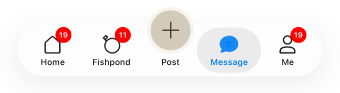 |  |
| 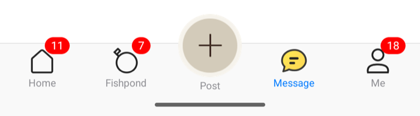 | 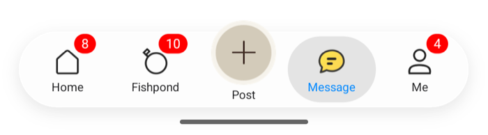 |
| 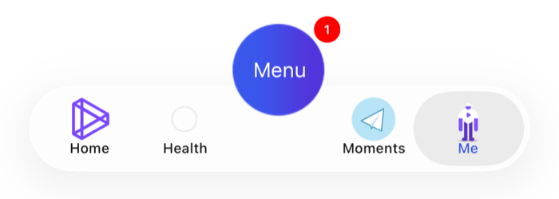 | 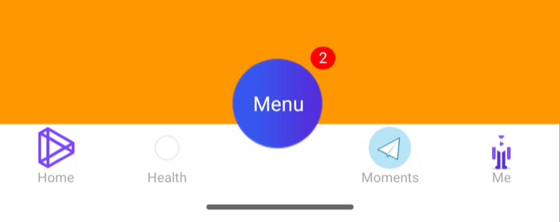 |
| 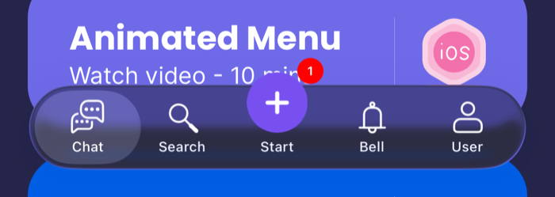 | 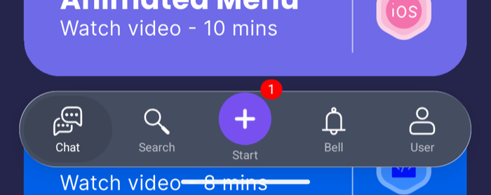 |

| 中文 | English |
|:---|:---|
| PAG 与 Rive 动效图标示例各有 React Native 与 Flutter 版本，TabBar 与 `Example-PAG`、`Example-Rive` 一致；页面中的动画用 `CYLAnimationView` 播放。见[动效图标示例](docs/Cross-Platform-Components.md#cn动效图标示例)。 | The PAG and Rive animated-icon demos each have a React Native and a Flutter version, with the same tab bar as `Example-PAG` and `Example-Rive`; animations in a page play through `CYLAnimationView`. See [Animated-icon demos](docs/Cross-Platform-Components.md#enanimated-icon-demos). |

### [CN]在 Swift 项目中使用 CYLTabBarController
### [EN]Using CYLTabBarController in a Swift project

| 中文 | English |
|:---|:---|
| 仓库提供了 Swift Demo，目录为 `Example-Swift`。 | The repository includes a Swift demo in `Example-Swift`. |
| 完整的中英文 Swift 使用指南（`import` 报错排查、初始化、PlusButton、代理、角标、Lottie、深色模式等 API 示例）：[docs/Swift-Guide.md](docs/Swift-Guide.md)。 | A full bilingual Swift guide (fixing `import` errors, initializers, PlusButton, delegates, badges, Lottie, Dark Mode and more, with code): [docs/Swift-Guide.md](docs/Swift-Guide.md). |
| SwiftUI App 中的集成方式（`UIViewControllerRepresentable`、`UIHostingController`、在 SwiftUI 中控制 TabBar）：[docs/SwiftUI-Integration.md](docs/SwiftUI-Integration.md)，示例目录 `Example-SwiftUI`。 | Integrating it in a SwiftUI app (`UIViewControllerRepresentable`, `UIHostingController`, driving the tab bar from SwiftUI): [docs/SwiftUI-Integration.md](docs/SwiftUI-Integration.md), example in `Example-SwiftUI`. |

| 中文 | English |
|:---|:---|
| 在 Swift 项目中作为静态库使用： | To use the library as a static library in a Swift project: |

| 中文 | English |
|:---|:---|
| 使用 CocoaPods： | With CocoaPods: |

 ```Objective-C
 platform :ios, '15.0'
# Uncomment the next line when you want all Pods as static framework
# use_modular_headers!
pod 'CYLTabBarController', '~> 1.99.0', :modular_headers => true
 ```

| 中文 | English |
|:---|:---|
| 作为动态库使用： | To use it as a dynamic framework: |

 ```Objective-C
platform :ios, '15.0'
use_frameworks!
 ```

| 中文 | English |
|:---|:---|
| 感谢 [@WeMadeCode](https://github.com/WeMadeCode) 提供 Swift Demo，原仓库：[WeMadeCode/CYLTabBarController-Swift](https://github.com/WeMadeCode/CYLTabBarController-Swift)。 | Thanks to [@WeMadeCode](https://github.com/WeMadeCode) for the Swift demo. Original repository: [WeMadeCode/CYLTabBarController-Swift](https://github.com/WeMadeCode/CYLTabBarController-Swift). |

| 中文 | English |
|:---|:---|
| 具体步骤可参考教程：[从头开始 Swift 2.1：主流 Tabbed 框架搭建](http://www.jianshu.com/p/c5bc2eae0f55?nomobile=yes)。 | For step-by-step instructions, see [Building a mainstream Tabbed framework with Swift 2.1](http://www.jianshu.com/p/c5bc2eae0f55?nomobile=yes). |

| 中文 | English |
|:---|:---|
| 注意：教程早期版本的示例缺少 PlusButton 尺寸设置，可能导致点击事件失效。当前教程已更新。 | Note: an early version of the tutorial omitted the PlusButton size, which could disable taps. The tutorial has since been updated. |

<p align="center"><a href="https://mp.weixin.qq.com/s/A4e5h3xgIEh6PInf1Rjqsw"></a></p>

### [CN]搭配 Storyboard 使用 CYLTabBarController
### [EN]Using CYLTabBarController with Storyboard

| 中文 | English |
|:---|:---|
| 参考： | References: |

| 中文 | English |
|:---|:---|
| [Issue 讨论](https://github.com/ChenYilong/CYLTabBarController/issues/170) | [Issue discussion](https://github.com/ChenYilong/CYLTabBarController/issues/170) |
| [CYLDeallocBlockExecutor](https://github.com/ChenYilong/CYLDeallocBlockExecutor) 中的 `CYLTabBarControllerTestDemo` 演示了如何与 Storyboard 配合使用。 | The `CYLTabBarControllerTestDemo` directory demonstrates Storyboard integration. |

### [CN]源码实现原理
### [EN]Implementation details

| 中文 | English |
|:---|:---|
| 参考：[《[Note] CYLTabBarController》](http://www.jianshu.com/p/8758d8014f86) | See [Note: CYLTabBarController](http://www.jianshu.com/p/8758d8014f86). |

| 中文 | English |
|:---|:---|
| 更多文档请查看 [CocoaDocs: CYLTabBarController](http://cocoadocs.org/docsets/CYLTabBarController/1.2.1/index.html)。 | For additional documentation, see [CocoaDocs: CYLTabBarController](http://cocoadocs.org/docsets/CYLTabBarController/1.2.1/index.html). |

## [CN]常见问题
## [EN]FAQ

| 中文 | English |
|:---|:---|
| 更多问答请查看 [docs/FAQ.md](docs/FAQ.md)，其中整理了 Issues 中的使用问答（原 issue 见 [Q-A 标签](https://github.com/ChenYilong/CYLTabBarController/issues?q=label%3AQ-A)）。 | For more questions and answers, see [docs/FAQ.md](docs/FAQ.md), which collects the usage questions from Issues (the original issues are under the [Q-A label](https://github.com/ChenYilong/CYLTabBarController/issues?q=label%3AQ-A)). |

### [CN]为什么放置 6 个 TabBarItem 会显示异常？
### [EN]Why does placing six TabBarItems behave unexpectedly?

| 中文 | English |
|:---|:---|
| Apple 规定，一个 `TabBar` 最多显示 5 个 `TabBarItem`，第六个及之后的项目不会显示。 | Apple allows a maximum of five `TabBarItem` instances in a `TabBar`; additional items are hidden. |

| 中文 | English |
|:---|:---|
| Apple 检测的是 `UITabBarItem` 及其子类。由于 PlusButton 是 `UIButton`，它不计入这五个项目。 | Because PlusButton is a `UIButton`, it is not counted as one of those five items. |

| 中文 | English |
|:---|:---|
| 因此，一个 TabBar 最多可以放置 5 个 TabBarItem 和 1 个 PlusButton。 | The practical limit is therefore five TabBarItems plus one PlusButton. |

### [CN]按钮响应区域发生偏移
### [EN]The button hit area is offset

| 中文 | English |
|:---|:---|
| 我把 Demo 两侧的 item 各去掉一个后，按钮的响应区域变成了下图的样子： | After removing one item from each side of the demo, the button hit area looked like this: |

<p align="center"><a href="https://mp.weixin.qq.com/s/A4e5h3xgIEh6PInf1Rjqsw"></a></p>

| 中文 | English |
|:---|:---|
| v1.5.5 已修复该问题，不会再出现点击区域无响应或响应区域偏移。 | This was fixed in v1.5.5; the hit area should no longer be offset. |

### [CN]如何添加选中背景色？
### [EN]How can I add a selected background color?

<p align="center"><a href="https://mp.weixin.qq.com/s/A4e5h3xgIEh6PInf1Rjqsw"></a></p>

| 中文 | English |
|:---|:---|
| Demo 中已提供实现代码，详见 `CYLTabBarControllerConfig` 的以下方法： | The demo includes an implementation in `CYLTabBarControllerConfig`: |

 ```Objective-C
/**
 *  更多TabBar自定义设置：比如：tabBarItem 的选中和不选中文字和背景图片属性、tabbar 背景图片属性
 */
- (void)customizeTabBarAppearance:(CYLTabBarController *)tabBarController;

 ```

| 中文 | English |
|:---|:---|
| 效果如下： | The result is shown below: |

<p align="center"><a href="https://mp.weixin.qq.com/s/A4e5h3xgIEh6PInf1Rjqsw"></a></p>

### [CN]ViewController 标题与 TabBar 标题不一致
### [EN]The ViewController title does not match the TabBar title

| 中文 | English |
|:---|:---|
| 当 `ViewController` 的 `self.title` 与 `tabBarItemsAttributes` 中的 `title` 不一致时，可能导致排序异常。 | If `self.title` differs from the corresponding `tabBarItemsAttributes` title, the order may appear incorrect. |

| 中文 | English |
|:---|:---|
| v1.0.7 已修复相关 bug，但仍建议不要使用 `self.title` 设置导航栏标题。 | This bug was fixed in v1.0.7, but do not use `self.title` to set the navigation bar title. |

| 中文 | English |
|:---|:---|
| 请使用 `self.navigationItem.title = @"同城";`： | Use `self.navigationItem.title = @"同城";`: |
| 切换 Tab 时底部文字闪动、或变成导航栏标题（[#258](https://github.com/ChenYilong/CYLTabBarController/issues/258)），也是 `self.title` 导致的：页面第一次被选中时才执行 `viewDidLoad`，UIKit 把其中的 `self.title` 同步写入 `tabBarItem.title`。详见 [FAQ](docs/FAQ.md#cn页面里设置-selftitle-后tab-的文字也变了)。 | A tab title that flickers when switching tabs, or turns into the navigation bar title ([#258](https://github.com/ChenYilong/CYLTabBarController/issues/258)), is also caused by `self.title`: the page runs `viewDidLoad` only when first selected, and UIKit copies its `self.title` into `tabBarItem.title`. See the [FAQ](docs/FAQ.md#ensetting-selftitle-in-a-page-also-changes-the-tab-title). |

| 中文 | English |
|:---|:---|
| `self.title = @"同城";  ` 这种方式，如果和 `tabBarItemsAttributes` 中对应的 `title` 不一致的时候可能会导致如下现象（不算 bug，但看起来也很奇怪）： | If `self.title = @"同城";` differs from the corresponding `tabBarItemsAttributes` title, the following strange-looking behavior may occur (this is not technically a bug): |

<p align="center"><a href="https://mp.weixin.qq.com/s/A4e5h3xgIEh6PInf1Rjqsw"></a></p>

| 中文 | English |
|:---|:---|
| 推荐规则如下： | Recommended usage: |

 ```Objective-C

    self.navigationItem.title = @"同城";    //✅sets navigation bar title.The right way to set the title of the navigation
    self.tabBarItem.title = @"同城";   //❌sets tab bar title. Even the `tabBarItem.title` changed, this will be ignored in  tabbar.
    self.title = @"同城1";                  //❌sets both of these. Do not do this‼️‼️ This may cause something strange like this : http://i68.tinypic.com/282l3x4.jpg

 ```

### [CN]调用 `cyl_popSelectTabBarChildViewControllerAtIndex:` 时出现黑边
### [EN]Black borders appear when calling `cyl_popSelectTabBarChildViewControllerAtIndex:`

<p align="center"><a href="https://mp.weixin.qq.com/s/A4e5h3xgIEh6PInf1Rjqsw"></a></p>

| 中文 | English |
|:---|:---|
| 这是早期 iOS 系统的问题，测试表明 iOS 9.3 已修复。 | This was an issue on older iOS versions; testing shows that it was fixed in iOS 9.3. |
| 在受影响的旧版本上，可以将根窗口背景色设置为白色： | On affected older iOS versions, set the root window background color to white: |

 ```Objective-C
//#import "CYLTabBarController.h"
    [[self cyl_tabBarController] rootWindow].backgroundColor = [UIColor whiteColor];
 ```

### [CN]iPhone Duo 展开横屏时左右出现黑边
### [EN]Black bars on the left and right of the unfolded iPhone Duo in landscape

| 中文 | English |
|:---|:---|
| 这是系统行为，与 TabBar 无关（#719、#680）。App 不支持横屏时，展开的 iPhone Duo 横放会把 App 当作竖屏窗口显示在屏幕中间，两侧留黑。只勾选 Portrait 时就是这种情况。 | This is system behavior, not the tab bar (#719, #680). When an app does not support landscape, the unfolded iPhone Duo held in landscape shows it as a portrait window in the middle of the screen, with black bars on both sides. Checking only Portrait does exactly this. |
| 要铺满内屏，需要同时满足下面三项： | To fill the inner screen, do all three: |
| 1. **启动屏有效**：`Info.plist` 使用 `UILaunchScreen`（iOS 14+），或者 `UILaunchStoryboardName` 指向一个专用的启动 storyboard。名称不带 `.storyboard` 扩展名，storyboard 里不能有自定义类，并且用 Auto Layout 适配任意尺寸。不要把 `Main.storyboard` 当作启动屏。 | 1. **A valid launch screen**: `UILaunchScreen` in `Info.plist` (iOS 14+), or `UILaunchStoryboardName` naming a dedicated launch storyboard. Give the name without the `.storyboard` extension, use no custom classes, and lay it out with Auto Layout for any size. Do not use `Main.storyboard` as the launch screen. |
| 2. **`Info.plist` 声明横屏**：`UISupportedInterfaceOrientations` 包含 `LandscapeLeft` 和 `LandscapeRight`。系统只会在这里声明过的方向中选择，代码返回的方向不能超出这个范围。 | 2. **Landscape in `Info.plist`**: `UISupportedInterfaceOrientations` includes `LandscapeLeft` and `LandscapeRight`. The system only picks from these, so code cannot return an orientation missing here. |
| 3. **运行时允许横屏**：如果实现了 `application:supportedInterfaceOrientationsForWindow:` 或 `supportedInterfaceOrientations`，在可折叠设备上返回包含横屏的值。 | 3. **Allow landscape at run time**: if you implement `application:supportedInterfaceOrientationsForWindow:` or `supportedInterfaceOrientations`, return a mask with landscape on foldable devices. |
| 普通 iPhone 仍想只用竖屏：在 `Info.plist` 中保留横屏，在代码中默认返回竖屏，检测到铰链（只有可折叠设备会报告）后再放开横屏。Demo 就是这样做的，见 `Example/CYLMainRootViewController.m` 和 `Example/ AppDelegate.m`： | To keep other iPhones portrait-only, keep landscape in `Info.plist`, return portrait in code by default, and allow landscape once a hinge is reported (only foldable devices report one). The demo does this; see `Example/CYLMainRootViewController.m` and `Example/ AppDelegate.m`: |

 ```Objective-C
// AppDelegate.m
- (UIInterfaceOrientationMask)application:(UIApplication *)application supportedInterfaceOrientationsForWindow:(UIWindow *)window {
    return self.supportsLandscapeOnFoldableDevice ? UIInterfaceOrientationMaskAllButUpsideDown : UIInterfaceOrientationMaskPortrait;
}

// Root view controller, -viewDidLoad
if (@available(iOS 27.1, *)) {
    __weak __typeof(self) weakSelf = self;
    UIHingeInteraction *hingeInteraction = [[UIHingeInteraction alloc] initWithUpdateHandler:^(UIHingeInteraction *interaction, UIHingeInteractionUpdate *update) {
        AppDelegate *appDelegate = (AppDelegate *)UIApplication.sharedApplication.delegate;
        if (!update.hinge || appDelegate.supportsLandscapeOnFoldableDevice) { return; }
        appDelegate.supportsLandscapeOnFoldableDevice = YES;
        [weakSelf setNeedsUpdateOfSupportedInterfaceOrientations];
    }];
    [self.view addInteraction:hingeInteraction];
}
 ```

| 中文 | English |
|:---|:---|
| 横屏时希望 TabBar 显示在右侧竖向栏，再设置 `tabBarController.allowsVerticalBar = YES;`。 | To show the tab bar in the trailing vertical bar in landscape, also set `tabBarController.allowsVerticalBar = YES;`. |

### [CN]凸起的图标超出 49pt 后无法响应
### [EN]A raised icon does not respond above 49pt

| 中文 | English |
|:---|:---|
| 库会自动处理，但只能保证 `UIButton` frame 内的区域可以响应。 | The library handles this automatically, but only the `UIButton` frame is guaranteed to receive taps. |

| 中文 | English |
|:---|:---|
| 请给 button 设置明显的背景色以确认实际 frame。红色区域可以响应，超出 button frame 的图片区域不能响应。 | Use a visible background color to inspect the button frame. The button area receives taps; image pixels outside the frame do not. |

<p align="center"><a href="https://mp.weixin.qq.com/s/A4e5h3xgIEh6PInf1Rjqsw"></a></p>

| 中文 | English |
|:---|:---|
| 这是因为响应链中的 `UIControl` 可以响应点击，而 `UIImage` 不能。 | This is because `UIControl` participates in hit testing, while `UIImage` does not. |

### [CN]为什么 iOS 10 会崩溃而 iOS 9 不会？
### [EN]Why does it crash on iOS 10 but not iOS 9?

| 中文 | English |
|:---|:---|
| 注册 PlusButton 时，必须在 `-application:didFinishLaunchingWithOptions:` 中调用 `[YourClass registerPlusButton]`。 | Register the PlusButton by calling `[YourClass registerPlusButton]` from `-application:didFinishLaunchingWithOptions:`. |

| 中文 | English |
|:---|:---|
| 不要在子类的 `+load` 方法中调用，否则在 iOS 10 上可能崩溃。 | Do not call it from the subclass `+load` method, as this may crash on iOS 10. |

 ```Objective-C
 + (void)load {
    [super registerPlusButton];
}
 ```

### [CN]PlusButton 选中后无法恢复为 normal
### [EN]PlusButton remains selected after selecting another tab

| 中文 | English |
|:---|:---|
| 通常有两种原因： | There are two common causes: |

| 中文 | English |
|:---|:---|
| `tabBar` 设置了自定义 delegate，覆盖了默认状态切换逻辑。请在 delegate 中手动同步状态。 | A custom `tabBar` delegate may override the default selection handling. Synchronize the state manually: |

 ```Objective-C
- (BOOL)tabBarController:(UITabBarController *)tabBarController shouldSelectViewController:(UIViewController *)viewController {
    [[self cyl_tabBarController] updateSelectionStatusIfNeededForTabBarController:tabBarController shouldSelectViewController:viewController];
    return YES;
}
 ```

| 中文 | English |
|:---|:---|
| PlusButton 添加了自定义点击事件或手势，与库内置逻辑冲突。请移除自定义 `addTarget` 或手势。 | A custom action or gesture may conflict with the library. Remove the custom `addTarget` or gesture. |

### [CN]PlusButton 与其他 TabBarItem 的间距不均匀
### [EN]The PlusButton is not evenly spaced

| 中文 | English |
|:---|:---|
| 对应 [issue #36](https://github.com/ChenYilong/CYLTabBarController/issues/36#issuecomment-269165471)。 | See [issue #36](https://github.com/ChenYilong/CYLTabBarController/issues/36#issuecomment-269165471). |

| 中文 | English |
|:---|:---|
| 将 Demo 中的： | Replace this in the demo: |

 ```Objective-C
[button sizeToFit];
 ```

| 中文 | English |
|:---|:---|
| 改为： | Replace it with: |

 ```Objective-C
button.frame = CGRectMake(0.0, 0.0, w, h);
 ```

| 中文 | English |
|:---|:---|
| 如果只放置一个相机图标，尺寸应以设计稿为准。 | For a camera-only icon, use the size specified by your design. |

| 中文 | English |
|:---|:---|
| 通常可以使用与其他 TabBarItem 相同的宽度： | In most cases, use the same width as the other TabBarItems: |

 ```Objective-C
 [UIScreen mainScreen].bounds.size.width / [CYLTabBarController allItemsInTabBarCount]
 ```

### [CN]如何兼容 Lottie 动画？
### [EN]How do I integrate Lottie animations?

| 中文 | English |
|:---|:---|
| Lottie、PAG、Rive 的接入步骤与注意事项见 [docs/Tab-Icon-Animation-Quick-Start.md](docs/Tab-Icon-Animation-Quick-Start.md)，接入前建议先运行对应的 Demo 体验一下。更早的讨论见 [issue #341](https://github.com/ChenYilong/CYLTabBarController/issues/341)。 | For the steps and things to watch for with Lottie, PAG and Rive, see [docs/Tab-Icon-Animation-Quick-Start.md](docs/Tab-Icon-Animation-Quick-Start.md); run the matching demo first to try the effect. Earlier discussion: [issue #341](https://github.com/ChenYilong/CYLTabBarController/issues/341). |

## [CN]Star 历史
## [EN]Star history

<a href="https://star-history.dera.page/ChenYilong/CYLTabBarController">
 <picture>
   <source media="(prefers-color-scheme: dark)" srcset="https://star-history.dera.page/svg?repos=ChenYilong/CYLTabBarController&theme=dark" />
   <source media="(prefers-color-scheme: light)" srcset="https://star-history.dera.page/svg?repos=ChenYilong/CYLTabBarController" />
   
 </picture>
</a>

| 中文 | English |
|:---|:---|
| （更多 iOS 开发干货，欢迎关注 [微博@iOS程序犭袁](http://weibo.com/luohanchenyilong/)） | (For more iOS development tips, follow [@iOS程序犭袁 on Weibo](http://weibo.com/luohanchenyilong/).) |

--------------------------------------------

| 中文 | English |
|:---|:---|
| 发布者：[微博@iOS程序犭袁](http://weibo.com/luohanchenyilong/) & [公众号@iTeaTime技术清谈](https://mp.weixin.qq.com/s/A4e5h3xgIEh6PInf1Rjqsw) | Posted by [@iOS程序犭袁 on Weibo](http://weibo.com/luohanchenyilong/) & [@iTeaTime技术清谈 on WeChat](https://mp.weixin.qq.com/s/A4e5h3xgIEh6PInf1Rjqsw) |

| 中文 | English |
|:---|:---|
| 原创作品，版权声明：License MIT | Original work. Copyright license: MIT. |

<p align="center"><a href="http://weibo.com/u/1692391497?s=6uyXnP" target="_blank"></a></p>
