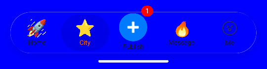
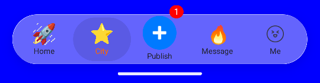
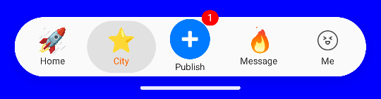
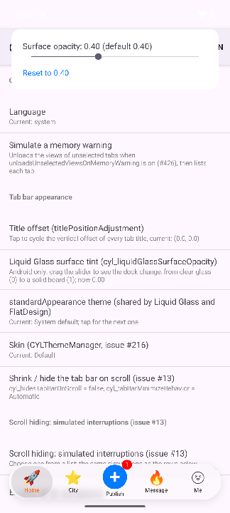

# Android 液态玻璃 / Android Liquid Glass

<!-- bound-classes: none -->
<!-- binding:start -->
<!-- Generated by scripts/update-docs-navigation.py; do not edit by hand. -->

| 中文 | English |
|:---|:---|
| 本文档不绑定代码类。 | This document is not bound to a code class. |

<!-- binding:end -->

| 中文 | English |
|:---|:---|
| iOS 的液态玻璃由系统绘制，没有可翻译的代码；Android 版本参考 Kyant 的 [AndroidLiquidGlass](https://github.com/Kyant0/AndroidLiquidGlass)（`LiquidBottomTabs`，Apache-2.0），从 Compose 改写为 View（`CYLLiquidGlass.kt`、`CYLTabBarStyle.kt`）。设置 `tabBarStyleType = CYLTabBarStyleType.LiquidGlass` 即可使用。本文说明胶囊的组成、各参数的默认值，以及可以自定义的表面着色。 | iOS draws Liquid Glass in the system, so there is no code to translate; the Android version follows Kyant's [AndroidLiquidGlass](https://github.com/Kyant0/AndroidLiquidGlass) (`LiquidBottomTabs`, Apache-2.0), rewritten from Compose to views (`CYLLiquidGlass.kt`, `CYLTabBarStyle.kt`). Set `tabBarStyleType = CYLTabBarStyleType.LiquidGlass` to use it. This page explains how the dock is built, the default values, and the surface tint you can customize. |

## [CN]目录
## [EN]Contents

<!-- navigation:start -->
<!-- Generated by scripts/update-docs-navigation.py; do not edit by hand. -->

| 中文 | English |
|:---|:---|
| [胶囊的组成](#cn胶囊的组成) | [How the dock is built](#enhow-the-dock-is-built) |
| [表面着色](#cn表面着色) | [Surface tint](#ensurface-tint) |
| [演示](#cn演示) | [Demo](#endemo) |

<!-- navigation:end -->

<!-- toc:start -->
<!-- toc:end -->

## [CN]胶囊的组成
## [EN]How the dock is built

| 中文 | English |
|:---|:---|
| 由下到上：阴影（24 dp、向下 4 dp、10 % 黑色，只画在胶囊外部）→ 玻璃（下方页面先叠加窗口背景，再经过鲜艳度 1.5、8 dp 模糊、24 dp / 24 dp 透镜）→ 表面着色（见下文）→ 选中气泡（10 % 黑色或白色；按下时放大为 78/56，带色散透镜与边缘高光，可拖动）→ Tab → 0.5 dp 边缘高光 → PlusButton（始终在最上层）。 | From bottom to top: the shadow (24 dp, 4 dp down, 10 % black, outside the dock only) → the glass (the page under it over the window's background, through vibrancy 1.5, an 8 dp blur and a 24 dp / 24 dp lens) → the surface tint (below) → the selection bubble (10 % black or white; pressed, it grows to 78/56 with a dispersion lens and a rim highlight, and can be dragged) → the tabs → the 0.5 dp rim highlight → the plus button (always on top). |
| 这些值与 `LiquidBottomTabs` 相同。Android 13+ 绘制完整玻璃，Android 12 只有模糊，更早的版本为不透明度至少 0.9 的胶囊。玻璃只在页面变化时重绘。 | These are `LiquidBottomTabs`' values. Android 13+ draws the full glass, Android 12 the blur only, older versions a capsule at least 0.9 opaque. The glass redraws only when the pages change. |

## [CN]表面着色
## [EN]Surface tint

| 中文 | English |
|:---|:---|
| 表面着色是叠加在玻璃上的一层颜色，决定胶囊在 "完全透明的玻璃" 与 "白板" 之间的位置。仅 Android 的两个属性（`CYLTabBar`）：`cyl_liquidGlassSurfaceOpacity`：0 到 1，默认 0.4（`LiquidBottomTabs` 的容器不透明度），立即生效；`cyl_liquidGlassSurfaceColor`：颜色（忽略其透明度），null 时使用 `cyl_tabBarBackgroundColor`，否则为 `#FAFAFA`（浅色）/ `#121212`（深色）。 | The surface tint is a color laid over the glass; it decides where the dock sits between clear glass and a solid board. Two Android-only properties of `CYLTabBar`: `cyl_liquidGlassSurfaceOpacity`, 0 to 1, default 0.4 (`LiquidBottomTabs`' container opacity), taking effect at once; `cyl_liquidGlassSurfaceColor`, a color (its alpha is ignored), null for `cyl_tabBarBackgroundColor`, else `#FAFAFA` (light) / `#121212` (dark). |

```kotlin
controller.tabBarStyleType = CYLEnums.CYLTabBarStyleType.LiquidGlass
controller.tabBar.cyl_liquidGlassSurfaceOpacity = 0.6f       // [EN] more opaque than the default 0.4 [CN] 比默认的 0.4 更不透明
controller.tabBar.cyl_liquidGlassSurfaceColor = Color.WHITE  // [EN] optional [CN] 可选
```

| 中文 | English |
|:---|:---|
| 同一个胶囊在蓝色页面上的效果（Android 15 模拟器，Example-GIF）： | The same dock over a blue page (Android 15 emulator, Example-GIF): |
| **0.00**：透明玻璃，只有模糊与折射后的页面，蓝色页面上的文字难以辨认。 | **0.00**: clear glass, only the blurred, refracted page; labels are hard to read on the blue page. |
|  |  |
| **0.40（默认）**：磨砂玻璃，页面的颜色透过来，文字清晰：在模糊与白板之间取得平衡。 | **0.40 (default)**: frosted glass, the page's color shows through and the labels stay readable: a balance between the blur and a board. |
|  |  |
| **1.00**：白板，看不到下方的页面。 | **1.00**: a solid board; the page under it no longer shows. |
|  |  |

## [CN]演示
## [EN]Demo

| 中文 | English |
|:---|:---|
| Example-GIF、Example-PAG、Example-Rive 与 `app` 的设置列表 "Tab bar appearance" 中有 "Liquid Glass surface tint (cyl_liquidGlassSurfaceOpacity)" 一行：点击后在屏幕顶部打开不调暗窗口的滑块面板（TabBar 不是液态玻璃时先切换为液态玻璃），拖动滑块即可实时看到底部胶囊的变化，"Reset to 0.40" 恢复默认值。 | The settings list of Example-GIF, Example-PAG, Example-Rive and `app` has a "Liquid Glass surface tint (cyl_liquidGlassSurfaceOpacity)" row under "Tab bar appearance": it opens a slider panel at the top of the screen without dimming the window (switching the bar to Liquid Glass first), so dragging the slider changes the dock at the bottom live; "Reset to 0.40" restores the default. |
|  |  |
