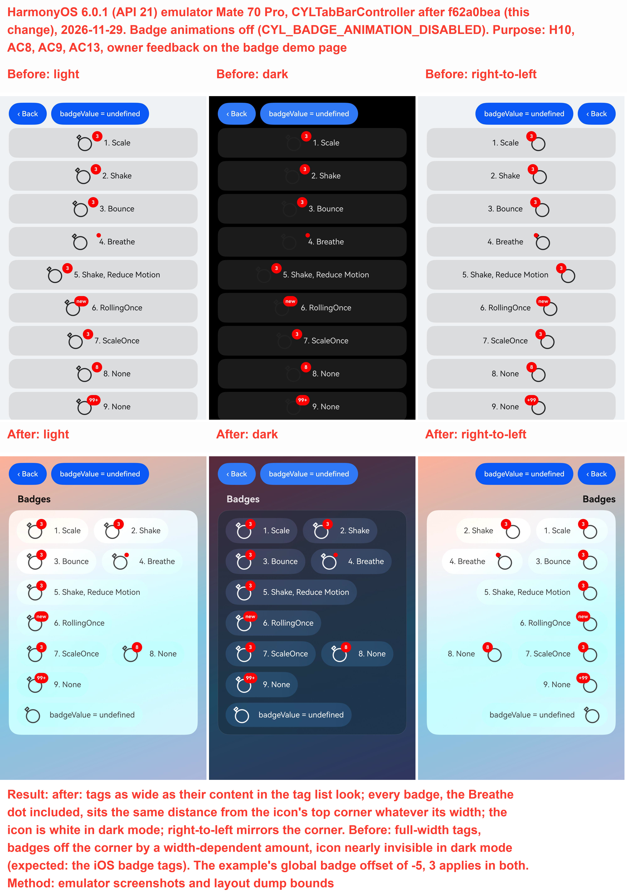
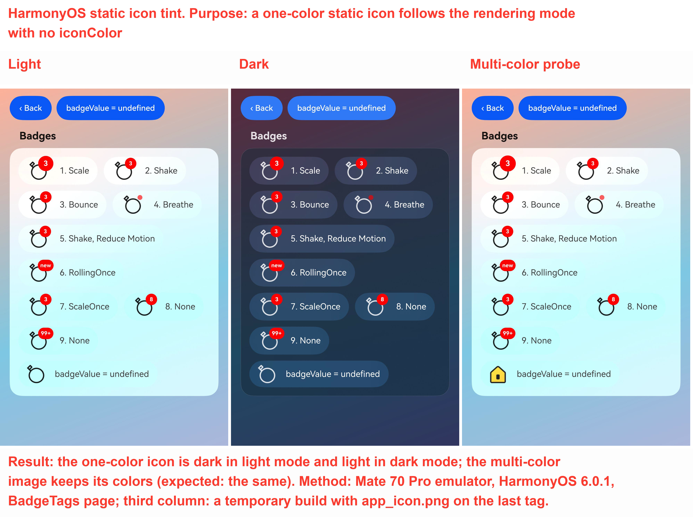
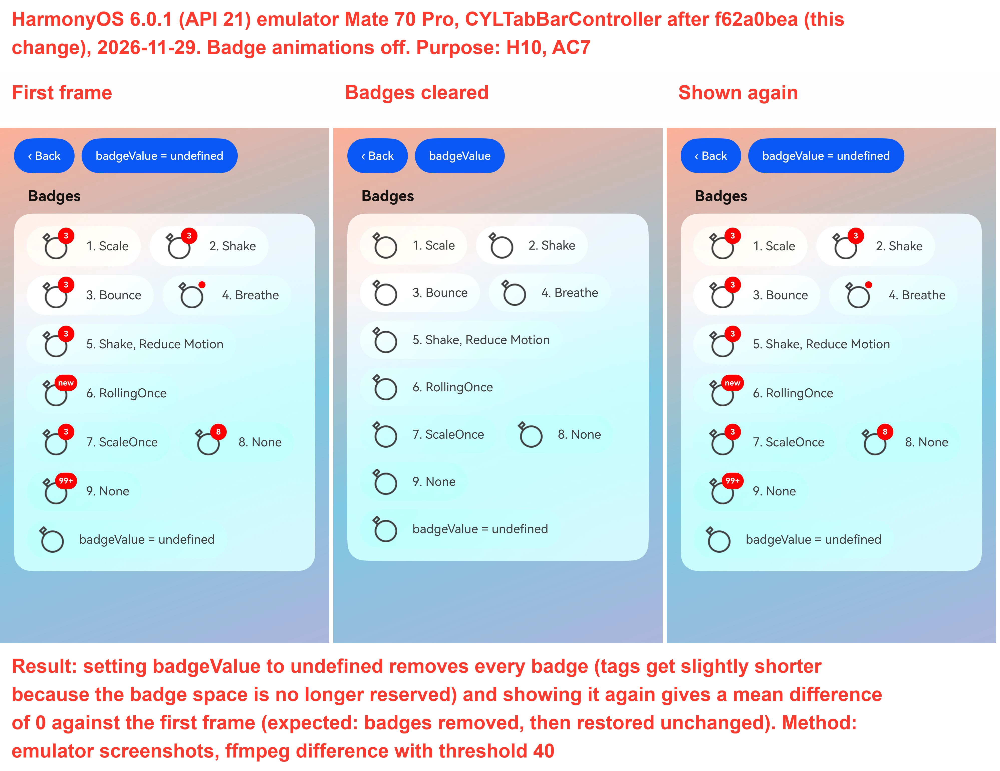
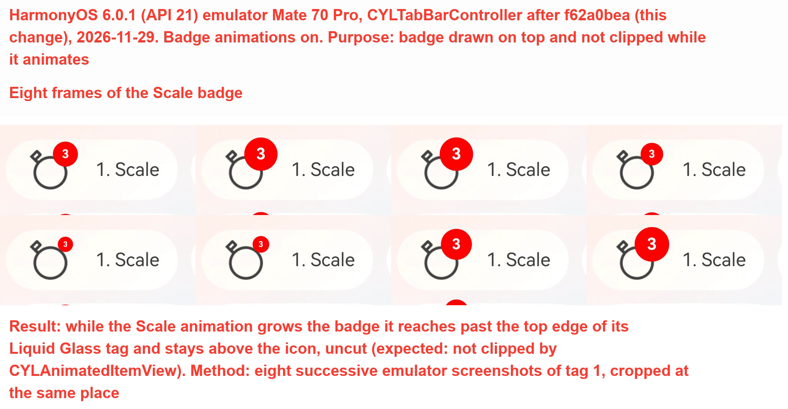

# [CN]CYLBadge 抽离与动效 item 角标：其他平台（实施指南）
# [EN]Extracting CYLBadge and badging animated items: the other platforms (implementation guide)

<!-- bound-classes: none -->
<!-- binding:start -->
<!-- Generated by scripts/update-docs-navigation.py; do not edit by hand. -->

| 中文 | English |
|:---|:---|
| 本文档不绑定代码类。 | This document is not bound to a code class. |

<!-- binding:end -->

| 中文 | English |
|:---|:---|
| 状态：**设计，尚未实现**。**发布状态：只有 iOS 已发布；Android、鸿蒙、微信小程序、React Native 与 Flutter 均未发布**（负责人，2026-11-27），所以这些平台上不符合命名规则的现有名字直接改名，不保留别名。本任务分两个阶段：**阶段 1：抽离 CYLBadge**（主要任务）；**阶段 2：CYLAnimatedItemView 支持角标**。所有平台都已有角标代码，大多已有 CYLBadge：本任务**不是从零实现角标**。每个平台先查看现有实现，再按"决策规则"选择路径。API、处理策略与验收标准以 iOS 文档（[Animated-Item-Badge.md](Animated-Item-Badge.md)）为准；两份文档不一致时以 iOS 为准，并在同一次修改中更正本文。 | Status: **design, not implemented**. **Release status: only iOS is released; Android, HarmonyOS, the WeChat Mini Program, React Native and Flutter are not released yet** (owner, 2026-11-27), so existing names on those platforms that break the naming rule are renamed directly, with no aliases. The task has two phases: **phase 1, extract CYLBadge** (the main task); **phase 2, CYLAnimatedItemView supports badges**. Every platform already has badge code, most already have a CYLBadge: this task **does not implement badges from scratch**. On each platform, read the existing implementation first, then pick the path from the "Decision rule". The API, strategy and acceptance criteria come from the iOS document ([Animated-Item-Badge.md](Animated-Item-Badge.md)); when the two disagree, iOS wins, and this one is corrected in the same change. |

## [CN]目录
## [EN]Contents

<!-- navigation:start -->
<!-- Generated by scripts/update-docs-navigation.py; do not edit by hand. -->

| 中文 | English |
|:---|:---|
| [任务记录](#cn任务记录) | [Task log](#entask-log) |
| [实施状态（2026-11-28）](#cn实施状态2026-11-28) | [Implementation status (2026-11-28)](#enimplementation-status-2026-11-28) |
| [静态编写的边界（2026-11-28）](#cn静态编写的边界2026-11-28) | [Where static writing stops (2026-11-28)](#enwhere-static-writing-stops-2026-11-28) |
| [决策规则](#cn决策规则) | [Decision rule](#endecision-rule) |
| [各平台现状（2026-11-27 查得）](#cn各平台现状2026-11-27-查得) | [What each platform has today (checked 2026-11-27)](#enwhat-each-platform-has-today-checked-2026-11-27) |
| [对齐的目标：iOS 角标 API](#cn对齐的目标ios-角标-api) | [What to align with: the iOS badge API](#enwhat-to-align-with-the-ios-badge-api) |
| [与 iOS 的差异（第 0 步更新）](#cn与-ios-的差异第-0-步更新) | [Differences from iOS (updated in step 0)](#endifferences-from-ios-updated-in-step-0) |
| [规则：每个平台一样](#cn规则每个平台一样) | [Rules: the same on every platform](#enrules-the-same-on-every-platform) |
| [命名：哪里需要 cyl 前缀（按平台重新评估）](#cn命名哪里需要-cyl-前缀按平台重新评估) | [Naming: where a cyl prefix is needed (reassessed per platform)](#ennaming-where-a-cyl-prefix-is-needed-reassessed-per-platform) |
| [生命周期：CYLUtils 是唯一入口（D8）](#cn生命周期cylutils-是唯一入口d8) | [Lifecycle: CYLUtils is the only gateway (D8)](#enlifecycle-cylutils-is-the-only-gateway-d8) |
| [阶段 1 验收标准（抽离）](#cn阶段-1-验收标准抽离) | [Phase 1 acceptance criteria (extraction)](#enphase-1-acceptance-criteria-extraction) |
| [统一 API（阶段 2 新增部分）](#cn统一-api阶段-2-新增部分) | [The common API (what phase 2 adds)](#enthe-common-api-what-phase-2-adds) |
| [统一策略](#cn统一策略) | [The common strategy](#enthe-common-strategy) |
| [各平台的分层](#cn各平台的分层) | [Layering per platform](#enlayering-per-platform) |
| [阶段 2 验收标准（item 支持）](#cn阶段-2-验收标准item-支持) | [Phase 2 acceptance criteria (item support)](#enphase-2-acceptance-criteria-item-support) |
| [Android 实施指南（路径 A：先对齐，再抽离）](#cnandroid-实施指南路径-a先对齐再抽离) | [Android implementation guide (path A: align, then extract)](#enandroid-implementation-guide-path-a-align-then-extract) |
| &nbsp;&nbsp;&nbsp;&nbsp;↳ [阶段 1：抽离 CYLBadge](#cn阶段-1抽离-cylbadge) | &nbsp;&nbsp;&nbsp;&nbsp;↳ [Phase 1: extract CYLBadge](#enphase-1-extract-cylbadge) |
| &nbsp;&nbsp;&nbsp;&nbsp;↳ [阶段 2：CYLAnimatedItemView 支持](#cn阶段-2cylanimateditemview-支持) | &nbsp;&nbsp;&nbsp;&nbsp;↳ [Phase 2: CYLAnimatedItemView support](#enphase-2-cylanimateditemview-support) |
| [鸿蒙实施指南（路径 A：先对齐，再抽离）](#cn鸿蒙实施指南路径-a先对齐再抽离) | [HarmonyOS implementation guide (path A: align, then extract)](#enharmonyos-implementation-guide-path-a-align-then-extract) |
| &nbsp;&nbsp;&nbsp;&nbsp;↳ [阶段 1：抽离 CYLBadge](#cn阶段-1抽离-cylbadge-1) | &nbsp;&nbsp;&nbsp;&nbsp;↳ [Phase 1: extract CYLBadge](#enphase-1-extract-cylbadge-1) |
| &nbsp;&nbsp;&nbsp;&nbsp;↳ [阶段 2：CYLAnimatedItemView 支持](#cn阶段-2cylanimateditemview-支持-1) | &nbsp;&nbsp;&nbsp;&nbsp;↳ [Phase 2: CYLAnimatedItemView support](#enphase-2-cylanimateditemview-support-1) |
| [微信小程序实施指南（路径 B：先抽离，再对齐）](#cn微信小程序实施指南路径-b先抽离再对齐) | [WeChat Mini Program implementation guide (path B: extract, then align)](#enwechat-mini-program-implementation-guide-path-b-extract-then-align) |
| &nbsp;&nbsp;&nbsp;&nbsp;↳ [阶段 1：抽离旧的角标实现，再对齐 iOS](#cn阶段-1抽离旧的角标实现再对齐-ios) | &nbsp;&nbsp;&nbsp;&nbsp;↳ [Phase 1: extract the old badge implementation, then align with iOS](#enphase-1-extract-the-old-badge-implementation-then-align-with-ios) |
| &nbsp;&nbsp;&nbsp;&nbsp;↳ [阶段 2：cyl-animated-item 支持](#cn阶段-2cyl-animated-item-支持) | &nbsp;&nbsp;&nbsp;&nbsp;↳ [Phase 2: cyl-animated-item support](#enphase-2-cyl-animated-item-support) |
| [React Native 实施指南（只有阶段 2）](#cnreact-native-实施指南只有阶段-2) | [React Native implementation guide (phase 2 only)](#enreact-native-implementation-guide-phase-2-only) |
| [Flutter 实施指南（只有阶段 2）](#cnflutter-实施指南只有阶段-2) | [Flutter implementation guide (phase 2 only)](#enflutter-implementation-guide-phase-2-only) |
| [顺序与分工](#cn顺序与分工) | [Order and who does what](#enorder-and-who-does-what) |
| [平台差异（待负责人同意）](#cn平台差异待负责人同意) | [Platform differences (waiting for the owner)](#enplatform-differences-waiting-for-the-owner) |
| [平台验收记录](#cn平台验收记录) | [Platform acceptance log](#enplatform-acceptance-log) |
| &nbsp;&nbsp;&nbsp;&nbsp;↳ [HarmonyOS 角标演示页反馈](#harmonyos-角标演示页反馈--harmonyos-badge-demo-feedback) | &nbsp;&nbsp;&nbsp;&nbsp;↳ [HarmonyOS badge demo feedback](#harmonyos-角标演示页反馈--harmonyos-badge-demo-feedback) |
| [所有平台的常见错误](#cn所有平台的常见错误) | [Common mistakes on every platform](#encommon-mistakes-on-every-platform) |

<!-- navigation:end -->

## [CN]任务记录
## [EN]Task log

| 中文 | English |
|:---|:---|
| 负责人反馈（2026-11-29，原文照录）："本反馈仅仅涉及cylbasge的演示页面， 鸿蒙模拟器example badge 演示部分， 应该是用taglist默认样式 ， 不应该使用固定宽度的tag。 第四项， breathe样式 ， badge角标位置 错乱。 从cylbasge的core中修改该坐标问题。 鸿蒙暗黑模式， icon 没有正确tint。导致icon不可见，cylbadge应总是在屏幕顶部， 执行动画时候， 可以超出cylanimateditemview， 其他平台应该参考iOS平台实现。" TODO（Windows 会话）：鸿蒙四项已修复并在模拟器验证（见下方"HarmonyOS 角标演示页反馈"）；Android、Flutter、React Native、小程序对照 iOS 的检查与修改尚未做。约 47 / 100 | Owner's feedback on the badge demo page (2026-11-29; the Chinese column quotes it as written): tag list default style instead of fixed-width tags; the Breathe badge is misplaced, fix the coordinates in the CYLBadge core; the icon is not tinted in HarmonyOS dark mode; the badge is always on top and may leave CYLAnimatedItemView while animating; other platforms follow iOS. TODO (Windows session): the four HarmonyOS items are fixed and checked on the emulator (see "HarmonyOS badge demo feedback" below); the check and changes of Android, Flutter, React Native and the mini program against iOS are not done. About 47 / 100 |
| 同一任务（2026-11-29，Windows，续）：React Native 示例新增角标 Tag 页（`CYLBadgeTagsPage.tsx`），并加入 Android 静态图 `cyl_still_check.png`（iOS 示例工程未加入）。Android 端部分验收，见"平台验收记录"。约 46 / 100。TODO | Same task (2026-11-29, Windows, continued): the React Native example gained a badge tag page (`CYLBadgeTagsPage.tsx`) and the still image `cyl_still_check.png` for Android (not added to the iOS example project). The Android half is partly accepted, see the platform acceptance log. About 46 / 100. TODO |
| 同一任务（2026-11-29，Windows，续）：Flutter 示例新增角标 Tag 页（`cyl_badge_tags_page.dart`）；示例清单补上缺少的 `android:supportsRtl="true"`，否则角标从右到左时不镜像；容器宽度 64 以免 "99+" 被 platform view 裁掉。Android 端部分验收，见"平台验收记录"。约 45 / 100。TODO | Same task (2026-11-29, Windows, continued): the Flutter example gained a badge tag page (`cyl_badge_tags_page.dart`); its manifest lacked `android:supportsRtl="true"`, without which badges did not mirror right-to-left; the tag box is 64 wide so the platform view does not clip "99+". The Android half is partly accepted, see the platform acceptance log. About 45 / 100. TODO |
| 同一任务（2026-11-29，Windows，续）：Android 模拟器验收（CYL_Second_API_37）。新增示例页 `DemoBadgeTagActivity`（Home → Badges →"CYLAnimatedItemView badges"）。修复核心缺陷：(1) `CYLAnimatedItemView` 从不读取布局方向，从右到左时图标仍在左侧；(2) "Shake ×3 / Bounce ×3" 示例调用三次 `play()` 后仍一直重复。结果见"平台验收记录"。TODO：HarmonyOS、小程序、React Native、Flutter 的 AC 验收；Android P1-4 与 AC4 差异待负责人决定。 | Same task (2026-11-29, Windows, continued): Android emulator acceptance (CYL_Second_API_37). New demo page `DemoBadgeTagActivity` (Home → Badges → "CYLAnimatedItemView badges"). Core bugs fixed: (1) `CYLAnimatedItemView` never read the layout direction, so right-to-left kept the icon on the left; (2) the "Shake ×3 / Bounce ×3" samples kept repeating after three `play()` calls. Results: "Platform acceptance log". TODO: AC acceptance on HarmonyOS, the mini program, React Native and Flutter; the owner's decisions on Android P1-4 and the AC4 difference. |
| 同一任务：TODO（2026-11-29，Windows）。Flutter 示例 APK 编译失败：两个封装把 Android 库源码编进自己的模块，却没有加入 `cylutils` 与 `cylbadge`；`CYLBadge` 改为按名字查找字符串，动画调试开关改为 bool 资源 `cyl_badge_animation_disabled`。现在 Flutter（`flutter test` 21 / 21、`build apk`）与 React Native（`jest` 19 / 19、`tsc`、示例 `assembleDebug`）通过。小程序 `npm test` 273 / 273。**离 100 缺的项（TODO）**：Android、HarmonyOS、小程序、React Native、Flutter 的 P1-6 与 AC1–AC13（需要角标 Tag 示例页、模拟器或开发者工具与截图）；Android P1-4 与"平台差异"需负责人决定；L1–L7（生命周期库仓库）；全部 iOS 项（需要 `Mac` 会话）。验证验收分约 41 / 100（估算），低于 60：在没有 iOS 进展时上限约 52。 | Same task: TODO (2026-11-29, Windows). The Flutter example APK did not compile: both wrappers compile the Android library sources into their own module but had not added `cylutils` and `cylbadge`; `CYLBadge` now finds its strings by name, and the animation debug switch is the bool resource `cyl_badge_animation_disabled`. Flutter (`flutter test` 21 / 21, `build apk`) and React Native (`jest` 19 / 19, `tsc`, the example's `assembleDebug`) now pass. Mini program `npm test` 273 / 273. **Missing for 100 (TODO)**: P1-6 and AC1–AC13 on Android, HarmonyOS, the mini program, React Native and Flutter (they need a badge tag demo page, an emulator or the developer tools, and screenshots); the owner's decisions on Android P1-4 and "Platform differences"; L1–L7 (the lifecycle library's repository); every iOS item (needs a `Mac` session). Verified acceptance about 41 / 100 (an estimate), below 60: without iOS progress the ceiling is about 52. |
| 同一任务（用户原话见下一行）：TODO（Windows 会话，2026-11-29）。HarmonyOS 首次在 DevEco 中构建，发现 `cylbadge` 与 `cylutils` 的 `string.json` 是空数组，hvigor 报错，`entry` 与 `cylanimateditem` 都构建失败；删除这两个文件后，`scripts/harmonyos-build.sh` 通过（两个 `entry` HAP），`cylutils`、`cylbadge`、`cylanimateditem`、`cyltabbar` 的 `assembleHar` 全部通过，node 测试 4 / 4、140 / 140、4 / 4。`BadgeEvents` 定义在 `cylbadge`（P1-9）；剩余的 `cyl_` 角标与监听器导出名改为 `cylFoo`。仍待办：模拟器与 ohosTest、P1-6、AC1–AC13 与截图。Android 的 P1-4：原样的 `grep` 仍有结果，但都不是角标 API（`cyl_showPage`、`cyl_showsAllTabs`、`cyl_showsTitleInTabBarItem`、`cyl_badgeAnchorRect` 等 TabBar 成员与 `R.string.cyl_badge_*` 资源名），等负责人决定是否改名。已验收分数约 37 / 100（估算）。 | Same task (the owner's words are in the next row): TODO (Windows session, 2026-11-29). HarmonyOS was built in DevEco for the first time: the `string.json` of `cylbadge` and `cylutils` was an empty array, which hvigor rejects, so `entry` and `cylanimateditem` failed to build; with the two files removed, `scripts/harmonyos-build.sh` passes (both `entry` HAPs), `assembleHar` passes for `cylutils`, `cylbadge`, `cylanimateditem` and `cyltabbar`, and the node tests pass 4 / 4, 140 / 140 and 4 / 4. `BadgeEvents` is defined in `cylbadge` (P1-9); the remaining `cyl_` badge and listener exports are now `cylFoo`. Still open: the emulator and ohosTest, P1-6, AC1–AC13 with screenshots. Android P1-4: the literal `grep` still has matches, none in the badge API (tab bar members such as `cyl_showPage`, `cyl_showsAllTabs`, `cyl_showsTitleInTabBarItem`, `cyl_badgeAnchorRect`, and the `R.string.cyl_badge_*` resource names); the owner decides whether to rename them. Verified score about 37 / 100 (an estimate). |
| 用户原话（2026-11-29，原文照录）："follow https://github.com/ChenYilong/CYLTabBarController/blob/feat/harmony-animated-item-engines/docs/Animated-Item-Badge.md https://github.com/ChenYilong/CYLTabBarController/blob/feat/harmony-animated-item-engines/docs/Animated-Item-Badge-CrossPlatform.md fix score to 100"。TODO（Windows 会话）：Android 已在本机构建并测试通过（Gradle 8.14.3：`testDebugUnitTest :tabpages:test lintDebug assembleRelease`）。本次补齐：`BadgeEvents` 定义在 `:cylbadge`（P1-9，事件字符串不变）；`:cylbadge` 自己的 6 个测试（P1-2），`CYLAnimatedItemBadgeTest` 7 个与 `CYLBadgeEventsTest` 2 个通过；`:cylutils`、`:cylbadge` 的 `gradle.lockfile`；`cylShowAnimationViewLastFrame` 与示例标签去掉剩余的 `cyl_` 名字（N1）。仍待办：Android 的模拟器验收（P1-6、AC1–AC13 与截图）、其他非 iOS 平台。iOS 交给 `Mac` 会话：在 `e3898040` 上 CI 的失败原因为 `CYLBadgeView.h:40` 在模块 `CYLBadge` 中引入非模块头文件，以及 `Example-Swift-04` 找不到 `CYLMenuStyleKey.titleMaxLines` / `backgroundStyle` / `sectionStyle` / `sectionBackgroundStyle`。已验收分数约 28 / 100（估算：Android 两个阶段由"静态检查"升为"目标工具链构建"，尚无 AC 通过）。 | Owner's words (2026-11-29, quoted as written): "follow https://github.com/ChenYilong/CYLTabBarController/blob/feat/harmony-animated-item-engines/docs/Animated-Item-Badge.md https://github.com/ChenYilong/CYLTabBarController/blob/feat/harmony-animated-item-engines/docs/Animated-Item-Badge-CrossPlatform.md fix score to 100". TODO (Windows session): Android is built and tested locally and passes (Gradle 8.14.3: `testDebugUnitTest :tabpages:test lintDebug assembleRelease`). Closed now: `BadgeEvents` is defined in `:cylbadge` (P1-9, same event strings); 6 tests of `:cylbadge`'s own (P1-2), and the 7 `CYLAnimatedItemBadgeTest` and 2 `CYLBadgeEventsTest` tests pass; the `gradle.lockfile` of `:cylutils` and `:cylbadge`; `cylShowAnimationViewLastFrame` and the sample labels drop the last `cyl_` names (N1). Still open: Android acceptance on an emulator (P1-6, AC1–AC13 with screenshots) and the other non-iOS platforms. iOS is for a `Mac` session: CI on `e3898040` fails because `CYLBadgeView.h:40` includes a non-modular header inside the `CYLBadge` module, and `Example-Swift-04` finds no `CYLMenuStyleKey.titleMaxLines` / `backgroundStyle` / `sectionStyle` / `sectionBackgroundStyle`. Verified score about 28 / 100 (an estimate: both Android phases move from "static check" to "built on the target toolchain"; no AC accepted yet). |
| 用户原话（2026-11-28，写明边界）："将你无法继续静态编写的结论也更新文档中" | Owner's words (2026-11-28, state the limit; quoted as written): "将你无法继续静态编写的结论也更新文档中". Done: the section "Where static writing stops" below records, per area, why more static writing cannot raise the verified score and what is needed to go on. Scores unchanged: **writing completeness 90 / 100**, **verified acceptance 16 / 100**. Nothing is marked DONE. |
| 用户原话（2026-11-28，再检查）："再次检查 看看文档是否还有可以静态编写代码能完成的 尽可能提高分数" | Owner's words (2026-11-28, another look; quoted as written): "再次检查 看看文档是否还有可以静态编写代码能完成的 尽可能提高分数". Added what can run here: `scripts/check-badge-keys.py` (the eleven keys are the same on iOS, Android, HarmonyOS, the mini program, React Native and Flutter, and the names that cross the React Native and Flutter bridges exist on both sides; wired into `scripts/check-badge-readiness.sh`), five more mini program tests (`npm test` 273 / 273: the `cyl-badge` component in a fake runtime, the tab item's use of it, the style split), the iOS `CYLTabBarHostView` on the shared parser for views (written, not built). Scores: **writing completeness 90 / 100** (unchanged: only the compile check is left), **verified acceptance 16 / 100**. Nothing is marked DONE. |
| 用户原话（2026-11-28，进度表述）："更新我今天提供给你的文档 表述所有步骤完成进度 并给出advisor评分验收标准的自我评估分数" | Owner's words (2026-11-28, status report; quoted as written): "更新我今天提供给你的文档 表述所有步骤完成进度 并给出advisor评分验收标准的自我评估分数". Done: the table "Implementation status" lists the steps of every platform. Two scores: **writing completeness 90 / 100** and **verified acceptance 15 / 100** (the advisor's standard, see the iOS document); nothing is marked DONE. |
| 用户原话（第 6 版）："更新iOS以及cross platform文档，要求cylutils 依赖于cyldealloc 这个库，其他想依赖cyldealloc 这个库，实现生命周期管理的目标，仅需依赖cylutils。cyldealloc 这个库不依赖于其他库。这对cyldealloc 这个库提出了更高要求，因为需要从更加通用的组件进行生命周期管理，而非依赖cyltanimateditemview或者其他库。更新文档，如有必要改造cyldealloc 这个库 core核心实现。" 本条按英文记录（见右列）。 | TODO, 90 / 100 (2026-11-28, Linux session; owner: write up to 90, keep 10 for the compile check). Added: Android `CYLAnimatedItemBadgeTest` (Robolectric: anchor on the icon, icon unchanged with and without a badge, dot and style keys, animation names, `reservesBadgeSpace`, the description in the label; written, not run); HarmonyOS parser split into the pure `CYLBadgeAttributeParser.ts` and the ArkUI applier `CYLBadgeAttributes.ets`, with `cylbadge/test/CYLBadgeAttributes.test.mjs`: 4 / 4 by `node --test` (the 140 existing `cylanimateditem` tests still pass); `docs/Animated-Item.md` has a row for the badge props on every platform; the "Platform acceptance log" is filled with what exists and what was verified. What is left is the compile and run check on each platform and AC1-AC13 with screenshots. Earlier entry: 89 / 100 (2026-11-28, Linux session). iOS step 9 (SwiftPM) is written: `CYLUtilsKit` and `CYLBadge` are Swift-only targets on top of the existing `CYLTabBarControllerObjC` C target, the graph is acyclic by a script; SwiftPM resolution and the run-time bundle lookup are not checked. Earlier entry: 87 / 100 (2026-11-28, Linux session). iOS steps 10 and 15 are done (Carthage targets by the xcodeproj gem; the TagList keys in CollectionViewClassifyMenu); step 9 (SwiftPM targets) stays: it needs a C target per layer, see the iOS document. Earlier entry: 84 / 100 (2026-11-28, Linux session; owner: write up to 90, keep 10 for the compile check). Added statically, not built: Android `CYLTabBarHostView` uses the shared `:cylbadge` parser (`cylApplyBadgeAttributes`, which also takes `[x, y]` lists and enum animations); HarmonyOS: the localized badge description moved into `cylbadge` (`CYLBadgeAccessibility.textProvider`, installed by `cyltabbar`, read by the item); the mini program tab bar item draws its badge through `<cyl-badge variant="tab">` with the same position and look (position stays on the host node, look moves to `cyl-badge`; `npm test` 268 / 268, not looked at in the developer tools). iOS: SwiftPM keeps building the old way (the three interface headers import the one `CYLTabBarController` module under SwiftPM, the two new headers are linked into `Package/ObjC/include`, the engine target searches `CYLBadgeView`), the Xcode framework falls back to `CYLTabBarController-Swift.h`, and the new headers are registered in the project. **Not written, and why:** iOS SwiftPM targets `CYLUtilsKit` / `CYLBadge` (step 9: each needs a C target of its own, and the localization bundle is found through `Bundle.module` of the target that holds it, so moving the Swift code changes where the strings are looked up: a build is needed to get it right), Carthage framework targets (step 10: hand-written pbxproj targets), step 15 (the TagList keys are in the CollectionViewClassifyMenu repository, D5). Earlier entry: 76 / 100 (2026-11-28, Linux session; every item below is written statically and NOT built or run: the owner verifies by hand). **Android:** `:cylutils` (new: `CYLEnums`, `CYLLocalization`, `CYLGeometry` with `CYLSize` / `CYLOffset`, `CYLFont` and `CYLEdgeInsets` extracted from `CYLTabBarItem.kt`; the only module that declares the lifecycle library, `api(libs.cyldeallocblockexecutor)`) and `:cylbadge` (new: `CYLBadge.kt`, `CYLBadgeAppearance.kt` split from `CYLBadgeExtensions.kt`, the badge strings, the `CYLBadgeAttributeKey` parser, the `cylBadgeAnimationDisabled` switch), both with `package com.cyl.tabbar` kept so no import changes (and `com.cyl.animateditem` for `CYLGeometry`); `CYLBadgeHosting` (the answer to the host question: `cylBadgeAnchorView`, `cylBadgeIconView`, `cylBadgePlacesBadge`, adopted by the tab button and the plus button so the badge no longer names them); `scripts/android-library-strings.py` writes the badge strings to `:cylbadge` and `--check` passes; settings, dependencies, publish script and the license check cover the new modules; phase 2: `CYLAnimatedItemView.badgeValue` / `badgeAttributes` / `reservesBadgeSpace` / `isShowingBadge` / `badgeAnchorView` (an anchor on the icon, placed in `placeIcon`, `reservesBadgeSpace` in measure and layout), the description after the title; the React Native Android view manager and the Flutter Android view pass the props to the item. **HarmonyOS:** `cylutils` (re-exports the lifecycle library, D8) and `cylbadge` (`CYLBadge.ets` moved from `cyltabbar`, `CYLBadgeAttributes.ets` with `CYLBadgeAttributeKey` and `cylApplyBadgeAttributes`, the debug switch) modules, imports and `oh-package.json5` files rewired, `CYLAnimatedItemView` props `badgeValue`, `badgeAttributes`, `reservesBadgeSpace`, `badgeAccessibilityLabel` with a `CYLBadgeView` overlay in the icon stack. **Still to do on a machine that builds:** compile and run everything above; `gradle.lockfile` files for `:cylutils` and `:cylbadge` (`./gradlew :cylutils:dependencies --write-locks`) and the `entry/oh-package-lock.json5` refresh (`ohpm install`); the HarmonyOS localized badge description and `CYLBadgeView` position checks; Android `CYLTabBarHostView` using the shared parser; the mini program tab bar item on `<cyl-badge>`; every acceptance item (AC1-AC13) and screenshots. Earlier entry: 58 / 100 (2026-11-28, Linux session; owner: write all remaining code statically, the owner verifies by hand). **Verified here:** React Native JS side (`npx jest` 19 / 19 and `npx tsc --noEmit` clean after `npm install --ignore-scripts`): `CYLAnimationView` props `badgeValue` (null none, "" a dot), `badgeAttributes`, `reservesBadgeSpace`, `cylBadgeNativeProps`, `CYLBadgeAttributeKey`, the Codegen spec props `badgeValue`, `badgeHidden` (default true), `badgeAttributesJSON`, `reservesBadgeSpace`. **Written, not run (no Xcode, Flutter or device):** the React Native iOS view (`CyltabbarAnimationView.mm`: sets the item's `badgeValue` / `badgeAttributes` / `reservesBadgeSpace` only when changed), Flutter `CYLAnimationView` props, `CYLBadgeAttributeKey` (`cyl_badge_attribute_key.dart`), `setBadge` / `setReservesBadgeSpace` channel calls sent only on change, the Flutter iOS plugin, a Dart test. Mini program: the tab bar methods are `cylShowBadge` / `cylClearBadge` as iOS (were `cylShowBadgeDot` / `cylRemoveBadge`), one copy of the badge keyframes (`cyl-badge/cyl_badge_animations.wxss`, both wxss files import it), `npm test` 268 / 268. **Not written:** the Android and HarmonyOS native sides and the React Native and Flutter Android bridges (they need the Android item badge API, which needs `:cylbadge` / `:cylutils`; `CYLFont` and `CYLEdgeInsets` live in `CYLTabBarItem.kt`, `CYLEnums.java` and the string resources are shared with the tab bar, so the move is not mechanical), the mini program tab bar item moving to `<cyl-badge>` (its CSS is tuned to the old markup). Earlier entry: TODO, 49 / 100 (2026-11-28, Linux session). Mini program: `src/cyl-utils/index.js` added (D8): the only module that requires the vendored lifecycle library, which `cyl-tab-bar`, `cyl-animated-item` and its events file now reach through `../cyl-utils/index`; `test/cyl_utils_layering.test.js` (3 tests) checks that only cyl-utils requires the library, that `cyl-badge` requires nothing above it and that the library requires nothing outside itself; `npm test` is 268 / 268. Earlier entry: TODO, 47 / 100 (2026-11-28, Linux session). Mini program, phase 2 written and checked by `node --test` (265 / 265, 5 new): `src/cyl-badge/` (`cyl_badge_model.js`: the iOS value semantics, the one parser `cylBadgeParseAttributes`, the view model; component `index.js/json/wxml/wxss`; `cyl_badge_animations.wxss`; the debug switch moved to `cyl_badge_debug.js`, `cyl-tab-bar/cyl_debug.js` re-exports it) and `cyl-animated-item` properties `badgeValue`, `badgeAttributes`, `reservesBadgeSpace`, `badgeAccessibilityLabel`, an anchor on the icon, the label read after the item's own. Not done for the mini program: the tab bar and `cyl-tab-bar-item` still draw their own badge markup and keep their own `@keyframes` copy (phase 1 extraction: cyl-tab-bar-item moves to `<cyl-badge>`, then the old keyframes go), `cylShowBadgeValue` / `cylShowBadge` / `cylClearBadge` renames of the tab bar, `cyl-utils` (D8), the localized badge description (the app supplies `badgeAccessibilityLabel`), the animations without a CSS class (`leftRightOnce`, `rightLeftOnce`, `fadeInOnce`, `rollingOnce` draw without animating), and every developer-tools check (AC1-AC13, screenshots). Earlier entry: TODO, 40 / 100 (2026-11-28, Linux session). Decision N4 (owner): a mini program name clash is solved by `cyl` + module name + original name (`cylBadgeFoo`), written into `docs/instructions/code.md`, the `cyl-naming` skill and `AGENTS.md`. The six clashing mini program names are renamed that way: `cyl_animation` -> `cylLottieAnimation`, `cyl_countdown` -> `cylAnimatedItemCountdown`, `cyl_player` -> `cylAnimatedItemPlayer`, `cyl_itemStyle` -> `cylTabBarItemStyle`, `cyl_playAll` -> `cylTabBarPlayAll`, `cyl_fireworks` -> `cylTabBarFireworks`; `npm test` is 260 / 260. Earlier entry: TODO, 38 / 100 (2026-11-28, Linux session). Owner answers, taken from this document and `docs/instructions/code.md` (the owner said both are already marked): (1) Android host abstraction = the same `CYLBadgeHosting` as iOS (the "no host protocol" row above), declared next to the badge code so `:cylbadge` never names a tab bar class; `CYLTabBarItemButton` and `CYLPlusButton` adopt it and `cylGetActualBadgeSuperView()` asks it first (written, not compiled, Kotlin). (2) W4 scope = the public methods of mini program component instances (N3, `code.md`: "Public methods of a WeChat Mini Program component instance: keep a prefix, spelled `cylFoo`"), not file names, event names, CSS classes, storage keys, component tags or config keys, which keep their names; I had over-counted by including those. Done: 94 component methods plus the engine contract (`cylPause`, `cylPlay`, `cylGoToAndPlay`, `cylGoToAndStop`, `cylSetProgress`, `cylSetSpeed`) renamed with no aliases, in the sources, the example, the docs and the tests; the test helper that strips the old prefix now strips both spellings. Verified: `npm test` in `CrossPlatform/wechat-miniprogram-cyltabbar` is 260 / 260 (it was 260 / 260 before). Left with the old spelling on purpose: `cylLottieAnimation`, `cylAnimatedItemCountdown`, `cylAnimatedItemPlayer`, `cylTabBarItemStyle`, `cylTabBarPlayAll`, `cylTabBarFireworks` (the new names are already taken by other members; needs a rename decision) and the example pages' own helpers. Score +10 (A2 and H2 about 8, W4 about 2, this guide 20, no acceptance item passed). Earlier entry: TODO, 28 / 100 (2026-11-28, Linux session, branch `claude/tender-galileo-0swydc`; owner: "你实现 crossplatform部分", code first, compile last). Done statically, not compiled (no Android SDK, DevEco or devtools here): step A2 (Android `View.cyl_*` badge API renamed to `cylFoo` with no aliases: 50 names, 386 uses in 23 files, `docs/Android-API-Map.md` too, commit 810a1951) and step H2 (HarmonyOS `CYLBadge` members unprefixed, `cyl_maximum` became `maximumNumber` because `maximum` is taken; localization source strings kept so the table ids stay valid, commit 578b9ec3). Not done: Android A3+ (extraction stops at a design question: `View.cylGetActualBadgeSuperView()` in `CYLBadge.kt` names `CYLTabBarItemButton` and `CYLPlusButton`, so `:cylbadge` needs a host abstraction first; per the guide this is a question for the owner), HarmonyOS H3+, step W4 (the mini program has hundreds of `cyl_*` names including file names and events, so the rename list needs the owner's scope), phase 2 on every platform, React Native, Flutter. Handed to the Win session. Score 28 / 100 (this guide 20, A2 and H2 about 8; no acceptance item passed). TODO, 20 / 100 (2026-11-27). Added "Lifecycle: CYLUtils is the only gateway (D8)" with today's direct users per platform and what replaces them; HarmonyOS and the mini program now get a CYLUtils layer (`cylutils`, `src/cyl-utils/`), so the platform difference "no cylutils" is withdrawn; steps A4, A6, H3, H5, W2 and criterion P1-9 updated. The lifecycle library's own changes (L1–L7) are in the iOS document. |
| 负责人要求（第 5 版）："更新文档，amend code.md. 全英文 更新文档 标注 除了iOS已经发布，其他平台均未发布。neither of them are released. they are waiting to release. no requires cyl_ on extensions in Kotlin, Dart and TypeScript."，并格外标注重新评估 `cyl_` 前缀必要性的理由（iOS 用 `cyl_` 是为了避免 Objective-C 分类方法覆盖集成方的同名方法；其他平台若已有机制避免，就调整策略）。本条按英文记录（见右列）。 | Done in this change (2026-11-27): `docs/instructions/code.md` amended, in English only, with the reason for `cyl_` (Objective-C categories silently override), the per-language rule (`cyl_` not required on Kotlin, Dart or TypeScript extensions; `cylFoo` on platform-type extensions and mini program component methods; no prefix on our own members, ArkTS APIs and props) and the release status (only iOS released). Decision N3 added: the mini program's `cyl_*` methods are renamed to `cylFoo` too (step W4). Score unchanged, 20 / 100. |
| 负责人回答（第 4 版）："my answer is yes for N0 … my answer is yes for N1 … my answer is yes for neither of them are released. they are waiting to release. N2" | Recorded as decisions N0–N2 (2026-11-27): `docs/instructions/code.md` and the `cyl-naming` skill amended to the naming table; the Android `View.cyl_*` and HarmonyOS `CYLBadge.cyl_*` badge APIs are unreleased, so phase 1 renames them directly (`cylFoo` / unprefixed), with no aliases (steps A2, H2, criterion P1-4). Score unchanged, 20 / 100 (documentation only). |
| 用户原话（第 3 版）："更新文档，重新评估各个crossplatform的平台方法名的命名规范，iOS上cyl_前缀目的是避免objc分类方法与集成方已有的同名方法产生冲突导致覆盖他人方法实现的问题，所以添加了cyl_前缀以此规避该问题，如果对应平台已经有方案避免该问题，适当调整策略，考虑cyl_前缀必要性。重新评估，更新文档" 本条按英文记录（见右列）。 | TODO, 20 / 100 (2026-11-27). Added "Naming: where a cyl prefix is needed": per platform, whether a name can be silently overridden or shadowed. Result: `cyl_` stays mandatory for Objective-C selectors and for mini program component methods (shared instance namespace); Kotlin and Dart extensions on platform types use `cylFoo` (members win over extensions); members of our own types (all of phase 2, HarmonyOS `CYLBadge`) and RN / Flutter props have no prefix. Released names stay. Open: N0 (amend `code.md`, which disagrees with the `cyl-naming` skill), N1, N2. |
| 用户原话（第 2 版）："更新你的文档，crossplatform 文档应遵循新的准则，本次主要任务是抽离cylbadge ，第二步骤支持cylanimateditemview。所有平台大部分已经存在旧的cylbadge，本次任务并不是从零开始实现cylbadge，先查看所在平台cylbadge现有实现。我们已知所有平台均有badge相关代码，大部分已经有了cylbadge。如果有了，cylbadge则先对齐Ios平台api后就抽离。如果没有cylbadge，就先抽离旧有的badge实现，之后再对齐iOS平台接口。之后为抽离的cylbadge完成cylanimateditemview相关api支持。" 本条按英文记录（见右列）。 | TODO, 20 / 100 (2026-11-27, branch `feat/harmony-animated-item-engines`, PR #824). Restructured into two phases with a per-platform decision rule. Existing implementations were checked (see "What each platform has today"): Android and HarmonyOS have a CYLBadge (path A: align with iOS, then extract); the mini program has badge code but no CYLBadge (path B: extract, then align); React Native and Flutter use the native badge (no extraction; phase 2 props only). Also fixed: the `animation` key values are the 10 `CYLBadgeAnimationType` names (v1 wrongly listed `rotation` / `spring`). **Rubric (100)**: this guide 20; phase 1 (extracted, aligned, P1 acceptance passed): Android 15, HarmonyOS 15, mini program 10; phase 2 (AC1–AC13 passed): Android 10, HarmonyOS 10, mini program 5, React Native 5, Flutter 5; platform differences approved 5. **Pass (60)**: the guide plus phase 1 on all three platforms and phase 2 on one. |
| 用户原话（第 1 版）："为本文档增加验收标准，达到和临时方案截图一致的效果，但使用的是新的api。并新建文档，保留原名基础上后缀加crossplatform，将本次文档改造为，增加其他项目平台的初级程序员实现指导，api以及处理策略以本文档为准后迁移到其他平台。注意每个平台里的cylbadge 遵循一样的api设计及验收标准。" 本条按英文记录（见右列）。 | Superseded by version 2 (2026-11-27, commit 80ed54dd): it treated the work as new code per platform. |

## [CN]实施状态（2026-11-28）
## [EN]Implementation status (2026-11-28)

| 中文 | English |
|:---|:---|
| Android A2 `View.cyl_*` 改名为 `cylFoo`：**已验证**（2026-11-29，本机 Gradle 构建与全部单元测试通过） | Android A2 rename `View.cyl_*` to `cylFoo`: **verified** (2026-11-29: the local Gradle build and every unit test pass) |
| Android A3 抽离 `:cylutils`、`:cylbadge`：**已构建并测试**（`:cylbadge` 自己的 7 个测试通过，两个锁文件已生成）；P1-6 通过（现有 Tab 栏角标像素一致） | Android A3 extract `:cylutils` and `:cylbadge`: **built and tested** (`:cylbadge`'s own 7 tests pass, both lockfiles written); P1-6 passes (the existing tab bar badges are pixel identical) |
| Android 阶段 2：item 角标 API、宿主解析器与角标 Tag 示例页（A12）：**已在 API 37 模拟器上验收**（2026-11-29）：AC1–AC3、AC5–AC11、AC13 通过，AC4 有一项平台差异（见"平台差异"），AC12 本地 `testDebugUnitTest :tabpages:test lintDebug assembleRelease` 通过（515 个测试，0 失败）；验收中修复了两个核心缺陷（从右到左未镜像；"×3" 动画不停止） | Android phase 2: the item badge API, the host parser and the badge tag demo page (A12): **accepted on the API 37 emulator** (2026-11-29): AC1-AC3, AC5-AC11 and AC13 pass, AC4 has one platform difference (see "Platform differences"), AC12 passes locally (`testDebugUnitTest :tabpages:test lintDebug assembleRelease`, 515 tests, 0 failures); two core bugs found in acceptance are fixed (no right-to-left mirroring; the "×3" animations never stopped) |
| HarmonyOS H2 去掉 `CYLBadge.cyl_*` 前缀：**已构建**（2026-11-29，DevEco；`cyl_maximum` 改为 `maximumNumber`） | HarmonyOS H2 unprefix `CYLBadge.cyl_*`: **built** (2026-11-29, DevEco; `cyl_maximum` became `maximumNumber`) |
| HarmonyOS H3 抽离 `cylutils`、`cylbadge`：**已构建**（各自 `assembleHar` 通过）；`entry/oh-package-lock.json5` 未单独更新；P1-6 未做 | HarmonyOS H3 extract `cylutils` and `cylbadge`: **built** (each passes `assembleHar`); `entry/oh-package-lock.json5` was not refreshed on its own; P1-6 not done |
| HarmonyOS 阶段 2：item 属性与浮层、本地化描述：**已构建并部分模拟器验收**（2026-11-29，Mate 70 Pro，HarmonyOS 6.0.1）：示例页 `BadgeTags`；AC7（清除后再显示与首帧相差 0 像素）、AC8（从右到左镜像）、AC9（深色）通过；ohosTest 76 / 76，node 测试 4 / 4、141 / 141、4 / 4、18 / 18。未验证：AC1–AC6 的逐项测量与"减弱动态效果"、AC10（`uitest dumpLayout` 不输出无障碍文本） | HarmonyOS phase 2: item props, overlay, localized description: **built and partly accepted on the emulator** (2026-11-29, Mate 70 Pro, HarmonyOS 6.0.1): example page `BadgeTags`; AC7 (cleared and shown again: 0 differing pixels against the first frame), AC8 (mirrored in right-to-left) and AC9 (dark) pass; ohosTest 76 / 76, node tests 4 / 4, 141 / 141, 4 / 4, 18 / 18. Not verified: the AC1–AC6 measurements and Reduce Motion, AC10 (`uitest dumpLayout` prints no accessibility text) |
| 小程序 W4 方法改名为 `cylFoo`（6 个冲突名按 N4 改名）：**已验证**：`npm test` 273 / 273 | Mini program W4 methods renamed to `cylFoo` (the 6 clashing names by N4): **verified**: `npm test` 273 / 273 |
| 小程序阶段 1：`cyl-utils`、`cyl-badge`、Tab 栏 item 改用 `<cyl-badge>`：部分：`cyl-utils` 分层有 3 项测试；Tab 栏 item 迁移的模型测试通过，但没有在开发者工具里看过；加号按钮角标仍用旧标记 | Mini program phase 1: `cyl-utils`, `cyl-badge`, the tab bar item through `<cyl-badge>`: partly: `cyl-utils` layering has 3 tests; the tab item model tests pass but it was not seen in the developer tools; the plus button badge still uses the old markup |
| 小程序阶段 2：`cyl-animated-item` 角标属性：**模型已验证**：`npm test` 273 / 273（2026-11-29，Windows）；未在开发者工具中看过 | Mini program phase 2: the `cyl-animated-item` badge properties: **model verified**: `npm test` 273 / 273 (2026-11-29, Windows); not seen in the developer tools |
| React Native 阶段 2：**JavaScript 已验证**（`jest` 19 / 19、`tsc` 无错误）；**示例 Android 应用已构建，Android 端部分验收（API 37 模拟器）**：清除与再显示后 0 个像素变化（AC7）、从右到左（AC8）、深色（AC9）、无障碍描述含角标（AC10）、AC13 Android 部分截图；未验证：AC6、减弱动态效果、像素测量、与原生示例对比；iOS 视图未构建 | React Native phase 2: **JavaScript verified** (`jest` 19 / 19, `tsc` clean); **the example Android app builds and the Android half is partly accepted (API 37 emulator)**: 0 changed pixels after clear and show again (AC7), right-to-left (AC8), dark (AC9), the accessibility description carries the badge (AC10), the Android part of the AC13 image; not verified: AC6, Reduce Motion, pixel measurements, a comparison with the native demo; the iOS view is not built |
| Flutter 阶段 2：**`flutter test` 21 / 21 通过，示例 APK 构建通过；Android 端部分验收（API 37 模拟器）**：清除与再显示、深色、从右到左（AC7–AC9）、无障碍描述含角标（AC10）、AC13 Android 部分截图；未验证：AC6（动画图标）、减弱动态效果、像素测量、与原生示例对比；iOS 插件未构建 | Flutter phase 2: **`flutter test` 21 / 21 pass, the example APK builds, and the Android half is partly accepted (API 37 emulator)**: clear and show again, dark, right-to-left (AC7-AC9), the accessibility description carries the badge (AC10), the Android part of the AC13 image; not verified: AC6 (animated icon), Reduce Motion, pixel measurements, a comparison with the native demo; the iOS plugin is not built |
| L1–L7 生命周期库自身的改造：**未开始**（在另一个仓库） | L1-L7 the lifecycle library's own changes: **not started** (another repository) |

| 中文 | English |
|:---|:---|
| **写作完整度：90 / 100**（所有者的尺度，最后 10 分留给编译验收） | **Writing completeness: 90 / 100** (the owner's scale, the last 10 reserved for the compile check) |
| **验证验收分：约 47 / 100**（估算，2026-11-29，同一标准。Android 阶段 1 与阶段 2 按 AC 验收计分，Flutter、React Native（Android 端）与 HarmonyOS 部分验收各另计约 1 分，非 iOS 的约 45 分中约 40 分；iOS 部分仍按约 7 / 55 计，**没有计入** `Mac` 会话推送的 iOS 修复（以其记录为准）） | **Verified acceptance: about 47 / 100** (an estimate, 2026-11-29, same standard. Android phases 1 and 2 count as accepted and the partial acceptances of Flutter, React Native (their Android halves) and HarmonyOS add about 1 point each, about 40 of the roughly 45 non-iOS points; iOS is still counted as about 7 of 55 and does **not** include the iOS fixes the `Mac` session pushed (its records apply)) |
| 两个数字不同的原因：非 iOS 平台已在目标工具链上构建并测试，但只有 Android 完成 AC 验收（Flutter 与 React Native 仅 Android 端部分验收）；验证分只数被验证过的东西，iOS 以其记录为准 | Why they differ: the non-iOS platforms are built and tested on their toolchains, but only Android has its AC accepted (Flutter and React Native only partly, on Android); the verified score counts only what was verified, and for iOS see its record |

| 中文 | English |
|:---|:---|
| 待办（所有者操作）：删除我误推的两条远端分支 `claude/badge-tag-keys`、`claude/badge-tag-keys-on-pin`，以及已废弃的 `claude/tender-galileo-0swydc`（本会话的代理禁止删除远端分支） | Open (owner action): delete the two remote branches I pushed by mistake, `claude/badge-tag-keys` and `claude/badge-tag-keys-on-pin`, and the abandoned `claude/tender-galileo-0swydc` (this session's proxy refuses deleting remote branches) |
| 待办：没有开任何 PR（会话规则：你明确要求才开） | Open: no pull request was opened (session rule: only when asked) |
| 待办：ClassifyMenu 提交前要求的 `.gitignore` 同步没有做 | Open: the `.gitignore` sync that ClassifyMenu asks for before a commit was skipped |
| 待办：`:cylutils`、`:cylbadge` 的 Gradle 锁文件缺失（`./gradlew :cylutils:dependencies :cylbadge:dependencies --write-locks`）；`entry/oh-package-lock.json5` 需要 `ohpm install` 刷新 | Open: the Gradle lockfiles of `:cylutils` and `:cylbadge` are missing (`./gradlew :cylutils:dependencies :cylbadge:dependencies --write-locks`); `entry/oh-package-lock.json5` needs `ohpm install` |
| 待办：ClassifyMenu 在 React Native、Flutter、Android、小程序、鸿蒙上的固定提交没有移动 | Open: ClassifyMenu's pins on React Native, Flutter, Android, the mini program and HarmonyOS have not moved |
| 已知损失：角标样例转成值时，工厂动画没有对应键；外边距与圆角样例没有键；跟随深色模式的边框显示为白色 | Known losses: turning a badge sample into values, factory animations have no key, the margin and corner radius samples have no key, and the border that follows Dark Mode becomes white |
| 已知限制：小程序有 4 种动画没有 CSS（`leftRightOnce`、`rightLeftOnce`、`fadeInOnce`、`rollingOnce`），角标显示但不播放 | Known limit: four mini program animations have no CSS (`leftRightOnce`, `rightLeftOnce`, `fadeInOnce`, `rollingOnce`), the badge shows without animating |

## [CN]静态编写的边界（2026-11-28）
## [EN]Where static writing stops (2026-11-28)

| 中文 | English |
|:---|:---|
| **2026-11-29 更正：下面各行是 2026-11-28 的 Linux 环境的边界。Windows 上已有 Android SDK、DevEco、Flutter 与 Node，Android、HarmonyOS、React Native、Flutter 现在都能构建（见"实施状态"）。** | **Correction, 2026-11-29: the rows below are the limits of the Linux environment of 2026-11-28. Windows has the Android SDK, DevEco, Flutter and Node, and Android, HarmonyOS, React Native and Flutter now build (see "Implementation status").** |
| **结论（2026-11-28）：能静态写、并且能在这里运行验证的内容已经写完；继续静态写不会提高验证分，只会增加未验证的代码量。** | **Conclusion (2026-11-28): what can be written statically and verified here is written; more static writing would not raise the verified score, only the amount of unverified code.** |
| iOS（Swift、Objective-C、pbxproj、podspec、Package.swift）：这里没有 Xcode、`swiftc`、`swift package`，也无法下载工具链（下载域名被代理拒绝，Docker 守护进程未运行）。剩下的改动（例如给 SwiftPM 每层加 C target）没有解析与构建就无法判断对错，写错会弄坏现在能用的 SwiftPM 路径 | iOS (Swift, Objective-C, pbxproj, podspec, Package.swift): this environment has no Xcode, `swiftc` or `swift package`, and the toolchain cannot be downloaded (the proxy refuses the download host, the Docker daemon is not running). What is left (for example a C target per SwiftPM layer) cannot be judged right or wrong without resolving and building, and a wrong one would break the SwiftPM path that works now |
| Android（Kotlin、Gradle）：没有 Android SDK，无法运行 Robolectric 或 Gradle；再多的 Kotlin 与测试也只能是"已写未运行"，按 advisor 的标准不加分 | Android (Kotlin, Gradle): no Android SDK, so neither Robolectric nor Gradle can run; more Kotlin and tests stay "written, not run", which the advisor's standard does not credit |
| HarmonyOS（ArkTS）：没有 DevEco；只有不依赖 ArkUI 的纯 `.ts` 逻辑能在 node 中运行，这部分已经拆出并测试（4 / 4）。`CYLBadgeView` 等 ArkUI 部分无法在这里运行 | HarmonyOS (ArkTS): no DevEco; only the pure `.ts` logic that does not touch ArkUI runs in node, and that part is split out and tested (4 / 4). The ArkUI parts such as `CYLBadgeView` cannot run here |
| 小程序：纯逻辑与模型已由 `node --test` 覆盖（273 / 273）；标记与样式的实际效果需要微信开发者工具，这里没有 | Mini program: the logic and the models are covered by `node --test` (273 / 273); how the markup and styles look needs the WeChat developer tools, which are not here |
| React Native：JavaScript 已由 `jest` 与 `tsc` 验证；原生的 iOS 与 Android 视图需要 Xcode 与 Android SDK | React Native: the JavaScript is verified by `jest` and `tsc`; the native iOS and Android views need Xcode and the Android SDK |
| Flutter：没有 Flutter SDK，Dart 代码与测试都不能运行 | Flutter: no Flutter SDK, so neither the Dart code nor its tests can run |
| 其他仓库：CollectionViewClassifyMenu 的 React Native、Flutter、Android、小程序、鸿蒙固定提交带有 vendored 或拉取的副本，需要各自的工具链刷新；生命周期库的改造 L1–L7 在 CYLDeallocBlockExecutor 仓库，本会话没有申请它的权限 | Other repositories: ClassifyMenu's React Native, Flutter, Android, mini program and HarmonyOS pins carry vendored or fetched copies that need their own toolchains to refresh; the lifecycle library changes L1-L7 are in the CYLDeallocBlockExecutor repository, which this session has no access to |
| 验收（AC1–AC13、截图、步骤 17）本质上需要设备或模拟器，无法静态完成 | Acceptance (AC1-AC13, screenshots, step 17) needs a device or a simulator by nature and cannot be done statically |
| **要继续提高验证分，需要这些环境之一：Mac（Xcode）、Windows（Android SDK、DevEco、微信开发者工具）、Flutter SDK；或在本会话开放 Swift / Android 工具链的下载域名。** | **To raise the verified score further, one of these is needed: a Mac (Xcode), Windows (Android SDK, DevEco, the WeChat developer tools), the Flutter SDK; or the download hosts of the Swift and Android toolchains opened for this session.** |

## [CN]决策规则
## [EN]Decision rule

| 中文 | English |
|:---|:---|
| **第 0 步（每个平台都做）**：查看该平台现有的角标实现：文件、公开 API、谁在用它、构建开关。把结果写进"各平台现状"并更新"与 iOS 的差异"表。**不要先写新代码。** | **Step 0 (every platform)**: read the platform's existing badge implementation: files, public API, who uses it, build switches. Write the result into "What each platform has today" and update the "Differences from iOS" table. **Do not write new code first.** |
| **路径 A：已有 CYLBadge** → (A1) 在原位置**对齐 iOS API**（只加缺的、改语义不同的；已发布的名字保留，必要时加别名）→ (A2) 跑通现有测试 → (A3) **抽离**成独立模块 → (A4) 阶段 1 验收。先对齐再抽离：对齐时代码还在原模块，出错容易定位；抽离只是搬家，不再改行为。 | **Path A: a CYLBadge exists** → (A1) **align it with the iOS API** where it is (add what is missing, fix what means something else; released names stay, with aliases if needed) → (A2) existing tests pass → (A3) **extract** it into its own module → (A4) phase 1 acceptance. Align first, extract second: while aligning, the code is still in its old module and failures are easy to place; extracting is then only a move, with no behaviour change. |
| **路径 B：没有 CYLBadge，只有散落的角标代码** → (B1) 把现有实现**原样抽离**成 CYLBadge 模块（行为不变，旧入口转发到新模块）→ (B2) 跑通现有测试与截图对比 → (B3) **对齐 iOS API** → (B4) 阶段 1 验收。先抽离再对齐：先把散落的代码集中起来，对齐时只需改一处。 | **Path B: no CYLBadge, only scattered badge code** → (B1) **extract** the existing implementation **as it is** into a CYLBadge module (same behaviour, old entry points forward to it) → (B2) existing tests and a screenshot comparison pass → (B3) **align it with the iOS API** → (B4) phase 1 acceptance. Extract first, align second: the scattered code is gathered first, so aligning changes one place only. |
| **阶段 2（两条路径都在阶段 1 验收后）**：为抽离出的 CYLBadge 增加 CYLAnimatedItemView 支持（`badgeValue`、`badgeAttributes`、锚点、`reservesBadgeSpace`），按 AC1–AC13 验收。React Native 与 Flutter 没有自己的角标，只做阶段 2 的属性。 | **Phase 2 (both paths, after phase 1 is accepted)**: add CYLAnimatedItemView support to the extracted CYLBadge (`badgeValue`, `badgeAttributes`, the anchor, `reservesBadgeSpace`), accepted against AC1–AC13. React Native and Flutter have no badge of their own; they only do phase 2's props. |

## [CN]各平台现状（2026-11-27 查得）
## [EN]What each platform has today (checked 2026-11-27)

| 平台 / Platform | 现有实现 / Existing implementation | 有 CYLBadge？/ CYLBadge? | 路径 / Path |
|:---|:---|:---|:---|
| iOS（参考 / reference） | subspec `CYLTabBarController/CYLBadgeView`: `UIView` / `UIBarButtonItem` / `UITabBarItem` `cyl_*` extensions, `CYLBadgeAppearance`, `CYLBadgeAnimationType` | yes | extraction designed in [Animated-Item-Badge.md](Animated-Item-Badge.md) |
| Android | `:cyltabbar` `com/cyl/tabbar/CYLBadge.kt` (`CYLBadgeView`, `CYLBadgeState`, `View.cyl_*`), `CYLBadgeExtensions.kt` (`CYLTabBarItem`, `MenuItem`, `TextView` extensions, samples); uses `CYLEnums`, `CYLFont`, `CYLOffset`, `CYLEdgeInsets`, `CYLLocalization`, `CYLReflection` of `:cyltabbar`; build switch `-PcylBadgeAnimationDisabled` | yes, close to iOS | **A** |
| HarmonyOS | `cyltabbar/src/main/ets/CYLBadge.ets`: `CYLBadgeAnimationType`, `CYLBadgeAppearance.globalAppearance`, `@Observed class CYLBadge` (state + `cyl_showBadge`, `cyl_showBadgeValue`, `cyl_clearBadge`, `cyl_pauseBadge`, `cyl_resumeBadge`, `cyl_isShowBadge`…), `struct CYLBadgeView`; samples in `CYLBadgeSamples.ets`; imports only `BuildProfile` and `curves`; switch in `cyltabbar/build-profile.json5` | yes, close to iOS | **A** |
| 小程序 / Mini Program | no CYLBadge: `cyl-tab-bar/index.js` (`cyl_showBadgeValue`, `cyl_showBadgeDot`, `cyl_removeBadge`, `cylBadgeText`, `cyl_badgeItem`, `cyl_plusBadge`), `cyl-tab-bar-item` (properties `badgeValue` with "•" for a dot and "" hidden, `badgeColor`, `badgeSize`, `badgeContentInset`, `badgePositionAdjustment`, `badgeAnimation`; markup in `index.wxml`), `cyl-tab-bar/cyl_badge_animations.wxss`, switch in `cyl-tab-bar/cyl_debug.js` | **no** | **B** |
| React Native | no badge code of its own; the host's `badgeValues` / `badgeStyles` / `plusButtonBadgeValue` go to the native host view | uses native | phase 2 only |
| Flutter | no badge code of its own; `CYLTabBarBadge` / `CYLTabBarBadgeAnimation` go to the native host view | uses native | phase 2 only |

## [CN]对齐的目标：iOS 角标 API
## [EN]What to align with: the iOS badge API

| 中文 | English |
|:---|:---|
| 对齐指：同样的概念、同样的语义、同样的枚举值与默认值；名字按"命名"一节翻译（已发布的名字保持不变；Android 与鸿蒙的角标名字尚未发布，按 N1、N2 改名）。iOS 的公开 API（`UIView+CYLBadgeExtention`、`CYLBadgeProtocol`、`CYLBadgeAppearance`）中需要每个平台都有的部分如下；平台特有的额外 API 可以保留。 | Aligning means: the same concepts, the same meaning, the same enum values and defaults; names are translated by the "Naming" section (released names stay as they are; the Android and HarmonyOS badge names are unreleased and are renamed per N1, N2). The part of the iOS public API (`UIView+CYLBadgeExtention`, `CYLBadgeProtocol`, `CYLBadgeAppearance`) every platform must have is below; extra platform APIs may stay. |

| 类别 / Kind | iOS | 语义 / Meaning |
|:---|:---|:---|
| 显示 / show | `cyl_showBadge()`, `cyl_showBadgeValue(_:)`, `cyl_showBadgeValue(_:animationType:)` | `cyl_showBadge` = a dot; value "" = a dot, a number (above the maximum shows "99+", ≤ 0 clears), "new" / "NEW" localized, other text as is |
| 清除与暂停 / clear, pause | `cyl_clearBadge()`, `cyl_resumeBadge()`, `cyl_isShowBadge()`, `cyl_isPauseBadge()` | clear removes the badge; resume replays a paused badge |
| 外观 / appearance | `cyl_badgeFont`, `cyl_badgeBackgroundColor`, `cyl_badgeTextColor`, `cyl_badgeBorderColor`, `cyl_badgeBorderWidth`, `cyl_badgeCenterOffset`, `cyl_badgeCornerRadius`, `cyl_badgeRadius`, `cyl_badgeMargin`, `cyl_badgeMaximumBadgeNumber`, `cyl_badgeRespectsReduceMotion`, `cyl_badgeAnimationType`, `cyl_resetBadgeAppearance()` | unset values follow `CYLBadgeAppearance.globalAppearance` |
| 动画 / animation | `CYLBadgeAnimationType`: `none`, `scale`, `shake`, `bounce`, `breathe`, `leftRightOnce`, `rightLeftOnce`, `fadeInOnce`, `rollingOnce`, `scaleOnce` | same order and raw values (0…9) |
| 全局 / global | `CYLBadgeAppearance.globalAppearance` | one shared default appearance |
| 事件 / events | `cyl.badge.*` through CYLDeallocBlockExecutor | the same event names |
| 阶段 2 / phase 2 | `CYLBadgeAttributeKey`, the attributes parser, `CYLBadgeHosting` | see "Phase 2" |

## [CN]与 iOS 的差异（第 0 步更新）
## [EN]Differences from iOS (updated in step 0)

| 平台 / Platform | 已知差异 / Known difference | 处理 / What to do |
|:---|:---|:---|
| Android | `View.cyl_*` names with an underscore (unreleased); `cyl_badgeFrame` is read-only (iOS can set it); extras `cyl_pauseBadge`, `cyl_attachBadge`, `cyl_detachBadge`, tab badge point | rename to `cylFoo` (N1); add the setter (`cylBadgeFrame`); keep the extras, renamed |
| Android | no host protocol (`CYLBadgeHosting`), no `cyl_moveBadgeToView` | add in phase 2 (only what the item needs) |
| HarmonyOS | a state object (`CYLBadge`) with unprefixed fields (`backgroundColor`, `fontSize`…) instead of `cyl_badge…` properties; extra `cyl_showNewBadge` | keep the object model (natural for ArkUI); unprefixed fields are right here (members of our own class, see "Naming"); rename the unreleased `cyl_showBadge`… methods to `showBadge`… (N2); record each field ↔ iOS property in this table; consider `font` next to `fontSize` |
| 小程序 / Mini Program | unreleased `cyl_*` method names; `cyl-tab-bar-item`'s internal `badgeValue` uses "•" for a dot and "" for hidden; the tab bar's `cyl_showBadgeDot` / `cyl_removeBadge` instead of `cyl_showBadge` / `cyl_clearBadge` | the new `cyl-badge` follows iOS (null none, "" dot); the unreleased tab bar methods are renamed to `cylFoo` (N3): `cylShowBadgeValue`, `cylShowBadge` (was `cyl_showBadgeDot`), `cylClearBadge` (was `cyl_removeBadge`) |
| React Native, Flutter | the host's `badgeValues` uses "" for none and "dot" for a dot | released, stays; the new item props follow iOS |

## [CN]规则：每个平台一样
## [EN]Rules: the same on every platform

| 中文 | English |
|:---|:---|
| 1. **同名（按命名规则翻译）**：每个平台使用"统一 API"表中的名字；前缀与拼写按"命名：哪里需要 cyl 前缀"决定。2. **同语义**：空值（nil / null / undefined）表示没有角标，空字符串表示红点，其他为文字。3. **同样的键**：`badgeAttributes` 的键字符串与 iOS `CYLBadgeAttributeKey` 完全相同；`animation` 的值是 10 个 `CYLBadgeAnimationType` 名字之一，或平台自己的动画对象（iOS `CAAnimation`、Android `Animator`、鸿蒙 `customAnimation` 名字），用于示例的 Rotation、Spring、×3 等行。4. **同样的策略**（"统一策略"）。5. **同样的验收标准**：阶段 1 的 P1-1–P1-9，阶段 2 的 AC1–AC13。6. **差异先记录再问**：写进"与 iOS 的差异"或"平台差异"，负责人同意后才能合并。7. **不删除、不修改已发布的公开 API**（只有 iOS 已发布）：iOS 抽离后旧的导入路径与方法照常可用；其他平台未发布，不符合规则的名字直接改名，但模块抽离后旧的导入路径仍要可用（重新导出），以免示例与下游项目同时失败。 | 1. **Same names, translated by the naming rule**: every platform uses the names in "The common API"; prefix and spelling follow "Naming: where a cyl prefix is needed". 2. **Same meaning**: an empty value (nil / null / undefined) means no badge, an empty string a dot, anything else the text. 3. **Same keys**: the key strings of `badgeAttributes` are exactly iOS `CYLBadgeAttributeKey`'s; the `animation` value is one of the 10 `CYLBadgeAnimationType` names, or the platform's own animation object (iOS `CAAnimation`, Android `Animator`, a HarmonyOS `customAnimation` name), used by the demo's Rotation, Spring and ×3 rows. 4. **Same strategy** ("The common strategy"). 5. **Same acceptance criteria**: P1-1–P1-9 for phase 1, AC1–AC13 for phase 2. 6. **Record a difference, then ask**: in "Differences from iOS" or "Platform differences"; merge only after the owner agrees. 7. **Never remove or change a released public API** (only iOS is released): on iOS, old import paths and methods keep working after extraction; the other platforms are unreleased, so rule-breaking names are renamed directly, but old import paths still work after a module is extracted (re-exports), so the demo and downstream projects do not all break at once. |

## [CN]命名：哪里需要 cyl 前缀（按平台重新评估）
## [EN]Naming: where a cyl prefix is needed (reassessed per platform)

| 中文 | English |
|:---|:---|
| **iOS 为什么用 `cyl_`**：Objective-C 分类方法在运行时加到类的方法表里，没有命名空间。分类里的方法与集成方（或系统、其他库）在同一个类上的同名方法会**静默互相覆盖**，谁后加载谁生效，别人的实现就被替换了。`cyl_` 前缀让选择器不可能重名。**评估原则**：只有在该平台上会发生"静默覆盖或被遮蔽"的地方才需要前缀；有命名空间、编译期解析或编译期报错的地方不需要。拼写跟随该语言的规范（Kotlin、Dart、JavaScript 用小驼峰，不用下划线）。这与 `cyl-naming` skill 第 2、3、7 条一致。 | **Why iOS uses `cyl_`**: Objective-C category methods are added to the class's method table at run time, with no namespace. A category method with the same name as a method the integrator (or the system, or another library) has on the same class **silently overrides it, or is overridden**: whichever loads last wins, and someone else's implementation is replaced. The `cyl_` prefix makes a selector clash impossible. **Rule for the reassessment**: a prefix is needed only where the platform can silently override or shadow a name; where there is a namespace, compile-time resolution or a compile error, it is not. The spelling follows the language (lowerCamelCase in Kotlin, Dart and JavaScript, no underscore). This matches items 2, 3 and 7 of the `cyl-naming` skill. |

| 平台与位置 / Platform, place | 会静默覆盖吗？/ Silent override? | 规则 / Rule | 例子 / Example |
|:---|:---|:---|:---|
| iOS, Objective-C category / `@objc` extension on a type we do not own | **yes**: one global method table per class, last loaded wins | selector keeps `cyl_` (mandatory); Swift name `cylFoo` | `@objc(cyl_showBadgeValue:animationType:)`, Swift `cylShowBadgeValue` |
| iOS, member of our own type (`CYLAnimatedItemView`, `CYLBadgeAppearance`) | no: the class is ours | no prefix | `badgeValue`, `badgeAnchorView` |
| Android, Kotlin extension on a platform type (`View`, `TextView`, `MenuItem`) | never overrides (resolved statically), but a **member always wins**: if Android later adds `View.showBadge()`, every call silently goes to the platform method | `cyl_` not required; `cyl` prefix in Kotlin style `cylFoo` | `View.cylApplyBadgeAttributes(…)` |
| Android, member of our class (`CYLBadgeView`, `CYLAnimatedItemView`) | no | no prefix | `badgeValue`, `isShowingBadge` |
| HarmonyOS, ArkTS | no: ArkTS cannot extend or patch system components or prototypes; every API is a member of our class or a module export (imports are explicit; a clash is a compile error) | members: no prefix; module-level exports keep the existing `cyl` camelCase style for consistency (optional) | new `CYLBadge` members `font`, `showBadgeValue` style |
| Mini program, public methods of a component instance (called through `selectComponent`) | **yes**: they share the instance namespace with the framework's own instance methods (`setData`, `triggerEvent`…) and behaviours; a same-named method silently shadows them | keep a prefix, JavaScript style `cylFoo` (unreleased: rename the existing `cyl_*` methods directly, N3) | `cylShowBadgeValue`, `cylClearBadge` |
| Mini program, properties, JS module exports, CSS classes, event names | properties: no (own component); CSS classes and event names are global per page | properties no prefix; CSS classes and events `cyl-` (already) | `badge-value`, `.cyl-badge-anchor` |
| React Native, props and ES module exports | no: object keys / module scope | no prefix (native component and module names stay prefixed: global) | `badgeValue`, `CYLBadgeAttributeKey` |
| Flutter, widget parameters and library members | no: library scope | no prefix; an extension on a Flutter type uses `cylFoo` (instance members win, as in Kotlin); channel names stay prefixed | `badgeValue`, channel `cyltabbar/animation_view` |

| 中文 | English |
|:---|:---|
| **对本任务的影响**：(1) 阶段 2 的 item API 是我们自己类型的成员，所有平台都**不加前缀**（`badgeValue`、`badgeAttributes`、`reservesBadgeSpace`、`isShowingBadge`）。(2) 加在系统类型上的新扩展：iOS 选择器 `cyl_`，Swift / Kotlin / Dart 名字 `cylFoo`。(3) 鸿蒙 `CYLBadge` 是我们自己的类，阶段 1 新增的成员不加前缀；小程序组件的公开方法用 `cylFoo`。(4) **Android 的 `View.cyl_*` 与鸿蒙的 `CYLBadge.cyl_*` 尚未发布**（负责人确认，N1、N2）：在阶段 1 直接改名为 `View.cylFoo` 与无前缀的 `CYLBadge` 成员，不保留旧名、不加别名。小程序同样未发布：组件方法保留前缀（有覆盖风险），拼写改为 `cylFoo`，直接改名（N3）。(5) "对齐 iOS"指概念与语义相同，名字按本表翻译，不是逐字照抄 iOS 选择器。 | **Effect on this task**: (1) phase 2's item API is made of members of our own types, so **no prefix** on any platform (`badgeValue`, `badgeAttributes`, `reservesBadgeSpace`, `isShowingBadge`). (2) New extensions on system types: iOS selector `cyl_`, Swift / Kotlin / Dart name `cylFoo`. (3) HarmonyOS `CYLBadge` is our class, so members added in phase 1 have no prefix; public methods of mini program components use `cylFoo`. (4) **Android's `View.cyl_*` and HarmonyOS's `CYLBadge.cyl_*` are not released yet** (confirmed by the owner, N1, N2): phase 1 renames them directly to `View.cylFoo` and unprefixed `CYLBadge` members, with no old names kept and no aliases. The mini program is unreleased too: its component methods keep a prefix (the risk is real), spelled `cylFoo`, renamed directly (N3). (5) "Align with iOS" means the same concept and meaning, with the name translated by this table, not a letter-by-letter copy of the iOS selector. |

| 编号 | 负责人的决定（2026-11-27）/ Owner decision (2026-11-27) |
|:---|:---|
| N0 | Yes: `docs/instructions/code.md` and the `cyl-naming` skill now follow the table above (done in the same change as this entry). |
| N1 | Yes, and the Android badge API is not released yet: rename `View.cyl_*` to `View.cylFoo` directly in phase 1 (step A2), no aliases, no deprecations; update every caller (the demo, the React Native and Flutter Android bridges, `:cyltabbar`). |
| N2 | Yes, and the HarmonyOS badge API is not released yet: rename `CYLBadge.cyl_*` to unprefixed members directly in phase 1 (step H2), no aliases; update every caller (`cyltabbar`, `entry`). |
| N3 | Release status: only iOS is released; Android, HarmonyOS, the WeChat Mini Program, React Native and Flutter are not. So the mini program's `cyl_*` component methods (`cyl_showBadgeValue`, `cyl_showBadgeDot`, `cyl_removeBadge`, `cyl_selectIdentifier`…) are renamed directly to `cylFoo` (step W4), and no platform except iOS keeps old names. `cyl_` is not required on Kotlin, Dart or TypeScript extensions. |
| 原话 / Words | "my answer is yes for N0 … yes for N1 … yes for neither of them are released. they are waiting to release. N2" |

## [CN]生命周期：CYLUtils 是唯一入口（D8）
## [EN]Lifecycle: CYLUtils is the only gateway (D8)

| 中文 | English |
|:---|:---|
| 与 iOS 相同（[Animated-Item-Badge.md](Animated-Item-Badge.md#enlifecycle-cylutils-is-the-only-gateway-d8)）：每个平台都是 生命周期库 ← **CYLUtils** ← CYLBadge ← CYLAnimatedItem ← TabBar。只有 CYLUtils 直接依赖生命周期库并重新导出它；其他模块要做生命周期管理只依赖 CYLUtils。生命周期库不依赖任何库，只管理通用的生命周期，不认识任何组件；它的改造（L1–L7：把 `AnimationEvents` / `BadgeEvents` 移到各自的组件，事件名不变）见 iOS 文档。因此**鸿蒙与小程序也需要 CYLUtils 层**（以前"鸿蒙不需要 cylutils"的差异作废）。 | The same as iOS ([Animated-Item-Badge.md](Animated-Item-Badge.md#enlifecycle-cylutils-is-the-only-gateway-d8)): on every platform, lifecycle library ← **CYLUtils** ← CYLBadge ← CYLAnimatedItem ← tab bar. Only CYLUtils depends on the lifecycle library directly and re-exports it; every other module that needs lifecycle management depends on CYLUtils only. The lifecycle library depends on nothing, manages only generic lifecycles and knows no component; its changes (L1–L7: move `AnimationEvents` / `BadgeEvents` to their components, same event names) are in the iOS document. Therefore **HarmonyOS and the mini program need a CYLUtils layer too** (the earlier difference "HarmonyOS needs no cylutils" is withdrawn). |

| 平台 / Platform | 今天直接依赖生命周期库的模块 / Direct users today | 改成 / Change to |
|:---|:---|:---|
| Android | `:cylanimateditem`, `:cyltabbar`, `demokit` (`implementation(libs.cyldeallocblockexecutor)`) | only `:cylutils` has `api(libs.cyldeallocblockexecutor)`; the others drop it and get it through `:cylutils` (`:cylbadge` → `api(project(":cylutils"))`, `:cylanimateditem` → `:cylbadge`, `demokit` → `:cylutils`) |
| HarmonyOS | `cylanimateditem`, `cylanimateditem_lottie`, `cylanimateditemrive`, `cyltabbar` (`"cyldeallocblockexecutor": "file:../cyldeallocblockexecutor"`) | new HAR `cylutils` with that dependency and `export * from 'cyldeallocblockexecutor'` in its `Index.ets`; the others depend on `cylutils` (or on `cylbadge`, which brings it) and import from `'cylutils'` |
| 小程序 / Mini Program | `cyl-tab-bar/index.js`, `cyl-animated-item/index.js`, `cyl-animated-item/cyl_animation_events.js` (`require('../cyl-dealloc-block-executor/index')`) | new folder `src/cyl-utils/` whose `index.js` re-exports the vendored library; every component requires `'../cyl-utils/index'`; only `cyl-utils` requires `cyl-dealloc-block-executor` |
| React Native, Flutter | the native host and item (through the iOS and Android libraries) | nothing in the wrappers; the native side follows the rule |

| 中文 | English |
|:---|:---|
| **事件常量归属（L2）**：`BadgeEvents` / `CYLBadgeEvent` 在各平台的 CYLBadge 模块中定义；`AnimationEvents` / `CYLAnimationEvent` 在 CYLAnimatedItem 中定义；名字（`cyl.badge.*`、`cyl.animation.*`）不变，用生命周期库的通用自定义事件接口发出。**检查**：Android `grep -rn "cyldeallocblockexecutor" Example-Android/*/build.gradle.kts` 只在 `cylutils` 出现；鸿蒙 `grep -rn "cyldeallocblockexecutor" CrossPlatform/harmonyos-cyltabbar/*/oh-package.json5` 只在 `cylutils`（与库本身）出现；小程序 `grep -rln "cyl-dealloc-block-executor" src` 只剩 `cyl-utils`。**避免**：(1) 在 CYLBadge 或 item 中"顺手"再加一次对生命周期库的依赖；(2) 在生命周期库里新增组件专用的常量或类型；(3) 修改 vendored 副本（用 `scripts/sync-cyldeallocblockexecutor.sh`，库改完、固定新提交后再同步）。 | **Who owns the event constants (L2)**: `BadgeEvents` / `CYLBadgeEvent` are defined in each platform's CYLBadge module; `AnimationEvents` / `CYLAnimationEvent` in CYLAnimatedItem; the names (`cyl.badge.*`, `cyl.animation.*`) do not change and are posted through the lifecycle library's generic custom-event API. **Check**: Android `grep -rn "cyldeallocblockexecutor" Example-Android/*/build.gradle.kts` shows only `cylutils`; HarmonyOS `grep -rn "cyldeallocblockexecutor" CrossPlatform/harmonyos-cyltabbar/*/oh-package.json5` shows only `cylutils` (and the library itself); mini program `grep -rln "cyl-dealloc-block-executor" src` shows only `cyl-utils`. **Avoid**: (1) adding the lifecycle library again "just in case" to CYLBadge or the item; (2) adding component-specific constants or types to the lifecycle library; (3) editing the vendored copies (use `scripts/sync-cyldeallocblockexecutor.sh` after the library is changed and its new commit pinned). |

## [CN]阶段 1 验收标准（抽离）
## [EN]Phase 1 acceptance criteria (extraction)

| 编号 | 中文 | English |
|:---|:---|:---|
| P1-1 | 第 0 步的现状与差异表已写进本文。 | Step 0's findings and the differences table are in this document. |
| P1-2 | 角标模块**单独**构建与测试通过，不依赖 TabBar 模块与 item 模块（Android `./gradlew :cylbadge:test`；鸿蒙 `cylbadge` 的 `assembleHar`；小程序 `cyl-badge` 的 node 测试）。 | The badge module builds and tests **on its own**, without the tab bar or item modules (Android `./gradlew :cylbadge:test`; HarmonyOS `assembleHar` of `cylbadge`; mini program node tests of `cyl-badge`). |
| P1-3 | 依赖方向正确：TabBar 依赖角标模块；角标模块中没有导入 TabBar 或 item 的代码（用 `grep` 证明）。 | Dependency direction: the tab bar depends on the badge module; the badge module imports nothing from the tab bar or the item (proved with `grep`). |
| P1-4 | 对齐（含命名：Android 为 `cylFoo`、鸿蒙无前缀、小程序为 `cylFoo`，在这些平台的源码中 `grep -rn "cyl_show\|cyl_clear\|cyl_remove\|cyl_badge"` 没有结果）：上面"iOS 角标 API"表的每一行在该平台都有对应，或在差异表中有负责人同意的说明。 | Aligned, names included (Android `cylFoo`, HarmonyOS unprefixed, mini program `cylFoo`: `grep -rn "cyl_show\|cyl_clear\|cyl_remove\|cyl_badge"` finds nothing in those platforms' sources): every row of "the iOS badge API" table has a counterpart on the platform, or an owner-approved entry in the differences table. |
| P1-5 | 旧用法不变：抽离前已有的所有角标测试通过（未发布平台只按 N1–N3 改名，不改断言）；旧的导入路径仍可用。 | Old usage unchanged: every badge test that existed before passes (on unreleased platforms only the N1–N3 renames change, never the assertions); old import paths still work. |
| P1-6 | 外观不变：TabBar、加号按钮与角标示例页在抽离前后截图逐像素比较，角标区域没有差异（`CYL_BADGE_ANIMATION_DISABLED` 打开）。 | Same look: screenshots of the tab bar, the plus button and the badge sample page before and after extraction show no difference in the badge areas (with `CYL_BADGE_ANIMATION_DISABLED` on). |
| P1-7 | 构建开关跟随角标模块，`docs/instructions/badges.md` 与 `docs/Badge-Debugging.md` 中的路径已更新，默认关闭。 | The build switch moved with the badge module; the paths in `docs/instructions/badges.md` and `docs/Badge-Debugging.md` are updated; default off. |
| P1-9 | 生命周期入口（D8）：只有 CYLUtils 层直接依赖生命周期库（用上节的 `grep` 证明），`BadgeEvents` 定义在角标模块中。 | Lifecycle gateway (D8): only the CYLUtils layer depends on the lifecycle library directly (proved with the `grep` of the section above), and `BadgeEvents` is defined in the badge module. |
| P1-8 | 新模块带许可证（`scripts/check-license-notices.py` 通过），发布配置包含它。 | The new module ships the license (`scripts/check-license-notices.py` passes), and the publishing setup includes it. |

## [CN]统一 API（阶段 2 新增部分）
## [EN]The common API (what phase 2 adds)

| 概念 / Concept | iOS（参考 / reference） | Android | HarmonyOS | 小程序 / Mini Program | React Native | Flutter |
|:---|:---|:---|:---|:---|:---|:---|
| 角标值 / badge value | `badgeValue: String?` | `badgeValue: String?` | `@Prop badgeValue?: string` | property `badgeValue` (attr `badge-value`) | prop `badgeValue?: string \| null` | `String? badgeValue` |
| 样式 / style | `badgeAttributes: [String: Any]?` | `badgeAttributes: Map<String, Any?>?` | `@Prop badgeAttributes?: CYLBadgeAttributes` | property `badgeAttributes` | prop `badgeAttributes?: CYLBadgeAttributes` | `Map<String, Object?>? badgeAttributes` |
| 键 / keys | `CYLBadgeAttributeKey` | `CYLBadgeAttributeKey` (object) | `CYLBadgeAttributeKey` (class of constants) | `cylBadgeAttributeKey` | `CYLBadgeAttributeKey` | `CYLBadgeAttributeKey` |
| 锚点 / anchor | `badgeAnchorView` | `badgeAnchorView: View` | the icon's `.overlay` (no public view) | the `cyl-badge-anchor` node | native | native |
| 是否显示 / showing | `isShowingBadge` | `isShowingBadge` | `isShowingBadge()` | `isShowingBadge()` method | — (native) | — (native) |
| 测量留空 / reserve room | `reservesBadgeSpace` (default NO) | `reservesBadgeSpace` (false) | `@Prop reservesBadgeSpace` (false) | property `reservesBadgeSpace` (false) | prop `reservesBadgeSpace` | `bool reservesBadgeSpace = false` |
| 宿主协议 / host protocol | `CYLBadgeHosting` | `CYLBadgeHosting` (interface) | — (component builds its own overlay) | — | — | — |
| 角标模块 / badge module | pod `CYLBadge` | module `:cylbadge` | HAR `cylbadge` | component `cyl-badge` | uses native | uses native |

| 中文 | English |
|:---|:---|
| 键（与 iOS 相同的字符串）：`value`、`color`、`animation`（10 个 `CYLBadgeAnimationType` 名字：`none`、`scale`、`shake`、`bounce`、`breathe`、`leftRightOnce`、`rightLeftOnce`、`fadeInOnce`、`rollingOnce`、`scaleOnce`，或平台的动画对象）、`radius`、`centerOffset`、`textColor`、`font`、`borderColor`、`borderWidth`、`maximumNumber`、`respectsReduceMotion`。值接受原生对象，也接受字符串（`#RRGGBB` / `#RRGGBBAA`、`{x, y}`、数字字符串）；空值与未知类型忽略并打印一次调试日志，绝不崩溃。 | Keys (the same strings as iOS): `value`, `color`, `animation` (one of the 10 `CYLBadgeAnimationType` names: `none`, `scale`, `shake`, `bounce`, `breathe`, `leftRightOnce`, `rightLeftOnce`, `fadeInOnce`, `rollingOnce`, `scaleOnce`, or the platform's animation object), `radius`, `centerOffset`, `textColor`, `font`, `borderColor`, `borderWidth`, `maximumNumber`, `respectsReduceMotion`. Values accept native objects and strings (`#RRGGBB` / `#RRGGBBAA`, `{x, y}`, numeric strings); null and unknown types are ignored with one debug log, never a crash. |

## [CN]统一策略
## [EN]The common strategy

| 中文 | English |
|:---|:---|
| S1. **角标是覆盖层，不是图片**：永远不要把"图标 + 角标"渲染成一张图片。S2. **挂在锚点上**：锚点是一个稳定的、透明的、不可交互的节点，每次布局都放在图标本身上；不要挂在静态图片节点或动画节点上（它们会隐藏或被替换）。S3. **不参与测量**：角标不改变 item 的尺寸与图标的位置；只有 `reservesBadgeSpace` 为真时，测量在两侧为伸出部分留空间。S4. **位置**：角标中心在图标的"后缘上角"加 `centerOffset`；从右到左时镜像。S5. **不能被裁剪**：item、Tag 背景与列表单元都不能裁掉角标（AC3）。S6. **无障碍**：item 的无障碍值 = 原值 + 角标描述；角标本身不是单独的无障碍元素。S7. **一份解析**：`badgeAttributes` 的解析只写在角标模块里，TabBar 宿主与 item 共用。S8. **依赖方向**：角标模块在 item 模块之下；item 与 TabBar 都依赖它；角标模块不依赖 item 或 TabBar。 | S1. **The badge is an overlay, not an image**: never render "icon + badge" into one image. S2. **On an anchor**: the anchor is a stable, transparent, non-interactive node placed on the icon itself at every layout; never on the still-image node or the animation node (they hide or get replaced). S3. **Not measured**: the badge never changes the item's size or the icon's position; only when `reservesBadgeSpace` is true does measuring reserve the overhang on both sides. S4. **Position**: the badge centre at the icon's top trailing corner plus `centerOffset`; mirrored in right-to-left. S5. **Never clipped**: neither the item, the tag background nor the list cell may clip the badge (AC3). S6. **Accessibility**: the item's accessibility value = its own value + the badge description; the badge itself is not a separate accessibility element. S7. **One parser**: `badgeAttributes` is parsed only in the badge module, shared by the tab bar host and the item. S8. **Dependency direction**: the badge module sits below the item module; the item and the tab bar both depend on it; the badge module depends on neither. |

## [CN]各平台的分层
## [EN]Layering per platform

| 平台 / Platform | 现在 / Today | 目标 / Target |
|:---|:---|:---|
| iOS | badge = subspec of CYLTabBarController | `CYLDeallocBlockExecutor` ← `CYLUtils` ← `CYLBadge` ← `CYLAnimatedItem` ← CYLTabBarController (D7, D8) |
| Android | `CYLBadge.kt`, `CYLBadgeExtensions.kt` in `:cyltabbar`; they use `CYLEnums`, `CYLFont`, `CYLOffset`, `CYLLocalization` of `:cyltabbar` | lifecycle library ← `:cylutils` ← `:cylbadge` ← `:cylanimateditem` ← `:cyltabbar` (mirrors D7, D8: the shared types the badge needs move to `:cylutils`, the only module that declares the lifecycle library) |
| HarmonyOS | `CYLBadge.ets` in `cyltabbar` (self-contained: imports only `BuildProfile` and `curves`) | `cyldeallocblockexecutor` ← `cylutils` ← `cylbadge` ← `cylanimateditem` ← `cyltabbar` (D8: `cylutils` is the lifecycle gateway, even while the badge needs no other shared code) |
| 小程序 / Mini Program | badge markup, JS and `cyl_badge_animations.wxss` inside `cyl-tab-bar` | `cyl-dealloc-block-executor` ← `cyl-utils` ← `cyl-badge` component ← `cyl-animated-item` ← `cyl-tab-bar` (D8) |
| React Native | `CYLAnimationView` wraps the native `CYLAnimatedItemView` | phase 2 only: new props passed to the native item (iOS and Android) |
| Flutter | `CYLAnimationView` wraps the native view | phase 2 only: new parameters passed to the native item (iOS and Android) |

## [CN]阶段 2 验收标准（item 支持）
## [EN]Phase 2 acceptance criteria (item support)

| 中文 | English |
|:---|:---|
| 每个平台都按 iOS 文档的 AC1–AC13 验收（[验收标准](Animated-Item-Badge.md#enacceptance-criteria)），编号与含义不变：效果与临时方案截图一致（图标居中、尺寸一致、角标在图标右上角、动画、清除后不变、从右到左、浅色与深色、无障碍），且只用新 API。下表是各平台的测法。量位置时打开该平台的 `CYL_BADGE_ANIMATION_DISABLED`，提交前关掉。 | Every platform is accepted against AC1–AC13 of the iOS document ([acceptance criteria](Animated-Item-Badge.md#enacceptance-criteria)), same numbers and meaning: the result matches the temporary fix's shot (icon centred, same size, badge at the icon's top-right, animations, unchanged after clearing, right-to-left, light and dark, accessibility), using only the new API. The table gives each platform's way to measure. When measuring positions, turn on that platform's `CYL_BADGE_ANIMATION_DISABLED`, and off again before committing. |

| AC | Android | HarmonyOS | 小程序 / Mini Program | React Native | Flutter |
|:---|:---|:---|:---|:---|:---|
| AC1–AC3, AC7 | emulator screenshot + pixels; Robolectric test of view bounds | emulator screenshot + pixels; `componentUtils.getRectangleById` in an ohosTest | DevTools screenshot + pixels; `createSelectorQuery().boundingClientRect` in a node test | the example app on both native platforms (it uses the native item) | the example app on both native platforms |
| AC4 (new API, no snapshot) | `grep -rn "Bitmap\|Canvas(" ` in the demo's badge page finds nothing | `grep` the demo page: no `componentSnapshot`, no `PixelMap` | `grep` the demo page: no `canvas` / `createOffscreenCanvas` | `grep` the example: no image composition | `grep` the example: no `RepaintBoundary` / `toImage` |
| AC5 (animations) | screen recording | screen recording | DevTools recording | recording | recording |
| AC6 (animated icon) | Robolectric: start the animation, badge `isShown` and bounds unchanged | ohosTest | node test with the player mocked | covered by native | covered by native |
| AC8 (RTL) | `android:supportsRtl`, Arabic locale | Arabic locale, `direction(Direction.Rtl)` | `dir="rtl"` page | `I18nManager.forceRTL(true)` | `Directionality(textDirection: TextDirection.rtl)` |
| AC10 (accessibility) | `contentDescription` / `stateDescription` test; TalkBack | `accessibilityText` / `accessibilityDescription` test; screen reader | `aria-label` test | `accessibilityValue` from native | `Semantics` from native |
| AC11 (old usage) | existing `:cyltabbar` badge tests pass | existing `cyltabbar` tests pass | existing `cyl-tab-bar` node tests pass | existing jest tests pass | existing `flutter test` passes |
| AC12 (build) | `./gradlew :cylutils:test :cylbadge:test :cylanimateditem:test :cyltabbar:test assembleDebug` | `hvigorw assembleHar` for each module, `assembleHap` for `entry` | `npm test` (node), DevTools compile | `yarn test`, iOS and Android builds of the example | `flutter test`, `flutter build ios --no-codesign`, `flutter build apk` |
| AC13 (screenshots) | `scripts/stitch-screenshots.py`, next to the iOS reference shot | same | same | same | same |

## [CN]Android 实施指南（路径 A：先对齐，再抽离）
## [EN]Android implementation guide (path A: align, then extract)

| 中文 | English |
|:---|:---|
| 目标分层 `:cylutils` ← `:cylbadge` ← `:cylanimateditem` ← `:cyltabbar`。先读 `docs/instructions/cross-platform.md`、`windows-harmonyos.md`、`docs/Android-API-Map.md`。 | Target layering `:cylutils` ← `:cylbadge` ← `:cylanimateditem` ← `:cyltabbar`. Read `docs/instructions/cross-platform.md`, `windows-harmonyos.md` and `docs/Android-API-Map.md` first. |

### [CN]阶段 1：抽离 CYLBadge
### [EN]Phase 1: extract CYLBadge

| 步骤 / Step | 中文 | English |
|:---|:---|:---|
| A0 | 查看现有实现：读 `CYLBadge.kt` 与 `CYLBadgeExtensions.kt`，列出全部 `View.cyl_*` 成员、它们用到的 `:cyltabbar` 类型、谁调用它们（`grep -rn "cyl_showBadge" Example-Android`），更新"与 iOS 的差异"表。 | Read the existing implementation: `CYLBadge.kt` and `CYLBadgeExtensions.kt`; list every `View.cyl_*` member, the `:cyltabbar` types they use, and their callers (`grep -rn "cyl_showBadge" Example-Android`); update "Differences from iOS". |
| A1 | 基线：`./gradlew test assembleDebug` 通过，记下测试数；为 P1-6 截下 TabBar、加号按钮与角标示例页（`-PcylBadgeAnimationDisabled=true`）。 | Baseline: `./gradlew test assembleDebug` passes, write down the test count; for P1-6, take shots of the tab bar, the plus button and the badge sample page (`-PcylBadgeAnimationDisabled=true`). |
| A2 | **对齐**（仍在 `:cyltabbar` 中）：先把未发布的 `View.cyl_*` 全部改名为 `View.cylFoo`（N1：`cyl_showBadgeValue` → `cylShowBadgeValue`，`cyl_badgeFont` → `cylBadgeFont`…），用 IDE 的重命名改掉所有调用方（示例、React Native 与 Flutter 的 Android 桥接、`:cyltabbar`）；再按差异表补齐，例如 `cylBadgeFrame` 加 setter；核对 `CYLBadgeAnimationType` 的顺序与 iOS 相同（0…9）；核对 `cyl_showBadgeValue` 的语义（"" 红点、≤ 0 清除、超过最大值 "99+"、"new" 本地化）。每补一项加一个单元测试。 | **Align** (still inside `:cyltabbar`): first rename every unreleased `View.cyl_*` to `View.cylFoo` (N1: `cyl_showBadgeValue` → `cylShowBadgeValue`, `cyl_badgeFont` → `cylBadgeFont`…) with the IDE's rename, so every caller follows (the demo, the React Native and Flutter Android bridges, `:cyltabbar`); then close the gaps in the differences table, e.g. a setter for `cylBadgeFrame`; check `CYLBadgeAnimationType`'s order matches iOS (0…9); check `cyl_showBadgeValue`'s meaning ("" a dot, ≤ 0 clears, above the maximum "99+", "new" localized). Add one unit test per fix. |
| A3 | `./gradlew :cyltabbar:test` 通过，提交"对齐"这一步。 | `./gradlew :cyltabbar:test` passes; commit the alignment step. |
| A4 | 新建 `:cylutils`（`api(libs.cyldeallocblockexecutor)`，唯一声明生命周期库的模块，D8），移入角标需要的共享类型（`CYLEnums`、`CYLFont`、`CYLOffset`、`CYLEdgeInsets`、`CYLLocalization` 及其字符串资源、`CYLReflection`），**包名保持 `com.cyl.tabbar`**（同一个包可以分布在多个模块），公开 API 一个字都不变。`CYLEnums` 若引用了 TabBar 类型，先停下来问。 | Create `:cylutils` (`api(libs.cyldeallocblockexecutor)`, the only module that declares the lifecycle library, D8) and move the shared types the badge needs (`CYLEnums`, `CYLFont`, `CYLOffset`, `CYLEdgeInsets`, `CYLLocalization` with its string resources, `CYLReflection`), **keeping the package `com.cyl.tabbar`** (one package may span modules), so not one character of the public API changes. If `CYLEnums` references tab bar types, stop and ask. |
| A5 | 新建 `:cylbadge`（只依赖 `:cylutils`；生命周期库经 `:cylutils` 得到，D8），用 `git mv` 移入 `CYLBadge.kt` 与和 TabBar 无关的扩展（`View`、`TextView`）；`CYLTabBarItem`、`CYLPlusButton`、`MenuItem` 的扩展与示例数据留在 `:cyltabbar`。构建开关 `cylBadgeAnimationDisabled` / `BuildConfig.CYL_BADGE_ANIMATION_DISABLED` 移到 `:cylbadge`。许可证：`src/main/resources/META-INF/cylbadge/LICENSE`。 | Create `:cylbadge` (depending on `:cylutils` only; the lifecycle library comes through `:cylutils`, D8) and `git mv` `CYLBadge.kt` and the extensions unrelated to the tab bar (`View`, `TextView`) into it; the `CYLTabBarItem`, `CYLPlusButton` and `MenuItem` extensions and the samples stay in `:cyltabbar`. The build switch `cylBadgeAnimationDisabled` / `BuildConfig.CYL_BADGE_ANIMATION_DISABLED` moves to `:cylbadge`. License: `src/main/resources/META-INF/cylbadge/LICENSE`. |
| A6 | 接上依赖：`:cyltabbar` 加 `api(project(":cylbadge"))`，并删除 `:cyltabbar`、`:cylanimateditem`、`demokit` 中的 `implementation(libs.cyldeallocblockexecutor)`；`BadgeEvents` 改用 `:cylbadge` 中定义的常量（L2）；`settings.gradle.kts` 两个 `include` 列表**都**加上新模块；Maven 发布与 `scripts/check-license-notices.py` 同步。 | Wire the dependencies: `:cyltabbar` gets `api(project(":cylbadge"))`, and `implementation(libs.cyldeallocblockexecutor)` leaves `:cyltabbar`, `:cylanimateditem` and `demokit`; `BadgeEvents` becomes the constants defined in `:cylbadge` (L2); add the new modules to **both** `include` lists of `settings.gradle.kts`; keep Maven publishing and `scripts/check-license-notices.py` in step. |
| A7 | 阶段 1 验收 P1-1–P1-9（截图与 A1 的逐像素比较），提交"抽离"这一步。 | Phase 1 acceptance P1-1–P1-9 (screenshots compared pixel by pixel with A1's), commit the extraction step. |

```kotlin
// :cylbadge/build.gradle.kts (sketch)
plugins { id("com.android.library"); kotlin("android") }
android {
    namespace = "com.cyl.badge"          // the R class namespace only; Kotlin packages stay com.cyl.tabbar
    buildFeatures { buildConfig = true }
    defaultConfig {
        val disabled = (project.findProperty("cylBadgeAnimationDisabled") as String?) == "true"
        buildConfigField("boolean", "CYL_BADGE_ANIMATION_DISABLED", disabled.toString())   // default false
    }
}
dependencies {
    api(project(":cylutils"))           // brings the lifecycle library (D8); never declare it here
}
```

### [CN]阶段 2：CYLAnimatedItemView 支持
### [EN]Phase 2: CYLAnimatedItemView support

| 步骤 / Step | 中文 | English |
|:---|:---|:---|
| A8 | `:cylanimateditem` 加 `api(project(":cylbadge"))`。Liquid Glass 规则在 `:cylanimateditem` 的 `CYLLiquidGlass.kt`：若角标需要它，按 iOS D2 移到 `:cylutils`，`:cylanimateditem` 转发；不需要就不动。 | `:cylanimateditem` gets `api(project(":cylbadge"))`. The Liquid Glass rule is `CYLLiquidGlass.kt` in `:cylanimateditem`: if the badge needs it, move it to `:cylutils` as iOS D2 does, with `:cylanimateditem` forwarding; otherwise leave it. |
| A9 | 锚点：`CYLAnimatedItemView` 是 `FrameLayout`，新增 `badgeAnchorView`（`FrameLayout`，`clipChildren = false`），在 `onLayout` 中放到图标本身。 | The anchor: `CYLAnimatedItemView` is a `FrameLayout`; add `badgeAnchorView` (a `FrameLayout` with `clipChildren = false`) and place it on the icon itself in `onLayout`. |
| A10 | 属性 `badgeValue`、`badgeAttributes`、`isShowingBadge`、`reservesBadgeSpace`；`CYLBadgeAttributeKey` 与解析函数放在 `:cylbadge`，`CYLTabBarHostView` 的 `badgeStyles` 解析改用它。 | Properties `badgeValue`, `badgeAttributes`, `isShowingBadge`, `reservesBadgeSpace`; `CYLBadgeAttributeKey` and the parser live in `:cylbadge`, and `CYLTabBarHostView`'s `badgeStyles` parsing switches to it. |
| A11 | 无障碍：`stateDescription`（API 30+）或 `contentDescription` 末尾加角标描述，清除时恢复；锚点 `importantForAccessibility = NO_HIDE_DESCENDANTS`。 | Accessibility: append the badge description to `stateDescription` (API 30+) or `contentDescription`, restore on clear; the anchor gets `importantForAccessibility = NO_HIDE_DESCENDANTS`. |
| A12 | 示例改用 `badgeValue`，删除合成位图的代码；Robolectric 测试覆盖 AC1–AC3、AC6、AC7、AC10；模拟器验收 AC1–AC13 并截图；更新 `docs/Android-API-Map.md`、本文与 `cyl-api-map`。 | The demo uses `badgeValue`, with the bitmap composition removed; Robolectric tests cover AC1–AC3, AC6, AC7, AC10; accept AC1–AC13 on the emulator with screenshots; update `docs/Android-API-Map.md`, this document and `cyl-api-map`. |

```kotlin
// :cylanimateditem — CYLAnimatedItemView.kt (new members only)
val badgeAnchorView: FrameLayout by lazy {
    FrameLayout(context).apply {
        clipChildren = false
        isClickable = false
        isFocusable = false
        importantForAccessibility = IMPORTANT_FOR_ACCESSIBILITY_NO_HIDE_DESCENDANTS
        this@CYLAnimatedItemView.addView(this, LayoutParams(0, 0))
    }
}
var badgeValue: String? = null
    set(value) { if (field == value) return; field = value; updateBadge() }
var badgeAttributes: Map<String, Any?>? = null
    set(value) { field = value; updateBadge() }
var reservesBadgeSpace = false
    set(value) { field = value; requestLayout() }
val isShowingBadge: Boolean get() = badgeAnchorView.cylIsShowBadge()

private fun updateBadge() {
    val value = badgeValue ?: run { badgeAnchorView.cylClearBadge(); refreshBadgeAccessibility(); return }
    val attributes = badgeAttributes.orEmpty()
    badgeAnchorView.cylApplyBadgeAttributes(attributes)                  // :cylbadge, the one parser (a View extension: cyl prefix, Kotlin style)
    badgeAnchorView.cylShowBadgeValue(value, CYLBadgeAttributeKey.animationType(attributes))
    refreshBadgeAccessibility()
}

// in onLayout, after the icon is laid out:
badgeAnchorView.layout(glyph.left, glyph.top, glyph.right, glyph.bottom)
badgeAnchorView.bringToFront()
```

| 中文 | English |
|:---|:---|
| **Android 要避免**：(1) 先抽离再对齐（路径 A 要先对齐）；(2) 抽离时改行为（抽离只是搬家）；(3) 改包名（违反公开 API 规则）；改名时漏掉 React Native / Flutter 的 Android 桥接或示例中的调用（编译失败）；给未发布的旧名加别名（N1 决定直接改名）；(4) `ViewGroup` 默认 `clipChildren = true`：item、Tag、RecyclerView 单元都要检查（AC3）；(5) 锚点用普通 `View`：角标会进父视图的 overlay；(6) 只改一个 `include` 列表；(7) 用 `implementation` 而不是 `api`；(8) 在 `onLayout` 里调用 `requestLayout()`。 | **Android, avoid**: (1) extracting before aligning (path A aligns first); (2) changing behaviour while extracting (extraction is only a move); (3) changing package names (against the public API rule); missing a caller in the React Native / Flutter Android bridges or the demo when renaming (build fails); adding aliases for the unreleased old names (N1 says rename directly); (4) `ViewGroup`'s default `clipChildren = true`: check the item, the tag and the RecyclerView cell (AC3); (5) a plain `View` as the anchor: the badge goes into the parent's overlay; (6) changing only one `include` list; (7) `implementation` instead of `api`; (8) calling `requestLayout()` inside `onLayout`. |

## [CN]鸿蒙实施指南（路径 A：先对齐，再抽离）
## [EN]HarmonyOS implementation guide (path A: align, then extract)

| 中文 | English |
|:---|:---|
| 目标分层 `cylbadge` ← `cylanimateditem` ← `cyltabbar`。先读 `windows-harmonyos.md` 与 `cyl-harmonyos-a11y-l10n` skill；从 ASCII 路径构建（例如 `C:\cyl-hm`）；每一步都构建 `entry`（`cyltabbar` 与 `cylanimateditem` 必须始终可构建）。 | Target layering `cylbadge` ← `cylanimateditem` ← `cyltabbar`. Read `windows-harmonyos.md` and the `cyl-harmonyos-a11y-l10n` skill first; build from an ASCII path (e.g. `C:\cyl-hm`); build `entry` after every step (`cyltabbar` and `cylanimateditem` must always build). |

### [CN]阶段 1：抽离 CYLBadge
### [EN]Phase 1: extract CYLBadge

| 步骤 / Step | 中文 | English |
|:---|:---|:---|
| H0 | 查看现有实现：读 `CYLBadge.ets`（`CYLBadgeAnimationType`、`CYLBadgeAppearance`、`CYLBadge`、`CYLBadgeView`）与 `CYLBadgeSamples.ets`，列出谁在用它们（`grep -rn "CYLBadge" CrossPlatform/harmonyos-cyltabbar --include=*.ets`），更新差异表（每个字段 ↔ iOS 属性）。 | Read the existing implementation: `CYLBadge.ets` (`CYLBadgeAnimationType`, `CYLBadgeAppearance`, `CYLBadge`, `CYLBadgeView`) and `CYLBadgeSamples.ets`; list their users (`grep -rn "CYLBadge" CrossPlatform/harmonyos-cyltabbar --include=*.ets`); update the differences table (each field ↔ iOS property). |
| H1 | 基线：各模块 `assembleHar`、`entry` 的 `assembleHap`、`cyltabbar/test` 通过；为 P1-6 截图（`CYL_BADGE_ANIMATION_DISABLED: true`）。 | Baseline: `assembleHar` of each module, `assembleHap` of `entry` and `cyltabbar/test` pass; shots for P1-6 (`CYL_BADGE_ANIMATION_DISABLED: true`). |
| H2 | **对齐**（仍在 `cyltabbar` 中）：先把未发布的 `CYLBadge.cyl_*` 改为无前缀（N2：`cyl_showBadge` → `showBadge`，`cyl_showBadgeValue` → `showBadgeValue`，`cyl_clearBadge` → `clearBadge`…），改掉 `cyltabbar` 与 `entry` 中的所有调用；再对照 iOS 表补齐缺的方法与语义，新成员不加前缀（`CYLBadge` 是我们自己的类；例如考虑在 `fontSize` 旁加 `font`；确认 `cyl_showBadgeValue` 对 ≤ 0、超过最大值、"new" 的处理与 iOS 相同；确认枚举顺序 0…9）。每项加测试。 | **Align** (still inside `cyltabbar`): first rename the unreleased `CYLBadge.cyl_*` to unprefixed names (N2: `cyl_showBadge` → `showBadge`, `cyl_showBadgeValue` → `showBadgeValue`, `cyl_clearBadge` → `clearBadge`…) and update every caller in `cyltabbar` and `entry`; then close the gaps against the iOS table, new members unprefixed (`CYLBadge` is our own class; e.g. consider `font` next to `fontSize`; check `cyl_showBadgeValue` handles ≤ 0, above-maximum and "new" as iOS does; check the enum order 0…9). One test per fix. |
| H3 | 新建 HAR 模块 `cylutils`（唯一依赖 `cyldeallocblockexecutor` 并 `export *` 它，D8）与 `cylbadge`（只依赖 `cylutils`），`git mv` `CYLBadge.ets`；`CYLBadgeSamples.ets` 是示例数据，留在 `cyltabbar` 或移到 `entry`。许可证放在模块根目录。 | Create the HAR modules `cylutils` (the only one that depends on `cyldeallocblockexecutor`, re-exporting it with `export *`, D8) and `cylbadge` (depending on `cylutils` only) and `git mv` `CYLBadge.ets`; `CYLBadgeSamples.ets` is sample data and stays in `cyltabbar` or moves to `entry`. License at the module root. |
| H4 | 构建开关 `CYL_BADGE_ANIMATION_DISABLED` 从 `cyltabbar/build-profile.json5` 移到 `cylbadge/build-profile.json5`（`CYLBadge.ets` 读本模块的 `BuildProfile`）；更新 `badges.md` 与 `Badge-Debugging.md` 中的路径。 | Move the build switch `CYL_BADGE_ANIMATION_DISABLED` from `cyltabbar/build-profile.json5` to `cylbadge/build-profile.json5` (`CYLBadge.ets` reads its own module's `BuildProfile`); update the paths in `badges.md` and `Badge-Debugging.md`. |
| H5 | `cyltabbar/Index.ets` 重新导出 `cylbadge` 的全部公开符号，旧的 `import { CYLBadge } from 'cyltabbar'` 照常可用；`cyltabbar` 的 `oh-package.json5` 加 `"cylbadge": "file:../cylbadge"` 并删除对 `cyldeallocblockexecutor` 的直接依赖（`cylanimateditem`、`cylanimateditem_lottie`、`cylanimateditemrive` 同样改为经 `cylutils`）；根 `build-profile.json5` 的 `modules` 加上新模块。 | `cyltabbar/Index.ets` re-exports every public symbol of `cylbadge`, so the old `import { CYLBadge } from 'cyltabbar'` still works; `cyltabbar`'s `oh-package.json5` gets `"cylbadge": "file:../cylbadge"` and drops its direct `cyldeallocblockexecutor` dependency (`cylanimateditem`, `cylanimateditem_lottie` and `cylanimateditemrive` likewise go through `cylutils`); add the modules to `modules` in the root `build-profile.json5`. |
| H6 | 阶段 1 验收 P1-1–P1-9（截图与 H1 比较）。 | Phase 1 acceptance P1-1–P1-9 (shots compared with H1's). |

```typescript
// cyltabbar/Index.ets: keep every old import working
export * from 'cylbadge';
```

### [CN]阶段 2：CYLAnimatedItemView 支持
### [EN]Phase 2: CYLAnimatedItemView support

| 步骤 / Step | 中文 | English |
|:---|:---|:---|
| H7 | `cylanimateditem` 的 `oh-package.json5` 加 `"cylbadge": "file:../cylbadge"`；`CYLAnimatedItemView` 新增 `@Prop badgeValue?: string`、`@Prop badgeAttributes?: CYLBadgeAttributes`、`@Prop reservesBadgeSpace: boolean = false`，在图标节点上用 `.overlay()` 放 `CYLBadgeView`（overlay 不参与测量，等同 iOS 的锚点）。 | `cylanimateditem`'s `oh-package.json5` gets `"cylbadge": "file:../cylbadge"`; `CYLAnimatedItemView` gets `@Prop badgeValue?: string`, `@Prop badgeAttributes?: CYLBadgeAttributes` and `@Prop reservesBadgeSpace: boolean = false`, and puts a `CYLBadgeView` on the icon node with `.overlay()` (an overlay is not measured: the counterpart of the iOS anchor). |
| H8 | `CYLBadgeAttributes`（interface，字段名即统一的键；ArkTS 严格模式不允许 `any`）与解析函数放在 `cylbadge`，`cyltabbar` 的宿主配置也用它。 | `CYLBadgeAttributes` (an interface whose field names are the common keys; ArkTS strict mode allows no `any`) and the parser live in `cylbadge`; the tab bar host's configuration uses it too. |
| H9 | 无障碍：item 的 `accessibilityText` / `accessibilityDescription` 加角标描述；角标节点 `accessibilityLevel('no')`；文字用 `scripts/harmonyos-l10n.py` 管理。 | Accessibility: the item's `accessibilityText` / `accessibilityDescription` gains the badge description; the badge node gets `accessibilityLevel('no')`; texts via `scripts/harmonyos-l10n.py`. |
| H10 | 示例页改用 `badgeValue`，删除 `componentSnapshot` / `PixelMap` 合成；ohosTest 覆盖 AC1–AC3、AC6、AC7、AC10；模拟器验收 AC1–AC13（本地模拟器是 x86_64，Rive 与 PAG 显示静态图，AC6 用 Lottie 或 GIF 测）；更新本文、`cylanimateditem/README.md` 与 `cyl-api-map`。 | The demo page uses `badgeValue`, with the `componentSnapshot` / `PixelMap` composition removed; ohosTest covers AC1–AC3, AC6, AC7, AC10; accept AC1–AC13 on the emulator (the local emulator is x86_64: Rive and PAG show still images, so test AC6 with Lottie or GIF); update this document, `cylanimateditem/README.md` and `cyl-api-map`. |

```typescript
// cylbadge — CYLBadgeAttributes.ets
export interface CYLBadgeAttributes {
  color?: string;
  animation?: string;          // 'none' | 'scale' | 'shake' | …
  radius?: number;
  centerOffset?: string;       // '{x, y}'
  textColor?: string;
  maximumNumber?: number;
  respectsReduceMotion?: boolean;
}

// cylanimateditem — CYLAnimatedItemView.ets (excerpt)
@Prop badgeValue?: string = undefined;
@Prop badgeAttributes?: CYLBadgeAttributes = undefined;
@Prop reservesBadgeSpace: boolean = false;

@Builder badgeOverlay() {
  if (this.badgeValue !== undefined) {
    CYLBadgeView({ value: this.badgeValue, attributes: this.badgeAttributes })
      .accessibilityLevel('no')
  }
}

// on the icon node inside build():
//   Image(this.image).width(this.iconSide).height(this.iconSide)
//     .overlay(this.badgeOverlay(), { align: Alignment.TopEnd, offset: this.cylBadgeOverlayOffset() })
```

| 中文 | English |
|:---|:---|
| **鸿蒙要避免**：(1) 先抽离再对齐；(2) 抽离时改行为；(3) 只移动文件不改 `Index.ets` 的导出（旧 import 全部失败）；改名时漏掉调用方，或给未发布的旧名加别名（N2 决定直接改名）；(4) 忘记移动 `buildProfileFields`（新模块里没有 `BuildProfile.CYL_BADGE_ANIMATION_DISABLED`，编译失败）；(5) 把角标放进图标的 `Stack` 并参与布局；(6) Tag 背景 `.clip(true)` 裁掉 overlay（AC3）；(7) 在 `build()` 中修改状态；(8) 从非 ASCII 路径构建。 | **HarmonyOS, avoid**: (1) extracting before aligning; (2) changing behaviour while extracting; (3) moving the file without updating `Index.ets`'s exports (every old import fails); missing a caller when renaming, or adding aliases for the unreleased old names (N2 says rename directly); (4) forgetting to move `buildProfileFields` (the new module has no `BuildProfile.CYL_BADGE_ANIMATION_DISABLED`, the build fails); (5) putting the badge in the icon's `Stack` so it takes part in layout; (6) a tag background with `.clip(true)` clipping the overlay (AC3); (7) changing state inside `build()`; (8) building from a non-ASCII path. |

## [CN]微信小程序实施指南（路径 B：先抽离，再对齐）
## [EN]WeChat Mini Program implementation guide (path B: extract, then align)

### [CN]阶段 1：抽离旧的角标实现，再对齐 iOS
### [EN]Phase 1: extract the old badge implementation, then align with iOS

| 步骤 / Step | 中文 | English |
|:---|:---|:---|
| W0 | 查看现有实现：`cyl-tab-bar/index.js` 中的 `cylBadgeText`、`cyl_showBadgeValue`、`cyl_showBadgeDot`、`cyl_removeBadge`、`cyl_badgeItem`、`cyl_plusBadge`；`cyl-tab-bar-item` 的角标属性、`cyl_tab_bar_item_model.js` 中的角标计算与 `index.wxml` 第 44–45 行的标记；`cyl_badge_animations.wxss`；`cyl_debug.js`。更新差异表。 | Read the existing implementation: `cylBadgeText`, `cyl_showBadgeValue`, `cyl_showBadgeDot`, `cyl_removeBadge`, `cyl_badgeItem` and `cyl_plusBadge` in `cyl-tab-bar/index.js`; `cyl-tab-bar-item`'s badge properties, the badge computation in `cyl_tab_bar_item_model.js` and the markup on lines 44–45 of `index.wxml`; `cyl_badge_animations.wxss`; `cyl_debug.js`. Update the differences table. |
| W1 | 基线：`npm test` 通过；DevTools 中为 P1-6 截下 TabBar 与加号按钮的角标（`CYL_BADGE_ANIMATION_DISABLED = true`）。 | Baseline: `npm test` passes; in DevTools, shots of the tab bar and plus button badges for P1-6 (`CYL_BADGE_ANIMATION_DISABLED = true`). |
| W2 | **原样抽离**：新建 `src/cyl-utils/`（`index.js` 重新导出 vendored 的生命周期库，D8；所有组件改为 `require('../cyl-utils/index')`）与 `src/cyl-badge`：`cyl_badge_model.js`（移入 `cylBadgeText` 等纯函数与样式计算）、组件 `index.js/json/wxml/wxss`（移入两行标记与 `cyl_badge_animations.wxss` 的 `@keyframes`）、`cyl_debug.js`（移入开关）。旧位置改为调用或重新导出新模块：行为、类名、动画名一个都不改。 | **Extract as it is**: create `src/cyl-utils/` (its `index.js` re-exports the vendored lifecycle library, D8; every component switches to `require('../cyl-utils/index')`) and `src/cyl-badge`: `cyl_badge_model.js` (move in the pure functions such as `cylBadgeText` and the style computation), the component `index.js/json/wxml/wxss` (move in the two markup lines and the `@keyframes` of `cyl_badge_animations.wxss`), `cyl_debug.js` (move in the switch). The old places call or re-export the new module: no behaviour, class name or animation name changes. |
| W3 | `cyl-tab-bar-item` 用 `<cyl-badge>` 替换原来的两行标记（`usingComponents` 注册）；`npm test` 通过，DevTools 截图与 W1 逐像素比较（P1-6）。提交"抽离"这一步。 | `cyl-tab-bar-item` replaces its two markup lines with `<cyl-badge>` (registered in `usingComponents`); `npm test` passes, and DevTools shots match W1's pixel by pixel (P1-6). Commit the extraction step. |
| W4 | **对齐 iOS**：`cyl-badge` 的公开属性 `value` 用 iOS 语义（`null` 无角标、`""` 红点）；`cyl-tab-bar-item` 内部仍用旧约定（"•" 红点、"" 隐藏），在传给 `cyl-badge` 时转换一次；`cyl-tab-bar` 的方法直接改名（N3，未发布）：`cyl_showBadgeValue` → `cylShowBadgeValue`、`cyl_showBadgeDot` → `cylShowBadge`、`cyl_removeBadge` → `cylClearBadge`，其他 `cyl_*` 公开方法同样改为 `cylFoo`，并改掉示例中的所有调用；动画名使用 10 个 `CYLBadgeAnimationType` 名字；外观字段对齐 iOS（颜色、文字颜色、边框、偏移、最大值、减弱动态效果），全局默认值 `cylBadgeGlobalAppearance`。 | **Align with iOS**: `cyl-badge`'s public property `value` uses iOS meaning (`null` none, `""` a dot); `cyl-tab-bar-item` keeps its old convention internally ("•" a dot, "" hidden) and converts once when passing to `cyl-badge`; `cyl-tab-bar`'s methods are renamed directly (N3, unreleased): `cyl_showBadgeValue` → `cylShowBadgeValue`, `cyl_showBadgeDot` → `cylShowBadge`, `cyl_removeBadge` → `cylClearBadge`, and the other public `cyl_*` methods to `cylFoo` too, with every call in the example updated; animation names are the 10 `CYLBadgeAnimationType` names; appearance fields match iOS (colour, text colour, border, offset, maximum, Reduce Motion), with global defaults in `cylBadgeGlobalAppearance`. |
| W5 | 更新 `badges.md` 与 `Badge-Debugging.md` 中开关的路径（旧的 `cyl-tab-bar/cyl_debug.js` 重新导出新开关）。阶段 1 验收 P1-1–P1-9。 | Update the switch's path in `badges.md` and `Badge-Debugging.md` (the old `cyl-tab-bar/cyl_debug.js` re-exports the new switch). Phase 1 acceptance P1-1–P1-9. |

```javascript
// cyl-tab-bar-item: the old internal convention converted once for cyl-badge
// "" hidden -> null, "•" dot -> "", anything else unchanged
function cylBadgeValueForComponent(itemBadgeValue) {
  if (!itemBadgeValue) return null;
  return itemBadgeValue === '•' ? '' : itemBadgeValue;
}
```

### [CN]阶段 2：cyl-animated-item 支持
### [EN]Phase 2: cyl-animated-item support

| 步骤 / Step | 中文 | English |
|:---|:---|:---|
| W6 | `cyl-animated-item` 新增属性 `badgeValue`（类型 `null`/`String`，默认 `null`）、`badgeAttributes`、`reservesBadgeSpace`；图标外包一层 `position: relative` 的节点，`<cyl-badge>` 绝对定位在右上角（不参与布局）。 | `cyl-animated-item` gets the properties `badgeValue` (type `null`/`String`, default `null`), `badgeAttributes` and `reservesBadgeSpace`; wrap the icon in a `position: relative` node and place `<cyl-badge>` absolutely at its top-right (not part of layout). |
| W7 | 解析函数 `cylBadgeParseAttributes` 在 `cyl-badge/cyl_badge_model.js`，宿主与 item 共用。 | The parser `cylBadgeParseAttributes` lives in `cyl-badge/cyl_badge_model.js`, shared by the host and the item. |
| W8 | 无障碍：item 的 `aria-label` 末尾加角标描述；角标节点 `aria-hidden="true"`。 | Accessibility: the item's `aria-label` gains the badge description; the badge node gets `aria-hidden="true"`. |
| W9 | 示例页改用 `badge-value`，删除 canvas 合成；node 测试覆盖模型；`npm run setup` 后在 DevTools 验收 AC1–AC13 并截图。 | The example page uses `badge-value`, with no canvas composition; node tests cover the model; after `npm run setup`, accept AC1–AC13 in DevTools with screenshots. |

```html
<!-- cyl-animated-item/index.wxml (excerpt) -->
<view class="cyl-icon-slot">
  <image class="cyl-icon" src="{{image}}" mode="aspectFit" />
  <cyl-badge wx:if="{{badgeValue !== null}}" class="cyl-badge-anchor" aria-hidden="true"
             value="{{badgeValue}}" attributes="{{badgeAttributes}}" />
</view>
```

```css
/* cyl-animated-item/index.wxss */
.cyl-icon-slot { position: relative; overflow: visible; }
.cyl-badge-anchor { position: absolute; top: 0; right: 0; transform: translate(50%, -50%); }
```

| 中文 | English |
|:---|:---|
| **小程序要避免**：(1) 抽离时就改语义（路径 B 先原样搬家，W4 再对齐）；(2) `@keyframes` 留在 `cyl-tab-bar` 的 wxss：组件样式隔离，`cyl-badge` 看不到，动画不播放（AC5）；(3) `cyl-badge` 的默认值写成 `''`（会显示红点，应为 `null`）；(4) item 或 Tag 上有 `overflow: hidden`（AC3）；(5) `observers` 里改同一个属性造成循环 `setData`；(6) 忘记在 `usingComponents` 注册 `cyl-badge`；(7) 改名时漏掉示例或 DevTools 测试中的调用，或给未发布的旧名加别名。 | **Mini program, avoid**: (1) changing meaning while extracting (path B moves first; W4 aligns); (2) leaving the `@keyframes` in `cyl-tab-bar`'s wxss: component styles are isolated, `cyl-badge` cannot see them and nothing animates (AC5); (3) a default of `''` in `cyl-badge` (that shows a dot; it must be `null`); (4) `overflow: hidden` on the item or the tag (AC3); (5) `observers` that set the same property and loop `setData`; (6) forgetting to register `cyl-badge` in `usingComponents`; (7) missing a call in the example or the tests when renaming, or adding aliases for the unreleased old names. |

## [CN]React Native 实施指南（只有阶段 2）
## [EN]React Native implementation guide (phase 2 only)

| 步骤 / Step | 中文 | English |
|:---|:---|:---|
| R1 | 阶段 1 无事可做（没有自己的角标；宿主的 `badgeStyles` 键已与 iOS 相同）。前提：iOS 与 Android 的原生 `CYLAnimatedItemView` 已实现 `badgeValue` 等成员（iOS 文档与上面的 Android 指南）。RN 只做薄封装（`cross-platform.md`）。 | Prerequisite: the native `CYLAnimatedItemView` on iOS and Android has `badgeValue` and the rest (the iOS document and the Android guide above). React Native is a thin wrapper only (`cross-platform.md`). |
| R2 | 公开 props（`CYLAnimationView.native.tsx` 的 `CYLAnimationViewProps`）：`badgeValue?: string \| null`、`badgeAttributes?: CYLBadgeAttributes`、`reservesBadgeSpace?: boolean`；导出 `CYLBadgeAttributeKey` 常量。 | Public props (`CYLAnimationViewProps` in `CYLAnimationView.native.tsx`): `badgeValue?: string \| null`, `badgeAttributes?: CYLBadgeAttributes`, `reservesBadgeSpace?: boolean`; export the `CYLBadgeAttributeKey` constants. |
| R3 | Codegen（`CyltabbarAnimationViewNativeComponent.ts`）不能表达 `string \| null` 与任意对象：内部用 `badgeValue: string` + `badgeHidden: boolean`，以及 `badgeAttributesJSON: string`（与宿主的 `badgeStyles` 相同做法）。转换只在 JS 封装中做一次。 | Codegen (`CyltabbarAnimationViewNativeComponent.ts`) cannot express `string \| null` or arbitrary objects: internally use `badgeValue: string` + `badgeHidden: boolean` and `badgeAttributesJSON: string` (as the host's `badgeStyles` does). Convert once, in the JS wrapper. |
| R4 | 原生：iOS `CyltabbarAnimationView.mm` 与 Android view manager 把它们设到 item 的 `badgeValue` / `badgeAttributes` / `reservesBadgeSpace`，不自己画角标。 | Native: iOS `CyltabbarAnimationView.mm` and the Android view manager set them on the item's `badgeValue` / `badgeAttributes` / `reservesBadgeSpace`, and draw no badge themselves. |
| R5 | jest 测试 JS 转换（null → hidden、对象 → JSON）；`example-*` 中加一页 Badge Tag，在 iOS 与 Android 上验收 AC1–AC13。 | Jest tests for the JS conversion (null → hidden, object → JSON); a badge tag page in an `example-*` app, accepted against AC1–AC13 on iOS and Android. |

```tsx
// CYLAnimationView.native.tsx (excerpt)
export function CYLAnimationView({ badgeValue = null, badgeAttributes, ...rest }: CYLAnimationViewProps) {
  return (
    <CyltabbarAnimationViewNativeComponent
      {...rest}
      badgeValue={badgeValue ?? ''}
      badgeHidden={badgeValue === null || badgeValue === undefined}
      badgeAttributesJSON={badgeAttributes ? JSON.stringify(badgeAttributes) : ''}
    />
  );
}
```

| 中文 | English |
|:---|:---|
| **RN 要避免**：(1) 用 `""` 表示没有角标（与统一语义相反，"" 是红点）；(2) 在 JS 或原生封装层画角标（违反"薄封装"）；(3) 改 Codegen 规格后忘记重新生成并提交生成的文件。 | **React Native, avoid**: (1) `""` for no badge (the common meaning is the opposite: "" is a dot); (2) drawing the badge in JS or in the native wrapper (breaks "thin wrapper"); (3) changing the Codegen spec without regenerating and committing the generated files. |

## [CN]Flutter 实施指南（只有阶段 2）
## [EN]Flutter implementation guide (phase 2 only)

| 步骤 / Step | 中文 | English |
|:---|:---|:---|
| F1 | 前提同 R1。`lib/src/cyl_animation_view.dart` 的 `CYLAnimationView` 新增 `badgeValue`（`String?`）、`badgeAttributes`（`Map<String, Object?>?`）、`reservesBadgeSpace`（`bool`，默认 `false`）；导出 `CYLBadgeAttributeKey`。 | Prerequisite as R1. `CYLAnimationView` in `lib/src/cyl_animation_view.dart` gets `badgeValue` (`String?`), `badgeAttributes` (`Map<String, Object?>?`) and `reservesBadgeSpace` (`bool`, default `false`); export `CYLBadgeAttributeKey`. |
| F2 | 通过 creation params 传给原生视图，`didUpdateWidget` 中值变化时用 method channel 发送更新（`setBadge`）。null 要真的传 null，不能变成 `''`。 | Pass them to the native view through creation params; in `didUpdateWidget`, send changes over the method channel (`setBadge`). Null must really travel as null, never as `''`. |
| F3 | iOS 与 Android 插件端把值设到 item 的属性上，不自己画角标。 | The iOS and Android plugin sides set the values on the item's properties and draw no badge themselves. |
| F4 | `flutter test` 测参数编码与 `didUpdateWidget` 只在变化时发送；示例中加 Badge Tag 页，在 iOS 与 Android 上验收 AC1–AC13。 | `flutter test` covers the parameter encoding and that `didUpdateWidget` sends only on change; a badge tag page in the example, accepted against AC1–AC13 on iOS and Android. |

```dart
// lib/src/cyl_animation_view.dart (excerpt)
class CYLBadgeAttributeKey {
  static const value = 'value';
  static const color = 'color';
  static const animation = 'animation';
  static const radius = 'radius';
  static const centerOffset = 'centerOffset';
}

@override
void didUpdateWidget(CYLAnimationView old) {
  super.didUpdateWidget(old);
  if (old.badgeValue != widget.badgeValue || !mapEquals(old.badgeAttributes, widget.badgeAttributes)) {
    _channel?.invokeMethod('setBadge', {'value': widget.badgeValue, 'attributes': widget.badgeAttributes});
  }
}
```

| 中文 | English |
|:---|:---|
| **Flutter 要避免**：(1) 用 Flutter widget 在平台视图上叠一个角标（与原生 item 的布局、无障碍、动画都不一致）；(2) 每次 build 都发送 channel 消息（动画反复重播）；(3) Dart 文件名不是 snake_case（`cyl_badge_attribute_key.dart`）。 | **Flutter, avoid**: (1) stacking a Flutter widget badge over the platform view (layout, accessibility and animation would differ from the native item); (2) sending a channel message on every build (the animation replays); (3) Dart file names that are not snake_case (`cyl_badge_attribute_key.dart`). |

## [CN]顺序与分工
## [EN]Order and who does what

| 中文 | English |
|:---|:---|
| 1. iOS 阶段 1 与阶段 2（`Mac*` 会话，[Animated-Item-Badge.md](Animated-Item-Badge.md)），API 定稿。2. Android 与鸿蒙的阶段 1（`Win*` 会话，可并行），然后小程序的阶段 1。3. 各平台阶段 2（Android、鸿蒙、小程序）。4. React Native 与 Flutter（依赖 iOS 与 Android 的阶段 2）。每完成一个阶段，在"平台验收记录"中填一格：提交、P1 或 AC 逐条结果、截图。 | 1. iOS phases 1 and 2 (a `Mac*` session, [Animated-Item-Badge.md](Animated-Item-Badge.md)); the API is then final. 2. Phase 1 on Android and HarmonyOS (`Win*` sessions, in parallel), then on the mini program. 3. Phase 2 on each platform (Android, HarmonyOS, mini program). 4. React Native and Flutter (they need phase 2 on iOS and Android). After each phase, fill one cell of "Platform acceptance log": commits, the result of each P1 or AC item, screenshots. |

## [CN]平台差异（待负责人同意）
## [EN]Platform differences (waiting for the owner)

| 平台 / Platform | 差异 / Difference | 原因 / Reason | 负责人同意 / Owner approved |
|:---|:---|:---|:---|
| HarmonyOS | A state object (`CYLBadge`) with unprefixed fields instead of `cyl_badge…` properties | The existing, released ArkUI design; method names already match iOS | pending |
| HarmonyOS, mini program | No public anchor view (an overlay / an absolutely positioned node instead) | Declarative UI frameworks; the overlay gives the same behaviour (S2, S3) | pending |
| 小程序 / Mini Program | The tab bar item keeps its internal badge convention ("" none, "•" dot) | Internal only; converted once into `cyl-badge`'s iOS meaning (the public API is unreleased and follows iOS) | pending |
| React Native | Internal Codegen props `badgeHidden`, `badgeAttributesJSON` | Codegen cannot express `string \| null` or arbitrary objects; the public props are the common ones | pending |
| Android | P1-4 原样 `grep` 仍匹配非角标成员（`cyl_showPage`、`cyl_showsAllTabs`、`cyl_showsTitleInTabBarItem`、`cyl_badgeAnchorRect` 等）与资源名 `R.string.cyl_badge_*` 及角标 drawable / The literal P1-4 `grep` still matches non-badge members (those names among others) and the resource names `R.string.cyl_badge_*` and badge drawables | 非角标成员属于 tab bar，不在本次抽取范围；Android 资源没有命名空间，前缀用来避免与 App 资源重名 / The members belong to the tab bar, outside this extraction; Android resources have no namespace, so the prefix avoids clashes with app resources | pending |
| Android | 角标视图归锚点所有（`badgeAnchorView.cylBadge`），但画在条目的 overlay 中，不是 `badgeAnchorView` 的子视图（AC4） / The badge view belongs to the anchor (`badgeAnchorView.cylBadge`) but is drawn in the item's overlay, not as a subview of `badgeAnchorView` (AC4) | 现有 Android 角标对不能放子视图或不应裁剪角标的宿主都这样绘制；锚点只有图标大小 / How Android badges are already drawn when the host should not hold or clip them; the anchor is only the size of the icon | pending |

## [CN]平台验收记录
## [EN]Platform acceptance log

| 平台 / Platform | 路径 / Path | 阶段 1（P1-1–P1-9）/ Phase 1 | 阶段 2（AC1–AC13）/ Phase 2 | 提交与截图 / Commits, screenshots |
|:---|:---|:---|:---|:---|
| iOS | — | 已写；CI 在 `e3898040` 上构建失败（见 iOS 文档任务记录）/ written; the CI build fails on `e3898040` (see the iOS document's task log); static gate green | 已写，未验收 / written, not accepted: item API, tests, TagList keys (ClassifyMenu `feat/harmony`) | 2026-11-29, branch `feat/harmony-animated-item-engines`（无截图 / no screenshots） |
| Android | A | 已构建，单元测试通过；P1-6 通过（与 `228838b9` 比较，0 个像素变化）；P1-4 原样 `grep` 仍匹配非角标名称（待决定） / built, unit tests pass; P1-6 passes (0 changed pixels against `228838b9`); the literal P1-4 `grep` still matches non-badge names (waiting for the owner) | AC1–AC3、AC5–AC13 通过；AC4 有平台差异。实测：图标中心偏差 0.0 dp，图标 79×79 px，数字角标中心在图标右上角右 4.5 px、下 0.5 px；清除与再显示后帧不变；从右到左镜像；`contentDescription` 带角标描述，清除后移除；"移除动画"打开时全部停止 / AC1-AC3 and AC5-AC13 pass; AC4 with a platform difference. Measured: icon centre offset 0.0 dp, icons 79x79 px, number badge centre 4.5 px right of and 0.5 px below the icon's top right corner; same frames after clear and show again; mirrored right-to-left; `contentDescription` carries the badge description and drops it on clear; with "Remove animations" on everything stops | f47b02bc, b856313c: [AC13](assets/android-animated-item-badge-tags-ac13.png), [AC8](assets/android-animated-item-badge-rtl-before-after.png), [P1-6](assets/android-badge-extraction-p1-6.png) |
| HarmonyOS | A | 已构建（应用与 4 个 HAR），node 测试通过；P1-6 未做 / built (apps and 4 HARs), node tests pass; P1-6 not done | 部分验收：AC7、AC8、AC9、AC13（鸿蒙部分）；其余未验证 / partly accepted: AC7, AC8, AC9, AC13 (HarmonyOS part); the rest not verified | 本次提交 / this change; [前后对比 before-after](assets/harmonyos-animated-item-badge-tags-before-after.png), [清除 clear](assets/harmonyos-animated-item-badge-tags-clear-reshow.png), [动画 animation](assets/harmonyos-animated-item-badge-tags-scale-overflow.png) |
| 小程序 / Mini Program | B | 部分完成：`cyl-utils`、`cyl-badge`、tab bar 项经由 `<cyl-badge>`、`cylFoo` 方法；`npm test` 273 / 273；未在开发者工具中看过 / partly: `cyl-utils`, `cyl-badge`, tab bar item through `<cyl-badge>`, `cylFoo` methods; `npm test` 273 / 273; not seen in the developer tools | 角标属性与模型的单元测试通过；无 AC 验收 / item badge props and model pass unit tests; no AC accepted | 无截图 / no screenshots |
| React Native | — | n/a | `jest` 19 / 19、`tsc` 通过。Android 端：AC7–AC10 与 AC13（Android 部分）在 API 37 模拟器上通过；未验证 AC6、减弱动态效果、AC11 对比、像素测量与 iOS 端 / `jest` 19 / 19 and `tsc` pass. Android half: AC7-AC10 and the Android part of AC13 pass on the API 37 emulator; not verified: AC6, Reduce Motion, the AC11 comparison, pixel measurements, the iOS half | fa7dea57: [Android](assets/react-native-android-animated-item-badge-tags.png) |
| Flutter | — | n/a | `flutter test` 21 / 21、示例 APK 构建通过。Android 端：AC7–AC10 与 AC13（Android 部分）在 API 37 模拟器上通过，标签 1–5 播放动画，一次性与 None 标签静止；未验证 AC6、减弱动态效果、AC11 对比、像素测量与 iOS 端 / `flutter test` 21 / 21 and the example APK build pass. Android half: AC7-AC10 and the Android part of AC13 pass on the API 37 emulator, tags 1-5 animate, the once and None tags stay still; not verified: AC6, Reduce Motion, the AC11 comparison, pixel measurements, the iOS half | 8e886c73: [Android](assets/flutter-android-animated-item-badge-tags.png) |

### HarmonyOS 角标演示页反馈 / HarmonyOS badge demo feedback

| 中文（[CN]） | English ([EN]) |
|:---|:---|
| **标签样式**：标签宽度随内容自适应（`sizesToContent`），流式换行，使用 TagList 的默认标签颜色、10 vp 间距、液态玻璃胶囊、分组卡片与渐变背景。页面没有直接使用 `CYLTagList`：固定版本（`9b62c229`）的鸿蒙 `CYLTagButton` 没有 `badgeAttributes`（iOS `e4d883a2` 有） | **Tag style**: tags as wide as their content (`sizesToContent`), wrapping, with the tag list's default tag colors, 10 vp spacing, Liquid Glass capsules, a section card and the gradient plate. The page does not use `CYLTagList` itself: at the pin (`9b62c229`) the HarmonyOS `CYLTagButton` has no `badgeAttributes` (iOS has it at `e4d883a2`) |
| **角标坐标（核心缺陷）**：组件在 `CYLBadgeView` 上链式添加了修饰符，ArkUI 因此多出一个与角标等大的布局节点，被父级的 `TopEnd` 推开，偏移量随角标宽度变化（dump 实测：红点水平偏 60 px，数字 "3" 偏 22 px）。点击穿透、无障碍与层级现在在 `CYLBadgeView` 内设置，宿主直接放置它、不加修饰符。修复后各宽度的偏移一致，等于示例的全局 `centerOffset`（-5, 3） | **Badge coordinates (core bug)**: the component chained modifiers on `CYLBadgeView`, so ArkUI added a layout node as large as the badge, which the parent's `TopEnd` alignment moved by an amount that depended on the width (layout dump: the dot 60 px off horizontally, the number "3" 22 px). Hit testing, accessibility and z order are now set inside `CYLBadgeView`; a host places it directly, without modifiers. Afterwards every width has the same offset, the example's global `centerOffset` (-5, 3) |
| **从右到左（核心缺陷）**：`CYLBadgeView` 新增 `mirrorsInRightToLeft`（默认 `false`，TabBar 行为不变），`CYLAnimatedItemView` 打开它；标题与图标的间距改用 `start` / `end` | **Right-to-left (core bug)**: `CYLBadgeView` gained `mirrorsInRightToLeft` (default `false`, tab bars unchanged), which `CYLAnimatedItemView` turns on; the icon–title gap now uses `start` / `end` |
| **深色图标（核心缺陷）**：资源颜色（`$r(...)`）的 `iconColor` 以前不给位图图标着色。现在用 source-in 混合绘制，由 ArkUI 按深浅色解析。更重要的是：不传 `iconColor` 时，单色静态图片以前从不着色（`Tint-Special.md` 中记为鸿蒙 TODO），第一次修复只是靠示例页传了 `iconColor`。现在核心按渲染方式处理（`tintsStaticImageAutomatically`，默认开启；TabBar 关闭），与 Android 相同；示例页不再传 `iconColor`。只检测 `$r` / `$rawfile` 资源，路径与网络地址保持原色 | **Dark mode icon (core bug)**: a resource (`$r(...)`) `iconColor` did not tint a bitmap icon. It is now painted with source-in blending, so ArkUI resolves it per color mode. More important: with no `iconColor`, a one-color static image was never tinted (recorded as a HarmonyOS TODO in `Tint-Special.md`), and the first fix only worked because the demo page passed `iconColor`. The core now follows the rendering mode (`tintsStaticImageAutomatically`, on by default; the tab bar turns it off), as on Android, and the demo page passes no `iconColor`. Only `$r` / `$rawfile` resources are detected; a path or URL keeps its colors |
| **层级与裁剪**：带角标的条目不再裁剪（此前液态玻璃条目会裁剪），并绘制在同级视图之上；图标绘制在标题之上。开启动画时 Scale 角标超出标签上边缘且完整 | **Layering and clipping**: a badged item is no longer clipped (a Liquid Glass item was) and is drawn above its siblings; the icon is drawn above the title. With animations on, the Scale badge reaches past the tag's top edge uncut |
| **TagList 尾部折叠标签样式**：属于 CollectionViewClassifyMenu 核心，已按负责人要求通知其会话（`github-a9`）。TODO：收到提交后更新 `classifymenu.pin`（一个固定版本同时影响鸿蒙、Android 与小程序）并分别构建验证 | **Tag list tail fold tag style**: part of the CollectionViewClassifyMenu core; its session (`github-a9`) was told, as the owner asked. TODO: when its commit arrives, move `classifymenu.pin` (one pin for HarmonyOS, Android and the mini program) and verify each build |









## [CN]所有平台的常见错误
## [EN]Common mistakes on every platform

| 中文 | English |
|:---|:---|
| 1. 不看现有实现就从零写一个新的角标。2. 路径 A 先抽离再对齐，或路径 B 先对齐再抽离。3. 抽离时改了行为（抽离只是搬家，P1-6 截图必须一致）。4. 抽离后旧的导入路径或方法不可用。5. 构建开关没有跟着角标模块走。6. 又把图标和角标合成一张图片（阶段 2）。7. 角标挂在会隐藏或被替换的节点上，或参与布局、被父节点裁剪。8. 空字符串与空值的含义弄反。9. 键名或动画名与 iOS 不同；或机械照抄 iOS 的 `cyl_` 选择器（应按"命名"一节翻译），或改掉已发布的名字；或保留 Android / 鸿蒙 / 小程序未发布的 `cyl_` 旧名。10. 新模块没有加入发布与许可证检查；提交时角标动画开关仍为开。 | 1. Writing a new badge from scratch without reading the existing one. 2. On path A extracting before aligning, or on path B aligning before extracting. 3. Changing behaviour while extracting (extraction is only a move; the P1-6 shots must match). 4. Old import paths or methods broken after extraction. 5. The build switch not moving with the badge module. 6. Rendering icon and badge into one image again (phase 2). 7. The badge on a node that hides or gets replaced, taking part in layout, or clipped by a parent. 8. Swapping the meaning of an empty string and an empty value. 9. Key or animation names different from iOS; or copying iOS `cyl_` selectors letter by letter (translate by "Naming"), or renaming released names; or keeping the unreleased Android / HarmonyOS / mini program `cyl_` names. 10. New modules missing from publishing and the license check; committing with the badge-animation switch on. |
