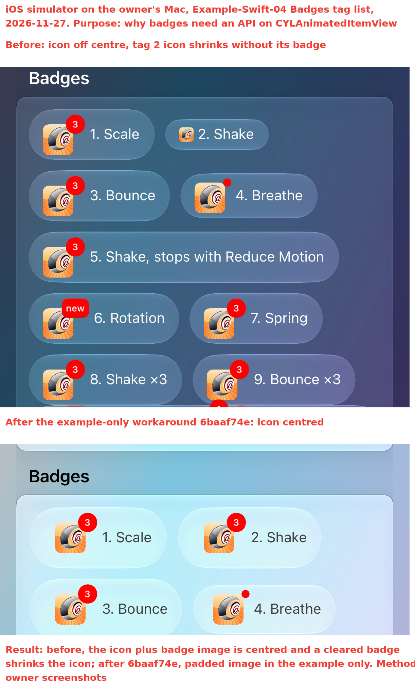

# [CN]动效 item 角标：CYLAnimatedItemView 直接显示角标（API 设计）
# [EN]Animated item badges: CYLAnimatedItemView shows its own badge (API design)

<!-- bound-classes: CYLAnimatedItemView -->
<!-- binding:start -->
<!-- Generated by scripts/update-docs-navigation.py; do not edit by hand. -->

| 中文 | English |
|:---|:---|
| 绑定的代码类 `CYLAnimatedItemView`：[`CYLTabBarController/CYLAnimatedItem/CYLAnimatedItemView.h`](../CYLTabBarController/CYLAnimatedItem/CYLAnimatedItemView.h) | Bound to the class `CYLAnimatedItemView`: [`CYLTabBarController/CYLAnimatedItem/CYLAnimatedItemView.h`](../CYLTabBarController/CYLAnimatedItem/CYLAnimatedItemView.h) |

<!-- binding:end -->

| 中文 | English |
|:---|:---|
| 状态：**API 设计，待负责人确认，尚未实现**。负责人同意后再写代码。 | Status: **API design, waiting for the owner's approval, not implemented**. Code follows only after the owner agrees. |

## [CN]目录
## [EN]Contents

<!-- navigation:start -->
<!-- Generated by scripts/update-docs-navigation.py; do not edit by hand. -->

| 中文 | English |
|:---|:---|
| [任务记录](#cn任务记录) | [Task log](#entask-log) |
| [问题](#cn问题) | [Problem](#enproblem) |
| [现状](#cn现状) | [What exists today](#enwhat-exists-today) |
| [目标](#cn目标) | [Goals](#engoals) |
| [API 设计（iOS）](#cnapi-设计ios) | [API design (iOS)](#enapi-design-ios) |
| [用法](#cn用法) | [Usage](#enusage) |
| [其他平台（同名）](#cn其他平台同名) | [Other platforms (same names)](#enother-platforms-same-names) |
| [与 6cba553b 的关系](#cn与-6cba553b-的关系) | [Relation to 6cba553b](#enrelation-to-6cba553b) |
| [待负责人决定](#cn待负责人决定) | [Questions for the owner](#enquestions-for-the-owner) |

<!-- navigation:end -->

## [CN]任务记录
## [EN]Task log

| 中文 | English |
|:---|:---|
| 用户原话："以上为最近几次修复的截图，修复前与临时方案修复后效果，你应该创建或者更新badge相关文档，为cylbadge增加 cylanimateditemview支持，cylanimateditemview 直接调用badge新增接口来增加badge，而非用户先找到icon再加badge，你先设计api，先别急着实现。文档创建好后发我https 指向分支的文档地址。我同意后再代码实现。" 本条按英文记录（见右列）。 | TODO, design 60 / 100 (2026-11-27, branch `feat/harmony-animated-item-engines`, PR #824, cloud session without a Mac). The owner asks for badge support on `CYLAnimatedItemView`: the item shows a badge through a new API, the app never looks up the icon first. Design first, code only after approval. **Rubric (100)**: the API is designed and documented here 30; the owner approves it 10; iOS implemented (CYLAnimatedItem, Core renderer, the existing `cyl_showBadge…` path) 20; TagList keys and the demo use it, no snapshot 10; unit tests pass 10; simulator pixel check (icon centred, badge at the icon's corner, during and after an animation) 10; Android, HarmonyOS, mini program, React Native and Flutter 10. **Pass (60)**: the design, approved, plus iOS with tests. Now: the design only (30), with the problem shots and open questions; the rest waits for approval. |

## [CN]问题
## [EN]Problem

| 中文 | English |
|:---|:---|
| 示例中的 Badge Tag（`CYLAnimatedItemView` 子类）只能接收图片，所以示例先找到行的图标，再把"图标 + 角标"渲染成一张图片交给 Tag。结果：(1) Tag 让整张图片居中，图标偏离中线；(2) 角标清除后图片变小，图标跟着缩小（上图第 2 个 Tag）；(3) 角标是图片的一部分，没有动画；(4) 每个接入方都要自己处理几何。6baaf74e 在示例中把图片对称扩展，6cba553b 让核心按 `alignmentRectInsets` 对齐，都只是绕过问题。 | The demo's badge tags (a `CYLAnimatedItemView` subclass) take only an image, so the demo first finds the row's icon and then renders "icon + badge" into one image for the tag. Results: (1) the tag centres the whole image, so the icon is off the centre line; (2) a cleared badge makes the image smaller, so the icon shrinks (tag 2 in the first shot); (3) the badge is part of a picture, so it cannot animate; (4) every adopter does the geometry itself. 6baaf74e padded the image in the example, and 6cba553b made the core align by `alignmentRectInsets`: both work around the problem. |
|  |  |

## [CN]现状
## [EN]What exists today

| 中文 | English |
|:---|:---|
| 发给 `CYLAnimatedItemView` 的 `-cyl_showBadgeValue:…` 已经会转发给图标（`UIView.cylAnimatedItemBadgeHost()`，按类名与 KVC 查找 `animationView` / `imageView`）。不足：(1) 动画开始时 `imageView` 被隐藏，挂在它上面的角标一起消失，只有 TabBar 会用 `-cyl_moveBadgeToView:` 搬角标；(2) 换文件、换图片时宿主视图被替换；(3) 只依赖 `CYLAnimatedItem` 的库（CollectionViewClassifyMenu 的 TagList）看不到角标组件，无法调用；(4) 角标描述没有进入 item 的无障碍值。 | `-cyl_showBadgeValue:…` sent to a `CYLAnimatedItemView` is already forwarded to its icon (`UIView.cylAnimatedItemBadgeHost()`, which finds `animationView` / `imageView` by class name and KVC). Gaps: (1) when an animation starts, `imageView` is hidden and the badge on it disappears with it; only the tab bar moves badges with `-cyl_moveBadgeToView:`; (2) a new file or image replaces the host view; (3) a library that depends only on `CYLAnimatedItem` (CollectionViewClassifyMenu's TagList) cannot see the badge component, so it cannot call it; (4) the badge description does not reach the item's accessibility value. |

## [CN]目标
## [EN]Goals

| 中文 | English |
|:---|:---|
| 1. 一行代码：在 item 上设置角标，不找图标。2. 角标是覆盖层：不参与测量，不改变图标对齐，图标始终以自身居中。3. 角标贴在图标（不含角标的图标本身）的右上角，随布局（横向 / 纵向、从右到左）、图片与动画切换移动，动画播放时不消失。4. 只链接 `CYLAnimatedItem` 也能用（TagList）；链接 CYLTabBarController 时使用完整的 CYLBadgeView（样式、动画、减弱动态效果）。5. 无障碍：item 的无障碍值包含角标描述。6. 不删除、不修改任何公开 API；`CYLAnimatedItem` 仍不依赖 CYLTabBarController。 | 1. One line: set the badge on the item, never look up its icon. 2. The badge is an overlay: it is not measured and never changes the icon's alignment; the icon is always centred by itself. 3. The badge sits at the top-trailing corner of the icon (the icon itself, without a badge part), and follows it through layouts (horizontal / vertical, right-to-left), image and animation changes; it stays visible while an animation plays. 4. It works with `CYLAnimatedItem` alone (TagList); with CYLTabBarController linked, it uses the full CYLBadgeView (styles, animations, Reduce Motion). 5. Accessibility: the item's accessibility value includes the badge description. 6. No public API is removed or changed; `CYLAnimatedItem` still does not depend on CYLTabBarController. |

## [CN]API 设计（iOS）
## [EN]API design (iOS)

| 中文 | English |
|:---|:---|
| **A. 组件 `CYLAnimatedItem`（无依赖）**：`CYLAnimatedItemView` 新增 `badgeValue`（nil 无角标，"" 红点，其他为文字或数字）、`badgeAttributes`（样式字典，键见 C）、只读的 `badgeAnchorView` 与 `isShowingBadge`，以及类属性 `badgeRenderer`（绘制角标的对象，见 B）。 | **A. The component `CYLAnimatedItem` (no dependency)**: `CYLAnimatedItemView` gets `badgeValue` (nil: no badge, "": a dot, otherwise text or a number), `badgeAttributes` (a style dictionary, keys in C), the read-only `badgeAnchorView` and `isShowingBadge`, and the class property `badgeRenderer` (the object that draws badges, see B). |

```swift
// CYLAnimatedItem: CYLAnimatedItemView (new members only)
extension CYLAnimatedItemView {
    /** nil: no badge (default); "": a dot; otherwise the text, a number above `maximumNumber` shows "99+". */
    @objc public dynamic var badgeValue: String?
    /** Style of the badge; keys `CYLAnimatedItemBadgeKey` (C). nil: the renderer's defaults. */
    @objc public dynamic var badgeAttributes: [String: Any]?
    /** A transparent view kept on the icon itself (the image minus its `alignmentRectInsets`, or the animation) at every
        layout; never hidden by an image / animation switch; not measured, not touchable, hidden from accessibility.
        Badges live here. Read-only. */
    @objc public var badgeAnchorView: UIView { get }
    /** True while a badge is shown. */
    @objc public var isShowingBadge: Bool { get }
    /** Draws badges for every item. nil (default): the built-in basic badge (a red capsule, no animation).
        CYLTabBarController's Core sets its CYLBadgeView renderer at launch. */
    @objc public class var badgeRenderer: CYLAnimatedItemBadgeRendering? { get set }
}
```

```objc
// Objective-C (generated names)
item.badgeValue = @"3";
item.badgeAttributes = @{ CYLAnimatedItemBadgeKeyAnimation: @"scale" };
```

| 中文 | English |
|:---|:---|
| **B. 绘制协议**（在 `CYLAnimatedItem` 中声明，Swift 协议只含要求）：item 的角标变化时调用渲染器；渲染器只在 `anchor` 上加角标，因此角标随图标移动。可选的描述方法供无障碍使用。 | **B. Rendering protocol** (declared in `CYLAnimatedItem`; a Swift protocol holds requirements only): the item calls the renderer when its badge changes; the renderer adds the badge on `anchor` only, so the badge moves with the icon. The optional description method feeds accessibility. |

```swift
@objc public protocol CYLAnimatedItemBadgeRendering: NSObjectProtocol {
    func animatedItem(_ item: CYLAnimatedItemView, showBadgeValue value: String,
                      attributes: [String: Any], on anchor: UIView)
    func animatedItem(_ item: CYLAnimatedItemView, clearBadgeOn anchor: UIView)
    @objc optional func animatedItem(_ item: CYLAnimatedItemView,
                                     accessibilityDescriptionForBadgeValue value: String) -> String?
}
```

| 中文 | English |
|:---|:---|
| **C. 样式键 `CYLAnimatedItemBadgeKey`**：与 `CYLTabBarHostView.badgeAttributes`（React Native、Flutter）相同的字符串，并补充几个：`color`（背景色）、`animation`（`none`、`scale`、`shake`、`bounce`、`breathe`、`rotation`、`spring` 等，与 `CYLBadgeAnimationType` 同名）、`radius`（红点半径）、`centerOffset`（相对图标右上角）、`textColor`、`font`、`borderColor`、`borderWidth`、`maximumNumber`、`respectsReduceMotion`。值可以是对象或字符串（`#RRGGBB`、`{x, y}`），便于配置文件使用。 | **C. Style keys `CYLAnimatedItemBadgeKey`**: the same strings as `CYLTabBarHostView.badgeAttributes` (React Native, Flutter), plus a few: `color` (background), `animation` (`none`, `scale`, `shake`, `bounce`, `breathe`, `rotation`, `spring`…, named as `CYLBadgeAnimationType`), `radius` (dot radius), `centerOffset` (from the icon's top-trailing corner), `textColor`, `font`, `borderColor`, `borderWidth`, `maximumNumber`, `respectsReduceMotion`. Values are objects or strings (`#RRGGBB`, `{x, y}`), so configuration files can use them. |
| **D. CYLTabBarController Core**：新增内部渲染器 `CYLAnimatedItemBadgeViewRenderer`，启动时设为 `CYLAnimatedItemView.badgeRenderer`；它在 `anchor` 上调用现有的 `-cyl_showBadgeValue:animationTypeValue:` 与 `cyl_badge…` 样式属性，所以外观、动画、减弱动态效果与其他角标完全一致。`UIView.cylAnimatedItemBadgeHost()` 在 item 有 `badgeAnchorView` 时返回它（按 selector 判断，不加依赖），因此 `item.cyl_showBadgeValue("3", animationType: .scale)` 与 `item.badgeValue = "3"` 落在同一个视图上，旧代码不变也得到修复。 | **D. CYLTabBarController Core**: a new internal renderer `CYLAnimatedItemBadgeViewRenderer`, set as `CYLAnimatedItemView.badgeRenderer` at launch; it calls the existing `-cyl_showBadgeValue:animationTypeValue:` and the `cyl_badge…` style properties on `anchor`, so look, animations and Reduce Motion match every other badge. `UIView.cylAnimatedItemBadgeHost()` returns `badgeAnchorView` when the item has one (checked by selector, no new dependency), so `item.cyl_showBadgeValue("3", animationType: .scale)` and `item.badgeValue = "3"` land on the same view, and old code gets the fix unchanged. |
| **E. 布局规则**：`badgeAnchorView` 位于图标与动画视图之上；每次 `layoutContent(in:)` 后其 frame 等于图标本身（6cba553b 的 glyph frame）；分割线或隐藏图标时隐藏；item 裁剪（`clipsToBounds`）时沿用角标组件现有的浮层。角标不参与 `contentSizeThatFits`。子类重写 `layoutContent(in:)` 时，调用 `super` 或自行设置 `badgeAnchorView.frame`。 | **E. Layout rules**: `badgeAnchorView` sits above the icon and the animation view; after every `layoutContent(in:)` its frame is the icon itself (the glyph frame of 6cba553b); it hides for a divider or a hidden icon; when the item clips (`clipsToBounds`), the badge component's existing overlay is used. The badge is not part of `contentSizeThatFits`. A subclass that overrides `layoutContent(in:)` calls `super` or sets `badgeAnchorView.frame` itself. |
| **F. 无障碍**：显示角标时，item 的 `accessibilityValue` 为原值加角标描述（渲染器的描述，或组件包内的本地化文字 "N 条新消息" / "新消息"），清除时恢复原值；角标视图本身对无障碍隐藏。 | **F. Accessibility**: while a badge shows, the item's `accessibilityValue` is its own value plus the badge description (the renderer's, or the component bundle's localized "N new items" / "New"), restored when cleared; the badge view itself is hidden from accessibility. |
| **G. TagList（CollectionViewClassifyMenu，另一个仓库）**：新增 `CYLTagItemKey.badgeValue` 与 `CYLTagItemKey.badgeAttributes`，Tag 按钮把它们设置到 `badgeValue` / `badgeAttributes`；Tag 宽度不变。示例的 `badgeItem` 只传这两个键，删除快照代码与 `CYLMenuStyleKey.imageSize`。 | **G. TagList (CollectionViewClassifyMenu, another repository)**: new keys `CYLTagItemKey.badgeValue` and `CYLTagItemKey.badgeAttributes`; the tag button sets them as `badgeValue` / `badgeAttributes`; tag widths do not change. The demo's `badgeItem` passes only these two keys; the snapshot code and the `CYLMenuStyleKey.imageSize` override go away. |

## [CN]用法
## [EN]Usage

```swift
// Any animated item (a tag, a chip, a FlatDesign tab button)
item.badgeValue = "3"
item.badgeAttributes = [CYLAnimatedItemBadgeKey.animation: "scale",
                        CYLAnimatedItemBadgeKey.color: "#FF3B30"]
item.badgeValue = ""      // a dot
item.badgeValue = nil     // cleared; the icon does not move or shrink

// TagList item (after G)
[CYLTagItemKey.title: "1. Scale", CYLTagItemKey.image: icon,
 CYLTagItemKey.badgeValue: "3", CYLTagItemKey.badgeAttributes: [CYLAnimatedItemBadgeKey.animation: "scale"]]
```

## [CN]其他平台（同名）
## [EN]Other platforms (same names)

| 中文 | English |
|:---|:---|
| Android `CYLAnimatedItemView.badgeValue: String?`、`badgeAttributes: Map<String, Any>?`、`badgeAnchorView`、`CYLAnimatedItemView.badgeRenderer`（`:cyltabbar` 注册其角标）；鸿蒙 `cylanimateditem` 的 `badgeValue` / `badgeAttributes` 属性；小程序 `cyl-animated-item` 的 `badge-value` / `badge-attributes`；React Native 与 Flutter 的 `CYLAnimationView` 增加 `badgeValue` / `badgeAttributes`。iOS 先实现，其余平台随后（Win 会话）。 | Android `CYLAnimatedItemView.badgeValue: String?`, `badgeAttributes: Map<String, Any>?`, `badgeAnchorView`, `CYLAnimatedItemView.badgeRenderer` (`:cyltabbar` registers its badge); HarmonyOS `cylanimateditem` properties `badgeValue` / `badgeAttributes`; mini program `cyl-animated-item` `badge-value` / `badge-attributes`; React Native and Flutter `CYLAnimationView` get `badgeValue` / `badgeAttributes`. iOS first, the other platforms after it (a Win session). |

## [CN]与 6cba553b 的关系
## [EN]Relation to 6cba553b

| 中文 | English |
|:---|:---|
| 按 `alignmentRectInsets` 对齐保留：它是通用的图片规则，对没有内边距的图片没有影响。`UIView.cylBadgeSnapshotImage(hidingBadge:traitCollection:)` 尚未发布，有了本 API 就不再需要：建议在发布前删除（见问题 2）。 | Aligning by `alignmentRectInsets` stays: it is a general image rule and changes nothing for images without insets. `UIView.cylBadgeSnapshotImage(hidingBadge:traitCollection:)` is not released yet and this API makes it unnecessary: the proposal is to remove it before release (question 2). |

## [CN]待负责人决定
## [EN]Questions for the owner

| 中文 | English |
|:---|:---|
| 1. 只链接 `CYLAnimatedItem`、没有 CYLTabBarController 时：显示内置的基础角标（红色胶囊、无动画，建议），还是不显示并打印警告？ 2. 删除尚未发布的 `cylBadgeSnapshotImage`（建议），还是保留给只接收图片的控件？ 3. 是否需要 `reservesBadgeSpace`（默认 NO：测量时为角标留出空间，避免紧凑宿主裁剪）？ 4. TagList 的两个键要改 CollectionViewClassifyMenu 仓库：本会话需要把该仓库加入权限，或由你在那里合并。 5. 顺序：先 iOS，再 Android、鸿蒙、小程序、RN、Flutter，可以吗？ | 1. With `CYLAnimatedItem` alone, no CYLTabBarController: show the built-in basic badge (a red capsule, no animation; recommended), or nothing plus a warning? 2. Remove the unreleased `cylBadgeSnapshotImage` (recommended), or keep it for controls that only take an image? 3. Add `reservesBadgeSpace` (default NO: reserve the badge's room when measuring, so a tight host does not clip it)? 4. The two TagList keys change the CollectionViewClassifyMenu repository: this session needs access to it, or you merge them there. 5. Order: iOS first, then Android, HarmonyOS, mini program, React Native, Flutter. Is that fine? |
