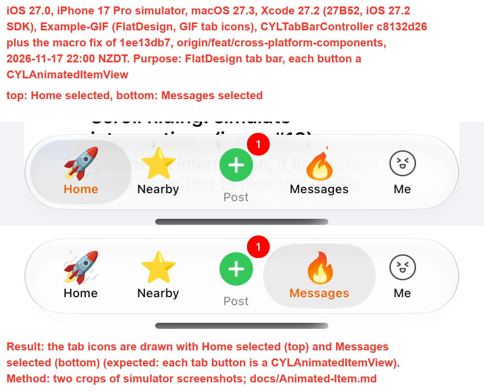

# [CN]动效 icon + title 共用组件：CYLAnimatedItem
# [EN]The shared animated icon + title component: CYLAnimatedItem

<!-- bound-classes: CYLAnimatedItemView -->
<!-- binding:start -->
<!-- Generated by scripts/update-docs-navigation.py; do not edit by hand. -->

| 中文 | English |
|:---|:---|
| 绑定的代码类 `CYLAnimatedItemView`：[`CYLTabBarController/CYLAnimatedItem/CYLAnimatedItemView.h`](../CYLTabBarController/CYLAnimatedItem/CYLAnimatedItemView.h) | Bound to the class `CYLAnimatedItemView`: [`CYLTabBarController/CYLAnimatedItem/CYLAnimatedItemView.h`](../CYLTabBarController/CYLAnimatedItem/CYLAnimatedItemView.h) |

<!-- binding:end -->

| 中文 | English |
|:---|:---|
| `CYLAnimatedItem` 是一个独立组件：iOS 为独立的 pod 与模块 `CYLAnimatedItem`（`CYLAnimatedItem.podspec`，`import CYLAnimatedItem`），Android 为模块 `:cylanimateditem`（包 `com.cyl.animateditem`）。**它不依赖 CYLTabBarController**（不依赖 Core、CYLUtils 或任何 TabBar 代码；只有测试代码可以依赖 TabBar），反过来 CYLTabBarController 依赖它。它由两部分组成：①动画引擎（iOS 为 `CYLAnimatedItem/Engine` 子库，与扁平样式一样在编译期用 guard 隔离，默认不引入）（`CYLTabBarItemAnimationFactory`、`CYLTabBarItemAnimatorRegistry`、播放器与 animator 协议），新增动画类型只需在这里新增一个 animator；②`CYLAnimatedItemView`：一个可继承的视图，包含可播放动效的图标、标题、可选的附加图标（自带手势，例如删除按钮），整个视图可响应自定义手势（点击、长按、拖拽）。CYLTagButton（CollectionViewClassifyMenu、CYLSearchViewController）、CYLPlaceholderView（CYLTableViewPlaceHolder）与本库的 Tab 按钮都可以继承它，不必各自实现。 | `CYLAnimatedItem` is a component of its own: on iOS the pod and module `CYLAnimatedItem` (`CYLAnimatedItem.podspec`, `import CYLAnimatedItem`), on Android the module `:cylanimateditem` (package `com.cyl.animateditem`). **It does not depend on CYLTabBarController** (not on Core, CYLUtils or any tab bar code; only test code may depend on the tab bar); CYLTabBarController depends on it instead. It is made of two parts: (1) the animation engine (on iOS the `CYLAnimatedItem/Engine` subspec, isolated at compile time like the FlatDesign tab bar and left out by default; `CYLTabBarItemAnimationFactory`, `CYLTabBarItemAnimatorRegistry`, the player and animator protocols), so a new animation type is one new animator here and nowhere else; (2) `CYLAnimatedItemView`, a view to subclass: an icon that can play an animation, a title, an optional accessory icon with its own gesture (a delete button, for example), and gestures on the whole view (tap, long press, drag). CYLTagButton (CollectionViewClassifyMenu, CYLSearchViewController), CYLPlaceholderView (CYLTableViewPlaceHolder) and this library's tab buttons can subclass it instead of each writing their own. |
| 最新版本（分支 `feat/cross-platform-components`）：https://github.com/ChenYilong/CYLTabBarController/blob/feat/cross-platform-components/docs/Animated-Item.md | Latest version (branch `feat/cross-platform-components`): https://github.com/ChenYilong/CYLTabBarController/blob/feat/cross-platform-components/docs/Animated-Item.md |

## [CN]目录
## [EN]Contents

<!-- navigation:start -->
<!-- Generated by scripts/update-docs-navigation.py; do not edit by hand. -->

| 中文 | English |
|:---|:---|
| [任务记录](#cn任务记录) | [Task log](#entask-log) |
| [结构](#cn结构) | [Structure](#enstructure) |
| [接入](#cn接入) | [Integration](#enintegration) |
| [四个仓库的迁移](#cn四个仓库的迁移) | [Migrating the four repositories](#enmigrating-the-four-repositories) |
| [下游仓库的迁移进度](#cn下游仓库的迁移进度) | [Downstream migration status](#endownstream-migration-status) |
| [新增一种动画类型](#cn新增一种动画类型) | [Adding an animation type](#enadding-an-animation-type) |
| [提交记录](#cn提交记录) | [Commits](#encommits) |
| [问题记录（除 iOS 外）](#cn问题记录除-ios-外) | [Bug log (platforms other than iOS)](#enbug-log-platforms-other-than-ios) |
| [截图（iOS 27）](#cn截图ios-27) | [Screenshots (iOS 27)](#enscreenshots-ios-27) |
| [TODO](#cntodo) | [TODO](#entodo) |

<!-- navigation:end -->

## [CN]任务记录
## [EN]Task log

| 中文 | English |
|:---|:---|
| 本条按用户要求使用英文（见右列）。 | DONE (2026-11-17, macOS 27.3 + Xcode 27.2): simulator screenshots and the next iOS TODOs. User prompt, verbatim: "运行模拟器 截图更新相关文档。阅读CYLAnimatedItem 相关的集成文档，continue fix todo iOS端代码与测试" (English: run the simulator, take screenshots and update the related documents; read the CYLAnimatedItem integration documents and continue fixing the iOS TODOs, code and tests). **Screenshots** (below, iOS, iPhone 17 Pro simulator, iOS 27.0, Xcode 27.2 (27B52, iOS 27.2 SDK), macOS 27.3, Example-GIF (FlatDesign, GIF tab icons), commit [c8132d26](https://github.com/ChenYilong/CYLTabBarController/commit/c8132d26) plus the macro fix of this change, 2026-11-17 22:00 NZDT): the FlatDesign tab bar after TODO (4), each tab button now a `CYLAnimatedItemView` (Home selected, then Messages selected), looks as before: GIF icons, titles, lens, the plus button's badge; the demo page on Messages: GIF playing, static image, placeholder for a broken file, remote GIF. **Fixed**: the build of every app using the pods warned "ambiguous expansion of macro 'CYL_SUPPRESS_ARC_PERFORM_SELECTOR_LEAKS'" (5 times in CYLTabBarController.m): the component and `CYLUtilsMacros.h` each defined it, differently, in two modules; `CYLUtilsMacros.h` now uses the component's and defines its own only without the component (its log is English now; the localized key stays). Clean Example-GIF build: no library warnings. **Environment note**: on the iOS 26.3 simulator runtime of this Mac (iOS_23D8133) emoji in labels draw as boxes (the settings list's "🌐 Language: 🇺🇸 English"), also after a reboot; the same build on iOS 27.0 draws them, so it is the runtime, not the code. |
| 本条按用户要求使用英文（见右列）。 | DONE (2026-11-17) for (1) and (2); (4) and (9) taken by another session (chenyilong-ba). Was: TODO (2026-11-17, macOS 27 + Xcode 27, branch `feat/cross-platform-components`): continue the iOS TODOs of this document, code and tests, on a Mac. User prompt, verbatim: "阅读CYLAnimatedItem 相关的集成文档，continue fix todo iOS端代码与测试" (English: read the CYLAnimatedItem integration documents and continue fixing the iOS TODOs, code and tests). Order: (1) local `pod lib lint` of both podspecs (every subspec alone, `CYLAnimatedItem` without an engine), the framework build and `CYLAnimatedItemViewTests`; then (2) Lottie URL downloads and loaded callback, (4) FlatDesign item drawn by `CYLAnimatedItemView`, (9) SPM / Carthage targets. |
| 本条按用户要求使用英文（见右列）。 | DONE (2026-11-17, macOS 27 + Xcode 27, branch `feat/cross-platform-components`), the same prompt, split between sessions: this part is TODO (4) and the Swift Package Manager half of (9). User prompt, verbatim: "阅读CYLAnimatedItem 相关的集成文档，continue fix todo iOS端代码与测试" (English: read the CYLAnimatedItem integration documents and continue fixing the iOS TODOs, code and tests). **Result**: (4) `CYLFlatDesignTabBarButton` subclasses `CYLAnimatedItemView` (content through `image` / `title`, the tab bar's layout in `-layoutContentInRect:`, the component's long press off); import order fixed for the framework build, where the generated Swift header now imports the umbrella header (`CYLAnimatedItemView.h` imports the engine after `@end`; `CYLFlatDesignTabBarDelegate` is declared before `CYLFlatDesignTabBar.h`'s imports; `CYLSwiftInterface.h` and `CYLTabBarItemAnimationPlayableView.h` import the component before the Swift header). (9) SwiftPM product `CYLAnimatedItem` (targets `CYLAnimatedItemSwift` + `CYLAnimatedItem`). **Checked locally** (macOS 27, Xcode 27.2, iPhone 17 Pro simulator): `scripts/unit-tests.sh` 154 tests, 0 failures, 2 skipped (not this change), new `testFlatDesignTabButtonIsTheAnimatedItemComponent` passes; framework scheme builds; `pod lib lint --quick` of both podspecs; the SwiftPM `CYLAnimatedItem` scheme builds. **Known, not from this change**: the SwiftPM `CYLTabBarController` scheme fails the same way on the unchanged branch (`cannot find type 'CYLBadgeAnimationType'`, `'CYLPlusButton'` in the Swift target: it cannot see the Objective-C target above it); TODO. **TODO**: a Carthage framework target for the component; the tab's animation view as the component's `animationView`. |
| 本条按用户要求使用英文（见右列）。 | TODO (2026-11-17, branch `feat/cross-platform-components`): build the shared component. User prompt, verbatim: "重构动效展示核心组件代码：现在有四个仓库使用了类似的动效展示组件，该组件的基本特点为支持动效的icon 以及 title 可能还还有另外一个自定义的响应自定义手势的方式的icon组件。整体可以响应自定义手势比如拖拽手势。这是他的基本特点，目前的问题是四个仓库，虽然使用类似类似特点，各自实现类似功能，但代码大量重复使用。但核心特征不变。我的需求是以后新增动效类型，仅需需要修改这个组件，所有需要使用动效展示的组件都可以支持新增动效，无须在第二个地方修改代码。我现在要求你在本仓库中将这些库的代码进行综合分析，重构为一个子仓库，其他仓库的依赖该子仓库，使用面向协议开发的原则进行引用，以达到复用代码，引用了该子仓库的项目可以使用继承，实现自定义协议的方式，完成原本需要从零开始实现一个全新的组件该组件的基本特点为支持动效的icon 以及 title 可能还还有另外一个自定义的响应自定义手势的方式的icon组件，且整体可以响应自定义手势比如拖拽手势。你封装好后创建一个接入文档，我将在其他四个项目中按照文档进行继承。…该组件应该独立与本项目的core，不依赖本项目的core，如果需要依赖，那么将需要依赖的代码提取到CYLUtils组件中，最多依赖CYLUtils组件。该改动适用于所有平台重构" (followed by links to `CYLTagButton` on iOS, Android and HarmonyOS in CollectionViewClassifyMenu, `CYLTabBarItemButton` here, and `CYLPlaceholderView` in CYLTableViewPlaceHolder). **Analysis**: (1) CYLTableViewPlaceHolder's `CYLPlaceholderAnimation/` is a renamed copy of this repository's engine (`CYLPlaceholderItemAnimatorRegistry` …); (2) CollectionViewClassifyMenu's `CYLTagButton` finds this engine at run time with selectors; (3) the three views repeat the same icon / title / accessory / state / gesture code. **Requirements**: one sub-library, protocol-oriented, independent of Core (at most `CYLUtils`), subclassable; a new animation type changes only this sub-library; an integration guide for the four repositories; every platform. **Plan**: iOS and Android in this change (Android verified here); HarmonyOS and the WeChat Mini Program after (no toolchain in this Linux container); React Native and Flutter wrap the native host views, so they follow iOS and Android. Status: iOS and Android done, the other platforms TODO (see "TODO" below). |
| 本条按用户要求使用英文（见右列）。 | DONE (2026-11-17; the layout was refined by the rows below): every animation subspec depends on the component, none on Core. User prompt, verbatim: "继续拆分，不区分动效类型，该组件的独立特性，适用于所有依赖包括Lottie。cyltabbar/lottie该组件，应依赖我们本次新增组件以完成Lottie动效展示。" **Plan**: (1) the playable-view protocols (`Swift/CYLTabBarItemAnimationPlayableView.swift`, now in Core) move to the engine, so `CYLAnimationEngine` builds alone; (2) what the animators take from Core (the generic `CYLTabBarAnimation…` keys, the Lottie keys, `CYLTabBarAnimationOption`, `CYLTabBarAnimationURLWithOptions()`) moves to CYLUtils, with the same names; (3) one Core-free subspec per library under the component (`CYLAnimatedItem/LottieSwift`, `…/LottieObjectiveC`, `…/PAG`, `…/PAGEnterprise`, `…/Rive`, `…/SVGA`, `…/GIF`); the existing `CYLTabBarController/LottieSwift` and its siblings keep their names and Podfiles, and depend on Core, `CYLTabBarItemAnimation` and that component subspec. Status: done (2026-11-17), pending iOS CI. (1) The playable view protocols moved to `CYLTabBarItemAnimation/Swift/` (engine). (2) The generic keys, the Lottie keys, `CYLTabBarAnimationOption` and `CYLTabBarAnimationURLWithOptions()` moved to CYLUtils (`CYLUtils/CYLAnimationKeys.{h,m}`, `CYLUtils/Swift/CYLAnimationURLOptions.swift`), same names, still declared through CYLTabBarController.h; GIF computes its frame delay itself; the tab bar's PAG helper `CYLTabBarItemsAttributesAddingPAGFiles` moved to `PAG/TabBar/` (tab bar subspec). (3) Flat component subspecs `CYLAnimatedItemLottieSwift`, `…LottieObjectiveC`, `…Lottie`, `…PAG`, `…PAGEnterprise`, `…Rive`, `…SVGA`, `…GIF` (CocoaPods allows `default_subspecs` only on the root, so they cannot be children of `CYLAnimatedItem`); the tab bar subspecs keep their names and depend on them. `pod lib lint --quick` passes; framework target, SwiftPM and pbxproj updated. |
| 本条按用户要求使用英文（见右列）。 | DONE (2026-11-17, pending iOS CI): "a project that adds CYLAnimatedItem plus LottieSwift does not get the tab bar library". User prompt, verbatim: "fix One limit remains: the animation subspecs themselves still depend on Core, because their code imports Core's key constants. So a project that adds CYLAnimatedItem plus LottieSwift today also gets the tab bar library. Moving those keys next to the engine is item (2) in the guide's TODO. fix way， add those mapped key in our new component. And do map in tabbar or CYLUtils, so So a project that adds CYLAnimatedItem plus LottieSwift today also not gets the tab bar library. The principle is   a project that adds CYLAnimatedItem plus LottieSwift  not gets the tab bar library." **Result**: the keys live in CYLUtils (`CYLAnimationKeys`, since `3427d9ad`); the animation subspecs `LottieSwift`, `LottieObjectiveC`, `Lottie`, `PAG`, `PAGEnterprise`, `Rive`, `SVGA`, `GIF` now depend on `CYLAnimationEngine` and their library only (no Core); the tab buttons' side of the engine (`CYLTabBarItemAnimationEngine`, `UIControl+CYLTabBarItemAnimationPlayer`, the PAG helper in `CYLTabBarItemAnimation/TabBar/`) is part of Core behind `CYL_ANIMATION_ENGINE_AVAILABLE` (CYLUtilsMacros.h, like `CYL_FLATDESIGN_AVAILABLE`), so a tab bar animates when an animation subspec is added; `CYLTabBarItemAnimation` stays as Core + engine; the short-lived `CYLAnimatedItem<Type>` subspecs are gone. Checked with CocoaPods' own file resolution: Core compiles only the guarded engine side; `LottieSwift` is the animator and its bridge. A tab bar Podfile now lists `pod 'CYLTabBarController'` with its animation subspec: Example-Swift, Example-Swift-02 and Example-SwiftUI-Rive got that line (the React Native and Flutter components already depend on Core). |
| 本条按用户要求使用英文（见右列）。 | DONE (2026-11-17, pending iOS CI): the final layout. User prompt, verbatim: "The principle is   a project that adds CYLAnimatedItem plus LottieSwift  not gets the tab bar library. CYLAnimatedItem can works with static image if projects donot add any animation engine. and compile well CYLTabBarController'core shoud depend on Core of CYLAnimatedItem by default. But not depend on any animation engine. CYLTabBarController/Lottie should depend on Lottie engine." **Result**: `CYLAnimatedItem` (the component's core, CYLUtils only) shows static images and compiles without any engine (`CYL_ANIMATION_ENGINE_AVAILABLE` = 0); `Core` depends on `CYLAnimatedItem`, never on an engine; each type has a component engine `CYLAnimatedItem<Type>` (`CYLAnimatedItem` + `CYLAnimationEngine` + the animator, no Core), so `CYLAnimatedItem` plus `CYLAnimatedItemLottieSwift` brings no tab bar; the tab bar's `Lottie` / `LottieObjectiveC` / `LottieSwift` / `PAG` / `PAGEnterprise` / `Rive` / `SVGA` / `GIF` are Core plus the matching engine, so tab bar Podfiles are unchanged (the three example Podfile lines added earlier are reverted). Flat names because CocoaPods allows `default_subspecs` only on the root, and nested children would bring every engine (and libpag / libpag-enterprise, iOS 13 / 14 requirements) with the parent. |
| 本条按用户要求使用英文（见右列）。 | DONE (2026-11-17, iOS pending CI): a resource bundle with a placeholder and the copyright policy. User prompt, verbatim: "为本次新增加的库，增加一个bundle，bundle内增加一个占位图，静态占位图大小应适合tabbaritem展示icon。如果，没传入静态图，只传入动效资源地址，没有对应动效引擎，则展示该占位图。不同平台可能资源文件的文件夹名字不同，以iOS为例是bundle形式。并在该bundle中加入版权相关的声明，policy。" **Result**: see "Resources" and rule (1) above; the placeholder also shows in the tab bar for a tab with only an animation file that cannot play (iOS `CYLTabBarAnimationCanPlay()` in CYLTabBarController.m, Android `CYLTabBarItemButton.cyl_animationPlaceholder()`, and after a Lottie file fails). Android: 17 + 124 tests, lint clean. |
| 本条按用户要求使用英文（见右列）。 | DONE (2026-11-17, iOS pending CI): the placeholder for more failure cases. User prompt, verbatim: "该占位图逻辑应扩展更对场景比如动效资源损坏等等异常场景" **Result**: see "Failure cases" above. Hooks: Android GIF (unreadable bytes, `Movie` null), SVGA (missing file, failed download, `onError`), Lottie (already); iOS SVGA failure block, Rive load error; a missing or empty local file is caught by the view on both platforms. **TODO**: the iOS tab bar (UIKit tab buttons do not adopt the protocol) gets `CYLTabBarItemAnimationDidFailNotification` but does not act on it yet; Lottie (iOS 4.x) and PAG remote files do not report a failed download yet. Android: 23 + 124 tests, lint clean. |
| 本条按用户要求使用英文（见右列）。 | DONE (2026-11-17): the display priority written down and tested. User prompt, verbatim: "更新上面的边界场景，展示占位图的前提是初始化时没有静态图片，如果传入静态图片和动效资源，优先展示动效，但动效加载失败。则先展示静态图片，没有静态图片才展示上面的占位图" **Result**: the code already followed it (iOS `-cyl_placeholderIfNeeded`, Android `placeholderIfNeeded()`, the Android tab button and the iOS tab setup all check for a static image first); the rule is now the first row above, with new tests: Android `withAStaticImageEveryFailureShowsTheImageNotThePlaceholder` (missing, empty, corrupted, unknown type), iOS `testWithAStaticImageAMissingFileShowsTheImageNotThePlaceholder`. |
| 本条按用户要求使用英文（见右列）。 | DONE (2026-11-17, iOS pending CI) with TODOs: URL animation files. User prompt, verbatim: "如果是URL类型动效资源，则遵循相同逻辑，参数传入的静态图片优先级总是高于上面的占位图，在动效URL下载期间不应展示占位图，而应首先看有没有参数传入的静态图，如果有静态图那么就展示静态图，如果没有静态图则展示占位图。如果现在的动效资源还不支持URL下载资源图。则写入文档，标记todo并追加我刚刚的占位图逻辑" **Result**: see "URL animation files" and the table above. Done: a loading state in the engine on both platforms (mark loading, report loaded, report failure); Android Lottie (composition listener), PAG, Rive, GIF, SVGA and the Android tab button follow it; iOS SVGA and Rive follow it. **TODO** (each must apply the same rule when added: while downloading, the static image passed in, else the placeholder; the animation once loaded; the static image or placeholder on failure): (1) iOS GIF, PAG and Lottie Swift: download URLs; (2) iOS Lottie Objective-C: a loaded callback; (3) the iOS tab bar: show the tab's image or the placeholder while downloading and after a failure (UIKit tab buttons do not adopt `CYLTabBarItemAnimationFailureHandling`). Android: 26 + 125 tests, lint clean. |
| 本条按用户要求使用英文（见右列）。 | DONE (2026-11-17) in part: the build configurations. User prompt, verbatim: "https://github.com/ChenYilong/CYLTabBarController/blob/13e717c9/docs/Animated-Item.md 根据文档链接，根据该文档，修改cocoapods gradle maven npm等配置，要求更新core核心代码 ，依赖该新组件。改造core核心代码，要求实现同等动效效果。core核心代码不依赖于动效引擎，仅仅在example层引入动效引擎时才展示动效icon。涉及的组件为本仓库中已经封装好的动效icon加title的核心组件代码。" **Done**: see "Dependencies" above. A real break fixed: the React Native and Flutter components compile `cyltabbar`'s sources directly, so they lacked `cylanimateditem` (the engine moved there) and would not have compiled; and the module's `com.cyl.animateditem.R` does not exist in their `com.cyl.tabbar` namespace, so the module now finds its view tags and placeholder by name. Checked with a throwaway module built the way the components build (namespace `com.cyl.tabbar`, both source folders): it compiles; Android 26 + 125 tests, lint clean, app release build. **TODO**: (1) Android `CYLTabBarItemButton` and iOS FlatDesign `CYLFlatDesignTabBarItem` drawn by `CYLAnimatedItemView` itself (today they use its engine, loading / failure protocol and placeholder, but keep their own icon and title views); the classic iOS tab button is UIKit's `UITabBarButton` and cannot subclass it; (2) run the React Native and Flutter example builds on a machine with their toolchains. |
| 本条按用户要求使用英文（见右列）。 | DONE (2026-11-17, iOS pending CI): the component is its own pod and module. User prompt, verbatim: "CYLAnimatedItemView should not depend on CYLTabBarController , if any code is only for test is acceptable." The code never used the tab bar; what tied it to CYLTabBarController was the package. The owner chose "Own pod + module": iOS `CYLAnimatedItem.podspec` (module `CYLAnimatedItem`: `Core`, `Engine`, `LottieObjectiveC`, `Lottie`, `LottieSwift`, `PAG`, `PAGEnterprise`, `Rive`, `SVGA`, `GIF`), its own `CYLAnimatedItemMacros.h` and `CYLAnimatedItemResourceBundle()` instead of CYLUtils, no import of CYLTabBarController; CYLTabBarController's `CYLUtils` depends on `CYLAnimatedItem/Core` and re-exports it (Swift `@_exported import`, Objective-C headers), its `CYLAnimatedItem`, `CYLAnimationEngine` and `CYLAnimatedItem<Type>` subspecs are names for the new pod's subspecs; Android: the engine classes moved from `com.cyl.tabbar` to `com.cyl.animateditem`, with Kotlin type aliases in `:cyltabbar` for the old names. Every Podfile of this repository adds `pod 'CYLAnimatedItem', :path => …` until the pod is on the trunk (`scripts/pod-lint.sh` lints and pushes it first). Evidence: both podspecs pass `pod lib lint --quick`, no file is in both pods (CocoaPods file accessor), Android 26 + 126 tests, lint clean, `:app:assembleRelease`. |
| 本条按用户要求使用英文（见右列）。 | DONE (2026-11-17, pending iOS CI and a re-test in CollectionViewClassifyMenu): two bugs of this pod found by CollectionViewClassifyMenu's CI (`7183711`), reported by the session working on that project. User prompt, verbatim: "check other project report and fix". The report: (a) CollectionViewClassifyMenu's demo app did not compile with Podfiles that build static libraries, because `CYLAnimatedItem.podspec` defines no module and its core's `import CYLAnimatedItem` failed (worked around there with `:modular_headers => true`); (b) its test "a file that cannot play shows the static image" failed with the Lottie engine linked, because the Lottie animator takes every file no other engine claims and made a Lottie view even for a file that is not an animation, which hid the static image. Fixed in this library's core, as the core-first rule asks: (a) `CYLAnimatedItem.podspec` sets `pod_target_xcconfig = { 'DEFINES_MODULE' => 'YES' }`, so no app needs modular headers for it; (b) new `CYLTabBarItemAnimationURLMayBeLottie()` (engine, `CYLTabBarItemAnimatorRegistry.h`): NO for a local file that is missing, unreadable or not a Lottie document (a JSON object with a `layers` array, or a `.lottie` archive when Lottie 4 is linked), YES for a remote URL; `CYLLottieTabBarItemAnimator` asks it in `-canAnimateFileAtURL:` and in `-animationViewWithURL:size:contentMode:` (a tab's Lottie keys bind a URL without asking the first), so such a file makes no view and the static image (or the placeholder) stays. Test: `CYLAnimatedItemViewTests` `testOnlyALottieDocumentIsTakenByTheLottieAnimator` (needs no Lottie). Not verified here: this session runs on Linux without Xcode, so the build, the unit tests and `pod lib lint` are left to CI; the end-to-end check is CollectionViewClassifyMenu's failing test once it is re-pinned to this commit (and its `:modular_headers` workaround can then be removed). |
| 本条按用户要求使用英文（见右列）。 | DONE (2026-11-17, branch `fix/lottie-unplayable-file`, pending iOS and Android CI): multi-engine management. User prompt, verbatim: "现在开始考虑多动效引擎的场景，如果导入多个动效引擎，如何管理动效引擎，并让接入方明确指导已经接入成功，请考虑CollectionView项目，展示多个动效引擎。评估目前实现能否支持。如果不能支持，参考plusbutton实现，使用注册制。导入动效引擎后在动效引擎所在子仓库自动注册完成。以完成多动效引擎管理。" (English: manage several engines at once, let the integrator know clearly that each engine is in, show several engines in CollectionViewClassifyMenu; evaluate; if not supported, use registration like the plus button, done automatically by each engine's subspec.) **Evaluation**: already supported: several engines at once, each engine subspec registering itself in `+load` (the same registration model as the plus button), selection by a tab's own keys, then by priority and extension, and a DEBUG warning when a file's engine is missing. Missing: a positive confirmation for the integrator, and any signal for conflicts (a same-identifier replacement or two equal-priority engines claiming one extension were silent, and `+load` order is not fixed). **Result** (the registration stays in each engine's subspec, no app code): `CYLTabBarItemAnimatorRegistry` gains `+registeredIdentifiers`, `+isAnimatorRegisteredWithIdentifier:`, `+missingKnownIdentifiers`, `+conflictDescriptions`, `+registrationReport`, `+logRegistrationReport`, `+logsRegistrationReportOnLaunch` (a DEBUG report logged once after launch) and `CYLTabBarItemAnimatorRegistryDidChangeNotification`; DEBUG warnings for both conflicts; `CYLAnimationKeys` gains `CYLAnimationKnownTypes()`, `CYLAnimationSubspecOfType()`, `CYLAnimationFileExtensionsOfType()`; Android parity (`registeredIdentifiers()`, `missingKnownIdentifiers()`, `conflictDescriptions()`, `registrationReport()`, `logRegistrationReport()`, `CYLAnimationEngines.knownTypes()` / `dependencyOf()`). Tests: iOS `CYLAnimatedItemViewTests` (`testTheRegistryReportsEveryEngineAndTheMissingOnes`, `testTwoEnginesClaimingOneExtensionAtOnePriorityAreAConflict`), Android `CYLAnimationEnginesTest.theRegistryReportsEveryEngineTheMissingOnesAndTheConflicts`. Docs: "Registering and choosing a library" in docs/Tab-Bar-Item-Animation.md. Not verified here (Linux, no Xcode, no Android SDK): both are left to CI. **TODO**: CollectionViewClassifyMenu already links five engines (`LottieObjectiveC`, `PAG`, `Rive`, `SVGA`, `GIF`) and shows one tag per engine in `CYLTagStyleDemoViewController`; showing `+registrationReport` there (a row or a section per engine, with ✅ / ➖) needs a change in that repository, which this session can only read. |
| 本条按用户要求使用英文（见右列）。 | DONE (2026-11-17): re-read the guide and adjust. User prompt, verbatim: "我已经更新了该文档地址 最新地址https://github.com/ChenYilong/CYLTabBarController/blob/feat/cross-platform-components/docs/Animated-Item.md 文档更新了一些描述 请重新阅读 调整" (English: I updated the document at the latest address; it has some new descriptions; please re-read it and adjust.) The branch tip on GitHub was the same as this session's last push (`57a527ef`), so no new owner edit was found; the whole guide was re-read against the code and the parts left behind by the pod split were corrected: "Adding an animation type" (the `CYLAnimatedItem/<Type>` subspec, the per-type switch and marker in `CYLAnimatedItemMacros.h`, the keys and the type table in `CYLAnimationKeys`, the Android, HarmonyOS and mini program type tables), downstream note (2) (the pod `CYLAnimatedItem`, old subspec names as compatibility names) and the TODO status (current subspec names, test counts, TODO 2 without the duplicate and with PAG done). |
| 本条按用户要求使用英文（见右列）。 | DONE (2026-11-17, macOS 27 + Xcode 27, base `a2a92973`): TODO (6), iOS part, and the CYLAnimatedItem part of TODO (1). **Demo**: Example-GIF's Messages tab shows four `CYLAnimatedItemView`s, one per display state: a GIF that plays (`tab_star.gif`), a static image (no animation file), the placeholder (a file named `.gif` that is not a GIF, no image) and a remote GIF whose image shows while it downloads (`MessageViewController.swift`; titles in the 33 languages of `CYLDemo.bundle`; accessibility identifiers `CYLAnimatedItemDemo*`). Screenshots (CYL 17Pro simulator, iOS 26.3, Debug, top to bottom: English, Simplified Chinese):   **Lint**: `pod lib lint CYLAnimatedItem.podspec --subspec=<name> --platforms=ios` with `XCODE_XCCONFIG_FILE=scripts/pod-lint.xcconfig` (as `scripts/pod-lint.sh`) passes for every subspec alone on `357c314b`: Core (no engine), Engine, GIF, SVGA, LottieObjectiveC, LottieSwift, Lottie, Rive, PAG, PAGEnterprise; without the xcconfig Xcode 27 refuses the 12.0 deployment target. The `CYLTabBarController-Framework` scheme builds (Release, simulator). Left for TODO (1): `CYLTabBarController.podspec` (chenyilong-91), (6) on the Android emulator. |
| 本条按用户要求使用英文（见右列）。 | DONE (2026-11-17, pending iOS CI and a re-test in CollectionViewClassifyMenu): a bug reported by the CollectionViewClassifyMenu session. **Seen**: its static-library demo app (root Podfile: static libraries, `CYLAnimatedItem` and `CYLTabBarController` with modular headers) fails with "cannot inherit from class 'CYLClassifyMenuViewController' because it has overridable members that could not be loaded" (CI runs on its `b4d0e51`, `320c3eb`, `0e79c2c`); the `use_frameworks!` example app with the same code passes. No screenshot: a compile error, quoted here. **Cause**: `CYLTabBarController.h` (and `CYLTabBarController.m`) imported `"CYLAnimatedItem/CYLAnimatedItemView.h"` in the quoted form first. With static libraries CocoaPods passes `-I Pods/Headers/Public`, so the quoted path resolves there too and the header was compiled into the CYLTabBarController module as text; a client that imports both modules then cannot load the `CYLAnimatedItem.CYLAnimatedItemView` superclass of its `CYLTagButton`. **Fix (core)**: under CocoaPods (`COCOAPODS` defined) both files import `<CYLAnimatedItem/CYLAnimatedItemView.h>`; the quoted forms stay for the framework target and SwiftPM, which compile the component into the CYLTabBarController module. `pod lib lint --quick` passes; not built here (Linux). |
| 本条按用户要求使用英文（见右列）。 | DONE (2026-11-17, branch `feat/animated-item-miniprogram-playback`; not yet tried in the WeChat DevTools): mini program `cyl-animated-item` playback, done by the CollectionViewClassifyMenu session so that its tags can move onto the component without losing the demo's playback controls. The owner's decision there, verbatim: "Extend upstream, then migrate (Recommended)" ("Core first: add play()/restartAnimation(), restingProgress and GIF stills (and data-module sources) to cyl-animated-item in CYLTabBarController, pin it by commit, then move cyl-tag-button onto it with no demo regression"). **Result**: properties `animationData` (Lottie JSON as an object, copied per item), `animationType` (a type the extension does not say, e.g. `.riv.bin`), `embedded` (inside a tag or bar item: no padding or 44 px minimum, hidden from accessibility, no gestures), `autoplay` (default true, as before), `restingProgress` (0...1; selected shows the last frame), `gifFirstFrame` / `gifLastFrame` / `gifDuration` (GIF stills at rest, one pass on play; without stills a GIF always plays, as before), `riveWasmPath` / `pagWasmPath` (passed to cyl-rive / cyl-pag, which now treat an empty path as their default); methods `playAnimation()` (engine `cyl_playFromStart()`, pending until `ready`; GIF restarts), `restartAnimation()`, `stopAnimation()`; the engine node has the id `cyl-animated-item-engine`; Rive also gets `resting-frame`; the placeholder engine reports `error` for `animation-data` too. Tests: `npm test` 34 (model + a fake `Component()` runtime for the methods). |

## [CN]结构
## [EN]Structure

| 中文 | English |
|:---|:---|
| **规则：`CYLAnimatedItemView` 不依赖 CYLTabBarController（2026-11-17，维护者要求）。** 组件的代码（iOS 的 `CYLAnimatedItem` pod：`CYLAnimatedItemView`、宏、资源、动画 key、引擎与各类型 animator；Android 的 `:cylanimateditem` 模块，包 `com.cyl.animateditem`）不得导入、调用或依赖 CYLTabBarController 的任何代码、子库、模块或资源：不导入 `CYLTabBarController.h`、CYLUtils、`CYLTabBarController-Swift.h`，不使用 `CYLLocalizedString` 等 TabBar 的函数，podspec / Gradle 中不依赖 `CYLTabBarController` 或 `:cyltabbar`。依赖方向只有一个：CYLTabBarController 依赖本组件。**例外：只用于测试的代码可以依赖 CYLTabBarController**（例如 TabBar 测试 target 中的 `CYLAnimatedItemViewTests`，或 `:cyltabbar` 中验证 Tab 按钮继承本组件的测试）。非 CocoaPods 构建（CYLTabBarController.xcodeproj 的 framework target、SwiftPM）把组件编进 CYLTabBarController 模块，因此组件中 `__has_include(<CYLTabBarController/…>)` 之类的回退分支是为这些构建查找组件自己的文件，不算依赖。新增或修改组件代码时检查：`pod lib lint CYLAnimatedItem.podspec` 单独通过；组件源码中没有对 TabBar 文件的必需导入。 | **Rule: `CYLAnimatedItemView` does not depend on CYLTabBarController (2026-11-17, the maintainer's requirement).** The component's code (iOS: the `CYLAnimatedItem` pod, that is `CYLAnimatedItemView`, its macros, resources, animation keys, the engine and the animators; Android: the `:cylanimateditem` module, package `com.cyl.animateditem`) never imports, calls or depends on any code, subspec, module or resource of CYLTabBarController: no `CYLTabBarController.h`, CYLUtils or `CYLTabBarController-Swift.h`, no tab bar function such as `CYLLocalizedString`, no `CYLTabBarController` or `:cyltabbar` dependency in the podspec or Gradle. The dependency goes one way only: CYLTabBarController depends on the component. **Exception: code that is only for tests may depend on CYLTabBarController** (for example `CYLAnimatedItemViewTests` in the tab bar's test target, or the test in `:cyltabbar` that checks the tab button subclasses the component). Builds other than CocoaPods (the framework target of CYLTabBarController.xcodeproj, SwiftPM) compile the component into the CYLTabBarController module, so fallback branches such as `__has_include(<CYLTabBarController/…>)` in the component find the component's own files in those builds and are not a dependency. When adding or changing component code, check that `pod lib lint CYLAnimatedItem.podspec` passes on its own and that the component's sources have no required import of a tab bar file. User prompt, verbatim: "CYLAnimatedItemView should not depend on CYLTabBarController , if any code is only for test is acceptable. Write into docs" |
| ①**动画引擎**（面向协议）：`CYLTabBarItemAnimator`（= 文件匹配 `CYLTabBarItemAnimationFileMatching` + 视图工厂 `CYLTabBarItemAnimationViewFactory`）、播放器 `CYLTabBarItemAnimationPlayer`、注册表 `CYLTabBarItemAnimatorRegistry`、工厂 `CYLTabBarItemAnimationFactory`（实现 `CYLTabBarItemAnimationViewMaking`）。类名保持不变，只是从 TabBar 中移出。②**条目协议**：`CYLAnimatedItemContent`（标题、图片、选中图片）、`CYLAnimatedItemAnimating`（动画文件、速度、循环、静止进度、播放 / 从 0 重播 / 停止 / 末帧）、手势代理（iOS `CYLAnimatedItemViewDelegate`，Android `CYLAnimatedItemGestureListener`）。③**基类** `CYLAnimatedItemView` 实现以上协议，并提供子类钩子。依赖方向：使用方 → `CYLAnimatedItemView` → 引擎协议 ← 各动画库的 animator；没有任何代码依赖 TabBar。 | (1) **The animation engine** (protocol-oriented): `CYLTabBarItemAnimator` (= file matching `CYLTabBarItemAnimationFileMatching` + view factory `CYLTabBarItemAnimationViewFactory`), the player `CYLTabBarItemAnimationPlayer`, the registry `CYLTabBarItemAnimatorRegistry` and the factory `CYLTabBarItemAnimationFactory` (which implements `CYLTabBarItemAnimationViewMaking`). The class names are unchanged; they only moved out of the tab bar. (2) **The item protocols**: `CYLAnimatedItemContent` (title, image, selected image), `CYLAnimatedItemAnimating` (animation file, speed, loops, resting progress, play / restart from 0 / stop / last frame), and the gesture delegate (iOS `CYLAnimatedItemViewDelegate`, Android `CYLAnimatedItemGestureListener`). (3) **The base class** `CYLAnimatedItemView` implements them and offers hooks for subclasses. Dependencies point one way: your view → `CYLAnimatedItemView` → engine protocols ← each library's animator; nothing depends on the tab bar. |

| iOS（Objective-C，Swift 可用） / iOS (Objective-C, usable from Swift) | Android（Kotlin） / Android (Kotlin) | 中文 | English |
|:---|:---|:---|:---|
| 模块 `CYLAnimatedItem`（pod `CYLAnimatedItem`，`import CYLAnimatedItem`） | 包 `com.cyl.animateditem`（模块 `:cylanimateditem`，Maven `cyltabbarcontroller-animateditem`） | 独立的包，不依赖 CYLTabBarController | A package of its own, with no dependency on CYLTabBarController |
| `CYLAnimatedItemView : UIControl` | `open class CYLAnimatedItemView : FrameLayout` | 基类 | The base class |
| `imageView`、`titleLabel`、`animationView`、`animationPlayer` | `iconView`、`titleView`、`animationView`、`animationPlayer` | 子视图与播放器 | Subviews and the player |
| `title`、`image`、`selectedImage`（`CYLAnimatedItemContent`） | `title`、`image`、`selectedImage`（`CYLAnimatedItemContent`） | 内容 | Content |
| `animationURL`（`NSURL`）、`animationSpeed`、`animationLoops`、`animationRestingProgress`、`-playAnimation`、`-restartAnimation`、`-stopAnimation`、`-showAnimationLastFrame` | `animationURL`（`String`）及同名成员 / and the same members | 动画（`CYLAnimatedItemAnimating`）；`-restartAnimation` 即示例的「全部播放」 | Animation (`CYLAnimatedItemAnimating`); `restartAnimation` is the examples' "Play all" |
| `animationSource`（`id<CYLTabBarItemAnimationViewMaking>`，默认 `+sharedFactory`） | `animationSource`（`CYLTabBarItemAnimationViewMaking`，默认 `CYLAnimatedItemAnimationSource.shared`） | 动画视图的来源，可替换（测试、自带注册表的库） | Where animation views come from; replaceable (tests, a library with its own registry) |
| `axis`、`alignment`、`spacing`、`contentInsets`、`iconSize` | `axis`、`alignment`、`spacingDp`、padding、`iconSizeDp` | 布局 | Layout |
| `accessoryView`、`accessoryPlacement`、`accessorySize` | `accessoryView`、`accessoryPlacement`、`accessorySizeDp` | 附加图标（自带点击） | The accessory (with its own tap) |
| `delegate`：`-animatedItemViewDidTap:`、`DidLongPress:`、`DidTapAccessory:`、`ShouldBeginDrag:`、`DidBeginDrag:`、`didDragWithTranslation:`、`didEndDragWithTranslation:cancelled:` | `gestureListener`：`onItemTapped`、`onItemLongPressed`、`onAccessoryTapped`、`shouldBeginDrag`、`onDragBegan`、`onDragChanged`、`onDragEnded` | 手势；`dragEnabled` / `isDragEnabled` 开启拖拽，`dragMovesView` 让视图跟随手指 | Gestures; `dragEnabled` / `isDragEnabled` turns drags on, `dragMovesView` makes the view follow the finger |
| `-contentSizeThatFits:`、`-layoutContentInRect:` | `measureContent`、`layoutContent`（`placeIcon`、`placeAccessory`） | 子类钩子：其他排列 | Subclass hooks: another arrangement |
| `-itemStateDidChange` | `onItemStateChanged` | 子类钩子：选中 / 高亮 / 可用状态的外观 | Subclass hook: the look per state (selected, highlighted, enabled) |
| `-itemAccessibilityLabel`、`-updateItemAccessibility` | `accessibilityText`、`updateAccessibility` | 子类钩子：读屏文本（加入角标、数量、状态） | Subclass hook: what screen readers say (add a badge, a count, a state) |
| 添加手势识别器；`longPressGestureRecognizer`、`panGestureRecognizer` | `onItemTouchEvent` | 子类钩子：自定义手势 | Subclass hook: custom gestures |
| — | `CYLTabBarItemAnimationFailureHandling`（`cyl_animationViewDidFail`） | 动画文件加载失败时恢复静态图标（基类已实现） | Shows the static icon again when a file fails (the base class does it) |

## [CN]接入
## [EN]Integration

| 中文 | English |
|:---|:---|
| **iOS，独立 pod（2026-11-17 起）**：组件是独立的 pod 与模块 `CYLAnimatedItem`（`CYLAnimatedItem.podspec`，与 CYLTabBarController 同一仓库、同一版本），不依赖 CYLTabBarController。`pod 'CYLAnimatedItem', :git => 'https://github.com/ChenYilong/CYLTabBarController.git', :commit => '<sha>'`（只显示静态图片），需要播放时加入 `pod 'CYLAnimatedItem/LottieSwift'`（或 `LottieObjectiveC`、`PAG`、`PAGEnterprise`、`Rive`、`SVGA`、`GIF`，同样的 `:git` 与 `:commit`）。代码中写 `import CYLAnimatedItem`（Objective-C：`@import CYLAnimatedItem;` 或 `#import <CYLAnimatedItem/CYLAnimatedItemView.h>`），不要导入 CYLTabBarController。下文仍出现的 `CYLTabBarController/CYLAnimatedItem…` 子库名保留以兼容，它们只依赖对应的 `CYLAnimatedItem/…` 子库。使用 CYLTabBarController 的项目在其 trunk 发布之前要同时写上 `pod 'CYLAnimatedItem'`（按相同的 `:path` 或 `:git` + `:commit`）；`scripts/latest-cyl-commit.sh --podfile` 会打印两行。CYLTabBarController 重新导出该模块，`import CYLTabBarController` 的代码不需要修改。 | **iOS, its own pod (since 2026-11-17)**: the component is the pod and module `CYLAnimatedItem` (`CYLAnimatedItem.podspec`, same repository and version as CYLTabBarController), with no dependency on CYLTabBarController. `pod 'CYLAnimatedItem', :git => 'https://github.com/ChenYilong/CYLTabBarController.git', :commit => '<sha>'` (static images only); to play files add `pod 'CYLAnimatedItem/LottieSwift'` (or `LottieObjectiveC`, `PAG`, `PAGEnterprise`, `Rive`, `SVGA`, `GIF`, same `:git` and `:commit`). Code writes `import CYLAnimatedItem` (Objective-C: `@import CYLAnimatedItem;` or `#import <CYLAnimatedItem/CYLAnimatedItemView.h>`), never CYLTabBarController. The `CYLTabBarController/CYLAnimatedItem…` subspec names below stay for compatibility and only depend on the matching `CYLAnimatedItem/…` subspec. Until both pods are on the trunk, a project that uses CYLTabBarController also names `pod 'CYLAnimatedItem'` (same `:path`, or `:git` + `:commit`); `scripts/latest-cyl-commit.sh --podfile` prints both lines. CYLTabBarController re-exports the module, so code that writes `import CYLTabBarController` does not change. |
| **iOS 动效引擎**：每种文件类型一个子库：`pod 'CYLAnimatedItem/LottieSwift'`（或 `LottieObjectiveC`、`PAG`、`PAGEnterprise`、`Rive`、`SVGA`、`GIF`），与 `CYLAnimatedItem` 使用相同的 `:git` 与 `:commit`。每个子库只依赖组件的 `Core`、`Engine` 与该动画库，从不依赖 CYLTabBarController。animator 向引擎注册，`CYLAnimatedItemView` 无需任何改动即可播放；所有动效类型做法相同。TabBar 的 Core 依赖 `CYLAnimatedItem/Core`（不依赖任何引擎），`CYLTabBarController/LottieSwift` 等子库是 Core 加对应引擎，TabBar 的 Podfile 只需再写一行 `pod 'CYLAnimatedItem'`（trunk 发布前）。兼容旧名称：`CYLTabBarController/CYLAnimatedItem`、`CYLTabBarController/CYLAnimationEngine`、`CYLTabBarController/CYLAnimatedItem<类型>` 仍可使用，只依赖对应的 `CYLAnimatedItem/…`。Objective-C：`@import CYLAnimatedItem;` 或 `#import <CYLAnimatedItem/CYLAnimatedItemView.h>`；Swift：`import CYLAnimatedItem`。 | **iOS animation engines**: one subspec per file type, `pod 'CYLAnimatedItem/LottieSwift'` (or `LottieObjectiveC`, `PAG`, `PAGEnterprise`, `Rive`, `SVGA`, `GIF`), with the same `:git` and `:commit` as `CYLAnimatedItem`. Each depends on the component's `Core`, `Engine` and its library only, never on CYLTabBarController. Its animator registers with the engine, and `CYLAnimatedItemView` plays it with no change; every animation type works the same way. The tab bar's Core depends on `CYLAnimatedItem/Core` (no engine), and `CYLTabBarController/LottieSwift` and its siblings are Core plus the matching engine, so a tab bar Podfile needs one more line, `pod 'CYLAnimatedItem'` (until the trunk release). Old names still work: `CYLTabBarController/CYLAnimatedItem`, `CYLTabBarController/CYLAnimationEngine` and `CYLTabBarController/CYLAnimatedItem<Type>` only depend on the matching `CYLAnimatedItem/…`. Objective-C: `@import CYLAnimatedItem;` or `#import <CYLAnimatedItem/CYLAnimatedItemView.h>`; Swift: `import CYLAnimatedItem`. |
| **iOS 编译期 guard（与扁平样式 Tab 按钮相同的做法）**：`CYLAnimatedItem/CYLAnimatedItemMacros.h`（CYLAnimatedItem pod；CYLTabBarController 的 `CYLUtilsMacros.h` 导入它）是唯一检查引擎是否存在的地方（与 `CYL_FLATDESIGN_AVAILABLE` 相同），定义 `CYL_ANIMATION_ENGINE_AVAILABLE`，`CYLAnimatedItemView` 与 Core 都使用它（先检查公开头文件 `<CYLTabBarController/CYLTabBarItemAnimationFactory.h>`，再检查 target 自己的头文件）。**默认只支持静态图片**：只依赖 `CYLAnimatedItem`（`Core`）时宏为 0，引擎代码不会被编译，`animationURL` 等属性保留设置的值但不播放，播放方法不做任何事，`animationPlayer`、`animationSource` 不提供。加入任意一个组件动效引擎（`CYLAnimatedItemLottieSwift`、`…LottieObjectiveC`、`…PAG`、`…Rive`、`…SVGA`、`…GIF`，或包含它们的 TabBar 子库）会带入 `CYLAnimationEngine`，宏变为 1，同一份代码即可播放该类文件。这样不使用动效的项目不会带入引擎和动画库，以后加入更多动效类型也不会增大它们的包体积。子类中与引擎相关的代码同样用 `#if CYL_ANIMATION_ENGINE_AVAILABLE` 包起来。Android 无需 guard：引擎通过反射调用动画库，App 不加入 Lottie、libpag、rive-android、SVGAPlayer 时它们不在包中。 | **iOS compile-time guard (the FlatDesign tab bar item's approach)**: `CYLAnimatedItem/CYLAnimatedItemMacros.h` (the CYLAnimatedItem pod; CYLTabBarController's `CYLUtilsMacros.h` imports it) is the one place that asks whether the engine is there (like `CYL_FLATDESIGN_AVAILABLE`), and defines `CYL_ANIMATION_ENGINE_AVAILABLE`, which `CYLAnimatedItemView` and Core both use (the public header `<CYLTabBarController/CYLTabBarItemAnimationFactory.h>` first, then the target's own headers). **Static images by default**: with `CYLAnimatedItem` (`Core`) alone the macro is 0, no engine code is compiled, `animationURL` and its siblings keep their values but play nothing, the playback methods do nothing, and `animationPlayer` / `animationSource` are not declared. Adding any component engine (`CYLAnimatedItemLottieSwift`, `…LottieObjectiveC`, `…PAG`, `…Rive`, `…SVGA`, `…GIF`, or a tab bar subspec that contains one) brings `CYLAnimationEngine`, the macro becomes 1, and the same code plays that file type. A project that never animates carries no engine and no animation library, and more animation types later do not grow it. Guard engine code in subclasses with `#if CYL_ANIMATION_ENGINE_AVAILABLE` too. Android needs no guard: the engine reaches the animation libraries by reflection, so Lottie, libpag, rive-android and SVGAPlayer are not in the app unless it adds them. |
| **每种动效的 guard（组件核心 `CYLAnimatedItem/Core` 的 `CYLAnimatedItemMacros.h`，2026-11-17）**：除 `CYL_ANIMATION_ENGINE_AVAILABLE`（任一引擎）外，每种类型一个开关：`CYL_GIF_AVAILABLE`、`CYL_PAG_AVAILABLE`、`CYL_RIVE_AVAILABLE`、`CYL_SVGA_AVAILABLE` 在该类型的引擎子库（`CYLAnimatedItem/GIF`、`PAG` / `PAGEnterprise`、`Rive`、`SVGA`，通过头文件搜索路径找到其 animator 头文件，从不使用相对路径）与其动画库都存在时为 1；`CYL_LOTTIE_AVAILABLE` 检查 Lottie 库（Lottie animator 头文件是私有的）。开关总有定义（否则为 0），任何文件都能用 `#if` 判断；animator 头文件导入该文件。SwiftPM 为此把各类型文件夹加入头文件搜索路径。 | **A guard per animation type (in the component's core `CYLAnimatedItem/Core`, `CYLAnimatedItemMacros.h`, 2026-11-17)**: next to `CYL_ANIMATION_ENGINE_AVAILABLE` (any engine), one switch per type: `CYL_GIF_AVAILABLE`, `CYL_PAG_AVAILABLE`, `CYL_RIVE_AVAILABLE` and `CYL_SVGA_AVAILABLE` are 1 when that type's engine subspec (`CYLAnimatedItem/GIF`, `PAG` / `PAGEnterprise`, `Rive`, `SVGA`, found by its animator header through the header search paths, never by a relative path) and its library are both there; `CYL_LOTTIE_AVAILABLE` asks for the Lottie library (the Lottie animator header is private). The switches are always defined (0 otherwise), so any file can use them in `#if`; the animator headers import that file. SwiftPM adds the type folders to its header search paths for this. User prompt, verbatim: "请确认除了CYL_ANIMATION_ENGINE_AVAILABLE这个guards还应存在不同类型动效的guard存在于CYLAnimatedItem/Core，以判断gif Lottie pag svga rive等动效引擎是否存在" |
| **传入了类型 key 但没有对应引擎（2026-11-17，iOS 与 Android）**：CYLTabBarController 的初始化参数可以用各类型自己的 key（`CYLTabBarLottie…`、`CYLTabBarPAG…`、`CYLTabBarRive…`、`CYLTabBarSVGA…`、`CYLTabBarGIF…`）。没有引入该类型的引擎时：①**编译通过**：所有 key 都声明在组件核心 `CYLAnimationKeys.h` 中（iOS），使用时只得到编译警告（`CYL_PAG_REQUIRED` 等，由 `CYL_PAG_AVAILABLE` 等开关决定；Android 的 key 是普通字符串常量）；②**主流程不受影响**：组件核心按类型 key 表找到文件（`CYLAnimationAttributesValue()`；Android `CYLAnimationEngines.attributesValue`），Tab 显示静态图片，没有静态图片时显示占位图，TabBar 照常工作；③**debug 提醒**：每种类型输出一次日志，说明缺少哪个引擎及需要加入的 pod / 依赖（iOS `CYLAnimationWarnMissingEngine()`，仅 `DEBUG`；Android `CYLAnimationEngines.warnMissingEngine`，仅可调试的 App），release 构建不输出。 | **A type's key without its engine (2026-11-17, iOS and Android)**: CYLTabBarController's initialization attributes can use each type's own keys (`CYLTabBarLottie…`, `CYLTabBarPAG…`, `CYLTabBarRive…`, `CYLTabBarSVGA…`, `CYLTabBarGIF…`). When that type's engine is not in the build: (1) **it compiles**: every key is declared in the component's core, `CYLAnimationKeys.h` (iOS), and using one only gives a compile warning (`CYL_PAG_REQUIRED` and its siblings, decided by `CYL_PAG_AVAILABLE` and the other switches; on Android the keys are plain string constants); (2) **the main flow is not affected**: the component's core finds the file through its table of every type's keys (`CYLAnimationAttributesValue()`; Android `CYLAnimationEngines.attributesValue`), the tab shows its static image, or the placeholder without one, and the tab bar works as usual; (3) **a debug reminder**: one log per type naming the missing engine and the pod / dependency to add (iOS `CYLAnimationWarnMissingEngine()`, `DEBUG` only; Android `CYLAnimationEngines.warnMissingEngine`, debuggable apps only), nothing in release builds. Tests: Android `CYLAnimationEnginesTest`, `aTypeKeyWithoutItsLibraryFallsBackAndWarns`. User prompt, verbatim: "除了CYL_ANIMATION_ENGINE_AVAILABLE这个guards还应存在不同类型动效的guard存在于CYLAnimatedItem/Core，以判断gif Lottie pag svga rive等动效引擎是否存在  CYL_LOTTIE_AVAILABLE。该操作目的在于CYLTabBarController初始化参数可能会传入不同的key 这些key可以定义不同动效类型。如果没有导入对应引擎，而传入了对应的key。CYLAnimatedItem/Core应该可以通过这些guards感知到，并隔离代码，保证编译通过且不影响项目接入的主流程。该边界情况以显示 静态图片形式，如果没有静态图片显示占位图形式展现。而且应该在debug阶段提醒用户接入，可以是debug状态下的log或者编译警告形式提示。" |
| **鸿蒙与微信小程序（2026-11-17，TODO 5）**：鸿蒙为独立模块 `CrossPlatform/harmonyos-cyltabbar/cylanimateditem`（ohpm 包 `cylanimateditem`，组件 `CYLAnimatedItemView`），不依赖 cyltabbar，也不依赖任何动画库：App 用 `CYLAnimatedItemEngines.register('Lottie')` 等注册能播放的类型，并通过 `animationBuilder` 传入动画视图，动画视图就绪 / 失败时调用上下文的 `onLoaded` / `onFailed`；未注册的类型显示静态图片或占位图，debug 构建输出一次需要加入的包。微信小程序为组件 `src/cyl-animated-item`（cyl-tabbar-miniprogram 包内），通过抽象节点 `cyl-lottie-view` 等使用 App 安装的引擎组件，GIF 由 `<image>` 绘制；引擎组件的 `ready` 显示动画，`error`（没有引擎、文件损坏、下载失败）回到静态图片或占位图，并在开发者工具中输出一次需要安装的包；显示逻辑在 `cyl_animated_item_model.js`，`npm test` 覆盖。其他仓库按 commit 引入（尚未发布）：鸿蒙复制或以 `file:` 依赖固定 commit 的 `cylanimateditem` 目录，小程序以 npm 的 git 依赖（`github:ChenYilong/CYLTabBarController#<sha>`，路径 `CrossPlatform/wechat-miniprogram-cyltabbar`）或复制 `src/cyl-animated-item`。本容器无法运行 DevEco Studio 与微信开发者工具：鸿蒙编译与小程序真机效果待验证。 | **HarmonyOS and the WeChat Mini Program (2026-11-17, TODO 5)**: HarmonyOS has a module of its own, `CrossPlatform/harmonyos-cyltabbar/cylanimateditem` (ohpm package `cylanimateditem`, component `CYLAnimatedItemView`), with no dependency on cyltabbar or on any animation library: an app registers the types it plays (`CYLAnimatedItemEngines.register('Lottie')` and its siblings) and passes the animation view through `animationBuilder`, which calls the context's `onLoaded` / `onFailed` when the view is ready or fails; a type nobody registered shows the static image or the placeholder, and debug builds log once which package to add. The mini program has the component `src/cyl-animated-item` (in the cyl-tabbar-miniprogram package), which uses the engine components the app installs through the abstract nodes `cyl-lottie-view` and its siblings, and draws GIF with `<image>`; the engine's `ready` shows the animation, its `error` (no engine, a corrupt file, a failed download) goes back to the static image or the placeholder and logs once in the developer tools which package to install; the display logic is `cyl_animated_item_model.js`, covered by `npm test`. Other repositories take them by commit while they are unpublished: HarmonyOS copies, or depends with `file:` on, the `cylanimateditem` folder at a pinned commit; the mini program uses an npm git dependency (`github:ChenYilong/CYLTabBarController#<sha>`, folder `CrossPlatform/wechat-miniprogram-cyltabbar`) or copies `src/cyl-animated-item`. DevEco Studio and the WeChat DevTools cannot run in this container: the HarmonyOS build and the mini program on a device are still to verify. |
| **显示优先级（iOS、Android、TabBar 相同）**：①动画能播放时显示动画；②动画不能播放（没有引擎或动画库、未知类型、文件不存在或为空、文件损坏、下载失败、解析错误）时显示**初始化时传入的静态图片**（`image` / `selectedImage`，TabBar 为 `CYLTabBarItemImage` / `CYLTabBarItemSelectedImage`）；③只有在没有静态图片时才显示占位图。也就是说，占位图的前提是没有传入静态图片：同时传入静态图片与动画资源时，动画失败后显示的是静态图片，而不是占位图。 | **Display priority (the same on iOS, Android and the tab bar)**: (1) the animation, when it can play; (2) when it cannot (no engine or library, an unknown type, a missing or empty file, a corrupted file, a failed download, a parse error), **the static image given at setup** (`image` / `selectedImage`; for a tab `CYLTabBarItemImage` / `CYLTabBarItemSelectedImage`); (3) the placeholder, only when there is no static image. So the placeholder requires that no static image was given: with both a static image and an animation file, a failed animation shows the static image, never the placeholder. |
| **URL 动效资源（下载期间）**：与上面的优先级相同，参数传入的静态图片总是优先于占位图。下载期间不显示空图标，也不直接显示占位图：先看是否传入了静态图片，有就显示静态图片，没有才显示占位图；下载完成后显示动画；下载失败或文件损坏时保持静态图片（没有时为占位图）。实现：animator 在等待文件时调用 `CYLTabBarItemAnimationMarkLoading()`（iOS）/ `CYLTabBarItemAnimationFailure.markLoading()`（Android），拿到文件后调用 `…ReportLoaded()` / `reportLoaded()`，失败时调用 `…ReportFailure()` / `reportLater()`；宿主（`CYLAnimatedItemView`、Android Tab 按钮）在等待期间不隐藏图标。 | **URL animation files (while downloading)**: the same priority as above, so the static image passed in always wins over the placeholder. While a file downloads, no empty icon and no placeholder first: the static image shows if one was given, the placeholder only if none was; the animation replaces it once loaded; a failed download or a corrupted file keeps the static image (or the placeholder). How: the animator calls `CYLTabBarItemAnimationMarkLoading()` (iOS) / `CYLTabBarItemAnimationFailure.markLoading()` (Android) while it waits, `…ReportLoaded()` / `reportLoaded()` when the file is in, and `…ReportFailure()` / `reportLater()` when it fails; the hosts (`CYLAnimatedItemView`, the Android tab button) keep the icon visible meanwhile. |

| 动效类型 / Animation type | iOS | Android |
|:---|:---|:---|
| Lottie | 支持（2026-11-17）：Objective-C（lottie-ios 2.x）与 Swift（lottie-ios 4.x，`LottieSwift`）都由 animator 自行下载（共享 URL session），下载期间显示静态图片或占位图，加载成功后播放，下载失败、状态码不小于 400 或文件不是 Lottie 时回退。远程 `.lottie` 压缩包不支持（按 JSON 解析，失败即回退）。 / Supported (2026-11-17): both Objective-C (lottie-ios 2.x) and Swift (lottie-ios 4.x, `LottieSwift`) are downloaded by the animator itself (the shared URL session): the static image or the placeholder shows while downloading, the animation once loaded; a failed download, a status of 400 or above, or a file that is not Lottie falls back. A remote `.lottie` archive is not supported (read as JSON, so it falls back). Test: `CYLAnimatedItemLottieRemoteTests` (test spec of `CYLAnimatedItem.podspec`, run by `pod lib lint`). | 支持（`setAnimationFromUrl`），下载期间按上述规则显示。 / Supported (`setAnimationFromUrl`), the rule above applies while downloading. |
| PAG | 支持（2026-11-17）：远程 URL 通过共享的 `NSURLSession` 下载到缓存目录后用 `+[PAGFile Load:]` 加载，下载期间按上述规则显示，失败时回到静态图片或占位图。 / Supported (2026-11-17): a remote URL is downloaded through the shared `NSURLSession` into the caches folder and loaded with `+[PAGFile Load:]`; the rule above applies while it downloads, and a failure goes back to the static image or the placeholder. | 支持（下载到缓存），下载期间按上述规则显示。 / Supported (downloaded to the cache), the rule above applies. |
| Rive | 支持（新版运行时 `.url`），下载期间按上述规则显示；旧版运行时只读本地文件。 / Supported (the new runtime's `.url`), the rule above applies; the legacy runtime reads local files only. | 支持（下载到缓存），下载期间按上述规则显示。 / Supported (downloaded to the cache), the rule above applies. |
| SVGA | 支持（`-parseWithURL:`），下载期间按上述规则显示。 / Supported (`-parseWithURL:`), the rule above applies. | 支持（下载到缓存），下载期间按上述规则显示。 / Supported (downloaded to the cache), the rule above applies. |
| GIF | 支持（2026-11-17）：远程 URL 通过共享的 `NSURLSession` 下载，下载期间按上述规则显示，下载或解码失败时回到静态图片或占位图。 / Supported (2026-11-17): a remote URL is downloaded through the shared `NSURLSession`, the rule above applies while it downloads, and a failed download or decoding goes back to the static image or the placeholder. | 支持（下载到缓存），下载期间按上述规则显示。 / Supported (downloaded to the cache), the rule above applies. |

| **图片与动画的规则（iOS、Android 相同，有测试）**：①只传动画文件、没有引擎或动画库（或文件无法读取）：不崩溃，显示组件的占位图（适合 Tab 图标的尺寸），播放方法不做任何事，`animationURL` 保留，加入引擎后即播放动画。②同时传静态图片与动画文件、没有引擎：显示静态图片，布局与只有图片时相同。③同时传入且有引擎：优先显示动画，静态图片隐藏在动画下方（位置与尺寸相同），文件无法播放时回到静态图片。`placeholderImage` 可替换占位图，设为没有尺寸的空图片则不显示（只有标题）。TabBar 的 Tab 属性同样如此：只有动画文件且无法播放时显示同一张占位图。测试：Android `CYLAnimatedItemEdgeCaseTest`、`CYLTabBarAnimationFallbackTest`，iOS `CYLAnimatedItemViewTests`。 | **Image and animation rules (the same on iOS and Android, tested)**: (1) only an animation file and no engine or library (or a file it cannot read): no crash, the component's placeholder shows (sized for a tab icon), the playback methods do nothing and `animationURL` is kept, so the animation plays once an engine is added. (2) a static image and an animation file without an engine: the static image shows, with the same layout as the image alone. (3) both, with an engine: the animation shows first and the static image waits under it (same frame); a file that cannot play falls back to the image. `placeholderImage` replaces the placeholder; an empty image with no size shows none (the title alone). Tab attributes work the same: a tab with only an animation file that cannot play shows the same placeholder. Tests: Android `CYLAnimatedItemEdgeCaseTest`, `CYLTabBarAnimationFallbackTest`; iOS `CYLAnimatedItemViewTests`. |
| **异常场景（iOS、Android 相同，有测试）**：下列情况都回退到静态图片；没有静态图片时显示占位图；不会崩溃：①没有引擎或该文件类型没有动画库；②未知的文件类型；③本地文件不存在、不是普通文件或大小为 0（不创建动画视图，也不询问引擎）；④文件已损坏、解析失败（GIF 不是有效 GIF、SVGA / Rive / Lottie 解析错误；接收其他引擎都不处理的文件的 Lottie animator 只接收 Lottie 文档，图片或损坏的本地文件根本不会创建视图，见 `CYLTabBarItemAnimationURLMayBeLottie()`）；⑤远程文件下载失败；⑥animator 或 App 自己的动画来源抛出异常。④⑤ 在视图创建之后才发现：animator 调用 `CYLTabBarItemAnimationReportFailure()`（iOS）/ `CYLTabBarItemAnimationFailure.reportLater()`（Android），在下一次主线程 run loop 中通知最近的 `CYLTabBarItemAnimationFailureHandling` 父视图（`CYLAnimatedItemView` 已实现：移除动画并重新显示图片），iOS 上没有这样的父视图时发送 `CYLTabBarItemAnimationDidFailNotification`。旧动画视图的迟到失败会被忽略。新增动画库时，在其失败回调中调用同一个函数即可。测试：Android `CYLAnimatedItemFailureTest`（含一个真正损坏的 GIF），iOS `CYLAnimatedItemViewTests`。 | **Failure cases (the same on iOS and Android, tested)**: each falls back to the static image, or to the placeholder when there is none, and none crashes: (1) no engine, or no library for the file type; (2) an unknown file type; (3) a local file that is missing, not a regular file or empty (no animation view is made, the engine is not asked); (4) a corrupted file or a parse error (a GIF that is not one, an SVGA / Rive / Lottie parse error; the Lottie animator, which takes the files no other engine claims, only takes a Lottie document, so a picture or a broken local file makes no view at all, see `CYLTabBarItemAnimationURLMayBeLottie()`); (5) a remote file whose download fails; (6) an animator, or the app's own animation source, that throws. (4) and (5) show up after the view was made: the animator calls `CYLTabBarItemAnimationReportFailure()` (iOS) / `CYLTabBarItemAnimationFailure.reportLater()` (Android), which tells the closest superview adopting `CYLTabBarItemAnimationFailureHandling` on the next main run loop turn (`CYLAnimatedItemView` does: it drops the animation and shows its image again); on iOS, with no such superview, `CYLTabBarItemAnimationDidFailNotification` is posted. A late failure of an old animation view is ignored. A new animation library calls the same function from its failure callback. Tests: Android `CYLAnimatedItemFailureTest` (with a really corrupted GIF), iOS `CYLAnimatedItemViewTests`. |
| **依赖配置（Core 依赖本组件，不依赖任何动效引擎）**：CocoaPods：`Core` 依赖 `CYLAnimatedItem`（只有静态图片），动效引擎只随 `CYLTabBarController/LottieSwift` 等子库（Core + `CYLAnimatedItem<类型>`）进入。SwiftPM / Carthage framework：一个 target，Core 中使用引擎的部分由 `CYL_ANIMATION_ENGINE_AVAILABLE` 隔离。Gradle / Maven：`cyltabbar` 以 `api` 依赖 `:cylanimateditem`，发布后 `cyltabbarcontroller` 的 POM 自动依赖 `cyltabbarcontroller-animateditem`；二者都不依赖 Lottie、libpag、rive-android、SVGAPlayer，示例层自行加入动画库后 Tab 与 `CYLAnimatedItemView` 才播放动效（通过反射）。npm（React Native）与 pub.dev（Flutter）：在本仓库内以源码编译时，`react-native-cyltabbar/android/build.gradle` 与 `flutter_cyltabbar/android/build.gradle.kts` 同时加入 `cylanimateditem` 的源码、资源、`META-INF` 与 R8 规则；从 npm / pub.dev 安装时使用 Maven 产物。本模块按名称查找资源（`CYLAnimatedItemResources`），不使用模块的 `R` 类，因此能编译进组件的 `com.cyl.tabbar` 命名空间；iOS 由组件的 podspec 依赖 `CYLTabBarController`（Core）。 | **Dependencies (Core depends on this component, never on an animation engine)**: CocoaPods: `Core` depends on `CYLAnimatedItem` (static images only); an engine comes only with `CYLTabBarController/LottieSwift` and its siblings (Core + `CYLAnimatedItem<Type>`). SwiftPM / the Carthage framework: one target, where Core's engine side sits behind `CYL_ANIMATION_ENGINE_AVAILABLE`. Gradle / Maven: `cyltabbar` has an `api` dependency on `:cylanimateditem`, so the published `cyltabbarcontroller` POM depends on `cyltabbarcontroller-animateditem`; neither depends on Lottie, libpag, rive-android or SVGAPlayer, and the tabs and `CYLAnimatedItemView` animate only once the example adds an animation library (reached by reflection). npm (React Native) and pub.dev (Flutter): built from source inside this repository, `react-native-cyltabbar/android/build.gradle` and `flutter_cyltabbar/android/build.gradle.kts` add `cylanimateditem`'s sources, resources, `META-INF` and R8 rules too; installed from npm / pub.dev, they use the Maven artifacts. The module finds its resources by name (`CYLAnimatedItemResources`), never through its `R` class, so it compiles into the components' `com.cyl.tabbar` namespace; on iOS the components' podspecs depend on `CYLTabBarController` (Core). |
| **资源（每个平台的文件夹不同）**：iOS 为 `CYLTabBarController/CYLAnimatedItem/Resources/CYLAnimatedItem.bundle`（`cyl_animated_item_placeholder@2x.png`、`@3x.png`，25 x 25 pt 模板图，按 HIG 只提供 @2x 与 @3x；`Info.plist`；`LICENSE`；`POLICY.md`；每个发布包的协议文件见 [License-Notices.md](License-Notices.md)），由 `CYLAnimatedItem` 子库、framework target 与 SwiftPM 一同发布，用 `CYLAnimatedItemResourceBundle()`（组件自己的函数，不依赖 CYLUtils）查找，`+[CYLAnimatedItemView defaultPlaceholderImage]` 返回占位图。Android 为 `:cylanimateditem` 的 `res/drawable/cyl_animated_item_placeholder.xml`（24 dp 矢量图，同一图形，按 Material 规范的 Tab 图标尺寸，适配所有屏幕密度，无需 mdpi…xxxhdpi 多份位图）与 `META-INF/cylanimateditem/LICENSE`、`POLICY.md`，`CYLAnimatedItemView.defaultPlaceholderImage(context)` 返回占位图。占位图由本项目绘制，MIT 许可证，不收集任何数据（见 `POLICY.md`）。 | **Resources (each platform has its own folder)**: iOS, `CYLTabBarController/CYLAnimatedItem/Resources/CYLAnimatedItem.bundle` (`cyl_animated_item_placeholder@2x.png`, `@3x.png`, a 25 x 25 pt template image, @2x and @3x only per the HIG; `Info.plist`; `LICENSE`; `POLICY.md`), shipped by the `CYLAnimatedItem` subspec, the framework target and SwiftPM, found with `CYLAnimatedItemResourceBundle()` (the component's own function, no CYLUtils); `+[CYLAnimatedItemView defaultPlaceholderImage]` returns the image. Android, `res/drawable/cyl_animated_item_placeholder.xml` in `:cylanimateditem` (a 24 dp vector of the same drawing, Material's tab icon size, sharp at every screen density, so no mdpi…xxxhdpi bitmaps are needed) with `META-INF/cylanimateditem/LICENSE` and `POLICY.md`; `CYLAnimatedItemView.defaultPlaceholderImage(context)` returns it. The placeholder is drawn by this project, MIT License, and collects no data (see `POLICY.md`). |
| **Android**（Gradle）：`implementation("io.github.chenyilong:cyltabbarcontroller-animateditem:<version>")`。按 commit 构建源码的项目（如 CollectionViewClassifyMenu 的 `android/merged/settings.gradle.kts`）在依赖替换中加一行：`substitute(module("io.github.chenyilong:cyltabbarcontroller-animateditem")).using(project(":cylanimateditem"))`。动画库（Lottie、libpag、rive-android、SVGAPlayer）由 App 自己加入，引擎通过反射使用它们。 | **Android** (Gradle): `implementation("io.github.chenyilong:cyltabbarcontroller-animateditem:<version>")`. A project that builds the sources by commit (for example CollectionViewClassifyMenu's `android/merged/settings.gradle.kts`) adds one substitution: `substitute(module("io.github.chenyilong:cyltabbarcontroller-animateditem")).using(project(":cylanimateditem"))`. The app adds the animation libraries it wants (Lottie, libpag, rive-android, SVGAPlayer); the engine reaches them by reflection. |

```swift
// [EN] iOS: a tag in another repository, by subclassing. [CN] iOS：在其他仓库中通过继承实现一个标签。
import CYLAnimatedItem

open class CYLTagButton: CYLAnimatedItemView {
    public let deleteButton = UIButton(type: .custom)

    public override init(frame: CGRect) {
        super.init(frame: frame)
        deleteButton.accessibilityLabel = CYLMenuLocalizedString("删除")
        accessoryView = deleteButton              // [EN] Its own tap: animatedItemViewDidTapAccessory(_:). [CN] 自己的点击。
        contentInsets = UIEdgeInsets(top: 6, left: 12, bottom: 6, right: 12)
    }
    public required init?(coder: NSCoder) { super.init(coder: coder) }

    open override func itemStateDidChange() {     // [EN] Colors per state. [CN] 各状态的颜色。
        backgroundColor = isSelected ? .systemOrange : .secondarySystemBackground
        titleLabel.textColor = isSelected ? .white : .label
    }

    open override func itemAccessibilityLabel() -> String? {
        [title, isSelected ? CYLMenuLocalizedString("已选中") : nil].compactMap { $0 }.joined(separator: ", ")
    }
}

// [EN] Use: any engine file plays, now and after a new animator is added. [CN] 使用：任何引擎支持的文件都能播放，以后新增的 animator 也一样。
let tag = CYLTagButton()
tag.title = "好评"
tag.animationURL = Bundle.main.url(forResource: "home", withExtension: "json")
tag.animationLoops = true
tag.isDragEnabled = true
tag.delegate = self
tag.restartAnimation()
```

```kotlin
// [EN] Android: the same tag. [CN] Android：同样的标签。
open class CYLTagButton @JvmOverloads constructor(context: Context, attrs: AttributeSet? = null) : CYLAnimatedItemView(context, attrs) {
    init {
        accessoryView = ImageView(context).apply {
            setImageResource(R.drawable.cyl_tag_delete)
            contentDescription = context.getString(R.string.cyl_delete)
        }
        setPadding(dp(12), dp(6), dp(12), dp(6))
    }

    override fun onItemStateChanged() {
        setBackgroundColor(if (isSelected) Color.parseColor("#FF9500") else Color.parseColor("#F2F2F7"))
        titleView.setTextColor(if (isSelected) Color.WHITE else Color.BLACK)
    }

    override fun accessibilityText(): CharSequence =
        CYLAnimatedItemAccessibilityText(title, if (isSelected) context.getString(R.string.cyl_selected) else null)
}

val tag = CYLTagButton(context).apply {
    title = "好评"
    animationURL = "file:///android_asset/home.json"
    animationLoops = true
    isDragEnabled = true
    gestureListener = object : CYLAnimatedItemGestureListener {
        override fun onAccessoryTapped(item: CYLAnimatedItemView) = removeTag(item)
        override fun onDragEnded(item: CYLAnimatedItemView, dx: Float, dy: Float, cancelled: Boolean) = moveTag(item, dx, dy)
    }
}
tag.restartAnimation()
```

## [CN]四个仓库的迁移
## [EN]Migrating the four repositories

| 仓库 / Repository | 中文 | English |
|:---|:---|:---|
| CollectionViewClassifyMenu：`CYLTagButton`（iOS Swift、Android Kotlin） | 继承 `CYLAnimatedItemView`：删除 `CYLTagAnimationEngine`（按 selector 运行时查找引擎）与自己的图标 / 标题 / 动画属性（改用继承的同名成员），`deleteIndicatorLabel` 改为 `accessoryView`，`style` 的各状态外观写在 `itemStateDidChange` / `onItemStateChanged`，删除指示器在前或在后用 `accessoryPlacement`；`width(forTitle:…)` 等静态尺寸计算保留在子类中。Podfile 加入 `pod 'CYLAnimatedItem'`（只有静态图片），需要哪种动效再加入对应的 `CYLAnimatedItem/<类型>`（例如 `CYLAnimatedItem/LottieSwift`、`CYLAnimatedItem/SVGA`，不带入 TabBar），代码写 `import CYLAnimatedItem`，不导入 CYLTabBarController；core 可以静态链接引擎，不再需要运行时查找；占位图、异常回退与下载期间的显示由基类处理。Android 依赖 `cyltabbarcontroller-animateditem`（按 commit 构建时加入 `:cylanimateditem` 的依赖替换），导入 `com.cyl.animateditem`。 | Subclass `CYLAnimatedItemView`: delete `CYLTagAnimationEngine` (the run-time lookup of the engine by selectors) and the own icon / title / animation properties (use the inherited ones), turn `deleteIndicatorLabel` into `accessoryView`, put the `style`'s per-state look in `itemStateDidChange` / `onItemStateChanged`, and the leading / trailing delete indicator in `accessoryPlacement`; keep the static measuring (`width(forTitle:…)`) in the subclass. Add `pod 'CYLAnimatedItem'` to the Podfile (static images), plus `CYLAnimatedItem/<Type>` for each animation type (e.g. `CYLAnimatedItem/LottieSwift`, `CYLAnimatedItem/SVGA`; no tab bar), and write `import CYLAnimatedItem`, never CYLTabBarController; the core can link the engine instead of looking it up at run time; the base class handles the placeholder, the failure fallbacks and what shows while a URL downloads. On Android, depend on `cyltabbarcontroller-animateditem` (with the `:cylanimateditem` substitution when building by commit) and import `com.cyl.animateditem`. |
| CYLSearchViewController | 它通过 CollectionViewClassifyMenu 的 `CYLTagButton` 显示标签建议，跟随上一行的迁移，无需自己的代码。 | It shows tag suggestions through CollectionViewClassifyMenu's `CYLTagButton`, so it follows the row above with no code of its own. |
| CYLTableViewPlaceHolder：`CYLPlaceholderView` | 删除 `CYLPlaceholderAnimation/`（本仓库引擎改名后的副本：`CYLPlaceholderItemAnimatorRegistry` 等）及其各动画库 animator，依赖 `pod 'CYLAnimatedItem'` 与所需的 `CYLAnimatedItem/<类型>`（不依赖 CYLTabBarController），代码写 `import CYLAnimatedItem`；`CYLPlaceholderView` 继承 `CYLAnimatedItemView`（`axis = vertical`），`imageView` / `textLabel` 对应 `imageView` / `titleLabel`，`setAnimationFile:` 设置 `animationURL`，`playPlaceholderAnimation` 等转发到 `playAnimation` 等，`tapHandler` 在 `animatedItemViewDidTap:` 中调用，`registerAnimationFactory:` 改为注册一个 animator（或设置 `animationSource`）。角标与选中指示保留在子类中，或使用本库的 `CYLBadgeView` 子库。公开 API 保持不变。 | Delete `CYLPlaceholderAnimation/` (a renamed copy of this engine: `CYLPlaceholderItemAnimatorRegistry` and the rest) and its animators, depend on `pod 'CYLAnimatedItem'` and the `CYLAnimatedItem/<Type>` subspecs it needs (no CYLTabBarController), and write `import CYLAnimatedItem`; `CYLPlaceholderView` subclasses `CYLAnimatedItemView` (`axis = vertical`): `imageView` / `textLabel` map to `imageView` / `titleLabel`, `setAnimationFile:` sets `animationURL`, `playPlaceholderAnimation` and its siblings forward to `playAnimation` and its siblings, `tapHandler` runs in `animatedItemViewDidTap:`, and `registerAnimationFactory:` registers an animator (or sets `animationSource`). The badge and the selection indicator stay in the subclass, or use this library's `CYLBadgeView` subspec. Its public API stays the same. |
| CYLTabBarController：Tab 按钮 | Core 依赖 `CYLAnimatedItem`，不依赖任何引擎。iOS 的 Tab 按钮是 UIKit 的 `UITabBarButton`，Core 中使用引擎的部分由 `CYL_ANIMATION_ENGINE_AVAILABLE` 包住，并使用组件的占位图；Android 的 `CYLTabBarItemButton` 已使用同一个引擎、加载 / 失败协议与占位图（`:cyltabbar` 依赖 `:cylanimateditem`），并且自 2026-11-17 起**继承 `CYLAnimatedItemView`**（`CYLAnimatedItemView` 改为继承 `FrameLayout`，角标仍可挂在 Tab 按钮上）：`iconView` 与 `titleLabel`（即 `titleView`）来自组件，Tab 保留自己的布局、10 sp 标题、朗读文本与手势，加载 / 失败交给 TabBar 的处理。iOS FlatDesign 的 `CYLFlatDesignTabBarItem` 见下方 TODO。 | Core depends on `CYLAnimatedItem`, never on an engine. The iOS tab button is UIKit's `UITabBarButton`; Core's engine side sits behind `CYL_ANIMATION_ENGINE_AVAILABLE` and uses the component's placeholder. The Android `CYLTabBarItemButton` already uses the same engine, the loading / failure protocol and the placeholder (`:cyltabbar` depends on `:cylanimateditem`), and since 2026-11-17 it **subclasses `CYLAnimatedItemView`** (which now extends `FrameLayout`, so badges still attach to the tab button): `iconView` and `titleLabel` (the component's `titleView`) come from the component; the tab keeps its own layout, 10 sp titles, label and gestures, and its load and failure go to the tab bar's handlers. The iOS FlatDesign `CYLFlatDesignTabBarItem` is a TODO below. |

## [CN]下游仓库的迁移进度
## [EN]Downstream migration status

| 仓库 / Repository | 中文 | English |
|:---|:---|:---|
| [CollectionViewClassifyMenu](https://github.com/ChenYilong/CollectionViewClassifyMenu/tree/feat/harmony)（`feat/harmony`，PR #20） | 已开始（2026-11-17 03:26 UTC）：任务记录于 [`45101fb`](https://github.com/ChenYilong/CollectionViewClassifyMenu/commit/45101fb)（`docs/component-architecture.md`），按 `35aa757` 版本的本文档：`CYLTagButton` 继承 `CYLAnimatedItemView`，删除 `CYLTagAnimationEngine`，core 不依赖动效引擎。该仓库已先把所有 iOS icon + title 组件统一为 `CYLTagButton`（`d05b42e`），迁移一个类即可覆盖全部。**已迁移**（[`1813025`](https://github.com/ChenYilong/CollectionViewClassifyMenu/commit/1813025)，03:39 UTC）：iOS 与 Android 的 `CYLTagButton` 继承 `CYLAnimatedItemView`，删除接入层自己的引擎查找、图标、标题与动画存储，删除按钮即附加图标；podspec 依赖 `CYLTabBarController/CYLAnimatedItem`（不带引擎），示例 Podfile 按需加入 `CYLAnimatedItem<Type>`；Android 依赖 `cyltabbarcontroller-animateditem`；固定 CYLTabBarController `7511f7d`。[`f93974b`](https://github.com/ChenYilong/CollectionViewClassifyMenu/commit/f93974b)（03:49 UTC）修复其 Objective-C 测试未 `@import CYLTabBarController` 导致看不到继承成员的编译错误（下游注意：Objective-C 文件使用继承自 `CYLAnimatedItemView` 的成员时必须导入 CYLTabBarController 模块）。维护者否决了该导入（"Donot import tabbar and fix it"）：[`ff9a763`](https://github.com/ChenYilong/CollectionViewClassifyMenu/commit/ff9a763) 撤销它，[`d3efc5f`](https://github.com/ChenYilong/CollectionViewClassifyMenu/commit/d3efc5f) 让 `CYLTagButton` 重新声明 Objective-C 使用的继承成员，使其出现在本模块的头文件中；自 `c53d2899` 起导入 `CYLAnimatedItem` 模块更简单。[`10c77a8`](https://github.com/ChenYilong/CollectionViewClassifyMenu/commit/10c77a8) 改为基于固定 commit 的 CYLTabBarController 检出目录做 lint（对单独下载的 podspec 使用 `--include-podspecs` 缺少模块与 LICENSE）；[`c350dec`](https://github.com/ChenYilong/CollectionViewClassifyMenu/commit/c350dec) 在 TagCollectionView 的 Podfile 中把所有 pod target 提升到 iOS 15（CYLTabBarController 的 iOS 12 部署版本没有 `UIBarAppearance`）。 | Started (2026-11-17 03:26 UTC): the task is logged in [`45101fb`](https://github.com/ChenYilong/CollectionViewClassifyMenu/commit/45101fb) (`docs/component-architecture.md`), following this guide as of `35aa757`: `CYLTagButton` subclasses `CYLAnimatedItemView`, `CYLTagAnimationEngine` goes, the core depends on no animation engine. That repository had already made every iOS icon + title component a `CYLTagButton` (`d05b42e`), so migrating one class covers them all. **Migrated** ([`1813025`](https://github.com/ChenYilong/CollectionViewClassifyMenu/commit/1813025), 03:39 UTC): `CYLTagButton` on iOS and Android subclasses `CYLAnimatedItemView`; its own engine lookup, icon, title and animation storage are gone and the delete indicator is the accessory; the podspec depends on `CYLTabBarController/CYLAnimatedItem` (no engine) and the example Podfiles add the `CYLAnimatedItem<Type>` they play; Android depends on `cyltabbarcontroller-animateditem`; CYLTabBarController is pinned at `7511f7d`. [`f93974b`](https://github.com/ChenYilong/CollectionViewClassifyMenu/commit/f93974b) (03:49 UTC) fixes its Objective-C test, which did not `@import CYLTabBarController` and so could not see the inherited members (note for downstream: an Objective-C file that uses members inherited from `CYLAnimatedItemView` must import the CYLTabBarController module). The owner rejected that import ("Donot import tabbar and fix it"): [`ff9a763`](https://github.com/ChenYilong/CollectionViewClassifyMenu/commit/ff9a763) reverts it and [`d3efc5f`](https://github.com/ChenYilong/CollectionViewClassifyMenu/commit/d3efc5f) makes `CYLTagButton` redeclare the inherited members Objective-C uses, so its module's header carries them; since `c53d2899` importing the `CYLAnimatedItem` module is the simpler way. [`10c77a8`](https://github.com/ChenYilong/CollectionViewClassifyMenu/commit/10c77a8) lints against a checkout of the pinned CYLTabBarController (`--include-podspecs` on a lone downloaded podspec lacked the module and LICENSE); [`c350dec`](https://github.com/ChenYilong/CollectionViewClassifyMenu/commit/c350dec) raises every pod target to iOS 15 in the TagCollectionView Podfile (CYLTabBarController's iOS 12 deployment target lacks `UIBarAppearance`). |
| CYLSearchViewController | 跟随 CollectionViewClassifyMenu：其搜索栏条目继承 `CYLTagButton`（任务记录：`docs/animated-icon-component.md`）。 | Follows CollectionViewClassifyMenu: its search bar items subclass `CYLTagButton` (task log: `docs/animated-icon-component.md`). |
| [CYLTableViewPlaceHolder](https://github.com/ChenYilong/CYLTableViewPlaceHolder/tree/feat/android-refresh-port-followup)（`feat/android-refresh-port-followup`，PR #31） | 进行中：任务记录于 [`eb03683`](https://github.com/ChenYilong/CYLTableViewPlaceHolder/commit/eb03683)（03:18 UTC）。**依赖部分已完成**（[`f0320c8`](https://github.com/ChenYilong/CYLTableViewPlaceHolder/commit/f0320c8)，03:31 UTC）：podspec 的 Core 依赖 `CYLTabBarController/CYLAnimatedItem`，`LottieSwift`、`PAG`、`PAGEnterprise`、`Rive`、`SVGA`、`GIF` 子库依赖对应的 `CYLAnimatedItem<类型>`；删除了自己的 `CYLPlaceholderItemAnimation` 引擎子库；示例 Podfile 按 commit 依赖本仓库（`7b6fd11d`，`:subspecs => ['CYLAnimatedItem']`）；Carthage 与测试通过 `scripts/cyltabbarcontroller-xcframework.sh` 从本仓库的 `CYLTabBarController-Framework` scheme 生成 XCFramework。自 [`2358f09`](https://github.com/ChenYilong/CYLTableViewPlaceHolder/commit/2358f09)（03:32 UTC）起，其 podspec 与任务记录以本文档最新版本（顶部的分支链接）为准，包括显示优先级、异常场景与 URL 加载规则。Android 迁移进行中（03:32–03:35 UTC）：[`1445404`](https://github.com/ChenYilong/CYLTableViewPlaceHolder/commit/1445404) 删除自带的引擎副本（`CYLPlaceholderAnimation.kt`）与 `placeholder-lottie`、`placeholder-pag`、`placeholder-rive` 模块，改用 `:cylanimateditem`；[`1505e0c`](https://github.com/ChenYilong/CYLTableViewPlaceHolder/commit/1505e0c) 与 [`8c743a9`](https://github.com/ChenYilong/CYLTableViewPlaceHolder/commit/8c743a9) 将 `CYLPlaceholderView`、`CYLPlaceholderStackView`、HUD 与刷新图标迁到该组件上（进行中，iOS 的 `CYLPlaceholderView.h` 也已改动）；[`8791cfa`](https://github.com/ChenYilong/CYLTableViewPlaceHolder/commit/8791cfa)（03:35 UTC）将 Android 示例的动效页与 Rive 刷新头迁到该组件上；[`ad8d34a`](https://github.com/ChenYilong/CYLTableViewPlaceHolder/commit/ad8d34a) 记录上面的下游注意事项，并在 Cartfile 与示例 Podfile 中固定 CYLTabBarController `ab40e2b5`。随后（03:38–03:53 UTC）：[`b903e6d`](https://github.com/ChenYilong/CYLTableViewPlaceHolder/commit/b903e6d) 完成 Android `CYLPlaceholderView` 迁到 `:cylanimateditem`（[`a9a33a9`](https://github.com/ChenYilong/CYLTableViewPlaceHolder/commit/a9a33a9) 重新生成对照表）；[`9f66d92`](https://github.com/ChenYilong/CYLTableViewPlaceHolder/commit/9f66d92) 与 [`5e666b8`](https://github.com/ChenYilong/CYLTableViewPlaceHolder/commit/5e666b8) 固定 CYLTabBarController `7511f7db`；[`724b280`](https://github.com/ChenYilong/CYLTableViewPlaceHolder/commit/724b280) 本地化检查跳过 Carthage 依赖目录；[`933ba13`](https://github.com/ChenYilong/CYLTableViewPlaceHolder/commit/933ba13) 与 [`29d993d`](https://github.com/ChenYilong/CYLTableViewPlaceHolder/commit/29d993d) 继续 iOS 迁移（进行中）。随后（03:54–04:21 UTC）：[`54834b7`](https://github.com/ChenYilong/CYLTableViewPlaceHolder/commit/54834b7) 继续 iOS 迁移；[`8c1b248`](https://github.com/ChenYilong/CYLTableViewPlaceHolder/commit/8c1b248) 为基于组件的 `CYLPlaceholderView` 补充文档（README 子库表、显示优先级）；其 Carthage CI：[`a0b63c3`](https://github.com/ChenYilong/CYLTableViewPlaceHolder/commit/a0b63c3) 构建 XCFramework 时不让 Carthage 构建 CYLTabBarController（Carthage 会列出检出目录中的所有 Xcode 工程，而 Flutter 示例需要生成的 Swift 包），[`4266af9`](https://github.com/ChenYilong/CYLTableViewPlaceHolder/commit/4266af9) 在 iOS 12 任务中用 Xcode 26 及以上构建 CYLTabBarController（它需要 iOS 26 SDK），[`2b04cf2`](https://github.com/ChenYilong/CYLTableViewPlaceHolder/commit/2b04cf2) 把组件与引擎头文件复制进 framework，因为 framework target 把它们标为 project 头文件（已在本仓库核心修复：自本次更新起为 public）。待完成：`CYLPlaceholderView` 改为继承 `CYLAnimatedItemView`、删除 `CYLPlaceholderAnimation/` 源码、Android 依赖 `cyltabbarcontroller-animateditem`；小程序与鸿蒙等待本仓库提供（TODO 5）。此前已让所有动效都经过 `CYLPlaceholderView`（`8a605ca`）。 | In progress: the task is logged in [`eb03683`](https://github.com/ChenYilong/CYLTableViewPlaceHolder/commit/eb03683) (03:18 UTC). **The dependency part is done** ([`f0320c8`](https://github.com/ChenYilong/CYLTableViewPlaceHolder/commit/f0320c8), 03:31 UTC): the podspec's Core depends on `CYLTabBarController/CYLAnimatedItem`, and its `LottieSwift`, `PAG`, `PAGEnterprise`, `Rive`, `SVGA` and `GIF` subspecs on the matching `CYLAnimatedItem<Type>`; its own `CYLPlaceholderItemAnimation` engine subspec is gone; the example Podfile depends on this repository by commit (`7b6fd11d`, `:subspecs => ['CYLAnimatedItem']`); Carthage and the tests build an XCFramework from this repository's `CYLTabBarController-Framework` scheme (`scripts/cyltabbarcontroller-xcframework.sh`). Since [`2358f09`](https://github.com/ChenYilong/CYLTableViewPlaceHolder/commit/2358f09) (03:32 UTC) its podspec and task log follow this guide's latest version (the branch link at the top), including the display priority, the failure cases and the URL loading rule. Android migration under way (03:32–03:35 UTC): [`1445404`](https://github.com/ChenYilong/CYLTableViewPlaceHolder/commit/1445404) removes its own engine copy (`CYLPlaceholderAnimation.kt`) and the `placeholder-lottie`, `placeholder-pag` and `placeholder-rive` modules in favor of `:cylanimateditem`; [`1505e0c`](https://github.com/ChenYilong/CYLTableViewPlaceHolder/commit/1505e0c) and [`8c743a9`](https://github.com/ChenYilong/CYLTableViewPlaceHolder/commit/8c743a9) move `CYLPlaceholderView`, `CYLPlaceholderStackView`, the HUD and the refresh icon onto it (work in progress, also `CYLPlaceholderView.h` on iOS); [`8791cfa`](https://github.com/ChenYilong/CYLTableViewPlaceHolder/commit/8791cfa) (03:35 UTC) moves the Android example's animation page and the Rive refresh header onto it; [`ad8d34a`](https://github.com/ChenYilong/CYLTableViewPlaceHolder/commit/ad8d34a) records the downstream notes above and pins CYLTabBarController `ab40e2b5` in its Cartfile and example Podfiles. Then (03:38–03:53 UTC): [`b903e6d`](https://github.com/ChenYilong/CYLTableViewPlaceHolder/commit/b903e6d) finishes the Android `CYLPlaceholderView` on `:cylanimateditem` ([`a9a33a9`](https://github.com/ChenYilong/CYLTableViewPlaceHolder/commit/a9a33a9) regenerates its parity table); [`9f66d92`](https://github.com/ChenYilong/CYLTableViewPlaceHolder/commit/9f66d92) and [`5e666b8`](https://github.com/ChenYilong/CYLTableViewPlaceHolder/commit/5e666b8) pin CYLTabBarController `7511f7db`; [`724b280`](https://github.com/ChenYilong/CYLTableViewPlaceHolder/commit/724b280) skips Carthage checkouts in its localization check; [`933ba13`](https://github.com/ChenYilong/CYLTableViewPlaceHolder/commit/933ba13) and [`29d993d`](https://github.com/ChenYilong/CYLTableViewPlaceHolder/commit/29d993d) continue the iOS migration (work in progress). Then (03:54–04:21 UTC): [`54834b7`](https://github.com/ChenYilong/CYLTableViewPlaceHolder/commit/54834b7) continues the iOS migration; [`8c1b248`](https://github.com/ChenYilong/CYLTableViewPlaceHolder/commit/8c1b248) documents `CYLPlaceholderView` on the component (README subspec table, display priority); its Carthage CI: [`a0b63c3`](https://github.com/ChenYilong/CYLTableViewPlaceHolder/commit/a0b63c3) builds the XCFramework without letting Carthage build CYLTabBarController (Carthage lists every Xcode project in the checkout, and the Flutter example needs generated Swift packages), [`4266af9`](https://github.com/ChenYilong/CYLTableViewPlaceHolder/commit/4266af9) uses Xcode 26 or later for CYLTabBarController in its iOS 12 jobs (CYLTabBarController needs the iOS 26 SDK), and [`2b04cf2`](https://github.com/ChenYilong/CYLTableViewPlaceHolder/commit/2b04cf2) copies the component and engine headers into the framework because the framework target marked them as project headers (fixed in the core here: they are public since this update). Left: finishing the iOS `CYLPlaceholderView` as a `CYLAnimatedItemView` subclass, removing the iOS `CYLPlaceholderAnimation/` sources, and a green Android CI; the mini program and HarmonyOS wait for this repository (TODO 5). It had already routed every animation through `CYLPlaceholderView` (`8a605ca`). |
| 下游接入注意事项 / Notes for downstream repositories | ⓪**2026-11-17 起组件是独立的 pod `CYLAnimatedItem`**：Podfile 写 `pod 'CYLAnimatedItem', :git => …, :commit => '<sha>'`（加需要的 `CYLAnimatedItem/<类型>`），Swift 写 `import CYLAnimatedItem`，Objective-C 写 `@import CYLAnimatedItem;`，不再需要导入 CYLTabBarController（CollectionViewClassifyMenu 的 `import CYLTabBarController` 与 Objective-C 测试的问题由此消失）；Android 的引擎类在包 `com.cyl.animateditem`（`com.cyl.tabbar` 中保留 Kotlin 类型别名）。①**Carthage / XCFramework 总是带引擎**：framework target 只有一个 target，`CYL_ANIMATION_ENGINE_AVAILABLE` 总为 1，并包含 `CYLAnimatedItem.bundle`；只有 CocoaPods 能做到“不引入动效引擎、只显示静态图片”。②**新 pod 尚未发布到 CocoaPods trunk**：pod `CYLAnimatedItem` 及其 `CYLAnimatedItem/<类型>` 子库（旧名 `CYLTabBarController/CYLAnimatedItem`、`CYLAnimationEngine`、`CYLAnimatedItem<类型>` 只是指向它们的兼容名）只在 `feat/cross-platform-components` 上；在包含它们的版本发布之前，下游 podspec 依赖这些子库时，`pod lib lint` / `pod trunk push` 需要按 commit 的 podspec（例如 `--include-podspecs`，或 Podfile 中 `:git` + `:commit`）。③按 AGENTS.md 每次构建前取本仓库最新的 commit；只改文档的提交不影响下游构建。 | (0) **Since 2026-11-17 the component is its own pod, `CYLAnimatedItem`**: the Podfile writes `pod 'CYLAnimatedItem', :git => …, :commit => '<sha>'` (plus the `CYLAnimatedItem/<Type>` it plays), Swift writes `import CYLAnimatedItem`, Objective-C `@import CYLAnimatedItem;`, and nothing imports CYLTabBarController any more (CollectionViewClassifyMenu's `import CYLTabBarController` and its Objective-C test problem go away); on Android the engine classes are in package `com.cyl.animateditem` (Kotlin type aliases stay in `com.cyl.tabbar`). (1) **Carthage / the XCFramework always include the engine**: the framework is a single target, so `CYL_ANIMATION_ENGINE_AVAILABLE` is always 1, and it ships `CYLAnimatedItem.bundle`; only CocoaPods can leave the engine out and show static images. (2) **The new pod is not on the CocoaPods trunk yet**: the pod `CYLAnimatedItem` and its `CYLAnimatedItem/<Type>` subspecs (the old names `CYLTabBarController/CYLAnimatedItem`, `CYLAnimationEngine` and `CYLAnimatedItem<Type>` are only compatibility names for them) exist on `feat/cross-platform-components` only; until a release contains them, a downstream podspec that depends on them needs the commit's podspec for `pod lib lint` / `pod trunk push` (e.g. `--include-podspecs`, or `:git` + `:commit` in a Podfile). (3) Per AGENTS.md, take this repository's newest commit before every build; documentation-only commits do not change a downstream build. |
| 本文档在其读取之后的变化 / Changes after the versions they read | `35aa757` 之后：①React Native 与 Flutter 的源码构建需要同时编译 `cylanimateditem`（`09e782af`），按 commit 以源码构建 Android 库的仓库同样要加入 `:cylanimateditem`；②`cylanimateditem` 按名称查找资源（`CYLAnimatedItemResources`），可编译进其他命名空间；③迁移表、guard 位置与 TODO 已按当前结构更新（`2659cd06`）。 | After `35aa757`: (1) the React Native and Flutter source builds must compile `cylanimateditem` too (`09e782af`), and so must any repository that builds the Android library from source by commit (add `:cylanimateditem`); (2) `cylanimateditem` finds its resources by name (`CYLAnimatedItemResources`), so it compiles into another namespace; (3) the migration table, the guard's location and the TODO were updated to the current layout (`2659cd06`). |

## [CN]新增一种动画类型
## [EN]Adding an animation type

| 中文 | English |
|:---|:---|
| 只改这个子库：写一个 animator（iOS 实现 `CYLTabBarItemAnimator`，或继承 `CYLTabBarItemViewAnimator` 用于自己会播放的视图；Android 实现 `CYLTabBarItemAnimator`），声明文件扩展名，向 `CYLTabBarItemAnimatorRegistry` 注册（iOS `+registerAnimator:`，Android `CYLTabBarItemAnimatorRegistry.registerAnimator`）。iOS 上把它放在 `CYLTabBarItemAnimation/<库名>/`，在 `CYLAnimatedItem.podspec` 中新建子库 `CYLAnimatedItem/<库名>`（`Engine` 加该库，绝不依赖 CYLTabBarController），在 `CYLAnimatedItemMacros.h` 中新增开关 `CYL_<库名>_AVAILABLE` 与 `CYL_<库名>_REQUIRED`，在 `CYLAnimationKeys.h/.m` 中新增该类型的 key（标记 `CYL_<库名>_REQUIRED`）并加入类型表（`CYLAnimationKnownTypes()`、`CYLAnimationSubspecOfType()`、`CYLAnimationFileExtensionsOfType()`），再在 `CYLTabBarController.podspec` 中新建 TabBar 子库 `<库名>`（Core 加 `CYLAnimatedItem/<库名>`）；Android 上放在 `:cylanimateditem`，通过反射调用该库，并加入 `CYLAnimationEngines` 的类型表；HarmonyOS 在 `CYLAnimatedItemEngines`（`cylanimateditem` 模块）的类型表中加一行，小程序在 `cyl_animated_item_model.js` 的 `CYL_ANIMATED_ITEM_TYPES` 中加一行并新增抽象节点。所有 `CYLAnimatedItemView` 子类、Tab 按钮以及接入本子库的其他仓库都会自动支持，无需第二处修改。 | Change this sub-library only: write an animator (iOS: implement `CYLTabBarItemAnimator`, or subclass `CYLTabBarItemViewAnimator` for a view that plays itself; Android: implement `CYLTabBarItemAnimator`), declare its file extensions, and register it with `CYLTabBarItemAnimatorRegistry` (iOS `+registerAnimator:`, Android `CYLTabBarItemAnimatorRegistry.registerAnimator`). On iOS it goes in `CYLTabBarItemAnimation/<Library>/` with a subspec `CYLAnimatedItem/<Library>` in `CYLAnimatedItem.podspec` (`Engine` plus the library, never CYLTabBarController), a switch `CYL_<LIBRARY>_AVAILABLE` and a marker `CYL_<LIBRARY>_REQUIRED` in `CYLAnimatedItemMacros.h`, the type's keys in `CYLAnimationKeys.h/.m` (marked `CYL_<LIBRARY>_REQUIRED`) and a row in the type table (`CYLAnimationKnownTypes()`, `CYLAnimationSubspecOfType()`, `CYLAnimationFileExtensionsOfType()`), then a tab bar subspec `<Library>` in `CYLTabBarController.podspec` (Core plus `CYLAnimatedItem/<Library>`); on Android in `:cylanimateditem`, reaching the library by reflection, with a row in `CYLAnimationEngines`'s type table; on HarmonyOS a row in `CYLAnimatedItemEngines` (the `cylanimateditem` module); in the mini program a row in `CYL_ANIMATED_ITEM_TYPES` (`cyl_animated_item_model.js`) and a new abstract node. Every `CYLAnimatedItemView` subclass, the tab buttons and the other repositories built on this sub-library support it at once, with no second change. |

## [CN]提交记录
## [EN]Commits

| 中文 | English |
|:---|:---|
| 分支 `feat/cross-platform-components`（PR #788）上本组件的全部提交，按时间顺序。iOS CI 状态（2026-11-17 05:20 UTC）：每次推送都取消了上一次运行，因此 iOS 尚未完成过一次完整运行。已通过的任务：[run 829](https://github.com/ChenYilong/CYLTabBarController/actions/runs/44011382775)（`7511f7db`）中 Demo Example-Swift；[run 839](https://github.com/ChenYilong/CYLTabBarController/actions/runs/44020228054)（`caf0a38d`，独立 pod `CYLAnimatedItem`、按类型的 guard 与 key）中 **Carthage（XCFramework）、Demo .（Objective-C 示例，根 Podfile 含 `pod 'CYLAnimatedItem'`）、Demo Example-Swift-03**，其余任务在排队中被 `ee106e82` 的推送取消，没有任务失败；合并 PR #814 后的 [run 843](https://github.com/ChenYilong/CYLTabBarController/actions/runs/44023891584)（`9a54e26a`）中 Carthage 已通过，其余排队中。[run 848](https://github.com/ChenYilong/CYLTabBarController/actions/runs/44028645016)（`842aef88`，含 `ab29a846`、`d875dd12`）：Carthage、Demo Example-Swift、Demo Example-Swift-04、shellcheck 通过；**两个任务失败并已修复**：Framework build and analyze（伞头文件没有包含 framework target 公开的 `CYLTabBarItemViewAnimator.h` 与 GIF / PAG / Rive animator 头文件，4 个警告；现在当 CYLAnimatedItem 不是独立模块时由伞头文件导入）与 Unit tests（`testAccessoryIsPlacedAndReachableFromVoiceOver`：逻辑测试没有宿主 App，`-sendActionsForControlEvents:` 不派发事件；测试改为直接调用 target，组件代码无问题）。[run 850](https://github.com/ChenYilong/CYLTabBarController/actions/runs/44035625781)（`e3ebc242`，含 `57a527ef`）：**Unit tests 通过**（含 `CYLAnimatedItemViewTests`），Carthage、Demo Example-Swift、Example-Swift-04、Example-SwiftUI 通过；Framework build and analyze 仍有同样 4 个警告（`__has_include(<CYLAnimatedItem/…>)` 在 framework target 中也为真，因为源码文件夹同名），已改为用 `COCOAPODS` 宏判断；Demo Example-Swift-SwiftManager（SwiftPM）失败：SwiftPM 的 Swift target 看不到 Objective-C 类型（`CYLBadgeAnimationType`、`CYLFlatDesignTabBar` 等），这是 [Swift-Migration.md](Swift-Migration.md) 中维护者已决定接受的状态（核心全部迁移到 Swift 前 SwiftPM 构建失败），与本组件无关；其余任务被 `219b54b4` 的推送取消。Android 在 Linux 上验证：`cylanimateditem` 30 个测试（含 `1e53d7a1` 的引擎报告）、`cyltabbar` 127 个测试全部通过，lint 无问题，App 发布版构建通过，两个发布版 AAR 都包含 `META-INF/<模块>/LICENSE`。 | Every commit of this component on branch `feat/cross-platform-components` (PR #788), oldest first. iOS CI status (2026-11-17 05:20 UTC): each push cancelled the run before it, so iOS has not completed a full run yet. Jobs that passed: Demo Example-Swift in [run 829](https://github.com/ChenYilong/CYLTabBarController/actions/runs/44011382775) (`7511f7db`); in [run 839](https://github.com/ChenYilong/CYLTabBarController/actions/runs/44020228054) (`caf0a38d`: the `CYLAnimatedItem` pod, the per-type guards and keys) **Carthage (XCFramework), Demo . (the Objective-C example, root Podfile with `pod 'CYLAnimatedItem'`) and Demo Example-Swift-03**; the rest were cancelled while queued by the push of `ee106e82`; no job failed. In [run 843](https://github.com/ChenYilong/CYLTabBarController/actions/runs/44023891584) (`9a54e26a`, after merging PR #814) Carthage passed and the rest are queued. [Run 848](https://github.com/ChenYilong/CYLTabBarController/actions/runs/44028645016) (`842aef88`, with `ab29a846` and `d875dd12`): Carthage, Demo Example-Swift, Demo Example-Swift-04 and shellcheck passed; **two jobs failed and are fixed**: Framework build and analyze (the umbrella header did not include `CYLTabBarItemViewAnimator.h` and the GIF / PAG / Rive animator headers that the framework target makes public, 4 warnings; the umbrella header now imports them when CYLAnimatedItem is not a module of its own) and Unit tests (`testAccessoryIsPlacedAndReachableFromVoiceOver`: the logic tests have no host app, so `-sendActionsForControlEvents:` delivers nothing; the test now calls the targets directly, the component was right). [Run 850](https://github.com/ChenYilong/CYLTabBarController/actions/runs/44035625781) (`e3ebc242`, with `57a527ef`): **Unit tests pass** (with `CYLAnimatedItemViewTests`), and so do Carthage, Demo Example-Swift, Example-Swift-04 and Example-SwiftUI; Framework build and analyze still had the same 4 warnings (`__has_include(<CYLAnimatedItem/…>)` is true in the framework target too, because the source folder has that name), now decided by the `COCOAPODS` macro; Demo Example-Swift-SwiftManager (SwiftPM) failed because SwiftPM's Swift target cannot see Objective-C types (`CYLBadgeAnimationType`, `CYLFlatDesignTabBar`…), the state the maintainer accepted in [Swift-Migration.md](Swift-Migration.md) (SwiftPM fails until the whole core is Swift), unrelated to this component; the rest was cancelled by the push of `219b54b4`. Android is verified on Linux: `cylanimateditem` 30 tests (with the engine report of `1e53d7a1`) and `cyltabbar` 127 tests pass, lint is clean, the app's release build passes, and both release AARs contain `META-INF/<module>/LICENSE`. |

| 提交 / Commit | 中文 | English |
|:---|:---|:---|
| [`ffba28a2`](https://github.com/ChenYilong/CYLTabBarController/commit/ffba28a2) | 记录任务 | Task recorded |
| [`86653bc1`](https://github.com/ChenYilong/CYLTabBarController/commit/86653bc1) | Android：`:cylanimateditem` 模块（引擎移入，`CYLAnimatedItemView`、协议、测试） | Android: the `:cylanimateditem` module (engine moved in, `CYLAnimatedItemView`, protocols, tests) |
| [`2e6db787`](https://github.com/ChenYilong/CYLTabBarController/commit/2e6db787) | iOS：`CYLAnimatedItem` 子库与 `CYLAnimatedItemView`（Objective-C，Swift 可用） | iOS: the `CYLAnimatedItem` subspec and `CYLAnimatedItemView` (Objective-C, usable from Swift) |
| [`61939e82`](https://github.com/ChenYilong/CYLTabBarController/commit/61939e82) | 本接入文档 | This integration guide |
| [`4010b60f`](https://github.com/ChenYilong/CYLTabBarController/commit/4010b60f) | 编译期 guard：默认只有静态图片，引擎为 `CYLAnimationEngine` 子库 | Compile-time guard: static images by default, the engine is the `CYLAnimationEngine` subspec |
| [`3427d9ad`](https://github.com/ChenYilong/CYLTabBarController/commit/3427d9ad) | 动画 key 移入 CYLUtils，可播放视图协议移入引擎，各动画库不再需要 Core | Animation keys moved to CYLUtils, playable view protocols to the engine, so no animator needs Core |
| [`8fd2e503`](https://github.com/ChenYilong/CYLTabBarController/commit/8fd2e503) | Core 中使用引擎的部分由 `CYL_ANIMATION_ENGINE_AVAILABLE`（CYLUtilsMacros.h）包住 | Core's engine side behind `CYL_ANIMATION_ENGINE_AVAILABLE` (CYLUtilsMacros.h) |
| [`13e717c9`](https://github.com/ChenYilong/CYLTabBarController/commit/13e717c9) | 最终结构：Core 依赖 `CYLAnimatedItem`；每种类型一个 `CYLAnimatedItem<类型>`；TabBar 的动画子库 = Core + 对应引擎 | Final layout: Core depends on `CYLAnimatedItem`; one `CYLAnimatedItem<Type>` per type; the tab bar's animation subspecs = Core + the matching engine |
| [`8dffb160`](https://github.com/ChenYilong/CYLTabBarController/commit/8dffb160) | 边界情况；修复 Android 图标尺寸在无法播放时仍按动画计算的问题 | Edge cases; fix: Android sized the icon for an animation that could not play |
| [`a7cc10c2`](https://github.com/ChenYilong/CYLTabBarController/commit/a7cc10c2) | `CYLAnimatedItem.bundle`：Tab 图标尺寸的占位图、LICENSE、POLICY.md；Android 资源与 META-INF | `CYLAnimatedItem.bundle`: the tab-icon-sized placeholder, LICENSE, POLICY.md; Android resources and META-INF |
| [`81c9fefa`](https://github.com/ChenYilong/CYLTabBarController/commit/81c9fefa) | 占位图遵循 HIG：只提供 @2x、@3x | Placeholder per the HIG: @2x and @3x only |
| [`0cb0baec`](https://github.com/ChenYilong/CYLTabBarController/commit/0cb0baec) | 异常场景：文件不存在 / 为空 / 损坏、下载失败、解析错误；iOS 的失败报告协议 | Failure cases: missing, empty or corrupted files, failed downloads, parse errors; the iOS failure reporting protocol |
| [`523e348e`](https://github.com/ChenYilong/CYLTabBarController/commit/523e348e) | 显示优先级：动画 → 静态图片 → 占位图 | Display priority: animation, then the static image, then the placeholder |
| [`35aa7577`](https://github.com/ChenYilong/CYLTabBarController/commit/35aa7577) | URL 动效下载期间显示静态图片或占位图（加载状态） | URL files: the static image or placeholder while downloading (a loading state) |
| [`09e782af`](https://github.com/ChenYilong/CYLTabBarController/commit/09e782af) | React Native 与 Flutter 的源码构建加入 `cylanimateditem`；模块按名称查找资源 | The React Native and Flutter source builds include `cylanimateditem`; the module finds resources by name |
| [`2659cd06`](https://github.com/ChenYilong/CYLTabBarController/commit/2659cd06) | 按当前结构刷新本文档 | This guide refreshed to the current layout |
| [`7b6fd11d`](https://github.com/ChenYilong/CYLTabBarController/commit/7b6fd11d) | 提交记录与 CI 状态 | Commit history and CI status |
| [`6b08e77d`](https://github.com/ChenYilong/CYLTabBarController/commit/6b08e77d) | 下游仓库的迁移进度 | Downstream migration status |
| [`ab40e2b5`](https://github.com/ChenYilong/CYLTabBarController/commit/ab40e2b5) | CYLTableViewPlaceHolder 的依赖步骤与下游注意事项 | CYLTableViewPlaceHolder's dependency step and notes for downstream repositories |
| [`3a17d3d6`](https://github.com/ChenYilong/CYLTabBarController/commit/3a17d3d6) | CYLTableViewPlaceHolder 以本文档最新版本为准 | CYLTableViewPlaceHolder follows this guide's latest version |
| [`64f19ee3`](https://github.com/ChenYilong/CYLTabBarController/commit/64f19ee3) | CYLTableViewPlaceHolder 的 Android 迁移进度 | CYLTableViewPlaceHolder's Android migration status |
| [`7511f7db`](https://github.com/ChenYilong/CYLTabBarController/commit/7511f7db) | CYLTableViewPlaceHolder `8791cfa` | CYLTableViewPlaceHolder `8791cfa` |
| [`d4dea857`](https://github.com/ChenYilong/CYLTabBarController/commit/d4dea857) | Android `CYLTabBarItemButton` 继承 `CYLAnimatedItemView`（TODO 4 的 Android 部分） | Android `CYLTabBarItemButton` subclasses `CYLAnimatedItemView` (TODO 4, Android part) |
| [`21e1e492`](https://github.com/ChenYilong/CYLTabBarController/commit/21e1e492) | 下游迁移与第一个 iOS 编译证据 | Downstream migrations and the first iOS compile evidence |
| [`c53d2899`](https://github.com/ChenYilong/CYLTabBarController/commit/c53d2899) | `CYLAnimatedItem` 成为独立的 pod 与模块，不依赖 CYLTabBarController；Android 引擎类移到 `com.cyl.animateditem` | `CYLAnimatedItem` becomes its own pod and module, with no dependency on CYLTabBarController; Android engine classes move to `com.cyl.animateditem` |
| [`0b06b65a`](https://github.com/ChenYilong/CYLTabBarController/commit/0b06b65a) | 提交列表 | The commit list |
| [`13352269`](https://github.com/ChenYilong/CYLTabBarController/commit/13352269) | 规则：`CYLAnimatedItemView` 不依赖 CYLTabBarController（测试代码除外） | Rule: `CYLAnimatedItemView` never depends on CYLTabBarController (test code excepted) |
| [`1f0fccec`](https://github.com/ChenYilong/CYLTabBarController/commit/1f0fccec) | framework target 的引擎头文件改为 public；下游提交记录 | The framework target's engine headers are public; downstream commits |
| [`b53011fa`](https://github.com/ChenYilong/CYLTabBarController/commit/b53011fa) | 本文档按独立 pod 描述 | This guide describes the CYLAnimatedItem pod |
| [`c0e11c4a`](https://github.com/ChenYilong/CYLTabBarController/commit/c0e11c4a) | Core 在 CYLAnimatedItem pod 中查找引擎头文件 | Core finds the engine headers in the CYLAnimatedItem pod |
| [`d1c24183`](https://github.com/ChenYilong/CYLTabBarController/commit/d1c24183) | 组件核心中按类型的 guard（`CYL_GIF_AVAILABLE` 等） | Per-type guards in the component's core (`CYL_GIF_AVAILABLE` and its siblings) |
| [`caf0a38d`](https://github.com/ChenYilong/CYLTabBarController/commit/caf0a38d) | 没有对应引擎时类型 key 仍能编译并回退，debug 提醒 | Type keys without their engine compile and fall back, with a debug reminder |
| [`ee106e82`](https://github.com/ChenYilong/CYLTabBarController/commit/ee106e82) | 每个发布包都带协议声明（见 License-Notices.md） | A license notice in every published package (see License-Notices.md) |
| [`ec12a9d8`](https://github.com/ChenYilong/CYLTabBarController/commit/ec12a9d8) | 本文档跟随最新提交 | This guide follows the latest commits |
| [`fbd05d59`](https://github.com/ChenYilong/CYLTabBarController/commit/fbd05d59) | PR #814：Lottie 只接收 Lottie 文档；`CYLAnimatedItem` 定义 module | PR #814: Lottie takes only Lottie documents; `CYLAnimatedItem` defines a module |
| [`9a54e26a`](https://github.com/ChenYilong/CYLTabBarController/commit/9a54e26a) | 把 PR #814 合并到 `feat/cross-platform-components` | Merge of PR #814 into `feat/cross-platform-components` |
| [`1e53d7a1`](https://github.com/ChenYilong/CYLTabBarController/commit/1e53d7a1) | 报告已注册与缺失的动画引擎（iOS 与 Android；Android 测试在本机通过） | Report of the registered and missing animation engines (iOS and Android; the Android tests pass here) |
| [`0a63bed5`](https://github.com/ChenYilong/CYLTabBarController/commit/0a63bed5) | tabpages 与各小程序 npm 包的协议声明（检查 20 个包） | License notices in tabpages and the mini program npm packages (20 packages checked) |

## [CN]问题记录（除 iOS 外）
## [EN]Bug log (platforms other than iOS)

| 本节按用户要求使用英文（见右列）。 | Recorded first, then fixed in the component (AGENTS.md, "Code rules"), 2026-11-17. Screenshots: none for B1–B3 (unit-test failures; the test output is quoted); B4 waits for a WeChat DevTools screenshot. |
| --- | --- |
| B1 | **Android, `CYLAnimatedItemView.localFileIsMissing` and the engine's `openLocal` / `localFile`**: a local file was recognised only by a leading `/`, so on a JVM whose absolute paths start with a drive (`C:\...`, the unit tests on Windows) a missing local file was handed to the engine and an existing one was not read. Seen as 3 failures of `CYLAnimatedItemFailureTest` on Windows (`expected:<0> but was:<1>`; "a corrupted GIF does not stay as an empty animation"). Fix in `:cylanimateditem`: `File(path).isAbsolute` (the same on Android). |
| B2 | **Android, `CYLTabBarManifestTest`**: 4 assertions compared file paths with `/` (`expected:<[light/]home@3x.png> but was:<[C:\...\light\]home@3x.png>`); the library is right (paths use the platform separator). Fix in the tests: compare with `File.separatorChar` replaced by `/`. |
| B3 | **Android, TODO 4**: the tab button (a `CYLAnimatedItemView`) had two animation views, the component's (`animationView`, always null) and the tab bar's (`cyl_tabBarItemAnimationView`), so `animationView`, `animationPlayer` and `isAnimationReady` were wrong on tab buttons. Fix: the tab bar hands its view to the component (`animationView` has a protected setter), and the tab button routes load / failure to the tab bar's handlers; test in `gifAnimatorIsRegisteredAndGIFKeysAreRead`. Checked on the Android emulator (API 37, 2026-11-17): `docs/assets/animated-item-android-gif-tabs.png` (GIF tab icons drawn, City selected by a tap) and `docs/assets/animated-item-android-demo.png` (the main demo's tab bar, badges and plus button). |
| B4 | **WeChat Mini Program, `cyl-tab-bar-item`**: it drew Lottie / PAG / Rive / SVGA itself, without GIF and without any `error` handling, so a GIF tab icon, a missing engine or a failed file left an empty icon (no static image, no placeholder). Fix in the component: the tab icon is `cyl-animated-item` (new properties `colors`, `autoplay`, `iconTint`, `iconWidth`, `iconHeight`, `bare`, `accessibilityHidden`, and `cyl_playFromStart` / `cyl_stop`); `npm test` 30 pass. Left: a WeChat DevTools screenshot. |
| B5 | **Not a bug (closed 2026-11-17), Android, SVGA on a `CYLAnimatedItemView` that is not a tab button** (reported by the CYLSearchViewController session, its `docs/animated-icon-component.md` row 28, screenshot `docs/assets/android-medium-phone-api37-20261117-svga-tagbutton-still.png` there; CollectionViewClassifyMenu `CYLTagButton`, `file:///android_asset/tab_activity.svga`, 64 dp, Medium Phone API 37): the still frame shows and `playAnimation()` never animates, right after creation or on a tap seconds later; the same file animates as a tab icon. Checked 2026-11-17 with the real SVGAPlayer 2.6.1 in Robolectric: the file parses, the drawable is set, and right after `playAnimation()` `SVGAImageView.isAnimating()` is true (the same `setLoops` + `stepToFrame(0, true)` as the tab bar); Robolectric's main-loop pass also ends a direct SVGAPlayer play, so what stops it on the device is not visible there. Next: a device trace (isAnimating at once and 200 ms later, whether the view was rebuilt or detached), asked of that session; then the fix in `:cylanimateditem`. **Device trace (that session, same day)**: `playAnimation()` right after creation is queued while the file parses and plays about 300 ms later (same view, `SVGAPlayer`); on a tap `isAnimating` is true at once and 200 ms later (same view, attached, 168 × 168). The report had two causes outside the component: taps landed on the clickable `CYLTagButton`, so the row's click (which plays) never ran (the example now sets `isClickable = false`, the documented way to leave touches to a parent), and 0.3 s screencaps missed the short animation. No change to `:cylanimateditem`. |
| B6 | **WeChat Mini Program, `cyl-animated-item`** (reported by the CYLSearchViewController session in WeChat DevTools, base library 3.6.6, its row 29, screenshot `docs/assets/miniprogram-devtools-20261117-svga-tagbutton-no-icon.jpg` there; CollectionViewClassifyMenu `cyl-tag-button`, `/assets/tab/svga/tab_activity.svga.bin`): the title showed but no icon, neither the animation nor the placeholder. Two causes in the component: (1) `cylAnimatedItemType()` read only the last extension (`bin`), and a mini program package must name SVGA / PAG / Rive files `*.svga.bin` and alike, so the type was unknown; since B4 this also hit tab icons named that way; (2) the placeholder was the relative path `./cyl_animated_item_placeholder.png`, which an `<image>` in a component resolves against the page, so it never showed. Fix in the component: a trailing `.bin` is skipped, a new property `animationType` names the type when the file name cannot, and the placeholder is a data URI of the same PNG; `npm test` 32 pass. A stray "GA" text at the top left reported with it is not explained by these: left to check in WeChat DevTools after the fix. Follow-up (same day): the SVGA still did not show in that app because CollectionViewClassifyMenu's own `cyl-tag-list/model.js` keeps a separate extension list without SVGA and passes an empty URL; that repository is asked to use this component's `cylAnimatedItemType()` (exported by `cyl_animated_item_model.js`) instead of its own list. |
| B7 | **TODO, low priority, WeChat Mini Program, not confirmed to be this repository's**: a stray clipped text ("GA", other letters on other pages) at y ≈ 0 above the status bar, on every tab page of CYLSearchViewController's example (base library 3.6.6, DevTools on Windows), seen before the SVGA header existed. `cyl-tab-bar` and `cyl-tab-bar-item` draw no text near the top (checked: their only `<text>` are titles and badges inside the bar). Next: the WXML node of that text in DevTools (its automation answered APPID_ERROR under touristappid), then fix it here if it is ours. |
| B8 | **WeChat Mini Program, `cyl-lottie` (`CrossPlatform/lottie-miniprogram`), caused by B4** (reported by the CYLTableViewPlaceHolder session, its MP2 in `docs/WeChat-MiniProgram.md`, screenshot `docs/assets/wechat-miniprogram-speed-bug.jpg` there; DevTools 2.02.2609250, base library 3.17.6): a speed of 3 never reached the playing Lottie and Replay did nothing. Cause found by that session: since 56a89d56 `cyl-animated-item` binds `colors="{{colors}}"`, every parent re-render sets that Object property again, and the `'path, animationData, colors, fit'` observer calls `cyl_load()` although nothing changed: about 32 reloads a second (`cylLoadToken` 1269 in 40 s), so each load restarts from the stand-in and no Lottie plays. Fix (the owner asked that session for it; its PR on a branch off `feat/cross-platform-components`): reload only when one of those four values really changed. Also suggested to it: apply the current `speed` / `loop` / `autoplay` at `DOMLoaded` instead of the values captured when the load began, and read `playSpeed` from the animation behind the stand-in in `cyl_playFromStart`. A `DOMLoaded` listener added after a path animation loaded is still called (checked with the built library in Node, not the cause). |
| B9 | **React Native and Flutter Android bridges** (reported by the CYLSearchViewController session building its React Native example at c8132d26, Windows, x86_64 debug; no screenshot: a build failure, the log is quoted): `:app:mergeDebugJavaResource` failed with "2 files found with path 'META-INF/cylanimateditem/LICENSE' from inputs: project(":react-native-cyltabbar") and project(":cylanimateditem")". With local sources the bridge compiled `cylanimateditem`'s sources, resources and Java resources into itself, so an app that also has the real `:cylanimateditem` module (here through CollectionViewClassifyMenu) got the component twice (duplicate classes would fail dex next). Fix in `react-native-cyltabbar/android/build.gradle` and `flutter_cyltabbar/android/build.gradle.kts`: when the build has a `:cylanimateditem` project, the bridge depends on it and no longer compiles its sources (or its R8 rules); otherwise unchanged. Not built here (the React Native example has no `node_modules`, and Flutter is not installed): to confirm in that session's React Native build. Second pass (same day, 927cc6fa did not fix that app): there `:cylanimateditem` is a project of an included build (`includeBuild('../../../../android/merged')` with a substitution of `io.github.chenyilong:cyltabbarcontroller-animateditem`), so `rootProject.findProject` returned null; the bridges now also look for an included build with a `cylanimateditem` folder and then depend on that coordinate, which the substitution maps to the project. Also noted by that session: a checkout moved to a new commit keeps `react-native-cyltabbar/android/build`, and stale Kotlin caches gave bogus errors until it was deleted. |
| B10 | **(recorded as B7 on its branch, PR #817; renumbered when merged, B7 to B9 were taken) WeChat Mini Program, engine components `cyl-lottie` / `cyl-pag` / `cyl-rive` / `cyl-svga`** (found by the CollectionViewClassifyMenu session in WeChat DevTools 2.02.2609250, 2026-11-17; its tag list Animations tab, `docs/assets/animated-item-miniprogram-b7-engines-overflow.jpg`): every animated tag icon drew far larger than its 20 px icon box, below and around the chip. Cause: each engine's `:host` was fixed at 100 × 100 px, and inside a host component (here CollectionViewClassifyMenu's engine dispatcher, which gives the engine a 100% class) that fixed host size won, so the canvas and its DevTools snapshot were 100 px. Checked by elimination: with only this change (no `embedded`, no other edit) every Lottie / PAG / Rive icon sits in its tag (`docs/assets/animated-item-miniprogram-b7-engines-fixed.jpg`). Fix in the engines: `:host` fills the box it is given (`width` / `height` 100%, a 1 px minimum); pages that size an engine (the example's 200 × 140 px Lottie page, the tab bar's 28 px icon box) are unchanged. `npm test`: cyltabbar 32, lottie 12, rive 3, svga 8 pass. |

## [CN]截图（iOS 27）
## [EN]Screenshots (iOS 27)

| 中文 | English |
|:---|:---|
|  | iOS, iPhone 17 Pro simulator, iOS 27.0, Xcode 27.2 (27B52, iOS 27.2 SDK), macOS 27.3, Example-GIF (FlatDesign, GIF tab icons), commit [c8132d26](https://github.com/ChenYilong/CYLTabBarController/commit/c8132d26) plus the macro fix of this change, 2026-11-17 22:00 NZDT; top: Home selected, bottom: Messages selected. |
|  | iOS, iPhone 17 Pro simulator, iOS 27.0, Xcode 27.2 (27B52, iOS 27.2 SDK), macOS 27.3, Example-GIF (FlatDesign, GIF tab icons), commit [c8132d26](https://github.com/ChenYilong/CYLTabBarController/commit/c8132d26) plus the macro fix of this change, 2026-11-17 22:00 NZDT; the demo page on the Messages tab. |

## [CN]TODO
## [EN]TODO

| 中文 | English |
|:---|:---|
| 本条按用户要求使用英文（见右列）。 | Status, 2026-11-17 (latest at the link above). **Done**: the iOS pod `CYLAnimatedItem` (its own module, no dependency on CYLTabBarController; before 2026-11-17 the subspecs below; the component's core, static images, `CYLAnimatedItem.bundle` with the @2x / @3x placeholder, LICENSE and POLICY.md), its `Engine` and one `CYLAnimatedItem/<Type>` subspec per animation type (the old subspec names are compatibility names), Core depending on `CYLAnimatedItem/Core` and on no engine (`CYL_ANIMATION_ENGINE_AVAILABLE`), the tab bar's animation subspecs = Core + the matching `CYLAnimatedItem/<Type>`; HarmonyOS module `cylanimateditem` and mini program component `cyl-animated-item` (the HarmonyOS HAR builds; the mini program's `cyl-tab-bar-item` draws its icon with `cyl-animated-item`, bug B4); Android modules `:cylanimateditem` (view, engine, placeholder, notices) and `:cyltabbar` on it, Maven artifact `cyltabbarcontroller-animateditem`, the React Native and Flutter builds compiling it; the display priority (animation, then the static image, then the placeholder), the failure cases, the loading state for URL files. Per-type guards in the component's core (`CYL_LOTTIE_AVAILABLE`, `CYL_GIF_AVAILABLE`, `CYL_PAG_AVAILABLE`, `CYL_RIVE_AVAILABLE`, `CYL_SVGA_AVAILABLE`); every type's keys always exist, compile with a warning without their engine, fall back to the image or the placeholder and log the pod to add in debug builds; a license notice in every published package. Tests: Android 30 + 127 (lint clean); mini program 27 (`npm test`); iOS XCTests in `CYLAnimatedItemViewTests` (run 848: one test fixed in `57a527ef`, it could not deliver taps without a host app). **TODO**: (1) DONE locally 2026-11-17 (macOS 27.3, Xcode 27.2, iPhone 17 Pro simulator, iOS 27.2 SDK): `scripts/unit-tests.sh` passes (153 tests, 2 skipped, 0 failures, all `CYLAnimatedItemViewTests`; one run had an intermittent 5 s timeout in `CYLTabBarHostViewTests testTheControllerKeepsItsOwnDelegateBehavior`, which passed in the three other runs); every `CYLAnimatedItem` subspec alone passes `pod lib lint --skip-tests` with `XCODE_XCCONFIG_FILE=scripts/pod-lint.xcconfig` and the CYLTabBarController-Framework scheme builds (chenyilong-fe, 3e7d67a7); left: iOS CI on macOS 26; (2) DONE 2026-11-17 (macOS): iOS Lottie remote files, Objective-C (lottie-ios 2.x) and Swift (4.x), are downloaded by the animator through the shared URL session, marked as loading, then reported as loaded or failed, as GIF and PAG; test `CYLAnimatedItemLottieRemoteTests` (test spec `Tests` of `CYLAnimatedItem.podspec`, with lottie-ios 2.x; a stubbed URL protocol serves the files) passes under `pod lib lint CYLAnimatedItem.podspec --no-subspecs`; the LottieSwift path is compile-checked by `pod lib lint --subspec=LottieSwift` (a test spec of the 12.0 root cannot resolve the iOS 13 LottieSwift subspec); (3) DONE 2026-11-17, iOS tab bar: a late failure (`CYLTabBarItemAnimationDidFailNotification`) removes the tab's animation view and shows its image again, or the placeholder; the tab bar plays local files only, so a remote URL or a missing file shows the image or the placeholder from the start (the tab bar does not download; `CYLAnimatedItemView` does); (4) iOS FlatDesign `CYLFlatDesignTabBarItem` drawn by `CYLAnimatedItemView` itself: DONE 2026-11-17 for iOS too, the first step as on Android: `CYLFlatDesignTabBarButton` subclasses `CYLAnimatedItemView`, the item's image and title are the component's content (`image`, `title`, shown by the same `imageView` and `titleLabel`), the tab bar's layout overrides `-layoutContentInRect:`, the component's long press is off; test `testFlatDesignTabButtonIsTheAnimatedItemComponent` (Android: `CYLTabBarItemButton`, test `theTabButtonIsTheAnimatedItemComponent`); screenshots on iOS 27 ("Screenshots (iOS 27)" above: the tab bar looks as before); TODO on both platforms: let the tab's animation view be the component's `animationView` instead of the tab bar's own; (5) HarmonyOS and the WeChat Mini Program: written 2026-11-17 (`cylanimateditem` module, `src/cyl-animated-item`; mini program model tests pass; the mini program component's playback, resting progress, GIF stills, Lottie data, `animationType` and `embedded` added by PR #815, merged 2026-11-17, `npm test` 41 after the merge); the HarmonyOS module builds (2026-11-17: `hvigorw assembleHar` succeeds; `scripts/harmonyos-build.sh` now copies and builds `cylanimateditem`, which it skipped before, so nothing had compiled it); left: try both on DevEco Studio / the WeChat DevTools, and move cyltabbar's own tab icons onto the component (waits for a running emulator: the tab bar is drawn differently afterwards and needs screenshots); (6) a demo page with screenshots (iOS simulator, Android emulator); (7) run the React Native and Flutter example builds with their toolchains; (9) the CYLAnimatedItem pod: confirm in iOS CI (`scripts/pod-lint.sh lib` lints both podspecs, the demos build with the new Podfile line); Swift Package Manager: DONE 2026-11-17, a separate `CYLAnimatedItem` product (targets `CYLAnimatedItemSwift` + `CYLAnimatedItem`, module map `CYLTabBarController/CYLAnimatedItem/include`; the tab bar's targets depend on it; the resource bundle is `CYLTabBarController_CYLAnimatedItemSwift.bundle`); TODO: the Carthage framework (CYLTabBarController.xcodeproj) still compiles the component into the CYLTabBarController module (a separate framework target); publish order on release: `CYLAnimatedItem` first (`scripts/pod-lint.sh push` does it); (8) migrate CollectionViewClassifyMenu, CYLSearchViewController and CYLTableViewPlaceHolder with this guide: started in both repositories on 2026-11-17, see "Downstream migration status". |
