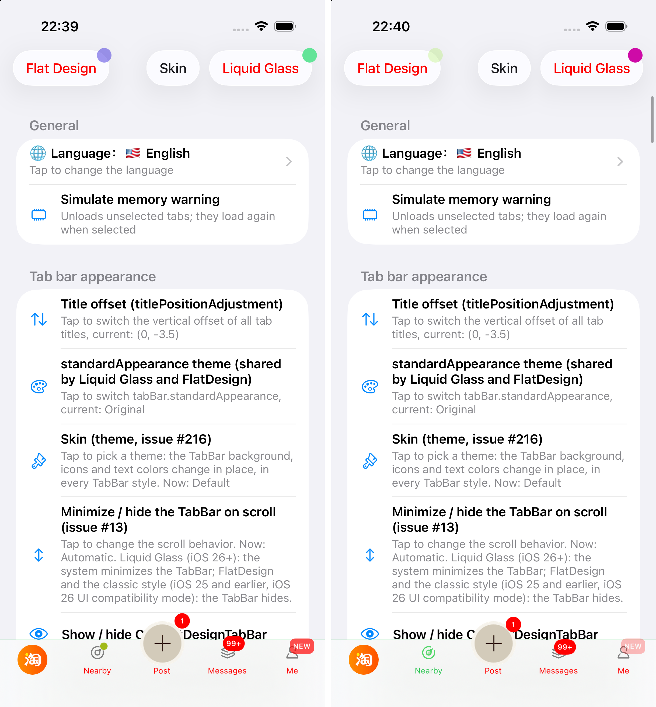
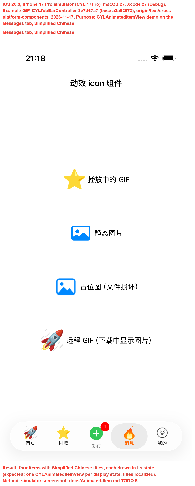
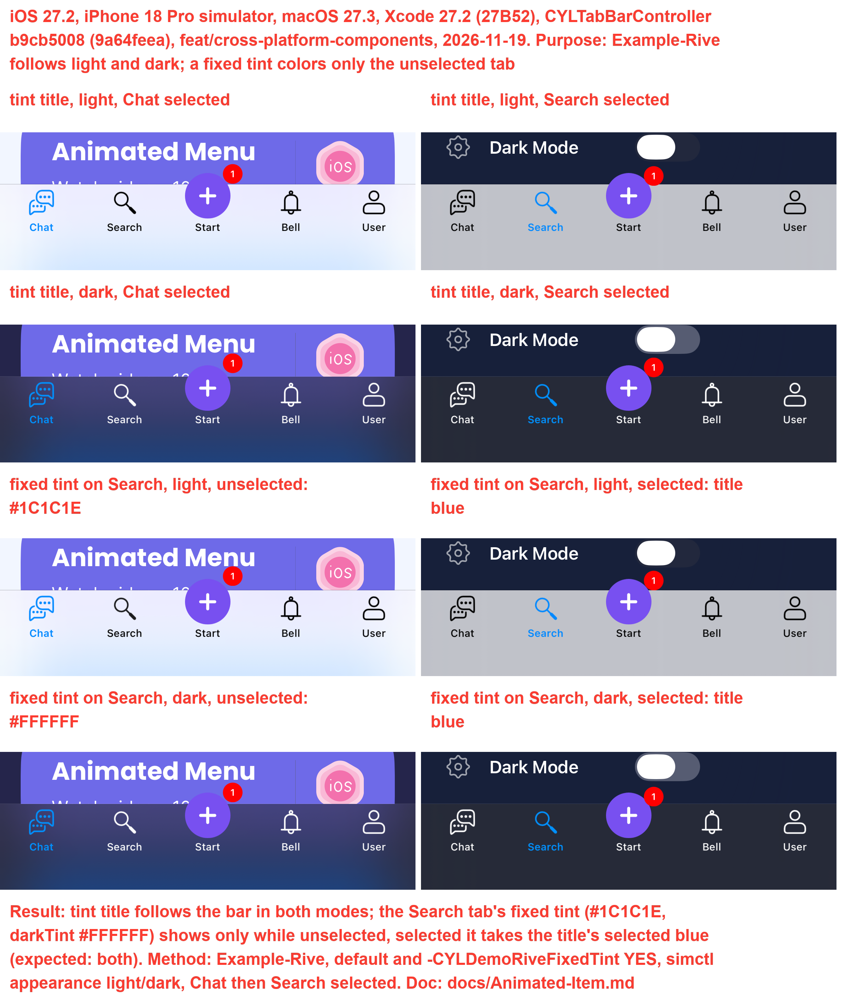
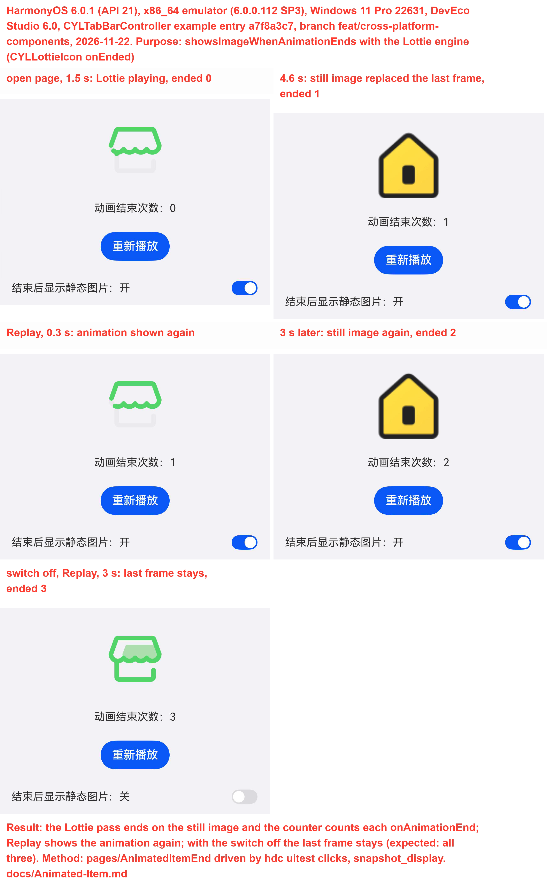
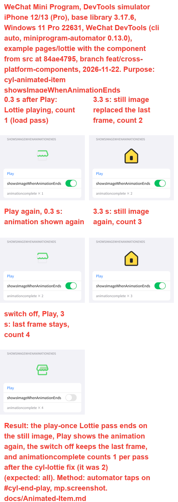
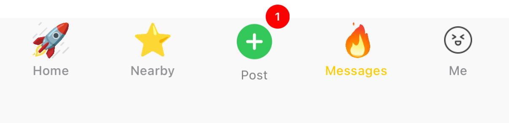
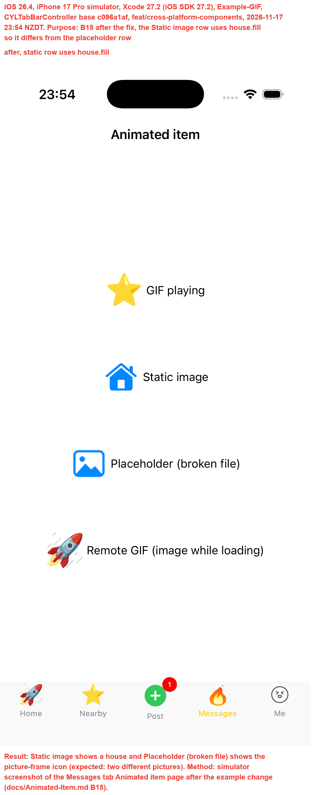

# [CN]动效 icon + title 共用组件：CYLAnimatedItem
# [EN]The shared animated icon + title component: CYLAnimatedItem

<!-- bound-classes: CYLAnimatedItemView -->
<!-- binding:start -->
<!-- Generated by scripts/update-docs-navigation.py; do not edit by hand. -->

| 中文 | English |
|:---|:---|
| 绑定的代码类 `CYLAnimatedItemView`：[`CYLTabBarController/CYLAnimatedItem/CYLAnimatedItemView.h`](../CYLTabBarController/CYLAnimatedItem/CYLAnimatedItemView.h) | Bound to the class `CYLAnimatedItemView`: [`CYLTabBarController/CYLAnimatedItem/CYLAnimatedItemView.h`](../CYLTabBarController/CYLAnimatedItem/CYLAnimatedItemView.h) |

<!-- binding:end -->

| 中文 | English |
|:---|:---|
| `CYLAnimatedItem` 是一个独立组件：iOS 为独立的 pod 与模块 `CYLAnimatedItem`（`CYLAnimatedItem.podspec`，`import CYLAnimatedItem`），Android 为模块 `:cylanimateditem`（包 `com.cyl.animateditem`）。**它不依赖 CYLTabBarController**（不依赖 Core、CYLUtils 或任何 TabBar 代码；只有测试代码可以依赖 TabBar），反过来 CYLTabBarController 依赖它。它由两部分组成：①动画引擎（iOS 为 `CYLAnimatedItem/Engine` 子库，与扁平样式一样在编译期用 guard 隔离，默认不引入）（`CYLTabBarItemAnimationFactory`、`CYLTabBarItemAnimatorRegistry`、播放器与 animator 协议），新增动画类型只需在这里新增一个 animator；②`CYLAnimatedItemView`：一个可继承的视图，包含可播放动效的图标、标题、可选的附加图标（自带手势，例如删除按钮），整个视图可响应自定义手势（点击、长按、拖拽）。CYLTagButton（CollectionViewClassifyMenu、CYLSearchViewController）、CYLPlaceholderView（CYLTableViewPlaceHolder）与本库的 Tab 按钮都可以继承它，不必各自实现。 | `CYLAnimatedItem` is a component of its own: on iOS the pod and module `CYLAnimatedItem` (`CYLAnimatedItem.podspec`, `import CYLAnimatedItem`), on Android the module `:cylanimateditem` (package `com.cyl.animateditem`). **It does not depend on CYLTabBarController** (not on Core, CYLUtils or any tab bar code; only test code may depend on the tab bar); CYLTabBarController depends on it instead. It is made of two parts: (1) the animation engine (on iOS the `CYLAnimatedItem/Engine` subspec, isolated at compile time like the FlatDesign tab bar and left out by default; `CYLTabBarItemAnimationFactory`, `CYLTabBarItemAnimatorRegistry`, the player and animator protocols), so a new animation type is one new animator here and nowhere else; (2) `CYLAnimatedItemView`, a view to subclass: an icon that can play an animation, a title, an optional accessory icon with its own gesture (a delete button, for example), and gestures on the whole view (tap, long press, drag). CYLTagButton (CollectionViewClassifyMenu, CYLSearchViewController), CYLPlaceholderView (CYLTableViewPlaceHolder) and this library's tab buttons can subclass it instead of each writing their own. |
| 最新版本（分支 `feat/cross-platform-components`）：https://github.com/ChenYilong/CYLTabBarController/blob/feat/cross-platform-components/docs/Animated-Item.md | Latest version (branch `feat/cross-platform-components`): https://github.com/ChenYilong/CYLTabBarController/blob/feat/cross-platform-components/docs/Animated-Item.md |

## [CN]目录
## [EN]Contents

<!-- navigation:start -->
<!-- Generated by scripts/update-docs-navigation.py; do not edit by hand. -->

| 中文 | English |
|:---|:---|
| [任务记录](#cn任务记录) | [Task log](#entask-log) |
| [结构](#cn结构) | [Structure](#enstructure) |
| [接入](#cn接入) | [Integration](#enintegration) |
| [四个仓库的迁移](#cn四个仓库的迁移) | [Migrating the four repositories](#enmigrating-the-four-repositories) |
| [下游仓库的迁移进度](#cn下游仓库的迁移进度) | [Downstream migration status](#endownstream-migration-status) |
| [倒计时样式](#cn倒计时样式) | [Countdown style](#encountdown-style) |
| &nbsp;&nbsp;&nbsp;&nbsp;↳ [其他平台](#cn其他平台) | &nbsp;&nbsp;&nbsp;&nbsp;↳ [The other platforms](#enthe-other-platforms) |
| &nbsp;&nbsp;&nbsp;&nbsp;↳ [SMSCodeButton 的 issue #1](#cnsmscodebutton-的-issue-1) | &nbsp;&nbsp;&nbsp;&nbsp;↳ [SMSCodeButton issue #1](#ensmscodebutton-issue-1) |
| [动画结束后显示静态图片](#cn动画结束后显示静态图片) | [Still image after the animation ends](#enstill-image-after-the-animation-ends) |
| [x86_64 鸿蒙模拟器](#cnx86_64-鸿蒙模拟器) | [x86_64 HarmonyOS emulator](#enx86_64-harmonyos-emulator) |
| [新增一种动画类型](#cn新增一种动画类型) | [Adding an animation type](#enadding-an-animation-type) |
| [提交记录](#cn提交记录) | [Commits](#encommits) |
| [问题记录（除 iOS 外）](#cn问题记录除-ios-外) | [Bug log (platforms other than iOS)](#enbug-log-platforms-other-than-ios) |
| [截图（iOS 27）](#cn截图ios-27) | [Screenshots (iOS 27)](#enscreenshots-ios-27) |
| [TODO](#cntodo) | [TODO](#entodo) |

<!-- navigation:end -->

## [CN]任务记录
## [EN]Task log

| 中文 | English |
|:---|:---|
| 本条按用户要求使用英文（见右列）。 | IN PROGRESS, 83 / 100 (2026-11-22, branch `feat/cross-platform-components`, Windows session chen-yilong-b6): **`showsImageWhenAnimationEnds` and an "animation ended" callback on `CYLAnimatedItemView`**, asked by the CYLTableViewPlaceHolder session (chen-yilong-3a): its Success placeholder plays once and its last frame is almost blank, so after "Submitted" the Android plus page showed no icon; the owner chose "show a static success icon after the animation ends", and the rules put that behaviour in the CYLAnimatedItem component. The owner approved the API ("approve the CYLAnimatedItemView API, go ahead", relayed by 3a). User prompt, verbatim: "go ahead, iOS to the Mac session". Rubric: **100** = the switch (default off) and the callback on iOS, Android, HarmonyOS and the mini program, the end detected for Lottie, PAG, Rive, GIF and SVGA where the engine can tell, unit tests, and emulator / DevTools screenshots of an item that ends on its image; **60** = the switch and the callback on Android, HarmonyOS and the mini program with unit tests and a build. **Done**: Android (`showsImageWhenAnimationEnds`, `animationEndListener` / `CYLAnimatedItemAnimationEndListener`, `isShowingImageAfterAnimationEnd`; a new optional `CYLTabBarItemAnimationPlayer.isPlaying` answered by Lottie `isAnimating`, PAG `isPlaying`, SVGA `isAnimating`, Rive `isPlaying` and the GIF view; `CYLAnimatedItemAnimationEndTest`, 7 tests, and the whole `:cylanimateditem` suite pass on JDK 21), HarmonyOS (prop `showsImageWhenAnimationEnds`, `onAnimationEnd`, `CYLAnimatedItemAnimationContext.onEnded` called by `CYLLottieIcon` on lottie's "complete" and by `CYLSVGAView` on the last frame; `assembleHap` BUILD SUCCESSFUL), mini program (property `showsImageWhenAnimationEnds`; the existing `animationcomplete` event is the callback and now also comes at the end of a timed GIF pass; 3 new tests, `node --test test/*.js` 93 / 93). **Device check (2026-11-22, by chen-yilong-3a, CYLTableViewPlaceHolder `e822b76` pinned to `b13b88f1`)**: Android 17 emulator, plus page, Success placeholder (Lottie `CYLPlaceholderSuccess.json`): PASS, the animation plays at 1.5 s and the still check mark replaces it at 3 s and 8 s (before, at `b4d68cfe`, the icon area stayed blank); HarmonyOS 6.0.1 Mate 70 Pro x86_64 emulator: the check mark shows, but as the fallback image, because Success plays `CYLPlaceholderSuccess.riv` and the x86_64 HAP has no Rive engine, so `onEnded` was not exercised on the device; mini program: wired in CYLTableViewPlaceHolder, 74 / 74 node tests, no DevTools screenshot. Screenshot sheet (in CYLTableViewPlaceHolder): [android-harmonyos-success-still-image](https://github.com/ChenYilong/CYLTableViewPlaceHolder/blob/feat/android-refresh-port-followup/docs/assets/android-harmonyos-success-still-image-150772a-20261122-sheet.png). **Second pass (2026-11-22, user prompt verbatim: "go ahead, do both")**: HarmonyOS `CYLRiveIcon` now reports the end (`onEnded`: after the pass has started, `isPlaying()` false after true, as Android; a7f8a3c7), and the example has `pages/AnimatedItemEnd` (City tab); on the HarmonyOS x86_64 emulator a Lottie item ends on its still image, Replay shows the animation again and the switch off keeps the last frame ([sheet](assets/harmonyos-animated-item-still-image-after-end-lottie-a7f8a3c7.png)); in WeChat DevTools (base library 3.17.6) the same on the example's cyl-lottie page ([sheet](assets/wechat-miniprogram-animated-item-still-image-after-end-devtools-sdk3.17.6.png)). Bug found and fixed there: cyl-lottie sent "complete" twice per pass because its loop / autoplay / restingFrame observer replayed on unchanged values (84ae4795, new test, 15 / 15). **Missing**: iOS, -15 (handed to the Mac session: no Mac session was reachable on 2026-11-22, so the spec is the TODO row in [Still image after the animation ends](#enstill-image-after-the-animation-ends)); the HarmonyOS Rive end is built but not seen on a device (@ohos/rive has no x86_64 library; needs an arm64 device), -2. HarmonyOS PAG and GIF have no engine view here, so they are outside "where the engine can tell". Details: [Still image after the animation ends](#enstill-image-after-the-animation-ends). |
| IN PROGRESS，90 / 100（2026-11-22，分支 `feat/cross-platform-components`，chen-yilong-b6）：**鸿蒙 x86_64 模拟器**。用户原话："到本项目instructions 相关文件以及skills相关文件，如果没有就新增文件保证写入成功，全英文写入：    to fix HAP won't install on this x86_64 emulator because its Rive and PAG libraries are arm64-only, 最好的CYLTabBarController里的CYLAnimatedItemView库中完成该测试方案， 以让依赖该组件的example以及其他库完成完整测试 x86_64 emulator"。见右列。 | IN PROGRESS, 90 / 100 (2026-11-22, branch `feat/cross-platform-components`, chen-yilong-b6): **HarmonyOS x86_64 emulator**. The user's prompt is quoted verbatim in the left column (in Chinese); in English: "In this project's instructions files and skills files (create them if missing, make sure the write succeeds, all in English): to fix HAP won't install on this x86_64 emulator because its Rive and PAG libraries are arm64-only, preferably complete this test plan in CYLTabBarController's CYLAnimatedItemView library, so that the examples and other libraries that depend on the component can run complete tests on the x86_64 emulator". Written into `instructions.md` and the skills `cyl-harmonyos-setup`, `cyl-tab-animation`, `cyl-verify`. Rubric: **100** = engines in `cylanimateditem` declare their native ABIs and `CYLAnimatedItemEngines.canPlay` is false without them (still image, debug log), an x86_64 debug build option leaves the arm64-only `.so` files out of the HAP, host tests, and the cyltabbar example plus CollectionViewClassifyMenu run their full UI tests on the x86_64 emulator with screenshots; **60** = the ABI check in `cylanimateditem` with tests and one dependent example installed and running on the x86_64 emulator. **Done**: `CYLAnimatedItemTypes.ts` types carry `nativeAbis` (PAG and Rive: `arm64-v8a`), the registry knows the device ABIs and `canPlay` is false without them; `CYLAnimatedItemEngines` reads `deviceInfo.abiList` and adds `isSupportedOnDevice`, `unsupportedReason` (logged once in debug builds), `setRequiredNativeAbis`, `requiredNativeAbis`, `deviceAbis`, `setDeviceAbis`, and `register(..., nativeAbis)`; `cylanimateditem/tools/cyl_hap_x86_64.py` (strip, install with an ABI check); the cyltabbar example's `emulator` target (`nativeLib.filter.excludes: ["**/arm64-v8a/*.so"]`); `cylanimateditem/README.md` "x86_64 emulator" with the build profile recipe, the static import note and the test plan. Tests: `node --test cylanimateditem/test/*.test.mjs` 34 / 34 (2 new), `python -m unittest` 2 / 2; hvigor: the `emulator` HAP has 0 native libraries, the `default` HAP keeps `libs/arm64-v8a`. Emulator: the `emulator` HAP installs on x86_64, the Rive configuration tabs show still images and switch with no crash ([sheet](assets/harmonyos-x86-64-emulator-target-rive-still-images.png)); CollectionViewClassifyMenu's animations page ran without its `.so` files once no PAG / Rive view was built ([sheet](assets/harmonyos-classifymenu-dark-animations-x86-9dc1f761.png)). **Hypium (user prompt verbatim: "add hypium tests for the x86_64 fallback path")**: the cyltabbar example now has an `ohosTest` target (`entry/src/ohosTest`, `@ohos/hypium` 1.0.21) and an `emulatorTest` build mode; `CYLAnimatedItemFallback.test.ets`, 6 tests: device ABIs read, the ABIs each engine needs, this device's support (follows `deviceInfo.abiList`), a simulated x86_64 / arm64 device, an app engine with a native library, and a UI test (a Rive item builds no engine view without arm64-v8a and keeps its still image, a Lottie item builds one). x86_64 emulator, HarmonyOS 6.0.1: `aa test` "Tests run: 6, Failure: 0, Error: 0, Pass: 6"; both HAPs carry no arm64-v8a library. Also fixed: `tools/cyl_hap_x86_64.py` passes Windows backslash paths to hdc (hdc read "C:/..." as relative; reported by the CYLTableViewPlaceHolder session), Python tests 3 / 3. CYLTableViewPlaceHolder adopted it (pinned 62715829). **Missing**: CollectionViewClassifyMenu and CYLSearchViewController adopting it and running their full UI tests on x86_64 (-10: in progress in their sessions). |
| IN PROGRESS，30 / 100（2026-11-22，分支 `feat/cross-platform-components`，chen-yilong-b6）：**Rive 与 PAG 在 x86_64 模拟器上**。用户原话："找到本项目instructions 相关文件以及skills相关文件，如果没有就新增文件保证写入成功，全英文写入：   Rive; pag 编译问题： 针对需要只能在arm64上才能执行的测试， 有两个方案可供实现， 第一个方案是在CYLTabBarController的CYLAnimatedItemView中进行改造， 从GitHub中引入x86 架构的依赖库， 以完成测试功能。判断guards条件为， 运行系统的版本。 为x86架构， 首先你要保证x86架构能编译通过，且不会crash影响其他功能，其次才是实现功能运行正常。 在该方案未测试通过前使用debug环境编译选项进行guards，因为该方案目前只在运行模拟器时候会触发， 当该方案验证可行时候才再移除debug编译guards，你在移除该guards前需要经过我的同意。如果该方案实现失败， 则选择第二个方案， 将任务转发给正在macOS上的session进行测试， 因为macOS就是arm64架构的。" | IN PROGRESS, 30 / 100 (2026-11-22, branch `feat/cross-platform-components`, chen-yilong-b6): **Rive and PAG on the x86_64 emulator**. The user's prompt is quoted verbatim in the left column (Chinese); the plan in English is in `instructions.md`, "Rive and PAG on the x86_64 emulator: two plans for arm64-only tests" (also in the skills `cyl-harmonyos-setup`, `cyl-tab-animation`, `cyl-verify` and `cylanimateditem/README.md`). Rubric: **100** = Plan 1 works: x86_64 builds of the PAG and Rive libraries load on the x86_64 emulator (guarded by the device architecture), PAG and Rive play and report their end there, nothing else regresses (hypium suite and the example on x86_64 and on the arm64 path), with screenshots; the debug guard removed only after the owner approves; or, if Plan 1 fails, Plan 2 done: the macOS session ran the arm64 tests and reported them; **60** = Plan 1 compiles behind the debug guard, causes no crash and no regression on x86_64, with hypium tests, even if playback is not working yet. **Step 0, feasibility (2026-11-22, user prompt verbatim: "start Plan 1 for Rive and PAG on x86_64 then")**: (1) the local DevEco SDK has an x86_64 HarmonyOS toolchain (`sdk/default/openharmony/native/sysroot/usr/lib/x86_64-linux-ohos`, `llvm` clang); (2) no prebuilt x86_64 library exists: every Tencent/libpag release on GitHub ships only `libpag_<version>_ohos_arm64-v8a.har`, and @ohos/rive publishes no artifact; (3) sources: libpag on GitHub (Tencent/libpag, its `ohos/libpag` module builds the root CMakeLists through hvigor, so an `abiFilters: ["x86_64"]` build is plausible after `sync_deps.sh`); @ohos/rive on GitCode (openharmony-tpc/openharmony_tpc_samples `ohos_rive`, `library` `abiFilters: ["arm64-v8a"]`, version 1.0.6 at HEAD while cyltabbar pins 1.0.4) with the Rive engine from GitHub (rive-app/rive-runtime submodule); its native build needs MSYS2 with premake5, ninja, make and python-ply, which are not installed here; (4) order: Rive first (cyltabbar itself uses only @ohos/rive 1.0.4; PAG is used only by the dependent repositories, 4.4.31 and 4.5.102). **Next**: install MSYS2 and the build tools (asked the owner first: a system-wide install), check out the @ohos/rive 1.0.4 sources and the matching rive-runtime, build `libohos_rive.so` with `abiFilters: ["x86_64"]`, verify it is an x86-64 ELF exporting the same NAPI module as 1.0.4, then wire it into the `emulator` target behind the debug guard. **Step 1, Rive x86_64 built and seen playing (2026-11-22, user prompt verbatim: "go ahead, install MSYS2 。then 按照我们之前约定的tag分类方式处理 …")**: MSYS2 installed with winget (`C:\msys64`, ninja 1.13.2, make 4.4.1, python-ply) and premake 5.0.0-beta2 from GitHub (premake/premake-core; MSYS2's premake 5.0.0 has no `flags()`, which rive-runtime's scripts call). Sources: openharmony_tpc_samples `4b1609b2` (`ohos_rive` 1.0.4) with its submodules `rive-runtime` `f27a9005` (a Gitee fork, `gitee.com/yp9522/rive-runtime`: the commit is not in GitHub rive-app/rive-runtime, so 1.0.4 can only be reproduced from the fork; deviation from "from GitHub", recorded) and `third_party_bounds_checking_function` `2ae82839`; local build changes only: `abiFilters: ["x86_64"]`, the product switched to the HarmonyOS 6.0.1 SDK, `OHOS_NDK` through a junction without spaces (`C:\cyl-x86\ohos-native`; the engine's ninja files do not quote the sysroot). Result: `libohos_rive.so` x86-64 ELF (debug build, 15 MB), the ArkTS declarations (`types/libohos_rive/Index.d.ts`) identical to the official 1.0.4, the same 2 N-API symbols; 19 exported symbols differ (SheenBidi and Yoga internals, not called from ArkTS). Local experiment (never committed: Rive allowed on x86_64 in the build copy, the two x86_64 libraries added to the `emulator` HAP): on the x86_64 emulator the configuration Rive tab bar draws the real `icons.riv` artboards (chat, search, bell, person; before, still images), the Discover icon animates after a tap (frame difference), hilog `OHOS_RIVE: Artboard drawn`, no crash. **Next**: a release build (smaller), where the libraries live and how they reach only debug `emulator` HAPs, the debug guard in `CYLAnimatedItemEngines` / `cylRiveIsSupported`, hypium tests on x86_64, then PAG. |
| 本条按用户要求使用英文（见右列）。 | DONE, 90 / 100 (2026-11-21, branch `fix/animated-item-item-style`, Windows session): **rename `CYLAnimatedItemView.style` to `itemStyle` on iOS and Android**, the name HarmonyOS and the mini program already use. Reported by the CYLSearchViewController session: at `e96c4979` the new `style: CYLAnimatedItemStyle` clashes with every subclass that already has a `style`, e.g. CollectionViewClassifyMenu's `CYLTagButton.style: CYLMenuStyle` (Android `compileDebugKotlin`: "'style' hides member of supertype 'CYLAnimatedItemView' and needs an 'override' modifier"; Swift has the same clash), so no downstream repository can pin past `41660d24`. User's decision (CollectionViewClassifyMenu session), verbatim: "option 1, rename upstream to itemStyle, process test all platform (not include ios)". **Requirements**: rename the property, its uses, tests and comments on iOS and Android; comments and docs that name the iOS / Android property on HarmonyOS and the mini program; test every platform except iOS (no Mac here). **Acceptance (100)**: Android `cylanimateditem` unit tests, the countdown view test included, and the Android example builds (40); HarmonyOS host tests and build (15); mini program `npm test` (15); CollectionViewClassifyMenu's Android library compiles against this commit (20); iOS renamed consistently, its compile left to a Mac session and said so (10). Pass: 60. **Result (Windows 11, JDK 17, Gradle 9.4.1, DevEco Studio)**: Android `:cylanimateditem:testDebugUnitTest` 91 tests, 0 failures (`CYLAnimatedItemCountdownViewTest` included) and `:app:assembleDebug` OK; HarmonyOS `scripts/harmonyos-build.sh` BUILD SUCCESSFUL (entry HAP and `cylanimateditem`), `CYLAnimatedItemCountdown.test.mjs` 8 / 8; mini program `npm test` 89 / 89. CollectionViewClassifyMenu (its `feat/harmony` with `cyl.tabbar.commit` set to this commit, not committed there): `:library:testDebugUnitTest` 105 tests, 0 failures, and `:example:assembleDebug` OK, so `CYLTagButton.style` no longer clashes. **Missing (-10)**: iOS is renamed (property, 10 uses, test) but not compiled here: a Mac session runs `scripts/unit-tests.sh` (`CYLAnimatedItemCountdownTests`). |
| 本条按用户要求使用英文（见右列）。 | DONE, 100 / 100 (2026-11-19, branch `feat/cross-platform-components`): **an overridable "is this item interactive" check in `CYLAnimatedItemStackView`**, asked by the Mac-CYLTableViewPlaceHolder session after it moved `CYLPlaceholderStackView` onto the stack view (its `6f59e43`, core 193 tests) with two workarounds: (1) the background tap skips every item with an action, while the placeholder skips only items that are tap-interactive (an item with an action but interaction turned off lets the background act); (2) item taps run the action from `touchUpInside` without asking the item whether it is enabled / interactive. Request, verbatim: "A hook like `shouldPassBackgroundTapForItemView:` (or an overridable \"item is interactive\" check) would let me drop both workarounds." **Plan**: iOS `open func isItemViewInteractive(_:) -> Bool` (Objective-C `-isItemViewInteractive:`), default: has an action, enabled, user interaction on; used by the item tap, the background tap and the VoiceOver role; the same check on Android (`open fun isItemInteractive`) and in the mini program (an item's `enabled: false`); HarmonyOS by the Win HarmonyOS session. **Rubric**: 100 = the hook on four platforms with tests and the placeholder session told; 60 = iOS only. **Done**: iOS `isItemViewInteractive(_:)` (`-isItemViewInteractive:`) and `updateInteractionOfItemViews()`; the check also sets the item's `isUserInteractionEnabled`, so a non-interactive item never swallows a background tap, and the enabled flag is observed. Found while testing: a Swift subclass marked `@objcMembers` re-exposed the inherited Swift initializer `init(itemViews:actions:)` with the selector of the Objective-C `-initWithItemViews:actions:` and did not compile; the Swift label is now `handlers:`. Android `open fun isItemInteractive` and `updateInteractionOfItemViews()`; mini program: an item's `enabled: false` (passed to `cyl-animated-item`). Tests: iOS 185 / 185 (2 new, with a Swift test subclass `CYLAnimatedItemTestStack`), Android `:cylanimateditem` 72 / 72 (1 new), mini program 64 / 64 (1 new). **HarmonyOS (Windows HarmonyOS session, 2026-11-19)**: `CYLAnimatedItemStackItem.enabled` (true by default; passed to the item view, which dims a disabled item) and, on `CYLAnimatedItemStackModel`, an overridable `isItemInteractive(item)` (default: an action and `enabled`) and `updateInteractionOfItemViews()` (redraws the stack). The one check drives the item tap (`tapItem` runs the action only while interactive), the hit test (a non-interactive element has `HitTestMode.None`, so the tap reaches the background), and the role (button / text); a non-interactive first item stands for the background action. Tests: `node --test CrossPlatform/harmonyos-cyltabbar/cylanimateditem/test/*.test.mjs` 15 / 15 (3 new: a disabled item with an action lets the background act and reads as text; a disabled first item stands for the background; a subclass overriding `isItemInteractive` plus `updateInteractionOfItemViews`); the module builds with hvigor with no warning (stack demo in the local build copy). Both placeholder sessions told. Score: 100 / 100. **Follow-up (2026-11-19, iOS)**: the placeholder session could not drop its workarounds yet: its components run their own tap handler (actions ran twice) and change `tapHandler` / `tapInteractionEnabled` where the stack cannot see it. Added `dispatchesItemTaps` (default true; false: the item handles its own tap, the stack does not run actions on item taps nor change `isUserInteractionEnabled`, and still performs the background tap, `performAction(_:)` and the VoiceOver roles), `bc5667bf`, iOS tests 186 / 186. iOS only for now: the other platforms' stacks have no client whose items run their own taps; add it there when CYLTableViewPlaceHolder's Android / HarmonyOS / mini program stacks move onto `CYLAnimatedItemStackView`. |
| 本条按用户要求使用英文（见右列）。 | DONE, 100 / 100 (2026-11-19, branch `feat/cross-platform-components`, `winCYLTabBarController 鸿蒙开发`): **map the engine symbols that `docs/Android-API-Map.md` lists as planned**. User prompt, verbatim: "should the Android API map drift be fixed now . It means mapping the 37 symbols, which the Windows session can take." (decided: yes, now, by the Windows session). **Context**: `python3 scripts/android-api-map.py --check` fails; regenerating adds 41 rows marked planned (score 99 to 96): the `CYLTabBarItemAnimatorRegistry` API (12), `CYLTabBarItemAnimationFailureHandling` and the loading / failure functions (`CYLTabBarItemAnimationReportFailure`, `MarkLoading`, `IsLoading`, `ReportLoaded`, `CYLTabBarItemAnimationDidFailNotification`), `CYLTabBarItemAnimationURLMayBeLottie`, the registry notification and key, and the `CYLTabBarSVGA*` keys. Most exist in `com.cyl.animateditem` (`CYLTabBarItemAnimationFailure.kt`, `CYLAnimationEngines.kt`, `CYLSVGATabBarItemAnimator.kt`), so they need mappings in the script's JSON, not new code; a symbol without a Kotlin counterpart gets one or an n/a reason. Not caused by Swift step 60 (the map never had `CYLAnimatedItemView` rows). **Rubric**: 100 = `--check` passes, score back to 99 or above, every row mapped or explained; 60 = half mapped. **Result**: 44 symbols had no entry in `Example-Android/cyltabbar/api-map.json` (the 41 above plus `CYLPlusButton reportsTapsToDelegate`, `CYLResourceBundleNamed()` and `UITabBarItem(CYLBadgeExtention) -cyl_moveBadgeToCurrentTabButtonIfNeeded`). Mapped done (34): the registry class and instance methods (`CYLTabBarItemAnimatorRegistry.registeredIdentifiers()` … `logRegistrationReport()`, instance forms through `sharedRegistry`), `CYLTabBarItemAnimationFailureHandling` and its two methods, the failure / loading functions (`CYLTabBarItemAnimationFailure.report` / `reportLater`, `markLoading`, `isLoading`, `reportLoaded`; the failure notification is the `fallbackHandler` callback), `CYLSVGATabBarItemAnimator` (a Kotlin object), the `tint` / `darkTint` / Rive view model instance options and the five `CYLTabBarSVGA*` keys (`CYLConstants`), and the engine helpers in `CYLAnimationEngines` (`attributesValue`, `typeOf`, `isAvailable`, `knownTypes`, `dependencyOf` for the subspec, `warnMissingEngine`). New code (1): `CYLPlusButton.reportsTapsToDelegate` (Android reported every plus button tap to `tabBarController_didSelectControl`; false now keeps it out, as on iOS), with the test `plusButtonReportsTapsToDelegateUnlessTurnedOff` (`CYLTabBarControllerTest`, 18 / 18 pass). Partial (1): `CYLAnimationFileExtensionsOfType()` (only for a registered engine, through the registry). n/a with a reason (6): `logsRegistrationReportOnLaunch` (no launch hook in a library: call `logRegistrationReport()` from `Application.onCreate`), the registry change notification and its key (animators register synchronously before tab bars are built), `CYLTabBarItemAnimationURLMayBeLottie()` (the Android Lottie animator matches by extension, not as a fallback), `CYLResourceBundleNamed()` (Android resources), and the classic-UITabBar badge move. Result: `python3 scripts/android-api-map.py --check` passes, score 100 / 100 (1068 counted symbols: done 1062, partial 6, planned 0, n/a 387). |
| 本条按用户要求使用英文（见右列）。 | DONE, 100 / 100 (2026-11-19, branch `feat/cross-platform-components`): **`CYLAnimatedItemStackView` on Android, HarmonyOS and the WeChat Mini Program**. User prompt, verbatim: "按照相同逻辑改造其他端的CYLAnimatedItemView，新增类似Stack View的视图组件" (English: change the other platforms' CYLAnimatedItemView by the same logic, and add a view component like the stack view). **Requirements**: (1) per platform, a stack component whose every element is that platform's `CYLAnimatedItemView`, with the iOS API (row below, `CYLAnimatedItemStackView.swift`): reserved first item, append with a spacing before, an action name per item run by handlers, a background action for taps outside items with an action, item lookup by action, remove, screen reader grouping with decorative items hidden, titles wrapped to the width; (2) "same logic" on iOS meant the core language rule (Swift first): Android is already Kotlin, HarmonyOS ArkTS, the mini program JavaScript, so the new code stays in each platform's language and in the component module (no tab bar dependency); (3) unit tests per platform; (4) React Native and Flutter have no `CYLAnimatedItemView`, so nothing to add there. **Split by session role** (`instructions.md`, "Sessions"): HarmonyOS to the Win HarmonyOS session (`winCYLTabBarController 鸿蒙开发`); Android and the mini program in this session (the Win mini program session is offline). **Rubric**: 100 = three platforms with tests passing and the API map updated; 60 = one platform. **Android, done (2026-11-19)**: `Example-Android/cylanimateditem/src/main/kotlin/com/cyl/animateditem/CYLAnimatedItemStackView.kt` (a `FrameLayout` holding a centered vertical `LinearLayout`; taps outside items with an action are taken in `onInterceptTouchEvent`, so items need no change; titles wrap because `LinearLayout` measures items at most the stack's width) and one change in `CYLAnimatedItemView`: it reports the `Button` role only while it is clickable, text otherwise (the stack makes items without an action not clickable). Tests: `CYLAnimatedItemStackViewTest.kt`, 10 cases (native graphics mode, since the legacy mode lays every text on one line); `:cylanimateditem` 71 tests and `:cyltabbar` 127 tests, 0 failures (JDK 17, Gradle 9.3.1, Robolectric SDK 34, run from an internal-disk copy because the external volume's `._*` files break the resource task). **Mini program, done (2026-11-19)**: component `CrossPlatform/wechat-miniprogram-cyltabbar/src/cyl-animated-item-stack/` (data-driven, since mini program components cannot take child instances in code: an `items` array, one `cyl-animated-item` per item, an `action` event in place of handlers, `detail.background` for the background tap; the four animation abstract nodes pass through), its pure model `cyl_animated_item_stack_model.js`, and a new `cyl-animated-item` property `accessibilityRole` ("button" by default, "text" for hints). Tests: `test/cyl_animated_item_stack.test.js`, 10 cases; `npm test` 63 / 63. **HarmonyOS, done (2026-11-19, Windows HarmonyOS session, 0b343364)**: `CrossPlatform/harmonyos-cyltabbar/cylanimateditem/src/main/ets/CYLAnimatedItemStackView.ets` (an ArkUI component: a centered `Column`, one element per item, each a wrapper around a bare `CYLAnimatedItemView`; the wrapper takes the tap and is the screen reader element, with `accessibilityGroup`, the item's text, the button role while it acts and the text role otherwise, set through an `AttributeModifier` only on API 18+ because the module supports API 12; decoration is `no-hide-descendants`; elements without an action have no click and `HitTestMode.None`, so a tap reaches the stack's background click) and its state `CYLAnimatedItemStackModel.ts` (plain TypeScript, no ArkUI import: items, the reserved first item, the spacing before each item, an action per item, handlers by action name, `backgroundAction`, `itemFor`, `remove`, `contentMargin` 16 vp, titles with no line limit and a maximum width of the stack's width minus the margins). Exported from `cylanimateditem`'s `Index.ets`. Found on the way and fixed: B29 (`CYLAnimatedItemView` filled its parent; new option `sizesToContent`). Tests: `cylanimateditem/test/CYLAnimatedItemStackModel.test.mjs`, 12 cases (the iOS cases plus listeners), `node --test CrossPlatform/harmonyos-cyltabbar/cylanimateditem/test/*.test.mjs` 12 / 12 (Node 22.23). Emulator (x86_64, OpenHarmony 6.0.1.112, temporary demo page in the local build copy, uitest taps): Retry runs `retry`, Write a post runs `post`, a tap on the hint, the separator, the first item or empty space runs the background action `reload`; only the acting elements are clickable in the layout dump ([screenshot](assets/animated-item-harmonyos-stack-view.png)). API maps: `scripts/harmonyos-api-map.py` now lists the Swift-only `CYLAnimatedItemStackView.swift` symbols, mapped in `scripts/harmonyos-api-map.json` (docs/HarmonyOS-API-Map.md regenerated), and a row in `.agents/skills/cyl-api-map`. **Screenshots (Windows HarmonyOS session, 2026-11-19, for the two missing points)**: WeChat Mini Program, DevTools 2.02.0 on Windows 11 (temporary page in the local example, removed afterwards): launch, Retry triggers `action` "retry" with `detail.background` false and no second background event, a tap on the hint triggers "reload" with `detail.background` true; the DevTools CLI cannot tap inside a custom component (its selector stops at the component), so each tap is replayed from the runtime as the framework delivers it (the item handler, then the bubbled container handler with the same `timeStamp`) ([screenshot](assets/wechat-miniprogram-animated-item-stack.png)). Android 17 (API 37) x86_64 emulator (temporary activity in Example-Android, removed afterwards), real adb taps: Retry runs "retry", the hint and empty space run "reload", Write a post runs "post"; the uiautomator dump shows the first item, Retry and Write a post as buttons, the hint as text and the decorative icon hidden ([screenshot](assets/android-animated-item-stack-view.png)). Score: 100 / 100. |
| 本条按用户要求使用英文（见右列）。 | DONE, 100 / 100 (2026-11-19, macOS 27.3 + Xcode 27.2, iPhone 18 Pro iOS 27.2 simulator, branch `feat/cross-platform-components`): **`CYLAnimatedItemStackView`, a stack whose every element is a `CYLAnimatedItemView`**, to take over the work of CYLTableViewPlaceHolder's `CYLPlaceholderStackView`. User prompt, verbatim: "封装session名字为Mac-CYLTableViewPlaceHolder 文件夹里所使用CYLPlaceholderStackView到CYLanimatedView里的一个视图，他的特点为每一个元素都为CYLanimatedView，并通知session名字为Mac-CYLTableViewPlaceHolder 让他使用我们的新视图控件来完成原本由CYLPlaceholderStackView完成的工作" (English: wrap the CYLPlaceholderStackView used in the CYLTableViewPlaceHolder folder (session Mac-CYLTableViewPlaceHolder) as a view of CYLAnimatedItem, whose every element is a CYLAnimatedItemView, and tell that session to use the new view for the work CYLPlaceholderStackView did.) **Requirements**: (1) a view in the `CYLAnimatedItem` pod / module, no dependency on CYLTableViewPlaceHolder or the tab bar; (2) every arranged element is a `CYLAnimatedItemView`; (3) what `CYLPlaceholderStackView` does, in generic form: a centered vertical `UIStackView` with side margins, a reserved first item, append with a spacing before, per-item actions (string identifiers) run by handlers given at creation, a background action for taps outside tappable items, item lookup by action, VoiceOver grouping with decorative items hidden, titles wrapped to the view's width; scenarios and component dictionaries stay in CYLTableViewPlaceHolder; (4) unit tests; (5) notify the Mac-CYLTableViewPlaceHolder session. **Rubric**: 100 = view + tests pass in the iOS test target + docs + downstream notified; 60 = view compiles without tests. **Context**: source `CYLTableViewPlaceHolder/CYLTableViewPlaceHolder/CYLTableViewPlaceHolder/CYLPlaceholderStackView.{h,m}` (its elements are `CYLPlaceholderView`, a `UIView`, not a `CYLAnimatedItemView`). **Follow-up prompts, verbatim**: "找到本项目instructions 相关文件以及skills相关文件，如果没有就新增文件保证写入成功，全英文写入： 本项目iOS core 核心代码为Swift，新增任何代码均为Swift优先" (English: find this project's instructions files and skills files, add them if missing, and write in English: the iOS core of this project is Swift; all new code is Swift first) and "CYLAnimatedItemStackView 改为swift ，并确保CYLAnimatedItemView也是" (English: make CYLAnimatedItemStackView Swift, and make sure CYLAnimatedItemView is Swift too). **Done**: the rule is in `AGENTS.md`, `instructions.md`, `docs/instructions.md` and every cyl-* skill (`46d2b3ec`); the view is Swift, `CYLTabBarController/CYLAnimatedItem/Swift/CYLAnimatedItemStackView.swift` (`@objc`, Objective-C: `@import CYLAnimatedItem;`, actions are `NSString`s, `-initWithItemViews:actions:` takes an `NSDictionary` of blocks), in the CocoaPods `CYLAnimatedItem/Core` subspec, the Xcode `CYLAnimatedItem` framework and the SwiftPM target `CYLAnimatedItemViews` (part of the `CYLAnimatedItem` product). Tests: `CYLTabBarControllerTests/CYLAnimatedItemStackViewTests.m`, 11 cases, kept in Objective-C on purpose to check the Objective-C API CYLTableViewPlaceHolder calls; `scripts/unit-tests.sh` 181 tests, 0 failures. SwiftPM (a copy without the Xcode project, Xcode 27.2): scheme `CYLAnimatedItem` builds with the Swift file; scheme `CYLTabBarController` fails already at `46d2b3ec` without this change (`CYLTabBarControllerSwift` cannot find `CYLPlusButton`, `CYLTabBar`, `CYLBadgeAnimationType`: Objective-C types of the target above it), a separate bug for the Swift migration. **`CYLAnimatedItemView` in Swift too** (docs/Swift-Migration.md step 60): unit tests 181 / 181, `pod lib lint` Core / Engine / GIF pass, SwiftPM `CYLAnimatedItem` builds. **Missing points (TODO)**: Done (2026-11-19): CYLTableViewPlaceHolder switched to the new view, its `e12af1f` pinned to `86c5f7c5` (`CYLPlaceholderItemStackView`, a Swift subclass with `dispatchesItemTaps = NO` and `isItemViewInteractive` = the component's `isTapInteractive`; both workarounds removed; core 195, animation 13; background tap reloads in the simulator). **Downstream: all three repositories on the Swift view (2026-11-19)**: CollectionViewClassifyMenu `e4dc5b59` / `d6a94ce9`, CYLSearchViewController `49d1f38` (32/32, no code change), CYLTableViewPlaceHolder below. **Downstream blocker found after step 60, resolved (2026-11-19)**: CYLTableViewPlaceHolder ported `CYLPlaceholderView` to Swift in its `97b0591`, pinned to `5996fa96` (core 191/191, animation 13/13, no missing parent hook); was: CYLTableViewPlaceHolder's `CYLPlaceholderView` is an Objective-C subclass of `CYLAnimatedItemView`, which Objective-C cannot do with a Swift class, so that repository stays pinned to `28a9609d` (before step 60) until `CYLPlaceholderView` moves to Swift; the owner decides the order of the two tasks (my earlier search missed it: it looked for `@interface X : CYLAnimatedItemView` on other branches); Done (2026-11-19): `pod lib lint CYLAnimatedItem.podspec` passes for `LottieSwift`, `PAG`, `Rive` and `SVGA` (with `scripts/pod-lint.xcconfig`; libpag 4.5.102's podspec warns about its own license file), and `scripts/pod-lint.sh xcframework` builds the Carthage XCFrameworks; `CYLAnimatedItem.xcframework` carries `CYLAnimatedItem-Swift.h` (declares `CYLAnimatedItemView`) next to the compatibility `CYLAnimatedItemView.h`. Score: 100 / 100. |
| 本条按用户要求使用英文（见右列）。 | DONE, 100 / 100 (2026-11-19, branch `feat/cross-platform-components`): **`CYLAnimatedItemStackView`: a horizontal axis and a symbol tint color**, every platform (iOS first, then HarmonyOS, Android, the mini program). Requested by the winCollectionViewClassifyMenu session (its docs/issue-progress.md TODO; its c9a94212 draws a tag's two editing icons itself from a `CYLAnimatedItemStackModel` because the stack view stacks vertically only and does not tint symbol images). Recorded by winCYLTabBarController 鸿蒙开发. Requirements: (1) `axis` (vertical by default, horizontal lays the items in a row, `spacingBefore` becomes the space on the leading side); (2) a tint color for symbol / template images of every item (per item and for the whole stack), as `CYLAnimatedItemView`'s icon tint. Today: iOS `CYLAnimatedItemStackView` sets `stackView.axis = .vertical` and has no tint; HarmonyOS likewise. The API names are to be set on iOS first (Mac sessions), then mirrored. Rubric: 100 = both options on every platform, unit tests (axis: frames / order; tint: the color reaches the item view), a screenshot per platform, API maps and docs updated; 60 = iOS and HarmonyOS with tests. **Names agreed (Mac-CYLTabBarController文件夹, 2026-11-19)**: iOS `axis` (wraps `stackView.axis`, default vertical), `spacing` (wraps `stackView.spacing`), per-item tint through the existing `CYLAnimatedItemView.itemAppearance` (normal / selected `iconColor`) and a new stack-wide `itemAppearance` for items without their own; the Mac 小程序 session implements iOS. Mirror names: `axis` ('vertical' | 'horizontal'), `spacing`, `iconColor` / `selectedIconColor` per item and on the stack. **HarmonyOS DONE (2026-11-19)**: `CYLAnimatedItemStackModel.axis` (anything but 'horizontal' is vertical; `isHorizontal`), `spacing` (16 by default; an item's `spacingBefore` is now -1 = use `spacing`, a set value wins), `iconColor` / `selectedIconColor` on the stack and on `CYLAnimatedItemStackItem`, `iconColorOf(item, selected)`; `CYLAnimatedItemStackView` lays the items in a `Row` when horizontal (the spacing on the leading side) and passes the icon color to each `CYLAnimatedItemView.iconColor`. Tests: `node --test CrossPlatform/harmonyos-cyltabbar/cylanimateditem/test/*.test.mjs` 18 / 18 (3 new). Emulator: a row stack of two icons, 35 px (10 vp) apart, gray default tint, the second red ([screenshot](assets/harmonyos-animated-item-stack-axis-tint.png)). **Android DONE (2026-11-19)**: `CYLAnimatedItemView.iconColor` / `selectedIconColor` (new on Android: the static icon drawn in the color with SRC_IN; null leaves it, and only a filter the view set is cleared, so the tab button keeps its own) and `effectiveIconColor`; `CYLAnimatedItemStackView.axis` (`CYLAnimatedItemAxis`, the spacing as `marginStart` when horizontal), `spacingDp` (16 by default; `append` / `appendItem` take `spacingBeforeDp: Float? = null`, null = `spacingDp`), `iconColor` / `selectedIconColor` for items without their own, `spacingBeforeDpOf`. Tests: `:cylanimateditem` 78 / 78 (2 new); emulator (temporary activity, removed): two items in a row, gray and red ([screenshot](assets/android-animated-item-stack-axis-tint.png)). ~~Missing (TODO): iOS, the mini program, the API map rows. Score 60 / 100.~~ **iOS DONE (2026-11-19, Mac-CYLTabBarController 小程序开发)**: `CYLAnimatedItemStackView.axis` (`NSLayoutConstraint.Axis`, `.vertical` default, `.horizontal` one row) and `spacing` wrap the public `stackView`'s; `itemAppearance` (`UITabBarItemAppearance?`, copied) is given to every item without one of its own, items appended later included, and removed again when set to nil (items with their own keep it); per-item symbol tint is the existing `CYLAnimatedItemView.itemAppearance`. Test `testAxisSpacingAndStackWideAppearance`; unit tests 193, 0 failures. **Mini program DONE (2026-11-19)**: `cyl-animated-item-stack` properties `axis` ('vertical' | 'horizontal': a row, the spacing as `margin-left`), `spacing` (16, for items without `spacingBefore`), `icon-color` / `selected-icon-color` for items without their own; items take `iconColor` / `selectedIconColor` (`iconTint` stays as the older name) and `selected`. Tests: `npm test` 70 / 70 (2 new). DevTools (temporary page, removed): two items in a row, gray and red ([screenshot](assets/wechat-miniprogram-animated-item-stack-axis-tint.png)). **API map**: HarmonyOS rows `CYLAnimatedItemStackView axis` / `spacing` (DONE) and `itemAppearance` (partial: the normal / selected icon colors) in scripts/harmonyos-api-map.json; the Android map does not cover the CYLAnimatedItem module. **Every platform DONE, 100 / 100.** |
| 本条按用户要求使用英文（见右列）。 | DONE (2026-11-18; the parts left here, house.riv number input and the Android and HarmonyOS device checks, are done in the two rows below), was TODO (2026-11-18, branch `feat/cross-platform-components`): **the Rive engine has no loop logic**, and the fix. User prompt, verbatim: "mark TODO for Rive engine, has no loop logic and fix the Rive loop". Context: the Rive bug of [WeChat-Mini-Program.md](WeChat-Mini-Program.md#entodo) (first TODO row: icons play once, then neither loop nor play on "Play all"; CollectionViewClassifyMenu section "Rive · pod 'CYLTabBarController/Rive'", files house, check, menu_button, button, shapes, truck). Known gaps: no Rive player restarts a state machine; a trigger never loops; a held or missing input makes a replay a no-op; iOS `CYLAnimatedItemView` never loops a Rive item (its loop timer needs a player with `progress`). Plan, in the components on every platform, one behavior: (1) a play restarts the icon: a trigger fires; a boolean input is set to false, then to true on the next frame (false again after `duration` when it is above 0); a named animation restarts from its start; a file without a usable input restarts its state machine (a new instance) or its first animation; (2) when looping is on, the icon plays again after each pass: after the input goes back to false (duration above 0), else after the pass's length (the animation's duration when known, otherwise a fixed interval); (3) tests on each platform that play an icon twice and with looping on. Order: WeChat Mini Program (`cyl-rive`), iOS (`CYLRiveTabBarItemAnimationView`, `CYLRiveLegacyTabBarItemAnimationView`, loop in the player), Android (`CYLRiveTabBarItemAnimationView` in cylanimateditem), HarmonyOS (`CYLRiveIcon`). **Evidence on iOS and Android (CollectionViewClassifyMenu session, 2026-11-18; recorded there as B20, PR #820 on this repository's side)**: iPhone 17 Pro simulator, iOS 27.2, CYLTabBarController fe5c3ae, loop on, Play all, frames 4–14 s: Shapes and Truck loop (their files loop by themselves); Home (house.riv) never moves; Done stays on the finished check; Menu stays on ≡; Button stays on its small arc; the icons.riv tags never move; the same on Android. Screenshots: CollectionViewClassifyMenu feat/harmony, docs/assets/ios-rive-b20-frames.jpeg. **Progress**: mini program fixed (39778645, `cyl-rive`, tests 9/9; DevTools check TODO); iOS, Android, HarmonyOS in progress. **iOS fixed (2026-11-18)**: `CYLTabBarItemPlayableViewPlayer` forwards `loops` to a view that implements the new optional `-cyl_setAnimationViewLoops:` (and only then answers to `loops`, so other views keep CYLAnimatedItemView's progress loop); the Rive views loop themselves (next pass after the input goes back to NO plus 0.4 s, the animation's length, or 1.5 s) and restart on every play: a named animation is stopped (back to its start) and played, a trigger first restarts the state machine (check.riv stayed on its finished check), an input the state machine has goes NO then YES a frame later, a state machine without a usable input restarts; a local file without a view model (house.riv) is played by the legacy view (`CYLRiveFileInspecting`). Checked in CollectionViewClassifyMenu's iOS example built against this code (iPhone 17 Pro simulator, iOS 27.0, Xcode 27.2, launch `-CYLExampleScreen animations-rive-loop`): distinct frames per icon over 4–14 s, before → after: Home 6 → 6, Done 1 → 6, Menu 1 → 4, Button 1 → 6, Shapes 6 → 6, Truck 6 → 6, Chat 1 → 6, Search 1 → 6, Timer 1 → 6, Alerts 1 → 5, Me 2 → 5 (`assets/animated-item-ios-rive-loop-before-after.png`, top before, bottom after, frames at 4, 8 and 12 s); `scripts/unit-tests.sh` 157 tests, 0 failures; no warnings from the changed files. **Mini program, second pass needed**: the Windows CollectionViewClassifyMenu session's DevTools check of 39778645 (2x, loop on, Play all): Shapes, Truck, the icons.riv tags and Menu now move; Home (house.riv), Done (check.riv) and Button (button.riv) stay still. **Android fixed (2026-11-18)**: `CYLTabBarItemAnimationPlayableView` gets an optional `cyl_setAnimationViewLoops`, which the view animator's player calls from `loops` (the component's `animationLoops` reaches Rive at last); `CYLRiveTabBarItemAnimationView` loops itself and restarts on every play as on iOS (a trigger: reset and play, fire 50 ms later; a boolean input the state machine has: false, then true 50 ms later, false after the duration; a state machine without it: reset and play; a named animation: reset, then play). Tests: `CYLRiveLoopTest` (Robolectric, a fake RiveAnimationView: a held input plays twice, a missing input restarts, a trigger restarts then fires, loop repeats and stops), `:cylanimateditem` 34 / 34 and `:cyltabbar` 127 / 127. TODO: try it on an emulator (CollectionViewClassifyMenu's Android example). **HarmonyOS fixed (2026-11-18, build only)**: `CYLRiveIcon` restarts on every play as on Android (`reset()` / `play()`, false then true 50 ms later, a trigger fired after a restart, a missing input checked with `inputNames` restarts) and gets an optional `loops` property (off by default; HarmonyOS has no loop control yet, which the animated-icon examples rule lists as TODO); `scripts/harmonyos-build.sh` builds the HAP and the HAR; not yet run: `@ohos/rive` 1.0.4 draws on an arm64 device or emulator only (an x86_64 one shows the image, c096a1af); TODO: check on the arm64 emulator. **Mini program confirmed (2026-11-18)**: the Windows CollectionViewClassifyMenu session's DevTools rerun with 4e8fe675 (loop on, 2x, 8 frames / 15 s): Done draws its circle again, Menu goes to its X and back, Shapes, Truck and the icons.riv tags loop; Button plays (linear `active`, 1 s, one-shot) but barely shows at 20 px. **TODO, house.riv**: not a rendering or loop problem: its `State Machine 1` has a single NUMBER input, `Rooms` (3), and moves only when it changes (plus a 40 s sun turn invisible at icon size); no platform drives number inputs. Options: a number-input option (e.g. `numberInput=Rooms&values=3,4,5,6`, the next value on each play), or the example passes `animation=Demo Mode` (2.73 s, loops) for house. Evidence: CollectionViewClassifyMenu docs/assets/miniprogram-devtools-rive-b20-runtime-state.json. |
| 本条按用户要求使用英文（见右列）。 | DONE (2026-11-18, branch `feat/cross-platform-components`): **review of the Rive loop fix, official loop APIs, house.riv number input**. User prompt, verbatim: "你的分析有漏洞，既然不支持loop为什么rive dark mode是可以响应loop按钮，且play all 也可以响应。你的修复会不会影响本来就正常的rive资源？从你的截图时上看 home 标题的rive 依然是静止状态，不能作为修复的证据。官方引擎有没有loop接口，搜索引擎源码 并搜搜网络资源寻找官方方案。请提供更合理的截图证明已经修复。再回到iOS端重新验证iOS是否涉及这个问题：iOS需要重新评估修复方案。please support for this case ，add data binding for cyl-rive 。and show in example 。house.riv only moves when its Rooms input changes, which cyl-rive doesn't drive"; follow-up: "continue acceptable … adding numberInput and values would expand the public API" (accepted). **Answers**: (1) "no loop logic" was too strong: the mini program `cyl-rive` already looped one case, a boolean input with a duration (icons.riv), which is why the dark icons.riv tags answered Loop and Play all there; on iOS the same tags measured frozen before the fix (1 distinct frame in 6). (2) Official engines: a loop mode (`oneShot`, `loop`, `pingPong`) exists only for **linear animations** (rive-cpp `LinearAnimationInstance` loop override; Apple `play(animationName:loop:direction:)`, legacy runtime only and deprecated; Android `play(…, loop = Loop.ONE_SHOT, …)`; web `LinearAnimationInstance.loopValue` read-only); **state machines have no loop or replay API**: they run until they settle, and the official way to replay is to change an input / view-model property or `reset()` the file. So the fix keeps its design (restart on play, re-drive the input), and a named animation still uses the engine's own play. (3) Regression check: a file that moves on its own (shapes.riv, truck.riv, no input) was reset on every loop pass; now a loop pass leaves it alone while it is still playing (iOS: `viewModel.isPlaying`; mini program: `advance()` returns false once settled), and only an explicit play restarts it. **house.riv**: new public options `CYLTabBarAnimationOptionRiveNumberInput` (`numberInput`) and `CYLTabBarAnimationOptionRiveNumberValues` (`values`, e.g. `3,4,5,6`): each play sets the next value (iOS legacy view; mini program `cyl-rive`, which also takes `number`, a data-binding view model number property). The mini program example's animation playground (`pages/lottie`, with `--animation=rive`) shows icons.riv · CHAT and house.riv · Rooms (house.riv added to the package's example resources); Play steps Rooms. Tests: `CrossPlatform/rive-miniprogram` 14 / 14 (number values, Rooms 4-5-6-3, view model number, no restart while still moving). **Evidence (iOS)**: CollectionViewClassifyMenu's iOS example with house given `numberInput=Rooms&values=3,4,5,6`, iPhone 17 Pro simulator, iOS 27.0, Xcode 27.2, loop on, frames at 4–14 s: `assets/animated-item-ios-rive-loop-per-icon.png` (one row per icon, left 6 frames before the fix, right 6 after; Home now grows from 1 to 2 to 3 houses; Done, Menu, Button, Shapes, Truck, Chat, Timer, Alerts all change). Menu at 2 s sampling looked still by aliasing; sampled densely it showed 10 distinct frames in 24. **Android**: the Windows CollectionViewClassifyMenu session (RN example, API 37 emulator, pin 8d2bbbc6): Done loops, Menu goes to X and back, Home moves (0 changed pixels before). TODO: Android and HarmonyOS number inputs (`numberInput`, `values`); mini program DevTools check of house.riv in the playground. |
| 本条按用户要求使用英文（见右列）。 | DONE (2026-11-18; was TODO, branch `feat/cross-platform-components`): **Rive number inputs on every platform, a CYLTableViewPlaceHolder page for the Rive Home icon, notify the active sessions**. User prompt, verbatim: "2 continue acceptable. The input check makes getNumber(name).value() safe, but since the iOS options are a public enum, adding numberInput and values would expand the public API; then apply for all platform 在placeholder项目中为 这个rive home icon专门做一个页面展示作为占位图时的效果。做一个选项卡，或者滑块，手动滑动播放。并演示loop switch用 label展示数字或者实时控制刚刚提到的选项卡或者滑块，展示loop如何控制数字来实现loop。通知所有活跃的session，本次改动。使用rive 动效的代码需要重新评估本次修改，并带上commit或者文档让他们适配或者重新测试潜在bug" (English: (1) add `numberInput` / `values` on every platform; (2) in the CYLTableViewPlaceHolder project, a page that shows the Rive Home icon (house.riv) as a placeholder, with a segmented control or a slider that plays it by hand, and a loop switch whose label shows the number and drives that control live, to show how looping steps the number; (3) tell every active session about this change, with the commits and documents, so code that uses Rive animations re-checks it.) Plan: Android `CYLRiveTabBarItemAnimationView` (`setNumberState`), HarmonyOS `CYLRiveIcon` (`setNumberState`), React Native and Flutter pass the options through the file path fragment to the host views (no wrapper change); CYLTableViewPlaceHolder example page; cross-session notice. **Step 1 DONE**: Android (`CYLTabBarItemAnimationKeys` / `CYLConstants` `CYLTabBarAnimationOptionRiveNumberInput`, `…NumberValues`; `CYLRiveTabBarItemAnimationView` reads the current value with `input(name).getValue()` and calls `setNumberState`; a loop pass skips a restart while `isPlaying()`), tests `CYLRiveLoopTest` (Rooms 4-5-6-3, values, no restart while moving), `:cylanimateditem` 37 / 37, `:cyltabbar` 127 / 127; HarmonyOS (`CYLTabBarAnimationOptionRiveNumberInput`, `…NumberValues`, `cylRiveNextNumber` exported; `CYLRiveIcon` uses `inputByName` / `SMINumber.value` and `setNumberState`; loop pass skips a restart while `isPlaying()`), `scripts/harmonyos-build.sh` HAP + HAR build (not run on a device: needs the arm64 emulator); React Native and Flutter: no change (the option keys are read from the fragment by the host views, no fixed key list). **Also**: `cyl-rive` exports `CYL_RIVE_OPTION_NAMES` (a10cdffc), asked by the Windows CollectionViewClassifyMenu session so its adapter stops copying the list. **Step 2 DONE**: CYLTableViewPlaceHolder 6b3dff3 (PR #31, `feat/android-refresh-port-followup`): Example-Scenarios `CYLRiveRoomsViewController` shows house.riv as a placeholder (`numberInput=Rooms`, `values=3,4,5,6`), a 3/4/5/6 picker and a slider set Rooms by hand, the Loop switch plays it every 1.5 s with the label, picker and slider following; video frames 1.5 s apart show Rooms 3, 4, 5, 6 (CYLTableViewPlaceHolder docs/assets/rive-rooms-loop-ios.png, iPhone 17 Pro simulator, iOS 27.0, Xcode 27.2). **Step 3 DONE**: notice sent to every active session with the commits and these documents. **Question answered (same day)**: why Shapes and Truck loop at launch while the other Rive tags stay still: not a regression of this change. Their files' state machines start in an animation that loops by itself, and the core starts every state machine on load (iOS `RiveViewModel(…, autoPlay: true)` in `CYLRiveLegacyTabBarItemAnimationView`, unchanged since before fe5c3ae; mini program `cyl-rive` renders from load, `autoplay` default true, unchanged since before 39778645); the other files rest in an idle state until an input changes. Possible core change (TODO, owner's choice): pause a state machine on its first frame after load until the first play, so every icon is still until played. **Mini program fix (same day)**: the Windows CollectionViewClassifyMenu session read menu_button's `isOpen` in WeChat DevTools every 250 ms for 6 s with loop on: always true. Cause: `cyl-rive`'s input play set false, `advance(0)`, true in one tick, so the state machine never spent time in the off state and the close transition never ran (iOS, Android and HarmonyOS wait 50 ms, so they were not affected; the earlier unit test only recorded the writes). Fix: an input already on goes off, then on a frame later (50 ms), or half a loop pass later while looping a held input, so it opens and closes in turn; tests sample the input over time (open 1.5 s, closed 0.75 s per pass). rive-miniprogram 16 / 16. **Verified (2026-11-18)**: mini program at 074285a6 (CollectionViewClassifyMenu 19e1e4a, Windows session): the 250 ms sampler on menu_button `isOpen` reads 100100110011001011010100 (off on every pass); DevTools changed pixels per frame pair: Menu [27,53,58,34,0,55,55] (about 5 at 6a9ede85), Home [30,17,20,36,16,42,56], Done [30,20,22,22,20,9,0], Shapes [0,32,45,67,41,70,15]; icons.riv tags move (CollectionViewClassifyMenu docs/assets/miniprogram-devtools-rive-b20-after-074285a6.png). iOS at 6a9ede85 (Mac CollectionViewClassifyMenu session): 152 tests, every Rive tag replays, Home steps Rooms. Android / React Native at 6a9ede85 (API 37 emulator): Home steps Rooms, Done and Menu loop (react-native-android-rive-b20-after-6a9ede85.png); Flutter integration 2 / 2. **HarmonyOS checked (2026-11-18, arm64)**: the Mac's own HarmonyOS emulator 127.0.0.1:5557 (abilist arm64-v8a, emulator 6.0.0.112 SP3, HarmonyOS 6.0.1 API 21; the HAP carries libohos_rive.so), the HarmonyOS example built from 3f262501 (`scripts/harmonyos-build.sh`), Home row "Rive Tab 图标（配置文件）" (icons.riv, input `active`): tapping Discover changes its icon in each of 5 frames, the icon then rests (two identical frames), and tapping Discover again replays it (4 changing frames): `assets/harmonyos-rive-replay-arm64.png` (top: select, bottom: rest then reselect). The HarmonyOS example has no loop switch or house.riv yet, so `loops` and `numberInput` on HarmonyOS are covered by the build only. **Left**: the owner's choice on pausing self-looping state machines (shapes, truck) until the first play. |
| 本条按用户要求使用英文（见右列）。 | DONE (2026-11-18; was TODO, branch `feat/cross-platform-components`): **a HarmonyOS emulator run of the Rive loop and `numberInput`**. User prompt, verbatim: "Add the loop switch and house.riv to the HarmonyOS example, so loop and numberInput get a real emulator run?" Context: the HarmonyOS tab bar has no `tabBarItemAnimationLoops` (iOS `CYLTabBarController.tabBarItemAnimationLoops`, Android `CYLTabBarHostView.animationLoops`), so `CYLRiveIcon.loops` is never set; the example has no house.riv. Plan: (1) core: `CYLTabBarController.tabBarItemAnimationLoops` (`@Prop`, off by default) passed to `CYLRiveIcon.loops`; (2) example: house.riv in rawfile, a configuration `cyl_tabbar_configuration_rive_house.json` whose Home tab is house.riv (`numberInput=Rooms&values=3,4,5,6`), a Home row for it, and a Loop toggle on the Rive configuration pages; (3) run on the arm64 emulator 127.0.0.1:5557: Home steps Rooms on each reselect, and with Loop on the selected tab replays by itself; screenshots in `assets/`. **Result**: core `CYLTabBarController.tabBarItemAnimationLoops` (`@Prop`, off by default, applied live) reaches `CYLRiveIcon.loops` (Lottie and SVGA on HarmonyOS loop too since the same day: [Tab-Icon-Animation-Quick-Start.md](Tab-Icon-Animation-Quick-Start.md)); example: rawfile `rive/house.riv` (NOTICE updated), `configurations/cyl_tabbar_configuration_rive_house.json` (Home = house.riv, `stateMachine=State Machine 1&numberInput=Rooms&values=3,4,5,6`), Home row "Rive Tab 图标：house.riv（数字输入 Rooms）", and a Loop switch (`cyl-config-rive-loop`, localized) on both Rive configuration pages; `scripts/harmonyos-l10n.py --check` passes; `scripts/harmonyos-build.sh` builds the HAP and the HAR. **Emulator** (arm64 127.0.0.1:5557, OpenHarmony 6.0.1.112, API 21, HAP built from this change on top of b0a7ae75, 2026-11-18): `assets/harmonyos-rive-house-loop-arm64.png`, top to bottom: (1) the Home icon after load and after each of 4 taps on Home, 4 s apart: the house changes on every tap and comes back to the first size after a full cycle (Rooms steps through the values); (2) Loop on, no taps, 1.5 s apart: the house changes by itself on every pass; (3) Loop off, 4 s apart: the house stays the same (only the sun and the clouds of the file drift).  |
| 本条按用户要求使用英文（见右列）。 | DONE, 100 / 100 (2026-11-19: Rive and GIF on every platform, FlatDesign included; was TODO, 2026-11-18, branch `feat/cross-platform-components`): **every animated tab icon rests until it is played: Rive state machines, and GIF images loaded as a static image**. User prompt, verbatim: "should the core keep every Rive icon on its first frame until it's played, so Shapes and Truck don't move at launch? That's about 30 minutes per platform. Reply \"yes\"\ngif images which loaded from data also has this issue, it keep loop without play action request. fix it like rive does. this case is not about AnimatedItem/Gif , it about load gif as statice image". Requirements: (1) Rive, every platform (mini program `cyl-rive`, iOS legacy and data binding views, Android `CYLRiveTabBarItemAnimationView`, HarmonyOS `CYLRiveIcon`): after load the state machine is not advanced (first frame) until the first play or loop pass; then it runs as today. shapes.riv and truck.riv stay still at launch. (2) A GIF given as an image (iOS `CYLTabBarItemImage` with an animated `UIImage`, e.g. `+[UIImage cyl_animatedImageWithGIFData:]` or a GIF `CYLTabBarItemImageURL`; the matching image paths of the other platforms), not the GIF animation type: show its first frame until the tab is played (selected, re-tapped, Play all), play it once per play, loop only when looping is on. Context: today UIKit / the platform image view animates such an image forever (docs: "an image. It loops, and needs no subspec"). Order: Rive (mini program, iOS, Android, HarmonyOS), then GIF images (iOS first, then the other platforms where the platform can stop a GIF). **Part 1, Rive, DONE (2026-11-18)**: mini program ff2e7a22 (`cyl-rive` starts not playing with the first frame applied once; rive-miniprogram 17 / 17, tab bar 46 / 46); iOS and Android ef1d0313 (iOS legacy view `autoPlay: false`, data binding view paused after the first frame and resumed on play; Android view paused 100 ms after load and resumed on the first play; Example-Rive on iPhone 17 Pro, iOS 27.2: Bell rests, then swings after a tap, [frames](assets/ios-rive-rest-then-play-bell.png); `scripts/unit-tests.sh` 157 tests, 0 failures; Android `:cylanimateditem` 39 / 39 with two new tests, `:cyltabbar` 126 / 127, the failure being a test that scans the repository for `Example*/Configurations`, missing from the APFS mirror it ran in); HarmonyOS dc2fef02 (`CYLRiveIcon` paused 100 ms after load, resumed on the first play; arm64 emulator: Discover identical while resting, 4 changing frames after a tap, [frames](assets/harmonyos-rive-rest-then-play-arm64.png)). Not run here: shapes.riv / truck.riv themselves (CollectionViewClassifyMenu's examples have them; asked its sessions to check). **Android regression (reported by the Windows CollectionViewClassifyMenu session at dcbfdec6)**: menu_button.riv (`isOpen`, duration 0) played once, then never again on Android (API 37 emulator); iOS and the mini program kept looping. Cause, by reading rive-android 10.3.0: the first play resumed the paused file with the unnamed `play(loop, direction, settleInitialState)`, which also starts every linear animation of the artboard, and those override the state machine. Fix: resume only the state machine (`play(name, loop, direction, isStateMachine = true, settleInitialState = false)`), on Android and HarmonyOS; test `aHeldInputKeepsPlayingAfterItWasResumed`; `:cylanimateditem` 40 / 40; HarmonyOS arm64: Discover still rests and plays on tap. The Windows session re-ran ad3dca0e: still stuck. **Root cause found and fixed (same day)**: reproduced on the Mac (Android 15 API 35 emulator, example-rive test build with Bell = menu_button.riv, Loop on): with no pause Bell toggles X / menu every pass; with `RiveAnimationView.pause()` it creeps one frame per pass and never reaches X, because that call also stops the view's renderer (`RiveArtboardRenderer.stop()`); pausing only the file controller (`getController().pause()`; HarmonyOS `controller.pauseAllAnimations()`) toggles every pass again. [Evidence](assets/android-rive-menu-loop-pause-fix.png). Android `:cylanimateditem` 40 / 40; HarmonyOS arm64: Discover still rests, then plays on tap. **Second cause (Windows CollectionViewClassifyMenu session, x86_64 API 37 emulator, dab6d91d)**: Menu still stopped there even with no pause; raising the 50 ms off time to 300 ms made it turn on every pass. A held input (duration 0) went false, then true 50 ms later, and on a slow device one rendered frame takes longer than that, so the state machine never advanced with the input off (the mini program's B20, 074285a6). Fix on Android and HarmonyOS: while looping a held input, it stays off for half a loop pass (0.75 s), as the mini program; otherwise for 150 ms (`INPUT_OFF_MS` / `CYL_RIVE_INPUT_OFF_MS`). Test `aLoopedHeldInputStaysOffForHalfAPass`; `:cylanimateditem` 41 / 41; the Mac arm64 emulator keeps toggling every pass; HarmonyOS builds. **Confirmed (same day)**: the Windows CollectionViewClassifyMenu session at f84c1073 (x86_64 API 37 emulator): every Rive tag still at rest; with Loop on, Menu changes in 27 of 29 frame pairs (0 of 39 at dab6d91d), the other Rive tags still move (CollectionViewClassifyMenu feat/harmony docs/assets/android-rive-menu-loops-f84c1073.png). The Android Menu regression is closed. **Part 2, GIF images: iOS DONE** (915bddbd, docs/GIF-Animation.md); FlatDesign, Android, HarmonyOS and the mini program TODO. FlatDesign: Mac-CYLTabBarController 小程序开发. Android, HarmonyOS, mini program: winCYLTabBarController 鸿蒙开发 (2026-11-19, the user's prompt "fix all to 100", relayed). Rubric per platform: 100 = first frame at launch, one pass per play (tap, re-tap, Play all), repeats while looping, looping off stops it, a test, a device or emulator screenshot; 60 = rests and plays on tap, with a test. **Android DONE 100 / 100 (2026-11-19)**: `CYLGIFDrawable` (cylanimateditem) rests on frame 0 and schedules frames only while playing: `play(loops)`, `stop()`, `loops` (off finishes the current pass); `CYLTabBarController` plays a tab's GIF images on a tap (`cyl_playTabButtonAnimationForControl`) and on Play all, and `tabBarItemAnimationLoops` off stops them, on repeats the selected tab's. Tests: `CYLGIFDecoderTest` 7 / 7 (2 new), example-gif `theGIFGivenAsAnImageRestsUntilPlayed` (rests, Play all plays once, loops, off stops), `:cyltabbar` 128 / 128 (1 skipped). Emulator (API 37): example-gif's fire tab keeps the same pixels at launch, moves after a tap, then is still again ([frames](assets/android-gif-image-rest-then-play.png)). **HarmonyOS DONE 100 / 100 (2026-11-19)**: new `CYLGIFImagePlayback.ts` (cyltabbar; the rules: `cylIsGIFImagePath`, `cylGIFDuration`, rest / one pass / looping states with a token per play); `CYLTabBarController.ets` decodes a GIF tab image (an image URL or path ending in ".gif": http(s), `resource://rawfile/...` or a rawfile path; not the GIF animation keys) with `image.createImageSource(...).createPixelMapList()`, shows its first frame at rest, and an `AnimatedDrawableDescriptor` of one pass (or repeating while `tabBarItemAnimationLoops` is on) when its tab is selected or tapped again; the previous tab's rests; the loop switch off rests them all. HarmonyOS has no Play all. Tests: `node --test CrossPlatform/harmonyos-cyltabbar/cyltabbar/test/*.test.mjs` 4 / 4. Emulator (x86_64): with a test `imageURL` GIF on Me (build copy only), still at launch, plays on a tap, rests, plays again on a re-tap ([frames](assets/harmonyos-gif-image-rest-then-play.png)). **Mini program DONE 100 / 100 (2026-11-19)**: new `src/cyl-animated-item/cyl_gif_image.js` (a small GIF reader: logical size, play time, first frame as RGBA; LZW, local and global color tables, transparency, interlace). cyl-animated-item treats a ".gif" static image (no animation, or a failed one) as a GIF image: it reads the file (package path, local file or http(s)), draws the first frame on a canvas 2d (tinted with `iconTint` for template images) and hides the looping `<image>`; `cyl_playFromStart` / `playAnimation` (selected tab, re-tap, Play all) removes the canvas (a canvas 2d ignores opacity), restarts the `<image>` from its first frame, and after one pass (the GIF's own play time) or when `loop` is turned off draws the still again; another tab selected rests it. Tests: `npm test` 68 / 68 (new: cyl_gif_image.test.js 3, a component test of rest, one pass, loop and deselect). DevTools (screen pixels, a local test config with a GIF on Me, reverted): the first frame stays, the colors cycle while playing with Loop on, Loop off rests it ([frames](assets/wechat-miniprogram-gif-image-rest-then-play.png)). **Part 2 on Android, HarmonyOS and the mini program: 100 / 100.** **FlatDesign DONE (2026-11-19, iOS 27.2 simulator)**: the FlatDesign button showed the whole animated image (UIImageView looped it) and played nothing when selected. Now every `CYLAnimatedItemView` rests an animated `image` / `selectedImage` on its first frame, `playAnimation()` / `restartAnimation()` play its frames when there is no animation file (once, or looping with `animationLoops`), `stopAnimation()` returns to the first frame, and `playAnimatedImage(_:)` plays a given animated image; the FlatDesign button plays its tab's animated image on selection (the selected one when animated, else the normal one, as the classic tab bar does: the selected image is often a still copy), and the FlatDesign item takes the animated original that the classic path keeps on the system item (selector keys in `CYLTabBarController.m`). Test `testFlatDesignAnimatedTabImageRestsUntilItsTabIsSelected`; unit tests 192, 0 failures. |
| 本条按用户要求使用英文（见右列）。 | DONE (2026-11-18; was TODO, branch `feat/cross-platform-components`): **Android: a Rive icon rests on the same frame at every launch**. Reported by the Windows CollectionViewClassifyMenu session (bug report relayed to this session, verbatim summary: "on Android, Rive Done and Menu don't always rest on the same frame at CYLTabBarController 396d3fca … In one, Menu rests on its X instead of the hamburger (440 changed px in its box) and Done's arc is further along (31 px) … before pausing, seek to the first frame (time 0, or settle the state machine's initial state), so every launch rests on the same frame, as on iOS"; evidence `docs/assets/android-rive-rest-frame-varies-396d3fca.png` in its repository). Cause: `CYLRiveTabBarItemAnimationView.cyl_restUntilPlayed` let the autoplayed state machine run for `FIRST_FRAME_MS` (100 ms) before pausing it, so the rest frame depended on the device's speed. Plan: rive-android 10.3.0 builds the scene synchronously in `setRiveFile` (the state machine is created and settled at time 0), so pause the controller right after the load, in the same main-thread step; update `CYLRiveLoopTest`; check four fresh launches on an Android emulator with screenshots. **Result**: `cyl_restUntilPlayed` now pauses the file controller right after the load, without `FIRST_FRAME_MS`, so the icon rests on the state machine's settled initial state; the paused controller still draws it. cylanimateditem unit tests 44/44 (`aLoadedFileRestsUntilItIsPlayed` checks the pause comes at once; `aFileLoadedAgainAfterAPlayKeepsRunning` replaces the play-before-the-first-frame case). Android 15 (API 35) emulator `CYL_API35_arm64`, example-rive: four cold launches give 0 changed pixels in menu_button.riv (on the hamburger) and in the five tab icons ([screenshot](assets/android-rive-rest-same-frame-every-launch.png)); this arm64 emulator is fast enough that the old 100 ms pause rested on the same frame too, so the x86_64 recheck belongs to the reporting session. Found while checking, older than this change (same in the build before it): on the Bell tab, the first "Play / Stop" tap after launch moves menu_button.riv toward its X and back within about a second instead of holding the X, and the next taps show the opposite of the button's state (0, 3728, 0 changed pixels after taps 1 to 3). Logged as a separate bug, not fixed here. **Correction (same day)**: not a separate bug. In menu_button.riv `isOpen` YES shows the menu icon and NO the close icon (Example-SwiftUI-Rive ContentView.swift); the rest frame here was the artboard pose captured before the machine settled, so Play (YES) went from the menu icon back to the menu icon. Fixed with the settle-then-rest change in the next row. |
| 本条按用户要求使用英文（见右列）。 | DONE (2026-11-18; logged and fixed in one step, branch `feat/cross-platform-components`): **Android: a resting Rive icon answers Play, Stop and Loop (regression from 319ba8a4)**. Reported by the Windows CollectionViewClassifyMenu session (relayed, summary verbatim: "at 918da089 on x86_64 emulator-5556, with Loop on, Menu (menu_button.riv, stateMachine \"State Machine\", input isOpen, duration 0) changes once (167 px) and then holds for 15 frame pairs. At 0505042f, Menu looped … the immediate pause in cyl_restUntilPlayed looks like the cause"). Cause, found with a logged debug build on the Android 15 arm64 emulator: the inputs reached the state machine as intended (resume, `isOpen` false, then true 240 ms later), but a machine paused before it settled answered them the wrong way round; without the pause, and with the explicit resume removed but the pause kept, the results showed it is the early pause itself. Fix: `cyl_restUntilPlayed` advances the controller in fixed `SETTLE_STEP_SECONDS` (1/60 s) steps until the machine settles (rive-android then pauses it by itself), at most `SETTLE_STEPS` (120); a machine still moving after that (shapes.riv, truck.riv) is paused. The steps do not depend on the device, so the rest frame stays the same at every launch; it is now the machine's settled state (menu_button.riv: the close icon, as the file defines for `isOpen` NO). Checks: four cold launches, 0 changed pixels; Play holds the menu icon, Stop returns to the rest frame (0 changed pixels), Loop keeps switching over 4 s ([screenshot](assets/android-rive-menu-settles-then-rests.png)); cylanimateditem unit tests 51/51 (two new: a machine settles in fixed steps and is not paused; a machine that moves by itself is paused after the steps). The x86_64 recheck is with the reporting session. **Follow-up (same day)**: on the reporting session's x86_64 emulator (API 37) Menu still stayed on its close icon with Loop on. Its log showed one play, then only the loop runnable, with "isOpen" flipping every pass (the delayed true fired after 1.4-1.5 s instead of 750 ms on that slow main thread), while the button changed 16 px in 2.4 s. Cause: rive-android pauses a settled state machine, and there a new input did not restart it. Fix: `cyl_resumeStateMachineIfSettled` plays the named state machine again before a boolean or number input is set, when the controller has none playing. cylanimateditem 57/57 (new: `aSettledStateMachineIsPlayedAgainBeforeEachInput`); Android 15 arm64 emulator: Play holds, Stop returns to the rest frame (0 changed pixels), Loop keeps switching over 4 s. **Verified on x86_64 (same day)** by the CollectionViewClassifyMenu session at 776b4635, emulator-5556 (API 37), ClassifyMenu Android example: with Loop on, Menu goes close icon, menu icon, close icon, menu icon over about 7 s (440-446 px against rest; about 2.4 s per pass on that slow main thread); Home, Done, Shapes, PAG and GIF still play; frame drops unchanged from 4f73209c (gfxinfo 96% janky, median 117-121 ms, every icon looping). Evidence: `docs/assets/android-rive-menu-loops-776b4635.png` in its repository (fed57ae). |
| 本条按用户要求使用英文（见右列）。 | DONE (2026-11-18, branch `feat/cross-platform-components`): **Android: PAG icons never play; Lottie files with image assets draw too large**. Reported by the user through the Windows CollectionViewClassifyMenu session (verbatim: "android 上 rive （home title） pag  gif动画 播放异常，无法播放，Lottie（image assets and placeholder）尺寸不对。请从CYLTabBar仓库内的animatedView 内的core代码修复。"). **PAG** — cause: `CYLPAGTabBarItemAnimator` made an `org.libpag.PAGView` (a TextureView with a GL surface per icon). In a list of icons on the x86_64 emulator (API 37, host GPU), Play drew one frame and then nothing more, and logcat printed libEGL "called unimplemented OpenGL ES API". Fix: the animator makes `org.libpag.PAGImageView` (libpag 4.0+, a plain View that draws frames as bitmaps; libpag recommends it for many small icons), with a frame-based player (`setCurrentFrame` / `numFrames`, `setRepeatCount`, `play` / `pause`). It falls back to `PAGView` with an older libpag. `ExamplePAGTest` checks the reflected `PAGImageView` methods. **Lottie image assets** — cause: lottie-android sizes an image layer by its bitmap's pixels times the screen density, so a bitmap decoded from a drawable folder (already scaled to the screen) or a @2x / @3x file drew 2-3 times too large (lottie-ios uses the size the file declares). Fix: `setMaintainOriginalImageBounds(true)` on every Lottie view, so image layers use the file's "w" / "h". **Result**: cylanimateditem and example-pag unit tests 51 / 51. CollectionViewClassifyMenu Android example on emulator-5556 (API 37, x86_64), Play all with Loop on, changed pixels per 0.6 s frame pair: PAG Home 1174-1959, Posts 331-425, Me 394-913, Animation 1 up to 313, Animation 2 up to 505 (before: 0, Posts once); the three gray Lottie icons with image assets fit their tags (before: about 2.6 times too large, cut off). GIF: the HarmonyOS session's B24. |
| 本条按用户要求使用英文（见右列）。 | DONE (2026-11-18; was TODO, branch `feat/cross-platform-components`): **Rive tint on iOS, like a template static image**. User prompt, verbatim: "该接口Rive tint也应适配 跟随tabbar 初始化时设置的tint 。Rive tint: \"title\" on iOS (the new report). Rive tint 行为应该与系统静态图片tint效果一致，用户需求为：用户可以像使用静态图片一样为Rive 增加tint 选中后设置" (English: the Rive tint option must follow the tint the tab bar was created with; `tint: "title"` on iOS (the new report); a tinted Rive icon must look like a tinted system static image: users can tint a Rive icon the way they tint a static image, and the selected state gets the selected tint). Context: reported by the Mac CYLSearchViewController session: with `{artboard, stateMachine, input: "active", tint: "title"}` on icons.riv, the Flutter and React Native tab bars draw white icons on the light Liquid Glass bar on iOS (also at fe5c3ae); cause: `CYLTabBarAnimationOptionTint` exists only on Android (bug B12, a SRC_IN layer paint fed with the tab title color), iOS ignores it. Plan: (1) iOS public key `CYLTabBarAnimationOptionTint` (`"tint"`: `"title"` = the tab bar's tint when selected and its unselected tint otherwise, as a template image; or a fixed `#RRGGBB`); (2) an optional `-cyl_applyAnimationViewTintColor:` on `CYLTabBarItemAnimationPlayableView`; (3) the tab bar passes each tab's current tint (selection, theme, trait changes); (4) the Rive views draw the icon as a one-color template in that color (find a way that works with Rive's Metal view); (5) check in Example-Rive and the React Native / Flutter iOS examples with screenshots. **Result**: public key `CYLTabBarAnimationOptionTint` (`"tint"`, Swift `.tint`) in the component's `CYLAnimationKeys`; optional `-cyl_applyAnimationViewTintColor:` on `CYLTabBarItemAnimationPlayableView`; both Rive views draw the icon in one color with a layer composited "sourceAtop" above the Rive view (`CYLRiveTintOverlay`: Rive draws with Metal, so the image cannot be tinted directly; a mask view was tried too and gave a lighter color); `CYLTabBarController` passes each tab's template color after a selection, a layout pass and a trait change (`-cyl_setNeedsApplyTabBarItemAnimationTintColors`): the appearance's selected / normal icon color, else `tintColor` / `unselectedItemTintColor`, else UIKit's default, because with Liquid Glass every title label reports `labelColor` whatever the selection. Checked in Example-Rive (iPhone 17 Pro, iOS 27.2) with test tints: orange selected, gray unselected, swapping on selection; a fixed `#34C759` stays green ([screenshot](assets/ios-rive-tint-template.png)). React Native and Flutter use the same core through `CYLTabBarHostView` and pass the option in the file fragment: asked the CYLSearchViewController session (the reporter) to check. **Re-check (CYLSearchViewController session, iPhone 18 Pro, iOS 27.2, d733c80e)**: Flutter and React Native draw the selected icon blue and the others gray, swapping on selection; but in React Native the unselected icons stayed pale until the first tab switch, because its animation views are added after the layout pass that applied the tint. Fix: the tint is applied again right after a tab's animation view is added (`-addLottieImageWithControl:…`); compile-checked in Example-Rive; **confirmed** by that session at 51d58545 (React Native 0.88.0, iPhone 18 Pro, iOS 27.2, no tap): the unselected Rive icons are gray at launch and the selected one blue (CYLSearchViewController feat/harmonyos-parity docs/assets/rn-ios27.2-iphone18pro-20261118-rive-launch-tint-d733c80e-vs-51d58545.png). **HarmonyOS: DONE (2026-11-18, Windows session)**. The tab bar reads `tint` / `darkTint` (`CYLTabBarAnimationOptionTint`, `CYLTabBarAnimationOptionDarkTint`, exported from cyltabbar) from the query of any tab animation path, e.g. `lottie/news.json?tint=title` or `rive/icons.riv?artboard=CHAT&tint=%23FF3B30`. The Lottie path is loaded without the query. "title" maps to the tab's icon color for its state, else its title color (B25); a fixed color uses `darkTint` in dark mode. The tab bar passes the color to the new `CYLAnimatedItemView.animationTintColor` (cylanimateditem), which draws any engine view in one color: a color layer composited `SRC_ATOP` over the engine view, in an offscreen group (`BlendApplyType.OFFSCREEN`), like the iOS sourceAtop overlay. Checked on the x86_64 emulator with the demo's Lottie tabs in a local build copy: Messages with `tint=title` is gray unselected and orange selected (instead of the file's green), and City with `tint=#FF3B30` is red in both states ([screenshot](assets/animated-item-harmonyos-tint-option.png)). Rive **checked (2026-11-18, Mac session, arm64 emulator "CYL TabBar Test", HarmonyOS 6.0.1, at 711babc1)**: with `tint=title` on CHAT and `tint=%23FF3B30` on SEARCH (added to the demo's Rive configuration in a local build copy), the blend reaches the Rive XComponent surface: CHAT is white when selected and gray otherwise, like its title, SEARCH is red in both states, and BELL and USER (no tint) keep the file's white ([screenshot](assets/animated-item-harmonyos-rive-tint-option.png)). `darkTint` checked the same day: City with `tint=#FF3B30&darkTint=#30D158` is green in dark mode and red in light mode, selected or not ([screenshot](assets/animated-item-harmonyos-dark-tint.png); the app put in dark mode with `setColorMode(0)` in a local build copy). WeChat Mini Program (2026-11-19): `tint` / `darkTint` from the route fragment or `CYLTabBarAnimationOptions`, "title" resolved per state by cyl-tab-bar-item, drawn by cyl-rive `tint` (source-atop fill after each frame); unit tests pass; DevTools check TODO (details: docs/WeChat-Mini-Program.md, TODO table). TODO: FlatDesign tab buttons not checked. |
| 本条按用户要求使用英文（见右列）。 | DONE (2026-11-18; was TODO, branch `feat/cross-platform-components`): **iOS: a tab badge is not on the top layer (the icon draws over it)**. User prompt, verbatim: "flutter iOS Badge 不在顶层" (English: Flutter iOS: the badge is not on the top layer), with this session's crop of the Flutter example's tab bar (iPhone 17 Pro, iOS 27.2, Liquid Glass). Seen: the "Me" tab's "NEW" badge is drawn under the person icon's strokes; the same in the Objective-C example (this session's launch-crash check screenshot), so it is the iOS core, not the Flutter wrapper. Not a bug: the plus button's "1" badge only looks cut in that image because of the crop (y from 2340); it is whole in the full screenshot. Known so far: `-cyl_getActualBadgeSuperView` puts a tab button's badge inside its animation view (else its image view); `-cyl_bringBadgeToFront:` gives the badge the top `zPosition`, which only orders sibling layers, so a view in another branch of the tab button drawn later (likely UIKit's Liquid Glass tab image) can still cover it. Plan: dump the tab button's view and layer tree in the Objective-C example on the simulator, find what covers the badge, fix the badge host in the core (above every icon view of the tab button), check the ObjC, Flutter and React Native examples with screenshots. **Result (verified at 396d3fca, follow-up prompt verbatim: "badge 最新提交疑似已经修复，请验证最新提交是否修复。如果没有修复继续修复" (English: the latest commits may have fixed the badge; verify, and keep fixing if not))**: the latest badge commits (cbe32a64 to 396d3fca) change badges on animated items and swapped animation views; on the Objective-C example the "NEW" badge still looked as before. Cause found: not a layering bug. An lldb dump of the tab bar (iPhone 18 Pro simulator, iOS 27.2, Liquid Glass) shows the badge as the last subview of the Lottie host view, `zPosition` at the maximum, in both platter layers; with its animation removed (opacity 1.0) the badge hides the icon completely. The example shows "NEW" with `CYLBadgeAnimationTypeBreathe`, which fades the badge from opacity 1.0 to 0.1 and back (`+cyl_opacityForeverAnimation`), so the icon behind it shows through most of the time. This was the same in the Objective-C core. No code change made: making Breathe fade less (for example to 0.5), or using another animation for "NEW" in the example, is the maintainer's choice. [Screenshot](assets/ios-badge-breathe-not-under-icon.png): iOS 27.2, iPhone 18 Pro simulator, macOS 27.3, Xcode 27.2 (27B52), Objective-C example, CYLTabBarController 396d3fca. |
| 本条按用户要求使用英文（见右列）。 | DONE, 100 / 100 (closed 2026-11-19; superseded by the row "the Rive engine has no loop logic", DONE 2026-11-18, which fixed this cause on every platform with tests and device checks, and by the Android and HarmonyOS loop rows after it). Was TODO (2026-11-18, bug, every platform): Rive icons that play once and then neither loop nor play again on "Play all" (reported in the mini program, CollectionViewClassifyMenu's example, section "Rive pod CYLTabBarController/Rive"). The cause and the per-platform code review are in [WeChat-Mini-Program.md](WeChat-Mini-Program.md#entodo) (first TODO row): the same replay design on every platform (no restart of a state machine; a missing or held input makes a replay a no-op), and on iOS `CYLAnimatedItemView` never loops a Rive item (its loop timer needs a player with `progress`). Not fixed yet. |
| 本条按用户要求使用英文（见右列）。 | DONE in part (2026-11-18), TODO left below: (2026-11-18, branch `feat/cross-platform-components`): badges on items drawn by `CYLAnimatedItemView`, every platform. User prompt, verbatim: "请排查其他端是否也存在同样的问题，因为我发现很多接入CYLAnimatedItemView的新接口的example badge都不显示了。排查所有端代码逻辑。检查类似逻辑扣动，尤其安卓端" (English: check whether the other platforms have the same problem, because many examples using the new CYLAnimatedItemView interface no longer show their badges; check the code of every platform for similar logic, especially Android). Context: on HarmonyOS the tab badges moved to the icon's top-left after the tab icons became CYLAnimatedItemView (bare mode filled the tab slot; fixed in the component, fa221021, HarmonyOS issue list #51). Plan: Android first (`CYLTabBarItemButton` subclasses `CYLAnimatedItemView` since d4dea857), then iOS (`CYLFlatDesignTabBarButton` subclasses it since 22282646), React Native and Flutter (through the native host views), the WeChat Mini Program (`cyl-tab-bar-item` on `cyl-animated-item`); for each: where the badge is attached, what it is positioned and clipped against, and an emulator / simulator check. **Results**: (1) **HarmonyOS**: the cause the maintainer saw, fixed in the component (fa221021, HarmonyOS issue list #51): a bare `CYLAnimatedItemView` filled its parent, so the tab's icon box grew and the badge left the icon. (2) **Android**: no such problem. `CYLAnimatedItemView.onMeasure` sizes the view to its content, and `CYLTabBarItemButton` lays out its badge in its own layout from `cyl_badgeAnchorRect()` (the icon); on the emulator (Pixel API 35, `CYL_API35_test`, the native example `com.cyl.tabbar.demo`) the Message "12" badge and the Me dot sit at the icons' top-right (`assets/animated-item-android-tab-badges.png`). CollectionViewClassifyMenu's Android `CYLTagButton` (feat/harmony) measures and lays out its own badge inside its bounds. (3) **iOS**: the component hides its image view while an animation is shown, and a tab's badge host is the animation view when visible, else the image view; the new test `testFlatDesignTabBadgesStayVisibleWithAnimatedIcons` (FlatDesign, GIF and static tabs, badges set before and after the animation loads) shows tabs with an animation keep a visible badge at the icon's top-right. It also found an **older bug, not caused by the component** (it fails the same way at 357c314b, before 22282646, with a static icon): the **first** FlatDesign tab's `tabBarItem.cyl_tabButton` is still the hidden system tab button (`_UITabButton` in `_UITabBarItemPlatterView`, hidden), so `[viewController.tabBarItem cyl_showBadgeValue:]` adds its badge there and it never shows; **DONE (2026-11-19, iOS 27.2 simulator)**: fixed in the core, and it was wider than recorded: the test had never run (it looked up `CYLFlatDesignTabBarButton` by name before any tab bar existed; in the distribution framework the Swift class has a superclass in another resilient module, so the Objective-C runtime knows it only after its first use, and the test skipped itself), and once it ran, **every** FlatDesign tab's badge set on `tabBarItem` went to UIKit's hidden tab button, not only the first (the `XCTExpectFailure` covered the rest of the loop). Fix: `UITabBarItem.cyl_replacementTabButton` (CYLUtils, weak), preferred by `cyl_tabButton`; the FlatDesign item sets it on its page's system item when it has both its button and its page; `-cyl_setTabButton:` sets it too for a non-UIKit button. Related core bug fixed with it: `CYLControlTabBarSupport.flatDesignTabBarButtonClass` was a `static let` that could cache that early nil for the app's lifetime; it now caches only a found class. The two FlatDesign tests now run (no skip, no expected failure); unit tests 191, 0 failures. (4) **React Native and Flutter**: their badges are drawn by the iOS and Android host views, so (2) and (3) apply. (5) **WeChat Mini Program**: in `cyl-tab-bar-item` the badge is a sibling after `cyl-animated-item` in the 28 px icon box, absolutely positioned at its top-right (`left: 18px; top: -4px`), not clipped (only the tint wrapper has `overflow: hidden`) and drawn after the icon (no `z-index` anywhere); ~~**TODO**: confirm in WeChat DevTools (needs the maintainer's QR login).~~ **Confirmed in WeChat DevTools (2026-11-19, Windows 11, DevTools 2.02 logged in, branch `feat/cross-platform-components`, winCYLTabBarController 鸿蒙开发 for the user's prompt "fix all to 100", relayed by Mac-CYLTabBarController 小程序开发)**: the example's Home, Lottie icons drawn by cyl-animated-item: the badges 8 (Nearby), 1 (the plus button), 99+ (Messages) and NEW (Me) sit at the icon's top-right, whole (not clipped by the icon box or the bar) and over the icon; [screenshot](assets/wechat-miniprogram-tab-item-badges.png). Point (5) DONE, no code change. |
| 本条按用户要求使用英文（见右列）。 | DONE (2026-11-17): TODO (9), the Carthage part, taken from chenyilong-ba's split. User prompt, verbatim: "continue" (after the iOS TODOs of this document). Result: see TODO (9) below (separate `CYLAnimatedItem` framework, both XCFrameworks in the Carthage zip, the demo embeds both, unit tests 155/155). |
| 本条按用户要求使用英文（见右列）。 | DONE (2026-11-17, macOS 27.3 + Xcode 27.2): simulator screenshots and the next iOS TODOs. User prompt, verbatim: "运行模拟器 截图更新相关文档。阅读CYLAnimatedItem 相关的集成文档，continue fix todo iOS端代码与测试" (English: run the simulator, take screenshots and update the related documents; read the CYLAnimatedItem integration documents and continue fixing the iOS TODOs, code and tests). **Screenshots** (below, iOS, iPhone 17 Pro simulator, iOS 27.0, Xcode 27.2 (27B52, iOS 27.2 SDK), macOS 27.3, Example-GIF (FlatDesign, GIF tab icons), commit [c8132d26](https://github.com/ChenYilong/CYLTabBarController/commit/c8132d26) plus the macro fix of this change, 2026-11-17 22:00 NZDT): the FlatDesign tab bar after TODO (4), each tab button now a `CYLAnimatedItemView` (Home selected, then Messages selected), looks as before: GIF icons, titles, lens, the plus button's badge; the demo page on Messages: GIF playing, static image, placeholder for a broken file, remote GIF. **Fixed**: the build of every app using the pods warned "ambiguous expansion of macro 'CYL_SUPPRESS_ARC_PERFORM_SELECTOR_LEAKS'" (5 times in CYLTabBarController.m): the component and `CYLUtilsMacros.h` each defined it, differently, in two modules; `CYLUtilsMacros.h` now uses the component's and defines its own only without the component (its log is English now; the localized key stays). Clean Example-GIF build: no library warnings. **Environment note**: on the iOS 26.3 simulator runtime of this Mac (iOS_23D8133) emoji in labels draw as boxes (the settings list's "🌐 Language: 🇺🇸 English"), also after a reboot; the same build on iOS 27.0 draws them, so it is the runtime, not the code. |
| 本条按用户要求使用英文（见右列）。 | DONE (2026-11-17) for (1) and (2); (4) and (9) taken by another session (chenyilong-ba). Was: TODO (2026-11-17, macOS 27 + Xcode 27, branch `feat/cross-platform-components`): continue the iOS TODOs of this document, code and tests, on a Mac. User prompt, verbatim: "阅读CYLAnimatedItem 相关的集成文档，continue fix todo iOS端代码与测试" (English: read the CYLAnimatedItem integration documents and continue fixing the iOS TODOs, code and tests). Order: (1) local `pod lib lint` of both podspecs (every subspec alone, `CYLAnimatedItem` without an engine), the framework build and `CYLAnimatedItemViewTests`; then (2) Lottie URL downloads and loaded callback, (4) FlatDesign item drawn by `CYLAnimatedItemView`, (9) SPM / Carthage targets. |
| 本条按用户要求使用英文（见右列）。 | DONE (2026-11-17, macOS 27 + Xcode 27, branch `feat/cross-platform-components`), the same prompt, split between sessions: this part is TODO (4) and the Swift Package Manager half of (9). User prompt, verbatim: "阅读CYLAnimatedItem 相关的集成文档，continue fix todo iOS端代码与测试" (English: read the CYLAnimatedItem integration documents and continue fixing the iOS TODOs, code and tests). **Result**: (4) `CYLFlatDesignTabBarButton` subclasses `CYLAnimatedItemView` (content through `image` / `title`, the tab bar's layout in `-layoutContentInRect:`, the component's long press off); import order fixed for the framework build, where the generated Swift header now imports the umbrella header (`CYLAnimatedItemView.h` imports the engine after `@end`; `CYLFlatDesignTabBarDelegate` is declared before `CYLFlatDesignTabBar.h`'s imports; `CYLSwiftInterface.h` and `CYLTabBarItemAnimationPlayableView.h` import the component before the Swift header). (9) SwiftPM product `CYLAnimatedItem` (targets `CYLAnimatedItemSwift` + `CYLAnimatedItem`). **Checked locally** (macOS 27, Xcode 27.2, iPhone 17 Pro simulator): `scripts/unit-tests.sh` 154 tests, 0 failures, 2 skipped (not this change), new `testFlatDesignTabButtonIsTheAnimatedItemComponent` passes; framework scheme builds; `pod lib lint --quick` of both podspecs; the SwiftPM `CYLAnimatedItem` scheme builds. **Known, not from this change**: the SwiftPM `CYLTabBarController` scheme fails the same way on the unchanged branch (`cannot find type 'CYLBadgeAnimationType'`, `'CYLPlusButton'` in the Swift target: it cannot see the Objective-C target above it); not a TODO here: the maintainer accepted SwiftPM staying red until the core is all Swift (`.github/workflows/ios.yml`, `continue-on-error` for the `spm` demos; docs/Swift-Migration.md). **TODO**: a Carthage framework target for the component; the tab's animation view as the component's `animationView`. |
| 本条按用户要求使用英文（见右列）。 | DONE (2026-11-17, macOS 27 + Xcode 27, branch `feat/cross-platform-components`): TODO (4) second step, iOS. User prompt, verbatim: "continue 运行模拟器 截图更新相关文档。阅读CYLAnimatedItem 相关的集成文档，continue fix todo iOS端代码与测试" (English: continue; run the simulator, take screenshots and update the related documents; read the CYLAnimatedItem integration documents and continue fixing the iOS TODOs, code and tests). **Result**: `CYLFlatDesignTabBarButton` maps the component's animation members onto the tab bar's animation view (`animationView`, `animationReady` = this tab has a view and the tab bar's animations are loaded, `reloadAnimation`, `playAnimation`, `restartAnimation`, `stopAnimation`); the component never builds a second view. Test `testFlatDesignTabButtonsComponentAnimationIsTheTabsAnimation` (a GIF tab); `scripts/unit-tests.sh` 155 tests, 0 failures, 2 skipped (macOS 27, Xcode 27.2, iPhone 17 Pro). Screenshot (iOS, iPhone 17 Pro simulator, iOS 26.4, Xcode 27.2 / iOS SDK 27.2, ObjC example `CYLTabBarController.xcworkspace`, commit [`a6e88609`](https://github.com/ChenYilong/CYLTabBarController/commit/a6e88609), 2026-11-17 22:40 NZDT): left, the FlatDesign tab bar after tapping "Flat Design" (icons, titles, badges, the raised plus button as before); right, "Nearby" selected.  |
| 本条按用户要求使用英文（见右列）。 | DONE, 100 / 100 (closed 2026-11-19; was TODO, 2026-11-17, branch `feat/cross-platform-components`): build the shared component. **Closed because every platform and repository has it now**: iOS pod `CYLAnimatedItem` (Swift since step 60), Android `:cylanimateditem`, HarmonyOS `cylanimateditem` (`CYLAnimatedItemView.ets`), WeChat Mini Program `cyl-animated-item`; React Native and Flutter use the native host views; the four repositories subclass or use it (CollectionViewClassifyMenu `CYLTagButton`, CYLSearchViewController, CYLTableViewPlaceHolder `CYLPlaceholderView`, the tab bar's own buttons), re-verified on the Swift view today (ClassifyMenu `e4dc5b59`, CYLSearch `49d1f38`, PlaceHolder `97b0591` / `e12af1f`). Original entry: User prompt, verbatim: "重构动效展示核心组件代码：现在有四个仓库使用了类似的动效展示组件，该组件的基本特点为支持动效的icon 以及 title 可能还还有另外一个自定义的响应自定义手势的方式的icon组件。整体可以响应自定义手势比如拖拽手势。这是他的基本特点，目前的问题是四个仓库，虽然使用类似类似特点，各自实现类似功能，但代码大量重复使用。但核心特征不变。我的需求是以后新增动效类型，仅需需要修改这个组件，所有需要使用动效展示的组件都可以支持新增动效，无须在第二个地方修改代码。我现在要求你在本仓库中将这些库的代码进行综合分析，重构为一个子仓库，其他仓库的依赖该子仓库，使用面向协议开发的原则进行引用，以达到复用代码，引用了该子仓库的项目可以使用继承，实现自定义协议的方式，完成原本需要从零开始实现一个全新的组件该组件的基本特点为支持动效的icon 以及 title 可能还还有另外一个自定义的响应自定义手势的方式的icon组件，且整体可以响应自定义手势比如拖拽手势。你封装好后创建一个接入文档，我将在其他四个项目中按照文档进行继承。…该组件应该独立与本项目的core，不依赖本项目的core，如果需要依赖，那么将需要依赖的代码提取到CYLUtils组件中，最多依赖CYLUtils组件。该改动适用于所有平台重构" (followed by links to `CYLTagButton` on iOS, Android and HarmonyOS in CollectionViewClassifyMenu, `CYLTabBarItemButton` here, and `CYLPlaceholderView` in CYLTableViewPlaceHolder). **Analysis**: (1) CYLTableViewPlaceHolder's `CYLPlaceholderAnimation/` is a renamed copy of this repository's engine (`CYLPlaceholderItemAnimatorRegistry` …); (2) CollectionViewClassifyMenu's `CYLTagButton` finds this engine at run time with selectors; (3) the three views repeat the same icon / title / accessory / state / gesture code. **Requirements**: one sub-library, protocol-oriented, independent of Core (at most `CYLUtils`), subclassable; a new animation type changes only this sub-library; an integration guide for the four repositories; every platform. **Plan**: iOS and Android in this change (Android verified here); HarmonyOS and the WeChat Mini Program after (no toolchain in this Linux container); React Native and Flutter wrap the native host views, so they follow iOS and Android. Status: iOS and Android done, the other platforms TODO (see "TODO" below). |
| 本条按用户要求使用英文（见右列）。 | DONE (2026-11-17; the layout was refined by the rows below): every animation subspec depends on the component, none on Core. User prompt, verbatim: "继续拆分，不区分动效类型，该组件的独立特性，适用于所有依赖包括Lottie。cyltabbar/lottie该组件，应依赖我们本次新增组件以完成Lottie动效展示。" **Plan**: (1) the playable-view protocols (`Swift/CYLTabBarItemAnimationPlayableView.swift`, now in Core) move to the engine, so `CYLAnimationEngine` builds alone; (2) what the animators take from Core (the generic `CYLTabBarAnimation…` keys, the Lottie keys, `CYLTabBarAnimationOption`, `CYLTabBarAnimationURLWithOptions()`) moves to CYLUtils, with the same names; (3) one Core-free subspec per library under the component (`CYLAnimatedItem/LottieSwift`, `…/LottieObjectiveC`, `…/PAG`, `…/PAGEnterprise`, `…/Rive`, `…/SVGA`, `…/GIF`); the existing `CYLTabBarController/LottieSwift` and its siblings keep their names and Podfiles, and depend on Core, `CYLTabBarItemAnimation` and that component subspec. Status: done (2026-11-17), pending iOS CI. (1) The playable view protocols moved to `CYLTabBarItemAnimation/Swift/` (engine). (2) The generic keys, the Lottie keys, `CYLTabBarAnimationOption` and `CYLTabBarAnimationURLWithOptions()` moved to CYLUtils (`CYLUtils/CYLAnimationKeys.{h,m}`, `CYLUtils/Swift/CYLAnimationURLOptions.swift`), same names, still declared through CYLTabBarController.h; GIF computes its frame delay itself; the tab bar's PAG helper `CYLTabBarItemsAttributesAddingPAGFiles` moved to `PAG/TabBar/` (tab bar subspec). (3) Flat component subspecs `CYLAnimatedItemLottieSwift`, `…LottieObjectiveC`, `…Lottie`, `…PAG`, `…PAGEnterprise`, `…Rive`, `…SVGA`, `…GIF` (CocoaPods allows `default_subspecs` only on the root, so they cannot be children of `CYLAnimatedItem`); the tab bar subspecs keep their names and depend on them. `pod lib lint --quick` passes; framework target, SwiftPM and pbxproj updated. |
| 本条按用户要求使用英文（见右列）。 | DONE (2026-11-17, pending iOS CI): "a project that adds CYLAnimatedItem plus LottieSwift does not get the tab bar library". User prompt, verbatim: "fix One limit remains: the animation subspecs themselves still depend on Core, because their code imports Core's key constants. So a project that adds CYLAnimatedItem plus LottieSwift today also gets the tab bar library. Moving those keys next to the engine is item (2) in the guide's TODO. fix way， add those mapped key in our new component. And do map in tabbar or CYLUtils, so So a project that adds CYLAnimatedItem plus LottieSwift today also not gets the tab bar library. The principle is   a project that adds CYLAnimatedItem plus LottieSwift  not gets the tab bar library." **Result**: the keys live in CYLUtils (`CYLAnimationKeys`, since `3427d9ad`); the animation subspecs `LottieSwift`, `LottieObjectiveC`, `Lottie`, `PAG`, `PAGEnterprise`, `Rive`, `SVGA`, `GIF` now depend on `CYLAnimationEngine` and their library only (no Core); the tab buttons' side of the engine (`CYLTabBarItemAnimationEngine`, `UIControl+CYLTabBarItemAnimationPlayer`, the PAG helper in `CYLTabBarItemAnimation/TabBar/`) is part of Core behind `CYL_ANIMATION_ENGINE_AVAILABLE` (CYLUtilsMacros.h, like `CYL_FLATDESIGN_AVAILABLE`), so a tab bar animates when an animation subspec is added; `CYLTabBarItemAnimation` stays as Core + engine; the short-lived `CYLAnimatedItem<Type>` subspecs are gone. Checked with CocoaPods' own file resolution: Core compiles only the guarded engine side; `LottieSwift` is the animator and its bridge. A tab bar Podfile now lists `pod 'CYLTabBarController'` with its animation subspec: Example-Swift, Example-Swift-02 and Example-SwiftUI-Rive got that line (the React Native and Flutter components already depend on Core). |
| 本条按用户要求使用英文（见右列）。 | DONE (2026-11-17, pending iOS CI): the final layout. User prompt, verbatim: "The principle is   a project that adds CYLAnimatedItem plus LottieSwift  not gets the tab bar library. CYLAnimatedItem can works with static image if projects donot add any animation engine. and compile well CYLTabBarController'core shoud depend on Core of CYLAnimatedItem by default. But not depend on any animation engine. CYLTabBarController/Lottie should depend on Lottie engine." **Result**: `CYLAnimatedItem` (the component's core, CYLUtils only) shows static images and compiles without any engine (`CYL_ANIMATION_ENGINE_AVAILABLE` = 0); `Core` depends on `CYLAnimatedItem`, never on an engine; each type has a component engine `CYLAnimatedItem<Type>` (`CYLAnimatedItem` + `CYLAnimationEngine` + the animator, no Core), so `CYLAnimatedItem` plus `CYLAnimatedItemLottieSwift` brings no tab bar; the tab bar's `Lottie` / `LottieObjectiveC` / `LottieSwift` / `PAG` / `PAGEnterprise` / `Rive` / `SVGA` / `GIF` are Core plus the matching engine, so tab bar Podfiles are unchanged (the three example Podfile lines added earlier are reverted). Flat names because CocoaPods allows `default_subspecs` only on the root, and nested children would bring every engine (and libpag / libpag-enterprise, iOS 13 / 14 requirements) with the parent. |
| 本条按用户要求使用英文（见右列）。 | DONE (2026-11-17, iOS pending CI): a resource bundle with a placeholder and the copyright policy. User prompt, verbatim: "为本次新增加的库，增加一个bundle，bundle内增加一个占位图，静态占位图大小应适合tabbaritem展示icon。如果，没传入静态图，只传入动效资源地址，没有对应动效引擎，则展示该占位图。不同平台可能资源文件的文件夹名字不同，以iOS为例是bundle形式。并在该bundle中加入版权相关的声明，policy。" **Result**: see "Resources" and rule (1) above; the placeholder also shows in the tab bar for a tab with only an animation file that cannot play (iOS `CYLTabBarAnimationCanPlay()` in CYLTabBarController.m, Android `CYLTabBarItemButton.cyl_animationPlaceholder()`, and after a Lottie file fails). Android: 17 + 124 tests, lint clean. |
| 本条按用户要求使用英文（见右列）。 | DONE (2026-11-17, iOS pending CI): the placeholder for more failure cases. User prompt, verbatim: "该占位图逻辑应扩展更对场景比如动效资源损坏等等异常场景" **Result**: see "Failure cases" above. Hooks: Android GIF (unreadable bytes, `Movie` null), SVGA (missing file, failed download, `onError`), Lottie (already); iOS SVGA failure block, Rive load error; a missing or empty local file is caught by the view on both platforms. **TODO**: the iOS tab bar (UIKit tab buttons do not adopt the protocol) gets `CYLTabBarItemAnimationDidFailNotification` but does not act on it yet; Lottie (iOS 4.x) and PAG remote files do not report a failed download yet. Android: 23 + 124 tests, lint clean. |
| 本条按用户要求使用英文（见右列）。 | DONE (2026-11-17): the display priority written down and tested. User prompt, verbatim: "更新上面的边界场景，展示占位图的前提是初始化时没有静态图片，如果传入静态图片和动效资源，优先展示动效，但动效加载失败。则先展示静态图片，没有静态图片才展示上面的占位图" **Result**: the code already followed it (iOS `-cyl_placeholderIfNeeded`, Android `placeholderIfNeeded()`, the Android tab button and the iOS tab setup all check for a static image first); the rule is now the first row above, with new tests: Android `withAStaticImageEveryFailureShowsTheImageNotThePlaceholder` (missing, empty, corrupted, unknown type), iOS `testWithAStaticImageAMissingFileShowsTheImageNotThePlaceholder`. |
| 本条按用户要求使用英文（见右列）。 | DONE (2026-11-17, iOS pending CI) with TODOs: URL animation files. User prompt, verbatim: "如果是URL类型动效资源，则遵循相同逻辑，参数传入的静态图片优先级总是高于上面的占位图，在动效URL下载期间不应展示占位图，而应首先看有没有参数传入的静态图，如果有静态图那么就展示静态图，如果没有静态图则展示占位图。如果现在的动效资源还不支持URL下载资源图。则写入文档，标记todo并追加我刚刚的占位图逻辑" **Result**: see "URL animation files" and the table above. Done: a loading state in the engine on both platforms (mark loading, report loaded, report failure); Android Lottie (composition listener), PAG, Rive, GIF, SVGA and the Android tab button follow it; iOS SVGA and Rive follow it. **TODO** (each must apply the same rule when added: while downloading, the static image passed in, else the placeholder; the animation once loaded; the static image or placeholder on failure): (1) iOS GIF, PAG and Lottie Swift: download URLs; (2) iOS Lottie Objective-C: a loaded callback; (3) the iOS tab bar: show the tab's image or the placeholder while downloading and after a failure (UIKit tab buttons do not adopt `CYLTabBarItemAnimationFailureHandling`). Android: 26 + 125 tests, lint clean. |
| 本条按用户要求使用英文（见右列）。 | DONE (2026-11-17) in part: the build configurations. User prompt, verbatim: "https://github.com/ChenYilong/CYLTabBarController/blob/13e717c9/docs/Animated-Item.md 根据文档链接，根据该文档，修改cocoapods gradle maven npm等配置，要求更新core核心代码 ，依赖该新组件。改造core核心代码，要求实现同等动效效果。core核心代码不依赖于动效引擎，仅仅在example层引入动效引擎时才展示动效icon。涉及的组件为本仓库中已经封装好的动效icon加title的核心组件代码。" **Done**: see "Dependencies" above. A real break fixed: the React Native and Flutter components compile `cyltabbar`'s sources directly, so they lacked `cylanimateditem` (the engine moved there) and would not have compiled; and the module's `com.cyl.animateditem.R` does not exist in their `com.cyl.tabbar` namespace, so the module now finds its view tags and placeholder by name. Checked with a throwaway module built the way the components build (namespace `com.cyl.tabbar`, both source folders): it compiles; Android 26 + 125 tests, lint clean, app release build. **TODO**: (1) Android `CYLTabBarItemButton` and iOS FlatDesign `CYLFlatDesignTabBarItem` drawn by `CYLAnimatedItemView` itself (today they use its engine, loading / failure protocol and placeholder, but keep their own icon and title views); the classic iOS tab button is UIKit's `UITabBarButton` and cannot subclass it; (2) run the React Native and Flutter example builds on a machine with their toolchains. |
| 本条按用户要求使用英文（见右列）。 | DONE (2026-11-17, iOS pending CI): the component is its own pod and module. User prompt, verbatim: "CYLAnimatedItemView should not depend on CYLTabBarController , if any code is only for test is acceptable." The code never used the tab bar; what tied it to CYLTabBarController was the package. The owner chose "Own pod + module": iOS `CYLAnimatedItem.podspec` (module `CYLAnimatedItem`: `Core`, `Engine`, `LottieObjectiveC`, `Lottie`, `LottieSwift`, `PAG`, `PAGEnterprise`, `Rive`, `SVGA`, `GIF`), its own `CYLAnimatedItemMacros.h` and `CYLAnimatedItemResourceBundle()` instead of CYLUtils, no import of CYLTabBarController; CYLTabBarController's `CYLUtils` depends on `CYLAnimatedItem/Core` and re-exports it (Swift `@_exported import`, Objective-C headers), its `CYLAnimatedItem`, `CYLAnimationEngine` and `CYLAnimatedItem<Type>` subspecs are names for the new pod's subspecs; Android: the engine classes moved from `com.cyl.tabbar` to `com.cyl.animateditem`, with Kotlin type aliases in `:cyltabbar` for the old names. Every Podfile of this repository adds `pod 'CYLAnimatedItem', :path => …` until the pod is on the trunk (`scripts/pod-lint.sh` lints and pushes it first). Evidence: both podspecs pass `pod lib lint --quick`, no file is in both pods (CocoaPods file accessor), Android 26 + 126 tests, lint clean, `:app:assembleRelease`. |
| 本条按用户要求使用英文（见右列）。 | DONE (2026-11-17, pending iOS CI and a re-test in CollectionViewClassifyMenu): two bugs of this pod found by CollectionViewClassifyMenu's CI (`7183711`), reported by the session working on that project. User prompt, verbatim: "check other project report and fix". The report: (a) CollectionViewClassifyMenu's demo app did not compile with Podfiles that build static libraries, because `CYLAnimatedItem.podspec` defines no module and its core's `import CYLAnimatedItem` failed (worked around there with `:modular_headers => true`); (b) its test "a file that cannot play shows the static image" failed with the Lottie engine linked, because the Lottie animator takes every file no other engine claims and made a Lottie view even for a file that is not an animation, which hid the static image. Fixed in this library's core, as the core-first rule asks: (a) `CYLAnimatedItem.podspec` sets `pod_target_xcconfig = { 'DEFINES_MODULE' => 'YES' }`, so no app needs modular headers for it; (b) new `CYLTabBarItemAnimationURLMayBeLottie()` (engine, `CYLTabBarItemAnimatorRegistry.h`): NO for a local file that is missing, unreadable or not a Lottie document (a JSON object with a `layers` array, or a `.lottie` archive when Lottie 4 is linked), YES for a remote URL; `CYLLottieTabBarItemAnimator` asks it in `-canAnimateFileAtURL:` and in `-animationViewWithURL:size:contentMode:` (a tab's Lottie keys bind a URL without asking the first), so such a file makes no view and the static image (or the placeholder) stays. Test: `CYLAnimatedItemViewTests` `testOnlyALottieDocumentIsTakenByTheLottieAnimator` (needs no Lottie). Not verified here: this session runs on Linux without Xcode, so the build, the unit tests and `pod lib lint` are left to CI; the end-to-end check is CollectionViewClassifyMenu's failing test once it is re-pinned to this commit (and its `:modular_headers` workaround can then be removed). |
| 本条按用户要求使用英文（见右列）。 | DONE (2026-11-17, branch `fix/lottie-unplayable-file`, pending iOS and Android CI): multi-engine management. User prompt, verbatim: "现在开始考虑多动效引擎的场景，如果导入多个动效引擎，如何管理动效引擎，并让接入方明确指导已经接入成功，请考虑CollectionView项目，展示多个动效引擎。评估目前实现能否支持。如果不能支持，参考plusbutton实现，使用注册制。导入动效引擎后在动效引擎所在子仓库自动注册完成。以完成多动效引擎管理。" (English: manage several engines at once, let the integrator know clearly that each engine is in, show several engines in CollectionViewClassifyMenu; evaluate; if not supported, use registration like the plus button, done automatically by each engine's subspec.) **Evaluation**: already supported: several engines at once, each engine subspec registering itself in `+load` (the same registration model as the plus button), selection by a tab's own keys, then by priority and extension, and a DEBUG warning when a file's engine is missing. Missing: a positive confirmation for the integrator, and any signal for conflicts (a same-identifier replacement or two equal-priority engines claiming one extension were silent, and `+load` order is not fixed). **Result** (the registration stays in each engine's subspec, no app code): `CYLTabBarItemAnimatorRegistry` gains `+registeredIdentifiers`, `+isAnimatorRegisteredWithIdentifier:`, `+missingKnownIdentifiers`, `+conflictDescriptions`, `+registrationReport`, `+logRegistrationReport`, `+logsRegistrationReportOnLaunch` (a DEBUG report logged once after launch) and `CYLTabBarItemAnimatorRegistryDidChangeNotification`; DEBUG warnings for both conflicts; `CYLAnimationKeys` gains `CYLAnimationKnownTypes()`, `CYLAnimationSubspecOfType()`, `CYLAnimationFileExtensionsOfType()`; Android parity (`registeredIdentifiers()`, `missingKnownIdentifiers()`, `conflictDescriptions()`, `registrationReport()`, `logRegistrationReport()`, `CYLAnimationEngines.knownTypes()` / `dependencyOf()`). Tests: iOS `CYLAnimatedItemViewTests` (`testTheRegistryReportsEveryEngineAndTheMissingOnes`, `testTwoEnginesClaimingOneExtensionAtOnePriorityAreAConflict`), Android `CYLAnimationEnginesTest.theRegistryReportsEveryEngineTheMissingOnesAndTheConflicts`. Docs: "Registering and choosing a library" in docs/Tab-Bar-Item-Animation.md. Not verified here (Linux, no Xcode, no Android SDK): both are left to CI. **TODO**: CollectionViewClassifyMenu already links five engines (`LottieObjectiveC`, `PAG`, `Rive`, `SVGA`, `GIF`) and shows one tag per engine in `CYLTagStyleDemoViewController`; showing `+registrationReport` there (a row or a section per engine, with ✅ / ➖) needs a change in that repository, which this session can only read. |
| 本条按用户要求使用英文（见右列）。 | DONE (2026-11-17): re-read the guide and adjust. User prompt, verbatim: "我已经更新了该文档地址 最新地址https://github.com/ChenYilong/CYLTabBarController/blob/feat/cross-platform-components/docs/Animated-Item.md 文档更新了一些描述 请重新阅读 调整" (English: I updated the document at the latest address; it has some new descriptions; please re-read it and adjust.) The branch tip on GitHub was the same as this session's last push (`57a527ef`), so no new owner edit was found; the whole guide was re-read against the code and the parts left behind by the pod split were corrected: "Adding an animation type" (the `CYLAnimatedItem/<Type>` subspec, the per-type switch and marker in `CYLAnimatedItemMacros.h`, the keys and the type table in `CYLAnimationKeys`, the Android, HarmonyOS and mini program type tables), downstream note (2) (the pod `CYLAnimatedItem`, old subspec names as compatibility names) and the TODO status (current subspec names, test counts, TODO 2 without the duplicate and with PAG done). |
| 本条按用户要求使用英文（见右列）。 | DONE (2026-11-17, macOS 27 + Xcode 27, base `a2a92973`): TODO (6), iOS part, and the CYLAnimatedItem part of TODO (1). **Demo**: Example-GIF's Messages tab shows four `CYLAnimatedItemView`s, one per display state: a GIF that plays (`tab_star.gif`), a static image (no animation file), the placeholder (a file named `.gif` that is not a GIF, no image) and a remote GIF whose image shows while it downloads (`MessageViewController.swift`; titles in the 33 languages of `CYLDemo.bundle`; accessibility identifiers `CYLAnimatedItemDemo*`). Screenshots (CYL 17Pro simulator, iOS 26.3, Debug, top to bottom: English, Simplified Chinese):   **Lint**: `pod lib lint CYLAnimatedItem.podspec --subspec=<name> --platforms=ios` with `XCODE_XCCONFIG_FILE=scripts/pod-lint.xcconfig` (as `scripts/pod-lint.sh`) passes for every subspec alone on `357c314b`: Core (no engine), Engine, GIF, SVGA, LottieObjectiveC, LottieSwift, Lottie, Rive, PAG, PAGEnterprise; without the xcconfig Xcode 27 refuses the 12.0 deployment target. The `CYLTabBarController-Framework` scheme builds (Release, simulator). Left for TODO (1): `CYLTabBarController.podspec` (chenyilong-91), (6) on the Android emulator. |
| 本条按用户要求使用英文（见右列）。 | DONE (2026-11-17, pending iOS CI and a re-test in CollectionViewClassifyMenu): a bug reported by the CollectionViewClassifyMenu session. **Seen**: its static-library demo app (root Podfile: static libraries, `CYLAnimatedItem` and `CYLTabBarController` with modular headers) fails with "cannot inherit from class 'CYLClassifyMenuViewController' because it has overridable members that could not be loaded" (CI runs on its `b4d0e51`, `320c3eb`, `0e79c2c`); the `use_frameworks!` example app with the same code passes. No screenshot: a compile error, quoted here. **Cause**: `CYLTabBarController.h` (and `CYLTabBarController.m`) imported `"CYLAnimatedItem/CYLAnimatedItemView.h"` in the quoted form first. With static libraries CocoaPods passes `-I Pods/Headers/Public`, so the quoted path resolves there too and the header was compiled into the CYLTabBarController module as text; a client that imports both modules then cannot load the `CYLAnimatedItem.CYLAnimatedItemView` superclass of its `CYLTagButton`. **Fix (core)**: under CocoaPods (`COCOAPODS` defined) both files import `<CYLAnimatedItem/CYLAnimatedItemView.h>`; the quoted forms stay for the framework target and SwiftPM, which compile the component into the CYLTabBarController module. `pod lib lint --quick` passes; not built here (Linux). |
| 本条按用户要求使用英文（见右列）。 | DONE (2026-11-17, branch `feat/animated-item-miniprogram-playback`; not yet tried in the WeChat DevTools): mini program `cyl-animated-item` playback, done by the CollectionViewClassifyMenu session so that its tags can move onto the component without losing the demo's playback controls. The owner's decision there, verbatim: "Extend upstream, then migrate (Recommended)" ("Core first: add play()/restartAnimation(), restingProgress and GIF stills (and data-module sources) to cyl-animated-item in CYLTabBarController, pin it by commit, then move cyl-tag-button onto it with no demo regression"). **Result**: properties `animationData` (Lottie JSON as an object, copied per item), `animationType` (a type the extension does not say, e.g. `.riv.bin`), `embedded` (inside a tag or bar item: no padding or 44 px minimum, hidden from accessibility, no gestures), `autoplay` (default true, as before), `restingProgress` (0...1; selected shows the last frame), `gifFirstFrame` / `gifLastFrame` / `gifDuration` (GIF stills at rest, one pass on play; without stills a GIF always plays, as before), `riveWasmPath` / `pagWasmPath` (passed to cyl-rive / cyl-pag, which now treat an empty path as their default); methods `playAnimation()` (engine `cyl_playFromStart()`, pending until `ready`; GIF restarts), `restartAnimation()`, `stopAnimation()`; the engine node has the id `cyl-animated-item-engine`; Rive also gets `resting-frame`; the placeholder engine reports `error` for `animation-data` too. Tests: `npm test` 34 (model + a fake `Component()` runtime for the methods). |
| 本条按用户要求使用英文（见右列）。 | DONE (2026-11-17, **verified downstream**: with `83a8ff8a` pinned, CollectionViewClassifyMenu's static-library menu suite passes, its run 44092883295 on `f8301a4` is fully green, all five test suites pass on `eb96f99`, no "module 'CYLAnimatedItem' not found"; its workarounds (modular headers, the CI diagnostic flag) are removed in `698260e`. In this repository run 936 passed the framework build, unit tests and demos with it): follow-up of the static-library bug above, reported by the CYLSearchViewController session. **Seen** (CollectionViewClassifyMenu run 44071148862, menu job, pinned at `c8132d26`, with `-disable-deserialization-recovery`): "modularization issue on 'CYLAnimatedItemView', reference from 'CollectionViewClassifyMenu' not resolvable: expected in 'CYLAnimatedItem' but found in 'CYLTabBarController'". So the angle-form `#import <CYLAnimatedItem/…>` of `c8132d26` still let clang compile the component's header into the CYLTabBarController module in a static-library app. **Fix (core)**: every public header of this library that imports a CYLAnimatedItem header (`CYLTabBarController.h` twice, `CYLSwiftInterface.h` twice, `CYLUtils.h`, `CYLUtilsMacros.h`, `UIControl+CYLTabBarItemAnimationPlayer.h`) now writes `@import CYLAnimatedItem;` when modules are on and CocoaPods' `CYLAnimatedItem-umbrella.h` exists (static libraries and frameworks alike), so the component is only ever imported as its module; the old imports stay for the Xcode framework target (its own `CYL_ANIMATED_ITEM_SEPARATE_MODULE` path, `67c79792`) and SwiftPM. Risk to check in CI: the CYLTabBarController pod target must see CYLAnimatedItem's module map (CocoaPods passes `-fmodule-map-file` for dependencies that define a module). `pod lib lint --quick` passes; not built here (Linux). |
| 本条按用户要求使用英文（见右列）。 | DONE (2026-11-17): the first iOS CI run that finished since run 850, [run 936](https://github.com/ChenYilong/CYLTabBarController/actions/runs/44099891582) (`1e192d62`, which contains `afebfddc`, `c8132d26`, `83a8ff8a`, `67c79792` and the Lottie downloads `8990125c`). **Passed**: Framework build and analyze (no warnings: the 4 umbrella warnings of runs 848 and 850 are gone), Unit tests, Carthage (both XCFrameworks), Demo . (Objective-C example), Example-Swift, -02, -03, -04, Example-SwiftUI, Example-GIF, Example-network-download, shellcheck. **Failed and fixed here**: (1) pod lib lint: the `CYLAnimatedItem` test spec (`CYLAnimatedItemTests`, Objective-C only) could not link the Swift runtime its component needs ("Undefined symbol: __swift_FORCE_LOAD_$_swiftCompatibility56" on Xcode 26.6); the test spec now has one empty Swift file, `CYLAnimatedItemTestsSwiftRuntime.swift`. (2) Example-Swift-Gallery and Example-Swift-SwiftManager-FlatDesign (SwiftPM): "Module 'CYLTabBarControllerSwift' not found (in target 'CYLAnimatedItem')": `CYLTabBarItemAnimationPlayableView.h` imported the tab bar's Swift target under SwiftPM; it now imports the component's own `CYLAnimatedItemSwift` (the rule: the component never depends on the tab bar). **Still failing, accepted**: Example-Swift-SwiftManager (SwiftPM, Objective-C types the SwiftPM Swift target cannot see, [Swift-Migration.md](Swift-Migration.md)). `pod lib lint --quick` passes for both podspecs; the fixes wait for the next CI run. |
| 本条按用户要求使用英文（见右列）。 | DONE (2026-11-18, macOS 27.3 + Xcode 27.2, iPhone 18 Pro iOS 27.2): TODO (6), the rest of the iOS demo. User prompt, verbatim (relayed by the Mac-CYLTableViewPlaceHolder session): "continue fix TODO". English: continue fixing the open TODO items. **Scope**: the TODO status still said "iOS simulator left" although the iOS demo exists (Example-GIF's Messages tab); the Android demo also has a vertical item with an accessory and dragging, which iOS lacked. Add that item to the iOS demo (vertical axis, an accessory with its own tap, `dragEnabled` + `dragMovesView`, the last event shown under it), localize it, screenshot it on iOS 27.2, update the TODO status. **Result**: Example-GIF's Messages tab has a fifth item, `CYLAnimatedItemDemoInteractive`: vertical (`axis`), a red cross as `accessoryView` (VoiceOver label "Delete"), `isDragEnabled` + `dragMovesView`; its delegate writes the last event under it (`CYLAnimatedItemDemoEvent`) and announces it to VoiceOver; 7 new strings in all 33 languages. Checked on the simulator with axe: a tap on the cross gives "Accessory tapped", a tap on the item "Item tapped", a drag "Drag ended, sprang back" and the item's frame is back where it was. Screenshot: `docs/assets/animated-item-ios-demo-interactive-ios27.2.png`. No bug found. |
| 本条按用户要求使用英文（见右列）。 | DONE in part (2026-11-18, macOS 27.3 + Xcode 27.2, iPhone 18 Pro iOS 27.2): Rive Dark Mode API in the core. User prompt, verbatim: "截图中显示异常白底白字，如果rive有tint 属性，那么我推测他也应该有暗黑与白天模式适配的相关属性。寻找rive官方引擎对暗黑 白天模式适配 因为目前从截图上看 白底白字的icon 无法去辨认。请在CYLTabBar Core核心代码上修改，增加相关接口，然后在example适配。" English: the screenshot shows white icons on a white bar; if Rive has a tint property it should also have light / dark mode properties. Find how the official Rive engine adapts to dark and light mode (the white-on-white icons cannot be recognized), change the CYLTabBar core to add the API, then adapt the examples. **Findings**: the official Rive pattern is a view model with named instances ("Light", "Dark") rebound when the color scheme changes (Rive Apple data binding docs: `createViewModelInstance(.name(_, from:))`, `StateMachine.bindViewModelInstance(_:)`, RiveRuntime 6.29). The core already has `CYLTabBarRiveDarkURL` / `CYLTabBarRiveDarkFilePath` (a dark file), `CYLTabBarAnimationColors` / `CYLTabBarAnimationDarkColors` (color properties) and `tint`. **Plan**: (1) options `viewModelInstance` / `darkViewModelInstance`; (2) option `darkTint`; (3) the tint follows a light / dark switch (it resolved its color once); (4) Example-Rive and the docs; Android and HarmonyOS as a TODO. **Result**: new options `CYLTabBarAnimationOptionDarkTint` (`darkTint`: the Dark Mode color of a fixed `tint`; both Rive views resolve it again on a light / dark switch), `CYLTabBarAnimationOptionRiveViewModelInstance` / `CYLTabBarAnimationOptionRiveDarkViewModelInstance` (`viewModelInstance` / `darkViewModelInstance`: Rive's named theme instances, created with `createViewModelInstance(.name(_, from: .artboardDefault))` and rebound with `StateMachine.bindViewModelInstance` on a trait change, keeping the selected state and the color overrides). Item (3) was not needed: the "title" tint already follows light / dark (the tab bar calls `-cyl_setNeedsApplyTabBarItemAnimationTintColors` from `traitCollectionDidChange`). Example-SwiftUI-Rive / Example-Rive: icons.riv uses `tint` "title" (the selected icon in the title's tint, the user's correction: a fixed tint lost the selected color), and `-CYLDemoRiveFollowsAppearance YES` keeps the system appearance instead of the course's forced dark bar. Checked: Example-Rive builds; with tint #1C1C1E + darkTint #FFFFFF the icons switch live between light and Dark Mode: [ios-rive-dark-tint-appearance-switch.png](assets/ios-rive-dark-tint-appearance-switch.png) (iOS 27.2, iPhone 18 Pro, Xcode 27.2, 2026-11-18). `scripts/check-public-api-comments.py` OK. **Redo after the appearance migration: PASS on the Liquid Glass bar** (2026-11-18 16:14 NZDT, iPhone 18 Pro iOS 27.2): with `stackedLayoutAppearance` normal `iconColor` and title color label and selected systemBlue, the icons match their titles in both states, in light and Dark Mode: [ios-rive-item-appearance-icon-title-tint.png](assets/ios-rive-item-appearance-icon-title-tint.png). First run: **NOT PASS** (user, 2026-11-18: "mark as not pass. 模仿扁平样式tabbaritem appearance设置可以设置title tintcolor也可以icon tintcolor。你先完成appearance设置迁移，传入合适参数再来完成这个测试": like the FlatDesign tab bar item appearance, both the title tint and the icon tint must be settable; finish the appearance migration first, pass suitable parameters, then redo this test) `tint` "title" checked on iOS (2026-11-18 16:02 NZDT, iPhone 18 Pro iOS 27.2): the selected icon takes the selected title's tint and follows the selection; unselected icons take the unselected title color (label color), drawn at icons.riv's own inactive opacity, so they look gray: [ios-rive-title-tint-light-dark.png](assets/ios-rive-title-tint-light-dark.png). iOS unit tests (`CYLTabBarController-Framework`, iPhone 18 Pro iOS 27.2, Xcode 27.2, 2026-11-18 16:07 NZDT): 157 tests, 2 skipped, 0 failures. **Left (TODO)**: and a .riv with Light / Dark view model instances to show the instance switch (user, 2026-11-18: "download file from internet for this case"; no public file named for themes was found on GitHub; candidates downloaded from MIT-licensed Rive repositories: rive-ios `Tests/Assets/data_binding_test.riv`, whose view model "Test" has the instances "Default" and "Editor Defaults" and a Color property (rive-ios `Tests/DataBindingTests.swift`), and rive-runtime `tests/unit_tests/assets/color_passthrough_test.riv`; next: show one as a tab with `viewModelInstance` "Default" / `darkViewModelInstance` "Editor Defaults", screenshot light and dark, then keep it with a NOTICE). **Android port written on the Mac (2026-11-18)** at the user's request ("转写你刚刚的接口适配android端，将iOS代码撰写 翻译为android 代码，方便把你因为机器负载无法执行的任务交给the Windows session's CYLSearchViewController 使用android测试模拟器效果": port the iOS API to Android so the Windows session can test it on the emulator): keys `CYLTabBarAnimationOptionDarkTint`, `CYLTabBarAnimationOptionRiveViewModelInstance`, `CYLTabBarAnimationOptionRiveDarkViewModelInstance` (CYLTabBarItemAnimationKeys, aliases in CYLConstants); `CYLRiveTabBarItemAnimationView.fixedTintColor(configuration)` with `onConfigurationChanged`, and `cyl_bindThemeInstance` (rive-android by reflection, bound after load and on a night-mode change, keeping the active state); unit test `CYLRiveDarkModeTest`. Fixed on both platforms while porting: `darkTint` without a fixed tint (with "title") is ignored, it used to override the title color at night. Not compiled on the Mac (load average about 725): the Windows session builds, runs the tests and checks the emulator. **Handed off (2026-11-18)** at the user's request ("把你因为机器负载无法执行的任务交给the Windows session's CYLSearchViewController 使用android测试模拟器效果") to the Windows CYLSearchViewController session: Android parity of `darkTint` / `viewModelInstance` / `darkViewModelInstance`, the icons.riv tint check under `adb shell cmd uimode night`, and the instance switch with the candidate files on the Android emulator. Kept on the Mac (needs Xcode): the iOS unit tests, the iOS `tint` "title" screenshot: the Mac was overloaded (load average 832, `ps` and `simctl` hung), so the simulator runs stopped; Android and HarmonyOS parity. **Android check: NOT PASS (user review, 2026-11-18: "mark as not pass selected tint is wrong un selected tint is wrong")**: in the screenshot below unselected icons do not take the unselected title color (Search draws its fixed tint, User and Bell are untinted white) and the tab bar keeps the forced dark course look in both modes, so the light / dark selected tints were never shown; only Chat used `tint` "title". Next: every tab with `tint` "title" and a tab bar whose title colors follow the mode, then check selected = selected title color and unselected = normal title color in light and dark; `darkTint` on its own tab against a light and a dark bar. **Recheck at 0505042f (after the tint interface fix 0dc6d1c4, 2026-11-18 18:40 +13:00), waiting for the user's review**: the same two cases measure the same: every icon equals its title (selected Chat 7850F0 / FFFFFF, unselected 8E8E93 / A2A5AD), Search fixed tint 1C1C1E / FFFFFF; `:cylanimateditem` unit tests 44 of 44 ([assets/android-api37-20261118-rive-tint-at-0505042f.png](assets/android-api37-20261118-rive-tint-at-0505042f.png), Android API 37 Medium Phone emulator, Android SDK 36, rive-android 10.3.0, Windows 11, 2026-11-18 +13:00). **Redo (2026-11-18), waiting for the user's review**: the fault was the test set-up, not the library: only Chat used `tint` "title" and Example-Rive forces its dark course look. With every icons.riv tab on `tint` "title" and a local test bar that is white in light mode (title 8E8E93, selected 7850F0) and the course look in dark mode, each icon equals its title in both modes: selected Chat 7850F0 / FFFFFF, unselected 8E8E93 / A2A5AD; Search with `tint` "#1C1C1E" + `darkTint` "#FFFFFF" draws 1C1C1E on the light bar and FFFFFF on the dark bar, by design not following the selection ([assets/android-api37-20261118-rive-tint-title-and-dark-tint.png](assets/android-api37-20261118-rive-tint-title-and-dark-tint.png), Android API 37 Medium Phone emulator, Android SDK 36, rive-android 10.3.0, Windows 11, CYLTabBarController 2747d3ba, 2026-11-18 +13:00). Earlier notes: **Android checked on Windows (2026-11-18)**, Medium Phone emulator API 37, Android SDK 36, rive-android 10.3.0, JDK 17, Windows 11: (1) `:cylanimateditem` unit tests 44 of 44 after two fixes in `79ff1d36` (the test fake exposed `val file` next to `getFile()`, a JVM signature clash; a file used without a `stateMachine` option never recorded the selection, so a theme instance bound on a night switch lost it: the last frame and stop paths record it now). (2) `darkTint` (measured, but judged wrong by the user, above): Search tab with `tint` "#1C1C1E" + `darkTint` "#FFFFFF" draws ink 1C1C1E in light and FFFFFF in dark; `tint` "title" (Chat) follows the title color and ignores `darkTint` ([assets/android-api37-20261118-rive-dark-mode-options.png](assets/android-api37-20261118-rive-dark-mode-options.png), 2026-11-18 +13:00). Example-Rive forces night (`localNightMode = MODE_NIGHT_YES`), so the check used a local test build that follows the system, not committed. (3) Instances: with `data_binding_test.riv` (view model "Test", artboard "Artboard", no state machine) the light build binds "Default" and the dark build "Editor Defaults" on the artboard (debug log), but the file draws both alike, so nothing visible changes; `color_passthrough_test.riv` has only one instance ("Instance"; the missing dark name logs a warning and the light side falls back to the default instance). Neither file is kept. (4) A live `cmd uimode night yes/no` crashes Example-Rive in ART's JIT thread (SIGSEGV in `JitCompileTask::Finalize`) on this emulator, also in the unmodified example without these options and after `cmd package compile -m speed`; each mode was checked on a fresh launch (the same init / load path a recreated activity takes). **Still left (TODO)**: a .riv whose light and dark instances look different, to show the switch; the live-switch crash in Example-Rive (Android 17 x86_64 emulator), to be checked on another image or device. **2026-11-19 (Windows)**: (a) the live light / dark switch crash is fixed for Example-Rive by `android:configChanges="uiMode"` (the course forces night, so no new activity is needed; example-only, the library cannot change how an app recreates its activity): 6 live switches, 0 crashes ([assets/android-api37-20261119-example-rive-live-uimode-switch.png](assets/android-api37-20261119-example-rive-live-uimode-switch.png), Android API 37 Medium Phone emulator, Windows 11, CYLTabBarController 9b0a5084, 2026-11-19 +13:00). (b) Instance switch: rive-android's sample file `data_bind_test_impl.riv` (MIT; view model "Test All", instances "Test Default" and "Test Alternate", artboard "Test Observation" which prints its values) was tried; `viewModelInstance` / `darkViewModelInstance` bind the right instance on every live switch (log), and without a state machine the two hold different values ("World" / 123 and "Moon" / 456), but nothing visible changes: with the state machine "Output" bound, the file's machine writes the same values into both instances, and without it the artboard-level binding draws nothing new while the icon rests (a resting icon's controller is paused by `cyl_restUntilPlayed`; waking it after a rebind blanked the artboard). Still left (TODO): a file whose instances differ visibly, and whether a resting icon should redraw after a rebind (iOS sets isPaused = false) — for the Rive owner. **Resting icon redraw after a rebind (2026-11-19, the Rive owner's decision: yes, as on iOS)**: `redrawRestingFrame()` in the Android Rive view: after `cyl_bindThemeInstance` binds a new instance on a resting icon, the file resumes as a first play resumes it, draws for two frames, and its controller is paused again (the icon keeps resting). Checked: `:cylanimateditem` 61 of 61; on the emulator a live switch binds "Test Alternate" and the redraw runs (log: playing, then paused), with no blank artboard and no crash. Not visible with `data_bind_test_impl.riv`: its "Test Observation" artboard refreshes its bound text only through its state machine "Output", which writes the same values into both instances, so the file cannot show a difference (the owner agreed it is not a valid test). Still left (TODO): a file whose light and dark instances differ on screen without a state machine overwriting them. **Android tint recheck at 0505042f: NOT PASS (user review, 2026-11-19)**, all four faults chosen: (1) a fixed `tint` / `darkTint` ignores the selection (Search shows the fixed color when selected; it should only replace the normal color); (2) the light bar was a local test configuration, not Example-Rive (the example itself must follow light / dark); (3) the selected / unselected icon colors do not match the iOS example for the same options; (4) the icons look wrong (shape or stroke, not only color). Next: the iOS reference for the same options from the macOS session, then fix the Android Rive view and Example-Rive to match it, and recheck. **Faults (2)-(4) redone (2026-11-19)**: Android Example-Rive gets the iOS option, the boolean extra `CYLDemoRiveFollowsAppearance` (iOS `-CYLDemoRiveFollowsAppearance YES`): it follows the system light / dark mode instead of forcing dark, every Rive tab has `tint` "title", and the bar uses the iOS per-state colors (normal `.label`: black / white; selected `.systemBlue`: 007AFF / 0A84FF), re-applied on a live switch. On the emulator it matches the iOS reference `assets/ios-rive-item-appearance-icon-title-tint.png` panel for panel, with bold, crisp icons ([assets/android-api37-20261119-rive-follows-appearance.png](assets/android-api37-20261119-rive-follows-appearance.png), Android API 37 Medium Phone emulator, Android SDK 36, rive-android 10.3.0, Windows 11, 2026-11-19 +13:00); waiting for the user's review. Fault (1), a fixed `tint` per state, waits for the Rive owner's rule (iOS also draws a fixed tint in every state). **All four faults redone on Android (2026-11-19), after the user approved the iOS rules (9a64feea)**: a fixed `tint` colors only the unselected tab, the selected tab takes the title's selected color (`CYLTabBarItemAnimationPlayer.setTintColor(color, selected)`, `CYLTabBarItemAnimationTint.resolvedTintColor(..., selected)`, every engine and the Rive view; a caller without the state keeps the old behavior; unit tests `aFixedTintColorsOnlyTheUnselectedTab`, `titleTintIsTheSameWithTheState`); Example-Rive follows the system mode by default (`CYLDemoRiveForcesDark` restores the dark bar, `CYLDemoRiveFixedTint` gives Search the fixed tint), as iOS. The 8 panels match the iOS reference `assets/ios-rive-fixed-tint-unselected-only.png` ([assets/android-api37-20261119-rive-fixed-tint-unselected-only.png](assets/android-api37-20261119-rive-fixed-tint-unselected-only.png), Android API 37 Medium Phone emulator, Android SDK 36, rive-android 10.3.0, Windows 11, 2026-11-19 +13:00, after 86c5f7c5); waiting for the user's review. **Blocked (2026-11-19, "fix all to 100" pass)**: what is left needs the owner: (1) a `.riv` whose light and dark view model instances differ on screen without a state machine overwriting them (none found among public MIT files; making one needs the Rive editor); (2) the owner's review of the Android tint redo above. Everything else in this row is done. |
| 本条按用户要求使用英文（见右列）。 | DONE (2026-11-19, score 100/100; was TODO, branch `feat/cross-platform-components`, iOS, Mac session, macOS 27.3 + Xcode 27.2, iPhone 18 Pro iOS 27.2): **Rive fixed tint only on unselected tabs; Example-Rive follows light and dark by default.** **Result** (commit `9a64feea`): a fixed `tint` ("#RRGGBB", with `darkTint`) colors only the unselected tab, the selected tab takes the title's selected color, as with "title". New optional hook `-cyl_applyAnimationViewTintColor:selected:` (`CYLTabBarItemAnimationPlayableView`); the tab bar and `CYLAnimatedItemView` call it when a view implements it, else the old `-cyl_applyAnimationViewTintColor:` (no state: the fixed color in both states, as before). Both Rive views implement it (rule: `CYLRiveTabBarItemAnimationConfiguration.tintColor`); the animation engine adds it to the Lottie, PAG, SVGA and GIF views. `CYLAnimationKeys.h` documents the rule. Example-Rive and Example-SwiftUI-Rive (shared `TabItems.swift`) follow the system appearance by default; `-CYLDemoRiveForcesDark YES` restores the dark bar, `-CYLDemoRiveFixedTint YES` gives the Search tab tint "#1C1C1E" + darkTint "#FFFFFF". The Rive view also moved off the deprecated `bindViewModelInstance(_:)`. **Verified**: 187 unit tests, 0 failures (new `CYLAnimatedItemTintStateTests`), `Tests/CYLTabBarItemAnimation` 83 checks, both Rive demos build; on the simulator the fixed-tint Search icon is #1C1C1E (light) and white (dark) while unselected, the selected blue when selected:  Label: iOS 27.2, iPhone 18 Pro simulator, macOS 27.3, Xcode 27.2 (27B52), CYLTabBarController b9cb5008 (9a64feea), feat/cross-platform-components, 2026-11-19. Purpose: Example-Rive follows light and dark; a fixed tint colors only the unselected tab. TODO (accessibility, found here): in Example-Rive the Search tab exposes two elements labeled "Search" (the button and its label) without identifiers, so `axe tap --label` cannot pick one and the screenshots used coordinates; give the tab an identifier or merge the label into the button. Original entry: TODO (2026-11-19, branch `feat/cross-platform-components`, iOS, Mac session): **Rive fixed tint only on unselected tabs; Example-Rive follows light and dark by default.** Context: the user rejected the Android Rive tint check (the Windows CYLSearchViewController session, "Rive Dark Mode API in the core" above); two points contradicted iOS: a fixed `tint` ("#RRGGBB", with `darkTint`) was drawn in both states, and iOS Example-Rive forced Dark Mode unless launched with `-CYLDemoRiveFollowsAppearance YES`. User prompt (verbatim): "continue with migration step 61.  then Rive decision: \"yes\" to both (fixed tint only on unselected tabs, Example-Rive follows light and dark by default) and I'll do that. Otherwise I". Rubric: 100 = core: a fixed tint colors only the unselected state, the selected state uses the title's selected color (as tint "title"), unit test; Example-Rive and Example-SwiftUI-Rive follow the system appearance by default; light and dark screenshots (labeled, `docs/assets/`) of tint "title" and of a tab with tint "#1C1C1E" + darkTint "#FFFFFF", selected and unselected; `CYLAnimationKeys.h` docs updated; commit and screenshots sent to the Windows session; 60 = core change with a unit test, pushed. |
| 本条按用户要求使用英文（见右列）。 | DONE (2026-11-19; started 2026-11-18, macOS 27.3 + Xcode 27.2, iPhone 18 Pro iOS 27.2): dark mode and tint for every engine, and the tab bar item appearance in `CYLAnimatedItemView`. User prompt, verbatim: "对所有动效引擎执行Rive类似操作，查找组件官方引擎对暗黑模式适配，tintcolor官方支持，包括但不限于gif lottie pag rive等等动效组件。并在AnimatedView组件中一比一复刻tabbar的appearence相关样式预处理接口，在tabbar初始化时将tabbar的appearence赋值给AnimatedView组件。该操作可以参考扁平样式中tabbaritem的appearence的赋值匹配操作。你也可以直接将扁平样式中tabbaritem的appearence涉及icon与title的相关接口移动到AnimatedView组件中，使tabbar的appearence直接赋值给AnimatedView组件。扁平样式中tabbaritem的appearence涉及两个大的类别，第一个类别是icon与title的。第二个是tabbar的。我们移动第一个即可" (sent twice). English: do for every animation engine what was done for Rive: find each official engine's dark mode adaptation and official tint color support (GIF, Lottie, PAG, Rive and the others). In the AnimatedView component, replicate one to one the tab bar's appearance preprocessing API, and assign the tab bar's appearance to the AnimatedView component when the tab bar is set up, like the FlatDesign tab bar item's appearance mapping. Or move the FlatDesign item appearance API for the icon and the title into AnimatedView, so the tab bar's appearance is assigned to it directly. FlatDesign's appearance has two groups, (1) the icon and the title, (2) the tab bar; move only the first. **Engines, official support found**: GIF: UIKit template images (`withRenderingMode(.alwaysTemplate)` + `tintColor`, dynamic colors resolve per appearance); Lottie (lottie-ios 4): `ColorValueProvider` on an `AnimationKeypath` (e.g. `**.Color`), re-applied on a trait change; PAG: no tint API, editable `PAGSolidLayer.setSolidColor` / `PAGTextLayer.setFillColor` only; SVGA: no tint API (`setImage:forKey:`); Rive: data binding colors and named view model instances. Engines without a tint API use the same template overlay as Rive (sourceAtop). **Plan**: (1) `CYLAnimatedItemView` gets the icon and title part of `UITabBarItemAppearance` (normal / selected / disabled: `iconColor`, `titleTextAttributes`, `titlePositionAdjustment`), moved from `CYLFlatDesignTabBarButton`; (2) the icon color tints the static image and the animation (each engine's official way, else the overlay); (3) the tab bar assigns its `standardAppearance` to the items at setup and on change; (4) tests, Example screenshots in light and Dark Mode. **Result, steps (1)–(3) on iOS**: `CYLAnimatedItemView` has `itemAppearance` (`UITabBarItemAppearance`), `currentItemStateAppearance`, `-applyIconTintColor:` and `-applyItemAppearance`: per state (disabled, else selected, else normal) `iconColor` tints `imageView` and the animation view (`-cyl_applyAnimationViewTintColor:` by selector, so the component imports nothing of the tab bar), `titleTextAttributes` sets the title font and color, `titlePositionAdjustment` moves the title; re-applied on selection, enabled, trait and icon changes. `CYLFlatDesignTabBarButton` sets `itemAppearance` from its effective appearance and tints through `-applyIconTintColor:`, so FlatDesign animation icons now take the icon color too (the tab bar's tint feed skipped FlatDesign). Tests `testAnimatedItemViewAppliesTheItemAppearancePerState`, `testFlatDesignButtonsTakeTheBarAppearanceThroughTheComponent`; 159 tests, 2 skipped, 0 failures. The system tab bar already maps its appearance's `iconColor` to the Rive tint (`CYLTemplateTintColor`). **FlatDesign checked (2026-11-18 16:33 NZDT)** after two fixes found by the check: (a) the tab's animation view is made after the button is tinted, so tabs that never changed state kept icons.riv's white strokes on a light bar: the button now tints in `updateLayout` after `initTabBarItemAnimation()`, and the component remembers its last icon tint for a new animation view; (b) the Rive views did not resolve a dynamic "title" tint again on their own light / dark switch (unselected icons stayed black in Dark Mode): both Rive views now re-apply it on a trait change. Result: [ios-rive-flatdesign-item-appearance.png](assets/ios-rive-flatdesign-item-appearance.png); Liquid Glass unchanged; 159 tests, 0 failures. (`-CYLDemoTabBarFlatDesign YES` as a launch argument did not switch Example-Rive; the Bell tab's switch does.) **Badge check (2026-11-18, maintainer: "修复本次引入的新问题 badge无法显示", fix the new problem introduced by this change: the badge cannot be displayed)**: not reproduced in Example-Rive (tab badges added in its follow-appearance mode, FlatDesign and Liquid Glass, light and dark, also with the previous overlay) nor in the ObjC Example (8, 99+, NEW, plus badge shown): [ios-rive-tab-badges-over-tinted-icons.png](assets/ios-rive-tab-badges-over-tinted-icons.png). A safeguard that moved the tint overlay inside the Rive render view (895de643) was rolled back (maintainer, 2026-11-18: "badge不适用于tabbar的tint设置 ，badge有自己的color设置逻辑。回滚badge tint代码": the tab bar's tint does not apply to badges, which have their own color logic; roll back the badge tint code): the overlay is on the host layer again; badges still show in their own red in light and dark (iPhone 18 Pro iOS 27.2), 161 tests, 0 failures. **Badge host for the component (maintainer, 2026-11-18: "你需要更新的是core核心代码里badge相关viewcontroller分类方法，我的example是向viewcontroller填加badge ，而分类方法中仅仅获取了Lottie和静态图片对象。现在的改动将lottie对象视图，变成了animatedview组件跟动效格式无关。还有更多badge相关 UIView UIControl NavigationBarItem tabbaritdm 分类方法。都是仅仅获取了Lottie和静态图片对象。你需要更新该分类方法适配animatedview组件": update the core badge category methods (UIViewController, UIView, UIControl, UIBarButtonItem, UITabBarItem), which found only Lottie and static image views, to find the AnimatedView component, which is independent of the animation format)**: new `-[UIView cyl_animatedItemBadgeHost]` (badge subspec; the component found by class name): a CYLAnimatedItemView's `animationView` while it shows (any engine), else its `imageView`. Used first by `UIControl` (Core; UIViewController goes through it), `UITabBarItem` (badge-only icon lookup) and `UIBarButtonItem` (a custom view that is or holds the component); each still sends the badge messages to the host through the old `-cyl_performSelector:…` forwarding (maintainer, 2026-11-18: "注意保留添加badge时总是保留旧有的cyl_performSelector逻辑添加badge": always keep the old cyl_performSelector logic when adding a badge). `UIView`'s own lookup is unchanged (it returns the view itself). `UIView` covers a badge set directly on the component (maintainer repeated the rule for all four categories, 2026-11-18): `cyl_showBadgeValue:animationTypeValue:`, `cyl_clearBadge`, `cyl_resumeBadge` and `cyl_refreshBadge` sent to a CYLAnimatedItemView forward to its icon subview through `-cyl_performSelector:withObject:withObject:` (needed without Core, where `UIControl` does not forward), and `cyl_isShowBadge` / `cyl_isPauseBadge` read the icon's badge; the test also checks show and clear through the item. 160 tests, 0 failures; Example-Rive badges still shown (iPhone 18 Pro iOS 27.2). Correction (maintainer, 2026-11-18: "注意badge不是加在CYLAnimatedItemView上 而是里面的icon子视图上": the badge is not added to the CYLAnimatedItemView but to its icon subview): a standalone item (not a tab button) used to get a transparent anchor aligned to the icon; now the badge is added to the icon subview itself, tab or not. Test `testABadgeOnAnAnimatedItemGoesOnItsIcon` checks the badge is a descendant of the icon subview; 160 tests, 0 failures; checked on iPhone 18 Pro iOS 27.2: [ios-badges-on-animated-item-component.png](assets/ios-badges-on-animated-item-component.png). **Audit after the component (maintainer, 2026-11-18: "排查项目中类似的由于将Lottie更换为CYLAnimatedItemView 可能引入的问题。尤其注意排查cyl_replace系列方法": look for similar problems from replacing Lottie with CYLAnimatedItemView, especially the cyl_replace methods)**: (1) `swapAnimationView:withNewView:` (used by `cyl_replaceTabBarItemAnimation…`, the dark-file switch and skins) removed the old animation view with the tab's badge on it, and the new view did not get the tint: `-cyl_replaceTrackedSubview:withView:` now moves the badge (new `-[UIView cyl_moveBadgeToView:]`, settings copied, shown again through `-cyl_performSelector:…`) and asks the tab bar to tint again; (2) `cyl_replace(isTabButton:…)` (`cyl_replaceTabImageView…`, `cyl_replaceTabButton…`) hid only the image view, while an animated item shows its animation view instead: that icon is now hidden and shown again too. Test `testABadgeMovesWithASwappedAnimationView`; 161 tests, 0 failures; checked with the Grapefruit skin: [ios-badges-follow-swapped-animation-skin.png](assets/ios-badges-follow-swapped-animation-skin.png). **Engine step (2), iOS, in part (2026-11-18)**: the `tint` / `darkTint` options now work for every library through the engine (`CYLTabBarItemAnimationEngine.m`): GIF frames become UIKit template images in the view's `tintColor`; Lottie 4.x takes a `ColorValueProvider` on "**.Color" through its player's `-applyColors:traitCollection:`; a library without a tint API (PAG, SVGA, Lottie 2.x) gets a layer composited "sourceAtop" over its view (the SVGA view keeps it above the drawing layer SVGAPlayer adds when it plays, below its subviews, so badges keep their colors); `-cyl_applyAnimationViewTintColor:` is added to the view's class at run time, so no library header is imported. Checked on iPhone 18 Pro iOS 27.2: GIF (Example-GIF `-CYLDemoAnimationTint YES`, title and fixed / dark tints) and SVGA (Example-Rive `-CYLDemoTabIconSource 1`, Liquid Glass): [ios-gif-svga-tint-option.png](assets/ios-gif-svga-tint-option.png); 162 tests, 0 failures. **Bug found, fixed (2026-11-18)**: in FlatDesign the selected tab's animation icon went blank (also without any tint; its badge with it). Cause, a regression from 00ed70e6: the engine shows a tab's animation view through `-cyl_replaceTabImageViewWithNewView:show:`, and `cyl_replace` marked the item's icon hidden (`iconHidden`) for it, so the item hid that animation view on its next update (a selection). Fix: the tab's own animation view does not hide the item's icon (`UIControl+CYLTabBarControllerExtention.swift`); test `testFlatDesignSelectedTabKeepsItsAnimationView` (fails before, passes after; 163 tests, 0 failures): [ios-flatdesign-svga-selected-icon-fixed.png](assets/ios-flatdesign-svga-selected-icon-fixed.png). **Lottie and PAG checked (2026-11-19)**: Lottie 2.x (Example-Swift-02, `LOTAnimationView`, no color API) and PAG (Example-PAG) take the overlay; both demos have `-CYLDemoAnimationTint YES`. Two overlay fixes were needed: it is kept at the view's size (it was made at 0 x 0 and these views never size sublayers) and right above the library's own layers, below the view's subviews (Lottie added its content layer above it): [ios-lottie-pag-tint-option.png](assets/ios-lottie-pag-tint-option.png); SVGA rechecked, 163 tests, 0 failures. **Lottie 4.x checked (2026-11-19)**: Example-Swift-03 shows the options in its Lottie branch too (`-CYLDemoAnimationTint YES`: tab 1 "title", tab 2 "#1C1C1E" / `darkTint` "#FFFFFF"; the other tabs keep their files' colors and `CYLTabBarLottieDarkColors`). SwiftManager (SPM), its usual Lottie 4.x host, does not build while SwiftPM is red until the core is all Swift (Swift-Migration.md), so it was checked with CocoaPods: Example-Swift-03 with `CYLAnimatedItem/LottieSwift` (lottie-ios 4.6.1) in a temporary worktree; the `ColorValueProvider` tint follows the item colors (blue selected, gray unselected), the fixed tint is near-black in light and white in Dark Mode, untinted tabs keep their colors: [ios-lottie4-tint-option.png](assets/ios-lottie4-tint-option.png). **Android DONE (2026-11-19)**: the same options for every engine in `:cylanimateditem`: `CYLTabBarItemAnimationTint` (the SRC_IN layer paint that Rive used, now shared) and `CYLTabBarItemAnimationFactory`, which reads `tint` / `darkTint` from the URL, draws a fixed tint when it makes the view, and wraps the engine's player so "title" follows `tintColor` and a fixed tint takes its night color in `applyColors` (GIF, Lottie, PAG, SVGA; Rive keeps its own, `cyl_drawsAnimationViewTint`). New public API: `CYLTabBarItemAnimationPlayableView.cyl_drawsAnimationViewTint`, `CYLConstants.CYLTabBarAnimationOptionTint`. Unit tests `CYLTabBarItemAnimationTintTest` (4); `:cylanimateditem` 61 and `:cyltabbar` 127 tests, 0 failures. On the emulator (Android 15, example-gif launched with `--ez CYLDemoAnimationTint true`): [android-gif-tint-option.png](assets/android-gif-tint-option.png). **Lottie, PAG and SVGA checked on the Android emulator (2026-11-19)**: example-pag and example-rive (SVGA keys) take the extra `CYLDemoAnimationTint` too, and the `CYLAnimatedItemView` demo shows a Lottie row with `tint` / `darkTint` under the original one; all follow the options, in light and night mode (a live switch for Lottie), and the untinted ones keep their colors: [android-lottie-pag-svga-tint-option.png](assets/android-lottie-pag-svga-tint-option.png). **HarmonyOS DONE (2026-11-19)**: the tint of Lottie, Rive and SVGA (`CYLAnimatedItemView.animationTintColor`, 984cf12d) did not reach two cases. (1) GIF: a GIF tab icon is an `Image`, not an engine view, so `gifFilePath` "gif/a.gif?tint=title" was ignored; it now loads without the query and is drawn through a color matrix (`cylGifColorFilter`: RGB = the tint, alpha kept, as SRC_IN), with the same tint rules (`cylTintForPath`). (2) **Bug found, fixed**: SVGA with `?tint=` never tinted: `CYLSVGAView` got the path with its query, the file failed to load and the tab fell back to its untinted image; it now gets the file without the query. HarmonyOS 6.0.1 emulator (CYL TabBar Test), local build copy with the query on the GIF demo row and the SVGA configuration file: [harmonyos-gif-svga-tint-option.png](assets/harmonyos-gif-svga-tint-option.png) (with the bug, before the fix). PAG has no HarmonyOS engine. **Re-checked on x86_64 (2026-11-19, Windows session, HarmonyOS emulator, 1b16a0ad, local build copy)**: the City GIF with `?tint=%23FF9500` is an orange disc selected and unselected (the sample GIF is a disc that changes color on a transparent background); SVGA Home with `?tint=title` is orange selected and gray unselected like its title, Discover with `?tint=%23FF3B30` red in both states, Messages and Me (no tint) keep the file's colors ([screenshot](assets/harmonyos-gif-svga-tint-x86_64.png)). |
| 本条按用户要求使用英文（见右列）。 | DONE, 100 / 100 (closed 2026-11-19: the plan as narrowed by the maintainer has two steps, and both are DONE below with tests). Was TODO (2026-11-18): Lottie left in the tab bar core. User prompt, verbatim: "排查tabbar 的core核心代码是否还残留着Lottie相关代码，Lottie相关代码需要全部替换为 将Lottie更换为CYLAnimatedItemView 。残留Lottie代码可能引入的问题。" English: check whether the tab bar core still has Lottie code; all of it must be replaced (Lottie replaced by CYLAnimatedItemView); find the problems remaining Lottie code may cause. **Inventory** (205 core files outside the Lottie subspecs, about 1,100 hits): (A) public API names, many already deprecated with generic replacements (`CYLTabBarLottieURL` / `CYLTabBarAnimationURL`, `lottieAnimationSpeed`, `isLottieViewAdded` / `tabBarItemAnimationViewAdded`, `CYLTabBarItemLottieAnimationViewDidAddNotification`, `cyl_lottieAnimationView`, `cyl_isLottieAnimationView`): kept as deprecated aliases, since renaming breaks apps; (B) internal names that already serve every format (`lottieURL` 90×, `lottieSizeValue` 65×, `lottieFilePath`, `addLottieImageWithControl`, `cyl_updateLoopingLottieViews`, `cyl_reloadLottieAnimationViewsForCurrentStyle`, `tureLottieSizeValue`): misleading, no behavior risk; (C) code that assumes a UIKit image view or a Lottie view next to the icon: `CYLTabBarController.m` around 3798–3824 sets `tabButton.cyl_tabImageView.hidden` itself, which a CYLAnimatedItemView manages on its own; the badge host, `swapAnimationView` and `cyl_replace…` were (C) and are fixed (rows above). **Plan** (narrowed by the maintainer, 2026-11-18, repeated with steps 2 and 3 quoted: "这个不必要，key相关，统一按照动效key的规范即可。参考pag rive的key的处理。放在一起": the renames and the generic public counterparts are not needed; for keys, follow the animation key convention as the PAG and Rive keys do, and put them together): (1) review every (C) place and route it through the component when the button is one; (2) keys only: the `CYLTabBarLottie…` keys are declared and documented like `CYLTabBarPAG…` / `CYLTabBarRive…` (aliases of the generic `CYLTabBarAnimation…` keys, `CYL_LOTTIE_REQUIRED`), in the same per-type section of `CYLAnimationKeys.h`, not in a block of their own; no renaming of internal (B) names, no new names for the (A) methods. Tests and the simulator after each step. **Step (1) DONE (2026-11-18)**: the (C) places reviewed: `cyl_updateTabBarItemIconViewsOfViewController:` (#601) and `cyl_replace(isTabButton:…)` hid the tab's image view directly, but a CYLAnimatedItemView (FlatDesign) showed it again on its own icon update after a selection change (test `testFlatDesignIconViewProviderKeepsTheComponentIconHidden` failed: the image view came back under the custom icon). Fix: new `CYLAnimatedItemView.iconHidden` (its icon updates keep the image view, and the animation view, hidden), set by key from the #601 code and from `cyl_replace…`, so Core still does not import the component. The other uses (GIF frames on `cyl_tabImageView`, selection effects, the plus button, badge readiness) check the animation view first or do not involve the component. 162 tests, 0 failures. **Step (2) DONE (2026-11-18)**: the `CYLTabBarLottie…` keys moved from their own block at the top of `CYLAnimationKeys.h` into the per-type section, first, with a summary written like the PAG and Rive ones (aliases of the generic `CYLTabBarAnimation…` keys, the Lottie subspec needed to play, `CYL_LOTTIE_REQUIRED`); the section intro now reads "Lottie, PAG, Rive, SVGA, GIF". Names, values and the type table are unchanged (the engine already mapped the Lottie keys like the others). 162 tests, 0 failures; Example-Rive and the ObjC Example build. |
| 本条按用户要求使用英文（见右列）。 | DONE in part (2026-11-20, branch `claude/cylanimateditemview-countdown-lha9jq`; not built on a Mac, see TODO): a countdown style for `CYLAnimatedItemView`, written in Swift in `Swift/CYLAnimatedItemView.swift` (the first attempt, in the Objective-C file that no longer exists on this base, was dropped), driven by the SMSCodeButton rewrite. User prompt, verbatim: "第一步：复制CYLTabBarController相关 instructions与相关skills改造为适应本项目的版本复制一份过来。第二：将项目转写 为纯swift 代码，第三：commit依赖 使用CYLTabBarController中的CYLAnimatedItemView组件 ，改造CYLAnimatedItemView组件，新增倒计时样式。 更新后，repin在其本项目使用新增接口完成需求。要求效果与readme描述一致。但核心代码都在CYLAnimatedItemView组件中。 实现过程中，阅读并fix 关闭issue：https://github.com/ChenYilong/SMSCodeButton/issues/1"; follow-up: "所有新增代码应为swift CYLAnimatedItemViewy里已经有swift版本，你改错地方了" (English: all new code must be Swift; `CYLAnimatedItemView` already has a Swift version, I changed the wrong place). follow-up: "fix TODO (-5) Android、HarmonyOS 和小程序没有倒计时" (English: fix the TODO that Android, HarmonyOS and the mini program have no countdown). **Result**: see "Countdown style" below. |

## [CN]结构
## [EN]Structure

| 中文 | English |
|:---|:---|
| **规则：`CYLAnimatedItemView` 不依赖 CYLTabBarController（2026-11-17，维护者要求）。** 组件的代码（iOS 的 `CYLAnimatedItem` pod：`CYLAnimatedItemView`、宏、资源、动画 key、引擎与各类型 animator；Android 的 `:cylanimateditem` 模块，包 `com.cyl.animateditem`）不得导入、调用或依赖 CYLTabBarController 的任何代码、子库、模块或资源：不导入 `CYLTabBarController.h`、CYLUtils、`CYLTabBarController-Swift.h`，不使用 `CYLLocalizedString` 等 TabBar 的函数，podspec / Gradle 中不依赖 `CYLTabBarController` 或 `:cyltabbar`。依赖方向只有一个：CYLTabBarController 依赖本组件。**例外：只用于测试的代码可以依赖 CYLTabBarController**（例如 TabBar 测试 target 中的 `CYLAnimatedItemViewTests`，或 `:cyltabbar` 中验证 Tab 按钮继承本组件的测试）。非 CocoaPods 构建（CYLTabBarController.xcodeproj 的 framework target、SwiftPM）把组件编进 CYLTabBarController 模块，因此组件中 `__has_include(<CYLTabBarController/…>)` 之类的回退分支是为这些构建查找组件自己的文件，不算依赖。新增或修改组件代码时检查：`pod lib lint CYLAnimatedItem.podspec` 单独通过；组件源码中没有对 TabBar 文件的必需导入。 | **Rule: `CYLAnimatedItemView` does not depend on CYLTabBarController (2026-11-17, the maintainer's requirement).** The component's code (iOS: the `CYLAnimatedItem` pod, that is `CYLAnimatedItemView`, its macros, resources, animation keys, the engine and the animators; Android: the `:cylanimateditem` module, package `com.cyl.animateditem`) never imports, calls or depends on any code, subspec, module or resource of CYLTabBarController: no `CYLTabBarController.h`, CYLUtils or `CYLTabBarController-Swift.h`, no tab bar function such as `CYLLocalizedString`, no `CYLTabBarController` or `:cyltabbar` dependency in the podspec or Gradle. The dependency goes one way only: CYLTabBarController depends on the component. **Exception: code that is only for tests may depend on CYLTabBarController** (for example `CYLAnimatedItemViewTests` in the tab bar's test target, or the test in `:cyltabbar` that checks the tab button subclasses the component). Builds other than CocoaPods (the framework target of CYLTabBarController.xcodeproj, SwiftPM) compile the component into the CYLTabBarController module, so fallback branches such as `__has_include(<CYLTabBarController/…>)` in the component find the component's own files in those builds and are not a dependency. When adding or changing component code, check that `pod lib lint CYLAnimatedItem.podspec` passes on its own and that the component's sources have no required import of a tab bar file. User prompt, verbatim: "CYLAnimatedItemView should not depend on CYLTabBarController , if any code is only for test is acceptable. Write into docs" |
| ①**动画引擎**（面向协议）：`CYLTabBarItemAnimator`（= 文件匹配 `CYLTabBarItemAnimationFileMatching` + 视图工厂 `CYLTabBarItemAnimationViewFactory`）、播放器 `CYLTabBarItemAnimationPlayer`、注册表 `CYLTabBarItemAnimatorRegistry`、工厂 `CYLTabBarItemAnimationFactory`（实现 `CYLTabBarItemAnimationViewMaking`）。类名保持不变，只是从 TabBar 中移出。②**条目协议**：`CYLAnimatedItemContent`（标题、图片、选中图片）、`CYLAnimatedItemAnimating`（动画文件、速度、循环、静止进度、播放 / 从 0 重播 / 停止 / 末帧）、手势代理（iOS `CYLAnimatedItemViewDelegate`，Android `CYLAnimatedItemGestureListener`）。③**基类** `CYLAnimatedItemView` 实现以上协议，并提供子类钩子。依赖方向：使用方 → `CYLAnimatedItemView` → 引擎协议 ← 各动画库的 animator；没有任何代码依赖 TabBar。 | (1) **The animation engine** (protocol-oriented): `CYLTabBarItemAnimator` (= file matching `CYLTabBarItemAnimationFileMatching` + view factory `CYLTabBarItemAnimationViewFactory`), the player `CYLTabBarItemAnimationPlayer`, the registry `CYLTabBarItemAnimatorRegistry` and the factory `CYLTabBarItemAnimationFactory` (which implements `CYLTabBarItemAnimationViewMaking`). The class names are unchanged; they only moved out of the tab bar. (2) **The item protocols**: `CYLAnimatedItemContent` (title, image, selected image), `CYLAnimatedItemAnimating` (animation file, speed, loops, resting progress, play / restart from 0 / stop / last frame), and the gesture delegate (iOS `CYLAnimatedItemViewDelegate`, Android `CYLAnimatedItemGestureListener`). (3) **The base class** `CYLAnimatedItemView` implements them and offers hooks for subclasses. Dependencies point one way: your view → `CYLAnimatedItemView` → engine protocols ← each library's animator; nothing depends on the tab bar. |

| iOS（Objective-C，Swift 可用） / iOS (Objective-C, usable from Swift) | Android（Kotlin） / Android (Kotlin) | 中文 | English |
|:---|:---|:---|:---|
| 模块 `CYLAnimatedItem`（pod `CYLAnimatedItem`，`import CYLAnimatedItem`） | 包 `com.cyl.animateditem`（模块 `:cylanimateditem`，Maven `cyltabbarcontroller-animateditem`） | 独立的包，不依赖 CYLTabBarController | A package of its own, with no dependency on CYLTabBarController |
| `CYLAnimatedItemView : UIControl`（Swift，`@objc`，2026-11-19 起；`CYLAnimatedItemView.h` 为兼容头文件；SwiftPM：`import CYLAnimatedItemViews`） | `open class CYLAnimatedItemView : FrameLayout` | 基类 | The base class (Swift since 2026-11-19, same Objective-C API; `CYLAnimatedItemView.h` is a compatibility header) |
| `CYLAnimatedItemStackView : UIView`（Swift，`@objc`；SwiftPM：`import CYLAnimatedItemViews`） | `open class CYLAnimatedItemStackView : FrameLayout`（`stackView: LinearLayout`、`ActionHandler`、`contentMarginDp`、`append` / `appendItem` / `remove` / `setAction` / `itemView(action)` / `performAction`） | 每个元素都是 `CYLAnimatedItemView` 的居中竖向堆叠：保留的第一个条目、按动作名执行的处理、背景动作、VoiceOver 分组、标题按宽度换行（CYLTableViewPlaceHolder `CYLPlaceholderStackView` 的通用形式） | A centered vertical stack whose every element is a `CYLAnimatedItemView`: the reserved first item, handlers run by action name, a background action, VoiceOver grouping, titles wrapped to the width (the generic form of CYLTableViewPlaceHolder's `CYLPlaceholderStackView`) |
| `imageView`、`titleLabel`、`animationView`、`animationPlayer` | `iconView`、`titleView`、`animationView`、`animationPlayer` | 子视图与播放器 | Subviews and the player |
| `title`、`image`、`selectedImage`（`CYLAnimatedItemContent`） | `title`、`image`、`selectedImage`（`CYLAnimatedItemContent`） | 内容 | Content |
| `animationURL`（`NSURL`）、`animationSpeed`、`animationLoops`、`animationRestingProgress`、`-playAnimation`、`-restartAnimation`、`-stopAnimation`、`-showAnimationLastFrame` | `animationURL`（`String`）及同名成员 / and the same members | 动画（`CYLAnimatedItemAnimating`）；`-restartAnimation` 即示例的「全部播放」 | Animation (`CYLAnimatedItemAnimating`); `restartAnimation` is the examples' "Play all" |
| `animationSource`（`id<CYLTabBarItemAnimationViewMaking>`，默认 `+sharedFactory`） | `animationSource`（`CYLTabBarItemAnimationViewMaking`，默认 `CYLAnimatedItemAnimationSource.shared`） | 动画视图的来源，可替换（测试、自带注册表的库） | Where animation views come from; replaceable (tests, a library with its own registry) |
| `axis`、`alignment`、`spacing`、`contentInsets`、`iconSize` | `axis`、`alignment`、`spacingDp`、padding、`iconSizeDp` | 布局 | Layout |
| `accessoryView`、`accessoryPlacement`、`accessorySize` | `accessoryView`、`accessoryPlacement`、`accessorySizeDp` | 附加图标（自带点击） | The accessory (with its own tap) |
| `delegate`：`-animatedItemViewDidTap:`、`DidLongPress:`、`DidTapAccessory:`、`ShouldBeginDrag:`、`DidBeginDrag:`、`didDragWithTranslation:`、`didEndDragWithTranslation:cancelled:` | `gestureListener`：`onItemTapped`、`onItemLongPressed`、`onAccessoryTapped`、`shouldBeginDrag`、`onDragBegan`、`onDragChanged`、`onDragEnded` | 手势；`dragEnabled` / `isDragEnabled` 开启拖拽，`dragMovesView` 让视图跟随手指 | Gestures; `dragEnabled` / `isDragEnabled` turns drags on, `dragMovesView` makes the view follow the finger |
| `-contentSizeThatFits:`、`-layoutContentInRect:` | `measureContent`、`layoutContent`（`placeIcon`、`placeAccessory`） | 子类钩子：其他排列 | Subclass hooks: another arrangement |
| `-itemStateDidChange` | `onItemStateChanged` | 子类钩子：选中 / 高亮 / 可用状态的外观 | Subclass hook: the look per state (selected, highlighted, enabled) |
| `-itemAccessibilityLabel`、`-updateItemAccessibility` | `accessibilityText`、`updateAccessibility` | 子类钩子：读屏文本（加入角标、数量、状态） | Subclass hook: what screen readers say (add a badge, a count, a state) |
| 添加手势识别器；`longPressGestureRecognizer`、`panGestureRecognizer` | `onItemTouchEvent` | 子类钩子：自定义手势 | Subclass hook: custom gestures |
| — | `CYLTabBarItemAnimationFailureHandling`（`cyl_animationViewDidFail`） | 动画文件加载失败时恢复静态图标（基类已实现） | Shows the static icon again when a file fails (the base class does it) |

## [CN]接入
## [EN]Integration

| 中文 | English |
|:---|:---|
| **iOS，独立 pod（2026-11-17 起）**：组件是独立的 pod 与模块 `CYLAnimatedItem`（`CYLAnimatedItem.podspec`，与 CYLTabBarController 同一仓库、同一版本），不依赖 CYLTabBarController。`pod 'CYLAnimatedItem', :git => 'https://github.com/ChenYilong/CYLTabBarController.git', :commit => '<sha>'`（只显示静态图片），需要播放时加入 `pod 'CYLAnimatedItem/LottieSwift'`（或 `LottieObjectiveC`、`PAG`、`PAGEnterprise`、`Rive`、`SVGA`、`GIF`，同样的 `:git` 与 `:commit`）。代码中写 `import CYLAnimatedItem`（Objective-C：`@import CYLAnimatedItem;` 或 `#import <CYLAnimatedItem/CYLAnimatedItemView.h>`），不要导入 CYLTabBarController。下文仍出现的 `CYLTabBarController/CYLAnimatedItem…` 子库名保留以兼容，它们只依赖对应的 `CYLAnimatedItem/…` 子库。使用 CYLTabBarController 的项目在其 trunk 发布之前要同时写上 `pod 'CYLAnimatedItem'`（按相同的 `:path` 或 `:git` + `:commit`）；`scripts/latest-cyl-commit.sh --podfile` 会打印两行。CYLTabBarController 重新导出该模块，`import CYLTabBarController` 的代码不需要修改。 | **iOS, its own pod (since 2026-11-17)**: the component is the pod and module `CYLAnimatedItem` (`CYLAnimatedItem.podspec`, same repository and version as CYLTabBarController), with no dependency on CYLTabBarController. `pod 'CYLAnimatedItem', :git => 'https://github.com/ChenYilong/CYLTabBarController.git', :commit => '<sha>'` (static images only); to play files add `pod 'CYLAnimatedItem/LottieSwift'` (or `LottieObjectiveC`, `PAG`, `PAGEnterprise`, `Rive`, `SVGA`, `GIF`, same `:git` and `:commit`). Code writes `import CYLAnimatedItem` (Objective-C: `@import CYLAnimatedItem;` or `#import <CYLAnimatedItem/CYLAnimatedItemView.h>`), never CYLTabBarController. The `CYLTabBarController/CYLAnimatedItem…` subspec names below stay for compatibility and only depend on the matching `CYLAnimatedItem/…` subspec. Until both pods are on the trunk, a project that uses CYLTabBarController also names `pod 'CYLAnimatedItem'` (same `:path`, or `:git` + `:commit`); `scripts/latest-cyl-commit.sh --podfile` prints both lines. CYLTabBarController re-exports the module, so code that writes `import CYLTabBarController` does not change. |
| **iOS 动效引擎**：每种文件类型一个子库：`pod 'CYLAnimatedItem/LottieSwift'`（或 `LottieObjectiveC`、`PAG`、`PAGEnterprise`、`Rive`、`SVGA`、`GIF`），与 `CYLAnimatedItem` 使用相同的 `:git` 与 `:commit`。每个子库只依赖组件的 `Core`、`Engine` 与该动画库，从不依赖 CYLTabBarController。animator 向引擎注册，`CYLAnimatedItemView` 无需任何改动即可播放；所有动效类型做法相同。TabBar 的 Core 依赖 `CYLAnimatedItem/Core`（不依赖任何引擎），`CYLTabBarController/LottieSwift` 等子库是 Core 加对应引擎，TabBar 的 Podfile 只需再写一行 `pod 'CYLAnimatedItem'`（trunk 发布前）。兼容旧名称：`CYLTabBarController/CYLAnimatedItem`、`CYLTabBarController/CYLAnimationEngine`、`CYLTabBarController/CYLAnimatedItem<类型>` 仍可使用，只依赖对应的 `CYLAnimatedItem/…`。Objective-C：`@import CYLAnimatedItem;` 或 `#import <CYLAnimatedItem/CYLAnimatedItemView.h>`；Swift：`import CYLAnimatedItem`。 | **iOS animation engines**: one subspec per file type, `pod 'CYLAnimatedItem/LottieSwift'` (or `LottieObjectiveC`, `PAG`, `PAGEnterprise`, `Rive`, `SVGA`, `GIF`), with the same `:git` and `:commit` as `CYLAnimatedItem`. Each depends on the component's `Core`, `Engine` and its library only, never on CYLTabBarController. Its animator registers with the engine, and `CYLAnimatedItemView` plays it with no change; every animation type works the same way. The tab bar's Core depends on `CYLAnimatedItem/Core` (no engine), and `CYLTabBarController/LottieSwift` and its siblings are Core plus the matching engine, so a tab bar Podfile needs one more line, `pod 'CYLAnimatedItem'` (until the trunk release). Old names still work: `CYLTabBarController/CYLAnimatedItem`, `CYLTabBarController/CYLAnimationEngine` and `CYLTabBarController/CYLAnimatedItem<Type>` only depend on the matching `CYLAnimatedItem/…`. Objective-C: `@import CYLAnimatedItem;` or `#import <CYLAnimatedItem/CYLAnimatedItemView.h>`; Swift: `import CYLAnimatedItem`. |
| **iOS 编译期 guard（与扁平样式 Tab 按钮相同的做法）**：`CYLAnimatedItem/CYLAnimatedItemMacros.h`（CYLAnimatedItem pod；CYLTabBarController 的 `CYLUtilsMacros.h` 导入它）是唯一检查引擎是否存在的地方（与 `CYL_FLATDESIGN_AVAILABLE` 相同），定义 `CYL_ANIMATION_ENGINE_AVAILABLE`，`CYLAnimatedItemView` 与 Core 都使用它（先检查公开头文件 `<CYLTabBarController/CYLTabBarItemAnimationFactory.h>`，再检查 target 自己的头文件）。**默认只支持静态图片**：只依赖 `CYLAnimatedItem`（`Core`）时宏为 0，引擎代码不会被编译，`animationURL` 等属性保留设置的值但不播放，播放方法不做任何事，`animationPlayer`、`animationSource` 不提供。加入任意一个组件动效引擎（`CYLAnimatedItemLottieSwift`、`…LottieObjectiveC`、`…PAG`、`…Rive`、`…SVGA`、`…GIF`，或包含它们的 TabBar 子库）会带入 `CYLAnimationEngine`，宏变为 1，同一份代码即可播放该类文件。这样不使用动效的项目不会带入引擎和动画库，以后加入更多动效类型也不会增大它们的包体积。子类中与引擎相关的代码同样用 `#if CYL_ANIMATION_ENGINE_AVAILABLE` 包起来。Android 无需 guard：引擎通过反射调用动画库，App 不加入 Lottie、libpag、rive-android、SVGAPlayer 时它们不在包中。 | **iOS compile-time guard (the FlatDesign tab bar item's approach)**: `CYLAnimatedItem/CYLAnimatedItemMacros.h` (the CYLAnimatedItem pod; CYLTabBarController's `CYLUtilsMacros.h` imports it) is the one place that asks whether the engine is there (like `CYL_FLATDESIGN_AVAILABLE`), and defines `CYL_ANIMATION_ENGINE_AVAILABLE`, which `CYLAnimatedItemView` and Core both use (the public header `<CYLTabBarController/CYLTabBarItemAnimationFactory.h>` first, then the target's own headers). **Static images by default**: with `CYLAnimatedItem` (`Core`) alone the macro is 0, no engine code is compiled, `animationURL` and its siblings keep their values but play nothing, the playback methods do nothing, and `animationPlayer` / `animationSource` are not declared. Adding any component engine (`CYLAnimatedItemLottieSwift`, `…LottieObjectiveC`, `…PAG`, `…Rive`, `…SVGA`, `…GIF`, or a tab bar subspec that contains one) brings `CYLAnimationEngine`, the macro becomes 1, and the same code plays that file type. A project that never animates carries no engine and no animation library, and more animation types later do not grow it. Guard engine code in subclasses with `#if CYL_ANIMATION_ENGINE_AVAILABLE` too. Android needs no guard: the engine reaches the animation libraries by reflection, so Lottie, libpag, rive-android and SVGAPlayer are not in the app unless it adds them. |
| **每种动效的 guard（组件核心 `CYLAnimatedItem/Core` 的 `CYLAnimatedItemMacros.h`，2026-11-17）**：除 `CYL_ANIMATION_ENGINE_AVAILABLE`（任一引擎）外，每种类型一个开关：`CYL_GIF_AVAILABLE`、`CYL_PAG_AVAILABLE`、`CYL_RIVE_AVAILABLE`、`CYL_SVGA_AVAILABLE` 在该类型的引擎子库（`CYLAnimatedItem/GIF`、`PAG` / `PAGEnterprise`、`Rive`、`SVGA`，通过头文件搜索路径找到其 animator 头文件，从不使用相对路径）与其动画库都存在时为 1；`CYL_LOTTIE_AVAILABLE` 检查 Lottie 库（Lottie animator 头文件是私有的）。开关总有定义（否则为 0），任何文件都能用 `#if` 判断；animator 头文件导入该文件。SwiftPM 为此把各类型文件夹加入头文件搜索路径。 | **A guard per animation type (in the component's core `CYLAnimatedItem/Core`, `CYLAnimatedItemMacros.h`, 2026-11-17)**: next to `CYL_ANIMATION_ENGINE_AVAILABLE` (any engine), one switch per type: `CYL_GIF_AVAILABLE`, `CYL_PAG_AVAILABLE`, `CYL_RIVE_AVAILABLE` and `CYL_SVGA_AVAILABLE` are 1 when that type's engine subspec (`CYLAnimatedItem/GIF`, `PAG` / `PAGEnterprise`, `Rive`, `SVGA`, found by its animator header through the header search paths, never by a relative path) and its library are both there; `CYL_LOTTIE_AVAILABLE` asks for the Lottie library (the Lottie animator header is private). The switches are always defined (0 otherwise), so any file can use them in `#if`; the animator headers import that file. SwiftPM adds the type folders to its header search paths for this. User prompt, verbatim: "请确认除了CYL_ANIMATION_ENGINE_AVAILABLE这个guards还应存在不同类型动效的guard存在于CYLAnimatedItem/Core，以判断gif Lottie pag svga rive等动效引擎是否存在" |
| **传入了类型 key 但没有对应引擎（2026-11-17，iOS 与 Android）**：CYLTabBarController 的初始化参数可以用各类型自己的 key（`CYLTabBarLottie…`、`CYLTabBarPAG…`、`CYLTabBarRive…`、`CYLTabBarSVGA…`、`CYLTabBarGIF…`）。没有引入该类型的引擎时：①**编译通过**：所有 key 都声明在组件核心 `CYLAnimationKeys.h` 中（iOS），使用时只得到编译警告（`CYL_PAG_REQUIRED` 等，由 `CYL_PAG_AVAILABLE` 等开关决定；Android 的 key 是普通字符串常量）；②**主流程不受影响**：组件核心按类型 key 表找到文件（`CYLAnimationAttributesValue()`；Android `CYLAnimationEngines.attributesValue`），Tab 显示静态图片，没有静态图片时显示占位图，TabBar 照常工作；③**debug 提醒**：每种类型输出一次日志，说明缺少哪个引擎及需要加入的 pod / 依赖（iOS `CYLAnimationWarnMissingEngine()`，仅 `DEBUG`；Android `CYLAnimationEngines.warnMissingEngine`，仅可调试的 App），release 构建不输出。 | **A type's key without its engine (2026-11-17, iOS and Android)**: CYLTabBarController's initialization attributes can use each type's own keys (`CYLTabBarLottie…`, `CYLTabBarPAG…`, `CYLTabBarRive…`, `CYLTabBarSVGA…`, `CYLTabBarGIF…`). When that type's engine is not in the build: (1) **it compiles**: every key is declared in the component's core, `CYLAnimationKeys.h` (iOS), and using one only gives a compile warning (`CYL_PAG_REQUIRED` and its siblings, decided by `CYL_PAG_AVAILABLE` and the other switches; on Android the keys are plain string constants); (2) **the main flow is not affected**: the component's core finds the file through its table of every type's keys (`CYLAnimationAttributesValue()`; Android `CYLAnimationEngines.attributesValue`), the tab shows its static image, or the placeholder without one, and the tab bar works as usual; (3) **a debug reminder**: one log per type naming the missing engine and the pod / dependency to add (iOS `CYLAnimationWarnMissingEngine()`, `DEBUG` only; Android `CYLAnimationEngines.warnMissingEngine`, debuggable apps only), nothing in release builds. Tests: Android `CYLAnimationEnginesTest`, `aTypeKeyWithoutItsLibraryFallsBackAndWarns`. User prompt, verbatim: "除了CYL_ANIMATION_ENGINE_AVAILABLE这个guards还应存在不同类型动效的guard存在于CYLAnimatedItem/Core，以判断gif Lottie pag svga rive等动效引擎是否存在  CYL_LOTTIE_AVAILABLE。该操作目的在于CYLTabBarController初始化参数可能会传入不同的key 这些key可以定义不同动效类型。如果没有导入对应引擎，而传入了对应的key。CYLAnimatedItem/Core应该可以通过这些guards感知到，并隔离代码，保证编译通过且不影响项目接入的主流程。该边界情况以显示 静态图片形式，如果没有静态图片显示占位图形式展现。而且应该在debug阶段提醒用户接入，可以是debug状态下的log或者编译警告形式提示。" |
| **鸿蒙与微信小程序（2026-11-17，TODO 5）**：鸿蒙为独立模块 `CrossPlatform/harmonyos-cyltabbar/cylanimateditem`（ohpm 包 `cylanimateditem`，组件 `CYLAnimatedItemView`），不依赖 cyltabbar，也不依赖任何动画库：App 用 `CYLAnimatedItemEngines.register('Lottie')` 等注册能播放的类型，并通过 `animationBuilder` 传入动画视图，动画视图就绪 / 失败时调用上下文的 `onLoaded` / `onFailed`；未注册的类型显示静态图片或占位图，debug 构建输出一次需要加入的包。微信小程序为组件 `src/cyl-animated-item`（cyl-tabbar-miniprogram 包内），通过抽象节点 `cyl-lottie-view` 等使用 App 安装的引擎组件，GIF 由 `<image>` 绘制；引擎组件的 `ready` 显示动画，`error`（没有引擎、文件损坏、下载失败）回到静态图片或占位图，并在开发者工具中输出一次需要安装的包；显示逻辑在 `cyl_animated_item_model.js`，`npm test` 覆盖。其他仓库按 commit 引入（尚未发布）：鸿蒙复制或以 `file:` 依赖固定 commit 的 `cylanimateditem` 目录，小程序以 npm 的 git 依赖（`github:ChenYilong/CYLTabBarController#<sha>`，路径 `CrossPlatform/wechat-miniprogram-cyltabbar`）或复制 `src/cyl-animated-item`。本容器无法运行 DevEco Studio 与微信开发者工具：鸿蒙编译与小程序真机效果待验证。 | **HarmonyOS and the WeChat Mini Program (2026-11-17, TODO 5)**: HarmonyOS has a module of its own, `CrossPlatform/harmonyos-cyltabbar/cylanimateditem` (ohpm package `cylanimateditem`, component `CYLAnimatedItemView`), with no dependency on cyltabbar or on any animation library: an app registers the types it plays (`CYLAnimatedItemEngines.register('Lottie')` and its siblings) and passes the animation view through `animationBuilder`, which calls the context's `onLoaded` / `onFailed` when the view is ready or fails; a type nobody registered shows the static image or the placeholder, and debug builds log once which package to add. The mini program has the component `src/cyl-animated-item` (in the cyl-tabbar-miniprogram package), which uses the engine components the app installs through the abstract nodes `cyl-lottie-view` and its siblings, and draws GIF with `<image>`; the engine's `ready` shows the animation, its `error` (no engine, a corrupt file, a failed download) goes back to the static image or the placeholder and logs once in the developer tools which package to install; the display logic is `cyl_animated_item_model.js`, covered by `npm test`. Other repositories take them by commit while they are unpublished: HarmonyOS copies, or depends with `file:` on, the `cylanimateditem` folder at a pinned commit; the mini program uses an npm git dependency (`github:ChenYilong/CYLTabBarController#<sha>`, folder `CrossPlatform/wechat-miniprogram-cyltabbar`) or copies `src/cyl-animated-item`. DevEco Studio and the WeChat DevTools cannot run in this container: the HarmonyOS build and the mini program on a device are still to verify. |
| **显示优先级（iOS、Android、TabBar 相同）**：①动画能播放时显示动画；②动画不能播放（没有引擎或动画库、未知类型、文件不存在或为空、文件损坏、下载失败、解析错误）时显示**初始化时传入的静态图片**（`image` / `selectedImage`，TabBar 为 `CYLTabBarItemImage` / `CYLTabBarItemSelectedImage`）；③只有在没有静态图片时才显示占位图。也就是说，占位图的前提是没有传入静态图片：同时传入静态图片与动画资源时，动画失败后显示的是静态图片，而不是占位图。 | **Display priority (the same on iOS, Android and the tab bar)**: (1) the animation, when it can play; (2) when it cannot (no engine or library, an unknown type, a missing or empty file, a corrupted file, a failed download, a parse error), **the static image given at setup** (`image` / `selectedImage`; for a tab `CYLTabBarItemImage` / `CYLTabBarItemSelectedImage`); (3) the placeholder, only when there is no static image. So the placeholder requires that no static image was given: with both a static image and an animation file, a failed animation shows the static image, never the placeholder. |
| **URL 动效资源（下载期间）**：与上面的优先级相同，参数传入的静态图片总是优先于占位图。下载期间不显示空图标，也不直接显示占位图：先看是否传入了静态图片，有就显示静态图片，没有才显示占位图；下载完成后显示动画；下载失败或文件损坏时保持静态图片（没有时为占位图）。实现：animator 在等待文件时调用 `CYLTabBarItemAnimationMarkLoading()`（iOS）/ `CYLTabBarItemAnimationFailure.markLoading()`（Android），拿到文件后调用 `…ReportLoaded()` / `reportLoaded()`，失败时调用 `…ReportFailure()` / `reportLater()`；宿主（`CYLAnimatedItemView`、Android Tab 按钮）在等待期间不隐藏图标。 | **URL animation files (while downloading)**: the same priority as above, so the static image passed in always wins over the placeholder. While a file downloads, no empty icon and no placeholder first: the static image shows if one was given, the placeholder only if none was; the animation replaces it once loaded; a failed download or a corrupted file keeps the static image (or the placeholder). How: the animator calls `CYLTabBarItemAnimationMarkLoading()` (iOS) / `CYLTabBarItemAnimationFailure.markLoading()` (Android) while it waits, `…ReportLoaded()` / `reportLoaded()` when the file is in, and `…ReportFailure()` / `reportLater()` when it fails; the hosts (`CYLAnimatedItemView`, the Android tab button) keep the icon visible meanwhile. |

| 动效类型 / Animation type | iOS | Android |
|:---|:---|:---|
| Lottie | 支持（2026-11-17）：Objective-C（lottie-ios 2.x）与 Swift（lottie-ios 4.x，`LottieSwift`）都由 animator 自行下载（共享 URL session），下载期间显示静态图片或占位图，加载成功后播放，下载失败、状态码不小于 400 或文件不是 Lottie 时回退。远程 `.lottie` 压缩包不支持（按 JSON 解析，失败即回退）。 / Supported (2026-11-17): both Objective-C (lottie-ios 2.x) and Swift (lottie-ios 4.x, `LottieSwift`) are downloaded by the animator itself (the shared URL session): the static image or the placeholder shows while downloading, the animation once loaded; a failed download, a status of 400 or above, or a file that is not Lottie falls back. A remote `.lottie` archive is not supported (read as JSON, so it falls back). Test: `CYLAnimatedItemLottieRemoteTests` (test spec of `CYLAnimatedItem.podspec`, run by `pod lib lint`). | 支持（`setAnimationFromUrl`），下载期间按上述规则显示。 / Supported (`setAnimationFromUrl`), the rule above applies while downloading. |
| PAG | 支持（2026-11-17）：远程 URL 通过共享的 `NSURLSession` 下载到缓存目录后用 `+[PAGFile Load:]` 加载，下载期间按上述规则显示，失败时回到静态图片或占位图。 / Supported (2026-11-17): a remote URL is downloaded through the shared `NSURLSession` into the caches folder and loaded with `+[PAGFile Load:]`; the rule above applies while it downloads, and a failure goes back to the static image or the placeholder. | 支持（下载到缓存），下载期间按上述规则显示。 / Supported (downloaded to the cache), the rule above applies. |
| Rive | 支持（新版运行时 `.url`），下载期间按上述规则显示；旧版运行时只读本地文件。 / Supported (the new runtime's `.url`), the rule above applies; the legacy runtime reads local files only. | 支持（下载到缓存），下载期间按上述规则显示。 / Supported (downloaded to the cache), the rule above applies. |
| SVGA | 支持（`-parseWithURL:`），下载期间按上述规则显示。 / Supported (`-parseWithURL:`), the rule above applies. | 支持（下载到缓存），下载期间按上述规则显示。 / Supported (downloaded to the cache), the rule above applies. |
| GIF | 支持（2026-11-17）：远程 URL 通过共享的 `NSURLSession` 下载，下载期间按上述规则显示，下载或解码失败时回到静态图片或占位图。 / Supported (2026-11-17): a remote URL is downloaded through the shared `NSURLSession`, the rule above applies while it downloads, and a failed download or decoding goes back to the static image or the placeholder. | 支持（下载到缓存），下载期间按上述规则显示。 / Supported (downloaded to the cache), the rule above applies. |

| **图片与动画的规则（iOS、Android 相同，有测试）**：①只传动画文件、没有引擎或动画库（或文件无法读取）：不崩溃，显示组件的占位图（适合 Tab 图标的尺寸），播放方法不做任何事，`animationURL` 保留，加入引擎后即播放动画。②同时传静态图片与动画文件、没有引擎：显示静态图片，布局与只有图片时相同。③同时传入且有引擎：优先显示动画，静态图片隐藏在动画下方（位置与尺寸相同），文件无法播放时回到静态图片。`placeholderImage` 可替换占位图，设为没有尺寸的空图片则不显示（只有标题）。TabBar 的 Tab 属性同样如此：只有动画文件且无法播放时显示同一张占位图。测试：Android `CYLAnimatedItemEdgeCaseTest`、`CYLTabBarAnimationFallbackTest`，iOS `CYLAnimatedItemViewTests`。 | **Image and animation rules (the same on iOS and Android, tested)**: (1) only an animation file and no engine or library (or a file it cannot read): no crash, the component's placeholder shows (sized for a tab icon), the playback methods do nothing and `animationURL` is kept, so the animation plays once an engine is added. (2) a static image and an animation file without an engine: the static image shows, with the same layout as the image alone. (3) both, with an engine: the animation shows first and the static image waits under it (same frame); a file that cannot play falls back to the image. `placeholderImage` replaces the placeholder; an empty image with no size shows none (the title alone). Tab attributes work the same: a tab with only an animation file that cannot play shows the same placeholder. Tests: Android `CYLAnimatedItemEdgeCaseTest`, `CYLTabBarAnimationFallbackTest`; iOS `CYLAnimatedItemViewTests`. |
| **异常场景（iOS、Android 相同，有测试）**：下列情况都回退到静态图片；没有静态图片时显示占位图；不会崩溃：①没有引擎或该文件类型没有动画库；②未知的文件类型；③本地文件不存在、不是普通文件或大小为 0（不创建动画视图，也不询问引擎）；④文件已损坏、解析失败（GIF 不是有效 GIF、SVGA / Rive / Lottie 解析错误；接收其他引擎都不处理的文件的 Lottie animator 只接收 Lottie 文档，图片或损坏的本地文件根本不会创建视图，见 `CYLTabBarItemAnimationURLMayBeLottie()`）；⑤远程文件下载失败；⑥animator 或 App 自己的动画来源抛出异常。④⑤ 在视图创建之后才发现：animator 调用 `CYLTabBarItemAnimationReportFailure()`（iOS）/ `CYLTabBarItemAnimationFailure.reportLater()`（Android），在下一次主线程 run loop 中通知最近的 `CYLTabBarItemAnimationFailureHandling` 父视图（`CYLAnimatedItemView` 已实现：移除动画并重新显示图片），iOS 上没有这样的父视图时发送 `CYLTabBarItemAnimationDidFailNotification`。旧动画视图的迟到失败会被忽略。新增动画库时，在其失败回调中调用同一个函数即可。测试：Android `CYLAnimatedItemFailureTest`（含一个真正损坏的 GIF），iOS `CYLAnimatedItemViewTests`。 | **Failure cases (the same on iOS and Android, tested)**: each falls back to the static image, or to the placeholder when there is none, and none crashes: (1) no engine, or no library for the file type; (2) an unknown file type; (3) a local file that is missing, not a regular file or empty (no animation view is made, the engine is not asked); (4) a corrupted file or a parse error (a GIF that is not one, an SVGA / Rive / Lottie parse error; the Lottie animator, which takes the files no other engine claims, only takes a Lottie document, so a picture or a broken local file makes no view at all, see `CYLTabBarItemAnimationURLMayBeLottie()`); (5) a remote file whose download fails; (6) an animator, or the app's own animation source, that throws. (4) and (5) show up after the view was made: the animator calls `CYLTabBarItemAnimationReportFailure()` (iOS) / `CYLTabBarItemAnimationFailure.reportLater()` (Android), which tells the closest superview adopting `CYLTabBarItemAnimationFailureHandling` on the next main run loop turn (`CYLAnimatedItemView` does: it drops the animation and shows its image again); on iOS, with no such superview, `CYLTabBarItemAnimationDidFailNotification` is posted. A late failure of an old animation view is ignored. A new animation library calls the same function from its failure callback. Tests: Android `CYLAnimatedItemFailureTest` (with a really corrupted GIF), iOS `CYLAnimatedItemViewTests`. |
| **依赖配置（Core 依赖本组件，不依赖任何动效引擎）**：CocoaPods：`Core` 依赖 `CYLAnimatedItem`（只有静态图片），动效引擎只随 `CYLTabBarController/LottieSwift` 等子库（Core + `CYLAnimatedItem<类型>`）进入。SwiftPM / Carthage framework：一个 target，Core 中使用引擎的部分由 `CYL_ANIMATION_ENGINE_AVAILABLE` 隔离。Gradle / Maven：`cyltabbar` 以 `api` 依赖 `:cylanimateditem`，发布后 `cyltabbarcontroller` 的 POM 自动依赖 `cyltabbarcontroller-animateditem`；二者都不依赖 Lottie、libpag、rive-android、SVGAPlayer，示例层自行加入动画库后 Tab 与 `CYLAnimatedItemView` 才播放动效（通过反射）。npm（React Native）与 pub.dev（Flutter）：在本仓库内以源码编译时，`react-native-cyltabbar/android/build.gradle` 与 `flutter_cyltabbar/android/build.gradle.kts` 同时加入 `cylanimateditem` 的源码、资源、`META-INF` 与 R8 规则；从 npm / pub.dev 安装时使用 Maven 产物。本模块按名称查找资源（`CYLAnimatedItemResources`），不使用模块的 `R` 类，因此能编译进组件的 `com.cyl.tabbar` 命名空间；iOS 由组件的 podspec 依赖 `CYLTabBarController`（Core）。 | **Dependencies (Core depends on this component, never on an animation engine)**: CocoaPods: `Core` depends on `CYLAnimatedItem` (static images only); an engine comes only with `CYLTabBarController/LottieSwift` and its siblings (Core + `CYLAnimatedItem<Type>`). SwiftPM / the Carthage framework: one target, where Core's engine side sits behind `CYL_ANIMATION_ENGINE_AVAILABLE`. Gradle / Maven: `cyltabbar` has an `api` dependency on `:cylanimateditem`, so the published `cyltabbarcontroller` POM depends on `cyltabbarcontroller-animateditem`; neither depends on Lottie, libpag, rive-android or SVGAPlayer, and the tabs and `CYLAnimatedItemView` animate only once the example adds an animation library (reached by reflection). npm (React Native) and pub.dev (Flutter): built from source inside this repository, `react-native-cyltabbar/android/build.gradle` and `flutter_cyltabbar/android/build.gradle.kts` add `cylanimateditem`'s sources, resources, `META-INF` and R8 rules too; installed from npm / pub.dev, they use the Maven artifacts. The module finds its resources by name (`CYLAnimatedItemResources`), never through its `R` class, so it compiles into the components' `com.cyl.tabbar` namespace; on iOS the components' podspecs depend on `CYLTabBarController` (Core). |
| **资源（每个平台的文件夹不同）**：iOS 为 `CYLTabBarController/CYLAnimatedItem/Resources/CYLAnimatedItem.bundle`（`cyl_animated_item_placeholder@2x.png`、`@3x.png`，25 x 25 pt 模板图，按 HIG 只提供 @2x 与 @3x；`Info.plist`；`LICENSE`；`POLICY.md`；每个发布包的协议文件见 [License-Notices.md](License-Notices.md)），由 `CYLAnimatedItem` 子库、framework target 与 SwiftPM 一同发布，用 `CYLAnimatedItemResourceBundle()`（组件自己的函数，不依赖 CYLUtils）查找，`+[CYLAnimatedItemView defaultPlaceholderImage]` 返回占位图。Android 为 `:cylanimateditem` 的 `res/drawable/cyl_animated_item_placeholder.xml`（24 dp 矢量图，同一图形，按 Material 规范的 Tab 图标尺寸，适配所有屏幕密度，无需 mdpi…xxxhdpi 多份位图）与 `META-INF/cylanimateditem/LICENSE`、`POLICY.md`，`CYLAnimatedItemView.defaultPlaceholderImage(context)` 返回占位图。占位图由本项目绘制，MIT 许可证，不收集任何数据（见 `POLICY.md`）。 | **Resources (each platform has its own folder)**: iOS, `CYLTabBarController/CYLAnimatedItem/Resources/CYLAnimatedItem.bundle` (`cyl_animated_item_placeholder@2x.png`, `@3x.png`, a 25 x 25 pt template image, @2x and @3x only per the HIG; `Info.plist`; `LICENSE`; `POLICY.md`), shipped by the `CYLAnimatedItem` subspec, the framework target and SwiftPM, found with `CYLAnimatedItemResourceBundle()` (the component's own function, no CYLUtils); `+[CYLAnimatedItemView defaultPlaceholderImage]` returns the image. Android, `res/drawable/cyl_animated_item_placeholder.xml` in `:cylanimateditem` (a 24 dp vector of the same drawing, Material's tab icon size, sharp at every screen density, so no mdpi…xxxhdpi bitmaps are needed) with `META-INF/cylanimateditem/LICENSE` and `POLICY.md`; `CYLAnimatedItemView.defaultPlaceholderImage(context)` returns it. The placeholder is drawn by this project, MIT License, and collects no data (see `POLICY.md`). |
| **Android**（Gradle）：`implementation("io.github.chenyilong:cyltabbarcontroller-animateditem:<version>")`。按 commit 构建源码的项目（如 CollectionViewClassifyMenu 的 `android/merged/settings.gradle.kts`）在依赖替换中加一行：`substitute(module("io.github.chenyilong:cyltabbarcontroller-animateditem")).using(project(":cylanimateditem"))`。动画库（Lottie、libpag、rive-android、SVGAPlayer）由 App 自己加入，引擎通过反射使用它们。 | **Android** (Gradle): `implementation("io.github.chenyilong:cyltabbarcontroller-animateditem:<version>")`. A project that builds the sources by commit (for example CollectionViewClassifyMenu's `android/merged/settings.gradle.kts`) adds one substitution: `substitute(module("io.github.chenyilong:cyltabbarcontroller-animateditem")).using(project(":cylanimateditem"))`. The app adds the animation libraries it wants (Lottie, libpag, rive-android, SVGAPlayer); the engine reaches them by reflection. |

```swift
// [EN] iOS: a tag in another repository, by subclassing. [CN] iOS：在其他仓库中通过继承实现一个标签。
import CYLAnimatedItem

open class CYLTagButton: CYLAnimatedItemView {
    public let deleteButton = UIButton(type: .custom)

    public override init(frame: CGRect) {
        super.init(frame: frame)
        deleteButton.accessibilityLabel = CYLMenuLocalizedString("删除")
        accessoryView = deleteButton              // [EN] Its own tap: animatedItemViewDidTapAccessory(_:). [CN] 自己的点击。
        contentInsets = UIEdgeInsets(top: 6, left: 12, bottom: 6, right: 12)
    }
    public required init?(coder: NSCoder) { super.init(coder: coder) }

    open override func itemStateDidChange() {     // [EN] Colors per state. [CN] 各状态的颜色。
        backgroundColor = isSelected ? .systemOrange : .secondarySystemBackground
        titleLabel.textColor = isSelected ? .white : .label
    }

    open override func itemAccessibilityLabel() -> String? {
        [title, isSelected ? CYLMenuLocalizedString("已选中") : nil].compactMap { $0 }.joined(separator: ", ")
    }
}

// [EN] Use: any engine file plays, now and after a new animator is added. [CN] 使用：任何引擎支持的文件都能播放，以后新增的 animator 也一样。
let tag = CYLTagButton()
tag.title = "好评"
tag.animationURL = Bundle.main.url(forResource: "home", withExtension: "json")
tag.animationLoops = true
tag.isDragEnabled = true
tag.delegate = self
tag.restartAnimation()
```

```kotlin
// [EN] Android: the same tag. [CN] Android：同样的标签。
open class CYLTagButton @JvmOverloads constructor(context: Context, attrs: AttributeSet? = null) : CYLAnimatedItemView(context, attrs) {
    init {
        accessoryView = ImageView(context).apply {
            setImageResource(R.drawable.cyl_tag_delete)
            contentDescription = context.getString(R.string.cyl_delete)
        }
        setPadding(dp(12), dp(6), dp(12), dp(6))
    }

    override fun onItemStateChanged() {
        setBackgroundColor(if (isSelected) Color.parseColor("#FF9500") else Color.parseColor("#F2F2F7"))
        titleView.setTextColor(if (isSelected) Color.WHITE else Color.BLACK)
    }

    override fun accessibilityText(): CharSequence =
        CYLAnimatedItemAccessibilityText(title, if (isSelected) context.getString(R.string.cyl_selected) else null)
}

val tag = CYLTagButton(context).apply {
    title = "好评"
    animationURL = "file:///android_asset/home.json"
    animationLoops = true
    isDragEnabled = true
    gestureListener = object : CYLAnimatedItemGestureListener {
        override fun onAccessoryTapped(item: CYLAnimatedItemView) = removeTag(item)
        override fun onDragEnded(item: CYLAnimatedItemView, dx: Float, dy: Float, cancelled: Boolean) = moveTag(item, dx, dy)
    }
}
tag.restartAnimation()
```

## [CN]四个仓库的迁移
## [EN]Migrating the four repositories

| 仓库 / Repository | 中文 | English |
|:---|:---|:---|
| CollectionViewClassifyMenu：`CYLTagButton`（iOS Swift、Android Kotlin） | 继承 `CYLAnimatedItemView`：删除 `CYLTagAnimationEngine`（按 selector 运行时查找引擎）与自己的图标 / 标题 / 动画属性（改用继承的同名成员），`deleteIndicatorLabel` 改为 `accessoryView`，`style` 的各状态外观写在 `itemStateDidChange` / `onItemStateChanged`，删除指示器在前或在后用 `accessoryPlacement`；`width(forTitle:…)` 等静态尺寸计算保留在子类中。Podfile 加入 `pod 'CYLAnimatedItem'`（只有静态图片），需要哪种动效再加入对应的 `CYLAnimatedItem/<类型>`（例如 `CYLAnimatedItem/LottieSwift`、`CYLAnimatedItem/SVGA`，不带入 TabBar），代码写 `import CYLAnimatedItem`，不导入 CYLTabBarController；core 可以静态链接引擎，不再需要运行时查找；占位图、异常回退与下载期间的显示由基类处理。Android 依赖 `cyltabbarcontroller-animateditem`（按 commit 构建时加入 `:cylanimateditem` 的依赖替换），导入 `com.cyl.animateditem`。 | Subclass `CYLAnimatedItemView`: delete `CYLTagAnimationEngine` (the run-time lookup of the engine by selectors) and the own icon / title / animation properties (use the inherited ones), turn `deleteIndicatorLabel` into `accessoryView`, put the `style`'s per-state look in `itemStateDidChange` / `onItemStateChanged`, and the leading / trailing delete indicator in `accessoryPlacement`; keep the static measuring (`width(forTitle:…)`) in the subclass. Add `pod 'CYLAnimatedItem'` to the Podfile (static images), plus `CYLAnimatedItem/<Type>` for each animation type (e.g. `CYLAnimatedItem/LottieSwift`, `CYLAnimatedItem/SVGA`; no tab bar), and write `import CYLAnimatedItem`, never CYLTabBarController; the core can link the engine instead of looking it up at run time; the base class handles the placeholder, the failure fallbacks and what shows while a URL downloads. On Android, depend on `cyltabbarcontroller-animateditem` (with the `:cylanimateditem` substitution when building by commit) and import `com.cyl.animateditem`. |
| CYLSearchViewController | 它通过 CollectionViewClassifyMenu 的 `CYLTagButton` 显示标签建议，跟随上一行的迁移，无需自己的代码。 | It shows tag suggestions through CollectionViewClassifyMenu's `CYLTagButton`, so it follows the row above with no code of its own. |
| CYLTableViewPlaceHolder：`CYLPlaceholderView` | 删除 `CYLPlaceholderAnimation/`（本仓库引擎改名后的副本：`CYLPlaceholderItemAnimatorRegistry` 等）及其各动画库 animator，依赖 `pod 'CYLAnimatedItem'` 与所需的 `CYLAnimatedItem/<类型>`（不依赖 CYLTabBarController），代码写 `import CYLAnimatedItem`；`CYLPlaceholderView` 继承 `CYLAnimatedItemView`（`axis = vertical`），`imageView` / `textLabel` 对应 `imageView` / `titleLabel`，`setAnimationFile:` 设置 `animationURL`，`playPlaceholderAnimation` 等转发到 `playAnimation` 等，`tapHandler` 在 `animatedItemViewDidTap:` 中调用，`registerAnimationFactory:` 改为注册一个 animator（或设置 `animationSource`）。角标与选中指示保留在子类中，或使用本库的 `CYLBadgeView` 子库。公开 API 保持不变。 | Delete `CYLPlaceholderAnimation/` (a renamed copy of this engine: `CYLPlaceholderItemAnimatorRegistry` and the rest) and its animators, depend on `pod 'CYLAnimatedItem'` and the `CYLAnimatedItem/<Type>` subspecs it needs (no CYLTabBarController), and write `import CYLAnimatedItem`; `CYLPlaceholderView` subclasses `CYLAnimatedItemView` (`axis = vertical`): `imageView` / `textLabel` map to `imageView` / `titleLabel`, `setAnimationFile:` sets `animationURL`, `playPlaceholderAnimation` and its siblings forward to `playAnimation` and its siblings, `tapHandler` runs in `animatedItemViewDidTap:`, and `registerAnimationFactory:` registers an animator (or sets `animationSource`). The badge and the selection indicator stay in the subclass, or use this library's `CYLBadgeView` subspec. Its public API stays the same. |
| CYLTabBarController：Tab 按钮 | Core 依赖 `CYLAnimatedItem`，不依赖任何引擎。iOS 的 Tab 按钮是 UIKit 的 `UITabBarButton`，Core 中使用引擎的部分由 `CYL_ANIMATION_ENGINE_AVAILABLE` 包住，并使用组件的占位图；Android 的 `CYLTabBarItemButton` 已使用同一个引擎、加载 / 失败协议与占位图（`:cyltabbar` 依赖 `:cylanimateditem`），并且自 2026-11-17 起**继承 `CYLAnimatedItemView`**（`CYLAnimatedItemView` 改为继承 `FrameLayout`，角标仍可挂在 Tab 按钮上）：`iconView` 与 `titleLabel`（即 `titleView`）来自组件，Tab 保留自己的布局、10 sp 标题、朗读文本与手势，加载 / 失败交给 TabBar 的处理。iOS FlatDesign 的 `CYLFlatDesignTabBarItem` 见下方 TODO。 | Core depends on `CYLAnimatedItem`, never on an engine. The iOS tab button is UIKit's `UITabBarButton`; Core's engine side sits behind `CYL_ANIMATION_ENGINE_AVAILABLE` and uses the component's placeholder. The Android `CYLTabBarItemButton` already uses the same engine, the loading / failure protocol and the placeholder (`:cyltabbar` depends on `:cylanimateditem`), and since 2026-11-17 it **subclasses `CYLAnimatedItemView`** (which now extends `FrameLayout`, so badges still attach to the tab button): `iconView` and `titleLabel` (the component's `titleView`) come from the component; the tab keeps its own layout, 10 sp titles, label and gestures, and its load and failure go to the tab bar's handlers. The iOS FlatDesign `CYLFlatDesignTabBarItem` is a TODO below. |

## [CN]下游仓库的迁移进度
## [EN]Downstream migration status

| 仓库 / Repository | 中文 | English |
|:---|:---|:---|
| [CollectionViewClassifyMenu](https://github.com/ChenYilong/CollectionViewClassifyMenu/tree/feat/harmony)（`feat/harmony`，PR #20） | 已开始（2026-11-17 03:26 UTC）：任务记录于 [`45101fb`](https://github.com/ChenYilong/CollectionViewClassifyMenu/commit/45101fb)（`docs/component-architecture.md`），按 `35aa757` 版本的本文档：`CYLTagButton` 继承 `CYLAnimatedItemView`，删除 `CYLTagAnimationEngine`，core 不依赖动效引擎。该仓库已先把所有 iOS icon + title 组件统一为 `CYLTagButton`（`d05b42e`），迁移一个类即可覆盖全部。**已迁移**（[`1813025`](https://github.com/ChenYilong/CollectionViewClassifyMenu/commit/1813025)，03:39 UTC）：iOS 与 Android 的 `CYLTagButton` 继承 `CYLAnimatedItemView`，删除接入层自己的引擎查找、图标、标题与动画存储，删除按钮即附加图标；podspec 依赖 `CYLTabBarController/CYLAnimatedItem`（不带引擎），示例 Podfile 按需加入 `CYLAnimatedItem<Type>`；Android 依赖 `cyltabbarcontroller-animateditem`；固定 CYLTabBarController `7511f7d`。[`f93974b`](https://github.com/ChenYilong/CollectionViewClassifyMenu/commit/f93974b)（03:49 UTC）修复其 Objective-C 测试未 `@import CYLTabBarController` 导致看不到继承成员的编译错误（下游注意：Objective-C 文件使用继承自 `CYLAnimatedItemView` 的成员时必须导入 CYLTabBarController 模块）。维护者否决了该导入（"Donot import tabbar and fix it"）：[`ff9a763`](https://github.com/ChenYilong/CollectionViewClassifyMenu/commit/ff9a763) 撤销它，[`d3efc5f`](https://github.com/ChenYilong/CollectionViewClassifyMenu/commit/d3efc5f) 让 `CYLTagButton` 重新声明 Objective-C 使用的继承成员，使其出现在本模块的头文件中；自 `c53d2899` 起导入 `CYLAnimatedItem` 模块更简单。[`10c77a8`](https://github.com/ChenYilong/CollectionViewClassifyMenu/commit/10c77a8) 改为基于固定 commit 的 CYLTabBarController 检出目录做 lint（对单独下载的 podspec 使用 `--include-podspecs` 缺少模块与 LICENSE）；[`c350dec`](https://github.com/ChenYilong/CollectionViewClassifyMenu/commit/c350dec) 在 TagCollectionView 的 Podfile 中把所有 pod target 提升到 iOS 15（CYLTabBarController 的 iOS 12 部署版本没有 `UIBarAppearance`）。 | Started (2026-11-17 03:26 UTC): the task is logged in [`45101fb`](https://github.com/ChenYilong/CollectionViewClassifyMenu/commit/45101fb) (`docs/component-architecture.md`), following this guide as of `35aa757`: `CYLTagButton` subclasses `CYLAnimatedItemView`, `CYLTagAnimationEngine` goes, the core depends on no animation engine. That repository had already made every iOS icon + title component a `CYLTagButton` (`d05b42e`), so migrating one class covers them all. **Migrated** ([`1813025`](https://github.com/ChenYilong/CollectionViewClassifyMenu/commit/1813025), 03:39 UTC): `CYLTagButton` on iOS and Android subclasses `CYLAnimatedItemView`; its own engine lookup, icon, title and animation storage are gone and the delete indicator is the accessory; the podspec depends on `CYLTabBarController/CYLAnimatedItem` (no engine) and the example Podfiles add the `CYLAnimatedItem<Type>` they play; Android depends on `cyltabbarcontroller-animateditem`; CYLTabBarController is pinned at `7511f7d`. [`f93974b`](https://github.com/ChenYilong/CollectionViewClassifyMenu/commit/f93974b) (03:49 UTC) fixes its Objective-C test, which did not `@import CYLTabBarController` and so could not see the inherited members (note for downstream: an Objective-C file that uses members inherited from `CYLAnimatedItemView` must import the CYLTabBarController module). The owner rejected that import ("Donot import tabbar and fix it"): [`ff9a763`](https://github.com/ChenYilong/CollectionViewClassifyMenu/commit/ff9a763) reverts it and [`d3efc5f`](https://github.com/ChenYilong/CollectionViewClassifyMenu/commit/d3efc5f) makes `CYLTagButton` redeclare the inherited members Objective-C uses, so its module's header carries them; since `c53d2899` importing the `CYLAnimatedItem` module is the simpler way. [`10c77a8`](https://github.com/ChenYilong/CollectionViewClassifyMenu/commit/10c77a8) lints against a checkout of the pinned CYLTabBarController (`--include-podspecs` on a lone downloaded podspec lacked the module and LICENSE); [`c350dec`](https://github.com/ChenYilong/CollectionViewClassifyMenu/commit/c350dec) raises every pod target to iOS 15 in the TagCollectionView Podfile (CYLTabBarController's iOS 12 deployment target lacks `UIBarAppearance`). |
| CYLSearchViewController | 跟随 CollectionViewClassifyMenu：其搜索栏条目继承 `CYLTagButton`（任务记录：`docs/animated-icon-component.md`）。 | Follows CollectionViewClassifyMenu: its search bar items subclass `CYLTagButton` (task log: `docs/animated-icon-component.md`). |
| [CYLTableViewPlaceHolder](https://github.com/ChenYilong/CYLTableViewPlaceHolder/tree/feat/android-refresh-port-followup)（`feat/android-refresh-port-followup`，PR #31） | 进行中：任务记录于 [`eb03683`](https://github.com/ChenYilong/CYLTableViewPlaceHolder/commit/eb03683)（03:18 UTC）。**依赖部分已完成**（[`f0320c8`](https://github.com/ChenYilong/CYLTableViewPlaceHolder/commit/f0320c8)，03:31 UTC）：podspec 的 Core 依赖 `CYLTabBarController/CYLAnimatedItem`，`LottieSwift`、`PAG`、`PAGEnterprise`、`Rive`、`SVGA`、`GIF` 子库依赖对应的 `CYLAnimatedItem<类型>`；删除了自己的 `CYLPlaceholderItemAnimation` 引擎子库；示例 Podfile 按 commit 依赖本仓库（`7b6fd11d`，`:subspecs => ['CYLAnimatedItem']`）；Carthage 与测试通过 `scripts/cyltabbarcontroller-xcframework.sh` 从本仓库的 `CYLTabBarController-Framework` scheme 生成 XCFramework。自 [`2358f09`](https://github.com/ChenYilong/CYLTableViewPlaceHolder/commit/2358f09)（03:32 UTC）起，其 podspec 与任务记录以本文档最新版本（顶部的分支链接）为准，包括显示优先级、异常场景与 URL 加载规则。Android 迁移进行中（03:32–03:35 UTC）：[`1445404`](https://github.com/ChenYilong/CYLTableViewPlaceHolder/commit/1445404) 删除自带的引擎副本（`CYLPlaceholderAnimation.kt`）与 `placeholder-lottie`、`placeholder-pag`、`placeholder-rive` 模块，改用 `:cylanimateditem`；[`1505e0c`](https://github.com/ChenYilong/CYLTableViewPlaceHolder/commit/1505e0c) 与 [`8c743a9`](https://github.com/ChenYilong/CYLTableViewPlaceHolder/commit/8c743a9) 将 `CYLPlaceholderView`、`CYLPlaceholderStackView`、HUD 与刷新图标迁到该组件上（进行中，iOS 的 `CYLPlaceholderView.h` 也已改动）；[`8791cfa`](https://github.com/ChenYilong/CYLTableViewPlaceHolder/commit/8791cfa)（03:35 UTC）将 Android 示例的动效页与 Rive 刷新头迁到该组件上；[`ad8d34a`](https://github.com/ChenYilong/CYLTableViewPlaceHolder/commit/ad8d34a) 记录上面的下游注意事项，并在 Cartfile 与示例 Podfile 中固定 CYLTabBarController `ab40e2b5`。随后（03:38–03:53 UTC）：[`b903e6d`](https://github.com/ChenYilong/CYLTableViewPlaceHolder/commit/b903e6d) 完成 Android `CYLPlaceholderView` 迁到 `:cylanimateditem`（[`a9a33a9`](https://github.com/ChenYilong/CYLTableViewPlaceHolder/commit/a9a33a9) 重新生成对照表）；[`9f66d92`](https://github.com/ChenYilong/CYLTableViewPlaceHolder/commit/9f66d92) 与 [`5e666b8`](https://github.com/ChenYilong/CYLTableViewPlaceHolder/commit/5e666b8) 固定 CYLTabBarController `7511f7db`；[`724b280`](https://github.com/ChenYilong/CYLTableViewPlaceHolder/commit/724b280) 本地化检查跳过 Carthage 依赖目录；[`933ba13`](https://github.com/ChenYilong/CYLTableViewPlaceHolder/commit/933ba13) 与 [`29d993d`](https://github.com/ChenYilong/CYLTableViewPlaceHolder/commit/29d993d) 继续 iOS 迁移（进行中）。随后（03:54–04:21 UTC）：[`54834b7`](https://github.com/ChenYilong/CYLTableViewPlaceHolder/commit/54834b7) 继续 iOS 迁移；[`8c1b248`](https://github.com/ChenYilong/CYLTableViewPlaceHolder/commit/8c1b248) 为基于组件的 `CYLPlaceholderView` 补充文档（README 子库表、显示优先级）；其 Carthage CI：[`a0b63c3`](https://github.com/ChenYilong/CYLTableViewPlaceHolder/commit/a0b63c3) 构建 XCFramework 时不让 Carthage 构建 CYLTabBarController（Carthage 会列出检出目录中的所有 Xcode 工程，而 Flutter 示例需要生成的 Swift 包），[`4266af9`](https://github.com/ChenYilong/CYLTableViewPlaceHolder/commit/4266af9) 在 iOS 12 任务中用 Xcode 26 及以上构建 CYLTabBarController（它需要 iOS 26 SDK），[`2b04cf2`](https://github.com/ChenYilong/CYLTableViewPlaceHolder/commit/2b04cf2) 把组件与引擎头文件复制进 framework，因为 framework target 把它们标为 project 头文件（已在本仓库核心修复：自本次更新起为 public）。待完成：`CYLPlaceholderView` 改为继承 `CYLAnimatedItemView`、删除 `CYLPlaceholderAnimation/` 源码、Android 依赖 `cyltabbarcontroller-animateditem`；小程序与鸿蒙等待本仓库提供（TODO 5）。此前已让所有动效都经过 `CYLPlaceholderView`（`8a605ca`）。 | In progress: the task is logged in [`eb03683`](https://github.com/ChenYilong/CYLTableViewPlaceHolder/commit/eb03683) (03:18 UTC). **The dependency part is done** ([`f0320c8`](https://github.com/ChenYilong/CYLTableViewPlaceHolder/commit/f0320c8), 03:31 UTC): the podspec's Core depends on `CYLTabBarController/CYLAnimatedItem`, and its `LottieSwift`, `PAG`, `PAGEnterprise`, `Rive`, `SVGA` and `GIF` subspecs on the matching `CYLAnimatedItem<Type>`; its own `CYLPlaceholderItemAnimation` engine subspec is gone; the example Podfile depends on this repository by commit (`7b6fd11d`, `:subspecs => ['CYLAnimatedItem']`); Carthage and the tests build an XCFramework from this repository's `CYLTabBarController-Framework` scheme (`scripts/cyltabbarcontroller-xcframework.sh`). Since [`2358f09`](https://github.com/ChenYilong/CYLTableViewPlaceHolder/commit/2358f09) (03:32 UTC) its podspec and task log follow this guide's latest version (the branch link at the top), including the display priority, the failure cases and the URL loading rule. Android migration under way (03:32–03:35 UTC): [`1445404`](https://github.com/ChenYilong/CYLTableViewPlaceHolder/commit/1445404) removes its own engine copy (`CYLPlaceholderAnimation.kt`) and the `placeholder-lottie`, `placeholder-pag` and `placeholder-rive` modules in favor of `:cylanimateditem`; [`1505e0c`](https://github.com/ChenYilong/CYLTableViewPlaceHolder/commit/1505e0c) and [`8c743a9`](https://github.com/ChenYilong/CYLTableViewPlaceHolder/commit/8c743a9) move `CYLPlaceholderView`, `CYLPlaceholderStackView`, the HUD and the refresh icon onto it (work in progress, also `CYLPlaceholderView.h` on iOS); [`8791cfa`](https://github.com/ChenYilong/CYLTableViewPlaceHolder/commit/8791cfa) (03:35 UTC) moves the Android example's animation page and the Rive refresh header onto it; [`ad8d34a`](https://github.com/ChenYilong/CYLTableViewPlaceHolder/commit/ad8d34a) records the downstream notes above and pins CYLTabBarController `ab40e2b5` in its Cartfile and example Podfiles. Then (03:38–03:53 UTC): [`b903e6d`](https://github.com/ChenYilong/CYLTableViewPlaceHolder/commit/b903e6d) finishes the Android `CYLPlaceholderView` on `:cylanimateditem` ([`a9a33a9`](https://github.com/ChenYilong/CYLTableViewPlaceHolder/commit/a9a33a9) regenerates its parity table); [`9f66d92`](https://github.com/ChenYilong/CYLTableViewPlaceHolder/commit/9f66d92) and [`5e666b8`](https://github.com/ChenYilong/CYLTableViewPlaceHolder/commit/5e666b8) pin CYLTabBarController `7511f7db`; [`724b280`](https://github.com/ChenYilong/CYLTableViewPlaceHolder/commit/724b280) skips Carthage checkouts in its localization check; [`933ba13`](https://github.com/ChenYilong/CYLTableViewPlaceHolder/commit/933ba13) and [`29d993d`](https://github.com/ChenYilong/CYLTableViewPlaceHolder/commit/29d993d) continue the iOS migration (work in progress). Then (03:54–04:21 UTC): [`54834b7`](https://github.com/ChenYilong/CYLTableViewPlaceHolder/commit/54834b7) continues the iOS migration; [`8c1b248`](https://github.com/ChenYilong/CYLTableViewPlaceHolder/commit/8c1b248) documents `CYLPlaceholderView` on the component (README subspec table, display priority); its Carthage CI: [`a0b63c3`](https://github.com/ChenYilong/CYLTableViewPlaceHolder/commit/a0b63c3) builds the XCFramework without letting Carthage build CYLTabBarController (Carthage lists every Xcode project in the checkout, and the Flutter example needs generated Swift packages), [`4266af9`](https://github.com/ChenYilong/CYLTableViewPlaceHolder/commit/4266af9) uses Xcode 26 or later for CYLTabBarController in its iOS 12 jobs (CYLTabBarController needs the iOS 26 SDK), and [`2b04cf2`](https://github.com/ChenYilong/CYLTableViewPlaceHolder/commit/2b04cf2) copies the component and engine headers into the framework because the framework target marked them as project headers (fixed in the core here: they are public since this update). Left: finishing the iOS `CYLPlaceholderView` as a `CYLAnimatedItemView` subclass, removing the iOS `CYLPlaceholderAnimation/` sources, and a green Android CI; the mini program and HarmonyOS wait for this repository (TODO 5). It had already routed every animation through `CYLPlaceholderView` (`8a605ca`). |
| 下游接入注意事项 / Notes for downstream repositories | ⓪**2026-11-17 起组件是独立的 pod `CYLAnimatedItem`**：Podfile 写 `pod 'CYLAnimatedItem', :git => …, :commit => '<sha>'`（加需要的 `CYLAnimatedItem/<类型>`），Swift 写 `import CYLAnimatedItem`，Objective-C 写 `@import CYLAnimatedItem;`，不再需要导入 CYLTabBarController（CollectionViewClassifyMenu 的 `import CYLTabBarController` 与 Objective-C 测试的问题由此消失）；Android 的引擎类在包 `com.cyl.animateditem`（`com.cyl.tabbar` 中保留 Kotlin 类型别名）。①**Carthage / XCFramework 总是带引擎**：framework target 只有一个 target，`CYL_ANIMATION_ENGINE_AVAILABLE` 总为 1，并包含 `CYLAnimatedItem.bundle`；只有 CocoaPods 能做到“不引入动效引擎、只显示静态图片”。②**新 pod 尚未发布到 CocoaPods trunk**：pod `CYLAnimatedItem` 及其 `CYLAnimatedItem/<类型>` 子库（旧名 `CYLTabBarController/CYLAnimatedItem`、`CYLAnimationEngine`、`CYLAnimatedItem<类型>` 只是指向它们的兼容名）只在 `feat/cross-platform-components` 上；在包含它们的版本发布之前，下游 podspec 依赖这些子库时，`pod lib lint` / `pod trunk push` 需要按 commit 的 podspec（例如 `--include-podspecs`，或 Podfile 中 `:git` + `:commit`）。③按 AGENTS.md 每次构建前取本仓库最新的 commit；只改文档的提交不影响下游构建。 | (0) **Since 2026-11-17 the component is its own pod, `CYLAnimatedItem`**: the Podfile writes `pod 'CYLAnimatedItem', :git => …, :commit => '<sha>'` (plus the `CYLAnimatedItem/<Type>` it plays), Swift writes `import CYLAnimatedItem`, Objective-C `@import CYLAnimatedItem;`, and nothing imports CYLTabBarController any more (CollectionViewClassifyMenu's `import CYLTabBarController` and its Objective-C test problem go away); on Android the engine classes are in package `com.cyl.animateditem` (Kotlin type aliases stay in `com.cyl.tabbar`). (1) **Carthage / the XCFramework always include the engine**: the framework is a single target, so `CYL_ANIMATION_ENGINE_AVAILABLE` is always 1, and it ships `CYLAnimatedItem.bundle`; only CocoaPods can leave the engine out and show static images. (2) **The new pod is not on the CocoaPods trunk yet**: the pod `CYLAnimatedItem` and its `CYLAnimatedItem/<Type>` subspecs (the old names `CYLTabBarController/CYLAnimatedItem`, `CYLAnimationEngine` and `CYLAnimatedItem<Type>` are only compatibility names for them) exist on `feat/cross-platform-components` only; until a release contains them, a downstream podspec that depends on them needs the commit's podspec for `pod lib lint` / `pod trunk push` (e.g. `--include-podspecs`, or `:git` + `:commit` in a Podfile). (3) Per AGENTS.md, take this repository's newest commit before every build; documentation-only commits do not change a downstream build. |
| 本文档在其读取之后的变化 / Changes after the versions they read | `35aa757` 之后：①React Native 与 Flutter 的源码构建需要同时编译 `cylanimateditem`（`09e782af`），按 commit 以源码构建 Android 库的仓库同样要加入 `:cylanimateditem`；②`cylanimateditem` 按名称查找资源（`CYLAnimatedItemResources`），可编译进其他命名空间；③迁移表、guard 位置与 TODO 已按当前结构更新（`2659cd06`）。 | After `35aa757`: (1) the React Native and Flutter source builds must compile `cylanimateditem` too (`09e782af`), and so must any repository that builds the Android library from source by commit (add `:cylanimateditem`); (2) `cylanimateditem` finds its resources by name (`CYLAnimatedItemResources`), so it compiles into another namespace; (3) the migration table, the guard's location and the TODO were updated to the current layout (`2659cd06`). |

## [CN]倒计时样式
## [EN]Countdown style

| 中文 | English |
|:---|:---|
| `CYLAnimatedItemView.itemStyle = .countdown`（Objective-C：`CYLAnimatedItemStyleCountdown`）把控件变为倒计时按钮（例如短信登录的「获取验证码」，[SMSCodeButton](https://github.com/ChenYilong/SMSCodeButton) 就是用它实现的）。代码在 `Swift/CYLAnimatedItemView.swift`（"Countdown" 部分）；所有逻辑都在组件内，使用方只设置文本与图标、调用 `startCountdown()`。 | `CYLAnimatedItemView.itemStyle = .countdown` (Objective-C: `CYLAnimatedItemStyleCountdown`) turns the control into a countdown button (e.g. the "Get code" button of an SMS login; [SMSCodeButton](https://github.com/ChenYilong/SMSCodeButton) is built on it). The code is in `Swift/CYLAnimatedItemView.swift` (the "Countdown" part); all the logic is in the component, and an app sets the texts and icons and calls `startCountdown()`. |
| 三个阶段（`countdownState`）：待机（`countdownIdleTitle` 与 `image`）→ 倒计时中（`countdownRunningTitleFormat`，含一个 `%ld`，与 `countdownImage`；控件不可用，标题变灰）→ 结束（`countdownFinishedTitle`，可再次点击）。 | Three states (`countdownState`): idle (`countdownIdleTitle` and `image`), running (`countdownRunningTitleFormat` with one `%ld`, and `countdownImage`; the control is disabled and the title gray), finished (`countdownFinishedTitle`; it can be tapped again). |
| 开始方式：`startCountdown()`（时长为 `countdownDuration`，默认 60 秒）、`startCountdown(withDuration:)`（例如服务器返回的「多少秒后重试」），或设置 `startsCountdownOnTap`，点击后在代理的 `animatedItemViewDidTap(_:)` 之后自动开始。`resetCountdown()` 回到待机，不触发结束回调。代理方法：`animatedItemViewDidStartCountdown(_:)`、`animatedItemView(_:didTickCountdown:)`（每秒一次）、`animatedItemViewDidFinishCountdown(_:)`。 | Starting: `startCountdown()` (`countdownDuration` seconds, 60 by default), `startCountdown(withDuration:)` (e.g. the server's "retry after"), or `startsCountdownOnTap`, which starts it after the delegate's `animatedItemViewDidTap(_:)`. `resetCountdown()` goes back to idle with no finish callback. Delegate: `animatedItemViewDidStartCountdown(_:)`, `animatedItemView(_:didTickCountdown:)` (once per second), `animatedItemViewDidFinishCountdown(_:)`. |
| 默认文本是英文（"Get code"、"%ld s left"、"Resend"）：请设置 App 本地化后的文本。 | The default texts are English ("Get code", "%ld s left", "Resend"): set the app's localized texts. |

### [CN]其他平台
### [EN]The other platforms

| 中文 | English |
|:---|:---|
| 四个平台的倒计时规则相同（结束是时间点、时钟过头或被调回时关闭、可选缓存、倒计时中不可用、标题宽度不变），状态机各自独立实现，用例相同。 | The four platforms share the rules (the end is a time, a clock past the end or set back closes it, an optional cache, disabled while counting, one title width), each with its own state machine and the same test cases. |
| Android：`com.cyl.animateditem`，`CYLAnimatedItemView.itemStyle = CYLAnimatedItemStyle.Countdown`，`startCountdown(durationSeconds)`、`resetCountdown()`、`refreshCountdown()`、`countdownCacheKey`（默认存入 `SharedPreferences`）、`startsCountdownOnTap`、监听者 `onCountdownStarted` / `onCountdownTicked` / `onCountdownFinished`。状态机 `CYLAnimatedItemCountdown.kt` 不含 Android 类。窗口再次显示（`onWindowVisibilityChanged`）与定时器读取时钟。 | Android: `com.cyl.animateditem`, `CYLAnimatedItemView.itemStyle = CYLAnimatedItemStyle.Countdown`, `startCountdown(durationSeconds)`, `resetCountdown()`, `refreshCountdown()`, `countdownCacheKey` (kept in `SharedPreferences` by default), `startsCountdownOnTap`, and the listener's `onCountdownStarted` / `onCountdownTicked` / `onCountdownFinished`. The state machine `CYLAnimatedItemCountdown.kt` holds no Android class. The window shown again (`onWindowVisibilityChanged`) and a timer read the clock. |
| HarmonyOS：`CYLAnimatedItemView` 的 `itemStyle = CYLAnimatedItemStyle.Countdown`、`countdown…` prop、`controller.startCountdown(seconds)` / `resetCountdown()` / `refreshCountdown()`、`countdownCacheKey`（存入 App 的 preferences）、`startsCountdownOnTap`、`onCountdownStart` / `onCountdownTick` / `onCountdownFinish`。状态机 `CYLAnimatedItemCountdown.ts` 不含 ArkUI 或系统 API；App 回到前台（`applicationStateChange`）与定时器读取时钟。 | HarmonyOS: `itemStyle = CYLAnimatedItemStyle.Countdown` of `CYLAnimatedItemView`, the `countdown…` props, `controller.startCountdown(seconds)` / `resetCountdown()` / `refreshCountdown()`, `countdownCacheKey` (kept in the app's preferences), `startsCountdownOnTap`, and `onCountdownStart` / `onCountdownTick` / `onCountdownFinish`. The state machine `CYLAnimatedItemCountdown.ts` holds no ArkUI or system API; the app coming to the foreground (`applicationStateChange`) and a timer read the clock. |
| 微信小程序：`cyl-animated-item` 的 `itemStyle="countdown"`（与 iOS、Android、HarmonyOS 同名；`style` 是宿主自己的属性）、`countdown…` 属性、方法 `startCountdown(seconds)` / `resetCountdown()` / `refreshCountdown()`、`countdownCacheKey`（存入 `wx.setStorageSync`）、`startsCountdownOnTap`、事件 `countdownstart` / `countdowntick` / `countdownfinish`。状态机 `cyl_animated_item_countdown.js` 不含 wx API；`wx.onAppShow` 与定时器读取时钟。 | WeChat Mini Program: `itemStyle="countdown"` of `cyl-animated-item` (the same name as on iOS, Android and HarmonyOS; `style` is the host's own attribute), the `countdown…` properties, the methods `startCountdown(seconds)` / `resetCountdown()` / `refreshCountdown()`, `countdownCacheKey` (kept with `wx.setStorageSync`), `startsCountdownOnTap`, and the events `countdownstart` / `countdowntick` / `countdownfinish`. The state machine `cyl_animated_item_countdown.js` holds no wx API; `wx.onAppShow` and a timer read the clock. |
| 验证（2026-11-20，Linux）：小程序 `npm test` 通过（80 项，含 10 项倒计时）；Android 状态机用 Kotlin 2.0.21 在 JVM 上编译并运行 `CYLAnimatedItemCountdownTest`（8 项通过）；鸿蒙状态机用 Node 22 运行 `CYLAnimatedItemCountdown.test.mjs`（通过）。**未验证**：Android 视图接入与 Robolectric 测试 `CYLAnimatedItemCountdownViewTest`（没有 Android SDK）、鸿蒙 `.ets` 视图接入（没有 DevEco Studio）、小程序在开发者工具与真机上的表现。 | Verified (2026-11-20, Linux): the mini program's `npm test` passes (80 tests, 10 of them for the countdown); the Android state machine was compiled with Kotlin 2.0.21 and `CYLAnimatedItemCountdownTest` run on the JVM (8 tests pass); the HarmonyOS state machine's `CYLAnimatedItemCountdown.test.mjs` runs on Node 22 and passes. **Not verified**: the Android view integration and its Robolectric test `CYLAnimatedItemCountdownViewTest` (no Android SDK), the HarmonyOS `.ets` view integration (no DevEco Studio), and the mini program in the developer tools and on a device. |

### [CN]SMSCodeButton 的 issue #1
### [EN]SMSCodeButton issue #1

| 中文 | English |
|:---|:---|
| [issue #1](https://github.com/ChenYilong/SMSCodeButton/issues/1) 报告了两个问题：进入后台这段时间没有计入（回来后剩余秒数不变），以及秒数变化时按钮一闪一闪（评论的解决办法是把按钮改为 `UIButtonTypeCustom`）。按本仓库规则，在核心（组件）中修复，而不是在示例中。 | [Issue #1](https://github.com/ChenYilong/SMSCodeButton/issues/1) reports two problems: the time spent in the background was not counted (the seconds left stayed the same on return), and the button flickered when the seconds changed (the comment's workaround: make the button `UIButtonTypeCustom`). Per this repository's rule, both are fixed in the core, the component, not in the example. |
| 后台：结束时间保存为日期，每 0.25 秒读取一次时钟，只在剩余整秒数变化时才改变标题；App 回到前台（`UIApplication.willEnterForegroundNotification`、`didBecomeActiveNotification`）时立即读取，所以后台与锁屏的时间都计入；时间已到则直接结束。原实现靠计数器累减，并且把进入后台的处理注释掉了。 | Background: the end is kept as a date, the clock is read every 0.25 s, and the title changes only when the whole seconds left change; when the app returns (`UIApplication.willEnterForegroundNotification`, `didBecomeActiveNotification`) it reads at once, so the time in the background or with the screen locked counts, and a countdown that ended meanwhile finishes. The old code decremented a counter and had its background handling commented out. |
| 闪烁：组件是 `UIControl`，不是系统按钮，每秒只改变同一个 `titleLabel` 的文字，不重建系统按钮的标题与图片；同时控件保持最宽标题（待机、结束、位数最多的倒计时）的宽度，数字位数变化也不会抖动。 | Flicker: the component is a `UIControl`, not a system button, and changes only the text of the same `titleLabel` each second, so no system button title or image is rebuilt; the control also keeps the width of its widest title (idle, finished, the running title with the most digits), so a change in the number of digits does not make it jump. |
| 所有者的评论（2026-11-20）：倒计时应与本地时钟对齐，前后台切换时以本地时钟为准更新数字；记录最长倒计时，回到前台时若本地时钟超过最长时长，应关闭倒计时，恢复可以重新倒计时的可响应状态；必要时增加本地缓存，以支持前后台切换恢复倒计时状态。 | The owner's comment (2026-11-20): the countdown must align with the local clock and update its number from it on every foreground / background switch; record the longest duration, and when the app returns and the local clock is past it, close the countdown and go back to a state that responds and can count down again; add a local cache if needed, so that a foreground / background switch can restore the countdown. |
| 对齐本地时钟：见上，结束时间是日期。最长倒计时：开始时记录 `countdownStartDate`、结束时间与时长；回到前台时，如果时间已过，或时钟被调回到开始之前（剩余时间超过最长时长，允许 1 秒误差），都关闭倒计时：状态变为 `.finished`，控件恢复可用，可以重新开始。 | Aligned with the local clock: see above, the end is a date. The longest duration: the start, the end and the duration are recorded at the start; when the app returns and the time is over, or the clock was set back to before the start (a time left longer than the longest duration, one second of tolerance), the countdown is closed: the state becomes `.finished`, the control is enabled and can start again. |
| 本地缓存：设置 `countdownCacheKey`（每个被计时的对象一个 key，例如每个手机号一个）后，运行中的倒计时（开始、结束、最长时长）保存到 `countdownCacheStore`（默认 `UserDefaults.standard`）。App 在后台被系统结束或退出后再次启动时，样式为倒计时且 key 相同的视图接续倒计时（期间的秒数计入，不触发开始回调）。时间到、`resetCountdown()`、或缓存已失效（已过期、来自未来、剩余时间超过记录的最长时长）时丢弃缓存。默认不缓存。 | Local cache: with `countdownCacheKey` set (one key per thing counted, e.g. one per phone number), the running countdown (start, end, longest duration) is kept in `countdownCacheStore` (`UserDefaults.standard` by default). When the app was ended by the system in the background, or quit, and is started again, a view in the countdown style with the same key takes the countdown up (the seconds meanwhile counted, no start callback). The cache is dropped when the time is up, on `resetCountdown()`, and when it is no longer valid (over, from the future, a time left longer than the recorded longest duration). Nothing is cached by default. |
| 验证：`CYLAnimatedItemCountdownTests.swift`，使用手动拨动的时钟（`countdownDateProvider`），不需要等待。真机验证仍需要（issue 评论指出模拟器测不出后台问题）。 | Verification: `CYLAnimatedItemCountdownTests.swift`, on a clock the test moves (`countdownDateProvider`), so nothing is waited for. A test on a real device is still needed (the issue's comment says the simulator cannot show the background problem). |


## [CN]动画结束后显示静态图片
## [EN]Still image after the animation ends

| 中文 | English |
|:---|:---|
| `showsImageWhenAnimationEnds`（默认 `false`）：只播放一次的动画（`animationLoops` / `loop` 关闭）播放结束时，隐藏动画，显示条目的静态图片（选中时为 `selectedImage`，否则为 `image`，都没有时为占位图）。默认关闭时保留最后一帧，与之前相同。用于最后一帧为空的动画，例如逐渐消失的成功对勾。 | `showsImageWhenAnimationEnds` (default `false`): when a play-once animation (`animationLoops` / `loop` off) ends, the animation is hidden and the item's still image shows (`selectedImage` while selected, else `image`, else the placeholder). Off, the last frame stays, as before. For an animation whose last frame is empty, such as a success check that fades out. |
| 下一次播放会重新显示动画：Android 的 `playAnimation()`、`restartAnimation()`、`stopAnimation()`、`showAnimationLastFrame()`；鸿蒙的重播（`animationRestartToken`、`controller.restartAnimation()`）或重新选中；小程序的 `playAnimation()`、`stopAnimation()`、重新选中或新文件。开启循环或关闭此开关时同样重新显示动画。 | The next play shows the animation again: Android `playAnimation()`, `restartAnimation()`, `stopAnimation()`, `showAnimationLastFrame()`; HarmonyOS a restart (`animationRestartToken`, `controller.restartAnimation()`) or a new selection; the mini program `playAnimation()`, `stopAnimation()`, a new selection or a new file. Turning looping on, or this switch off, shows it again too. |
| 结束回调：Android `animationEndListener`（`CYLAnimatedItemAnimationEndListener.onAnimationEnd(item)`，开关关闭时也会调用）；鸿蒙 `onAnimationEnd`；小程序已有的 `animationcomplete` 事件（现在有静帧的 GIF 一遍计时结束时也会发送，`detail.type` 为 `'gif'`）。循环动画与 `stopAnimation()` 不触发。 | The end callback: Android `animationEndListener` (`CYLAnimatedItemAnimationEndListener.onAnimationEnd(item)`, called with the switch off too); HarmonyOS `onAnimationEnd`; the mini program's existing `animationcomplete` event (now also sent when a timed pass of a GIF with stills ends, `detail.type` `'gif'`). Not sent for a looping animation, nor after `stopAnimation()`. |
| 如何发现结束：Android 每帧读取播放器新增的可选成员 `CYLTabBarItemAnimationPlayer.isPlaying`（Lottie `isAnimating`、PAG `isPlaying`、SVGA `isAnimating`、Rive `isPlaying`、GIF 视图；自定义播放器默认返回 null，此时判断 `progress` 是否到达 1），先看到正在播放再看到停止才算结束，因此晚一帧开始的引擎不会被提前结束。鸿蒙由引擎调用 `CYLAnimatedItemAnimationContext.onEnded`（cyltabbar 的 `CYLLottieIcon` 在 lottie 的 "complete" 时、`CYLSVGAView` 在最后一帧时、`CYLRiveIcon` 在这一遍开始后 `isPlaying()` 变为 false 时）。小程序使用引擎的 `complete`。 | How the end is found: Android reads the player's new optional `CYLTabBarItemAnimationPlayer.isPlaying` on every frame (Lottie `isAnimating`, PAG `isPlaying`, SVGA `isAnimating`, Rive `isPlaying`, the GIF view; an app's own player answers null by default, and then `progress` reaching 1 counts), and only playing followed by stopped is an end, so an engine that starts a frame late is not ended early. HarmonyOS: the engine calls `CYLAnimatedItemAnimationContext.onEnded` (cyltabbar's `CYLLottieIcon` on lottie's "complete", `CYLSVGAView` on the last frame, and `CYLRiveIcon` when `isPlaying()` goes false after the pass started). The mini program: the engine's `complete`. |
| 示例（Android）：`item.showsImageWhenAnimationEnds = true; item.animationEndListener = CYLAnimatedItemAnimationEndListener { … }`；鸿蒙：`CYLAnimatedItemView({ showsImageWhenAnimationEnds: true, onAnimationEnd: () => { … } })`；小程序：`<cyl-animated-item shows-image-when-animation-ends bind:animationcomplete="onEnd" />`。 | Example (Android): `item.showsImageWhenAnimationEnds = true; item.animationEndListener = CYLAnimatedItemAnimationEndListener { … }`; HarmonyOS: `CYLAnimatedItemView({ showsImageWhenAnimationEnds: true, onAnimationEnd: () => { … } })`; mini program: `<cyl-animated-item shows-image-when-animation-ends bind:animationcomplete="onEnd" />`. |
| 已验证（2026-11-22）：Android 17 模拟器上 Success 占位图的 Lottie 动画结束后显示静态对勾（CYLTableViewPlaceHolder 会话，[截图](https://github.com/ChenYilong/CYLTableViewPlaceHolder/blob/feat/android-refresh-port-followup/docs/assets/android-harmonyos-success-still-image-150772a-20261122-sheet.png)）；鸿蒙 x86_64 模拟器上示例的 `pages/AnimatedItemEnd`（同城 Tab）中 Lottie 条目结束后显示静态图片、重新播放时重新显示动画、关闭开关时保留最后一帧；微信开发者工具（基础库 3.17.6）中示例 cyl-lottie 页面相同（见下方截图）。测试中发现并修复：cyl-lottie 的 loop / autoplay / restingFrame 观察者在值未变化时也会重新播放，每一遍发送两次 "complete"（84ae4795）。TODO：iOS 尚未实现（需要 Mac 会话，`chenyilong-0b`）；鸿蒙 Rive 的结束已实现但未在设备上验证（@ohos/rive 没有 x86_64 库，需要 arm64 设备）。 | Verified (2026-11-22): on an Android 17 emulator the Success placeholder's Lottie animation ends on the still check mark (by the CYLTableViewPlaceHolder session, [screenshots](https://github.com/ChenYilong/CYLTableViewPlaceHolder/blob/feat/android-refresh-port-followup/docs/assets/android-harmonyos-success-still-image-150772a-20261122-sheet.png)); on the HarmonyOS x86_64 emulator the example's `pages/AnimatedItemEnd` (City tab) Lottie item ends on its still image, Replay shows the animation again and the switch off keeps the last frame; the same in WeChat DevTools (base library 3.17.6) on the example's cyl-lottie page (screenshots below). Bug found and fixed while testing: cyl-lottie's loop / autoplay / restingFrame observer replayed on unchanged values, so "complete" came twice per pass (84ae4795). TODO: iOS is not done yet (needs a Mac session, `chenyilong-0b`); the HarmonyOS Rive end is built but not seen on a device (@ohos/rive has no x86_64 library; needs an arm64 device). |
| TODO（交给 Mac 会话，2026-11-22）：iOS 部分。在 iOS `CYLAnimatedItemView`（CYLAnimatedItem pod，Swift 优先，保留 Objective-C API）中加入：`showsImageWhenAnimationEnds`（默认 NO）；结束回调（开关关闭时也调用，循环与 `stopAnimation` 不调用；例如 delegate 方法加 block 属性）；只读的 `isShowingImageAfterAnimationEnd`；下一次播放（`playAnimation`、`restartAnimation`、`stopAnimation`、`showAnimationLastFrame`、重新选中、新地址、开启循环、关闭开关）重新显示动画。结束判断参照 Android 的 `watchForAnimationEnd`：CADisplayLink 每帧读取播放器可选的 `isPlaying`（先看到播放再看到停止才算结束），没有时判断进度到达 0.999；或使用引擎的完成回调。单元测试参照 `CYLAnimatedItemAnimationEndTest.kt` 的 7 个用例，加一张模拟器截图拼图。完成后更新本节、上方任务行（iOS 占 15 分）、README 与 cyl-api-map，并告知 chen-yilong-b6。用户原话："send the iOS part to the Mac session"。 | TODO (handed to the Mac session, 2026-11-22; no Mac session was reachable, so it is recorded here): the iOS part. On iOS `CYLAnimatedItemView` (the CYLAnimatedItem pod, Swift first, Objective-C API kept) add: `showsImageWhenAnimationEnds` (default NO); an end callback (called with the switch off too, never for a loop or after `stopAnimation`; e.g. a delegate method plus a block property); read-only `isShowingImageAfterAnimationEnd`; the next play (`playAnimation`, `restartAnimation`, `stopAnimation`, `showAnimationLastFrame`, a new selection, a new URL, loops on, the switch off) shows the animation again. End detection as Android's `watchForAnimationEnd` (`Example-Android/cylanimateditem/.../CYLAnimatedItemView.kt`): a CADisplayLink reads an optional `isPlaying` on the player each frame (Lottie `isAnimationPlaying`, PAG, Rive, SVGA, GIF; playing seen first, then stopped, is an end, so a late start is not ended early), else progress reaching 0.999 after it was below; or the engine's completion callback where it has one. Unit tests like the 7 cases of `CYLAnimatedItemAnimationEndTest.kt`, and a simulator screenshot sheet (`scripts/stitch-screenshots.py`). Then update this section, the task row above (iOS is worth 15 points), README and cyl-api-map, and tell chen-yilong-b6. User prompt, verbatim: "send the iOS part to the Mac session". |
|  |  |
|  |  |

## [CN]x86_64 鸿蒙模拟器
## [EN]x86_64 HarmonyOS emulator

| 中文 | English |
|:---|:---|
| 本地鸿蒙模拟器是 x86_64；@ohos/rive 1.0.4 与 @tencent/libpag 4.4.31 只提供 arm64-v8a 原生库，带有它们的 HAP 无法安装（错误 9568347），去掉原生库后第一个 PAG 或 Rive 视图会崩溃。鸿蒙 `cylanimateditem` 负责 x86_64 测试方案，依赖它的示例与库（cyltabbar 示例、CollectionViewClassifyMenu、CYLTableViewPlaceHolder、CYLSearchViewController）都能在 x86_64 模拟器上完整测试。 | The local HarmonyOS emulator is x86_64; @ohos/rive 1.0.4 and @tencent/libpag 4.4.31 ship arm64-v8a native libraries only, so a HAP that bundles them does not install (error 9568347), and without them the first PAG or Rive view crashes. The HarmonyOS `cylanimateditem` owns the x86_64 test path, so the examples and libraries that depend on it (the cyltabbar example, CollectionViewClassifyMenu, CYLTableViewPlaceHolder, CYLSearchViewController) can test fully on the x86_64 emulator. |
| 运行时检查：`CYLAnimatedItemEngines` 读取 `deviceInfo.abiList`，PAG 与 Rive 需要 arm64-v8a；设备没有时 `canPlay` 为 false，不创建引擎视图，条目显示静态图片；`isSupportedOnDevice(type)`、`unsupportedReason(url)`（debug 构建输出一次日志）、`setRequiredNativeAbis(type, abis)`、`setDeviceAbis`（测试）。 | Runtime check: `CYLAnimatedItemEngines` reads `deviceInfo.abiList`; PAG and Rive need arm64-v8a; without it `canPlay` is false, no engine view is created and the item shows its still image; `isSupportedOnDevice(type)`, `unsupportedReason(url)` (logged once in debug builds), `setRequiredNativeAbis(type, abis)`, `setDeviceAbis` (tests). |
| TODO（2026-11-22，CollectionViewClassifyMenu 会话 chen-yilong-a8 发现）：x86_64 上深色标签中的 PAG / Rive 条目显示的回退占位图为黑色，在深蓝背景上几乎看不见（ClassifyMenu "Rive · icons.riv（深色标签）"）；占位图应随 `iconColor` 着色，或在深色背景下使用浅色版本。 | TODO (2026-11-22, found by the CollectionViewClassifyMenu session chen-yilong-a8): on x86_64, a PAG / Rive item on a dark tag shows the fallback placeholder in black on navy, nearly invisible (ClassifyMenu "Rive · icons.riv (dark tags)"); the placeholder should take `iconColor` or a light variant on dark backgrounds. Its screenshot will be ClassifyMenu docs/assets/harmonyos-x86_64-animations-pag-rive-still.jpeg. |
| 模拟器 HAP：应用的 `entry/build-profile.json5` 中加入 `emulator` 构建选项（`nativeLib.filter.excludes: ["**/arm64-v8a/*.so"]`）、`emulator` target 与 `emulatorTest` 构建模式；`hvigorw --mode module -p module=entry@emulator -p product=default assembleHap`。没有该 target 时用 `cylanimateditem/tools/cyl_hap_x86_64.py install`（检查 ABI、去掉原生库、hdc install）。完整说明与测试方案：`CrossPlatform/harmonyos-cyltabbar/cylanimateditem/README.md`。 | Emulator HAP: the app's `entry/build-profile.json5` gets an `emulator` build option (`nativeLib.filter.excludes: ["**/arm64-v8a/*.so"]`), an `emulator` target and an `emulatorTest` build mode; `hvigorw --mode module -p module=entry@emulator -p product=default assembleHap`. Without that target, `cylanimateditem/tools/cyl_hap_x86_64.py install` (ABI check, strip the native libraries, hdc install). Full text and the test plan: `CrossPlatform/harmonyos-cyltabbar/cylanimateditem/README.md`. |

## [CN]新增一种动画类型
## [EN]Adding an animation type

| 中文 | English |
|:---|:---|
| 只改这个子库：写一个 animator（iOS 实现 `CYLTabBarItemAnimator`，或继承 `CYLTabBarItemViewAnimator` 用于自己会播放的视图；Android 实现 `CYLTabBarItemAnimator`），声明文件扩展名，向 `CYLTabBarItemAnimatorRegistry` 注册（iOS `+registerAnimator:`，Android `CYLTabBarItemAnimatorRegistry.registerAnimator`）。iOS 上把它放在 `CYLTabBarItemAnimation/<库名>/`，在 `CYLAnimatedItem.podspec` 中新建子库 `CYLAnimatedItem/<库名>`（`Engine` 加该库，绝不依赖 CYLTabBarController），在 `CYLAnimatedItemMacros.h` 中新增开关 `CYL_<库名>_AVAILABLE` 与 `CYL_<库名>_REQUIRED`，在 `CYLAnimationKeys.h/.m` 中新增该类型的 key（标记 `CYL_<库名>_REQUIRED`）并加入类型表（`CYLAnimationKnownTypes()`、`CYLAnimationSubspecOfType()`、`CYLAnimationFileExtensionsOfType()`），再在 `CYLTabBarController.podspec` 中新建 TabBar 子库 `<库名>`（Core 加 `CYLAnimatedItem/<库名>`）；Android 上放在 `:cylanimateditem`，通过反射调用该库，并加入 `CYLAnimationEngines` 的类型表；HarmonyOS 在 `CYLAnimatedItemEngines`（`cylanimateditem` 模块）的类型表中加一行，小程序在 `cyl_animated_item_model.js` 的 `CYL_ANIMATED_ITEM_TYPES` 中加一行并新增抽象节点。所有 `CYLAnimatedItemView` 子类、Tab 按钮以及接入本子库的其他仓库都会自动支持，无需第二处修改。 | Change this sub-library only: write an animator (iOS: implement `CYLTabBarItemAnimator`, or subclass `CYLTabBarItemViewAnimator` for a view that plays itself; Android: implement `CYLTabBarItemAnimator`), declare its file extensions, and register it with `CYLTabBarItemAnimatorRegistry` (iOS `+registerAnimator:`, Android `CYLTabBarItemAnimatorRegistry.registerAnimator`). On iOS it goes in `CYLTabBarItemAnimation/<Library>/` with a subspec `CYLAnimatedItem/<Library>` in `CYLAnimatedItem.podspec` (`Engine` plus the library, never CYLTabBarController), a switch `CYL_<LIBRARY>_AVAILABLE` and a marker `CYL_<LIBRARY>_REQUIRED` in `CYLAnimatedItemMacros.h`, the type's keys in `CYLAnimationKeys.h/.m` (marked `CYL_<LIBRARY>_REQUIRED`) and a row in the type table (`CYLAnimationKnownTypes()`, `CYLAnimationSubspecOfType()`, `CYLAnimationFileExtensionsOfType()`), then a tab bar subspec `<Library>` in `CYLTabBarController.podspec` (Core plus `CYLAnimatedItem/<Library>`); on Android in `:cylanimateditem`, reaching the library by reflection, with a row in `CYLAnimationEngines`'s type table; on HarmonyOS a row in `CYLAnimatedItemEngines` (the `cylanimateditem` module); in the mini program a row in `CYL_ANIMATED_ITEM_TYPES` (`cyl_animated_item_model.js`) and a new abstract node. Every `CYLAnimatedItemView` subclass, the tab buttons and the other repositories built on this sub-library support it at once, with no second change. |

## [CN]提交记录
## [EN]Commits

| 中文 | English |
|:---|:---|
| 分支 `feat/cross-platform-components`（PR #788）上本组件的全部提交，按时间顺序。iOS CI 状态（2026-11-17 05:20 UTC）：每次推送都取消了上一次运行，因此 iOS 尚未完成过一次完整运行。已通过的任务：[run 829](https://github.com/ChenYilong/CYLTabBarController/actions/runs/44011382775)（`7511f7db`）中 Demo Example-Swift；[run 839](https://github.com/ChenYilong/CYLTabBarController/actions/runs/44020228054)（`caf0a38d`，独立 pod `CYLAnimatedItem`、按类型的 guard 与 key）中 **Carthage（XCFramework）、Demo .（Objective-C 示例，根 Podfile 含 `pod 'CYLAnimatedItem'`）、Demo Example-Swift-03**，其余任务在排队中被 `ee106e82` 的推送取消，没有任务失败；合并 PR #814 后的 [run 843](https://github.com/ChenYilong/CYLTabBarController/actions/runs/44023891584)（`9a54e26a`）中 Carthage 已通过，其余排队中。[run 848](https://github.com/ChenYilong/CYLTabBarController/actions/runs/44028645016)（`842aef88`，含 `ab29a846`、`d875dd12`）：Carthage、Demo Example-Swift、Demo Example-Swift-04、shellcheck 通过；**两个任务失败并已修复**：Framework build and analyze（伞头文件没有包含 framework target 公开的 `CYLTabBarItemViewAnimator.h` 与 GIF / PAG / Rive animator 头文件，4 个警告；现在当 CYLAnimatedItem 不是独立模块时由伞头文件导入）与 Unit tests（`testAccessoryIsPlacedAndReachableFromVoiceOver`：逻辑测试没有宿主 App，`-sendActionsForControlEvents:` 不派发事件；测试改为直接调用 target，组件代码无问题）。[run 850](https://github.com/ChenYilong/CYLTabBarController/actions/runs/44035625781)（`e3ebc242`，含 `57a527ef`）：**Unit tests 通过**（含 `CYLAnimatedItemViewTests`），Carthage、Demo Example-Swift、Example-Swift-04、Example-SwiftUI 通过；Framework build and analyze 仍有同样 4 个警告（`__has_include(<CYLAnimatedItem/…>)` 在 framework target 中也为真，因为源码文件夹同名），已改为用 `COCOAPODS` 宏判断；Demo Example-Swift-SwiftManager（SwiftPM）失败：SwiftPM 的 Swift target 看不到 Objective-C 类型（`CYLBadgeAnimationType`、`CYLFlatDesignTabBar` 等），这是 [Swift-Migration.md](Swift-Migration.md) 中维护者已决定接受的状态（核心全部迁移到 Swift 前 SwiftPM 构建失败），与本组件无关；其余任务被 `219b54b4` 的推送取消。Android 在 Linux 上验证：`cylanimateditem` 30 个测试（含 `1e53d7a1` 的引擎报告）、`cyltabbar` 127 个测试全部通过，lint 无问题，App 发布版构建通过，两个发布版 AAR 都包含 `META-INF/<模块>/LICENSE`。 | Every commit of this component on branch `feat/cross-platform-components` (PR #788), oldest first. iOS CI status (2026-11-17 05:20 UTC): each push cancelled the run before it, so iOS has not completed a full run yet. Jobs that passed: Demo Example-Swift in [run 829](https://github.com/ChenYilong/CYLTabBarController/actions/runs/44011382775) (`7511f7db`); in [run 839](https://github.com/ChenYilong/CYLTabBarController/actions/runs/44020228054) (`caf0a38d`: the `CYLAnimatedItem` pod, the per-type guards and keys) **Carthage (XCFramework), Demo . (the Objective-C example, root Podfile with `pod 'CYLAnimatedItem'`) and Demo Example-Swift-03**; the rest were cancelled while queued by the push of `ee106e82`; no job failed. In [run 843](https://github.com/ChenYilong/CYLTabBarController/actions/runs/44023891584) (`9a54e26a`, after merging PR #814) Carthage passed and the rest are queued. [Run 848](https://github.com/ChenYilong/CYLTabBarController/actions/runs/44028645016) (`842aef88`, with `ab29a846` and `d875dd12`): Carthage, Demo Example-Swift, Demo Example-Swift-04 and shellcheck passed; **two jobs failed and are fixed**: Framework build and analyze (the umbrella header did not include `CYLTabBarItemViewAnimator.h` and the GIF / PAG / Rive animator headers that the framework target makes public, 4 warnings; the umbrella header now imports them when CYLAnimatedItem is not a module of its own) and Unit tests (`testAccessoryIsPlacedAndReachableFromVoiceOver`: the logic tests have no host app, so `-sendActionsForControlEvents:` delivers nothing; the test now calls the targets directly, the component was right). [Run 850](https://github.com/ChenYilong/CYLTabBarController/actions/runs/44035625781) (`e3ebc242`, with `57a527ef`): **Unit tests pass** (with `CYLAnimatedItemViewTests`), and so do Carthage, Demo Example-Swift, Example-Swift-04 and Example-SwiftUI; Framework build and analyze still had the same 4 warnings (`__has_include(<CYLAnimatedItem/…>)` is true in the framework target too, because the source folder has that name), now decided by the `COCOAPODS` macro; Demo Example-Swift-SwiftManager (SwiftPM) failed because SwiftPM's Swift target cannot see Objective-C types (`CYLBadgeAnimationType`, `CYLFlatDesignTabBar`…), the state the maintainer accepted in [Swift-Migration.md](Swift-Migration.md) (SwiftPM fails until the whole core is Swift), unrelated to this component; the rest was cancelled by the push of `219b54b4`. Android is verified on Linux: `cylanimateditem` 30 tests (with the engine report of `1e53d7a1`) and `cyltabbar` 127 tests pass, lint is clean, the app's release build passes, and both release AARs contain `META-INF/<module>/LICENSE`. |

| 提交 / Commit | 中文 | English |
|:---|:---|:---|
| [`ffba28a2`](https://github.com/ChenYilong/CYLTabBarController/commit/ffba28a2) | 记录任务 | Task recorded |
| [`86653bc1`](https://github.com/ChenYilong/CYLTabBarController/commit/86653bc1) | Android：`:cylanimateditem` 模块（引擎移入，`CYLAnimatedItemView`、协议、测试） | Android: the `:cylanimateditem` module (engine moved in, `CYLAnimatedItemView`, protocols, tests) |
| [`2e6db787`](https://github.com/ChenYilong/CYLTabBarController/commit/2e6db787) | iOS：`CYLAnimatedItem` 子库与 `CYLAnimatedItemView`（Objective-C，Swift 可用） | iOS: the `CYLAnimatedItem` subspec and `CYLAnimatedItemView` (Objective-C, usable from Swift) |
| [`61939e82`](https://github.com/ChenYilong/CYLTabBarController/commit/61939e82) | 本接入文档 | This integration guide |
| [`4010b60f`](https://github.com/ChenYilong/CYLTabBarController/commit/4010b60f) | 编译期 guard：默认只有静态图片，引擎为 `CYLAnimationEngine` 子库 | Compile-time guard: static images by default, the engine is the `CYLAnimationEngine` subspec |
| [`3427d9ad`](https://github.com/ChenYilong/CYLTabBarController/commit/3427d9ad) | 动画 key 移入 CYLUtils，可播放视图协议移入引擎，各动画库不再需要 Core | Animation keys moved to CYLUtils, playable view protocols to the engine, so no animator needs Core |
| [`8fd2e503`](https://github.com/ChenYilong/CYLTabBarController/commit/8fd2e503) | Core 中使用引擎的部分由 `CYL_ANIMATION_ENGINE_AVAILABLE`（CYLUtilsMacros.h）包住 | Core's engine side behind `CYL_ANIMATION_ENGINE_AVAILABLE` (CYLUtilsMacros.h) |
| [`13e717c9`](https://github.com/ChenYilong/CYLTabBarController/commit/13e717c9) | 最终结构：Core 依赖 `CYLAnimatedItem`；每种类型一个 `CYLAnimatedItem<类型>`；TabBar 的动画子库 = Core + 对应引擎 | Final layout: Core depends on `CYLAnimatedItem`; one `CYLAnimatedItem<Type>` per type; the tab bar's animation subspecs = Core + the matching engine |
| [`8dffb160`](https://github.com/ChenYilong/CYLTabBarController/commit/8dffb160) | 边界情况；修复 Android 图标尺寸在无法播放时仍按动画计算的问题 | Edge cases; fix: Android sized the icon for an animation that could not play |
| [`a7cc10c2`](https://github.com/ChenYilong/CYLTabBarController/commit/a7cc10c2) | `CYLAnimatedItem.bundle`：Tab 图标尺寸的占位图、LICENSE、POLICY.md；Android 资源与 META-INF | `CYLAnimatedItem.bundle`: the tab-icon-sized placeholder, LICENSE, POLICY.md; Android resources and META-INF |
| [`81c9fefa`](https://github.com/ChenYilong/CYLTabBarController/commit/81c9fefa) | 占位图遵循 HIG：只提供 @2x、@3x | Placeholder per the HIG: @2x and @3x only |
| [`0cb0baec`](https://github.com/ChenYilong/CYLTabBarController/commit/0cb0baec) | 异常场景：文件不存在 / 为空 / 损坏、下载失败、解析错误；iOS 的失败报告协议 | Failure cases: missing, empty or corrupted files, failed downloads, parse errors; the iOS failure reporting protocol |
| [`523e348e`](https://github.com/ChenYilong/CYLTabBarController/commit/523e348e) | 显示优先级：动画 → 静态图片 → 占位图 | Display priority: animation, then the static image, then the placeholder |
| [`35aa7577`](https://github.com/ChenYilong/CYLTabBarController/commit/35aa7577) | URL 动效下载期间显示静态图片或占位图（加载状态） | URL files: the static image or placeholder while downloading (a loading state) |
| [`09e782af`](https://github.com/ChenYilong/CYLTabBarController/commit/09e782af) | React Native 与 Flutter 的源码构建加入 `cylanimateditem`；模块按名称查找资源 | The React Native and Flutter source builds include `cylanimateditem`; the module finds resources by name |
| [`2659cd06`](https://github.com/ChenYilong/CYLTabBarController/commit/2659cd06) | 按当前结构刷新本文档 | This guide refreshed to the current layout |
| [`7b6fd11d`](https://github.com/ChenYilong/CYLTabBarController/commit/7b6fd11d) | 提交记录与 CI 状态 | Commit history and CI status |
| [`6b08e77d`](https://github.com/ChenYilong/CYLTabBarController/commit/6b08e77d) | 下游仓库的迁移进度 | Downstream migration status |
| [`ab40e2b5`](https://github.com/ChenYilong/CYLTabBarController/commit/ab40e2b5) | CYLTableViewPlaceHolder 的依赖步骤与下游注意事项 | CYLTableViewPlaceHolder's dependency step and notes for downstream repositories |
| [`3a17d3d6`](https://github.com/ChenYilong/CYLTabBarController/commit/3a17d3d6) | CYLTableViewPlaceHolder 以本文档最新版本为准 | CYLTableViewPlaceHolder follows this guide's latest version |
| [`64f19ee3`](https://github.com/ChenYilong/CYLTabBarController/commit/64f19ee3) | CYLTableViewPlaceHolder 的 Android 迁移进度 | CYLTableViewPlaceHolder's Android migration status |
| [`7511f7db`](https://github.com/ChenYilong/CYLTabBarController/commit/7511f7db) | CYLTableViewPlaceHolder `8791cfa` | CYLTableViewPlaceHolder `8791cfa` |
| [`d4dea857`](https://github.com/ChenYilong/CYLTabBarController/commit/d4dea857) | Android `CYLTabBarItemButton` 继承 `CYLAnimatedItemView`（TODO 4 的 Android 部分） | Android `CYLTabBarItemButton` subclasses `CYLAnimatedItemView` (TODO 4, Android part) |
| [`21e1e492`](https://github.com/ChenYilong/CYLTabBarController/commit/21e1e492) | 下游迁移与第一个 iOS 编译证据 | Downstream migrations and the first iOS compile evidence |
| [`c53d2899`](https://github.com/ChenYilong/CYLTabBarController/commit/c53d2899) | `CYLAnimatedItem` 成为独立的 pod 与模块，不依赖 CYLTabBarController；Android 引擎类移到 `com.cyl.animateditem` | `CYLAnimatedItem` becomes its own pod and module, with no dependency on CYLTabBarController; Android engine classes move to `com.cyl.animateditem` |
| [`0b06b65a`](https://github.com/ChenYilong/CYLTabBarController/commit/0b06b65a) | 提交列表 | The commit list |
| [`13352269`](https://github.com/ChenYilong/CYLTabBarController/commit/13352269) | 规则：`CYLAnimatedItemView` 不依赖 CYLTabBarController（测试代码除外） | Rule: `CYLAnimatedItemView` never depends on CYLTabBarController (test code excepted) |
| [`1f0fccec`](https://github.com/ChenYilong/CYLTabBarController/commit/1f0fccec) | framework target 的引擎头文件改为 public；下游提交记录 | The framework target's engine headers are public; downstream commits |
| [`b53011fa`](https://github.com/ChenYilong/CYLTabBarController/commit/b53011fa) | 本文档按独立 pod 描述 | This guide describes the CYLAnimatedItem pod |
| [`c0e11c4a`](https://github.com/ChenYilong/CYLTabBarController/commit/c0e11c4a) | Core 在 CYLAnimatedItem pod 中查找引擎头文件 | Core finds the engine headers in the CYLAnimatedItem pod |
| [`d1c24183`](https://github.com/ChenYilong/CYLTabBarController/commit/d1c24183) | 组件核心中按类型的 guard（`CYL_GIF_AVAILABLE` 等） | Per-type guards in the component's core (`CYL_GIF_AVAILABLE` and its siblings) |
| [`caf0a38d`](https://github.com/ChenYilong/CYLTabBarController/commit/caf0a38d) | 没有对应引擎时类型 key 仍能编译并回退，debug 提醒 | Type keys without their engine compile and fall back, with a debug reminder |
| [`ee106e82`](https://github.com/ChenYilong/CYLTabBarController/commit/ee106e82) | 每个发布包都带协议声明（见 License-Notices.md） | A license notice in every published package (see License-Notices.md) |
| [`ec12a9d8`](https://github.com/ChenYilong/CYLTabBarController/commit/ec12a9d8) | 本文档跟随最新提交 | This guide follows the latest commits |
| [`fbd05d59`](https://github.com/ChenYilong/CYLTabBarController/commit/fbd05d59) | PR #814：Lottie 只接收 Lottie 文档；`CYLAnimatedItem` 定义 module | PR #814: Lottie takes only Lottie documents; `CYLAnimatedItem` defines a module |
| [`9a54e26a`](https://github.com/ChenYilong/CYLTabBarController/commit/9a54e26a) | 把 PR #814 合并到 `feat/cross-platform-components` | Merge of PR #814 into `feat/cross-platform-components` |
| [`1e53d7a1`](https://github.com/ChenYilong/CYLTabBarController/commit/1e53d7a1) | 报告已注册与缺失的动画引擎（iOS 与 Android；Android 测试在本机通过） | Report of the registered and missing animation engines (iOS and Android; the Android tests pass here) |
| [`0a63bed5`](https://github.com/ChenYilong/CYLTabBarController/commit/0a63bed5) | tabpages 与各小程序 npm 包的协议声明（检查 20 个包） | License notices in tabpages and the mini program npm packages (20 packages checked) |

## [CN]问题记录（除 iOS 外）
## [EN]Bug log (platforms other than iOS)

| 本节按用户要求使用英文（见右列）。 | Recorded first, then fixed in the component (AGENTS.md, "Code rules"), 2026-11-17. Screenshots: none for B1–B3 (unit-test failures; the test output is quoted); B4 waits for a WeChat DevTools screenshot. |
| --- | --- |
| B1 | **Android, `CYLAnimatedItemView.localFileIsMissing` and the engine's `openLocal` / `localFile`**: a local file was recognised only by a leading `/`, so on a JVM whose absolute paths start with a drive (`C:\...`, the unit tests on Windows) a missing local file was handed to the engine and an existing one was not read. Seen as 3 failures of `CYLAnimatedItemFailureTest` on Windows (`expected:<0> but was:<1>`; "a corrupted GIF does not stay as an empty animation"). Fix in `:cylanimateditem`: `File(path).isAbsolute` (the same on Android). |
| B2 | **Android, `CYLTabBarManifestTest`**: 4 assertions compared file paths with `/` (`expected:<[light/]home@3x.png> but was:<[C:\...\light\]home@3x.png>`); the library is right (paths use the platform separator). Fix in the tests: compare with `File.separatorChar` replaced by `/`. |
| B3 | **Android, TODO 4**: the tab button (a `CYLAnimatedItemView`) had two animation views, the component's (`animationView`, always null) and the tab bar's (`cyl_tabBarItemAnimationView`), so `animationView`, `animationPlayer` and `isAnimationReady` were wrong on tab buttons. Fix: the tab bar hands its view to the component (`animationView` has a protected setter), and the tab button routes load / failure to the tab bar's handlers; test in `gifAnimatorIsRegisteredAndGIFKeysAreRead`. Checked on the Android emulator (API 37, 2026-11-17): `docs/assets/animated-item-android-gif-tabs.png` (GIF tab icons drawn, City selected by a tap) and `docs/assets/animated-item-android-demo.png` (the main demo's tab bar, badges and plus button). |
| B4 | **WeChat Mini Program, `cyl-tab-bar-item`**: it drew Lottie / PAG / Rive / SVGA itself, without GIF and without any `error` handling, so a GIF tab icon, a missing engine or a failed file left an empty icon (no static image, no placeholder). Fix in the component: the tab icon is `cyl-animated-item` (new properties `colors`, `autoplay`, `iconTint`, `iconWidth`, `iconHeight`, `bare`, `accessibilityHidden`, and `cyl_playFromStart` / `cyl_stop`); `npm test` 30 pass. Left: a WeChat DevTools screenshot. |
| B5 | **Not a bug (closed 2026-11-17), Android, SVGA on a `CYLAnimatedItemView` that is not a tab button** (reported by the CYLSearchViewController session, its `docs/animated-icon-component.md` row 28, screenshot `docs/assets/android-medium-phone-api37-20261117-svga-tagbutton-still.png` there; CollectionViewClassifyMenu `CYLTagButton`, `file:///android_asset/tab_activity.svga`, 64 dp, Medium Phone API 37): the still frame shows and `playAnimation()` never animates, right after creation or on a tap seconds later; the same file animates as a tab icon. Checked 2026-11-17 with the real SVGAPlayer 2.6.1 in Robolectric: the file parses, the drawable is set, and right after `playAnimation()` `SVGAImageView.isAnimating()` is true (the same `setLoops` + `stepToFrame(0, true)` as the tab bar); Robolectric's main-loop pass also ends a direct SVGAPlayer play, so what stops it on the device is not visible there. Next: a device trace (isAnimating at once and 200 ms later, whether the view was rebuilt or detached), asked of that session; then the fix in `:cylanimateditem`. **Device trace (that session, same day)**: `playAnimation()` right after creation is queued while the file parses and plays about 300 ms later (same view, `SVGAPlayer`); on a tap `isAnimating` is true at once and 200 ms later (same view, attached, 168 × 168). The report had two causes outside the component: taps landed on the clickable `CYLTagButton`, so the row's click (which plays) never ran (the example now sets `isClickable = false`, the documented way to leave touches to a parent), and 0.3 s screencaps missed the short animation. No change to `:cylanimateditem`. |
| B6 | **WeChat Mini Program, `cyl-animated-item`** (reported by the CYLSearchViewController session in WeChat DevTools, base library 3.6.6, its row 29, screenshot `docs/assets/miniprogram-devtools-20261117-svga-tagbutton-no-icon.jpg` there; CollectionViewClassifyMenu `cyl-tag-button`, `/assets/tab/svga/tab_activity.svga.bin`): the title showed but no icon, neither the animation nor the placeholder. Two causes in the component: (1) `cylAnimatedItemType()` read only the last extension (`bin`), and a mini program package must name SVGA / PAG / Rive files `*.svga.bin` and alike, so the type was unknown; since B4 this also hit tab icons named that way; (2) the placeholder was the relative path `./cyl_animated_item_placeholder.png`, which an `<image>` in a component resolves against the page, so it never showed. Fix in the component: a trailing `.bin` is skipped, a new property `animationType` names the type when the file name cannot, and the placeholder is a data URI of the same PNG; `npm test` 32 pass. A stray "GA" text at the top left reported with it is not explained by these: left to check in WeChat DevTools after the fix. Follow-up (same day): the SVGA still did not show in that app because CollectionViewClassifyMenu's own `cyl-tag-list/model.js` keeps a separate extension list without SVGA and passes an empty URL; that repository is asked to use this component's `cylAnimatedItemType()` (exported by `cyl_animated_item_model.js`) instead of its own list. |
| B7 | **TODO, low priority, WeChat Mini Program, not confirmed to be this repository's**: a stray clipped text ("GA", other letters on other pages) at y ≈ 0 above the status bar, on every tab page of CYLSearchViewController's example (base library 3.6.6, DevTools on Windows), seen before the SVGA header existed. `cyl-tab-bar` and `cyl-tab-bar-item` draw no text near the top (checked: their only `<text>` are titles and badges inside the bar). Next: the WXML node of that text in DevTools (its automation answered APPID_ERROR under touristappid), then fix it here if it is ours. |
| B8 | **WeChat Mini Program, `cyl-lottie` (`CrossPlatform/lottie-miniprogram`), caused by B4** (reported by the CYLTableViewPlaceHolder session, its MP2 in `docs/WeChat-MiniProgram.md`, screenshot `docs/assets/wechat-miniprogram-speed-bug.jpg` there; DevTools 2.02.2609250, base library 3.17.6): a speed of 3 never reached the playing Lottie and Replay did nothing. Cause found by that session: since 56a89d56 `cyl-animated-item` binds `colors="{{colors}}"`, every parent re-render sets that Object property again, and the `'path, animationData, colors, fit'` observer calls `cyl_load()` although nothing changed: about 32 reloads a second (`cylLoadToken` 1269 in 40 s), so each load restarts from the stand-in and no Lottie plays. Fix (the owner asked that session for it; its PR on a branch off `feat/cross-platform-components`): reload only when one of those four values really changed. Also suggested to it: apply the current `speed` / `loop` / `autoplay` at `DOMLoaded` instead of the values captured when the load began, and read `playSpeed` from the animation behind the stand-in in `cyl_playFromStart`. A `DOMLoaded` listener added after a path animation loaded is still called (checked with the built library in Node, not the cause). |
| B9 | **React Native and Flutter Android bridges** (reported by the CYLSearchViewController session building its React Native example at c8132d26, Windows, x86_64 debug; no screenshot: a build failure, the log is quoted): `:app:mergeDebugJavaResource` failed with "2 files found with path 'META-INF/cylanimateditem/LICENSE' from inputs: project(":react-native-cyltabbar") and project(":cylanimateditem")". With local sources the bridge compiled `cylanimateditem`'s sources, resources and Java resources into itself, so an app that also has the real `:cylanimateditem` module (here through CollectionViewClassifyMenu) got the component twice (duplicate classes would fail dex next). Fix in `react-native-cyltabbar/android/build.gradle` and `flutter_cyltabbar/android/build.gradle.kts`: when the build has a `:cylanimateditem` project, the bridge depends on it and no longer compiles its sources (or its R8 rules); otherwise unchanged. Not built here (the React Native example has no `node_modules`, and Flutter is not installed): to confirm in that session's React Native build. Second pass (same day, 927cc6fa did not fix that app): there `:cylanimateditem` is a project of an included build (`includeBuild('../../../../android/merged')` with a substitution of `io.github.chenyilong:cyltabbarcontroller-animateditem`), so `rootProject.findProject` returned null; the bridges now also look for an included build with a `cylanimateditem` folder and then depend on that coordinate, which the substitution maps to the project. Third pass (same day): that included build maps `:cylanimateditem`'s projectDir elsewhere (`.cyl-deps/CYLTabBarController/Example-Android/cylanimateditem`), so the folder check missed it; the bridges now also read the included build's `settings.gradle(.kts)` for `":cylanimateditem"`, and an app can say so itself with the Gradle property `cylAnimatedItemProvided=true` (the supported switch when no detection fits a layout). **Confirmed** by that session: its React Native Android example builds with the detection alone (`mergeDebugJavaResource` and dex pass). Also noted by that session: a checkout moved to a new commit keeps `react-native-cyltabbar/android/build`, and stale Kotlin caches gave bogus errors until it was deleted. |
| B10 | **(recorded as B7 on its branch, PR #817; renumbered when merged, B7 to B9 were taken) WeChat Mini Program, engine components `cyl-lottie` / `cyl-pag` / `cyl-rive` / `cyl-svga`** (found by the CollectionViewClassifyMenu session in WeChat DevTools 2.02.2609250, 2026-11-17; its tag list Animations tab, `docs/assets/animated-item-miniprogram-b7-engines-overflow.jpg`): every animated tag icon drew far larger than its 20 px icon box, below and around the chip. Cause: each engine's `:host` was fixed at 100 × 100 px, and inside a host component (here CollectionViewClassifyMenu's engine dispatcher, which gives the engine a 100% class) that fixed host size won, so the canvas and its DevTools snapshot were 100 px. Checked by elimination: with only this change (no `embedded`, no other edit) every Lottie / PAG / Rive icon sits in its tag (`docs/assets/animated-item-miniprogram-b7-engines-fixed.jpg`). Fix in the engines: `:host` fills the box it is given (`width` / `height` 100%, a 1 px minimum); pages that size an engine (the example's 200 × 140 px Lottie page, the tab bar's 28 px icon box) are unchanged. `npm test`: cyltabbar 32, lottie 12, rive 3, svga 8 pass. |
| B11 | **WeChat Mini Program engines `cyl-svga`, `cyl-pag`, `cyl-rive`** (reported by the CYLSearchViewController session, the owner's screenshot `docs/assets/miniprogram-devtools-20261117-svga-tagbutton-no-play.jpg` there, its row 30): the SVGA of a `cyl-tag-button` never played, on open or on tap. Measured there: `cylLoadToken` rose 72 in 2 s (about 36 loads a second), each load cleared `cylMovie` and dropped the pending play. Same loop as B8 (B10 is the engines' host size, another bug): `ready` makes `cyl-animated-item` re-render, the host sets the same `path` again, and WeChat runs the `'path, fit'` observer on every set. Fix in each engine: reload only when its inputs (`path`, `fit`; Rive also `artboard`, `stateMachine`, `colors`) really change, or after a failed load (`cyl_reportError` marks it); `cyl-svga` tests 10 pass (two new: the same path sets again keep the movie and play; a failed path loads again), `cyl-rive` 3 pass, `cyl-pag` syntax checked (no tests). Left: confirm in DevTools (frames advance). |
| B12 | **Android, Rive tab icons have no tint** (reported by the CYLSearchViewController session and by the owner directly, "android tabbar item icon 显示失败", screenshots `docs/assets/android-medium-phone-api37-20261117-rn-rive-icons-faint.png` and `docs/assets/android-20261117-rn-tab-icons-user-report.png` there; its React Native example): the CHAT / SEARCH / BELL / USER artboards of icons.riv draw light strokes that are nearly invisible on a light tab bar, and the selected tab is not highlighted; `CYLRiveTabBarItemAnimationView` had no way to take the tab's colors. Fix (an API; an app only sets it): the option `tint` in `CYLTabBarAnimationOptions` (`CYLTabBarItemAnimationKeys.CYLTabBarAnimationOptionTint`): `"title"` draws the icon in the tab's title color, normal or selected, like a template image; a color such as `"#007AFF"` is fixed. The player protocol gains `tintColor` (set by the tab bar on every state change and when the animation view is added) and playable views `cyl_applyAnimationViewTintColor`; the Rive view draws its layer through a SRC_IN color filter (`setLayerPaint` on rive-android's TextureView). Android tests pass and Example-Rive builds. **Confirmed** the same day by that session on the Android emulator (Medium Phone, API 37), its React Native example with `tint: 'title'`: unselected Rive icons draw gray, the selected one in the blue title color (CHAT, then BELL after a tap); screenshots in its `docs/assets`. |
| B9 | **React Native and Flutter Android bridges** (reported by the CYLSearchViewController session building its React Native example at c8132d26, Windows, x86_64 debug; no screenshot: a build failure, the log is quoted): `:app:mergeDebugJavaResource` failed with "2 files found with path 'META-INF/cylanimateditem/LICENSE' from inputs: project(":react-native-cyltabbar") and project(":cylanimateditem")". With local sources the bridge compiled `cylanimateditem`'s sources, resources and Java resources into itself, so an app that also has the real `:cylanimateditem` module (here through CollectionViewClassifyMenu) got the component twice (duplicate classes would fail dex next). Fix in `react-native-cyltabbar/android/build.gradle` and `flutter_cyltabbar/android/build.gradle.kts`: when the build has a `:cylanimateditem` project, the bridge depends on it and no longer compiles its sources (or its R8 rules); otherwise unchanged. Not built here (the React Native example has no `node_modules`, and Flutter is not installed): to confirm in that session's React Native build. Second pass (same day, 927cc6fa did not fix that app): there `:cylanimateditem` is a project of an included build (`includeBuild('../../../../android/merged')` with a substitution of `io.github.chenyilong:cyltabbarcontroller-animateditem`), so `rootProject.findProject` returned null; the bridges now also look for an included build with a `cylanimateditem` folder and then depend on that coordinate, which the substitution maps to the project. Also noted by that session: a checkout moved to a new commit keeps `react-native-cyltabbar/android/build`, and stale Kotlin caches gave bogus errors until it was deleted. |
| B13 | **DONE (2026-11-17), iOS FlatDesign, caused by TODO (4) step 1 (`22282646`)**: found by running Example-GIF on the CYL 17Pro simulator (iOS 26.3, base `66aaf840`): the static image of an animated tab stayed visible under the tab bar's animation (the house under the rocket GIF on Home), selected and not selected; Liquid Glass was not affected, and the commit before `22282646` drew it correctly. Cause: the tab bar draws the animation in its own view and hides `imageView`, but `CYLAnimatedItemView` shows `imageView` again on every content or selection change because it only counts its own `animationView`. Fix: `CYLFlatDesignTabBarButton.hideImageUnderTabBarAnimation()` hides it again while the tab bar's animation view is on screen (after the content update and the layout); TODO (4) step 2 (one animation view) makes it unnecessary: confirmed and removed 2026-11-17 (the workaround off, Example-GIF on an iPhone 17 Pro simulator, iOS 26.4, Xcode 27.2, base `5ba3a089`: no house under the rocket GIF, selected or not; `testFlatDesignTabButtonsComponentAnimationIsTheTabsAnimation` now also checks that the image stays hidden under the animation and after a selection change; unit tests 156, 0 failures). Screenshot, left Home selected, right Messages selected:  Screenshots, top to bottom: before, after (Messages selected, Home not).   Also added: `testFlatDesignTabButtonsAreAccessibilityElements` (each FlatDesign tab button is an accessibility element labeled with its title, no ancestor hides it; passes). |
| B14 | **Not a bug (closed 2026-11-17)**: on the iPhone 18 Pro simulator (iOS 27.2, Xcode 27.2) the same row draws 🌐 and the flag correctly (screenshot below), so the boxes come from the iOS 26.3 simulator. Original report: the language row of the demos (`cyl_languageCell(for:)`) shows "?" boxes for its emoji (🌐 and the flag of `CYLLanguageNames.flaggedName`) on the CYL 17Pro simulator (iOS 26.3), in every tab bar style. Suspected: the simulator's emoji font; check on another simulator or a device before changing code.  |
| B15 | **DONE (2026-11-21; was TODO, fix not merged yet)**: PR #819 is merged into `feat/cross-platform-components` (2026-11-17, merge commit 264ee632); the fix is in `Example-Android/cylanimateditem/src/main/kotlin/com/cyl/animateditem/CYLTabBarItemAnimation.kt` (`enableMergePathsForKitKatAndAbove(true)` on every view the Lottie animator creates); `CYLTabBarControllerPortTest` 16 / 16 (`lottieAnimatorWorksWithLottieAndroid` checks it) and all Android unit tests 249 / 249 (`gradle -p Example-Android testDebugUnitTest :tabpages:test`, Windows 11, Gradle 9.4.1, JDK 21; JDK 25 fails Robolectric with "Unsupported class file major version 69"). Original entry: **Android, `CYLLottieTabBarItemAnimator` did not enable merge paths** (found and fixed by the CYLTableViewPlaceHolder session, commit 1dc25418 on the branch of PR #818, pushed after #818 was merged at a43c124d, so not on `feat/cross-platform-components` yet): lottie-android draws a file with merge paths (CYLTableViewPlaceHolder's `CYLPlaceholderEmpty.json`) wrongly or not at all and logs "Animation contains merge paths ... must be manually enabled". Fix in the animator: every view it creates calls `enableMergePathsForKitKatAndAbove(true)`; `CYLTabBarControllerPortTest` checks it (16 / 16); verified by that session on the emulator. Now PR #819 (1dc25418 cherry-picked onto the merged branch as e8b66957, `fix/android-lottie-merge-paths`), which CYLTableViewPlaceHolder pins and verified on the emulator; left: the owner's merge. |
| B16 | **Flutter examples: Android Gradle Plugin below Flutter 3.50's minimum** (found by the CYLTableViewPlaceHolder session with Flutter 3.50.0; a build error, no screenshot): `flutter build apk` of `example/` failed with "Your project's Android Gradle Plugin version (9.1.0) is lower than Flutter's minimum supported version 9.1.1". Fix: AGP 9.1.1 in `example`, `example_pag` and `example_rive` (`android/settings.gradle.kts`) and in the plugin's own `android/build.gradle.kts`. Built here with Flutter 3.50.0 (`flutter build apk`, example), which also warned that Kotlin 2.4.10 support will be dropped: the examples' Kotlin Gradle plugin is now 2.4.21 (the warning is gone). Plugin `flutter test`: 5 pass. Lockfiles refreshed (2026-11-18, `gradlew buildEnvironment :app:dependencies :flutter_cyltabbar:dependencies --write-locks` in `example`, `example_pag` and `example_rive`; they now record AGP 9.1.1 and Kotlin 2.4.21, plus each `settings-gradle.lockfile`, as `Example-Android` has); `flutter build apk --debug` of `example` passes with them. **Fixed.** |
| B17 | **Flutter and React Native main examples: Rive tab icons nearly invisible** (found here 2026-11-17 on the Android emulator, Flutter 3.50.0 example with the "Rive tab icons" switch on; screenshot `docs/assets/animated-item-flutter-rive-icons-faint.png`: top, Home selected; bottom, Nearby selected, its search icon white on the light bar): the B12 API exists, but the two examples did not set it. Fix in the examples only, through the library's API: their Rive options add `tint: 'title'`. **Checked** in the Flutter example (Android emulator, Flutter 3.50.0): with the switch on, the selected Nearby icon draws in the green title color and the others in gray (`docs/assets/animated-item-flutter-rive-icons-tinted.png`). **Checked** in the React Native example too (2026-11-18, Android emulator after a cold boot, JS from Metro at 4cb61807; checked by the CYLTableViewPlaceHolder session): Messages tab, "Rive tab icons" on, then Nearby. The selected Nearby icon is #34C759, the same as its title; the unselected icons (Messages, Me) are #1C1C1E, the same as the unselected titles, and clearly visible on the #FAFAFA bar (`docs/assets/animated-item-rn-rive-icons-tinted.png`). The unselected shade is the theme's unselected title color, not something the tint chooses. **Fixed.** |
| B18 | **Not a core bug (2026-11-17), iOS Example-GIF, Messages tab "Animated item" page** (reported by the owner with the screenshot below, iPhone 17 Pro simulator, iOS 26.4): the "Static image" row and the "Placeholder (broken file)" row showed what looked like the same picture. Checked first: the example passes different inputs (`image: UIImage(systemName: "photo")` and no animation for the first; no image and a broken `cyl_broken.gif` for the second), and the component shows them correctly (`-cyl_updateIcon`: the static image when there is one, `placeholderImage` only without one, so the second row shows `cyl_animated_item_placeholder` from `CYLAnimatedItem.bundle`). The placeholder is itself a picture-frame icon, tinted blue like the SF Symbol `photo`, so the two looked alike. Fix in the example only (the core is right): the static row uses `house.fill`. Screenshots, before then after (iOS, iPhone 17 Pro simulator, iOS 26.4, Xcode 27.2 / iOS SDK 27.2, Example-GIF, base [`c096a1af`](https://github.com/ChenYilong/CYLTabBarController/commit/c096a1af), 2026-11-17 23:54 NZDT):   |
| B19 | **HarmonyOS, tab badges at the icon's top-left after the tab icons moved onto `CYLAnimatedItemView` (760dfba2, this session)** (found and fixed by the Mac CYLTabBarController session, its HarmonyOS issue list row 51; verified on the emulator): the component's root Flex had no size, so in `isBare` mode it filled the tab slot and the tab's icon Stack, which places the badge, grew with it. Fix in `cylanimateditem` (fa221021): a bare, icon-only item takes the icon's width and height. Keep that sizing when changing the component's `build()` or the tab icon Stack. (This session's own screenshot of 760dfba2 shows the 99+ badge left of the Messages icon; it was missed.) |
| B20 | **Flutter main example: the "Rive tab icons" switch jumps back to the first tab** (found by the CYLTableViewPlaceHolder session on 2026-11-18, Android emulator, `com.cyl.tabbar.flutter_cyltabbar_example`; screenshot `docs/assets/animated-item-flutter-rive-switch-before.png`, taken during that check): on the Messages tab, turning on "Rive tab icons" rebuilt the page and selected the first tab. The React Native example stays on Messages. Cause: the example's switch handler bumps `_generation`, the page's `ValueKey`, so the page state (with `_selectedIndex`) is created again. The core needs no change: `CYLTabBar.didUpdateWidget` already sends a changed configuration with `setConfiguration`, and the Android host re-applies `selectedIndex` after the rebuild (`CYLTabBarHostView.applySelectedIndex`). Fix in the example only, as the bug is only there: the switch no longer bumps `_generation`; the core API it needs already exists. **Checked** (Android emulator, same day): on Messages, turning the switch on swaps the icons to Rive and Messages stays selected; turning it off swaps them back, still on Messages (`docs/assets/animated-item-flutter-rive-switch-after.png`). **Fixed.** |
| B21 | **HarmonyOS `CYLAnimatedItemView`: `spacing` is ignored, the title touches the icon; no title line count** (found by the CYLTableViewPlaceHolder session on 2026-11-18, x86_64 emulator, its animation detail page on `CYLAnimatedItemView`; screenshot `docs/assets/animated-item-harmonyos-spacing-before.png`): `@Prop spacing: number = 4` is declared but never read, so with `axis: Vertical, iconSize: 180, spacing: 8` the layout dump shows the icon Stack ending at y 1642 and the title starting at y 1642: a gap of 0 px whatever `spacing` is. A static image or a tight animation touches the title. Android (`spacingDp`), iOS (`spacing`) and the mini program (`titleSpacing`) leave the gap. Also asked: the title is always one line (`maxLines(1)`), while the mini program item has `titleLines` (1 by default, 0 no limit); without it that page keeps another view for long wrapping texts. Fix in the component (`cylanimateditem`): the title gets a margin of `spacing` vp after a shown icon (top on the vertical axis, left on the horizontal one) and is centered on the vertical axis; an inline accessory keeps `spacing` from the icon and title, as on Android; new `@Prop titleLines` (1 by default, one line with an ellipsis; 0 no limit). Built (`scripts/harmonyos-build.sh`, HAP + HAR); the demo's tab bar (bare icons, no title) is unchanged on the x86_64 emulator. **Checked** by the CYLTableViewPlaceHolder session (same day, its animation detail page, pinned at 0ce518a8): with `spacing: 8` the icon box ends at 1628 px and the title starts at 1656 px, 28 px = 8 vp (0 before), icon and title on one center line; its HarmonyOS unit tests 89 / 89; screenshot in that repository, `docs/assets/harmonyos-animation-detail-item-spacing.jpeg`. `titleLines: 0` on a long title is not exercised yet (its titles are short). **Fixed.** |
| B22 | **HarmonyOS `CYLAnimatedItemView`: no speed, loop or restart of its own, so the host kept handling playback** (asked by the user on 2026-11-18: "Fix HarmonyOS's CYLAnimatedItemView has no speed, loop or restart of its own, so the model keeps handling playback."). The engine context carried only the file, size and selection, built once per file; the tab bar passed its own speed, loops and replay token straight to each engine view, and CYLTableViewPlaceHolder needed a bridge (`CYLPlaceholderAnimatedItem`). Fix in the component (`cylanimateditem`): props `animationSpeed` (1), `animationLoops` (false) and `animationRestartToken` (any change plays from progress 0), and `CYLAnimatedItemController.restartAnimation()` (exported) for imperative use, as iOS / Android `restartAnimation`; the context gains `speed`, `loops` and `restartToken`. The builder is now called with one object literal whose fields read state, so ArkUI passes it by reference and the engine view gets new values live; a context object alone is rendered once (the first try, replacing a `@State` context, did not reach the engine). cyltabbar now gives its playback to the component, and its engine views read it from the context; `CYLLottieIcon.speed` is now a watched prop applied with `setSpeed` (it was set once at load). **Checked** on the HarmonyOS x86_64 emulator (demo, Lottie tab 消息, frames compared in the icon box without its badge): Loop on, the icon still changes 3 to 6 s after selection; Loop off (from the start, or after being on), it is still after one pass (0 changed pixels at 4 s, 6 s and 12 s). Speed and restart **checked** by the CYLTableViewPlaceHolder session (same day, x86_64 emulator, its animation detail page driven by item props only, pinned at ad3dca0e which includes 238a384a; 12 screenshots per case of the one-shot `CYLPlaceholderCelebrate.json`): `CYLAnimatedItemController.restartAnimation()` draws the finished one-shot again; at 3× the one-shot ends after 6 captures, at 1× it still draws at capture 12; with Loop on it keeps cycling; layout unchanged (centered, 8 vp spacing). Its bridge `CYLPlaceholderAnimatedItem` is no longer needed there. Built: `scripts/harmonyos-build.sh`, HAP + HAR. **Fixed.** |
| B23 | **Fixed (2026-11-18), HarmonyOS: a re-tap on the selected Lottie tab did not replay its icon.** Found while checking B22 on the x86_64 emulator, tab 消息. hilog showed that the re-tap reached the tab bar (`replayTokens[2]` = 1) and `CYLAnimatedItemView` (`animationRestartToken` = 1), but `CYLLottieIcon.cylReplay` never ran. Cause: the tab bar wraps its engine builder in an arrow function (to bind `this`), so ArkUI copies the builder values once. The new restart token never reaches the engine view's `replayToken` prop. Passing them as one object literal did not help either (tried). Fix (in the component): `CYLAnimatedItemAnimationContext.setRestartHandler` lets the engine view register its replay, and `CYLAnimatedItemView` calls it each time the restart token grows (prop or `CYLAnimatedItemController.restartAnimation()`). `CYLLottieIcon`, `CYLRiveIcon` and `CYLSVGAView` register it through the new `registerReplay`, and the tab bar passes `context.setRestartHandler`. Checked on the emulator: the frames right after the re-tap differ from the resting icon in 1364-2401 pixels of the icon box (0 before the fix), and the icon plays from its first frame to the end. A tab switch still plays. Screenshot: [animated-item-harmonyos-retap-replay.png](assets/animated-item-harmonyos-retap-replay.png). Rive re-tap **checked (2026-11-18, Mac session, arm64 emulator "CYL TabBar Test", HarmonyOS 6.0.1, at 711babc1)**: in the demo's Rive configuration, a re-tap on the selected CHAT tab replays its icon (172-1688 changed pixels in the icon box during the replay) and it rests again on its first frame (0 changed pixels 3 s and 6 s later). Screenshot: [animated-item-harmonyos-rive-retap-replay.png](assets/animated-item-harmonyos-rive-retap-replay.png). SVGA re-tap **checked (2026-11-18, Windows session, x86_64 emulator, at 0edd818b)** on the demo page "SVGA Tab 图标（配置文件）" (the earlier note "the demo has no SVGA tab" was wrong): a re-tap on the selected Home tab replays its icon from the first frame (4715, 1114, 439 and 252 changed pixels in the icon box in the frames after the tap) and it rests on its last frame again (0 changed pixels 3 s and 6 s later). Screenshot: [animated-item-harmonyos-svga-retap-replay.png](assets/animated-item-harmonyos-svga-retap-replay.png). |
| B24 | **Fixed (2026-11-18), Android: the GIF animation view ignored `animationLoops`, `animationSpeed` and `restartAnimation()`** (requested by the Windows CYLTableViewPlaceHolder session, whose refresh demo needs a looping GIF on a plain `CYLAnimatedItemView`). `CYLGIFTabBarItemAnimationView` played once in `cyl_playAnimationView` whatever the player said. Fix: two optional hooks on `CYLTabBarItemAnimationPlayableView`, `cyl_setAnimationViewSpeed` and `cyl_setAnimationViewProgress`, which the view animator's player forwards `animationSpeed` and `progress` to, as it already forwarded `loops`. The GIF view repeats through ValueAnimator's own `repeatCount`. Restarting from an end listener would spin when the animator duration scale is 0 (found here: the first version hung the unit test worker). Turning loops off lets the pass playing end on the last frame. A speed change applies to the pass playing, and progress 0 before play starts from frame 0. Tests: `CYLGIFPlaybackTest` (5), `:cylanimateditem` 46 / 46 and lint clean, with JDK 17 (Robolectric 4.14 rejects class files of the JDK 25 that ships with Android Studio). Robolectric does not time animators, so the tests check the animator's setup. The timing check on the emulator (loop on/off, 3x, Play all) is done by the CYLTableViewPlaceHolder session after it pins this commit. **The device check failed at ad385a5a** (Windows CYLTableViewPlaceHolder session, emulator-5556, API 37): the GIF sat on its last frame. The ClassifyMenu session saw the same, at older commits too: Fire never changed, Rocket and Star changed once. Two causes, both older than B24. (1) `android.graphics.Movie` (deprecated) draws one frame on API 37 whatever time it is given, so Fire, a GIF given as an image (`CYLGIFDrawable`), never moved. Fixed with `CYLGIFDecoder` / `CYLGIFFrames` in cylanimateditem: a small GIF decoder with LZW, color tables, interlacing, transparency, the disposal methods, and per-frame delays (10 ms or less shows for 100 ms, as browsers do). Both the GIF view and `CYLGIFDrawable` draw its frames. (2) The GIF view played with a ValueAnimator, and on this emulator the app process got an animator duration scale of 0 with the setting unset. A log showed `tick 0`, then `tick 2189` 23 ms later; with `animator_duration_scale` set to 1 it played. Lottie kept playing because it computes frames itself. Fix: the view plays on the display frame clock (`postOnAnimationDelayed`, at least 10 ms apart) with the GIF time from the elapsed time × speed, as Lottie does. Checked on emulator-5556 with the setting unset, in Example-Android example-gif: Star changes 10, 643, 377, 234 px between successive frames after the tap and then rests (0 px), Rocket 189 and 72 px, and Fire about 950 px in every frame pair ([screenshot](assets/android-gif-decoder-frame-clock.png)). Tests: `CYLGIFDecoderTest` (5: frames, delays, colors, an interlaced 40 x 30 image with 9-bit codes, not a GIF, the view's frame at a time) and `CYLGIFPlaybackTest` (5, now timed: one pass, loops until turned off, 3x / 0.5x, restart from frame 0, playing with an animator scale of 0); `:cylanimateditem` 54 / 54, lint clean; `:cyltabbar` and `:example-gif` 129 / 129 with the decoder. **Loop confirmed in an app** (Windows CollectionViewClassifyMenu session, its Android example on emulator-5556, API 37, animator scale unset, 4f73209c): with Play all and no loop, Fire (838-885 px), Rocket (142-185) and Star (358-406) play one pass and rest at 0; with Loop on they repeat (Fire 512-835, Rocket 51-191, Star 103-511 px per 0.6 s pair); before the fix Fire showed 0 and Rocket and Star changed once (CollectionViewClassifyMenu feat/harmony docs/assets/android-gif-rive-home-fixed-4f73209c.png, panels 1-4). **Speed, loop off and Play all confirmed in an app** (Windows CYLTableViewPlaceHolder session, android/merged Animations detail on a plain `CYLAnimatedItemView`, emulator-5556, 4f73209c): loop on at 1x, 19 of 20 captures changed over 14 s; loop off plays one pass and rests on frame 19 from 2.1 s on; Play all with loop off plays one pass; NoFavorites.gif (2190 ms) at 3x ends 1.9 / 1.8 s after the tap and at 1x 3.1 / 3.1 s (about 0.9 s of tap latency: a 0.73 s pass against 2.19 s); evidence: CYLTableViewPlaceHolder feat/android-refresh-port-followup docs/assets/android-17-api37-x86_64-emulator-gif-item-b2cbe6a-20261118-sheet.png (ad385a5a stuck on the last frame, 4f73209c loop on, loop off, 3x; pinned in e52f7b5). B24 is closed. |
| B25 | **Fixed (2026-11-19), HarmonyOS: the Rive tab icons ignored the icon color settings, so `tint=title` does not draw them as the tab bar's icon colors.** User prompt, verbatim: "harmony rive 动效tabbar tint 效果不好，请按图标参数正确显示。修改harmony 在cyltabbar里的core代码。正确显示参数" (English: the HarmonyOS Rive animated tab bar tint looks bad; draw it from the icon parameters; change the HarmonyOS core code in cyltabbar; show the parameters correctly). Seen on the arm64 emulator at 5dda9f42 ([before](assets/animated-item-harmonyos-rive-tint-option.png)): the HarmonyOS core has no icon color keys at all (`CYLTabBarItemIconColor`, `CYLTabBarItemSelectedIconColor`, `CYLTabBarControllerIconColor`, `CYLTabBarControllerSelectedIconColor`, which iOS and Android have), so the demo theme's `CYLTabBarItemSelectedIconColor` is dropped, and `tint=title` follows only the title colors; iOS draws a `title` tint in the tab's icon (template) color. Reproduce: demo row "Rive Tab 图标（配置文件）" with `tint=title` in the Rive URLs. Plan (core, `cyltabbar`): (1) the four keys on items, themes and the controller; (2) `tint=title` = the icon color for the tab's state, else the title color; (3) the demo's Rive configuration uses `tint=title`, as iOS. Rubric: 100 = keys parsed and used, tint follows them on the arm64 emulator (selected and unselected, screenshot), build passes, docs updated, pushed; 60 = keys parsed and the tint follows them in a build. **Result** (score 100/100): (1) `cyltabbar` reads `CYLTabBarItemIconColor` / `CYLTabBarItemSelectedIconColor` on a tab and in the theme, and `CYLTabBarControllerIconColor` / `CYLTabBarControllerSelectedIconColor`; new item attributes `iconColor` / `selectedIconColor` (exported keys) and controller props `iconColor` / `selectedIconColor`; a tab without its own gets the theme's. (2) `tint=title` = the item's icon color for its state, then the controller's, then the title color (`cylTabAnimationTint`). (3) Found on the way: `CYLAnimatedItemView` composited the tint "source atop", so a semi-transparent tint left a white icon white; it is now "source in" (the shape takes the color and its alpha, as Android's SRC_IN). (4) Demo: both Rive configurations use `tint=title` on the icons.riv tabs and set `CYLTabBarItemIconColor`; their `#99FFFFFF` (meant as 60 % white) is now `#FFFFFF99`, because files use `#RRGGBBAA`; the configuration page now passes the file's unselected title color and icon colors to the controller. Checked on the arm64 emulator: the selected Rive icon is white and the others 60 % white, like the titles; a local copy with orange / gray icon colors draws the icons orange / gray while the titles stay white ([screenshot](assets/animated-item-harmonyos-rive-icon-color-tint.png)). Lottie tint re-checked after the "source in" change (Windows session, x86_64 emulator, 506df1b5, local build copy with `tint=title` on Messages and `tint=%23FF3B30` on City): unchanged, Messages gray (128,128,128) unselected and orange (248,120,0) selected like its title, City red in both states ([screenshot](assets/animated-item-harmonyos-lottie-tint-src-in.png)). Static icons (Windows session, 2026-11-19, score raised to 100/100): a static (non-animated) HarmonyOS tab icon now takes the icon colors too, the same rule as Android's "automatic" (#787): the item's `iconColor` / `selectedIconColor`, then the controller's, drawn SRC_IN (`cylIconColorFilter`, shared matrix `cylTintColorFilter`, also used by the GIF `tint`); with no icon color set the image keeps its own colors. Checked on the x86_64 emulator (local build copy, Me and City without Lottie, Me with `#8E8E93` / `#FF3B30`): Me measured (144,144,146) unselected and (251,64,54) selected while its title keeps the bar tint; City, without an icon color, keeps its black image ([screenshot](assets/animated-item-harmonyos-static-icon-color.png)). |
| B26 | **Fixed (2026-11-19), Flutter hosts on Android: Rive icons in a texture-layer platform view (`AndroidView`) stay empty until something redraws the view.** Found by the Windows CollectionViewClassifyMenu session while checking Flutter and React Native Android for the Mac session (CollectionViewClassifyMenu `cyl_tag_list` example, emulator-5556, API 37 x86_64, core 776b4635, rive-android 10.3.0). At rest, the Rive row (Home, Done, Menu) was empty on most launches (all three 27 s after start; on another launch only Menu); after Play all every icon drew and looped. The React Native example with the same core, and native Android, showed the resting frame ([before](assets/animated-item-android-flutter-rive-blank-at-rest.png)). Cause, from logs in the view: rive-android's renderer was attached, active and running on its own thread, drawing the resting frame into its TextureView, but in a Flutter `AndroidView` (texture-layer composition, SurfaceProducer backend) a new TextureView frame reached the screen only when something else redrew the platform view: a small scroll showed all three resting frames at once (Menu on its X); during Play all the Lottie icons and the button redrew it. Invalidation from inside the platform view did not redraw it either: a wrapper that invalidated itself on every frame drew 12 times in 2 s. Two core changes were tried and dropped (replaying the settled machine when the surface arrives; redrawing the wrapper while Rive draws): the core cannot reach Flutter's composition from Android. **Fix, in the host:** host the native view with Hybrid Composition (`PlatformViewLink` + `AndroidViewSurface` + `PlatformViewsService.initExpensiveAndroidView`), as this repository's `CrossPlatform/flutter_cyltabbar` does for its tab bar and `CYLAnimationView` since 273a4175. A Flutter plugin that shows Rive (or any TextureView, such as PAG's `PAGView`) icons through `cylanimateditem` must do the same. Applied in CollectionViewClassifyMenu's `cyl_tag_list` (`lib/cyl_tag_list.dart`, Android branch). **Checked** on the same emulator: Home, Done and Menu (on its X) drawn 20 s after start on 3 launches of 3; Play all plays them; with Loop on all three change in every frame pair over about 7 s; a tap still selects a tag ([after](assets/animated-item-android-flutter-rive-hybrid-composition.png)). |
| B27 | **TODO (filed as B20 in PR #820; renumbered on merge, B20 was taken). WeChat Mini Program, `cyl-rive`: some Rive icons play once, then neither loop nor play again** (reported by the owner, 2026-11-18; CollectionViewClassifyMenu's mini program Animations page, section "Rive · pod 'CYLTabBarController/Rive'", `cyl-tag-button` → `cyl-animated-item` → `cyl-rive`; tracked there in `docs/animated-item-migration.md` TODO 6): with loop on, some Rive icons play once and never repeat, and after that Play all (`cyl_playFromStart`) does not play them either: they stay static. Screenshot: TODO (the section is below the fold; WeChat DevTools' `automation_*` tools, needed to scroll, do not connect from the Windows CLI). Cause read in `cyl_playFromStart` (to confirm in DevTools), per file of that section: (1) a **state machine without input** (`house.riv`, `State Machine 1`; also `legacy` files with a state machine, since `legacy` is not read): nothing to set and the state machine is never restarted, so it plays once on load and every later play does nothing; (2) a **boolean input held on** (`menu_button.riv`, `input=isOpen`, `duration=0`): 0 keeps the input true, it never goes back to false, so setting true again changes nothing; (3) a **trigger** (`check.riv`, `triggerInput=Check`): fired on each play, but there is no loop path; (4) a **linear animation** (`button.riv`, `animation=active`): `time = 0` on play, repeats only when the file's own loop type does; (5) on the tab bar (boolean `active`, 1 s): the fixed 1.4 s repeat does not follow the state machine, and a reload (B11) or a stop clears `inputTimer`. Fix in `cyl-rive`: restart a state machine without input (a new `StateMachineInstance`), turn a held boolean off before setting it again, give triggers and linear animations a loop (on `loop`, after the machine settles / the animation ends), tests in `rive-miniprogram/test`. **All platforms (2026-11-18, the owner also saw it in CollectionViewClassifyMenu's React Native example, where some Rive tags never play)**: the engines share the same single-shot design, with no loop of their own: Android `CYLRiveTabBarItemAnimator.cyl_playAnimationView` (also React Native and Flutter on Android), iOS `CYLRiveTabBarItemAnimationView.playAnimation` / `CYLRiveLegacyTabBarItemAnimationView.playAnimation`, HarmonyOS `CYLRiveTabBarItemAnimator.ets` (tab bar only, linear animations `Loop.ONESHOT`) and `cyl-rive`. Per case: a state machine without the input to set (`house.riv`, `stateMachine=State Machine 1`): Android sets the default `active`, `hasInput` is false, so **it never plays**, and iOS legacy returns at `guard let input` (no play); a boolean held by `duration=0` (`menu_button.riv`, `isOpen`): true once, never false, so later plays change nothing (Android, iOS, HarmonyOS, mini program); a trigger (`check.riv`, `Check`): fired per play, no loop. Seen on the Android emulator (API 37) in the React Native example, loop on, Play all, frames over 12 s (CollectionViewClassifyMenu `docs/assets/react-native-android-rive-b20-frames.png`): the Lottie row changes in every frame; Rive Home never moves; Done shows only a small arc, the check never draws; Menu plays once (an arrow) and then stays at x. **iOS, seen** (the Mac CollectionViewClassifyMenu session, 2026-11-18; iPhone 17 Pro simulator, iOS 27.2, pins `fe5c3ae`, launch screen `-CYLExampleScreen animations-rive-loop`, loop on, Play all, frames 4 to 14 s after; CollectionViewClassifyMenu `docs/assets/ios-rive-b20-frames.jpeg`, `ios-rive-b20-play-all.png`): Shapes and Truck loop; Home (`house.riv`) never moves; Done stays on the finished check; Menu stays on its menu icon; Button stays on its small arc; the `icons.riv` dark tags never move. Same as Android. Fix (all engines, one behaviour): a play with nothing to set restarts the state machine (a new instance, or `reset` + `play`); a held boolean goes false then true; with `loop` the engine (or `CYLAnimatedItemView`) replays after the machine settles or the animation ends. |
| B28 | **Fixed (2026-11-19), WeChat Mini Program: the Rive `tint` option never reached the icon, so `tint=title` Rive tabs kept the file's white.** Found by the Windows session while checking 046c194d / 474a02c6 in WeChat DevTools for the Mac 小程序开发 session (example with `npm run setup -- --animation=rive`, Windows 11 DevTools, logged in). The models were right and tested (`cyl-tab-bar` computes `animationTint`, `cyl-tab-bar-item` resolves "title" per state, `cyl-rive` fills source-atop), but a runtime read of the components showed `animationTint` = '' on every tab item, its `cyl-animated-item` and `cyl-rive`: cause, `src/cyl-tab-bar/index.wxml` never bound `animation-tint` on `<cyl-tab-bar-item>`. Fix (component): `animation-tint="{{item.item.animationTint}}"`; new test `cyl-tab-bar passes every icon color option to cyl-tab-bar-item (B28)` reads the template (fails without the fix); `npm test` 53 / 53. Checked in DevTools: `cyl-rive` `tint` is #34C759 on the selected tab and #FF0000 on the others, the example's title colors (`app.json` `selectedColor` / `color`); the selected Nearby icon is green and the unselected icons red, white before the fix ([screenshot](assets/wechat-miniprogram-rive-tint-title.png)). Rubric: 100 = cause found, fixed in the component, test, DevTools screenshot before / after, docs, pushed; 60 = cause found and fixed. Score 100/100. Not covered here: a phone (the canvas is drawn on screen there, not through a snapshot), with the Mac 小程序开发 session. |
| B29 | **Fixed (2026-11-19), HarmonyOS: `CYLAnimatedItemView` filled its parent, so in a column the first item took the whole height and hid the items below.** Found by the Windows HarmonyOS session while building `CYLAnimatedItemStackView` (first emulator run: only "No messages yet" showed, its bounds 576–2678 px of a 520–2734 px stack). Cause: the view is a `Flex` without a size, and an ArkUI `Flex` without a size fills its parent; a tag in a fixed-size cell wants that, an item in a stack does not. Also found: a tap on an item view inside a wrapper always reached the item view's own `Flex` click, whatever hit test mode the wrapper set on the custom component. Fix (in the component, `cylanimateditem`): new option `sizesToContent` (width and height `auto`; default off, so tags and the tab bar are unchanged); the stack uses it with `isBare` (the item view only draws, the stack's wrapper is the touch target and the screen reader element). Checked on the x86_64 emulator: five items centered, the hint wrapped, every tap reaching the right action ([screenshot](assets/animated-item-harmonyos-stack-view.png), first cell before the fix). Score 100/100. |
| B30 | **Fixed (2026-11-19), HarmonyOS: a system symbol image (`$r('sys.symbol.xmark')`, `$r('sys.symbol.square_and_pencil')`) drew nothing in `CYLAnimatedItemView`.** Reported by the winCollectionViewClassifyMenu session (its tag draws its edit and close icons with `CYLAnimatedItemStackView`, 97b87b7b), reproduced in the stack demo (build copy): the row of two symbol items was blank. Cause: an ArkUI `Image` does not draw `sys.symbol` resources (runtime resource type 40000; media is 20000, logged on the emulator). Fix in the component: `cylIsSymbolResource` (new `CYLAnimatedItemResources.ts`, exported) and `CYLAnimatedItemView` draws such an image as a `SymbolGlyph` sized to `iconSize`, in `iconColor` (the theme's primary font color without one). Test: `node --test CrossPlatform/harmonyos-cyltabbar/cylanimateditem/test/*.test.mjs` 19 / 19 (1 new). [Before / after](assets/harmonyos-animated-item-sys-symbol-b30.png). |

## [CN]截图（iOS 27）
## [EN]Screenshots (iOS 27)

| 中文 | English |
|:---|:---|
|  | iOS, iPhone 17 Pro simulator, iOS 27.0, Xcode 27.2 (27B52, iOS 27.2 SDK), macOS 27.3, Example-GIF (FlatDesign, GIF tab icons), commit [c8132d26](https://github.com/ChenYilong/CYLTabBarController/commit/c8132d26) plus the macro fix of this change, 2026-11-17 22:00 NZDT; top: Home selected, bottom: Messages selected. |
|  | iOS, iPhone 17 Pro simulator, iOS 27.0, Xcode 27.2 (27B52, iOS 27.2 SDK), macOS 27.3, Example-GIF (FlatDesign, GIF tab icons), commit [c8132d26](https://github.com/ChenYilong/CYLTabBarController/commit/c8132d26) plus the macro fix of this change, 2026-11-17 22:00 NZDT; the demo page on the Messages tab. |

## [CN]TODO
## [EN]TODO

| 中文 | English |
|:---|:---|
| 本条按用户要求使用英文（见右列）。 | Status, 2026-11-17 (latest at the link above). **Done**: the iOS pod `CYLAnimatedItem` (its own module, no dependency on CYLTabBarController; before 2026-11-17 the subspecs below; the component's core, static images, `CYLAnimatedItem.bundle` with the @2x / @3x placeholder, LICENSE and POLICY.md), its `Engine` and one `CYLAnimatedItem/<Type>` subspec per animation type (the old subspec names are compatibility names), Core depending on `CYLAnimatedItem/Core` and on no engine (`CYL_ANIMATION_ENGINE_AVAILABLE`), the tab bar's animation subspecs = Core + the matching `CYLAnimatedItem/<Type>`; HarmonyOS module `cylanimateditem` and mini program component `cyl-animated-item` (the HarmonyOS HAR builds; the mini program's `cyl-tab-bar-item` draws its icon with `cyl-animated-item`, bug B4); Android modules `:cylanimateditem` (view, engine, placeholder, notices) and `:cyltabbar` on it, Maven artifact `cyltabbarcontroller-animateditem`, the React Native and Flutter builds compiling it; the display priority (animation, then the static image, then the placeholder), the failure cases, the loading state for URL files. Per-type guards in the component's core (`CYL_LOTTIE_AVAILABLE`, `CYL_GIF_AVAILABLE`, `CYL_PAG_AVAILABLE`, `CYL_RIVE_AVAILABLE`, `CYL_SVGA_AVAILABLE`); every type's keys always exist, compile with a warning without their engine, fall back to the image or the placeholder and log the pod to add in debug builds; a license notice in every published package. Tests: Android 30 + 127 (lint clean); mini program 27 (`npm test`); iOS XCTests in `CYLAnimatedItemViewTests` (run 848: one test fixed in `57a527ef`, it could not deliver taps without a host app). **TODO**: (1) DONE locally 2026-11-17 (macOS 27.3, Xcode 27.2, iPhone 17 Pro simulator, iOS 27.2 SDK): `scripts/unit-tests.sh` passes (153 tests, 2 skipped, 0 failures, all `CYLAnimatedItemViewTests`; one run had an intermittent 5 s timeout in `CYLTabBarHostViewTests testTheControllerKeepsItsOwnDelegateBehavior`, which passed in the three other runs); every `CYLAnimatedItem` subspec alone passes `pod lib lint --skip-tests` with `XCODE_XCCONFIG_FILE=scripts/pod-lint.xcconfig` and the CYLTabBarController-Framework scheme builds (chenyilong-fe, 3e7d67a7); the full `pod lib lint CYLTabBarController.podspec --include-podspecs=CYLAnimatedItem.podspec` (every subspec) passes with no warnings at c03e59bf, except `CYLFlatDesignTabBar-ObjectiveC`, which failed once on Xcode's shared build database ("disk I/O error", another lint running at the same time) and passes when linted alone after the Carthage split; left: iOS CI on macOS 26; (2) DONE 2026-11-17 (macOS): iOS Lottie remote files, Objective-C (lottie-ios 2.x) and Swift (4.x), are downloaded by the animator through the shared URL session, marked as loading, then reported as loaded or failed, as GIF and PAG; test `CYLAnimatedItemLottieRemoteTests` (test spec `Tests` of `CYLAnimatedItem.podspec`, with lottie-ios 2.x; a stubbed URL protocol serves the files) passes under `pod lib lint CYLAnimatedItem.podspec --no-subspecs`; the LottieSwift path is compile-checked by `pod lib lint --subspec=LottieSwift` (a test spec of the 12.0 root cannot resolve the iOS 13 LottieSwift subspec); (3) DONE 2026-11-17, iOS tab bar: a late failure (`CYLTabBarItemAnimationDidFailNotification`) removes the tab's animation view and shows its image again, or the placeholder; the tab bar plays local files only, so a remote URL or a missing file shows the image or the placeholder from the start (the tab bar does not download; `CYLAnimatedItemView` does); (4) iOS FlatDesign `CYLFlatDesignTabBarItem` drawn by `CYLAnimatedItemView` itself: DONE 2026-11-17 for iOS too, the first step as on Android: `CYLFlatDesignTabBarButton` subclasses `CYLAnimatedItemView`, the item's image and title are the component's content (`image`, `title`, shown by the same `imageView` and `titleLabel`), the tab bar's layout overrides `-layoutContentInRect:`, the component's long press is off; test `testFlatDesignTabButtonIsTheAnimatedItemComponent` (Android: `CYLTabBarItemButton`, test `theTabButtonIsTheAnimatedItemComponent`); screenshots on iOS 27 ("Screenshots (iOS 27)" above: the tab bar looks as before); second step DONE for iOS 2026-11-17: the button's component animation is the tab's (`animationView`, `animationReady`, `reloadAnimation`, `playAnimation`, `restartAnimation`, `stopAnimation` answer with and act on the tab bar's animation view, so there is one animation view and the tab bar keeps late failures, speed, loops, dark colors and themes), test `testFlatDesignTabButtonsComponentAnimationIsTheTabsAnimation`; DONE on Android 2026-11-17 (bug B3): `CYLTabBarItemButton.animationView` is the tab bar's animation view; (5) HarmonyOS and the WeChat Mini Program: written 2026-11-17 (`cylanimateditem` module, `src/cyl-animated-item`; mini program model tests pass; the mini program component's playback, resting progress, GIF stills, Lottie data, `animationType` and `embedded` added by PR #815, merged 2026-11-17, `npm test` 41 after the merge); the HarmonyOS module builds (2026-11-17: `hvigorw assembleHar` succeeds; `scripts/harmonyos-build.sh` now copies and builds `cylanimateditem`, which it skipped before, so nothing had compiled it); left: try both on DevEco Studio / the WeChat DevTools, and cyltabbar's own animated tab icons are drawn by `CYLAnimatedItemView` since 2026-11-17 (`cyltabbar` depends on `cylanimateditem`; the component's `isBare` mode leaves taps and accessibility to the tab; the Lottie, Rive and SVGA views report `onLoaded`; checked on the HarmonyOS emulator, x86_64 test build without native libraries: `docs/assets/animated-item-harmonyos-tabbar.jpeg`, a tap on 消息 plays its Lottie, `animated-item-harmonyos-lottie-playing.png` at 0.3 s and `animated-item-harmonyos-lottie-done.png` after; Rive and SVGA need an arm64 device or the native libraries); (6) a demo page with screenshots: Android DONE 2026-11-17 (`DemoAnimatedItemActivity`, the Home tab's row "CYLAnimatedItemView": a GIF, a Lottie file, a missing file with the placeholder, a vertical item with an accessory and dragging; `docs/assets/animated-item-android-demo-page.png`, and `animated-item-android-demo-interaction.png`: a tap plays the Lottie, a drag is reported and the item springs back); iOS DONE 2026-11-17 (Example-GIF's Messages tab: GIF, static image, placeholder, remote GIF) and 2026-11-18 (a vertical item with an accessory and dragging, `docs/assets/animated-item-ios-demo-interactive-ios27.2.png`); (7) run the React Native and Flutter example builds with their toolchains; (9) the CYLAnimatedItem pod: confirm in iOS CI (`scripts/pod-lint.sh lib` lints both podspecs, the demos build with the new Podfile line); Swift Package Manager: DONE 2026-11-17, a separate `CYLAnimatedItem` product (targets `CYLAnimatedItemSwift` + `CYLAnimatedItem`, module map `CYLTabBarController/CYLAnimatedItem/include`; the tab bar's targets depend on it; the resource bundle is `CYLTabBarController_CYLAnimatedItemSwift.bundle`); Carthage: DONE 2026-11-17 (macOS 27.3, Xcode 27.2), a separate `CYLAnimatedItem` framework target and shared scheme in CYLTabBarController.xcodeproj (objectVersion 46): the component's sources, its 13 headers (public, umbrella `CYLAnimatedItem/CYLAnimatedItem.h`), the per-type animators (as in the CocoaPods pod) and `CYLAnimatedItem.bundle`; `CYLTabBarController-Framework` and the tests link it and define `CYL_ANIMATED_ITEM_SEPARATE_MODULE`, which makes the umbrella header and CYLTabBarController.m import the component as a module (as under CocoaPods); the framework builds and analyzes without warnings, `scripts/unit-tests.sh` 155 tests 0 failures, `CYLAnimatedItemView` only in CYLAnimatedItem.framework, which links nothing of the tab bar; `scripts/pod-lint.sh xcframework` zips both XCFrameworks and the Carthage demo embeds both (docs/Carthage-Example.md, screenshot). Was: TODO: the Carthage framework (CYLTabBarController.xcodeproj) still compiles the component into the CYLTabBarController module (a separate framework target); publish order on release: `CYLAnimatedItem` first (`scripts/pod-lint.sh push` does it); (8) migrate CollectionViewClassifyMenu, CYLSearchViewController and CYLTableViewPlaceHolder with this guide: started in both repositories on 2026-11-17, see "Downstream migration status". |
| 本条按用户要求使用英文（见右列）。 | TODO (2026-11-20), countdown style. **Update (2026-11-21, chenyilong-0b, macOS 27.3 + Xcode 27.2, iPhone 18 Pro iOS 27.2 simulator): (1) is DONE**: `pod lib lint CYLAnimatedItem.podspec --quick --allow-warnings` passes (CYLAnimatedItem 1.100.0); the Swift code compiles, `scripts/unit-tests.sh` runs 209 tests with 0 failures, among them `CYLAnimatedItemCountdownTests` 10 / 10; Example-GIF's "Animated item" page (Messages tab) has a countdown item (`CYLAnimatedItemDemoCountdown`, 10 s, starts on tap) and the screenshot above shows idle, running and finished. Left: (2) the real device, (3) the other platforms' builds, (4) the localization table. Original text: (1) written on Linux, with no Xcode: the Swift code is not compiled, `CYLAnimatedItemCountdownTests` was not run, `pod lib lint` was not run, so run `scripts/unit-tests.sh "iPhone 17 Pro Max"` and take simulator screenshots (idle, running, finished) for this document and the README; (2) test the background case on a real device (issue #1 of SMSCodeButton: lock the screen and send the app to the background in the middle of a countdown); (3) DONE in code (2026-11-20): Android, HarmonyOS and the WeChat Mini Program have the countdown too ("The other platforms"); open: build and run them (Gradle `:cylanimateditem:testDebugUnitTest`, `hvigorw assembleHap` and the emulator, the mini program in the developer tools), and the generated `docs/Android-API-Map.md` and `docs/HarmonyOS-API-Map.md` (stale on the base branch, not regenerated here) for the new symbols; (4) the default texts are English literals: the component has no localization table of its own yet, so an app sets its localized texts. |
