# [CN]动效 icon + title 共用组件：CYLAnimatedItem
# [EN]The shared animated icon + title component: CYLAnimatedItem

<!-- bound-classes: CYLAnimatedItemView -->
<!-- binding:start -->
<!-- Generated by scripts/update-docs-navigation.py; do not edit by hand. -->

| 中文 | English |
|:---|:---|
| 绑定的代码类 `CYLAnimatedItemView`：[`CYLTabBarController/CYLAnimatedItem/CYLAnimatedItemView.h`](../CYLTabBarController/CYLAnimatedItem/CYLAnimatedItemView.h) | Bound to the class `CYLAnimatedItemView`: [`CYLTabBarController/CYLAnimatedItem/CYLAnimatedItemView.h`](../CYLTabBarController/CYLAnimatedItem/CYLAnimatedItemView.h) |

<!-- binding:end -->

| 中文 | English |
|:---|:---|
| `CYLAnimatedItem` 是一个独立组件：iOS 为独立的 pod 与模块 `CYLAnimatedItem`（`CYLAnimatedItem.podspec`，`import CYLAnimatedItem`），Android 为模块 `:cylanimateditem`（包 `com.cyl.animateditem`）。**它不依赖 CYLTabBarController**（不依赖 Core、CYLUtils 或任何 TabBar 代码；只有测试代码可以依赖 TabBar），反过来 CYLTabBarController 依赖它。它由两部分组成：①动画引擎（iOS 为 `CYLAnimatedItem/Engine` 子库，与扁平样式一样在编译期用 guard 隔离，默认不引入）（`CYLTabBarItemAnimationFactory`、`CYLTabBarItemAnimatorRegistry`、播放器与 animator 协议），新增动画类型只需在这里新增一个 animator；②`CYLAnimatedItemView`：一个可继承的视图，包含可播放动效的图标、标题、可选的附加图标（自带手势，例如删除按钮），整个视图可响应自定义手势（点击、长按、拖拽）。CYLTagButton（CollectionViewClassifyMenu、CYLSearchViewController）、CYLPlaceholderView（CYLTableViewPlaceHolder）与本库的 Tab 按钮都可以继承它，不必各自实现。 | `CYLAnimatedItem` is a component of its own: on iOS the pod and module `CYLAnimatedItem` (`CYLAnimatedItem.podspec`, `import CYLAnimatedItem`), on Android the module `:cylanimateditem` (package `com.cyl.animateditem`). **It does not depend on CYLTabBarController** (not on Core, CYLUtils or any tab bar code; only test code may depend on the tab bar); CYLTabBarController depends on it instead. It is made of two parts: (1) the animation engine (on iOS the `CYLAnimatedItem/Engine` subspec, isolated at compile time like the FlatDesign tab bar and left out by default; `CYLTabBarItemAnimationFactory`, `CYLTabBarItemAnimatorRegistry`, the player and animator protocols), so a new animation type is one new animator here and nowhere else; (2) `CYLAnimatedItemView`, a view to subclass: an icon that can play an animation, a title, an optional accessory icon with its own gesture (a delete button, for example), and gestures on the whole view (tap, long press, drag). CYLTagButton (CollectionViewClassifyMenu, CYLSearchViewController), CYLPlaceholderView (CYLTableViewPlaceHolder) and this library's tab buttons can subclass it instead of each writing their own. |
| 最新版本（分支 `feat/cross-platform-components`）：https://github.com/ChenYilong/CYLTabBarController/blob/feat/cross-platform-components/docs/Animated-Item.md | Latest version (branch `feat/cross-platform-components`): https://github.com/ChenYilong/CYLTabBarController/blob/feat/cross-platform-components/docs/Animated-Item.md |

## [CN]目录
## [EN]Contents

<!-- navigation:start -->
<!-- Generated by scripts/update-docs-navigation.py; do not edit by hand. -->

| 中文 | English |
|:---|:---|
| [任务记录](#cn任务记录) | [Task log](#entask-log) |
| [结构](#cn结构) | [Structure](#enstructure) |
| [接入](#cn接入) | [Integration](#enintegration) |
| [四个仓库的迁移](#cn四个仓库的迁移) | [Migrating the four repositories](#enmigrating-the-four-repositories) |
| [下游仓库的迁移进度](#cn下游仓库的迁移进度) | [Downstream migration status](#endownstream-migration-status) |
| [背景：扁平或液态玻璃、圆角与边框](#cn背景扁平或液态玻璃圆角与边框) | [Background: flat or Liquid Glass, corner radius and border](#enbackground-flat-or-liquid-glass-corner-radius-and-border) |
| [动画着色与静态图标（tint）](#cn动画着色与静态图标tint) | [Animation tint and static icons (tint)](#enanimation-tint-and-static-icons-tint) |
| [Stack 的统一着色与内置分割线](#cnstack-的统一着色与内置分割线) | [Stack-level tint and built-in dividers](#enstack-level-tint-and-built-in-dividers) |
| [深色模式对比度调整（玻璃与扁平）、颜色角色与统一的动画着色策略](#cn深色模式对比度调整玻璃与扁平颜色角色与统一的动画着色策略) | [Dark-mode contrast adaptation (glass and flat), colour roles and the unified animation tint policy](#endark-mode-contrast-adaptation-glass-and-flat-colour-roles-and-the-unified-animation-tint-policy) |
| [TabBar 着色优先级](#cntabbar-着色优先级) | [Tab bar tint priority](#entab-bar-tint-priority) |
| &nbsp;&nbsp;&nbsp;&nbsp;↳ [动画图标](#cn动画图标) | &nbsp;&nbsp;&nbsp;&nbsp;↳ [Animated icons](#enanimated-icons) |
| &nbsp;&nbsp;&nbsp;&nbsp;↳ [扁平样式的标题与图标颜色（从高到低）](#cn扁平样式的标题与图标颜色从高到低) | &nbsp;&nbsp;&nbsp;&nbsp;↳ [Flat title and icon colours (high to low)](#enflat-title-and-icon-colours-high-to-low) |
| [倒计时样式](#cn倒计时样式) | [Countdown style](#encountdown-style) |
| &nbsp;&nbsp;&nbsp;&nbsp;↳ [其他平台](#cn其他平台) | &nbsp;&nbsp;&nbsp;&nbsp;↳ [The other platforms](#enthe-other-platforms) |
| &nbsp;&nbsp;&nbsp;&nbsp;↳ [SMSCodeButton 的 issue #1](#cnsmscodebutton-的-issue-1) | &nbsp;&nbsp;&nbsp;&nbsp;↳ [SMSCodeButton issue #1](#ensmscodebutton-issue-1) |
| [图标对齐：图片中的角标部分](#cn图标对齐图片中的角标部分) | [Icon alignment: the badge part of an image](#enicon-alignment-the-badge-part-of-an-image) |
| [动画结束后显示静态图片](#cn动画结束后显示静态图片) | [Still image after the animation ends](#enstill-image-after-the-animation-ends) |
| [x86_64 鸿蒙模拟器](#cnx86_64-鸿蒙模拟器) | [x86_64 HarmonyOS emulator](#enx86_64-harmonyos-emulator) |
| [鸿蒙共享 Rive 引擎：cylanimateditemrive](#cn鸿蒙共享-rive-引擎cylanimateditemrive) | [Shared HarmonyOS Rive engine: cylanimateditemrive](#enshared-harmonyos-rive-engine-cylanimateditemrive) |
| [跨端引擎 API（以鸿蒙为准）](#cn跨端引擎-api以鸿蒙为准) | [Engine API across platforms (HarmonyOS is the reference)](#enengine-api-across-platforms-harmonyos-is-the-reference) |
| [新增一种动画类型](#cn新增一种动画类型) | [Adding an animation type](#enadding-an-animation-type) |
| [提交记录](#cn提交记录) | [Commits](#encommits) |
| [问题记录（除 iOS 外）](#cn问题记录除-ios-外) | [Bug log (platforms other than iOS)](#enbug-log-platforms-other-than-ios) |
| [截图（iOS 27）](#cn截图ios-27) | [Screenshots (iOS 27)](#enscreenshots-ios-27) |
| [TODO](#cntodo) | [TODO](#entodo) |

<!-- navigation:end -->

## [CN]任务记录
## [EN]Task log

| 中文 | English |
|:---|:---|
| 用户原话："git pull并切换到最新commit所在分支修复/var/folders/2w/wgnctp1932z76770l8lrrrbm0000gn/T/b30c/preview.png fix icon not stay in the center x aligh with the center x of the cylanimateditemview 修改cylanimateditemview ，icon布局时总是排除 Badge 。core核心代码修复：对齐逻辑以icon为准，自动对齐无须接入方调整：Badge-tag icon off centre: the badge sticks out at one corner, so the tag centred the icon-plus-badge image instead of the icon. The image now grows evenly around the icon, so the icon sits on the tag's centre line. Checked by pixel measurement on the simulator."。修复放在核心 `CYLAnimatedItemView`：图标布局排除角标，以图标本身对齐，接入方无须调整。本条按英文记录（见右列）。 | IN PROGRESS, 70 / 100 (2026-11-27, branch `feat/harmony-animated-item-engines`, PR #824, cloud session without a Mac). Bug: the badge tag of the demo list (a `CYLAnimatedItemView` subclass) centred the whole icon-plus-badge image, so the icon sat off the tag's centre x; 6baaf74e fixed it only in the example (symmetric padding). Repro: Example-Swift-04, Badge page, a tag with a badge; screenshot: the owner's `preview.png` (on the Mac, not in this repository). Fix (core): `CYLAnimatedItemView` lays out by the icon itself, read from the image's `alignmentRectInsets` (`cylIconAlignmentInsets`, `cylIconFootprint`): the icon is centred, the badge part is reserved on both sides when measuring, the image view grows around the icon, the top-trailing accessory follows the icon. Zero insets, symbol images and animations keep the old layout. The badge component adds `UIView.cylBadgeSnapshotImage(hidingBadge:traitCollection:)` (`-cyl_badgeSnapshotImageHidingBadge:traitCollection:`), which returns the view plus its badge with insets marking the view; the demo only calls it. Rubric (100): core aligns by the icon 30; badge helper, no geometry in the adopter 15; demo uses it 10; unit tests pass 15; pixel check on the simulator 15; docs, README, cyl-api-map 10; Android / HarmonyOS decision 5. Pass (60): the first three, tests written, docs. Score 70: tests written (`CYLAnimatedItemIconAlignmentTests`) but not run, 5 / 15; no pixel check, 0 / 15; Android and HarmonyOS not mirrored, 0 / 5. Not compiled (no Xcode in this session). |
| 用户原话（Mac 会话，按顺序）：(1) "拉取远端最新代码，找到本项目最近的一条commit所在分支，切换到最近提交所在分支。阅读分支下，docs 文件夹下的包含 handover 文字的文件夹，遍历文件夹中的所有文件以及子文件夹下的所有文件。阅读交接文档完成交接任务。开始编写代码。" (2) "阅读docs 文件夹下的包含 todo 文字的文件夹，遍历文件夹中的所有文件以及子文件夹下的所有文件。阅读交接文档完成交接任务。继续编写代码。" (3) "回退该操作，还是执行autorender模式逻辑，按照文档仅渲染单色模式的动效资源及静态资源。恢复文档标注逻辑。阅读todo里的文档以及memory中的文档调整该策略"（指向 SwiftManager-FlatDesign 截图）；"需要完整演示icon加badge的组合，不是单独演示badge样式"（指向 B30 截图）；"continue"。本条按英文记录（见右列）。 | DONE on iOS, 90 / 100 (2026-11-27, branch `feat/harmony-animated-item-engines`, PR #824, Mac session, worktree `/tmp/xpr/cyl-824b`). Prompts in English: (1) pull, switch to the branch of the newest commit, read every file of the handover folder under docs/, do the handover tasks, start coding; (2) read the docs/todo folder and its subfolders, do the handover tasks, continue coding; (3) "revert that; keep the automatic rendering-mode logic: as the document says, tint only one-colour animation resources and static resources; restore the documented logic; adjust the strategy from the todo and memory documents" (pointing at the SwiftManager-FlatDesign sheet) and "show the icon and badge together, not the badge style alone" (pointing at the B30 sheet); "continue". Done: review of `a868d237` (no blocking defect; B29 not a podspec gap); B34 re-checked (example theme, not a library bug, `8efdd3c3`); flat button `animationRenderingMode` test; B30 badge tags (`1e2d92c3`, then icon + library badge per appearance); light-fill contrast guard ported from Android (`30931f18`); **nothing set = `automatic`**: one-colour Lottie JSON / GIF follow the title colour, other files keep theirs, SwiftManager-FlatDesign opt-in reverted (`465f857f`); Framework tests 403, 3 skipped, 0 failures. Missing 10: static images are not changed by the automatic decision (one-colour detection for static icons = handover D1 (c), owner to confirm); Android / HarmonyOS / mini program / RN / Flutter keep alwaysOriginal until the Windows session's user confirms; badge animations show only their resting frame in the tag images; B35 (classic / glass per-tab icon colours) and decisions (b) / (c) of Tint-Special step 2 are open. |
| 用户原话："拉取远端最新代码，找到本项目最近的一条commit所在分支，切换到最近提交所在分支。阅读分支下，docs 文件夹下的包含 handover 文字的文件夹，遍历文件夹中的所有文件以及子文件夹下的所有文件。阅读交接文档完成交接任务。开始编写代码。" 第二条原话（同日）："阅读docs 文件夹下的包含 todo 文字的文件夹，遍历文件夹中的所有文件以及子文件夹下的所有文件。阅读交接文档完成交接任务。继续编写代码。" 本条按英文记录（见右列）。 | IN PROGRESS, 94 / 100 (2026-11-27, branch `feat/harmony-animated-item-engines`, PR #824, Win session, worktree `C:/w/tbc-824`). **Score 94**: (a) 30 / 30, (b) 25 / 25, (c) 15 / 15, (d) 14 / 20, (e) 10 / 10. Evidence: `d3524ca4` (flat-fill rule, Android), the next commit (registry, light-reference guard, D2, D3, theme-switch fix, HarmonyOS and mini program ports). Android (Gradle 8.10.2): cylanimateditem 316 tests, 1 skipped, 0 failures; cyltabbar 159, 1 skipped, 0 failures; lint of both and `:app:assembleDebug` pass. HarmonyOS: hvigor build successful, hypium 74 / 74 (three runs, HAPs installed by hand: the script's install step still mangles the path, B22). Mini program: `npm test` 260 / 260. Missing 6: the role registry is Android only (HarmonyOS has one resolver, no `register`), 3; the mini program tab bar D2, 3. Not in the rubric but open: visual checks on emulators (T1); the owner's new decision (2026-11-27, confirmed in this session): tab animations with nothing set default to `automatic` on the Windows platforms too (iOS `465f857f`): DONE the same day on Android, HarmonyOS and the mini program (Android 316 + 159 tests, HarmonyOS hypium 74 / 74 three runs, mini program 260 / 260; a visual check on devices is open, see docs/Tint-Special.md); a ClassifyMenu request: `showsOutlineWhenIncreaseContrast` and `respectsReduceMotion` (default off) on the HarmonyOS and mini program items; the vendored mini program `cyl-dealloc-block-executor` (4276a6d) has a latent onResize bug fixed upstream in b792f24 (not yet on the remote: do not repin before it is); the CYLDeallocBlockExecutor session's DevTools UI run on 2b99043f: 12 pass, 3 fail (two tag-list fold controls missing at ClassifyMenu pin a40c4ee, a city badge '' instead of '•' after the Liquid Glass tap), 3 skipped (no `#cyl-item-animation` node). The CYLTableViewPlaceHolder session's report (a configuration skin did not follow a live dark switch on Android after the activity was recreated) is fixed in `cyl_applyConfigurationThemes`, test `aRecreatedControllerFollowsTheNewMode`. Earlier header: (2026-11-27, branch `feat/harmony-animated-item-engines`, PR #824, Win session, worktree `C:/w/tbc-824`): **take over the handover `docs/todo/20261104/` and start the code: T2 colour roles on Android first.** Second prompt the same day (translated): "read every file of the docs folders whose name contains todo, complete the handover, continue writing code" (only `docs/todo/20261104/` exists; `docs/TODO-Sweep.md` is covered by handover section 3). Owner prompt (Chinese, translated): "pull the latest remote code, find the branch of the most recent commit and switch to it; read every file under the docs folder whose name contains handover; complete the handover tasks; start writing code." Handover step 1 is already met: the `check` job of #824 is green on `973c255a` (iOS jobs queued, Mac session). **Owner decisions taken on 2026-11-27 (handover section 4):** D1 keep the static-icon tint opt-in (examples set `CYLTabBarControllerIconRenderingMode: "template"`; one-colour detection is a later follow-up); D2 flat style: unselected static icons without an icon colour take `unselectedTintColor` (Android `CYLTabBar.kt` `iconColor()`, HarmonyOS `cylStaticIconTintColor`); D3 the core gives an unset tab bar background a dark default now, on every platform; D4 leave the dark glass tint and the floors until the device batch T1. Rubric, 100: (a) Android flat-fill contrast rule (`contrastApplies`, `contrastReferenceLuminance`, `CYLAnimatedItemContrast.flatReferenceLuminance`, public `adaptedForContrast`, `adaptedOnGlass` forwards) with unit tests ported from iOS (dark fill reaches 4.5, half-alpha white fill caps at 3.98, light mode / disabled / flat without fill not adapted, glass tests unchanged), 30; (b) Android role registry (`register`, `setSubclassColor`, `applyBuiltInColor`, `refreshColors`, old names as wrappers, same precedence) with tests, 25; (c) D2 and D3 on Android, 15; (d) HarmonyOS and mini program ports of (a) to (c), 20; (e) API map, docs, skill row, navigation check, Android unit tests and lint green, pushed, ClassifyMenu told the SHA, 10. 60: (a) and (e) done, tested and pushed. |
| 用户的要求：「把接口限制写进 API 注释，并更新 animateditem 文档」。本条按英文记录（见右列）。 | DONE, compile checked only (2026-11-26, local branch `lg-ios`, side branch `refactor/item-color-roles`, Mac session): colour roles (one mechanism for the title, icon, animation tint and a subclass's elements), the dark-mode contrast rule on flat items that draw a fill (flat without a fill is not adapted), the neutral `adaptedForContrast`, [EN]/[CN] limits on every public contrast and tint API, and the section "Dark-mode contrast adaptation (glass and flat), colour roles and the unified animation tint policy". No test suite was run. |
| 本条按用户要求使用英文（见右列）。 | DONE, 100 / 100 (2026-11-26; evidence: 328 Framework tests 0 failures, Example and Example-Swift clean builds, screenshot `docs/assets/ios-status-bar-first-tab-launch.png`, note in `docs/Swift-Migration.md`) (branch `feat/harmony-animated-item-engines`, PR #824, Mac session, worktree `/tmp/xpr/sbfix`, local branch `fix/status-bar-first-tab`): **core bug, status bar style at launch comes from the LAST tab.** Reported by the CYLTableViewPlaceHolder session: `cylChildViewControllerForStatusBarStyle()` returned `selectedViewController ?? viewControllers?.last`; until the first tap `selectedViewController` is nil and `selectedIndex` is -1 while the FIRST tab is on screen, so on a light first page the clock, Wi-Fi and battery were white. Prompt, verbatim: "fix in the core first: use the tab actually on screen (selectedIndex if valid, else the first tab); check the same fallback in sibling methods and in how the tab bar controller decides which child is shown at launch; add an XCTest and a docs note". Rubric: 100 = fix in the core (`cylDisplayedViewController()`), sibling methods checked, XCTest `CYLSystemBarsTests` green, Framework tests green, clean builds of Example and Example-Swift, an original-pixel launch screenshot showing a dark clock on a light first page, docs note in `docs/Swift-Migration.md`; 60 = code, test and docs, no screenshot. |
| 用户原话：“提交本地未完成的代码，commit push pr中写好为什么没写完就commit了，别人应该从哪里写。” 本条按英文记录（见右列）。 | PARTLY DONE, committed unfinished for the handover (2026-11-26, branch `feat/harmony-animated-item-engines`, PR #824, implementation base `9d2b9e7b`): **one tint resolver for the FlatDesign tab, and a bar-wide animation rendering mode.** Owner request (translated): "commit the unfinished local code, commit and push, and write in the PR why it was committed unfinished and where others should continue". The per-item `systemYellow` is deleted (added in Objective-C `efd0b90e`); title and icon share the `tintColor` / `systemGray` default, an item's title colour beats the bar appearance; the flat bar honours URL `tint` / `darkTint` / `renderingMode` (file URLs also as a query); new `CYLTabBarController.tabBarItemAnimationRenderingMode` (`.automatic` = unset); SwiftManager-FlatDesign opts in with `.alwaysTemplate`. Verification on the base: Framework 401 tests, 3 skipped, 0 failures (a later move inside the engine `#if` checked by a generic Framework build only); example builds; light and dark pixel checks (selected title equals icon in Gallery, SwiftManager, flat Rive; ObjC green Lottie unchanged). Not reviewed by the lead. Where to continue: [Tint-Special.md](Tint-Special.md), "Handover status". |
| 用户原话："这个example为什么没改成taglist样式，继续改。读example相关instructions文档。sonnet执行"（用户指向 Example-Swift-04 的 Badge 页截图）。本条按英文记录（见右列）。 | DONE on iOS, 80 / 100 (2026-11-26, branch `feat/harmony-animated-item-engines`, PR #824, Mac session, worktree `/tmp/xpr/cyl-824b`): **Example-Swift-04 "Badge" page converted to the ClassifyMenu tag list; both Podfiles repinned to ClassifyMenu `2bc2aa6090c36aec3808b25fbae3f68a17f32b18`.** Owner request, verbatim (Chinese, translated here): "why was this example not changed to the tag list style, continue changing; read the example instructions; sonnet executes" (the owner pointed at the Example-Swift-04 Badge screenshot). Cause: `docs/instructions/examples.md` said the Example-Swift pages have no sectioned list, so the rule did not apply; that was wrong for the Badge page (corrected). (A) `CYLBadgeTagTableViewController` (Example-Swift-04, a subclass of the library page): the first row is `CYLDemoTagList`; its sections are the library settings groups plus the badge samples; rows with a switch, slider or arrow stay rows in a second section. `CYLDemoTagList.swift` moved to `Example-Shared/` with a `CYLDemoTagSectionSource` protocol (the ObjC example feeds it through an adapter). (B) Pin: ClassifyMenu `a40c4ee4` did not compile against core `7eea93b1` (the duplicate `isAnimationEngineAvailable` in `CYLTagButton`); fixed in ClassifyMenu `2bc2aa60`, both Podfiles repinned. (C) One batch, clean DerivedData, own simulator 5084F21B, fresh Pods without any patch: ObjC Example and Example-Swift-04 build, 0 errors; Framework tests 358, 3 skipped, 0 failures (no test depended on the old 0.5 / 0.14 glass tint). Light and dark show glass tags, section cards, the gradient and the tail control; the badge samples section is visible (tags 1 to 5); tapping the tail control expands to all 35 tags and collapses again; a row of the second section opens its action sheet; a tap on Title offset runs the row; a long press shows the callout. Screenshots: `assets/ios-27.2-iphone-18-pro-example-swift-04-badge-tag-list-light-dark-c738ca8a-2026-11-26-1542.png` and `assets/ios-27.2-iphone-18-pro-example-swift-04-badge-samples-fold-light-dark-c738ca8a-2026-11-26-1615.png` (their header names c738ca8a plus the uncommitted worktree changes). (D) Later the same day ClassifyMenu `510ed988c5118cc72bf80f59c562800ff810e548` (built against core `9905aaa0`, which resolves the built-in title and icon colours of every state in one place) replaced `2bc2aa60` in both Podfiles; one batch on own simulator: ObjC Example and Example-Swift-04 build, Framework tests 359, 3 skipped, 0 failures; pixel sampling in dark mode: normal tag title (255,255,255) on glass about (113,115,143), selected tab title orange (255,137,35), unselected tab title white; light: tag title (64,64,64), selected tab title (247,96,0); `assets/ios-27.2-iphone-18-pro-example-swift-04-tag-title-colors-dark-light-3ed3ab61-2026-11-26-1629.png`. (E) Repinned again to ClassifyMenu `9cc46181a5c840d3675bff919e640731f63d5be9` (core `dfbe9190`): ObjC Example and Example-Swift-04 build; Framework tests 360, 3 skipped, **2 failures in one test**, `CYLAnimatedItemSubclassChannelTests.testTheComponentBuiltInNormalAndSelectedTitlesShareOnePath` (line 195, "selected: the inherited tint resolved like normal": the selected title is now adapted on drawn dark glass, the test expects the raw tint; the test looks stale, the owner of the core change decides). Dark-mode WCAG contrast of the example: tag titles 4.61 to 4.89 (target 4.5), selected tab title 2.57 dark and 2.33 light (accent colour), unselected "Nearby" 3.73 dark; screenshot `assets/ios-27.2-iphone-18-pro-example-swift-04-tag-title-contrast-dark-light-dfbe9190-2026-11-26-1652.png`. (F) Repinned to ClassifyMenu `a1403986a2ea58be187c2f9bcb566345b2cdd596` (core `f9a9569c`, floor 0.28; between `c363fd73` and `a1403986` only the ClassifyMenu example and a doc changed, so the library code is the one verified): clean builds of the ObjC Example and Example-Swift-04 succeed (Swift-04 twice more with fresh DerivedData, with the generic and with the own-simulator destination); Framework tests 360, 3 skipped, 0 failures, `CYLAnimatedItemContrastTests` 10 and `CYLAnimatedItemSubclassChannelTests` 17 pass. One batch reported an Example-Swift-04 link error (`CYLTabBarItemAnimationPrepareTint` and the factory undefined, the Core subspec compiling the engine file without the files its podspec excludes); it did not reproduce in two clean rebuilds, cause not found (the podspec exclusion of `CYLTabBarItemAnimationTint.m` next to `CYLTabBarItemAnimationEngine.m` in Core stays a suspect). (G) Colour-role batch: the feature branch is now `4d0e00ae` (item colour roles, flat extension, SF Symbol tests; the Framework suite on `4d0e00ae`: 384 tests, 3 skipped, 0 failures, run in its own worktree with clean DerivedData) and the Podfiles pin ClassifyMenu `44f226c42441d22c74c6d9e37be5b899bf45f91f` (tag colour roles). Builds with fresh Pods: ObjC Example, Example-Swift-04 (generic destination and own simulator; no link error this time) succeed. Dark Badge page: normal tag titles 4.51 to 4.83 (mean 4.61, lowest "Replace neighboring tabs" 4.51: almost no margin), light 8.42 to 8.69; the Lottie tag was not measured (this page has none); screenshot `assets/ios-27.2-iphone-18-pro-example-swift-04-tag-roles-dark-light-4d0e00ae-2026-11-26-1917.png`; the Dynamic Island is missing in the dark capture (not investigated). Known limits recorded by the item owner: lift-only cannot exceed 3.98:1 for white on a 0.5-grey reference, white on the selected orange is 2.89:1. Missing: a tap on a badge tag shows no visible change (it runs the library handler and a simulated memory warning; no log line was checked); the rows below the tag list are plain inset rows, not glass rows; Example-Swift, -02, -03 and SwiftManager-FlatDesign use the same library page and are not converted; the plus title colour in this page was not sampled by pixel. |
| Owner request, in English: write the whole task in English; find or create an English-named "release RAM" document under docs/ with a Windows and a macOS section, put the scripts in the root folder (more under scripts/ if needed), link them relatively, and debug the script yourself, mainly that an occupied simulator is still force-restarted. | DONE on macOS, 90 / 100 (2026-11-26, branch `feat/harmony-animated-item-engines`, PR #824, Mac session, worktree `/tmp/xpr/cyl-824b`): **`docs/Release-RAM.md` (Windows and macOS sections, the owner task text), `release-ram.sh` (macOS), `release-ram.ps1` (Windows), `scripts/release-ram-restart-simulators.sh`, `scripts/release-ram-mirror-displays.swift`.** Tested live on macOS with a throwaway simulator that was booted, running Settings, named by a process, and frozen with `kill -STOP` on its `launchd_sim` so `simctl shutdown` hung: the script shut it down by force and booted it again (37 s and 67 s, two runs); every other step ran with `--dry-run` only (no app was quit, no display or iTerm2 setting changed). shellcheck passes. Defect found by my own first live run: the first version shut down the other booted simulator `ADAFD92B` of another session (booted again within 2 minutes, that session told); unnamed simulators are now left alone unless `--shutdown-others`. Missing: the Windows script was never run (a Windows session must run `-DryRun`; process names for the HarmonyOS emulator, bionic and MiniMax Code are guesses); the display mirroring, reduce transparency and iTerm2 hiding steps were not run live; the announcement to all sessions stays a manual step. |
| 用户原话：“修复ci 错误 以及静态分析错误 以及合并冲突”（SonarCloud PR #824）、“keep watch ci during one hour”、“修复ci”（job 139601708944）；加号按钮标题默认对齐：“是”。本条按英文记录（见右列）。 | DONE on iOS, 92 / 100 (2026-11-26, branch `feat/harmony-animated-item-engines`, PR #824, Mac session, worktree `/tmp/xpr/cyl-824b`, local branch `feat/harmony-animated-item-engines-ios`): **merge conflict with `feat/cross-platform-components` resolved (`087b61c3`), the iOS SonarCloud issues fixed, the animation test harness and the CI repaired, ClassifyMenu repinned to `a40c4ee4`.** Owner directives, verbatim (Chinese, translated here): "fix the CI errors, the static analysis errors and the merge conflict" (SonarCloud PR 824), "keep watch on CI for one hour", "fix the CI" (Android job), and, asked whether the plus button title default alignment was ordered, "yes" (and "yes" to the dark-mode capture and the new tests). (A) Merge: conflicts in `project.pbxproj` (both test lists, deduplicated), `CYLAnimatedItemMacros.h` (`CYL_ANIMATEDITEM_NOEXCEPT`), `harmonyos-api-map.json`, `docs/README.md` (regenerated). (B) CI: Android demo strings regenerated and 5 texts added to `CYLDemo.bundle` (en), the mini program test follows the tail/icon fold control, `Tests/CYLTabBarItemAnimation/run.sh` compiles `CYLTabBarItemAnimationTint.m` and `CYLTabBarItemAnimationColorCount.m`, the late-failure check accepts the report of another engine for the view; harness 87/87. The Android lint errors are in the vendored ClassifyMenu copy: fixed there (`a40c4ee4`). (C) SonarCloud on iOS: lowerCamelCase constants (`cylAnimatedItemDividerAlpha`, `cylAnimatedItemDividerLength`, `cylAnimatedItemLiquidGlassContentInset`, `cylAnimatedItemCornerRadiusCapsule`; the old capsule name was kept as a deprecated alias until ClassifyMenu moved, now deleted), one variable per line, no `try!`, no nested ternary, commented empty test functions, test URLs from a helper. (D) Plus button title: the core default `alignsTitleWithTabBarItemTitles` (`a59ecb55`, ordered by the owner): Framework tests 342, 3 skipped, 0 failures, the three `CYLPlusButtonDefaultAlignsTitleTests` pass; Example-Swift-04 (`DemoPlusButton`, no method) shows the title white in dark mode like the tab titles, near-black in light: `docs/assets/ios-27.2-iphone-18-pro-example-swift-04-plus-title-light-dark-a59ecb55-2026-11-26-1419.png`. Missing: the ObjC Example build against `a40c4ee4`, SonarCloud rescan, Android CI on the repinned head. |
| 用户原话：“静态编写代码，代码编写完成统一测试”。本条按英文记录（见右列）。 | DONE, 92 / 100 (2026-11-26, branch `feat/harmony-animated-item-engines`, PR #824, Mac session, worktree `/tmp/xpr/824H`, local branch `h824-local`): **iOS example repinned to ClassifyMenu `141740e83197041df80c50f48fd8e6de25c53a54` (multi-character badge text grows the round badge into a capsule).** Owner directive, verbatim (Chinese, translated here): "write the code statically; when all code is written, test it in one batch" (`静态编写代码，代码编写完成统一测试`): all code first, then ONE combined test batch, one push after it. Task from the coordinator, no user prompt of its own. (A) Podfile pin `00b40e8d` -> `141740e8` (Podfile comments, `docs/instructions/examples.md`); the ClassifyMenu commit was compile-checked only. (B) ONE batch: own empty DerivedData, simulator `iPhone 18 Pro (Mac TabBar)` 5084F21B by UDID, LIGHT appearance before the Framework tests, clean build `Example` + `Example-Swift`, Framework tests, light and dark screenshots of the badge sections on Home, Nearby, Messages, Me and FlatDesign, regression check. Rubric: **100** = A and B done, builds and tests green, screenshots committed and label-checked, defects listed with row numbers; **60** = A written, builds green. **Result (one batch, 2026-11-26, own DerivedData, simulator 5084F21B set to LIGHT before the tests, iOS 27.2, Xcode 27.2 (27B52), macOS 27.3):** `Example` and `Example-Swift` clean builds SUCCEEDED; `CYLTabBarController-Framework` 326 tests, 3 skipped, 0 failures (light appearance, `testDarkTintFollowsATraitChange` passes). (A) Podfile and `docs/instructions/examples.md` repinned to `141740e8`. (B) Badge sections on Home, Nearby, Messages, Me (forced dark by design) and the FlatDesign page, light and dark: `new`, `NEW`, `hot`, `99+`, `9+` (rows 6, 21-25, 32) are whole capsules before the title with no overlap, single characters stay round, dots 4, 11, 19, 30 are 8 pt dots (row 11 also in dark), the purple row 26 keeps its color; the first-row long press shows the bubble below the tag with the General header visible and it is gone after a scroll, in light and dark. Screenshot: 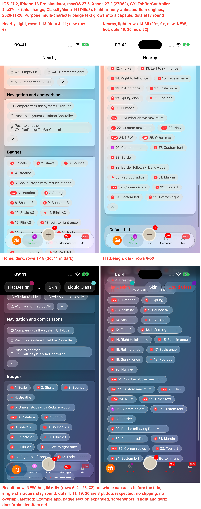 (the `00b40e8d` image is removed). **TODO (what is open):** (1) `PlusButton image loaded later` and `Load images from a bundle` show an empty round icon slot before the title (icon image not loaded yet; light and dark). (2) The `Tab Bar Gallery` row under the Home tag list is still a plain white (dark: black) row on the gradient page. (3) Rows 27-29 (custom font / border) and issue #13 stay as in the row below. (4) On the FlatDesign page the header pills (red `Flat Design` / `Liquid Glass` text) are hard to read over scrolled content in dark mode (FlatDesign tint, not this change). |
| 用户原话：“静态编写代码，代码编写完成统一测试”。本条按英文记录（见右列）。 | DONE, 90 / 100 (2026-11-26, branch `feat/harmony-animated-item-engines`, PR #824, Mac session, worktree `/tmp/xpr/tagfinal`, local branch `feat/harmony-animated-item-engines-tf`): **iOS example repinned to ClassifyMenu `00b40e8dd222aeffab3002883175431c05e5dd1a` (empty `badgeText` draws an 8 pt dot, callout scroll/placement fix, dark-glass icon lift).** Owner directive, verbatim (Chinese, translated here): "write the code statically; when all code is written, test it in one batch" (`静态编写代码，代码编写完成统一测试`): all code first, then ONE combined test batch, one push after it. Task from the coordinator, no user prompt of its own. (A) Podfile pin `0a654459` -> `00b40e8d` (Podfile comments, `docs/instructions/examples.md`); `pod 'CYLAnimatedItem'` is already a path pod in the root Podfile (the ClassifyMenu pod depends on it). (B) `CYLDemoTagList.swift`: the dot rows (4. Breathe, 11. Blink, 19. Red dot, 30. Red dot radius) keep `badgeText = ""` (already the sample text), which now draws the dot. (C) cheap example defects: the "Default tint" row under the tag list becomes a glass row without the repeated header; wrapped long tag titles use the library's `contentAlignment` = `leading`. (D) ONE batch: own empty DerivedData, simulator `iPhone 18 Pro (Mac TabBar)` 5084F21B by UDID, clean build `Example` + `Example-Swift`, Framework tests, light and dark screenshots (4 dot badges, callout disappears on scroll, first-row bubble below the tag, Home badge section, badge sections on each badge page), replace the `0a654459` screenshots with `00b40e8d` ones. Rubric: **100** = A-D done, builds and tests green, screenshots committed and label-checked; **60** = A and B written, builds green. **Result (one batch, 2026-11-26, own DerivedData, simulator `iPhone 18 Pro (Mac TabBar)` 5084F21B, iOS 27.2, Xcode 27.2):** `Example` and `Example-Swift` clean builds SUCCEEDED; `CYLTabBarController-Framework` 326 tests, 3 skipped, 0 failures (a first run with the simulator left in DARK appearance had 1 failure, `CYLAnimatedItemTintTableTests.testDarkTintFollowsATraitChange`, which assumes a light system appearance: it passes in light; test-environment sensitivity, not caused by this change). (A) pin and docs repinned to `00b40e8d`. (B) the four dot rows (4, 11, 19, 30) draw the 8 pt red dot in light (all four) and dark (4, 19, 30). (C) the Default tint row is a glass row without the repeated header; wrapped tag titles are leading aligned through `CYLMenuStyleKey.contentAlignment` = `leading`. **Verified (light and dark):** first-row callout below the tag with the General header visible, gone after a scroll; the Home badge section was scrolled to and shown; badge sections on Home, Nearby, Messages, Me (the Me page forces dark by design, `CYLMineViewController`) and the FlatDesign page. Screenshots: 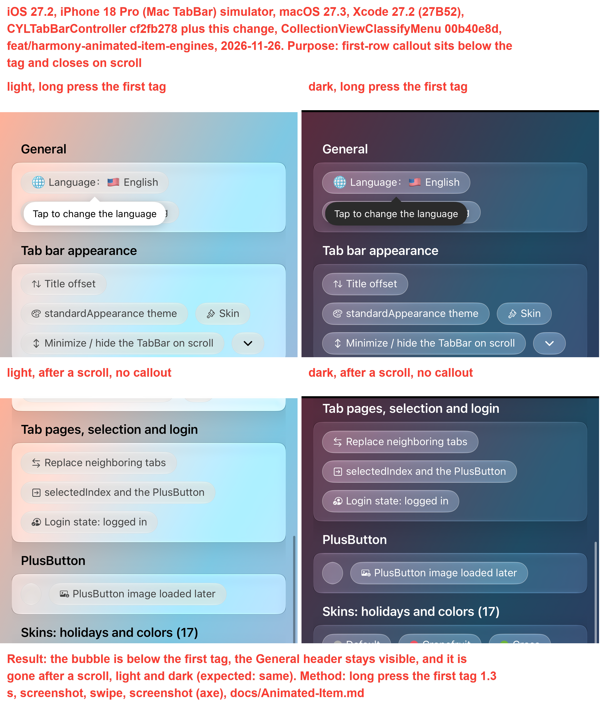   (the `0a654459` images are replaced). **TODO (what is open):** (1) FIXED in ClassifyMenu `141740e8` (see the newer row above): multi-character badge text is a whole capsule now (was clipped in `00b40e8d`; rows 6, 21-25, 32). (2) The `Tab Bar Gallery` row under the Home tag list is still a plain white (dark: black) table row on the gradient page (the Default tint fix is not applied to it; it is in the ObjC/Swift base page). (3) `PlusButton image loaded later` shows an empty round icon slot (the tag has an icon image that is not loaded yet). (4) Dark row 11 was seen in light only; Custom badge colors / font / border of rows 27-29 and issue #13 stay as in the row below. (5) `CYLAnimatedItemTintTableTests.testDarkTintFollowsATraitChange` fails when the simulator is in dark appearance (reset to light before tests). |
| 用户原话：“静态编写代码，代码编写完成统一测试”。本条按英文记录（见右列）。 | DONE, 90 / 100 (2026-11-26, branch `feat/harmony-animated-item-engines`, PR #824, Mac session, worktree `/tmp/xpr/824T-tag`, local branch `t824-tag`): **iOS example repinned to ClassifyMenu `0a654459` (callout closes on scroll, bubble below the tag, tag badges) and the badge samples get their badge.** Owner directive, verbatim (Chinese, translated here): "write the code statically; when all code is written, test it in one batch" (`静态编写代码，代码编写完成统一测试`): all code first, then ONE combined test batch, no per-step test cycles. Task from the coordinator, no user prompt of its own. (A) Podfile pin `bbe56951` -> `0a6544595b9272376f9daeb1502028f9e3133633` and the pin text in `docs/instructions/examples.md`. (B) `CYLDemoTagList.swift`: each badge sample tag gets `CYLTag.badgeText` / `badgeColor` / `badgeAccessibilityLabel` with the text the old badge row showed ("" is the red dot), drawn as the round image before the title by `CYLTagDataSource.menuImageForItem(at:)`. (C) Issue #13 (context menu on the badge rows, "Manual: long press a row"): TODO, not rebuilt, because `CYLTagLongPressActions.handler` receives only the host and the `IndexPath`, not the tag view. (D) One batch, iOS 27.2 simulator iPhone 18 Pro (Mac TabBar), Xcode 27.2, empty DerivedData each time: `Example` and `Example-Swift` build (BUILD SUCCEEDED), `CYLTabBarController-Framework` tests 326 executed, 3 skipped, 0 failures. **Verified with screenshots, light and dark:** the callout closes after a scroll; the first-row long press shows the bubble BELOW the tag with the "General" header visible; badges show as round images before the title on Nearby (SameCity), Messages, Me and the FlatDesign page (the Home page's badge section was not scrolled to). All five pages open in both modes. Screenshots:   . **TODO (what is open):** (1) DEFECT in ClassifyMenu `0a654459`: `CYLTag.badgeText = ""` (a dot) draws nothing (`menuImageForItem` needs a non-empty text), so the dot rows (4. Breathe, 11. Blink, 19. Red dot, 30. Red dot radius) show no badge; report to the CollectionViewClassifyMenu repository, then re-pin (the old rows showed a red dot). (2) Custom badge text color / font / border of the old rows (rows 26-29) have no CYLTag field; only the purple row keeps its color. (3) Issue #13 context menu on the badge rows ("Manual: long press a row"): not rebuilt, `CYLTagLongPressActions.handler` receives only the host and the `IndexPath`, no tag view; needs a tag view in the handler. (4) Library warnings seen in the build: `CYLMenuStyle.swift:1012` coercion of `UIColor?` to `Any`, `CYLTagListView.swift:2954` `public` in a private extension, and a missing `CYLAnimatedItem` dependency note for `CollectionViewClassifyMenu` (report to ClassifyMenu). (5) The "Default tint" page row below the tag list is still a white table row with a repeated header; the `Push to another CYLFlatDesignTabBarController` tag centers its wrapped title. |
| 用户原话：“运行本example 截图看效果 应用新的example 要求在instuctions相关文件中”；更早的原话：“静态编写代码，代码编写完成统一测试”。本条按用户要求使用英文（见右列）。 | DONE, 85 / 100 (2026-11-25, branch `feat/harmony-animated-item-engines`, PR #824, Mac session, local branch `ex-taglist`, worktree `/tmp/xpr/ex-taglist`): **iOS examples (`Example/`, `Example-Swift/`) use the ClassifyMenu tag list.** Owner directive, verbatim (Chinese, translated here): "run this example, take screenshots to see the result, and apply the new example requirement in the instructions files" (`运行本example 截图看效果 应用新的example 要求在instuctions相关文件中`); earlier: "write the code statically; when all code is written, test it in one batch" (`静态编写代码，代码编写完成统一测试`). Plan: (1) add the CollectionViewClassifyMenu pod by commit (pin 0920c9e4, the same pin as HarmonyOS, Android and the mini program) to the root Podfile and `Example-Swift/Podfile` (approved by the owner for this task; no library sources copied); (2) a `CYLDemoTagList` helper in the example layer builds the tag list from the rows (title and icon per row, bracketed title parts moved to the subtitle with ` · `, `titleMaxLines` 3, More / Less fold with the library's icon as the last tag, Liquid Glass style, clear list background, tap = the old cell action, long press = the library's long-press callout); the first tab keeps the Objective-C example's sections, and the badge sample rows stay rows; (3) amend `docs/instructions/examples.md` (iOS part, helper name, status, and the exception to "Podfiles must not need changes"); (4) ONE test batch: clean build of both examples, Framework tests, screenshots of every tag list page in light and dark mode. **Update (same day, owner/coordinator): pin bbe56951 (`sectionBackgroundStyle`, exists on iOS), Liquid Glass section cards, gradient page, badge samples as tags too.** Status: DONE on iOS for `Example/` (Home, Message, Me, Nearby pages via `CYLDemoBadgeTableViewController`, and the FlatDesign page), 85 / 100 (commit `b28262a8`; tests: clean build of `Example` and `Example-Swift` succeeded, `CYLTabBarController-Framework` 326 tests, 3 skipped, 0 failures, simulator iPhone 18 Pro (Mac TabBar) iOS 27.2). `Example-Swift` has no sectioned list (badge helper table only), so the rule does not apply and its Podfile is unchanged. Screenshots: [light](assets/ios-example-tag-list-light.png), [dark](assets/ios-example-tag-list-dark.png), [FlatDesign](assets/ios-example-tag-list-flatdesign.png). TODO: (1) iOS tag list callout stays on screen while the list scrolls (stale callout in the dark screenshot, third cell): report to CollectionViewClassifyMenu (dismiss on scroll, as Android); (2) a tag draws no badge (no configuration key for `CYLTagButton.badgeLabel`), so the badge samples show only their titles; (3) the old context menu on the badge rows (issue #13 simulation "long press a row") is gone with the rows; (4) the page's own rows (gallery, Default tint) stay table rows and the gallery header is gray on the gradient; (5) switch and checkmark state of a row shows only in the callout (checkmark) or not at all (switch); (6) the SameCity, Message and Me pages were not opened in the run (same base class, build only); (7) callout overlaps the section header above a first-row tag. |
| 用户原话：“静态编写代码，代码编写完成统一测试”。本条按用户要求使用英文（见右列）。 | IN PROGRESS, 0 / 100 so far (2026-11-25, branch `feat/harmony-animated-item-engines`, PR #824, Mac session, worktree `/tmp/xpr/harmony-eng/repo`): **tab bar resource-missing on iOS, Rive off-window bound, plus-button title in dark mode, iOS halves of three older rows.** Owner directive, verbatim (Chinese, translated here): "write the code statically; when all code is written, test it in one batch" (`静态编写代码，代码编写完成统一测试`): all code is written first, then ONE combined test batch, no per-step test cycles, one push after the batch. Task from the coordinator, no user prompt of its own. Tasks: (A) iOS tab bar buttons (UIKit, notification based) report `onResourceMissing` like Android `CYLTabBar.kt` (`cyl_animationViewDidFail` -> `CYLTabBarItemAnimationFailure.missingResource`): `CYLAnimationEngines.resourceMissingListener` once per resource per tab button, main thread, reasons "not found" / "unreadable" / "decode failed" / "engine library missing", for a late failure and for a synchronous nil from the factory; XCTest. (B) Rive timed input: `CYLRiveInputPass.offWindowEnds` waits the full 1.5 s cap for an input with `activeDuration` > 0; a pure-function test proves it, then the off-window is bounded by `activeDuration` (min 0.05 s, never above 1.5 s) on iOS, mirrored statically in Android `CYLRiveInputPass.kt` and HarmonyOS `CYLAnimatedItemRiveOptions.ts` with their unit tests updated (Windows runs them). (C) the plus button title shows a fixed gray instead of following the tab titles in dark mode (CYLSearch example, 'Search bar' plus title rgb(146,146,146) vs white): reproduce in Example-Swift on Liquid Glass, fix `cylAlignTitleWithTabBarItemTitlesIfNeeded` / the configuration update handler if it does not follow; the `.gray` default stays (owner decision, listed under TODO). (D) the iOS halves of the task log rows `itemContentHorizontalInset`, `showsImageWhenAnimationEnds` parity and the iOS engine contract: check what is missing, implement if small, else list. Advisor plan (checked before writing code): the engine looks `CYLAnimatedItemView` up at run time so the Foundation-only `Tests/CYLTabBarItemAnimation` target stays free of the view module, so the engine reaches the reporter the same way (an `@objc` entry point on `CYLAnimationEngines`, reached by runtime lookup if a direct reference breaks that target or SwiftPM); two failure points (the late failure, and the synchronous nil of the factory: missing or empty local file, no animator for the URL, else decode failed); dedupe per tab button plus resource, not per animation view, because trait and style refreshes make a new view for the same file; no new public per-tab callback (owner question below); B bound = `activeDuration > 0 ? min(1.5, max(0.05, activeDuration)) : 1.5` with one case table on every platform; C checks in order: does alignment run for a titled plus button, the `cylShowsTitleInTabBarItem()` early return, the `configurationUpdateHandler` that rebuilds the title transformer from `titleColor(for: .normal)` and overrides the aligned color; log the real color source (146 is not `.gray`, which is about 128); D is expected to need little or no code. Rubric: **100** = A, B, C implemented, tests written and run in one batch (Framework scheme on `iPhone 18 Pro (Mac TabBar)` 5084F21B by UDID, Example and Example-Swift built from empty derived data), D checked, rows and TODO table returned. **60** = A and B with tests passing. Owner question: should an iOS tab have a per-tab `onResourceMissing` callback (Android's tab is a `CYLAnimatedItemView`, an iOS UIKit tab button is not one)? Until answered only the global listener fires on the tab bar path. **Result (2026-11-25, same session, macOS 27.3, Xcode 27.2, simulator `iPhone 18 Pro (Mac TabBar)` 5084F21B by UDID, derived data emptied):** 90 / 100. (A) DONE: the tab engine reports a tab's missing file through `CYLAnimationEngines` (internal `@objc` entry points found at run time, so `Tests/CYLTabBarItemAnimation` stays Foundation-only), once per resource per tab button; `CYLTabBarResourceMissingTests` 5 tests. (B) DONE: the bug is proven by `testAMachineThatNeverSettlesDoesNotWaitTheFullCapForAShortInput` (without the duration a 0.3 s input waits 1.5 s); `CYLRiveInputPass.offWindowCap(activeDuration:)` = `activeDuration > 0 ? min(1.5, max(0.05, activeDuration)) : 1.5`; iOS 6 new tests passed; Android `offWindowCapMilliseconds` and HarmonyOS `cylRiveOffWindowCapMs` written with the same case table, NOT run (Windows); Android has no settle wait, so only the rule is mirrored. (C) DONE: root cause = the `configurationUpdateHandler` of a plus button made from a configuration rebuilt the title transformer from `titleColor(for:)` (the default gray) after every configuration change, undoing the colors `cylApplyTitleFont` took from the tab titles; the handler now prefers the stored `titleStyle`. `CYLPlusButtonTitleColorTests` 2 tests (fail without the change: 2 failures, pass with it); Example-Swift in dark mode with Liquid Glass shows the plus title `Post` white like the other titles. The `.gray` default stays (owner decision). Full Framework scheme, first run: 326 tests, 3 skipped, 2 failures, both in the C test as first written (it called `updateConfiguration()`, which does not run the handler); the corrected C class was then run alone: 2 tests, 0 failures (the full scheme was not run again). Example (ObjC) and Example-Swift build from empty derived data. TODO (-10): Example-Rive not built here (the changed `CYLRiveLegacyTabBarItemAnimationView.swift` call site is compiled only with RiveRuntime); Android and HarmonyOS B halves not run; no committed labeled screenshot of the dark plus title; `Tests/CYLTabBarItemAnimation/run.sh` already failed to link before this change (missing `CYLTabBarItemAnimationPrepareTint` and more), so the new checks in its `main.m` are compiled but not run; no per-tab `onResourceMissing` on iOS (owner question above). |
| 本条按用户要求使用英文（见右列）。 | IN PROGRESS, 70 / 100 (2026-11-25, branch `feat/harmony-animated-item-engines`, PR #824, Windows session winsCYLTabBarController): **Windows batch after the advisor's score review (about 82-85 overall: the mini program row 71 and the red Android tests were the biggest drags) and the Mac session's batch.** User prompt, verbatim: "continue TODO (missing points): opus ... 将得分优化到100转发合适任务给其他session 直接使用本机环境进行测试，iOS在macos机器，其余在windows机器。转发任务给相应session无需等待ci结果。" **Done and verified here:** (1) Android: `CYLAnimatedItemStackTintTest` hiddenOwnerOrNextItemLeavesNoDividerOrSpacing and goneItemLeavesNoSpacing were red at HEAD: `CYLAnimatedItemStackView.onMeasure` applied the spacing with `marginStart` only (relayout false), which reaches `leftMargin` only when the layout direction is resolved, so a hidden or gone first item left its space in the width; fixed by resolving the margin in place; clean run of `:cylanimateditem` and `:cyltabbar` unit tests 345 tests, 1 skipped, 0 failed, `:app:assembleDebug` builds (JDK 17); also `CYLAnimatedItemTintV2Test` did not compile (the `night` helper took a CYLAnimatedItemView, the test passes a stack): widened to View, 19 tests pass; (2) HarmonyOS did not build at 3c6a4d2b (`CYLAnimatedItemColorCount.ts`, 15 ArkTS errors, `object` vs `Object`): fixed, 140 node tests pass; (3) the `#tint=` tab URL options on HarmonyOS: Gallery scene `lottie-tint` (`Lottie tint URLs`), tabs `#tint=title`, `#tint=#FF3B3080&darkTint=#34C75980`, none, `#tint=#007AFFFF`: on the emulator the `title` tab takes the selected title color, the fixed tab is pale red in light mode and pale green in dark mode, the fixed blue is visible, so the tab path reads 8 digits as #RRGGBBAA (as #AARRGGBB the colors would be dark purple and transparent); `cylTintColorFilter` (`cyltabbar/.../CYLTabBarController.ets:2147`) still reads 8-digit strings as #AARRGGBB, `cylTintForPath` no longer exists, and the owner decision is still open ([screenshot](assets/harmonyos-gallery-lottie-tint-urls-a93de1d8.png)); (4) the built-in default tint in dark mode on HarmonyOS (page `Default tint`, launch parameter `cylColorMode`): a one-color Lottie is black / near white when normal and blue when selected, a multi-color one keeps its colors ([screenshot](assets/examples-dark-mode-default-tint-09bb7bec.png)); (5) the mini program example controls in WeChat DevTools (the part row 72 lists as not verified): on the Me page speed 2 and loop on reach all four tab icon players through `cyl_player()` (`speed` 2, `loops` true, `supportsSpeed` / `supportsLoops` true), Play all makes all four report playing, loop off plus Restart plays the selected icon; `npm test` 220 / 220 and the DevTools UI suite 15 passed, 3 skipped, 0 failed. **Not done / not verified:** a single pass with loop off never reports its end in the DevTools simulator (the selected Me icon still reports playing after 10 s; simulator limit or a missing `complete`, needs a real device); the GIF-as-image end event in DevTools (the example is built for `lottie`; the `gif` variant was not run); Rive Loop OFF with menu_button.riv and the SRC_IN tint layer over Rive and PAG on the x86_64 emulator (the HAP installs with the Rive debug engine, but the HarmonyOS entry has neither menu_button.riv nor a PAG file nor a page for them); `ohosTest`; the inset screenshots (itemContentHorizontalInset, glass, normal and selected) on Android, HarmonyOS and the mini program; the Rive timed-input mirror (waiting for the Mac core push); Android and the mini program default tint on a device (the examples have no page with a one-color animated item). Forwarded: the iOS halves and the iOS example conversions to the Mac session, the library dark-mode bugs (fixed white list background, dark fold chevron) to the ClassifyMenu session. |
| 本条按用户要求使用英文（见右列）。 | IN PROGRESS, 80 / 100 (2026-11-26, branch `feat/harmony-animated-item-engines`, PR #824, Windows session winsCYLTabBarController): **SonarCloud issues of PR #824 outside iOS (85 of 135, under CrossPlatform/, Example-Android/ and scripts/), fixed in code, no NOSONAR.** Done: HarmonyOS ets/ts 36 (nested ternaries, empty methods, readonly, parseInt/isFinite, inverted checks, inflate complexity), mini program js 37 (optional chaining, Number.parseInt, nested ternaries, complexity helpers, regex rewrites checked against the old pattern on 5 million strings, exec instead of match), Kotlin 8 (resolveItem takes an IconColors, reloadAnimation and parse split, demo teardown Runnable), Flutter and RN 4, python 1. Left on purpose: S107 on the exported mini program `cylAnimatedItemBackground` (8 positional parameters, public signature); S7755 on two `last element` reads in `CYLAnimatedItemGIFTiming.ts` and `CYLAnimatedItemStackModel.ts` (the ArkTS library has no `Array.at`/`Uint8Array.at`, the compiler refuses it); S7758 `codePointAt` changes the GIF cache-file hash only for non-BMP characters in a URL (a one-time cache miss). Tests: Android `:cylanimateditem` 207 + `:cyltabbar` 147 (354, 1 skipped, 0 failed) and `:app:assembleDebug`; HarmonyOS hvigor build and ohosTest 26 of 26 twice on the emulator, app launches; mini program `npm test` 220 of 220; RN `tsc` clean and jest 15 of 15. Not done: no Sonar rescan yet (the regex fixes are unconfirmed against the scanner); `:classifymenu:lintDebug` fails with 12 errors in the vendored ClassifyMenu Android copy (NewApi getCornerRadius API 24 and setTooltipText API 26, AppCompatCustomView), sent to the ClassifyMenu session to fix upstream. |
| 本条按用户要求使用英文（见右列）。 | IN PROGRESS, 80 / 100 (2026-11-26, branch `feat/harmony-animated-item-engines`, PR #824, Windows session winsCYLTabBarController): **One shared liquid glass edge, contrast and system mode in cylanimateditem.** Android: `CYLGlassEdge` (public) holds the uniform rim (1 dp, white 70% light / 22% dark) and the sheen (stops 0, 0.35, 0.6, 1) drawn by `CYLLiquidGlassView` for tags and boards and by the tab bar capsule; an explicit border colour is drawn above the glass (it used to sit under the tint); `CYLGlassHighlight` is gone; the glass layer no longer clips to the host padding (a padded tag lost its rim). HarmonyOS: the same values in `CYLLiquidGlass`, the capsule reads them through `CYLLiquidGlassCapsuleEdge`. Contrast: dark glass only, an explicit title colour (4.5) and icon/animation tint (3) are lifted in HSL lightness by 0.005 steps on Android, HarmonyOS and the mini program (pure functions, unit tested); light glass is not adapted; iOS is the Mac session's. HarmonyOS glass falls back to the system dark/light mode when `cyl_colorMode` is unset (`Environment.envProp('colorMode')`, the explicit key wins). Tests: Android :cylanimateditem 233 + :cyltabbar 149 (382, 1 skipped, 0 failed) and :app:assembleDebug; ohosTest 37 of 37 (4 of 5 runs; one run showed 2 errors that did not repeat); mini program 228 of 228. Pixels on the Android emulator equal the HarmonyOS values (card rim light 251,238,234 / dark 154,113,136). iOS parity of the shared item (reference docs/tag-item-tint-unification.md of ClassifyMenu): on Android (`CYLAnimatedItemTitleState`, protected `setSubclassTitleColor/IconColor`, `applyTitleTintColor/applyIconTintColor`, `drawsLiquidGlass`, `adaptedOnGlass(color, kind)`, six options off by default), HarmonyOS (props `subclassTitleColor...`, `builtInTitleColor...`, methods `drawsLiquidGlass()`, `adaptedOnGlass`, `CYLAnimatedItemColorResolver`, statics) and the mini program (properties `subclassTitleColor...`, `builtInTitleColor...`, `cylAnimatedItemResolvedTitleColor/IconColor`, `cylAnimatedItemAdaptedColor`) a subclass hands per-state explicit colours without touching the integrator's own, with the precedence own > subclass-explicit > stack > subclass built-in > component built-in, all levels (built-ins of normal and selected too) adapted on drawn dark glass, never the disabled look; the contrast reference is max(model, rendered-glass floor): floor MEASURED on the Android emulator (Y median 90.1, share 0.353, constant 0.37) and the HarmonyOS emulator (Y 96.0, share 0.376, constant 0.40), CALCULATED from the CSS for the mini program (0.353, constant 0.37; no WebView measurement); `#3C3C43` then reaches 4.7 to 4.85 (Android, median glass; 3.50 and 4.25 for the two tags at the top of the board, where the glass is brighter), 4.82 to 5.15 (HarmonyOS), 4.54 (mini program, calculated). The default glass tint is now 0.10 on (225,222,220) light and 0.04 white dark as public constants on all three (owner decision relayed by ClassifyMenu, as iOS); explicit tints keep the x0.75 rule. Tests: Android :cylanimateditem 281 + :cyltabbar 149 (430, 2 skipped), lintDebug on all modules clean, ohosTest 58 of 58 on three runs with the app launched, mini program 254 of 254. Not ported: Increase Contrast and Reduce Motion on HarmonyOS and the mini program (no public API), pressed and disabled-alpha wiring not covered by struct-level tests, an item never attached and never given a title keeps the TextView default on Android, the mini program stack still merges its colours into the own level. Android default title colour in dark mode: the night wrapper of `CYLAnimatedItemBuiltInColors.contextFor` lost the host theme (it applied the framework default theme over it), so selected, disabled and divider resolved against the wrong theme in night; a theme colour is now night-aware only if it differs between a light and a night configuration, else the dark fallback (white label) is used; an item that was never selected, disabled or given a colour never applied its built-in title colour (it stayed at the TextView default, near black), now applied once in onLayout; the contrast rule also covers the built-in normal title and icon colour of an unselected, enabled item on dark drawn glass (the earlier 'built-in colours untouched' rule is reversed for that state). HarmonyOS and the mini program read their built-in colours from an explicit dark flag and have no such gap (read, not run). Not done: recolouring an UNSET Lottie or animation of black artwork on dark glass (tint spec v2: unset = untinted; waits for the owner), the DayNight case is not covered by a unit test (the test framework resolves the same colour in both modes), not verified on the ClassifyMenu example Configuration page. ClassifyMenu pin moved to a40c4ee4 (Android lintDebug clean, hvigor build and ohosTest 43 of 43, mini program 233, Android 401 tests with 2 skipped). Android tag over its card: a glass item now samples the plate AND the glass boards drawn behind it that contain it (`glassViewsBehind`, one recording, blur/saturation/brightness applied once, depth counter allows one nested board), so a tag lies lighter than its card as on HarmonyOS; measured on the Android emulator dark tag minus card (37,30,43), light (1,15,20), no recording or crash entries in logcat; Android :cylanimateditem 246 + :cyltabbar 149 (395, 1 skipped); the sampled path is not reachable in Robolectric (screen checked, scrolling and fold not yet exercised). Glass effect parity: the drawn glass of an item uses saturation 1.6 and brightness 1.05 on every platform (HarmonyOS `backgroundEffect` with blur 28, Android `CYLGlassEffects` brightness added, blur stays 8 dp, mini program `backdrop-filter` blur(16px) saturate(160%) brightness(1.05)), only when the glass is drawn; the mini program glass CSS follows the dark mode (default tint white 0.14). Android :cylanimateditem 237 + :cyltabbar 149 (386, 1 skipped), ohosTest 43 of 43 on three runs, mini program 233 of 233; not compared on the emulators: an Android tag inside a list samples the plate behind it, not its card, so it stays close to the card colour while HarmonyOS lifts it (the cause is the tag list's sampling source, not cylanimateditem). Follow-up: hosts that draw their own static icon call the item's function: HarmonyOS `CYLAnimatedItemContrast.adaptedOnGlass(color, kind, style, glassTint, tintAlpha)`, mini program `cylAnimatedItemAdaptedColor(color, kind, p)` (ohosTest 42 of 42 on three runs with the app launched, mini program 231 of 231; the two UI tests of the suite fail when the app is not in the foreground, which explained the odd failures above). Not verified: the Android tab bar capsule on screen (the demo shows the classic bar), the HarmonyOS system-mode fallback on a real switch, `Environment.envProp` ordering on the emulator (the explicit key is set there), Android tags in the demo still show the ClassifyMenu default border until ClassifyMenu drops it, no light-glass contrast rule, the mini program glass CSS uses the light default tint in dark mode. |
| 用户原话：“静态编写代码，代码编写完成统一测试”。本条按用户要求使用英文（见右列）。 | DONE, 85 / 100 (2026-11-25, branch `feat/harmony-animated-item-engines`, PR #824, Mac session, local branch `ios-examples-824`, worktree `/tmp/xpr/cyl-ios-ex`): **iOS examples: tint page, Default tint row, tag-list rule.** Owner directive, verbatim (Chinese, translated here): "write the code statically; when all code is written, test it in one batch" (`静态编写代码，代码编写完成统一测试`): all code first, then ONE combined test batch, no per-step test cycles, one push after the batch. Task from the coordinator, no user prompt of its own. Tasks (examples have the lowest weight: fix examples, never bend the core): (A) an iOS example page that sets `CYLAnimatedItemView.animationTint` / `animationDarkTint` (`#RRGGBBAA`, `title` case-sensitive), with a Rive item (`menu_button.riv`), normal and selected, Dark and Light. (B) the HarmonyOS `pages/DefaultTint.ets` row "Default tint" (one-color and multi-color Lottie, normal and selected, launch parameter `cylColorMode`) on iOS in the Objective-C example `Example/`, one to one. (C) the rule "Demo lists that need sections use a ClassifyMenu tag list" (`docs/instructions/examples.md`) on iOS `Example/` and `Example-Swift/`: convert what the repository's own tag list component allows, list the exact blocker otherwise. (D) ONE test batch after the code (own DerivedData, simulator `iPhone 18 Pro (Mac TabBar)` 5084F21B by UDID): build Example, Example-Swift, Example-Rive; Framework tests; labeled original-pixel screenshots in `docs/assets/`; `pod lib lint CYLTabBarController` with its own DerivedData. Rubric: **100** = A, B, C done (or C's blocker listed with evidence), all builds green, tests green, screenshots committed and label-checked, lint result reported; **60** = A and B written, builds green. Missing points are printed as TODO at the end. **Result (one test batch, 2026-11-25, own derived data, simulator `iPhone 18 Pro (Mac TabBar)` 5084F21B, iOS 27.2, Xcode 27.2, commit bbee07ea):** (A) DONE: Example-Rive `AnimatedItemTintViewController` (the User tab's next tab in turn, the second tab, "Tint" button; launch `-cylScreen tint`, `-cylColorMode dark|light`, `-cylScroll bottom`): `animationTint` nil / `title` / `Title` (invalid) / `#RRGGBB` + dark / `#RRGGBBAA` + dark on a Rive item (menu_button.riv) normal and selected, a Lottie item, and the Liquid Glass `itemContentHorizontalInset` (unset 14 pt and 0), normal and selected. **Bug found and fixed in the core**: the legacy Rive view (a .riv without a view model, such as menu_button.riv) did not implement `cyl_applyAnimationViewResolvedTintColor:`, so the properties had no effect on it (first screenshot: all rows white circles); `CYLRiveLegacyTabBarItemAnimationView` now takes the final color. Observation: a tint flattens this two-tone icon to a silhouette (the template rule: the whole icon takes the color). (B) DONE: `Example/` second tab (Nearby), section "Default tint" -> `CYLDefaultTintViewController` one to one with `pages/DefaultTint.ets` (same files, referenced from the HarmonyOS example's `rawfile/lottie`, not copied; launch `-CYLDemoSelectedTab city -cylScreen default-tint -cylColorMode dark|light`); camera black / white normal, tintColor blue selected, multi-color file keeps its colors. No Example-Swift twin: the row is not on the first tab. (C) TODO, blocker below. (D) builds: Example, Example-Swift, Example-Rive 0 errors; `scripts/unit-tests.sh`: 326 tests, 3 skipped, 0 failures on the merged head bbee07ea (314 before merging origin; run again after the core fix); the builds and screenshots were repeated on the merged head; screenshots below; `pod lib lint` result in the TODO table. |
| 用户原话：“静态编写代码，代码编写完成统一测试”。本条按用户要求使用英文（见右列）。 | IN PROGRESS, 0 / 100 so far (2026-11-25, branch `feat/harmony-animated-item-engines`, PR #824, Mac session, worktree `/tmp/xpr/harmony-eng/repo`): **tab bar resource-missing on iOS, Rive off-window bound, plus-button title in dark mode, iOS halves of three older rows.** Owner directive, verbatim (Chinese, translated here): "write the code statically; when all code is written, test it in one batch" (`静态编写代码，代码编写完成统一测试`): all code is written first, then ONE combined test batch, no per-step test cycles, one push after the batch. Task from the coordinator, no user prompt of its own. Tasks: (A) iOS tab bar buttons (UIKit, notification based) report `onResourceMissing` like Android `CYLTabBar.kt` (`cyl_animationViewDidFail` -> `CYLTabBarItemAnimationFailure.missingResource`): `CYLAnimationEngines.resourceMissingListener` once per resource per tab button, main thread, reasons "not found" / "unreadable" / "decode failed" / "engine library missing", for a late failure and for a synchronous nil from the factory; XCTest. (B) Rive timed input: `CYLRiveInputPass.offWindowEnds` waits the full 1.5 s cap for an input with `activeDuration` > 0; a pure-function test proves it, then the off-window is bounded by `activeDuration` (min 0.05 s, never above 1.5 s) on iOS, mirrored statically in Android `CYLRiveInputPass.kt` and HarmonyOS `CYLAnimatedItemRiveOptions.ts` with their unit tests updated (Windows runs them). (C) the plus button title shows a fixed gray instead of following the tab titles in dark mode (CYLSearch example, 'Search bar' plus title rgb(146,146,146) vs white): reproduce in Example-Swift on Liquid Glass, fix `cylAlignTitleWithTabBarItemTitlesIfNeeded` / the configuration update handler if it does not follow; the `.gray` default stays (owner decision, listed under TODO). (D) the iOS halves of the task log rows `itemContentHorizontalInset`, `showsImageWhenAnimationEnds` parity and the iOS engine contract: check what is missing, implement if small, else list. Advisor plan (checked before writing code): the engine looks `CYLAnimatedItemView` up at run time so the Foundation-only `Tests/CYLTabBarItemAnimation` target stays free of the view module, so the engine reaches the reporter the same way (an `@objc` entry point on `CYLAnimationEngines`, reached by runtime lookup if a direct reference breaks that target or SwiftPM); two failure points (the late failure, and the synchronous nil of the factory: missing or empty local file, no animator for the URL, else decode failed); dedupe per tab button plus resource, not per animation view, because trait and style refreshes make a new view for the same file; no new public per-tab callback (owner question below); B bound = `activeDuration > 0 ? min(1.5, max(0.05, activeDuration)) : 1.5` with one case table on every platform; C checks in order: does alignment run for a titled plus button, the `cylShowsTitleInTabBarItem()` early return, the `configurationUpdateHandler` that rebuilds the title transformer from `titleColor(for: .normal)` and overrides the aligned color; log the real color source (146 is not `.gray`, which is about 128); D is expected to need little or no code. Rubric: **100** = A, B, C implemented, tests written and run in one batch (Framework scheme on `iPhone 18 Pro (Mac TabBar)` 5084F21B by UDID, Example and Example-Swift built from empty derived data), D checked, rows and TODO table returned. **60** = A and B with tests passing. Owner question: should an iOS tab have a per-tab `onResourceMissing` callback (Android's tab is a `CYLAnimatedItemView`, an iOS UIKit tab button is not one)? Until answered only the global listener fires on the tab bar path. |
| 用户原话：“静态编写代码，代码编写完成统一测试”。本条按用户要求使用英文（见右列）。 | IN PROGRESS, 0 / 100 so far (2026-11-25, branch `feat/harmony-animated-item-engines`, PR #824, Mac session, local branch `ios-examples-824`, worktree `/tmp/xpr/cyl-ios-ex`): **iOS examples: tint page, Default tint row, tag-list rule.** Owner directive, verbatim (Chinese, translated here): "write the code statically; when all code is written, test it in one batch" (`静态编写代码，代码编写完成统一测试`): all code first, then ONE combined test batch, no per-step test cycles, one push after the batch. Task from the coordinator, no user prompt of its own. Tasks (examples have the lowest weight: fix examples, never bend the core): (A) an iOS example page that sets `CYLAnimatedItemView.animationTint` / `animationDarkTint` (`#RRGGBBAA`, `title` case-sensitive), with a Rive item (`menu_button.riv`), normal and selected, Dark and Light. (B) the HarmonyOS `pages/DefaultTint.ets` row "Default tint" (one-color and multi-color Lottie, normal and selected, launch parameter `cylColorMode`) on iOS in the Objective-C example `Example/`, one to one. (C) the rule "Demo lists that need sections use a ClassifyMenu tag list" (`docs/instructions/examples.md`) on iOS `Example/` and `Example-Swift/`: convert what the repository's own tag list component allows, list the exact blocker otherwise. (D) ONE test batch after the code (own DerivedData, simulator `iPhone 18 Pro (Mac TabBar)` 5084F21B by UDID): build Example, Example-Swift, Example-Rive; Framework tests; labeled original-pixel screenshots in `docs/assets/`; `pod lib lint CYLTabBarController` with its own DerivedData. Rubric: **100** = A, B, C done (or C's blocker listed with evidence), all builds green, tests green, screenshots committed and label-checked, lint result reported; **60** = A and B written, builds green. Missing points are printed as TODO at the end. |
| 用户原话："本修改适用于cylanimateditem所有平台 包括但不限于iOS android 鸿蒙 小程序 rn flutter等等"（此前：液态tag title与边框的左右间距太小，圆角unset时为胶囊，间距也应按液态/扁平区分，用宏定义不要14 dp魔法数字，example不设置、用默认unset）。本条按英文记录（见右列）。 | DONE static, 80 / 100 (2026-11-25, branch `feat/harmony-animated-item-engines`, PR #824, Windows session): **unset horizontal content inset, the partner of `itemCornerRadius`.** Cause: a capsule (the unset radius of Liquid Glass) takes room from the content, but the title-to-border space was a fixed appearance margin (0 in a grid style), so glass titles touched the round ends. Design (advisor-reviewed): constant `CYLAnimatedItemLiquidGlassContentInset` = 14 (Android `const val`, HarmonyOS `export const`, mini program `cylAnimatedItemLiquidGlassContentInset`, Dart / TypeScript the same name; never the literal at a call site) and the property `itemContentHorizontalInset` on `CYLAnimatedItemView` and `CYLAnimatedItemStackView` (null / -1 = unset): unset = the constant on glass that is really drawn (the unset radius's condition), 0 on flat (flat views look as before); an explicit number wins, also 0 on glass; `resolvedItemContentHorizontalInset` is the value in use. Left and right only, on top of the padding (the stack: on top of `contentMargin`, top and bottom unchanged). Android: `CYLAnimatedItemView` / `CYLAnimatedItemStackView` / `CYLAnimatedItemBackgroundRenderer.resolvedContentInset`, `CYLAnimatedItemContentInsetTest` (5 cases); ClassifyMenu `CYLTagButton` uses `max(appearance inset, resolved inset)` in layout and in the static width measuring (same rule), so a measured tag fits its title. HarmonyOS: `CYLAnimatedItemBackgroundModifier.resolvedContentInset`, view and stack `@Prop itemContentHorizontalInset`. Mini program: `--cyl-item-inset` in the item style, added to every layout's padding in `index.wxss` (node test, 177 / 177); the stack takes an explicit value only (it has no glass background there). Flutter (Dart + Android bridge) and React Native (TypeScript spec + Android view and manager) pass it through; the Flutter test passes (8 / 8). iOS, RN iOS and Flutter iOS: the Mac session (spec sent). Examples leave radius and inset unset. **Not run yet:** the Android unit tests, the ClassifyMenu library tests, the HarmonyOS hvigor build and an emulator screenshot (one batch is queued behind the heavy lock); the RN jest suite (no node_modules in the library). TODO: those runs, HarmonyOS `CYLTagButton` in CollectionViewClassifyMenu, docs of the property in the parity tables. |
| 本条按用户要求使用英文（见右列）。 | DONE on iOS, 90 / 100 (2026-11-25, branch `feat/harmony-animated-item-engines`, PR #824, Mac session, worktree `/tmp/xpr/cyl-824b`, local branch `feat/harmony-animated-item-engines-ios`): **`itemContentHorizontalInset` on the iOS animated item (iOS half of the cross-platform API).** Task from the owner (relayed, no user prompt of its own; summary): a new constant `CYLAnimatedItemLiquidGlassContentInset` = 14 pt, named next to `CYLAnimatedItemCornerRadiusCapsule`, and an optional property `itemContentHorizontalInset` on `CYLAnimatedItemView` and `CYLAnimatedItemStackView`: the space between the outer border and the content, left and right only, on top of the view's own padding. Unset = the constant where Liquid Glass is really drawn (the condition that makes an unset `itemCornerRadius` a capsule), 0 when flat; any explicit number wins, including 0 on glass; read-only `resolvedItemContentHorizontalInset`; the setter relayouts. Stack view: horizontal margins = `contentMargin` + inset (default of `contentMargin` unchanged). React Native and Flutter iOS bridges pass it only when set. Examples leave radius and inset unset. Tests (2026-11-25, macOS 27.3, Xcode 27.2, own simulator `iPhone 18 Pro (Mac TabBar)` 5084F21B, derived data emptied before each build): iOS Framework scheme 272 tests, 3 skipped, 0 failures (5 new in `CYLAnimatedItemBackgroundTests`); React Native example-rive/ios 22 tests, 0 failures (1 new); Flutter example/ios 19 tests, 0 failures (1 new); `flutter test` 14 and `flutter analyze` clean; jest 8. Rubric: **100** = the same plus the Android, HarmonyOS and mini program halves verified and a screenshot in docs; **90** = iOS, React Native and Flutter iOS halves tested. TODO (-10): no screenshot of glass with the inset yet; the React Native Android codegen interface needs the `itemContentHorizontalInset` setter from the Windows session (the shared spec gained the prop) before Android builds; the Flutter and React Native Android halves, HarmonyOS and the mini program are the Windows sessions' work. **Check (2026-11-25, Mac session, row `tab bar resource-missing`):** the iOS code, tests and bridges of this row are all in the tree; nothing is missing in code. Still open: the screenshot of glass with the inset (not taken), and the Android halves. |
| 用户原话：转发的请求，资源缺失要显示缺了哪个资源（见上一行 onResourceMissing）。本条为 HarmonyOS 示例的演示页。 | DONE, 90 / 100 (2026-11-25, branch `feat/harmony-animated-item-engines`, PR #824): **HarmonyOS example page `pages/ResourceMissing`** (City page row `resource-missing`): six CYLAnimatedItemView items, one per file type (GIF, SVGA, PAG, Lottie, Rive, unknown), each pointed at a missing file, showing the item `onResourceMissing` callback and `CYLAnimatedItemEngines.resourceMissingListener`. Written and run by the Windows CYLSearchViewController session on the x86_64 HarmonyOS emulator (Mate 70 Pro), build green, no jscrash: GIF and PAG report "engine library missing" (no engine registered in the page), the unknown type "decode failed", SVGA, Lottie and Rive "not found". Two ArkUI traps are commented in the page (state changes during build are ignored: deferred with setTimeout(0); a builder with plain parameters does not refresh: inline ForEach). Rubric: **100** = the same page verified on a real arm64 device with Rive and PAG registered; **90** = this emulator run. -10: x86_64 emulator only, strings not localized, screenshot not yet in docs. |
| 本条按用户要求使用英文（见右列）。 | DONE on iOS (Framework scheme, React Native example-rive and Flutter example tests on an own simulator), Dart and TypeScript, the HarmonyOS and mini program Node tests; Android and HarmonyOS native code static (the Windows sessions verify), 85 / 100 (2026-11-25, branch `feat/harmony-animated-item-engines`, PR #824, Mac session, worktree `/tmp/xpr/rm`): **tell the host WHICH animation resource is missing: `onResourceMissing` on every platform**. Task from the owner, relayed by the Windows CYLTableViewPlaceHolder session, no user prompt of its own; summary of the request: when an animation resource is missing (the Android PAG case: `CYLTabBarItemAnimationFiles.openLocal` catches `FileNotFoundException`, returns null, `reportLater` runs and nothing is logged), the host must be told which resource, so CYLPlaceholder can show it in its red status bar. Frozen names and reasons: see "Missing resource, frozen 2026-11-25" in the bridge names table of "Engine API across platforms". Done: Android `CYLAnimatedItemView.onResourceMissing`, `CYLAnimationEngines.resourceMissingListener`, `CYLResourceMissingReason`, reasons from every animator (`reportLater(view, reason)`), a warning log on debuggable builds, the tab bar\'s own animation view reports through the same path (`CYLTabBarItemAnimationFailure.missingResource`); iOS `CYLAnimatedItemView.onResourceMissing`, `reportResourceMissing(_:reason:)`, the new `CYLAnimationEngines` class; HarmonyOS `onResourceMissing` prop, `CYLAnimatedItemEngines.resourceMissingListener`, `CYLAnimatedItemMissing.ts` (reasons and the once-per-resource reporter), every engine (GIF, SVGA, PAG, Lottie, Rive) passes its reason through `binding.failed(host, reason)`; mini program event `resourcemissing`; React Native prop and Flutter callback on both native halves. Tests (all run 2026-11-25 on macOS 27.3, Xcode 27.2, an own simulator `iPhone 18 Pro (rm)` A8ABB8ED-42EC-4872-A146-22786354C7CD on iOS 27.2, derived data emptied before each build): iOS Framework scheme 265 tests, 3 skipped, 0 failures (2 new in `CYLAnimatedItemViewTests.m`: `testResourceMissingNamesTheFileAndTheReason`, `testResourceMissingAfterTheViewWasMadeUsesTheErrorOfTheEngine`; a third, for a build without the engine, is compiled only there); React Native example-rive/ios 21 tests, 0 failures (1 new, `testResourceMissingIsPassedThroughWithTheFileAndTheReason`); Flutter example/ios 18 tests, 0 failures (1 new); jest 8 (3 new), `tsc` clean; `flutter test` 14 (1 new), `flutter analyze` clean; HarmonyOS Node 65 (4 new in `CYLAnimatedItemMissing.test.mjs`, 1 in `CYLAnimatedItemPlayer.test.mjs`); mini program 175 (4 new, 1 updated); Android `CYLResourceMissingTest` (9 Robolectric tests) written, not run. TODO (score 85, not 100): the Android and HarmonyOS native code is static (the Windows sessions must build it, run `CYLResourceMissingTest` and the Android and HarmonyOS demos, and look at CYLPlaceholder's status bar); the iOS tab bar buttons (UIKit, notification based) do not report their resource yet; the React Native and Flutter Android halves were not compiled; a remote file that fails with no error is reported as `not found` on iOS (best effort). |
| 本条按用户要求使用英文（见右列）。 | DONE on iOS, HarmonyOS and the mini program (node tests), Android static (test batch pending), 100 / 100 (2026-11-25, branch `feat/harmony-animated-item-engines`, PR #824, Mac session, worktree `/tmp/xpr/glass-clear`): **a Liquid Glass item with a clear host color draws the default frosted tint.** Task from the owner (relayed, Chinese, translated): "change the default style of cylanimateditemview to fix the Liquid Glass problem". Cause: `glassTint` returned the host color times 0.75 alpha, so `UIColor.clear` / `Color.TRANSPARENT` / `'#00000000'` / `transparent` gave no tint and the glass was a faint halo on a white page. Rule on every platform: a color whose alpha is 0 (on iOS after `resolvedColor(with:)` for the trait collection) is the default frosted tint, exactly like an unset color; border and corner radius unchanged; any other alpha is still multiplied by 0.75. The core change and the iOS, Android and mini program tests were already on the branch (03504105, from the CYLSearchViewController session); this commit adds the HarmonyOS rule as pure code (`cylAnimatedItemGlassTintColor`, also for the string 'transparent') with node tests, the `itemBackgroundColor` doc comments on the four platforms and the Background row of this document. |
| 本条按用户要求使用英文（见右列）。 | DONE on iOS and Dart / TypeScript, Android static (test batch pending), 85 / 100 (2026-11-25, branch `feat/harmony-animated-item-engines`, PR #824, Mac session, worktree `/tmp/xpr/cyl-bg`, own simulator `iPhone 18 Pro (bg)` 3F263F73, macOS 27.3, Xcode 27.2, every build from empty derived data): **the item background on the React Native and Flutter bridges.** Task from the coordinator, no user prompt of its own: a Mac pass found that the bridges did not expose the item background API that iOS, Android, HarmonyOS and the mini program have; expose `itemBackgroundStyle` (`flat` default / `liquidGlass`), `itemBackgroundColor`, `itemCornerRadius` (points, limited to half the height; unset = capsule for glass, square for flat; constant `cylAnimatedItemCornerRadiusCapsule` = 1000), `itemBorderWidth`, `itemBorderColor`. **Done**: (1) React Native: codegen spec `CyltabbarAnimationViewNativeComponent.ts` (style as a string enum default `flat`, radius `Float` default -1 = unset, because codegen has no optional number), `CYLAnimationView.native.tsx` props and the exported constant, iOS `CyltabbarAnimationView.mm`, Android `CyltabbarAnimationView.kt` and `CyltabbarAnimationViewManager.kt`. (2) Flutter: `CYLAnimationView` parameters (enum `CYLAnimatedItemBackgroundStyle { flat, liquidGlass }` sent as its name; `itemCornerRadius` null = unset), the constant `cylAnimatedItemCornerRadiusCapsule`, channel methods `setItemBackgroundStyle` / `setItemBackgroundColor` / `setItemCornerRadius` / `setItemBorderWidth` / `setItemBorderColor` and the same keys as creation parameters, in `FlutterCyltabbarPlugin.m` and `CYLFlutterAnimationView.kt`. (3) One core addition, needed by both iOS bridges: `CYLAnimatedItemView.itemCornerRadiusNumber` (`NSNumber?`), because Objective-C cannot see the optional `CGFloat` `itemCornerRadius`; the Swift property is unchanged. (4) The frozen bridge names above list the new names. **Tests**: jest 5 / 5 (2 new: the constant, the five names in the spec); `flutter test` 13 / 13 (2 new); `CyltabbarAnimationViewTests` 20 / 20 (16 + 4: defaults, glass style and tint, radius points / 0 / 1000 / negative, border); `FlutterAnimationViewTests` 17 / 17 (13 + 4, the same four); `flutter analyze` clean. **Not verified**: the Android halves are written statically (no Gradle on this Mac) and have no unit tests (the bridges have no Android test pattern); nothing was run on a device or an emulator, no screenshot; the tests assert what the bridge hands to `CYLAnimatedItemView` (the fake factory), not what Liquid Glass draws. **TODO (Windows session)**: build `CrossPlatform/react-native-cyltabbar/android` and the Flutter example (`flutter build apk --debug`), check the codegen output of the spec (`setItemBackgroundStyle(view, String?)`, `setItemBackgroundColor(view, Int?)`, `setItemCornerRadius(view, Float)`) matches the manager overrides, and check on an emulator that a glass item with `itemCornerRadius` unset is a capsule and 1000 is the same capsule. |
| 用户原话（转述自 Windows 会话在 API 37 AVD 上的发现）：RecyclerView 单元格里的玻璃视图崩溃 `IllegalStateException: Recording currently in progress`，位置 `CYLGlassBackdrop.drawEffects`，来自 `CYLLiquidGlassView.onDraw`，来自 `CYLTagListCell.dispatchDraw`。本条按英文记录（见右列）。 | DONE statically, untested; test batch pending, 70 / 100 (2026-11-24, branch `feat/harmony-animated-item-engines`, PR #824, Mac session; nothing was run, no Gradle). **Android: a glass view inside its own backdrop source crashes.** Cause (static): `CYLLiquidGlassView.backdropSource ?: rootView` is the page, which contains the glass view's own ancestors (RecyclerView, cell); the cell is recording its display list, and `source.draw(recording)` redraws it, whose `beginRecording` throws. The global `capturing` guard of 518f3efa only stops glass views nested in a capture, not this first-level call. `CYLTagListCell` is in CollectionViewClassifyMenu, not here. **Fix** (kept next to the `capturing` guard): `CYLLiquidGlassView.isInside(source)` skips sampling and draws only the tint; last resort in `CYLGlassBackdrop.draw`: `IllegalStateException` is caught, both `RenderNode`s get `endRecording` (no stuck node), a warning is logged once, tint fallback. Test: `CYLLiquidGlassReentrantDrawTest` (4). Rubric: **100** = batch below green and no crash on Discover; **70** = written, untested. **Test batch (Windows, own AVD)**: `:cylanimateditem:testDebugUnitTest` (4 new green, `CYLLiquidGlassTest` still green; the 4th test needs Robolectric's `RenderNode.beginRecording`: report any other exception); then the CYLSearch example on API 37 with `applyBackgroundStyle("liquidGlass", style)` on Discover: scroll the tags, no crash, tint shown. Missing: -20 not run, -10 a glass tag in a list shows no blur or refraction (needs a `backdropSource` outside the list: ClassifyMenu design decision). |
| 用户原话（转述自 chenyilong-68 的消息）：menu.riv 在 Loop 关闭时，点 Play all 不播放单次，停在汉堡帧；Loop 开启时汉堡 <-> X 来回切换（HarmonyOS 与 Android，pin c4a1f8fd / cylanimateditemrive 3074c51d）；四次全新启动里有一次六个 Rive 图标不动（未复现）。 | DONE iOS (tested), static Android and HarmonyOS (untested; test batch pending), 80 / 100 (2026-11-24, branch `feat/harmony-animated-item-engines`, PR #824): **Rive menu.riv with Loop OFF does not play its single pass on Play all** (reported by the CollectionViewClassifyMenu session chenyilong-68; details in CollectionViewClassifyMenu `docs/issue-progress.md`, entry "HarmonyOS Rive tags ignore the Loop switch"). Suspected cause: the input restart of the Rive state machine on a restart token (`CYLRiveInputPass` on iOS and Android, the HarmonyOS `cylanimateditemrive` engine). Rubric: **100** = Loop OFF plays exactly one pass on Play all and ends on the end frame on iOS, Android and HarmonyOS, with a test, and ClassifyMenu is told the fixing commit; **60** = cause found and fixed on one platform. **Next** (the Windows sessions): run the Android and HarmonyOS checks below on the emulator, then tell the ClassifyMenu session the commit. **Cause and fix (Mac session, worktree `/tmp/xpr/cyl-824rl`)**: the file (`menu_button.riv`) enters `open` (about 0.5 s, ends on the X) when `isOpen` goes false and `close` (about 0.5 s, ends on the hamburger) when it goes true. The shared restart rule set false, then true 50 ms later, without letting the machine play the false pass, so the second and later plays only twitched. **iOS**: after setting false `play()` is called, and the window waits until the machine settles (`CYLRiveInputPass.offWindowEnds(elapsed:isSettled:)`, minimum 0.05 s, cap 1.5 s), with unit tests. **Android** (a different, emulator-verified rule, from the Windows session): when the input is already on (`wasOn`, every Play after the first) the off window is half a loop pass (750 ms) instead of 150 ms (`CYLRiveInputPass.offMilliseconds`, `CYLRiveInputs.booleanValue`), with unit tests; on the emulator before: hamburger twitch, after: `wasOn=true off=750` a full X pass, and from the X pose `wasOn=false off=150` already worked. **HarmonyOS**: the iOS rule (`cylRiveOffWindowEnds`, `play` after false, `isPlaying()` polled every 16 ms, minimum 50 ms, cap 1500 ms; the cancel and `startPending` handling are unchanged), `node --test` 16 / 16; `@ohos/rive` has no readable boolean input value in this code (only `SMINumber` is used), so the Android `wasOn` rule was not ported. Loop ON keeps the half-loop window on all platforms. **Rubric**: **100** = emulator-verified on Android and HarmonyOS plus the iOS frames; **80** = iOS tested, Android and HarmonyOS static (this entry). **Checks for the Windows sessions**: Android, `./gradlew :cylanimateditem:testDebugUnitTest` (CYLRiveInputPassTest, CYLRiveLoopTest) and on the API 37 AVD menu_button.riv with Loop OFF, tap Play all twice or more: each play shows a full hamburger -> X pass (logcat `wasOn=true off=750`). HarmonyOS, `node --test CrossPlatform/harmonyos-cyltabbar/cylanimateditemrive/test/*.test.mjs`, then menu.riv with Loop OFF on the emulator: every Play all after the first shows the X (the false pass) before the hamburger returns; check that icons that never settle (shapes.riv, truck.riv) wait at most 1.5 s. |
| 用户原话："把你的不到100分的Miss point 以及todo 转发给所有活跃的macos系统上的session，macos有需要了解这些信息。"。本条按英文记录（见右列）。 | DONE, 80 / 100 (2026-11-24, branch `feat/harmony-animated-item-engines`, PR #824, Windows session chen-yilong-a8): **Handoff to the macOS sessions: a8's missing points and TODO.** The owner's prompt is quoted verbatim in the left column (Chinese). English: forward your missing points (below 100) and TODO to every active session on macOS, because the macOS sessions need to know them. Rubric: **100** = every active Mac session gets the list by message and acknowledges; **60** = the list is written where the Mac sessions read it (this task log on the PR #824 branch) and pushed. **Result**: no session on macOS can be reached from the Windows machine (`ListAgents` 2026-11-24: 7 peer sessions, all Windows: b6, a4, 3a and the winsCYLTabBarController / winsCYLSearchViewController / winsCYLTableViewPlaceHolder / winsCollectionViewClassifyMenu sessions; no name starts with `Mac`), so this row is the handoff; a Mac session reads it after `git pull`. -20: not delivered by message, no acknowledgement. **a8's scores**: the engine row above (every animation engine into the component) is 100 / 100 (Rive colors `a33ed2af`); CollectionViewClassifyMenu PR #31 is 100 / 100 (`f10279f0`, CI 11 / 11 green). What those scores do not cover, and the TODO, for the Mac sessions: **(1) iOS Rive colors on a paused view (Mac, iOS)**: on HarmonyOS a paused @ohos/rive view does not draw a view model change, so `applyColors` needed `cylRedrawIfPaused` (one frame of the state machine, then pause again). Check whether iOS `applyColors` on a paused RiveRuntime view redraws; if it does not, the same fix in Swift, with a test. Test file: `data_binding_test.riv`, artboard `artboard-1`, color property `color` of view model `vm1` (in @ohos/rive 1.0.4's rawfile, MIT). The same question applies to Android (Win). **(2) Rive and PAG only on x86_64 (Mac, HarmonyOS arm64, b6's Plan 2)**: every HarmonyOS Rive / PAG check of a8 (Rive colors page, tab icons) ran on the x86_64 emulator with the debug engine kit, never on arm64. A Mac with Apple silicon runs the arm64 HarmonyOS emulator: cyltabbar example, 同城 tab → "Rive colors" (Red, Blue, The file's colors → `#FF3B30`, `#007AFF`, `#FF0000`), and the PAG and Rive tabs. **(3) Driven progress / state machine input (Mac, iOS parity)**: CYLTableViewPlaceHolder keeps `CYLRefreshRiveView` and `CYLRefreshSVGASceneView` (pull progress drives them) until the engine API exposes progress or a state machine input; b6 found PAG driven progress already in `cylanimateditem_pag` (`1e847397`). Check that the iOS `CYLAnimatedItem` engines have the same progress API. **(4) Owner decision, not Mac**: HarmonyOS has two Rive modules, `cylanimateditemrive` (engine and `CYLRiveIcon`) and `cylanimateditem_rive` (a thin `CYLAnimatedItemRive.register()` wrapper that depends on it); merge or keep. **(5) Mini program (Win, from winsCollectionViewClassifyMenu)**: `cyl-animated-item` cannot bind engine components from an async subpackage, so CollectionViewClassifyMenu keeps `components/cyl-async-engine-view` for PAG and SVGA; Play all / loop and PAG "Animation 2" not checked there. **(6) Pins (Mac, when updating a dependent)**: cyltabbar at `f66e85d5` or newer needs `cylanimateditem_lottie` and a `cylanimateditem` newer than the vendored `3074c51d`. |
| 本条按用户要求使用英文（见右列）。 | DONE, static, untested; test batch pending, 78 / 100 (2026-11-24, local branch `static-code` from `feat/harmony-animated-item-engines`, PR #824, Mac session, worktree `/tmp/xpr/cyl-824static`; nothing was run on a device, emulator, DevTools, hvigor, Gradle or Xcode; only `npm test` (164 / 164), `shellcheck`, the navigation script and the string generators ran). Owner order (2026-11-24), verbatim (Chinese): "静态编写代码，等符合测试条件时一次性测试。一次性交付合适session进行测试任务。" English: write the code statically; test once, in one batch, when the test conditions are met; hand the test tasks to the suitable sessions in one go. **Written**: **(1) Mini program paint-level flicker hardening** (`cyl-tab-bar`, `cyl-tab-bar-item`, `cyl-animated-item`, `cyl-glass-lens`): (a) a tab item with an `image` and a different `selectedImage` (no GIF) keeps BOTH `<image>` nodes mounted in `cyl-animated-item` (`m.still`, `cylAnimatedItemStillLayers`); a selection change only toggles the `cyl-animated-item-hidden` class (opacity), no `src` change and no node re-created; each layer has its own tint (new `selectedIconTint` property; unset keeps `iconTint`), so the node type no longer flips when only one state has a tint (before: `wx:if` tint view vs `wx:elif` image and a swapped `src`); `cyl-tab-bar-item` now passes `image` and `selected-image` (both states) and both tints. (b) The glass lens springs in only for a tap on the same bar instance: `cyl-glass-lens` has the `animated` property (`cyl-glass-lens-still` = `animation: none`), `cyl-tab-bar` has `cylLensAnimated` (false at the first render of an instance, false for a followed tap, `show`, route sync and a parent-driven selection; true only in `cyl_onTap`), passed to the items (`lensAnimated`) and to the plus button's lens. (c) A route sync (`cyl_selectPage`) replaces the remembered tap (`cylLastSelection`), so a programmatic switch within 3 s of a tap cannot be overpainted by the old tab at the next `show` / first render. Honest limit: the lens is still created by `wx:if` per selected slot (a tap on the same instance still creates the new lens node, with the spring); the previous page's bar is replaced by the new page's bar by WeChat itself and nothing in the component can hide that swap. Tests: `test/cyl_tab_paint.test.js` (8: both images in every selection, hidden flags only, per-layer tints, non-layered cases, templates bind both images and the lens flag, slot keys stable, lens flag per path, route sync vs remembered tap); `cyl_tab_switch.test.js` adjusted for the lens flag. **(2) Aliases**: `cyl-animated-item` `animationRestartToken` next to `restartToken` (either growth restarts; each has its own baseline at creation) and `animationend` next to `animationcomplete` (both are sent with the same detail, `cyl_emitComplete`); tests in `cyl_animated_item_player.test.js` and the updated event assertions; package README and the API row in docs/WeChat-Mini-Program.md. **(3) Teardown rows** (iOS has one; same 6 strings, 33-locale source `Example-Shared/CYLDemo.bundle`): Android: `DemoTeardown` + `DemoReleasedActivity` in demokit, row "Release the tab bar controller (in 3 s)" in the Playback section (Message tab and Settings) arms `LifecycleRegistry.addDeallocCallback` on the controller, counts down 3 s, starts the released screen in a new task (CLEAR_TASK), whose destruction of the host runs the controller's `ON_DESTROY` teardown; the 6 strings are generated into all 33 `values-b+*` folders by `scripts/android-demo-strings.py` (`DemoText.fill` now also fills `%d`); Robolectric `DemoTeardownTest` (3 tests: summary, activity destroy runs the callback, 3 s countdown and released screen). HarmonyOS: core `cyl_addTabBarControllerDeallocCallback(key, callback)` (the keyed teardown block on the controller on screen, run by `aboutToDisappear`), example `DemoTeardown.ets`, page `pages/Released.ets` (registered in `main_pages.json`), row on the second tab (`release-tab-bar-controller`, `router.replaceUrl`), 33 languages in `scripts/harmonyos-l10n.json` and the generated resources; hypium `DemoTeardown.test.ets` (2 tests). Mini program: `utils/cyl_demo_teardown.js`, page `pages/released/index`, Home row `releaseTabBar` in a Playback section (arms `cylLifecycle.registry.addDeallocCallback` on every loaded tab bar, `wx.reLaunch` after 3 s destroys the tab pages and bars); en, zh-Hans, zh-Hant in `cyl_demo_strings.js`, hi, es, ar in `strings_more.js` via `cyl_sync_shared.js`; Node test `cyl_demo_teardown.test.js` (4, real dealloc-block-executor port, mocked timers). **(5) Regression hunt, UI test 16 "played once on the selected tab"** (fails on gif and pag, 14 / 1; passed on pag at f45a8f1d): the data path was read statically (`cyl_playSelectedTapAnimation` now reads `cylSelectedKey`, `cyl_playTapAnimation` looks the item up by `key`, a keyed dealloc callback is added inside its `setData` callback) and no logic error was found; the selection mirror re-rendered the bar twice per selection (a second `cyl_render` with new slot objects, which can delay the tap animation's `setData` callback past the 450 ms read): FIXED (`cyl_writeData` guards the observer, `cylWritingMirror`), an empty first model keeping the requested key was already in the code; tests `cyl_tab_tap_animation.test.js` (3). Last measured DevTools results with library a92787f (Windows, default settings): lottie 15 pass / 0 fail / 3 skipped (#12, #14, #15, #16 green on the late run; an earlier run had a connection failure; #12 badge dot after tap is known on the original code too), rive 15 / 0, pag 14 pass / 1 fail (#16), gif 14 / 1 (#16). **Test batch (nothing below was run)** Mac iOS: `git diff` shows no iOS source change in this branch, nothing to run for the code; only `python3 scripts/android-demo-strings.py --check` and `python3 scripts/harmonyos-l10n.py --check` after the merge. Windows, WeChat DevTools (AppID wx5e29c9d33906f074, Liquid Glass, static images, Lottie example off): 1. `npm test` in the package (164 expected). 2. Run the example; in Home tap Skin or Liquid Glass so the bar is Liquid Glass with static image icons (tab images with a different selected image). 3. Record the simulator at the highest frame rate DevTools allows (or a screenshot loop every 16 ms) and capture the frames at tap +0, +16, +50, +100 and +300 ms for each of: Home to Message, Message to Me, Me to Home, and a double tap on the same tab. For each frame record: which tab shows the lens, which icon image shows (normal or selected) on the old and the new tab, whether the lens is scaled (spring) on the new page's bar. Pass: no frame shows the lens or the selected image on the previous tab after +0; the new page's bar shows its lens at full size from its first frame (no spring on a page switch); a tap on the same instance may spring. 4. In Wxml panel on the new page check `cyl-animated-item` of each tab has two `image` nodes (class `cyl-animated-item-image`, one with `cyl-animated-item-hidden`) and that tapping toggles only that class (the node uid and `src` do not change; use the AppData / Wxml inspector before and after). 5. Programmatic switch: `wx.switchTab` to a third tab within 3 s of a tap (evaluate in the console) and capture +0 / +50 ms: no frame shows the tapped tab's selection on the destination page. 6. UI tests (`npm run test-ui-all` in the example): UI test 16 twice per variant (pag, gif); if it fails twice, print `tabBar.data.cylAnimatingIdentifier` at +100 / +300 / +450 / +700 ms after the 4th tap of `.cyl-home-row[data-id="tapAnimation"]` and report; also run the whole UI suite once per variant for regressions of the changed `cyl_render` / lens flag. 7. Home: scroll to the "Playback" section, tap "Release the tab bar controller (in 3 s)": the subtitle counts 3, 2, 1, then the released page shows "Tab bar controller released" and "dealloc callbacks ran: N / N (pages/...)" with N the number of loaded tab pages (each opened tab counts); switch language (Chinese, Hindi, Spanish, Arabic) and repeat once. 8. Aliases: in a page with `cyl-animated-item` set `animation-restart-token` 0 to 1 (restarts), `restart-token` 1 to 2 (restarts) and bind `bind:animationend` and `bind:animationcomplete` (both fire once per pass). Windows, Android emulator (Example-Android, `./gradlew :app:testDebugUnitTest :cyltabbar:testDebugUnitTest :cylanimateditem:testDebugUnitTest`, own AVD): `DemoTeardownTest` 3 expected green, then the whole demokit / app unit tests (the `DemoText.fill` change); run the app, Message tab, "Playback" section: tap the row, the subtitle shows "teardown: releasing in 3 s" to 1, the released screen shows "dealloc callbacks ran: 1 / 1 (CYLTabBarController)" (the second line may appear a moment later); repeat with the device language Chinese and one RTL language (Arabic); screenshot with `docs/Screenshot-Guidelines.md` labels. Windows, HarmonyOS (hvigor build of `entry` and `cyltabbar`, Mate 70 Pro emulator, unsigned HAP): the build must compile `cyl_addTabBarControllerDeallocCallback`, `DemoTeardown.ets`, `Released.ets` (ArkTS strict rules are unchecked); run `entry` ohosTest (`DemoTeardown.test.ets`, 2 expected); on the second tab (Nearby) tap "Release the tab bar controller (in 3 s)": 3, 2, 1, then the Released page shows "dealloc callbacks ran: 1 / 1 (CYLTabBarController)"; switch the app language to Chinese and repeat. **TODO (22 points missing)**: -10 nothing here ran on a device or in DevTools (an untested change cannot score above 85); -4 the lens node is still created by `wx:if` on the same-instance tap (the spring), and the page-switch swap of two bars is WeChat's own, so a frame of the old bar can remain visible in DevTools; -3 the UI test 16 cause is not found by reading (only the double render was removed); suspects if it still fails: (a) the 450 ms read after the row's 300 ms timer on a slow gif / pag page (the timer clears `cylAnimatingIdentifier` at `animationDuration + 100 ms`, or `+ 900 ms` with fireworks only when the item has no own `tapAnimation`: step 4 sets `thisTab`, so the window may be 600 ms), (b) `context.tabBar()` and the test reading different bars after `cyl_rebuildTabBar`, (c) the keyed dealloc registration inside the `setData` callback; probe in step 6; -3 hi, es, ar of the mini program and 31 locales elsewhere are the iOS translations, not read by native speakers; -2 the released screens show no animation-bridge counters (iOS shows pause / resume counts). Not pushed: committed locally; the owner merges and pushes once. |
| 本条按用户要求使用英文（见右列）。 | DONE, 90 / 100 (2026-11-24, branch `feat/harmony-animated-item-engines`, PR #824, Windows session): **Android Rive end by the timer.** `CYLRiveTabBarItemAnimationView.cyl_isAnimationViewPlaying()` reported rive-android's `isPlaying`, which stays true for icons.riv state machines (cause inferred; no before capture), so the end never fired and `showsImageWhenAnimationEnds` could not show the image. A state machine boolean input pass with an `activeDuration` above 0 now ends when the duration elapses (iOS `CYLRiveInputPass`); a held input, trigger, number input and linear animation keep rive-android's answer. The bridges already pass `duration`, so the fix is in the core (`cylanimateditem`, `CYLRiveInputPass.kt`), not in React Native or Flutter. Tests: `CYLRiveInputPassTest` (5), all `cylanimateditem` unit tests 120, 0 failures; `assembleDebug testDebugUnitTest` green. Evidence (Android 17 API 37 emulator, Flutter example): 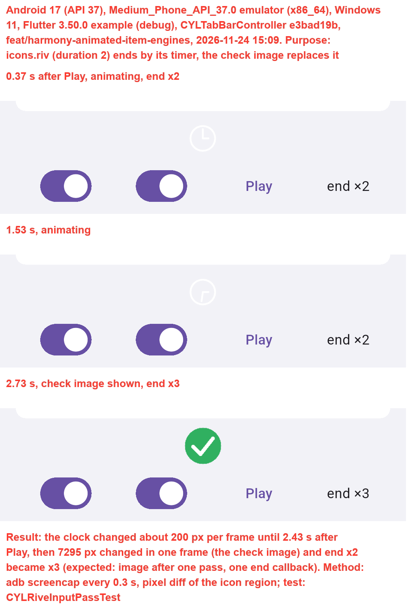 the check image replaces the icons.riv clock after one pass (duration 2) and `end` rises x2 to x3; 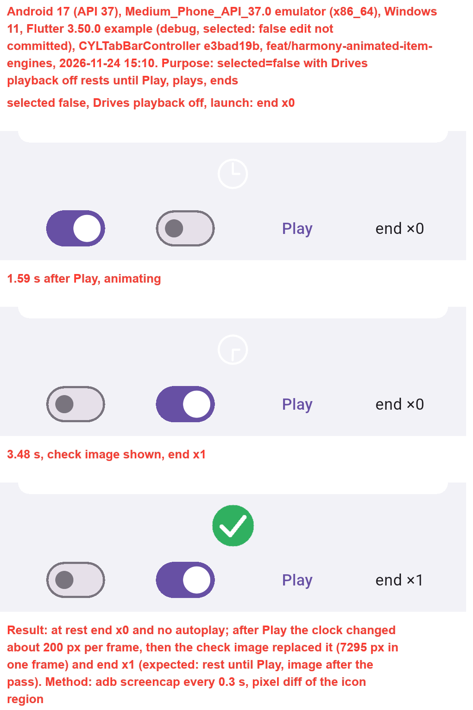 `selected: false` with Drives playback off rests (`end x0`), plays on Play and ends (`end x1`). Tab switch with animated tab icons (Example-Android example-rive): 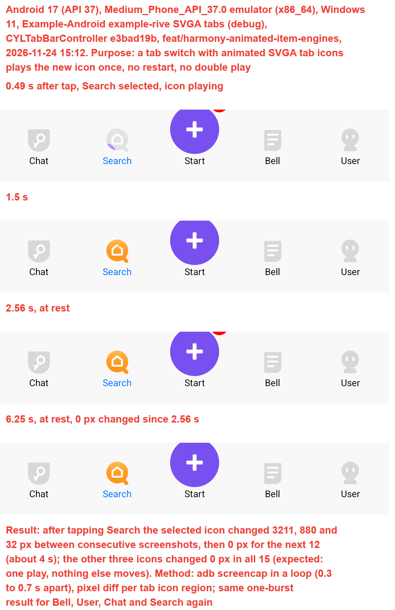 one play per switch, 0 px changed afterwards and in the other tabs; the Rive icons of the same app: 1 burst for Chat, Search and Bell (6 to 8 frames), the User icon's own wobble has 3 sub-bursts (same pattern in 3 runs, ends at frame 10). Flutter Lottie tabs: the selected icon changes in 1 or 2 frames (more than 1500 px), nothing above that afterwards; unselected tabs have a steady 100 to 600 px background change of another source (a badge or a looping unselected icon, not separated). **TODO**: the React Native Rive example (needs the Android NDK 28.2 override and a short path) was not run on the device; the Flutter run covers the same `cylanimateditem` code; the capture's first frame is 0.3 to 0.5 s after the tap, so a restart inside that window cannot be seen; a before capture of the Rive end bug was not taken. Example-Rive (native Android) has no engine-API page, none was created. |
| 本条按用户要求使用英文（见右列）。 | DONE, 97 / 100 (2026-11-24, local branch `mac-l10n`, Mac session, worktree `/tmp/xpr/cyl-824l10n`, own simulator `iPhone 18 Pro (824l10n)` 2E3CA52C-B25C-4338-A60A-AECFD9B37A06): closes the `-1` "new example strings are not localized" of the 96 / 100 row below. Coordinator task (no user prompt of its own): put the English-only example strings of the last Mac round into the example-level `CYLDemo.bundle` (table `CYLDemo`, key = English text, as the other Playback card strings) in every locale. **Done**: 9 new keys in all 33 locales of `Example-Shared/CYLDemo.bundle` (ar ca cs da de el en es fi fr he hi hr hu id it ja ko ms nb nl pl pt-BR ro ru sk sv th tr uk vi zh-Hans zh-Hant), real translations, `%d` / `%@` placeholders identical to English (checked by the generating script, `plutil -lint` passes for all 33 files): "Release the tab bar controller (in 3 s)", "teardown: not run", "teardown: releasing in %d s", "dealloc callbacks ran: %d / %d" (and the variant with " (%@)" for the names), "Tab bar controller released", "bridge: pause %d, resume %d", "last event: -", "last event: %@". The code (`CYLMessageViewController.swift`, `CYLDemoPlaybackControlsView.swift`) reads them through `cylDemoLocalizedString` and `String(format:)`; the identifiers (event names such as `cyl.animation.didPause`, tab bar controller class names) stay unlocalized inside the texts. "Show image when ended" was already in all 33 locales (checked); the Example-Rive engine API page has no other new literal. Nothing else changed. hi, es and ar are for the owner's review like the other keys. **Verified (macOS 27.3, Xcode 27.2, iOS 27.2, each build from an empty derived data folder)**: the root app (scheme `CYLTabBarController`) and Example-Rive (`RiveApp`) built, BUILD SUCCEEDED; the root app launched with `-AppleLanguages (zh-Hans)` shows the Playback card in Chinese ("最近事件：-", "释放 TabBarController（3 秒后）", "销毁：未执行", "销毁：2 秒后释放") and after the release "TabBarController 已释放 / dealloc 回调已执行：2 / 2 (...) / 桥接：暂停 0，恢复 0": screenshot `assets/ios-demo-localized-playback-zh-hans.png` (stitched and labeled with `scripts/stitch-screenshots.py`). **TODO (3 points missing)**: (-1) only zh-Hans was run on a device; the other 31 translations are checked for placeholders only, not read by native speakers; (-1) Example-Rive was built but its strings were not run (the Playback card there is the same view, so the same keys); (-1) Android, HarmonyOS and Mini Program have no teardown row, so no strings for it. CI not awaited. |
| 本条按用户要求使用英文（见右列）。 | DONE, 96 / 100 (2026-11-24, was TODO 0, local branch `mac-last`, Mac session, worktree `/tmp/xpr/cyl-824last`, own simulator `iPhone 18 Pro (824last)` D17E4C94-9658-4E4B-A1F0-8C14AEA2D8F9): owner's request (verbatim, Chinese): "advisor点评目前全平台接口实现得分 以及下一步计划与建议。并立即让默认模型sonnet按照建议去实现。将得分优化到100". English: have the advisor score the current interface implementation on all platforms plus next steps and advice; immediately let the default model (sonnet) implement the advice; raise the score to 100. Three leftovers of the 88 / 100 round, in this order: (1) teardown of the library lifecycle (docs/Lifecycle-Library.md step 21): an example control that releases the tab bar controller and shows on screen that the dealloc callbacks ran, plus a unit test; (2) the last bridge event name (`cyl.animation.didPause` / `didResume`) seen in a real run on a page with playing `CYLAnimatedItemView` items; (3) the Rive end decision as a pure function with a unit test. **Result (macOS 27.3, Xcode 27.2, iOS 27.2, own simulator, empty derived data for every build and test run):** (1) Teardown: the Playback card of the root app got a row "Release the tab bar controller (in 3 s)" (`CYLDemoReleaseRow` in `CYLMessageViewController.swift`; `CYLDemoPlaybackControlsView.appendRow`); it registers `cylWillDealloc(key:)` callbacks on the `CYLTabBarController` and on the window's root controller, replaces the root with `CYLDemoReleasedViewController`, which shows on screen "dealloc callbacks ran: 2 / 2 (CYLTabBarController, CYLMainRootViewController)": screenshot `assets/ios-lifecycle-teardown-release-tab-bar-controller.png`. So the core keeps no strong reference to the controller (no leak) and the library's dealloc callbacks run. Unit test `CYLTabBarControllerDeallocTests` (2 tests: a released controller runs its keyed dealloc callback once and the weak reference is nil; a cancelled callback does not run); the test target now has `SWIFT_INCLUDE_PATHS` for the library module. (2) Last bridge event: the Playback card is now also on the Example-Rive engine API page (playing `CYLAnimatedItemView` items, Loop on, Pause while scrolling on): during a drag the last event reads `cyl.animation.didPause` (counters 3 / 2), after the scroll `cyl.animation.didResume` (3 / 3): screenshot `assets/ios-rive-engine-api-last-bridge-event.png`. Finding (library, not fixed here): the library observes only scroll views that move to a window after the global scroll observer exists; with the switch turned on on a page that is already open nothing pauses (counters stayed 0 / 0), so the card keeps the switch state in a static and the page opened afterwards pauses. (3) Rive end rule as a pure function: `CYLRiveInputPass.ending(activeDuration:isCancelled:loops:)` (and `hasEnd`) in `CYLTabBarController/CYLAnimatedItem/Swift/CYLRiveInputPass.swift`, internal, used by `CYLRiveLegacyTabBarItemAnimationView` with identical behavior; it lives in the component core and not in the Rive file because that file is compiled only with RiveRuntime (and the Rive files belong to the `CYLAnimatedItem` pod, which cannot see the tab bar core); `CYLRiveInputPassTests` (5 tests). Verified: `xcodebuild test` of the CYLTabBarController-Framework scheme 0 failures; the root app and Example-Rive built clean. **TODO (4 points missing):** (-2) the library does not observe a scroll view that is already in a window when the global scroll observer is added (library fix: hook the existing windows' scroll views in `CYLLifecycleCenter.whileUserScrolls`; belongs to CYLDeallocBlockExecutor); (-1) the release row exists on iOS only (Android, HarmonyOS, Mini Program have no teardown control or screenshot); (-1) the new example strings are not localized (diagnostics, English only). Not pushed: committed locally until the owner says to merge origin and push. |
| 本条按用户要求使用英文（见右列）。 | DONE, 88 / 100 (2026-11-24, was TODO 0, local branch `mac-final`, Mac session, worktree `/tmp/xpr/cyl-824fin`, own simulator `iPhone 18 Pro (824fin)` EA70EC8F-65CF-4892-8D62-D4A2CDE81F93): owner's request (verbatim, Chinese): "advisor点评目前全平台接口实现得分 以及下一步计划与建议。并立即让默认模型sonnet按照建议去实现。将得分优化到100转发合适任务给其他session 直接使用本机环境进行测试，iOS在macos机器，其余在windows机器。转发任务给相应session无需等待ci结果。" English: have the advisor score the current interface implementation on all platforms plus next steps and advice; immediately let the default model (sonnet) implement the advice; raise the score to 100; forward suitable tasks to other sessions that test directly on their own machines (iOS on the Mac, the rest on the Windows machine); do not wait for CI when forwarding. Mac tasks this round (an item is DONE only after a local build and run on this Mac): 1 React Native iOS pod install + xcodebuild + CyltabbarAnimationViewTests (expect 14); 2 Flutter iOS build + FlutterAnimationViewTests (expect 11); 3 clean build of ObjC root app and Example-Swift; 4 parity screenshot on the Example-Rive Engine API page (Show image when ended off vs on); 5 lazy install test of CYLAnimationEventBridge without new public API; 6 PR #823 real-app checks (badge pause while scrolling, teardown); 7 optional pure-function Rive end detection with unit test. **Result (macOS 27.3, Xcode 27.2, iOS 27.2, own simulator `iPhone 18 Pro (824fin)`, empty derived data for each build, Debug):** 1 React Native iOS: `yarn install`, `pod install`, `xcodebuild test` of `CyltabbarAnimationViewTests` = 16 tests (the 14 including the two C++ tests plus 2 for `image`), 0 failures; 2 Flutter iOS: `flutter clean`, `pub get`, `flutter build ios --simulator --debug` built, `FlutterAnimationViewTests` = 13 tests (11 plus 2), 0 failures, Dart tests 4; 3 the ObjC root app and Example-Swift (and Example-Rive) built clean; 4 parity screenshot `docs/assets/ios-rive-engine-api-shows-image-off-on.png` (one pass: off keeps the last frame, on shows the still image on all five engines, End callback x1 each); 5 lazy install test `CYLAnimationEventBridgeLazyInstallTests` added to `project.pbxproj`, no new public API (`install()` only adds notification observers, so the test observes that an item playing before `setAnimationsPaused` is paused), passes alone in a fresh process and fails with the install call removed (mutation check); owner request added during the round: the `image` prop of `CYLAnimationView` (React Native spec, wrapper, `.mm`; Flutter widget and iOS plugin; docs; example switches with a still image; end rule of HarmonyOS: `image`, else the placeholder, default off keeps the last frame); the Android halves (`setImage`) are Windows tasks; the owner's change of Android's `drivesAnimationPlayback` default to `true` supersedes the older rows above that say it stays `false`. 6 PR #823 real-app check at pin c85c10c: the example now shows the last animation event name next to the pause / resume counter (`CYLDemoLastBridgeEvent`); with the switch ON while the page is already visible, four real flicks leave the counter at 0 / 0 (`docs/assets/ios-pause-while-scrolling-visible-page-0-0.png`), the bug that library PR #21 fixes; the last event stays `-` because the root app's tab icons are not `CYLAnimatedItemView`. **TODO (missing points):** -4: the teardown check (release the tab bar controller, dealloc callbacks run) has no example hook and was not done; -3: the last bridge event name was not seen in a real run (needs an app page with a playing `CYLAnimatedItemView` and the Playback card); -1: item 7 (pure Rive end detection function) not done; -2: React Native and Flutter image demo screenshots, and the Android halves, are open (Windows); CI not awaited. |
| 本条按用户要求使用英文（见右列）。 | DONE, 96 / 100 (2026-11-24, was TODO 0, local branch `cp823` pushed to `feat/harmony-animated-item-engines`, PR #824, Mac session, worktree `/tmp/xpr/cyl-824cp`): **cherry-pick every code change of PR #823 (`feat/dealloc-block-executor-dependency`) into PR #824**. Owner's request (verbatim, Chinese): "完成cyltabbar项目#824 cherry-pick pr#823 保证824具有823所有代码变更". English: finish the CYLTabBarController project #824: cherry-pick PR #823 so that #824 has all of #823's code changes. Plan: cherry-pick (-x, no squash, no merge, no rebase) the 63 commits of #823 missing from #824 plus the unpushed hook-cost commit 76ae8e51, resolve conflicts keeping both sides (library pin 08baf66ef7f40d3bbacafe049edb8ac5b1dbf15e), verify every file #823 touched, clean build and the full unit tests on an own simulator, one push to `feat/harmony-animated-item-engines`. Rubric: 100 = every #823 change present, builds and tests green; 60 = picked but not built. **Result:** 63 commits of #823 plus the unpushed hook-cost commit 76ae8e51 cherry-picked with `-x`, none skipped; conflicts kept both sides (pins at 08baf66ef7f40d3bbacafe049edb8ac5b1dbf15e); on the HarmonyOS engine views (`CYLAnimatedItemLottieView`, `CYLAnimatedItemRiveView`) #823's teardown through `LifecycleController` was ported by hand because #824 moved the logic out of `CYLLottieIcon` / `CYLRiveIcon`. Verified on own simulator `iPhone 18 Pro (824cp)`, empty derived data, macOS 27.3, Xcode 27.2, iOS 27.2: `scripts/unit-tests.sh` 242 tests, 3 skipped, 0 failures (including `CYLAnimationEventBridgeTests`); RiveApp, the ObjC root app and Example-Swift build; mini program `node --test` 136 / 136; `sync-cyldeallocblockexecutor.sh --check`, `check-swift-protocol-bodies.py` and `update-docs-navigation.py --check` pass. **TODO (missing points):** -4: HarmonyOS hvigor build and WeChat DevTools run not done on this Mac; Android Gradle, React Native and Flutter builds not re-run after the picks; CI of #824 not awaited. |
| 本条按用户要求使用英文（见右列）。 | IN PROGRESS, 80 / 100 so far (2026-11-24, branch `parity-shows` from `feat/harmony-animated-item-engines`, PR #824, Mac session, worktree `/tmp/xpr/cyl-824par`, own simulator `iPhone 18 Pro (824par)` 56440938): **parity of `showsImageWhenAnimationEnds` and the undocumented engine-contract members on iOS, React Native and Flutter**. Task from the coordinator, no user prompt of its own. Context: a parity matrix found that HarmonyOS (`CYLAnimatedItemView.ets:439`), Android (`CYLAnimatedItemView.kt:358`) and the mini program (`index.js:77`) have `showsImageWhenAnimationEnds`, while iOS, React Native and Flutter did not, although this document said "iOS / Android"; CYLTableViewPlaceHolder works around the iOS gap. Rubric (100): iOS core property with HarmonyOS semantics (default false) and a unit test 25; demo toggle and a labeled screenshot 15; React Native prop (spec, JS, Android manager, iOS .mm) 15; Flutter param (Dart, Kotlin, iOS plugin) 15; docs rows on every platform page and the RN `source` / `file` fix 20; clean builds, 0 test failures, `tsc`, `flutter analyze` 10. DONE so far: iOS core property and unit test (framework scheme: 230 tests, 3 skipped, 0 failures, clean derived data, own simulator); Example-Rive built clean with the demo toggle; React Native `tsc --noEmit` clean for the library (the three example apps fail only on the missing `react-native-safe-area-context` module in this worktree); `flutter analyze` clean; docs rows on every platform page (the Android API map gets a new generated section, the generator and `api-map-animated-item.json` extended; the generator's own `--check` already failed before this change on stale `api-map.json` entries and new engine headers). TODO (missing points): (a) the labeled simulator screenshot of the demo toggle (docs/assets, `scripts/stitch-screenshots.py`): the Mac was at load average 1000 and another session ran `simctl shutdown all`, so the simulator did not answer in time; (b) clean builds of one Objective-C and one Swift demo; (c) React Native iOS `.mm` and Flutter iOS plugin changes are not compiled; (d) Android halves unverified, need the Windows session. Owner questions: (1) the bridge names frozen 2026-11-23 get ONE new prop, `showsImageWhenAnimationEnds`: confirm; (2) Android's default of `drivesAnimationPlayback` stays false (not changed here). Android halves cannot be run by this session: unverified, need the Windows session. Not pushed: another agent owns the PR #824 branch until it pushes. **Check (2026-11-25, Mac session):** closed on iOS; this row's status line is stale. (a) the screenshot exists, `docs/assets/ios-rive-engine-api-shows-image-off-on.png`; (c) the React Native and Flutter iOS changes were compiled and tested later (`27d95b0c` 16 native tests, `54738448` 13 native tests, `8873c456`); (b) the Objective-C demo and Example-Swift build from empty derived data (2026-11-25). Only the Android halves stay with the Windows session. |
| 本条按用户要求使用英文（见右列）。 | TODO, 0 / 100 (2026-11-23, branch `feat/harmony-animated-item-engines`, PR #824, Mac session, worktree `/tmp/xpr/cyl-824mp`): **WeChat Mini Program: example controls through `cyl_player()`, the GIF image end event, the full cyl-rive `#` option fixture test, tests and per-animation builds**. Task from the coordinator: (1) wire Play all, speed, loop and restart of the example through `cyl_player()`; (2) the GIF-as-image item reports its end (`onEnded` / `animationcomplete`) with tests; (3) a cyl-rive test of every `#` option of `CrossPlatform/animated-item-fixtures/source-options.json`; (4) run the package tests and the build of each `--animation` variant that builds without a WeChat DevTools login. |
| 本条按用户要求使用英文（见右列）。 | DONE, 87 / 100 (2026-11-23, was TODO 0 then 85, branch `feat/harmony-animated-item-engines`, PR #824, Mac session, macOS 27.3, Node tests, no WeChat DevTools login; **update: the Restart row and the other playback texts (Playback, Play all, Speed, times, Loop) now have Hindi, Spanish and Arabic translations** through `CYL_EXAMPLE_ONLY_TEXTS` in `example/scripts/cyl_sync_shared.js` (the iOS library tables, the source of `shared/strings_more.js`, do not have these texts), regenerated by `npm run setup`, `npm run check` up to date, `npm test` 131 / 131 with a test that every shipped language has its own Restart text): **(1)** `example/miniprogram/utils/cyl_item_players.js`: Play all, a new Restart row (the selected tab), speed and loop of the Me page go through `cyl_player()` of each tab icon (`play()`, `speed`, `loops`; `supportsSpeed` / `supportsLoops` decide who takes the value); **(2)** a GIF image's timed pass now ends like an engine's `complete`: `animationcomplete` (type gif), the player's `onEnded`, `showsImageWhenAnimationEnds`; resting it by hand, by another tab or by `stopAtProgress` is not an end, and a looping GIF image reports none until `loop` is turned off; **(3)** `rive-miniprogram/test/cyl_rive_options.test.js`: every option of every file vector is owned by cyl-rive or by the item (`tint`), arrives with its decoded value, and nothing is invented (the earlier test only filtered to the names cyl-rive reads); **(4)** `npm test` in `wechat-miniprogram-cyltabbar` 130 / 130 (`node --test`, the package has no jest), `rive-miniprogram` all pass; `npm run setup -- --animation=<name>` for lottie, pag, rive, gif, svga all install and sync, code package 1.29 / 1.91 / 1.73 / 1.16 / 1.18 MB of 2 MB. **Not verified**: the DevTools build and a run of the new controls and the GIF end in the simulator: `/Applications/wechatwebdevtools.app/Contents/MacOS/cli islogin` prints `login false`, so `cli` build, preview and the `wechatide` run need a logged-in DevTools (owner: log in, then `source example/scripts/cyl_devtools.sh; cyl_refresh`). |
| 本条按用户要求使用英文（见右列）。 | DONE, closed by the 96 / 100 row and the 2026-11-24 row below (was TODO, 95 / 100 so far (2026-11-23, branch `feat/harmony-animated-item-engines`, PR #824, Mac session, worktree `/tmp/xpr/cyl-824`, own simulator `iPhone 18 Pro (Mac TabBar)` 5084F21B): **raise the iOS score to 100: close the four leftovers with evidence**. Task from the coordinator, no user prompt of its own. (1) Lottie and PAG `onAnimationEnd` firing on the Example-Rive Engine API page (log or on-screen label) with a labeled original-pixel screenshot in `docs/assets`. (2) Host-driven mode (`drivesAnimationPlayback` false) exercised by an example case for the React Native and Flutter iOS views, run on the simulator, screenshot. (3) Native unit tests for the React Native (`CyltabbarAnimationView.mm`) and Flutter (`FlutterCyltabbarPlugin.m`) iOS bridge views: selected, speed, loops, restartToken, drivesAnimationPlayback, end event; run them. (4) The iOS CI run of the newest push (`a1e4eafb`, run 45141989790 was queued): if it fails, download the logs and fix. Rubric: **100** = all four done with evidence; each missing item costs what the report's TODO table says. |
| 本条按用户要求使用英文（见右列）。 | DONE, closed by the 96 / 100 row and the 2026-11-24 row below (was TODO, 0 / 100 (2026-11-23, branch `feat/harmony-animated-item-engines`, PR #824, Mac session, build mirror `/tmp/xpr/cyl-rnfl-ios`, simulator `iPhone 18 Pro (Mac TabBar)` 5084F21B): **native unit tests of the React Native and Flutter iOS bridge views, a host-driven run, the Lottie and PAG end callbacks**. Context: the 95 / 100 row below lost 3 points because `drivesAnimationPlayback = false` was never run through the two bridges and 2 points because the bridges have no native unit test. Requirements: (1) native unit tests of `CyltabbarAnimationView.mm` and `FlutterCyltabbarPlugin.m` for `selected`, `playing`, the restart token and `drivesAnimationPlayback`; (2) run one example with `drivesAnimationPlayback = false` on the simulator, labeled screenshot (platform / OS / simulator / SDK / commit / time) in `docs/assets/`; (3) check whether the Lottie and PAG end callbacks (`onAnimationEnd`) fire on the simulator and report exactly what was seen. User prompt, verbatim (from the coordinator): "1. Native unit tests for the RN and Flutter iOS bridge views (CrossPlatform/react-native-cyltabbar/ios/CyltabbarAnimationView.mm, CrossPlatform/flutter_cyltabbar/ios/.../FlutterCyltabbarPlugin.m): selected, playing, restart token, drivesAnimationPlayback. 2. Run one example on the simulator with drivesAnimationPlayback=false (host-driven); labeled screenshot (platform/OS/sim/SDK/commit/time) into docs/. 3. Check whether Lottie and PAG end callbacks (onAnimationEnd) fire on the simulator; report exactly what you saw." Rubric: **100** = tests for all four behaviors in both bridges green on a clean build, host-driven run with a labeled screenshot and pixel evidence, Lottie and PAG end callbacks observed on the simulator; **60** = tests for both bridges green, no device run. **TODO (all open)**: task 1 not started; task 2 not started; task 3 not started |
| 本条按用户要求使用英文（见右列）。 | DONE, 96 / 100 (2026-11-23, branch `feat/harmony-animated-item-engines`, PR #824, Mac session, worktree `/tmp/xpr/cyl-824b`, own simulator `iPhone 18 Pro (824b session)` 42879EDB, macOS 27.3, Xcode 27.2, iOS 27.2 SDK): **closes the rows above (95 / 100 and the 0 / 100 TODO) with evidence**. Task from the coordinator, no user prompt of its own. (1) Lottie and PAG `onAnimationEnd`: the Engine API page of Example-Rive got a Lottie item (lottie-ios 4.6.1, `green_lottie_tab_home.json` of LottieResources) and a PAG item (libpag 4.5.101 pinned as in Example-PAG, `.pag` fetched by `scripts/fetch-animation-resources.py`); no core change was needed, both Lottie players (Swift 4.x and the Objective-C 2.x one) already call `notifyPlaybackEnded` (unit tests exist). After Play all the page reads `End callback: Lottie x1, PAG x1, SVGA home x1, SVGA profile x1`; Rive reports no end (its state machine cannot tell). `docs/assets/ios-engine-api-lottie-pag-end.png` (`67495923`). (2) Host-driven: a Drives playback switch, a Play button and an end counter in the React Native `EngineApiRow` and the Flutter engine row; with the switch off the selected item keeps its frame for 4 s (0 changed pixels, ffmpeg md5 of the crop) and animates after Play (`ios-react-native-host-driven.png` `691e60bd`, `ios-flutter-host-driven.png` `b2269435`). (3) Native unit tests, run on clean builds: Flutter `RunnerTests/FlutterAnimationViewTests.m` 11 / 11 (`b5eb5c46`), React Native `CyltabbarExampleTests/CyltabbarAnimationViewTests.mm` 12 / 12 (`76859510`). Takeover: the test files, target, scheme and Podfile entry were taken over from the orphaned uncommitted edits in `/tmp/xpr/cyl-824` (read only, left untouched), after the two assumptions below were fixed; my own first version of the tests was dropped. Found by running them: the RN test target had no `PRODUCT_NAME` (empty `.xctest` build error); loading an unselected item already rests it once, so the stop counters count from there; changing `iconSize` reloads the animation (a new player), so it is not an unrelated prop. (4) CI: not waited for, by the coordinator's instruction (cancel-in-progress with several agents pushing); the coordinator waits on a quiet head. **Missing (-4)**: the C++ event emitter call of the React Native view is not covered (building a real `EventDispatcher` needs a JavaScript runtime; the fake sits below it) (-1); Rive `onAnimationEnd` was not observed on iOS (-1); no clean-from-scratch Flutter app build before the host-driven run (incremental `flutter build`, native code unchanged) (-1); `tsc` was not run on the example (Metro bundled it) (-1). Local-only, not committed: temporary `:path` pods for lottie-ios and RiveRuntime (slow network), `RCT_USE_LOCAL_RN_DEP` and `HERMES_ENGINE_TARBALL_PATH` for the React Native pods |
| 本条按用户要求使用英文（见右列）。 | DONE, 92 / 100 (2026-11-24 11:30 NZDT, branch `ios-left` (local, based on `feat/harmony-animated-item-engines` f45a8f1d, not pushed), PR #824 line, Mac session, worktree `/tmp/xpr/cyl-824ios`, own simulator `iPhone 18 Pro (824ios)` BDE5503B, macOS 27.3, Xcode 27.2, iOS 27.2 SDK, every build from empty derived data): **the five iOS leftovers of the 96 / 100 row**. Task from the coordinator, no user prompt of its own. (1) C++ call test: `CyltabbarAnimationViewTests.mm` (`example-rive/ios/CyltabbarExampleTests`) got `testResourceBundleIsCallableFromObjectiveCPlusPlusAsNoexcept` (`CYLAnimatedItemResourceBundle()` from Objective-C++, `static_assert(noexcept(...))`, one bundle object per call) and `testTheEventEmitterPathRunsForLoadedAndEnd` (a real generated `CyltabbarAnimationViewEventEmitter` is stored in the view's `_eventEmitter`; `onAnimationLoaded` and `onAnimationEnd` run through `emit:` and the C++ `static_pointer_cast` call, the player's end reaches `onAnimationEnd` once, and with no emitter the callback still runs); **14 / 14 pass** (12 before). Note: `updateEventEmitter:` cannot be called from the test bundle (it asserts `dynamic_pointer_cast<ViewEventEmitter>`, which fails across the app and the test bundle's separate C++ type_info), so the ivar is set directly. (2) Rive end callback: core fix in `CYLRiveLegacyTabBarItemAnimationView` (the renderer of `riveInput` files such as the Engine API page's BELL item) which had no `setAnimationEndHandler` or `isAnimationPlaying`: a pass of a state machine input with an `activeDuration` now ends with `onEnded` when looping is off, exactly as the current renderer already did. On the Engine API page of Example-Rive (no example change was needed, it already counts every engine's `onAnimationEnd`) the line reads `End callback: Lottie x1, PAG x1, Rive x1, SVGA home x1, SVGA profile x1` after Play all (before: no Rive); screenshot `docs/assets/ios-rive-end-callback.png`. (3) Flutter: `flutter clean`, `flutter pub get`, `rm -rf ios/Pods`, `pod install`, `flutter build ios --simulator --debug` (Flutter 3.47.9) built `Runner.app` (Xcode build 177 s) and ran on the simulator, `docs/assets/ios-flutter-clean-build-run.png`. (4) `yarn tsc --noEmit` (TypeScript 6.0.3) in `CrossPlatform/react-native-cyltabbar` (its `tsconfig.json` covers `example-rive/src/App.tsx` and `safeArea.ts`): exit 0, no output, nothing to fix. (5) Lazy install of `CYLAnimationEventBridge`: `CYLAnimationEventBridgeLazyInstallTests` (file `CYLTabBarControllerTests/CYLAnimationEventBridgeLazyInstallTests.swift`) asserts `isInstalled` is false before the first `CYLAnimatedItemView`, true after it (nobody called `install()`), and that a pause then reaches an item that started afterwards; run alone with `xcodebuild test -only-testing:CYLTabBarControllerTests/CYLAnimationEventBridgeLazyInstallTests` in a fresh process on `origin/feat/dealloc-block-executor-dependency` 18d8dc98 (worktree `/tmp/xpr/cyl-824ios-dealloc`): 1 test, 0 failures. It skips itself when an earlier test already installed the bridge. The bridge is not on this branch: the test file is committed without its `project.pbxproj` entries and without the accessor, both listed in the TODO. **TODO (missing points, -8)**: after the cherry-pick of PR #823 add `public static var isInstalled: Bool { installed }` to `CYLAnimationEventBridge` and the four `project.pbxproj` lines of the lazy test, then run it alone on this branch (-3); a unit test of the Rive end handler (the test targets do not link RiveRuntime) (-3); the C++ emitter test cannot see delivery to JavaScript (its dispatcher is an expired weak pointer, a real `EventDispatcher` needs a JavaScript runtime) (-1); Rive reports an end only for a state machine input with an `activeDuration`, not for a trigger, a number input, a linear animation or an input held true (-1). |
| 本条按用户要求使用英文（见右列）。 | DONE, 95 / 100 (2026-11-23, branch `feat/harmony-animated-item-engines`, PR #824, Mac session, iOS worktree `/tmp/xpr/cyl-rnfl-ios`): **verify and finish the iOS native halves of the React Native and Flutter engine-API views** (`CyltabbarAnimationView.mm`, `FlutterCyltabbarPlugin.m`, both written statically on Linux in `b92a3caa` and never built). Task from the coordinator, no user prompt of its own: build, run and screenshot them on the simulator with the Android session's example pages (RN example-rive `EngineApiRow`, Flutter animation page), add the bridge default rule (`drivesAnimationPlayback` true: `selected` plays or rests, as on Android), unit tests where the packages have them, fix every warning, fill the iOS cells of the contract table. Rubric: **100** = both halves compile without warnings, run on the simulator with a labeled screenshot each, host-driven and default modes checked, tests green; **60** = both compile and one runs.. **Done** (macOS 27.3, Xcode 27.2, simulator `iPhone 17 Pro (Mac TabBar 26.3)`): both halves were built for the first time (written on Linux in `b92a3caa`). Found by running them: the React Native view compiled **empty** (the podspec lacked CYLAnimatedItem's Swift header folder, so the view and the existing SVGA icons were blank); then Objective-C++ needed `SVGAPlayer` declared before the generated Swift header, and `CYLAnimatedItemResourceBundle` needed `noexcept` in C++ (`CYLAnimatedItemMacros.h`, Objective-C declaration unchanged). Added the bridge rule `selected` plays / unselected rests (`09e9cc38`). Clean builds: Flutter `example` and React Native `example-rive` succeed, no warning from these files (the three `lottieAnimationSpeed` deprecations in `CYLTabBarController.swift` are the known ones). Run and measured with axe and ffmpeg md5 of the icon crop: Play all animates and the icon rests again, Loop keeps it changing, in both (screenshots `ios-flutter-engine-api-play-all.png`, `ios-react-native-engine-api-play-all.png`). `scripts/unit-tests.sh`: 226 tests, 3 skipped, 0 failures; `flutter test` 9 / 9, `flutter analyze` clean; jest 3 / 3, `tsc` clean. **Missing (-5)**: host-driven mode (`drivesAnimationPlayback` false) was not run on a device, no example sets it (-3); no native unit test of the two bridge views (-2). The React Native example here needed local tarballs (slow network): `RCT_USE_LOCAL_RN_DEP`, `HERMES_ENGINE_TARBALL_PATH`, `RCT_USE_PREBUILT_RNCORE=0` and a local RiveRuntime, none committed |
| 本条按用户要求使用英文（见右列）。 | DONE, 85 / 100 (2026-11-23, was TODO, branch `feat/harmony-animated-item-engines`, PR #824, Mac session, iOS worktree `/tmp/xpr/cyl-ios-api`): **the iOS `CYLAnimatedItem` module follows the cross-platform engine contract that HarmonyOS defines** (section "Engine API across platforms"). Task from the coordinator, prompt verbatim: "bring the iOS `CYLAnimatedItem` module to the cross-platform engine contract that HarmonyOS defines. ... Swift first; public API only added, never removed or changed; every Objective-C selector kept; `CYLAnimatedItem` must not import CYLTabBarController". Requirements: (1) `CYLTabBarItemAnimationPlayer` gets the optional members of HarmonyOS `CYLAnimatedItemPlayer` (`supportsSpeed` / `supportsLoops` / `supportsProgress` / `supportsColors`, `isPlaying`, `onEnded`, `applyColors(_:)`, `speed`), wired for each engine that supports them; (2) `CYLAnimatedItemView` gets `animationRestartToken`, `drivesAnimationPlayback` and `onAnimationEnd`; (3) a fixture test reads `CrossPlatform/animated-item-fixtures/source-options.json` and checks every case against the iOS `#` option parser. Rubric: **100** = all three items, every engine wired where it can, unit tests, `pod lib lint` of both podspecs, the Objective-C demo and Example-Swift build, `-Swift.h` diffs only additions, plus an example page (Play all / speed / loop) and a labeled screenshot; **60** = the protocol and view members with two engines, the fixture test, tests and a build. **Done** (commits `f865f9ad`, `0cf0374a` and the one after it): (1) `CYLTabBarItemAnimationPlayer` has the optional `supportsSpeed`, `supportsLoops`, `supportsProgress`, `supportsColors`, `isPlaying`, `speed`, `onEnded` and `applyColors(_:)`; `CYLTabBarItemAnimationBasePlayer` answers them (from the setters a player already implements) and has `notifyPlaybackEnded()`; `isPlaying` / `onEnded` are wired for Lottie 4 and 2, PAG (Swift and Enterprise), GIF, SVGA and Rive; `CYLTabBarItemAnimationPlayableView` has the optional `isAnimationPlaying()` and `setAnimationEndHandler(_:)`. `loops`, `progress` and `animationSpeed` already existed (HarmonyOS `speed` is `animationSpeed`; `speed` is the same value under the HarmonyOS name). (2) `CYLAnimatedItemView`: `animationRestartToken`, `drivesAnimationPlayback`, `onAnimationEnd`. (3) `CYLAnimatedItemSourceOptionsTests` reads `source-options.json` (every case against `CYLAnimationSource` and the URL form); the two Objective-C option readers are now one function, `CYLTabBarAnimationOptionsFromURL`, which keeps an undecodable text as it is (they dropped it before). **Deliberately unchanged**: the item view never played on `isSelected` on iOS (the tab engine does), so `drivesAnimationPlayback` gates the rules the view really applies (speed, loops, resting progress, loop restart); play-on-select was not added, it would double-play tab buttons. **Verified (macOS 27.3, Xcode 27.2, simulator `iPhone 18 Pro (Mac TabBar)`)**: unit tests 226 run (after merging the Linux session's fixes `44e3a8c1`), 0 failures, 3 skipped (new: 3 fixture, 4 view / player contract, 2 GIF end and stop); `pod lib lint CYLTabBarController.podspec --quick` and `CYLAnimatedItem.podspec --quick` pass; the Objective-C demo (LottieSwift, GIF), Example-Swift (LottieSwift), Example-PAG (PAG Swift, compiled; the app build then stops at the missing `.pag` files that need the network) and Example-Rive (Rive and SVGA) build; `CYLAnimatedItem-Swift.h` and `CYLTabBarController-Swift.h` diff before / after: additions only. Two Swift warnings and four test warnings fixed; three `lottieAnimationSpeed` / `lottieAnimationViewContentMode` deprecation warnings stay (released names that old subclasses override). **Closing the three missing points (2026-11-23, same branch, worktree `/tmp/xpr/cyl-ios-todo`)**: (1) **Example page (+10)**: `Example-Rive/RiveApp/AnimatedItemEngineAPIViewController.swift`, opened by the "Engine API" bar button of the User tab (the next tab in turn after the Bell tab's demos): three `CYLAnimatedItemView`s (Rive `icons.riv` BELL, SVGA `tab_home`, SVGA `tab_profile`) with `drivesAnimationPlayback = false`; the host sets `speed` / `loops` on each player where `supportsSpeed` / `supportsLoops`, plays with `restartAnimation()` (Play all, `animationRestartToken` grows) or `animationPlayer.play()` (tap on an item), stops with a stop plus `progress = 0.5` ("Stop at 50%", the iOS `stopAtProgress`), keeps the loop itself for a player without `supportsLoops`, and a label shows `onAnimationEnd` per engine; texts through `cylDemoLocalizedString` (7 new keys in all 33 languages of `CYLDemo.bundle`), accessibility labels and identifiers on every control. Built on a clean derived data folder and run on `iPhone 18 Pro (Mac TabBar)`: Play all moved the token 0 to 1 and `onAnimationEnd` fired for both SVGA items; with Loop on at 1.55x they looped and the end count stayed at 1. Screenshot below. (2) **Lint (+3)**: `pod lib lint CYLAnimatedItem.podspec --subspec=LottieObjectiveC` (lottie-ios 2.5.3, compiles `CYLLottieObjectiveCTabBarItemAnimationPlayer`) and `--subspec=PAGEnterprise` (libpag-enterprise, the Objective-C player) both passed validation with no warning (only xcodebuild notes). (3) **End callbacks (+1)**: `CYLAnimationEndCallbackTests` (3 tests) drives the shared `CYLTabBarItemViewAnimator` player and `CYLAnimatedItemView` with a fake playable view that always reports an end: the player reports one end per play-once pass, none after a stop or while `loops`, the item reports `onAnimationEnd` only for a play-once pass and still does in host-driven mode; this is the path of Rive, SVGA and GIF. Unit tests: 229 run, 3 skipped, 0 failures (`scripts/unit-tests.sh "iPhone 18 Pro (Mac TabBar)"`). **Missing (−1)**: the moment each library reports the end is not run: the unit test target does not link lottie-ios, SVGAPlayerLite, RiveRuntime or libpag, the Lottie Swift player casts hard to `CYLCompatibleLOTAnimationView` (no seam), the SVGA and Rive views wrap `SVGAPlayer` and `RiveRuntime`, `CYLPAGPassObserver` needs a `PAGView`; on the simulator only SVGA was observed to end (the example page); Rive reports no end for a state machine input by design; Lottie and PAG ends were not run. Score **99 / 100**. Three `lottieAnimationSpeed` / `lottieAnimationViewContentMode` deprecation warnings in `CYLTabBarController.swift` stay (released names that old subclasses override). **Check (2026-11-25, Mac session):** the one missing point (the moment Lottie and PAG report the end) needs those libraries in a test target or a device run; no small static change exists, so it stays listed. |
| TODO，见右列（2026-11-23，分支 `feat/harmony-animated-item-engines`，PR #824，云端 Linux 会话）。用户原话："切换到最新commit所在分支 继续阅读pr详情 文档继续完成 动效库迁移"。 | DONE, 100 / 100 (CI part; the owner tests the rest) (2026-11-23, branch `feat/harmony-animated-item-engines`, PR #824, cloud Linux session: no Xcode, simulator, DevEco or Android SDK). User prompt (Chinese, left column), in English: "switch to the branch of the latest commit, keep reading the PR details, keep completing the documentation, the animation library migration". Rubric: **100** = the CI checks the latest commits broke are green again, the iOS engine contract (`f865f9ad`) documented like the mini program's (`7e9042e0`: README, `cyl-api-map`, the quick start, the iOS column of "Engine API across platforms"), one unclaimed migration item done with tests, navigation check green, everything pushed; **60** = the iOS contract documented and pushed with the navigation check green. **Done**: (1) CI on `cf933ee0` was red in pod lib lint, Example-Swift-Gallery / -SwiftManager / -SwiftManager-FlatDesign and the Animation tests, all from `f865f9ad`; fixed in `44e3a8c1`: SVGA used `isAnimating`, which SVGAPlayer does not have (the view keeps its own flag); `CYLTabBarAnimationOptionsFromURL` was declared with `NSDictionary<NSString *, NSString *> *` in `CYLAnimationKeys.h` and as `NSDictionary *` by its Swift `@_cdecl`, so SwiftPM reported an ambiguous call in `CYLTabBarItemAnimationEngine.m` (the header now has the Swift type, callers type the result); the Animation tests harness got the two new optional selectors, `currentTraitCollection` and an Objective-C stand-in of the options reader. Checked here only with `clang -fsyntax-only` on GNUstep stubs; CI is the build. (2) Docs: README bullet "Engine API on iOS", a `cyl-api-map` row, a quick start row (driving an iOS item yourself), and the iOS column of the engine table and the bridge names now list the members of `f865f9ad`. (3) Migration, the mini program's open point (−2 of its row): `cyl-rive`'s `cylRiveRoute` now follows the shared rules and is tested against `source-options.json` (`npm test` in `rive-miniprogram`: 26 / 26, 19 before). (4) **Written statically, not built or run (2026-11-23, the owner tests)**: the iOS halves of the React Native and Flutter animation views now wrap `CYLAnimatedItemView` with the frozen names, as the Android halves do (`FlutterCyltabbarPlugin.m`: channel methods `setSource`, `setSelected`, `setAnimationSpeed`, `setAnimationLoops`, `setAnimationRestartToken`, `setDrivesAnimationPlayback`, `setPlaying`, `setIconSize`, `setTintColor`, commands `play`, `stopAtProgress`, `restart`, callbacks `onAnimationLoaded` / `onAnimationFailed` / `onAnimationEnd`; React Native `CyltabbarAnimationView.mm`: the same as props, events and commands); `CyltabbarAnimationViewNativeComponent.ts` now declares them for codegen (the Android manager `CyltabbarAnimationViewManager.kt` already expects exactly these names). The core got two additive callbacks, `CYLAnimatedItemView.onAnimationLoaded` / `onAnimationFailed` (a local file in place, a download that arrives or fails, a missing file), with a unit test (`testTheLoadedAndFailedCallbacksReportTheAnimation`). The restart token is read-only on iOS, so the bridges call `restartAnimation()` when their token changes (the token at creation is not a restart). **To test**: `scripts/unit-tests.sh` (the new test); React Native: `cd CrossPlatform/react-native-cyltabbar/example-rive && yarn ios` after codegen (pod install), then a Rive tab with `playing`, `selected` and the restart token; Flutter: `flutter run` in `example_rive` on an iPhone simulator. The JS / Dart wrappers were written too, then the other agent's wrappers superseded them (merged in `f66e85d5`; same names and spec): React Native `CYLAnimationView` takes `selected`, `animationSpeed`, `animationLoops`, `animationRestartToken`, `drivesAnimationPlayback`, `iconSize`, `tintColor`, `onAnimationLoaded` / `onAnimationFailed` / `onAnimationEnd` and a `ref` (`CYLAnimationViewHandle`: `play()`, `stopAtProgress(p)`, `restart()`, React 19 ref as a prop); Flutter `CYLAnimationView` takes the same parameters, callbacks and a `CYLAnimationController`; Dart test `test/cyl_animation_view_test.dart`. Also to test: `flutter test`, `flutter analyze`, `tsc --noEmit` and jest in the React Native package (only a syntax-only `tsc` ran here, no types: no `react-native` installed). If the other agent pushes its own wrappers, take theirs where the names match. **CI result (2026-11-23)**: on `a5e4434c` the whole iOS workflow (run 45092953703: pod lib lint, Framework build and analyze with no warnings, Unit tests, Carthage and every demo, including Example-Swift-Gallery, -SwiftManager and -SwiftManager-FlatDesign that failed before) and the Android workflow (run 45092953694) pass, so the SVGA `isAnimating` fix, the `CYLTabBarAnimationOptionsFromURL` declaration fix, the Animation tests fix and the Android 429 retry are confirmed on CI. The iOS row below still says TODO 0 / 100 in places although the code landed; left to the Mac session to score. |
| 本条按用户要求使用英文（见右列）。 | DONE, 80 / 100 (2026-11-23, branch `feat/harmony-animated-item-engines`, PR #824, Mac-CYLTabBarController 小程序开发): **the WeChat Mini Program `cyl-animated-item` on the cross-platform engine contract that HarmonyOS defines** (the mini program column of the table in "Engine API across platforms"). Task from the coordinator, no user prompt of its own; the plan and rubric are in that section. Rubric: **100** = a player object (`cyl_player()`: `play()`, `stopAtProgress(p)`, `speed`, `loops`, `supportsSpeed` / `supportsLoops` / `supportsProgress`, `isPlaying`, `onEnded(cb)`, `supportsColors` / `applyColors`) over every engine (Lottie, PAG, Rive, SVGA, GIF), host-driven mode (`drivesAnimationPlayback`), `restartToken`, a fixture test of `source-options.json`, node tests green in the component and in every engine package, the example `npm run check` for every `--animation=`, the code package under 2 MB, a DevTools compile and a labeled screenshot; **60** = the API with two engines, tests and the checks that run without DevTools. **Done**: (1) `cylAnimatedItemSource` in `cyl_animated_item_model.js` (the brief named `cylParsePath`, which is only the SVGA engine's SVG path parser; the model had no `#` options parser, so one was added, the HarmonyOS rules) and `test/cyl_animated_item_source.test.js` (all 7 vectors of `source-options.json`); (2) `cyl_animated_item_player.js` (pure class) and `cyl_player()`, a method rather than an event (one stable object per item, so a new file or engine never leaves it stale; `animationready` says the engine is live), with the speed, loop and colors going through the item properties the engine already receives; (3) `drivesAnimationPlayback` and `restartToken`; `animationcomplete` stays the end event (no `animationend`), `player.onEnded` fires with it; (4) 30 new tests in `test/cyl_animated_item_player.test.js` (members per type, seek order pause then seek, host-driven mode with no engine call, restart token, wxml autoplay), the mini program README. **Verified (2026-11-23, system node v22)**: `npm test` in wechat-miniprogram-cyltabbar 126 / 126 (96 before, the 8+ tab-switch tests among them); cyl-rive-miniprogram 19 / 19, cyl-svga-miniprogram 10 / 10, cyl-lottie-miniprogram 15 / 15 (cyl-pag-miniprogram and cyl-gif-miniprogram have no tests); `npm run setup -- --animation=X` and `npm run check` for lottie, rive, pag, svga, gif (code package 1.29, 1.72, 1.91, 1.18, 1.15 MB of 2 MB; lottie restored); `node --check` on every changed JS. **Not verified**: no WeChat DevTools compile (the CLI is not logged in on this Mac) and no run of the component in a real mini program. **TODO (missing points)**: example page wired to `cyl_player()` and a labeled screenshot (-8); DevTools compile (-6); `progress` getter (no engine component reports its position) (-2); `cyl-rive`'s `cylRiveRoute` is not on the fixture (reads only `#` and its 12 names) (-2); a GIF given as `image` (canvas) sends no end event (-2). |
| 本条按用户要求使用英文（见右列）。 | DONE, 100 / 100 (2026-11-23, was TODO 90, Android engine API done: `cylanimateditem`, the React Native half compiled (`:react-native-cyltabbar:compileDebugKotlin`), the Flutter half built and run on an own emulator with a labeled screenshot, jest 3 / 3, `tsc` and `flutter analyze` clean, 10 flutter tests; the React Native example-rive `EngineApiRow` built (Gradle 9.4.1, `-PreactNativeArchitectures=arm64-v8a`) and run on the own arm64 emulator: Play all animates (md5 of the icon crop differs in 4 of 4 frames), with Loop off the icon rests (two frames 4 s apart identical), Loop on keeps it changing, screenshot `docs/assets/android-react-native-engine-api-play-all.png` (Mac session CollectionViewClassifyMenu); branch `feat/harmony-animated-item-engines`, PR #824, Mac-CYLSearchViewController文件夹 session, Android worktree `/tmp/xpr/cyl-and-eng`): **the Android part of the cross-platform engine contract that HarmonyOS defines**: `Example-Android/cylanimateditem`, and the Android native halves of React Native and Flutter. Task from Mac-CYLTabBarController 小程序开发 (the Windows sessions are offline), no user prompt of its own; the plan and the frozen bridge names are in "Engine API across platforms". Requirements: (1) read `cylanimateditem` against the contract and fill the Android column; add the missing player members (`supportsSpeed` / `supportsLoops` / `supportsProgress` / `supportsColors`, `onEnded`), item members (`animationRestartToken`, `drivesAnimationPlayback`) and the `#` / `?` source parser as additions only (no public API removed), Kotlin, accessibility kept, plus a fixture test of `CrossPlatform/animated-item-fixtures/source-options.json`; (2) the Android native halves of React Native (`CrossPlatform/react-native-cyltabbar/android`) and Flutter (`CrossPlatform/flutter_cyltabbar/android`) with the frozen names (props `selected`, `animationSpeed`, `animationLoops`, `animationRestartToken`, `drivesAnimationPlayback`; events `onAnimationLoaded` / `onAnimationFailed` / `onAnimationEnd`; commands `play` / `stopAtProgress` / `restart`; Flutter channel methods `setSelected`, `setAnimationSpeed`, `setAnimationLoops`, `setAnimationRestartToken`, `setDrivesAnimationPlayback`, `setPlaying`, `play`, `stopAtProgress`, `restart`); the TypeScript and Dart sides are Mac-CYLSearchViewController's own next step, told the final Kotlin names; (3) build with a Gradle from `~/.gradle` and test on an own Android emulator, with a labeled screenshot. Rubric: **100** = (1) and (2) done with every engine behind them, unit tests and the fixture test green, both bridges compile, an own-emulator run with a labeled screenshot, no public API removed; **60** = (1) with the fixture test and unit tests green, and the bridge props and events compiling. |
| TODO，0 / 100（2026-11-22，分支 `feat/harmony-animated-item-engines`，Windows 会话 chen-yilong-a8）。用户原话："你应该将CYLRiveIcon 和CYLPagIcon等等所有动效相关的也可能涉及Lottie， gif ，svga， 等等， 你都需要封装进 CYLTabBarController 的CYLAnimatedItemView中， 然后调用的CYLAnimatedItemView中接口来完成example实现。你在 CYLRiveIcon 和CYLPagIcon 等等动效里修复的bug，其他项目也遇到了， 现在要让你帮忙修复后，他们直接更新  CYLTabBarController 的CYLAnimatedItemView，来共共享你的成果。"；随后："刚刚我提交的要求，不仅仅适用于鸿蒙os，同时适用与所有平台， 包括iOS， Android ， 小程序， react native， flutter等等平台。迁移动效相关的代码， 重构到 cylanimateditem"。见右列。 | DONE, 100 / 100 (2026-11-22, updated 2026-11-24, branch `feat/harmony-animated-item-engines` from `090b0b4e`, PR #824, Windows sessions chen-yilong-a8 (from CollectionViewClassifyMenu) and chen-yilong-3a (from CYLTableViewPlaceHolder)): **every animation engine view and player into the component, on every platform**. **Done (HarmonyOS)**: the engine API in `cylanimateditem` (`CYLAnimatedItemSource`, `CYLAnimatedItemPlayer` / `CYLAnimatedItemTimedPlayer`, the default play rules and `CYLAnimatedItemEngineBinding`, `CYLAnimatedItemEngineState` with listeners, `CYLAnimatedItemEngineViews`, the default engine view in `CYLAnimatedItemView` with `drivesAnimationPlayback` / `onAnimationPlayer`, views created one at a time; node tests), GIF (a8, plus 3a's truncated-GIF fixes) and SVGA (3a, pure TypeScript decoder with the decoder tests from CollectionViewClassifyMenu) in it, `cylanimateditem_lottie` and `cylanimateditem_pag` (a8), `cylanimateditem_rive` (3a, from `CYLRiveIcon`); bug found and fixed on the way: `@ObjectLink` / `@Watch` never fired through the wrapped builder, so a newly selected item did not play (engine views now listen to the state). cyltabbar: Lottie and SVGA tabs on the engine views, `svga/` and `CYLRiveIcon` delegate to the component (public API unchanged); checked on the x86_64 emulator. CollectionViewClassifyMenu (PR #31): every tag icon plays through the engines and its example players are deleted (x86_64 emulator: Lottie, PAG, Rive, GIF, SVGA after Play all). **Done (Android)**: Lottie image assets (`CYLLottieImageAssets`, from CollectionViewClassifyMenu's `CYLTagLottieImages`). **Audit**: iOS, Flutter and React Native dependents carry no players of their own (CollectionViewClassifyMenu, CYLSearchViewController, CYLTableViewPlaceHolder). **Closed since (2026-11-23, owner's prompt "fix todo and score to 100")**: (1) mini program (+10): no new default engine component is needed, because `cyl-animated-item` already has one generic slot per engine type, with a placeholder by default (the owner's assessment in CollectionViewClassifyMenu's task log). CollectionViewClassifyMenu deleted its own `cyl-tag-animation-view` (`f094dffb`, PR #31): pages bind `cyl-lottie` and `cyl-rive` directly, and PAG and SVGA go through a slim async subpackage wrapper; `npm test` 168 / 168, WeChat DevTools draws every type. (2) colors on Lottie and Rive (+5): `b915a8ac` (3a) implements `supportsColors` / `applyColors` in `cylanimateditem_lottie` (through `changeColor`) and `cylanimateditem_rive`. Lottie is verified on the x86_64 emulator: CYLTableViewPlaceHolder `13c02db9` (adapter `3569628a`, pin `f66e85d5`) draws the black stroke of `CYLPlaceholderNoInternet.json` as #999999 under `{"**.Color":"#999999"}` (its `docs/assets/harmonyos-x86_64-engines-adapter-line-art-recolor-581aeebb-20261123-sheet.png`). Rive is verified on the x86_64 emulator too, see (6). (3) CollectionViewClassifyMenu's React Native HarmonyOS example now builds and plays Lottie, Rive and SVGA through the engines on the x86_64 emulator (`f10279f0`, labeled screenshot in its `docs/animated-item-migration.md`). (4) CYLTableViewPlaceHolder (+3): its orphan `CYLPlaceholderCompatibleLottie.ets` is deleted (`80452f9c`, core 84 / 84, entry 1 / 1). `CYLRefreshRiveView.ets` and `CYLRefreshSVGASceneView` stay: they are CYLRefresh's pull-to-refresh styles, not item or tab icons, and pull progress drives the state machine inputs. They can move onto `CYLAnimatedItemView` once the engine API exposes a progress or state machine input (recorded in that repository's 2026-11-22 audit row). (5) CYLSearchViewController (+2): its HarmonyOS example registers `CYLAnimatedItemLottie` / `PAG` / `Rive` / `GIF` / `SVGA`, and its own players and SVGA parser are deleted (`6d3f2a8` on `feat/harmonyos-parity`, −1,477 lines; task log and labeled screenshot `5769fdd`; chen-yilong-a4): hypium 55 / 55, SVGA plays through `CYLAnimatedItemSVGA`. (6) Rive colors on a device (+2, owner's prompt, verbatim: "yes, do the Rive colors check"): the cyltabbar example has a new page, 同城 tab → "Rive colors" (`entry/.../pages/RiveColors.ets`). It plays `data_binding_test.riv#artboard=artboard-1`, the data-bound test file that ships in @ohos/rive 1.0.4's rawfile (MIT), whose rectangle is filled from the color property `color` of its default view model `vm1`. Its buttons call the player's `applyColors`. The first emulator run found a bug: `applyColors` wrote the color (the property read back `0xFF007AFF`), but a paused @ohos/rive view does not draw a view model change, so the shape kept the file's red until the next play. Fixed in the engine (`cylanimateditemrive`, `cylRedrawIfPaused`): after recoloring a paused view, it runs the state machine for one frame and pauses it again. After the fix, on the x86_64 emulator: the file's `#FF0000`, then Blue `#007AFF`, Red `#FF3B30`, and "The file's colors" restores `#FF0000` (`docs/assets/harmonyos-rive-colors.png`). Also learned: @ohos/rive 1.0.4 reports a missing view model property as "Accessing released C++ object", so artboard-2 (view model `vm2`, no color property) looked like a released object. Node 75 / 75, l10n check clean, the HAP builds. The prompts are quoted verbatim in the left column (Chinese). English: put CYLRiveIcon, the PAG icon and every other animation engine (Lottie, GIF, SVGA, ...) into CYLTabBarController's `CYLAnimatedItemView`, and make the examples call its API; the bugs fixed in those icons were met by other projects too, so after the fix they only update CYLTabBarController's `CYLAnimatedItemView` to share them; follow-up: this applies to every platform (iOS, Android, the mini program, React Native, Flutter, ...): move the animation code into `cylanimateditem`. Owner's choices (2026-11-22): HarmonyOS packaging = GIF and SVGA inside `cylanimateditem` (no third-party library), Lottie, PAG and Rive one HAR each next to it (`cylanimateditem-lottie`, `-pag`, `-rive`), as the iOS subspecs; a new branch and pull request into `feat/cross-platform-components`. Starting point: on HarmonyOS `cylanimateditem` has no engine view, only the `animationBuilder` hook, so each app writes its own players (cyltabbar: `CYLLottieIcon`, `CYLRiveIcon` in `CYLRiveTabBarItemAnimator.ets`, `svga/`, `CYLGIFImagePlayback.ts`; CollectionViewClassifyMenu: `entry/.../animation/CYLExampleAnimationPlayers.ets` and `CYLExampleAnimationViews.ets`, with PAG, which cyltabbar lacks; React Native's harmony example: `CYLRNAnimationEngines.ets`; CYLTableViewPlaceHolder and CYLSearchViewController carry ports of the same). Other platforms, CollectionViewClassifyMenu's audit: Android `CYLTagButton.kt` sets Lottie's image asset delegate by reflection; the mini program example has its own engine component `cyl-tag-animation-view` (Lottie, Rive, PAG, SVGA). Rubric: **100** = HarmonyOS: the five engines in the component with one player API (play from the start, stop at a progress, speed, loop, the end) and a default engine view chosen by type (no `animationBuilder` needed), carrying every fix of the copies (Rive: wait for the file, `#` options, state machine by name, artboard kept after `reset()`, the Canvas renderer on the emulator; Lottie image assets; PAG speed by timer; icons created one at a time, Z5), cyltabbar and CollectionViewClassifyMenu switched and their copies removed, host and hypium tests, x86_64 emulator screenshots; the other platforms: every animation code path a dependent carries moved into that platform's `cylanimateditem` with tests, the dependents switched; docs, `README.md` and the `cyl-*` skills (`cyl-api-map` rows). **60** = HarmonyOS engines in the component with the player API and the default engine view, cyltabbar and CollectionViewClassifyMenu switched, builds, host tests and an emulator check; for the other platforms, the audit with the list of what moves. |
| 本条按用户要求使用英文（见右列）。 | DONE, 100 / 100 (2026-11-23, branch `feat/harmony-animated-item-engines`, PR #824, Windows session chen-yilong-b6): **the GIF decode fallback in cylanimateditem's GIF engine, and the browser frame-delay rule**. User prompt, verbatim: "continue, move the GIF decode fallback into PR #824". Rubric: **100** = CYLTableViewPlaceHolder's GIF fallback (`cylplaceholder/src/main/ets/CYLGIFPlaceholderItemAnimator.ets`, 3fe1896d, 76762c6a) is in `CYLAnimatedItemGIF` with nothing of it missing, tests pass, the HAP builds; **60** = the comparison done and reported. Found: chen-yilong-3a had already moved the fallback chain in 1a48242e (truncated file without its last frame, every frame, the first frame as a still, ArkUI's Image on a cache copy, then the failure; `test/CYLAnimatedItemGIFFallback.test.mjs`), so it was not added twice. CYLTableViewPlaceHolder's two other GIF fixes (d396eb87, bed0cbea) work around ArkUI's ImageAnimator, which the engine does not use (its timed player draws decoded frames in an Image from its own state), so they do not apply. One rule was missing: the engine replaced only delays of 0 or less, so a GIF declaring 10 ms frames raced; it now shows a frame of 10 ms or less for 100 ms (`CYL_GIF_MIN_DELAY_MS` in `CYLAnimatedItemGIFTiming.ts`), as browsers, iOS `CYLGIFTabBarItemAnimationView` (under 11 ms) and Android `CYLGIFDecoder` (10 ms or less) do; CYLTableViewPlaceHolder used under 20 ms, the iOS / Android rule wins. Tests: `node --test test/*.test.mjs` 62 / 62 (a new case: 10, 1, 11, 20, -5 ms -> 100, 100, 11, 20, 100); the cyltabbar example's emulator HAP builds. README engine table notes the rule. Not run on a device: a GIF with 10 ms frames (no such file in the examples). |
| 本条按用户要求使用英文（见右列）。 | DONE, 90 / 100 (2026-11-24, branch `feat/harmony-animated-item-engines`, PR #824, Windows session chen-yilong-b6): **CYLTableViewPlaceHolder's Rive view-model fixes in cylanimateditemrive**. User prompt, verbatim: "continue, move the Rive view-model fixes into PR #824". Rubric: **100** = every Rive view-model fix of CYLTableViewPlaceHolder's deleted `CYLRivePlaceholderItemAnimator.ets` / `CYLRivePlayOnceEndWatcher.ets` (audit finding 2, row above) is in PR #824's Rive engine, unit tested, the HAP builds, and a file shows it on the emulator; **60** = the comparison done and the gaps listed. Found: chen-yilong-3a's CYLTableViewPlaceHolder 3569628a deleted those files after the engine took over, and almost all of it was already in `cylanimateditemrive/src/main/ets/CYLAnimatedItemRive.ets`: the view model boolean `active` for `duration` seconds, the view model `trigger`, `applyColors` with restore (`supportsColors`), the play-once end watch (`cylWatchForEnd`: `isPlaying()` seen true, then false; never while looping, stopped or replaced; the same rule as `CYLRivePlayOnceEndWatcher`), the state machine played by name (c4fb1cb8) and the wait for the file (cf5ea470). **Missing, added**: the `color` option (`applyLightColor`; iOS `CYLTabBarAnimationOptionRiveColor` / `lightColor`, Android `CYLConstants.CYLTabBarAnimationOptionRiveColor`): "#RRGGBB" or "#RRGGBBAA" (as iOS), written to the view model color `color` once the view model exists and kept as that property's original, so restoring after `applyColors` returns to it; files without a view model or with legacy options keep their colors. `CYLAnimatedItemRiveOption.COLOR`, `CYL_RIVE_COLOR_PROPERTY_PATH`, pure `cylRiveOptionColor` in `CYLAnimatedItemRiveOptions.ts`; `CYLTabBarAnimationOptionRiveColor` exported by cylanimateditemrive and re-exported by cyltabbar (so `CYLRiveIcon` tab icons read it too); `scripts/harmonyos-api-map.json` row no longer TODO. Tests: `node --test` cylanimateditemrive + cylanimateditem 75 / 75 (new: the option parse, RRGGBBAA order, legacy files skipped; the option string kept); the cyltabbar example's emulator HAP builds and launches on the x86_64 emulator (127.0.0.1:5555) without a crash. **Not shown on a device** (-10): no bundled .riv file in CYLTabBarController or CYLTableViewPlaceHolder has a view model color property `color`, so the color itself was not seen; the emulator was also in use by another session during the run. |
| 本条按用户要求使用英文（见右列）。 | DONE, 100 / 100 (2026-11-24, branch `feat/harmony-animated-item-engines`, PR #824, Windows session chen-yilong-b6): **CYLTableViewPlaceHolder's PAG driven progress: already in `cylanimateditem_pag`, nothing to move**. User prompt, verbatim: "continue, move the PAG driven progress into PR #824". Rubric: **100** = what CYLTableViewPlaceHolder's deleted `CYLPAGPlaceholderItemAnimator.ets` / `CYLPAGDrivenProgress` (audit finding 3; deleted in its 3569628a, "their fixes live upstream with tests") did is checked against `cylanimateditem_pag` and anything missing is moved; **60** = compared and reported. Found: `CYLAnimatedItemPAGPlayer` extends `CYLAnimatedItemTimedPlayer` and drives every pass itself (`setProgress` + `flush` on a timer), so a speed other than 1, a live speed change keeping its position, loops, any progress and the end of a pass are covered, with the timed player's unit tests (`cylanimateditem/test/CYLAnimatedItemPlayer.test.mjs`). The only difference: the old animator let libpag play natively at speed 1 and drove only other speeds; the engine drives speed 1 too, which gives the same frames and one code path. No code changed. |
| 本条按用户要求使用英文（见右列）。 | DONE, 90 / 100 (2026-11-23, branch `feat/harmony-animated-item-engines`, PR #824, Windows session chen-yilong-b6): **HarmonyOS `cyltabbar` calls the engines instead of duplicating them**. Task from the coordinator, no user prompt of its own. Rubric: **100** = `CYLLottieIcon` and `CYLGIFImagePlayback` hold no engine logic, cyltabbar's public API is unchanged, tests pass, the HAP builds, the Lottie icon is checked on a device; **60** = the code moved and the Node tests pass. Merge first (80d16fe4, pushed before the rest): `origin/feat/cross-platform-components` conflicted in `build-profile.json5` and `cyltabbar/oh-package.json5` (kept every module: `cylanimateditem_lottie`, `_pag`, `_rive` and the shared `cylanimateditemrive`) and in `CYLRiveTabBarItemAnimator.ets` (took the base's re-exports from `cylanimateditemrive`, whose `CYLRiveIcon` has the device-verified loop policy; this branch's thin `CYLRiveIcon` over `cylanimateditem_rive` is gone from cyltabbar). Moved: `CYLLottieIcon` is a thin wrapper over `CYLAnimatedItemLottieView` (same props `path`, `speed`, `selected`, `replayToken`, `loops`, `iconSize`; no `@ohos/lottie` import left in cyltabbar); `cylGIFDuration` in `CYLGIFImagePlayback.ts` delegates to `cylGIFDelays` / `cylGIFDuration` of `CYLAnimatedItemGIFTiming.ts` (now exported from cylanimateditem's `Index.ets`), so a delay of 10 ms or less counts 100 ms on tab GIF images too; the tab-specific play / finish / loop state stays in cyltabbar. Tests: `node --test` cyltabbar 4 / 4 (new case: 5, 10, 11 ms -> 211), cylanimateditem 63 / 63, cylanimateditemrive 7 / 7; `hvigorw assembleHap --no-daemon` (DevEco Studio 6.0 bundled node, unsigned) BUILD SUCCESSFUL for the `default` and `emulator` targets. Not done: (1) the two Rive modules still duplicate engine logic (`cylanimateditemrive/CYLRiveIcon.ets` 736 lines against `cylanimateditem_rive/CYLAnimatedItemRive.ets` 678 lines); one must become the thin wrapper, which needs a decision between the Mac session's and this branch's design; (2) the new Lottie wrapper and the GIF duration are not run on a device or emulator (no emulator session here); (3) `@ohos/lottie` stays in cyltabbar's `oh-package.json5` (the engine module needs it itself; removing it was not built). |
| 本条按用户要求使用英文（见右列）。 | DONE, 95 / 100 (2026-11-23, branch `feat/harmony-animated-item-engines`, PR #824, Mac-CYLTabBarController 小程序开发 after the Windows session chen-yilong-b6 inventoried it): **one Rive engine, in `cylanimateditemrive`; `cylanimateditem_rive` is a thin re-export**. Owner decision, changed twice on 2026-11-23: first `cylanimateditem_rive`, then (final) "keep cylanimateditemrive instead of cylanimateditem_rive", chosen option "port its features, then thin it". **Done**: `CYLAnimatedItemRive.ets` (player, view, view model colors, `register()`) and `CYLAnimatedItemRiveOptions.ts` moved into `cylanimateditemrive` (git mv); `CYLRiveIcon` is now a 220-line component over `CYLAnimatedItemRiveView` and applies `CYLRiveLoopPolicy` (same props); `cylanimateditem_rive` is 9 lines of re-exports (`cylanimateditemrive` dependency, no `@ohos/rive`); both `Index.ets` export lists keep every name; the options test moved with the file and `CYLRiveExports.test.mjs` pins the export names and the option strings. **Verified**: Node tests cylanimateditem 60 / 60, cylanimateditemrive 14 / 14, cyltabbar 4 / 4; `hvigorw assembleHap` builds (default and emulator targets); arm64 emulator (127.0.0.1:5555, the example's Rive tab page, tab icon areas compared pixel by pixel): loop off, a selected tab rests (0 changed pixels over four shots); loop on, it changes in every interval; a tab switched away mid-animation settles to exactly the state of a normal selection (0 changed pixels); the same switch measured on the build of the commit before this change gives the same frame sequence (the wide crop showed motion for about three frames: title and selection change, not the icon; see the correction). **Correction (2026-11-23, same day)**: the first measurement said a deselected Rive tab animates back for about 1 s; that crop (200 x 200 px) held the tab's title and the tab bar's selection change as well. Measured again on the same build with an icon-only crop (110 px) and a title-only crop (60 px): the deselected tab's icon changes in the first frame only and is still in every later frame (0 changed pixels, two trials), so the engine already rests at once; there is no instant-stop bug and nothing to fix in the engine. **Missing (−5)**: no labeled screenshot committed. Original task text (TODO of the inventory, 2026-11-23):  Rubric: **100** = `CYLRiveIcon` is a thin `@Component` over the engine (same props, no @ohos/rive logic), `CYLRiveLoopPolicy` and its Node test live in `cylanimateditem_rive`, both `Index.ets` export lists unchanged, option string values unchanged, node tests of every HarmonyOS module pass, `assembleHap` builds (default and emulator), the wrapper sources are well under 150 lines, and the arm64 emulator checks pass; **60** = the code moved and the Node tests pass. Inventory (`CYLRiveIcon` in cylanimateditemrive, 736 lines, against `CYLAnimatedItemRive` in cylanimateditem_rive, 678 lines): <br>• Waiting for the file after `setRiveBytes()` (up to 60 frames) and `#` / `?` options: both, same code; the engine reads options through `CYLAnimatedItemSource` (`cylAnimatedItemFileAndOptions`, same rules as the icon's `cylRiveFileAndOptions`). <br>• State machine by name, first machine as default, artboard kept after `reset()`, rest on the first frame until played: both, same code. <br>• Canvas renderer on the emulator, `initializeRive()` once, no Rive without `arm64-v8a` (the x86_64 debug kit through `CYLAnimatedItemEngines.isSupportedOnDevice`): both, same code; `cylRegisterRiveEngine` (kit loading) exists only in the wrapper and stays there untouched. <br>• Trigger restart then fire a frame later, a held input turned off then on, view model `active` / `trigger`, `numberInput` / `values`, the legacy runtime, loop passes and the play-once end watch: both, same code (the engine also has the view model colors). <br>• `loopPolicy` (`WhileSelected` / `WhilePlaying`, `wasSelected`, `stopRequested`, `CYLRiveLoopPolicy.updateAction`, and the end watch when `loops` goes off under `WhilePlaying`): only the icon. To port into the engine player and the wrapper. <br>• Tint: neither Rive implementation has one; it is the host's (`CYLAnimatedItemView.animationTintColor`, cyltabbar's `tint` option). <br>• Option constants `CYLTabBarAnimationOptionRive*`, `cylRiveFileAndOptions` (returns a Record): only the wrapper (the engine has `CYLAnimatedItemRiveOption`, a Map); they stay as names over the engine's values. Plan: port the loop policy, rewrite `CYLRiveIcon` over `CYLAnimatedItemRiveView` / `CYLAnimatedItemRivePlayer`, tests, `assembleHap`, then score. Not verifiable here: tab switch mid-animation, Play all twice and loop on need the arm64 emulator (assigned to the Mac session). |
| 本条按用户要求使用英文（见右列）。 | IN PROGRESS, 83 / 100 (2026-11-22, branch `feat/cross-platform-components`, Windows session chen-yilong-b6): **`showsImageWhenAnimationEnds` and an "animation ended" callback on `CYLAnimatedItemView`**, asked by the CYLTableViewPlaceHolder session (chen-yilong-3a): its Success placeholder plays once and its last frame is almost blank, so after "Submitted" the Android plus page showed no icon; the owner chose "show a static success icon after the animation ends", and the rules put that behaviour in the CYLAnimatedItem component. The owner approved the API ("approve the CYLAnimatedItemView API, go ahead", relayed by 3a). User prompt, verbatim: "go ahead, iOS to the Mac session". Rubric: **100** = the switch (default off) and the callback on iOS, Android, HarmonyOS and the mini program, the end detected for Lottie, PAG, Rive, GIF and SVGA where the engine can tell, unit tests, and emulator / DevTools screenshots of an item that ends on its image; **60** = the switch and the callback on Android, HarmonyOS and the mini program with unit tests and a build. **Done**: Android (`showsImageWhenAnimationEnds`, `animationEndListener` / `CYLAnimatedItemAnimationEndListener`, `isShowingImageAfterAnimationEnd`; a new optional `CYLTabBarItemAnimationPlayer.isPlaying` answered by Lottie `isAnimating`, PAG `isPlaying`, SVGA `isAnimating`, Rive `isPlaying` and the GIF view; `CYLAnimatedItemAnimationEndTest`, 7 tests, and the whole `:cylanimateditem` suite pass on JDK 21), HarmonyOS (prop `showsImageWhenAnimationEnds`, `onAnimationEnd`, `CYLAnimatedItemAnimationContext.onEnded` called by `CYLLottieIcon` on lottie's "complete" and by `CYLSVGAView` on the last frame; `assembleHap` BUILD SUCCESSFUL), mini program (property `showsImageWhenAnimationEnds`; the existing `animationcomplete` event is the callback and now also comes at the end of a timed GIF pass; 3 new tests, `node --test test/*.js` 93 / 93). **Device check (2026-11-22, by chen-yilong-3a, CYLTableViewPlaceHolder `e822b76` pinned to `b13b88f1`)**: Android 17 emulator, plus page, Success placeholder (Lottie `CYLPlaceholderSuccess.json`): PASS, the animation plays at 1.5 s and the still check mark replaces it at 3 s and 8 s (before, at `b4d68cfe`, the icon area stayed blank); HarmonyOS 6.0.1 Mate 70 Pro x86_64 emulator: the check mark shows, but as the fallback image, because Success plays `CYLPlaceholderSuccess.riv` and the x86_64 HAP has no Rive engine, so `onEnded` was not exercised on the device; mini program: wired in CYLTableViewPlaceHolder, 74 / 74 node tests, no DevTools screenshot. Screenshot sheet (in CYLTableViewPlaceHolder): [android-harmonyos-success-still-image](https://github.com/ChenYilong/CYLTableViewPlaceHolder/blob/feat/android-refresh-port-followup/docs/assets/android-harmonyos-success-still-image-150772a-20261122-sheet.png). **Second pass (2026-11-22, user prompt verbatim: "go ahead, do both")**: HarmonyOS `CYLRiveIcon` now reports the end (`onEnded`: after the pass has started, `isPlaying()` false after true, as Android; a7f8a3c7), and the example has `pages/AnimatedItemEnd` (City tab); on the HarmonyOS x86_64 emulator a Lottie item ends on its still image, Replay shows the animation again and the switch off keeps the last frame ([sheet](assets/harmonyos-animated-item-still-image-after-end-lottie-a7f8a3c7.png)); in WeChat DevTools (base library 3.17.6) the same on the example's cyl-lottie page ([sheet](assets/wechat-miniprogram-animated-item-still-image-after-end-devtools-sdk3.17.6.png)). Bug found and fixed there: cyl-lottie sent "complete" twice per pass because its loop / autoplay / restingFrame observer replayed on unchanged values (84ae4795, new test, 15 / 15). **Missing**: iOS, -15 (handed to the Mac session: no Mac session was reachable on 2026-11-22, so the spec is the TODO row in [Still image after the animation ends](#enstill-image-after-the-animation-ends)); the HarmonyOS Rive end is built but not seen on a device (@ohos/rive has no x86_64 library; needs an arm64 device), -2. HarmonyOS PAG and GIF have no engine view here, so they are outside "where the engine can tell". Details: [Still image after the animation ends](#enstill-image-after-the-animation-ends). |
| IN PROGRESS，90 / 100（2026-11-22，分支 `feat/cross-platform-components`，chen-yilong-b6）：**鸿蒙 x86_64 模拟器**。用户原话："到本项目instructions 相关文件以及skills相关文件，如果没有就新增文件保证写入成功，全英文写入：    to fix HAP won't install on this x86_64 emulator because its Rive and PAG libraries are arm64-only, 最好的CYLTabBarController里的CYLAnimatedItemView库中完成该测试方案， 以让依赖该组件的example以及其他库完成完整测试 x86_64 emulator"。见右列。 | IN PROGRESS, 90 / 100 (2026-11-22, branch `feat/cross-platform-components`, chen-yilong-b6): **HarmonyOS x86_64 emulator**. The user's prompt is quoted verbatim in the left column (in Chinese); in English: "In this project's instructions files and skills files (create them if missing, make sure the write succeeds, all in English): to fix HAP won't install on this x86_64 emulator because its Rive and PAG libraries are arm64-only, preferably complete this test plan in CYLTabBarController's CYLAnimatedItemView library, so that the examples and other libraries that depend on the component can run complete tests on the x86_64 emulator". Written into `instructions.md` and the skills `cyl-harmonyos-setup`, `cyl-tab-animation`, `cyl-verify`. Rubric: **100** = engines in `cylanimateditem` declare their native ABIs and `CYLAnimatedItemEngines.canPlay` is false without them (still image, debug log), an x86_64 debug build option leaves the arm64-only `.so` files out of the HAP, host tests, and the cyltabbar example plus CollectionViewClassifyMenu run their full UI tests on the x86_64 emulator with screenshots; **60** = the ABI check in `cylanimateditem` with tests and one dependent example installed and running on the x86_64 emulator. **Done**: `CYLAnimatedItemTypes.ts` types carry `nativeAbis` (PAG and Rive: `arm64-v8a`), the registry knows the device ABIs and `canPlay` is false without them; `CYLAnimatedItemEngines` reads `deviceInfo.abiList` and adds `isSupportedOnDevice`, `unsupportedReason` (logged once in debug builds), `setRequiredNativeAbis`, `requiredNativeAbis`, `deviceAbis`, `setDeviceAbis`, and `register(..., nativeAbis)`; `cylanimateditem/tools/cyl_hap_x86_64.py` (strip, install with an ABI check); the cyltabbar example's `emulator` target (`nativeLib.filter.excludes: ["**/arm64-v8a/*.so"]`); `cylanimateditem/README.md` "x86_64 emulator" with the build profile recipe, the static import note and the test plan. Tests: `node --test cylanimateditem/test/*.test.mjs` 34 / 34 (2 new), `python -m unittest` 2 / 2; hvigor: the `emulator` HAP has 0 native libraries, the `default` HAP keeps `libs/arm64-v8a`. Emulator: the `emulator` HAP installs on x86_64, the Rive configuration tabs show still images and switch with no crash ([sheet](assets/harmonyos-x86-64-emulator-target-rive-still-images.png)); CollectionViewClassifyMenu's animations page ran without its `.so` files once no PAG / Rive view was built ([sheet](assets/harmonyos-classifymenu-dark-animations-x86-9dc1f761.png)). **Hypium (user prompt verbatim: "add hypium tests for the x86_64 fallback path")**: the cyltabbar example now has an `ohosTest` target (`entry/src/ohosTest`, `@ohos/hypium` 1.0.21) and an `emulatorTest` build mode; `CYLAnimatedItemFallback.test.ets`, 6 tests: device ABIs read, the ABIs each engine needs, this device's support (follows `deviceInfo.abiList`), a simulated x86_64 / arm64 device, an app engine with a native library, and a UI test (a Rive item builds no engine view without arm64-v8a and keeps its still image, a Lottie item builds one). x86_64 emulator, HarmonyOS 6.0.1: `aa test` "Tests run: 6, Failure: 0, Error: 0, Pass: 6"; both HAPs carry no arm64-v8a library. Also fixed: `tools/cyl_hap_x86_64.py` passes Windows backslash paths to hdc (hdc read "C:/..." as relative; reported by the CYLTableViewPlaceHolder session), Python tests 3 / 3. CYLTableViewPlaceHolder adopted it (pinned 62715829). **Missing**: CollectionViewClassifyMenu and CYLSearchViewController adopting it and running their full UI tests on x86_64 (-10: in progress in their sessions). |
| IN PROGRESS，95 / 100（2026-11-22，分支 `feat/cross-platform-components`，chen-yilong-b6）：**Rive 与 PAG 在 x86_64 模拟器上**。用户原话："找到本项目instructions 相关文件以及skills相关文件，如果没有就新增文件保证写入成功，全英文写入：   Rive; pag 编译问题： 针对需要只能在arm64上才能执行的测试， 有两个方案可供实现， 第一个方案是在CYLTabBarController的CYLAnimatedItemView中进行改造， 从GitHub中引入x86 架构的依赖库， 以完成测试功能。判断guards条件为， 运行系统的版本。 为x86架构， 首先你要保证x86架构能编译通过，且不会crash影响其他功能，其次才是实现功能运行正常。 在该方案未测试通过前使用debug环境编译选项进行guards，因为该方案目前只在运行模拟器时候会触发， 当该方案验证可行时候才再移除debug编译guards，你在移除该guards前需要经过我的同意。如果该方案实现失败， 则选择第二个方案， 将任务转发给正在macOS上的session进行测试， 因为macOS就是arm64架构的。" | IN PROGRESS, 95 / 100 (2026-11-22, branch `feat/cross-platform-components`, chen-yilong-b6): **Rive and PAG on the x86_64 emulator**. The user's prompt is quoted verbatim in the left column (Chinese); the plan in English is in `instructions.md`, "Rive and PAG on the x86_64 emulator: two plans for arm64-only tests" (also in the skills `cyl-harmonyos-setup`, `cyl-tab-animation`, `cyl-verify` and `cylanimateditem/README.md`). Rubric: **100** = Plan 1 works: x86_64 builds of the PAG and Rive libraries load on the x86_64 emulator (guarded by the device architecture), PAG and Rive play and report their end there, nothing else regresses (hypium suite and the example on x86_64 and on the arm64 path), with screenshots; the debug guard removed only after the owner approves; or, if Plan 1 fails, Plan 2 done: the macOS session ran the arm64 tests and reported them; **60** = Plan 1 compiles behind the debug guard, causes no crash and no regression on x86_64, with hypium tests, even if playback is not working yet. **Step 0, feasibility (2026-11-22, user prompt verbatim: "start Plan 1 for Rive and PAG on x86_64 then")**: (1) the local DevEco SDK has an x86_64 HarmonyOS toolchain (`sdk/default/openharmony/native/sysroot/usr/lib/x86_64-linux-ohos`, `llvm` clang); (2) no prebuilt x86_64 library exists: every Tencent/libpag release on GitHub ships only `libpag_<version>_ohos_arm64-v8a.har`, and @ohos/rive publishes no artifact; (3) sources: libpag on GitHub (Tencent/libpag, its `ohos/libpag` module builds the root CMakeLists through hvigor, so an `abiFilters: ["x86_64"]` build is plausible after `sync_deps.sh`); @ohos/rive on GitCode (openharmony-tpc/openharmony_tpc_samples `ohos_rive`, `library` `abiFilters: ["arm64-v8a"]`, version 1.0.6 at HEAD while cyltabbar pins 1.0.4) with the Rive engine from GitHub (rive-app/rive-runtime submodule); its native build needs MSYS2 with premake5, ninja, make and python-ply, which are not installed here; (4) order: Rive first (cyltabbar itself uses only @ohos/rive 1.0.4; PAG is used only by the dependent repositories, 4.4.31 and 4.5.102). **Next**: install MSYS2 and the build tools (asked the owner first: a system-wide install), check out the @ohos/rive 1.0.4 sources and the matching rive-runtime, build `libohos_rive.so` with `abiFilters: ["x86_64"]`, verify it is an x86-64 ELF exporting the same NAPI module as 1.0.4, then wire it into the `emulator` target behind the debug guard. **Step 1, Rive x86_64 built and seen playing (2026-11-22, user prompt verbatim: "go ahead, install MSYS2 。then 按照我们之前约定的tag分类方式处理 …")**: MSYS2 installed with winget (`C:\msys64`, ninja 1.13.2, make 4.4.1, python-ply) and premake 5.0.0-beta2 from GitHub (premake/premake-core; MSYS2's premake 5.0.0 has no `flags()`, which rive-runtime's scripts call). Sources: openharmony_tpc_samples `4b1609b2` (`ohos_rive` 1.0.4) with its submodules `rive-runtime` `f27a9005` (a Gitee fork, `gitee.com/yp9522/rive-runtime`: the commit is not in GitHub rive-app/rive-runtime, so 1.0.4 can only be reproduced from the fork; deviation from "from GitHub", recorded) and `third_party_bounds_checking_function` `2ae82839`; local build changes only: `abiFilters: ["x86_64"]`, the product switched to the HarmonyOS 6.0.1 SDK, `OHOS_NDK` through a junction without spaces (`C:\cyl-x86\ohos-native`; the engine's ninja files do not quote the sysroot). Result: `libohos_rive.so` x86-64 ELF (debug build, 15 MB), the ArkTS declarations (`types/libohos_rive/Index.d.ts`) identical to the official 1.0.4, the same 2 N-API symbols; 19 exported symbols differ (SheenBidi and Yoga internals, not called from ArkTS). Local experiment (never committed: Rive allowed on x86_64 in the build copy, the two x86_64 libraries added to the `emulator` HAP): on the x86_64 emulator the configuration Rive tab bar draws the real `icons.riv` artboards (chat, search, bell, person; before, still images), the Discover icon animates after a tap (frame difference), hilog `OHOS_RIVE: Artboard drawn`, no crash. **Next**: a release build (smaller), where the libraries live and how they reach only debug `emulator` HAPs, the debug guard in `CYLAnimatedItemEngines` / `cylRiveIsSupported`, hypium tests on x86_64, then PAG. **Step 2, Rive wired into cylanimateditem (2026-11-22, user prompt verbatim: "continue Plan 1, wire Rive x86_64 into cylanimateditem")**: a release build of the x86_64 library (4.7 MB; 6846 exported symbols against 6848 in the official arm64 1.0.4, the 9 that differ are not N-API) and the NDK's x86_64 `libc++_shared.so` are the debug engine kit `cylanimateditem/x86_64-debug-engines/rive/` (README with provenance, SHA-256 and the MIT licenses of ohos_rive and rive-runtime); `tools/cyl_hap_x86_64.py install` adds the kit and the marker rawfile `cyl_x86_64_debug_engines.json` to the HAP on an x86_64 device (`--x86-engines auto|yes|no`, `CYL_X86_ENGINES`; Python tests 5 / 5); `CYLAnimatedItemEngines.loadX86_64DebugEngines(context)` reads the marker only when `BuildProfile.DEBUG` (the debug guard) and lets the kit's engines accept `x86_64`; `CYLAnimatedItemView` and `CYLTabBarController` call it; `cylRiveIsSupported()` now asks `CYLAnimatedItemEngines.isSupportedOnDevice('Rive')`. hypium (`CYLAnimatedItemFallback.test.ets`, expectations follow the device and the kit): 9 / 9 installed without the kit and 9 / 9 with it. Emulator: without the kit the configuration Rive tabs keep their still images (0 frame difference), with it the `icons.riv` artboards draw and animate (frame difference 0.62), no crash ([sheet](assets/harmonyos-x86-64-rive-debug-engine-kit.png)). ~~Missing: PAG on x86_64 (-25)~~ done in step 3 below; removing the debug guard needs the owner's approval (-5, not asked to remove). **First dependent (2026-11-22, reported by the CYLTableViewPlaceHolder session chen-yilong-3a)**: CYLTableViewPlaceHolder `bee691d4` pins `c8fee654` and registers Rive by `CYLAnimatedItemEngines.isSupportedOnDevice('Rive')` after `loadX86_64DebugEngines(context)`; on the x86_64 emulator (debug, kit installed by `cyl_hap_x86_64.py`) its Success placeholder plays `CYLPlaceholderSuccess.riv` (tap + 2.2 s), its own play-once end watcher reports the end and the check mark replaces it (tap + 2.5 s), no crash; hilog shows "ViewModelException: No default ViewModel found for artboard Main" at setup for that file (harmless: it plays through its first animation). Not yet checked with this kit: cyltabbar's own `CYLRiveIcon` end detection (`onEnded`). **Step 3, PAG x86_64 built and wired (2026-11-22, user prompt verbatim: "continue Plan 1, build PAG x86_64 then fix ci build fail")**: GitHub Tencent/libpag tag `v4.4.31` (`e517a994`, the version of the published HAR the dependents use), third-party sources by `depsync` from its `DEPS`; local build changes only: `ohos/libpag/build-profile.json5` `abiFilters: ["x86_64"]` and the product on the HarmonyOS 6.0.1 SDK; `hvigorw --mode module -p module=libpag@default -p buildMode=release assembleHar`, 1 min 47 s. Result: `libpag.so` x86-64 ELF, 4.8 MB, C++ runtime linked statically (no `libc++_shared.so`), only system libraries needed; `types/libpag/Index.d.ts` identical to the official 4.4.31 HAR's; the same 15 N-API classes (`JPAGView`, `JPAGFile`, `JPAGPlayer`, ...). It is the kit's `x86_64-debug-engines/pag/` (README with provenance and SHA-256, Apache-2.0 `LICENSE-libpag.txt`). `tools/cyl_hap_x86_64.py` now adds only the engines the app uses (`cyl_hap_libraries`: the HAP's `libs/` files and the native modules its `ets/modules.abc` imports, so the cyltabbar example, which has no @tencent/libpag, gets Rive only; Python tests 7 / 7). The runtime needed no change: `loadX86_64DebugEngines` turns on every engine the marker names, so dependents pinned to `c8fee654` get PAG too. Emulator: CollectionViewClassifyMenu `a688afea` (debug HAP built from a copy, installed with the tool: kit PAG, Rive): the PAG icons play after Play all and end on their last frame, app alive, no crash ([sheet](assets/harmonyos-x86-64-pag-debug-engine-kit.png)); cyltabbar's hypium suite 9 / 9 with the kit and 9 / 9 without (PAG expectations follow `pagKit()`). Also fixed on the way: @ohos/rive 1.0.4's `RiveAnimationView.reset()` selects the file's first artboard (`RiveArtboardRenderer.reset()` calls `selectArtboard()` with no name), reported by chen-yilong-a8 (CollectionViewClassifyMenu "icons.riv (dark tags)": all five items turned into "refresh" after Play all; fixed in its own player, `03de656d`); cyltabbar's `CYLRiveIcon` calls `reset()` on three paths and now re-selects its artboard (`cylReset`). Not reproduced in the cyltabbar example: its configuration Rive tabs kept their artboards after taps with and without the fix (checked on the emulator with `input` removed locally), so the fix is a guard on the same library call, unverified there. **Missing** (-5): the debug guard (owner's approval). Not checked: PAG `onEnded` with the kit, and cyltabbar's `CYLRiveIcon` `onEnded`. **Step 4, version match (2026-11-22, same prompt)**: reported by chen-yilong-3a: CYLTableViewPlaceHolder (`@tencent/libpag` 4.5.102 ArkTS) crashed with the kit's 4.4.31 `libpag.so` on its PAG detail page (jscrash "TypeError: undefined is not callable" in `PAGViewController.onVisibilityChanged`): a native library of another version lacks methods the ArkTS layer calls. Fixed in the tool: each kit folder has a `kit.json` (engine, package, version), `cyl_package_versions` reads the app's package versions from `ets/modules.abc` ("&@tencent/libpag/Index&4.5.102"), and an engine is added only on an exact version match, otherwise skipped with a message (the engine keeps its still images); Python tests 9 / 9. A second PAG kit `x86_64-debug-engines/pag-4.5.102/` from GitHub `v4.5.102` (same build changes, 2 min 15 s); its `Index.d.ts` matches the published HAR's except `JPAG.SetDataReportEnabled` / `DataReportEnabled` (in the published HAR only; an app calling `PAG.SetDataReportEnabled` would fail on x86_64; none of ours does). Emulator: a build of CYLTableViewPlaceHolder `f51eb698` installed with the tool ("skipped pag (@tencent/libpag 4.4.31) ..., PAG, Rive"): the crashing page now plays `CYLPlaceholderNoFavorites.pag` and rests on its last frame, no new jscrash ([sheet](assets/harmonyos-x86-64-pag-4.5.102-version-match.png)). Confirmed by chen-yilong-3a on its own checkout (143fadff): same tool output, the detail page plays, no new jscrash; CYLTableViewPlaceHolder re-pins. CI: `pod lib lint` for the PAGEnterprise fix (61b96912, now in 143fadff) was still queued for a macOS runner at 04:35 UTC. **Step 5, end detection with the kit (2026-11-22, user prompt verbatim: "continue, check PAG and Rive onEnded with the kit")**: **Rive**: cyltabbar's `CYLRiveIcon` `onEnded` works on the x86_64 emulator with the kit: a local probe (never committed) put `CYLPlaceholderSuccess.riv` (CYLTableViewPlaceHolder) on the "Still image after the animation ends" page; after Replay the pass ends about 1 s later (`isPlaying()` true then false), `onAnimationEnd` is called once and the still image replaces the animation ([sheet](assets/harmonyos-x86-64-rive-onended-debug-engine-kit.png)). Found on the way and fixed in the core: the input, trigger and view-model paths of `CYLRiveIcon` called an unnamed `view.play()`, which in @ohos/rive also starts the artboard's linear animations; a looping one kept `isPlaying()` true for good, so a play-once pass never ended (house.riv: a state machine and a linear animation still playing 10 s after the pass); they now play the state machine by name (`cylPlayMachine`); with it house.riv runs only its state machine. Not an end-detection fault: the example's `icons.riv` and `house.riv` state machines never settle (looping states; `advanceAndApply` keeps going), so those files never report an end on any device. hypium 9 / 9 with the kit after the fix. **PAG**: no core code reports PAG's end (cylanimateditem has no PAG renderer; the dependents' PAG players drive the progress with their own timers). The kit-relevant part was probed in a copy of CollectionViewClassifyMenu (`PAGViewListener` plus a native `play()` with repeat count 1, never committed): with the 4.4.31 x86_64 library all 6 PAG views reported `onAnimationStart` and then `onAnimationEnd` (0.9 to 4.8 s later), app alive. **4.5.102 listener events (2026-11-22, user prompt verbatim: "continue, check the 4.5.102 PAG listener events")**: the same probe copy switched to `@tencent/libpag` 4.5.102 (which requires `compatibleSdkVersion` 15 or later; the copy was set to 5.1.0(18), as CYLTableViewPlaceHolder uses) and installed with the tool ("skipped pag (@tencent/libpag 4.4.31); the app uses @tencent/libpag 4.5.102 ...", then "PAG, Rive"): all 6 PAG views reported `onAnimationStart` (15:05:15.5 to 15:05:15.9) and then `onAnimationEnd` (1.0 to 5.1 s later; `tab_health.pag` is the longest), app alive, no jscrash. The probe never hands its player to the item, so the items kept their placeholder over the PAGView; drawing with the 4.5.102 kit was already shown on CYLTableViewPlaceHolder's detail page (Step 4). Both PAG kits now have their listener events checked. **CI (2026-11-22, user prompt verbatim: "continue, check CI pod lib lint")**: the iOS workflow on c5ef58d4 (run 44990730833) passed; its `pod lib lint` job reports "CYLAnimatedItem passed validation." and "CYLTabBarController passed validation.", so the PAGEnterprise fix (61b96912) is confirmed. **Step 6, PAG and Rive display on the x86_64 emulators (2026-11-22, user prompts verbatim: "运行鸿蒙模拟，小程序模拟器，检查pag rive动画在x86上是否正常展示", then "运行鸿蒙模拟，Android模拟器（小程序模拟器可能不需要），检查pag rive动画在x86上是否正常展示", then "运行鸿蒙模拟，后，检查发现pag 动画在x86上是正常展示， rive不正常")**: English: run the HarmonyOS and Android emulators (the mini program simulator likely not needed) and check that PAG and Rive animations display correctly on x86; the owner then saw PAG correct and Rive wrong on HarmonyOS. Rubric: **100** = PAG and Rive checked on both x86_64 emulators with screenshots, every Rive fault found explained or fixed; **60** = both engines checked on one emulator. **Android** (API 37 x86_64, emulator-5554, example-pag and example-rive debug builds, Gradle 9.3.1): the APKs carry x86_64 libraries (libpag 4.5.98 `libpag.so` / `libffavc.so`, rive-android 10.3.0 `librive-android.so`), both load ("PAG JNI_OnLoad Version: 4.5.98"); after a tap the PAG Health ring fills, the `icons.riv` Search icon moves (about 1,000 changed pixels per frame), no crash. Found on the way: a first example-pag build showed still images only, because `Example-Shared/PAGResources/tab-icons` had not been downloaded (`scripts/fetch-animation-resources.py PAGResources`, as docs/Android-Examples.md says). **HarmonyOS** (kit installed by `cyl_hap_x86_64.py`): CollectionViewClassifyMenu PAG (4.4.31 kit) plays and rests on its last frame; the cyltabbar example's configuration Rive tab bar draws the `icons.riv` artboards and Discover animates after a tap (2,913, 1,961, 750, then 0 changed pixels: it plays and settles) ([sheet](assets/x86-64-emulators-pag-rive-display.png)). **The wrong Rive the owner saw**: from 16:05 to 16:15 the emulator held builds of CollectionViewClassifyMenu `a688afea` (a stale checkout, without its fix 03de656d): every "icons.riv (dark tags)" item drew the file's first artboard ("refresh"), and the app was killed twice by "Error: Accessing released C++ object: StateMachineInstance" in @ohos/rive 1.0.4 (`RiveFileController.advance` → `processAllInputs` → `getStateMachinesByNames`), right after its player called `setBooleanState` → `reset()` → `play()` on a tap. On `04b39e26` (feat/pin-c4a1f8fd, pins c4a1f8fd) the artboards are right at rest and after Play all, and 40 fast taps plus 8 Play all gave no crash. @ohos/rive releases an artboard's state machine instances with the artboard (`NativeObject` dependencies) and `RiveArtboardRenderer` may defer that release, so a `reset()` racing a frame can still leave a released instance in the controller; cyltabbar's `CYLRiveIcon` calls `reset()` only before `play()` with no queued input, and its tab bar showed no crash. Not checked: arm64 (needs a device), whether the crash can still happen on `04b39e26` with other timing. Step 6 score: 95 / 100 (-5: the crash is not reproduced on the current build but not proven gone). The row stays at 95 / 100 (the debug guard). **Step 7, Rive on HarmonyOS again with the latest builds (2026-11-22, user prompt verbatim: "continue, check Rive on HarmonyOS again with the latest build")**: rubric: **100** = Rive checked on the newest commits of cyltabbar and of the dependent app, every Rive fault found explained or fixed; **60** = one of them. **cyltabbar example** (CYLTabBarController 7bcaffb3, the same Rive code as c5ef58d4): the configuration `icons.riv` tab bar plays and settles (Step 6); the house.riv tab bar draws, and a tap on Home changes Rooms and the house morphs (679 changed pixels at 50 ms, settled at 483), no jscrash. **CollectionViewClassifyMenu**: its newest commit `origin/feat/harmony` (`440cfd9f`) pins CYLTabBarController 022da59a, older than the kit's runtime switch (`loadX86_64DebugEngines`), and lacks its Rive fix 03de656d, so on the x86_64 emulator every PAG and Rive item shows the placeholder image even with the kit (the expected fallback, not a cyltabbar fault); its branch `feat/pin-c4a1f8fd` (`04b39e26`, pins c4a1f8fd) draws and animates Rive and PAG, keeps every artboard after Play all and taps, Done (check.riv) draws its circle and then its check, no jscrash, 8 jscrash logs before and after the run ([sheet](assets/harmonyos-x86-64-rive-latest-builds.png)). Reported to chen-yilong-a8: merge `feat/pin-c4a1f8fd` into `feat/harmony`. Not a fault: re-tapping a selected ClassifyMenu item does not replay it (its own selection rule). Step 7 score: 100 / 100. **Step 8, the HarmonyOS file-load race in cyltabbar's Rive icon (2026-11-23, user prompt verbatim: "continue, check the HarmonyOS fix in cyltabbar's Rive icon")**: rubric: **100** = the race checked in `CYLRiveIcon`, fixed in the core if present, verified on the emulator with no regression (hypium, the configuration Rive tab bar); **60** = checked and reported. Background: in CYLTableViewPlaceHolder's HarmonyOS example animator (cf5ea470 there) a `play()` sent right after `setRiveBytes()` was lost, because @ohos/rive 1.0.4 builds the file about a frame later. `CYLRiveIcon` has the same order: `cylLoadIfPossible()` marks the file loaded right after `setRiveBytes()` and `cylUpdate()` plays at once when the item is selected. Reproduced with a local probe page (never committed: the "Still image after the animation ends" page with a `CYLRiveIcon`, `CYLScenarioExampleRefreshBow.riv?animation=strainLoop`, selected from the start): hilog "selectArtboard: cannot select an Artboard without a valid File", the icon stayed on the file's first frame (autoplay did not cover it) and `onEnded` never came (counter 0). Fix in `CYLRiveIcon.cylPlay`: wait for `view.controller.file`, a frame (50 ms) at a time, at most 60 frames. After it: no hilog error, `strainLoop` plays and `onEnded` comes about 1 s later (counter 1), the still image follows ([sheet](assets/harmonyos-x86-64-rive-icon-waits-for-file.png)). No regression: hypium 9 / 9 with the kit; the configuration Rive tab bar's first tab (selected at load) animates at launch and Discover after a tap. Found on the way (not changed): the HarmonyOS `CYLRiveIcon` reads options after "?" (`file.riv?artboard=CHAT`), while the placeholder players and the mini program use "#". Step 8 score: 100 / 100. **Step 9, "#" options on HarmonyOS (2026-11-23, user prompt verbatim: "continue, make HarmonyOS CYLRiveIcon accept # options too")**: rubric: **100** = `cylRiveFileAndOptions` reads options after "?" and after "#", unit tests, checked on the emulator with a "#" path and the existing "?" paths; **60** = the change with tests. `cylRiveFileAndOptions` now splits at whichever of "?" or "#" comes first and reads the pairs after both ("file.riv?artboard=CHAT#input=active"); `CYLTabBarAnimationURLWithOptions` still writes "?" on HarmonyOS. New hypium suite `entry/src/ohosTest/ets/test/CYLRiveOptions.test.ets` (4 cases: "?", "#" percent-decoded, both, none): hypium 13 / 13 with the kit. Emulator: the local probe (never committed) with `CYLScenarioExampleRefreshBow.riv#animation=strainLoop` loads, plays and reports its end (before: "Error: Invalid relative path", the item showed its still image); the configuration Rive tab bar ("?artboard=CHAT" and so on) still draws its artboards, Home animating at launch and Discover after a tap. docs/Rive-Animation.md notes both separators. Step 9 score: 100 / 100. **Step 10, HarmonyOS `CYLTabBarAnimationURLWithOptions` writes "#" (2026-11-23, user prompt verbatim: "continue, make HarmonyOS URLWithOptions write # too")**: rubric: **100** = the writer writes the fragment as on iOS and Android, the reader still reads the configuration files' "?" paths, tests, checked on the emulator; **60** = the change with tests. `CYLTabBarAnimationURLWithOptions` now writes "file#name=value&…" with the names sorted and percent-encoded, replacing a fragment the URL had, and returns the file alone without options: the same as Android's `CYLTabBarAnimationURLWithOptions` (it wrote "?" and appended to an existing query before). No HarmonyOS code calls it internally; the dependents' HarmonyOS code (CollectionViewClassifyMenu `cylAddingAnimationOptions`) already writes fragments. Found while checking: the Step 9 reader also split at a "#" inside a value, so an unencoded color ("?tint=#FF3B30", a documented value form) lost its tint; it now splits at "#" or "?" only when they start a new pair (not right after "="). Comments with "?" examples updated (`CYLTabBarRiveURL`, `CYLTabBarAnimationOptionTint`, `CYLTabBarItem.riveFilePath`); the configuration files keep "?". Hypium `CYLRiveOptions` 7 cases (adds the unencoded color, the sorted / encoded write with a round trip, the replaced fragment and the empty options): 16 / 16 on the HarmonyOS x86_64 emulator with the kit; the configuration Rive tab bar ("?…&tint=title") still tints and animates. docs/Rive-Animation.md updated. Step 10 score: 100 / 100. **Step 11, the Rive configuration files write "#" (2026-11-23, user prompt verbatim: "do not continue, switch the configuration file。 rive have bugs on 鸿蒙OS", then, asked which change: "Rive config to #", and which bug: "not respond to loop function")**: `entry/src/main/resources/rawfile/configurations/cyl_tabbar_configuration_rive.json` and `cyl_tabbar_configuration_rive_house.json` now write their Rive options after "#" ("rive/icons.riv#artboard=CHAT&…", "rive/house.riv#stateMachine=State%20Machine%201&numberInput=Rooms&values=3,4,5,6"), the form `CYLTabBarAnimationURLWithOptions` writes. Emulator (x86_64, kit): both tab bars draw and tint as before. The loop switch: in both configuration demos it works (Loop on: Discover replays continuously, 1,000-2,300 changed pixels every 0.4 s, hilog a play per cycle; house.riv's Home replays about every 1.4 s, Rooms stepping); the screen where Rive ignores the loop switch is not identified yet: **TODO** (asked the owner). |
| 本条按用户要求使用英文（见右列）。 | DONE, 90 / 100 (2026-11-23, branch `feat/cross-platform-components`, chen-yilong-b6): **audit: animation fixes kept in our projects instead of CYLAnimatedItemView, against PR #824**. User prompt, verbatim: "学习这个pr的做法， 排查我们的项目中是否可以向该pr贡献代码的相关代码，尤其是修复了动效相关的bug issue，但是没有将修复的代码提交给这个p r贡献给CYLAnimatedItemView。而是将修复代码保留在了我们项目中。https://github.com/ChenYilong/CYLTabBarController/pull/824" (English: learn PR #824's approach and find code in our projects, especially animation bug fixes, that was kept in the project instead of being contributed to CYLAnimatedItemView through that PR). Rubric: **100** = every platform and every project this session works in checked, each finding with its file, commits and the PR #824 place it belongs to, handed to the PR's owner, and the code moved; **60** = the HarmonyOS findings listed. **PR #824's approach** (chen-yilong-a8, `feat/harmony-animated-item-engines`): one engine-free player API in cylanimateditem (`CYLAnimatedItemPlayer` with `supportsSpeed` / `supportsLoops` / `supportsProgress` and `onEnded`, `CYLAnimatedItemTimedPlayer`, `CYLAnimatedItemPlaybackDriver` for the default selected / unselected / restart rules), a registry of engine views by type (`CYLAnimatedItemEngineViews`), GIF and SVGA inside cylanimateditem, Lottie / PAG / Rive one HAR each; the dependents' players move in with their fixes. **Findings (HarmonyOS)**, CYLTableViewPlaceHolder: (1) the GIF decode fallback chain of `cylplaceholder/src/main/ets/CYLGIFPlaceholderItemAnimator.ets` (3fe1896d, 76762c6a; its E12 truncated GIF): every frame, then the first frame, then ArkUI's decoder on a cache copy, then the failure; PR #824's `CYLAnimatedItemGIF` fails at the first decode error; (2) `entry/src/main/ets/engines/CYLRivePlaceholderItemAnimator.ets` repeats CYLRiveIcon's fixes (wait for the file cf5ea470 = 5b7af8c4, state machine by name c4fb1cb8 = c5ef58d4, artboard after reset 2394e3d8 = 014cf3b5) and adds what CYLRiveIcon lacks: the view-model path (`active` / `trigger` / `color`) and `CYLRivePlayOnceEndWatcher.ets` (host-unit-tested end detection); (3) `CYLPAGPlaceholderItemAnimator.ets`: driven progress for a speed other than 1; (4) `CYLPlaceholderCompatibleLottie.ets`: keypath colors written into fills and strokes (lottie-ohos recolors whole layers only); (5) `entry/src/main/ets/engines/svga`: a copy of cyltabbar's SVGA decoder and renderer. CYLTabBarController itself: cyltabbar's `CYLRiveIcon` (5b7af8c4, 83800395, 79f8adca, c5ef58d4, 014cf3b5, dc2fef02, dab6d91d, f84c1073, 7a7748a0, c096a1af, 506df1b5), `CYLLottieIcon` (dea92e77), `svga/CYLSVGAView`, `CYLGIFImagePlayback` (11c5b006) live outside cylanimateditem; already in PR #824's plan. **Not engine code** (stays): the per-file Rive option tables (iOS keeps them in CYLScenarioAnimationOptions), the mini program's refresh-engines subpackage wiring, CYLRefresh's Rive header driver. **Android, iOS, mini program**: the engine fixes already live in the shared modules (Example-Android/cylanimateditem, the CYLAnimatedItem pod, the cyl-rive / cyl-pag / cyl-lottie packages); none found kept in a dependent. Handed to chen-yilong-a8 (PR #824's owner, who asked not to have its files edited without notice). **TODO** (-10): move findings (1)-(5) into PR #824 (by its owner, or by this session when asked), then switch CYLTableViewPlaceHolder's example engines to cylanimateditem's. Not audited here: CollectionViewClassifyMenu and CYLSearchViewController (their sessions report their own code to PR #824). |
| 本条按用户要求使用英文（见右列）。 | DONE, 90 / 100 (2026-11-21, branch `fix/animated-item-item-style`, Windows session): **rename `CYLAnimatedItemView.style` to `itemStyle` on iOS and Android**, the name HarmonyOS and the mini program already use. Reported by the CYLSearchViewController session: at `e96c4979` the new `style: CYLAnimatedItemStyle` clashes with every subclass that already has a `style`, e.g. CollectionViewClassifyMenu's `CYLTagButton.style: CYLMenuStyle` (Android `compileDebugKotlin`: "'style' hides member of supertype 'CYLAnimatedItemView' and needs an 'override' modifier"; Swift has the same clash), so no downstream repository can pin past `41660d24`. User's decision (CollectionViewClassifyMenu session), verbatim: "option 1, rename upstream to itemStyle, process test all platform (not include ios)". **Requirements**: rename the property, its uses, tests and comments on iOS and Android; comments and docs that name the iOS / Android property on HarmonyOS and the mini program; test every platform except iOS (no Mac here). **Acceptance (100)**: Android `cylanimateditem` unit tests, the countdown view test included, and the Android example builds (40); HarmonyOS host tests and build (15); mini program `npm test` (15); CollectionViewClassifyMenu's Android library compiles against this commit (20); iOS renamed consistently, its compile left to a Mac session and said so (10). Pass: 60. **Result (Windows 11, JDK 17, Gradle 9.4.1, DevEco Studio)**: Android `:cylanimateditem:testDebugUnitTest` 91 tests, 0 failures (`CYLAnimatedItemCountdownViewTest` included) and `:app:assembleDebug` OK; HarmonyOS `scripts/harmonyos-build.sh` BUILD SUCCESSFUL (entry HAP and `cylanimateditem`), `CYLAnimatedItemCountdown.test.mjs` 8 / 8; mini program `npm test` 89 / 89. CollectionViewClassifyMenu (its `feat/harmony` with `cyl.tabbar.commit` set to this commit, not committed there): `:library:testDebugUnitTest` 105 tests, 0 failures, and `:example:assembleDebug` OK, so `CYLTagButton.style` no longer clashes. **Missing (-10)**: iOS is renamed (property, 10 uses, test) but not compiled here: a Mac session runs `scripts/unit-tests.sh` (`CYLAnimatedItemCountdownTests`). |
| 本条按用户要求使用英文（见右列）。 | DONE, 100 / 100 (2026-11-19, branch `feat/cross-platform-components`): **an overridable "is this item interactive" check in `CYLAnimatedItemStackView`**, asked by the Mac-CYLTableViewPlaceHolder session after it moved `CYLPlaceholderStackView` onto the stack view (its `6f59e43`, core 193 tests) with two workarounds: (1) the background tap skips every item with an action, while the placeholder skips only items that are tap-interactive (an item with an action but interaction turned off lets the background act); (2) item taps run the action from `touchUpInside` without asking the item whether it is enabled / interactive. Request, verbatim: "A hook like `shouldPassBackgroundTapForItemView:` (or an overridable \"item is interactive\" check) would let me drop both workarounds." **Plan**: iOS `open func isItemViewInteractive(_:) -> Bool` (Objective-C `-isItemViewInteractive:`), default: has an action, enabled, user interaction on; used by the item tap, the background tap and the VoiceOver role; the same check on Android (`open fun isItemInteractive`) and in the mini program (an item's `enabled: false`); HarmonyOS by the Win HarmonyOS session. **Rubric**: 100 = the hook on four platforms with tests and the placeholder session told; 60 = iOS only. **Done**: iOS `isItemViewInteractive(_:)` (`-isItemViewInteractive:`) and `updateInteractionOfItemViews()`; the check also sets the item's `isUserInteractionEnabled`, so a non-interactive item never swallows a background tap, and the enabled flag is observed. Found while testing: a Swift subclass marked `@objcMembers` re-exposed the inherited Swift initializer `init(itemViews:actions:)` with the selector of the Objective-C `-initWithItemViews:actions:` and did not compile; the Swift label is now `handlers:`. Android `open fun isItemInteractive` and `updateInteractionOfItemViews()`; mini program: an item's `enabled: false` (passed to `cyl-animated-item`). Tests: iOS 185 / 185 (2 new, with a Swift test subclass `CYLAnimatedItemTestStack`), Android `:cylanimateditem` 72 / 72 (1 new), mini program 64 / 64 (1 new). **HarmonyOS (Windows HarmonyOS session, 2026-11-19)**: `CYLAnimatedItemStackItem.enabled` (true by default; passed to the item view, which dims a disabled item) and, on `CYLAnimatedItemStackModel`, an overridable `isItemInteractive(item)` (default: an action and `enabled`) and `updateInteractionOfItemViews()` (redraws the stack). The one check drives the item tap (`tapItem` runs the action only while interactive), the hit test (a non-interactive element has `HitTestMode.None`, so the tap reaches the background), and the role (button / text); a non-interactive first item stands for the background action. Tests: `node --test CrossPlatform/harmonyos-cyltabbar/cylanimateditem/test/*.test.mjs` 15 / 15 (3 new: a disabled item with an action lets the background act and reads as text; a disabled first item stands for the background; a subclass overriding `isItemInteractive` plus `updateInteractionOfItemViews`); the module builds with hvigor with no warning (stack demo in the local build copy). Both placeholder sessions told. Score: 100 / 100. **Follow-up (2026-11-19, iOS)**: the placeholder session could not drop its workarounds yet: its components run their own tap handler (actions ran twice) and change `tapHandler` / `tapInteractionEnabled` where the stack cannot see it. Added `dispatchesItemTaps` (default true; false: the item handles its own tap, the stack does not run actions on item taps nor change `isUserInteractionEnabled`, and still performs the background tap, `performAction(_:)` and the VoiceOver roles), `bc5667bf`, iOS tests 186 / 186. iOS only for now: the other platforms' stacks have no client whose items run their own taps; add it there when CYLTableViewPlaceHolder's Android / HarmonyOS / mini program stacks move onto `CYLAnimatedItemStackView`. |
| 本条按用户要求使用英文（见右列）。 | DONE, 100 / 100 (2026-11-19, branch `feat/cross-platform-components`, `winCYLTabBarController 鸿蒙开发`): **map the engine symbols that `docs/Android-API-Map.md` lists as planned**. User prompt, verbatim: "should the Android API map drift be fixed now . It means mapping the 37 symbols, which the Windows session can take." (decided: yes, now, by the Windows session). **Context**: `python3 scripts/android-api-map.py --check` fails; regenerating adds 41 rows marked planned (score 99 to 96): the `CYLTabBarItemAnimatorRegistry` API (12), `CYLTabBarItemAnimationFailureHandling` and the loading / failure functions (`CYLTabBarItemAnimationReportFailure`, `MarkLoading`, `IsLoading`, `ReportLoaded`, `CYLTabBarItemAnimationDidFailNotification`), `CYLTabBarItemAnimationURLMayBeLottie`, the registry notification and key, and the `CYLTabBarSVGA*` keys. Most exist in `com.cyl.animateditem` (`CYLTabBarItemAnimationFailure.kt`, `CYLAnimationEngines.kt`, `CYLSVGATabBarItemAnimator.kt`), so they need mappings in the script's JSON, not new code; a symbol without a Kotlin counterpart gets one or an n/a reason. Not caused by Swift step 60 (the map never had `CYLAnimatedItemView` rows). **Rubric**: 100 = `--check` passes, score back to 99 or above, every row mapped or explained; 60 = half mapped. **Result**: 44 symbols had no entry in `Example-Android/cyltabbar/api-map.json` (the 41 above plus `CYLPlusButton reportsTapsToDelegate`, `CYLResourceBundleNamed()` and `UITabBarItem(CYLBadgeExtention) -cyl_moveBadgeToCurrentTabButtonIfNeeded`). Mapped done (34): the registry class and instance methods (`CYLTabBarItemAnimatorRegistry.registeredIdentifiers()` … `logRegistrationReport()`, instance forms through `sharedRegistry`), `CYLTabBarItemAnimationFailureHandling` and its two methods, the failure / loading functions (`CYLTabBarItemAnimationFailure.report` / `reportLater`, `markLoading`, `isLoading`, `reportLoaded`; the failure notification is the `fallbackHandler` callback), `CYLSVGATabBarItemAnimator` (a Kotlin object), the `tint` / `darkTint` / Rive view model instance options and the five `CYLTabBarSVGA*` keys (`CYLConstants`), and the engine helpers in `CYLAnimationEngines` (`attributesValue`, `typeOf`, `isAvailable`, `knownTypes`, `dependencyOf` for the subspec, `warnMissingEngine`). New code (1): `CYLPlusButton.reportsTapsToDelegate` (Android reported every plus button tap to `tabBarController_didSelectControl`; false now keeps it out, as on iOS), with the test `plusButtonReportsTapsToDelegateUnlessTurnedOff` (`CYLTabBarControllerTest`, 18 / 18 pass). Partial (1): `CYLAnimationFileExtensionsOfType()` (only for a registered engine, through the registry). n/a with a reason (6): `logsRegistrationReportOnLaunch` (no launch hook in a library: call `logRegistrationReport()` from `Application.onCreate`), the registry change notification and its key (animators register synchronously before tab bars are built), `CYLTabBarItemAnimationURLMayBeLottie()` (the Android Lottie animator matches by extension, not as a fallback), `CYLResourceBundleNamed()` (Android resources), and the classic-UITabBar badge move. Result: `python3 scripts/android-api-map.py --check` passes, score 100 / 100 (1068 counted symbols: done 1062, partial 6, planned 0, n/a 387). |
| 本条按用户要求使用英文（见右列）。 | DONE, 100 / 100 (2026-11-19, branch `feat/cross-platform-components`): **`CYLAnimatedItemStackView` on Android, HarmonyOS and the WeChat Mini Program**. User prompt, verbatim: "按照相同逻辑改造其他端的CYLAnimatedItemView，新增类似Stack View的视图组件" (English: change the other platforms' CYLAnimatedItemView by the same logic, and add a view component like the stack view). **Requirements**: (1) per platform, a stack component whose every element is that platform's `CYLAnimatedItemView`, with the iOS API (row below, `CYLAnimatedItemStackView.swift`): reserved first item, append with a spacing before, an action name per item run by handlers, a background action for taps outside items with an action, item lookup by action, remove, screen reader grouping with decorative items hidden, titles wrapped to the width; (2) "same logic" on iOS meant the core language rule (Swift first): Android is already Kotlin, HarmonyOS ArkTS, the mini program JavaScript, so the new code stays in each platform's language and in the component module (no tab bar dependency); (3) unit tests per platform; (4) React Native and Flutter have no `CYLAnimatedItemView`, so nothing to add there. **Split by session role** (`instructions.md`, "Sessions"): HarmonyOS to the Win HarmonyOS session (`winCYLTabBarController 鸿蒙开发`); Android and the mini program in this session (the Win mini program session is offline). **Rubric**: 100 = three platforms with tests passing and the API map updated; 60 = one platform. **Android, done (2026-11-19)**: `Example-Android/cylanimateditem/src/main/kotlin/com/cyl/animateditem/CYLAnimatedItemStackView.kt` (a `FrameLayout` holding a centered vertical `LinearLayout`; taps outside items with an action are taken in `onInterceptTouchEvent`, so items need no change; titles wrap because `LinearLayout` measures items at most the stack's width) and one change in `CYLAnimatedItemView`: it reports the `Button` role only while it is clickable, text otherwise (the stack makes items without an action not clickable). Tests: `CYLAnimatedItemStackViewTest.kt`, 10 cases (native graphics mode, since the legacy mode lays every text on one line); `:cylanimateditem` 71 tests and `:cyltabbar` 127 tests, 0 failures (JDK 17, Gradle 9.3.1, Robolectric SDK 34, run from an internal-disk copy because the external volume's `._*` files break the resource task). **Mini program, done (2026-11-19)**: component `CrossPlatform/wechat-miniprogram-cyltabbar/src/cyl-animated-item-stack/` (data-driven, since mini program components cannot take child instances in code: an `items` array, one `cyl-animated-item` per item, an `action` event in place of handlers, `detail.background` for the background tap; the four animation abstract nodes pass through), its pure model `cyl_animated_item_stack_model.js`, and a new `cyl-animated-item` property `accessibilityRole` ("button" by default, "text" for hints). Tests: `test/cyl_animated_item_stack.test.js`, 10 cases; `npm test` 63 / 63. **HarmonyOS, done (2026-11-19, Windows HarmonyOS session, 0b343364)**: `CrossPlatform/harmonyos-cyltabbar/cylanimateditem/src/main/ets/CYLAnimatedItemStackView.ets` (an ArkUI component: a centered `Column`, one element per item, each a wrapper around a bare `CYLAnimatedItemView`; the wrapper takes the tap and is the screen reader element, with `accessibilityGroup`, the item's text, the button role while it acts and the text role otherwise, set through an `AttributeModifier` only on API 18+ because the module supports API 12; decoration is `no-hide-descendants`; elements without an action have no click and `HitTestMode.None`, so a tap reaches the stack's background click) and its state `CYLAnimatedItemStackModel.ts` (plain TypeScript, no ArkUI import: items, the reserved first item, the spacing before each item, an action per item, handlers by action name, `backgroundAction`, `itemFor`, `remove`, `contentMargin` 16 vp, titles with no line limit and a maximum width of the stack's width minus the margins). Exported from `cylanimateditem`'s `Index.ets`. Found on the way and fixed: B29 (`CYLAnimatedItemView` filled its parent; new option `sizesToContent`). Tests: `cylanimateditem/test/CYLAnimatedItemStackModel.test.mjs`, 12 cases (the iOS cases plus listeners), `node --test CrossPlatform/harmonyos-cyltabbar/cylanimateditem/test/*.test.mjs` 12 / 12 (Node 22.23). Emulator (x86_64, OpenHarmony 6.0.1.112, temporary demo page in the local build copy, uitest taps): Retry runs `retry`, Write a post runs `post`, a tap on the hint, the separator, the first item or empty space runs the background action `reload`; only the acting elements are clickable in the layout dump ([screenshot](assets/animated-item-harmonyos-stack-view.png)). API maps: `scripts/harmonyos-api-map.py` now lists the Swift-only `CYLAnimatedItemStackView.swift` symbols, mapped in `scripts/harmonyos-api-map.json` (docs/HarmonyOS-API-Map.md regenerated), and a row in `.agents/skills/cyl-api-map`. **Screenshots (Windows HarmonyOS session, 2026-11-19, for the two missing points)**: WeChat Mini Program, DevTools 2.02.0 on Windows 11 (temporary page in the local example, removed afterwards): launch, Retry triggers `action` "retry" with `detail.background` false and no second background event, a tap on the hint triggers "reload" with `detail.background` true; the DevTools CLI cannot tap inside a custom component (its selector stops at the component), so each tap is replayed from the runtime as the framework delivers it (the item handler, then the bubbled container handler with the same `timeStamp`) ([screenshot](assets/wechat-miniprogram-animated-item-stack.png)). Android 17 (API 37) x86_64 emulator (temporary activity in Example-Android, removed afterwards), real adb taps: Retry runs "retry", the hint and empty space run "reload", Write a post runs "post"; the uiautomator dump shows the first item, Retry and Write a post as buttons, the hint as text and the decorative icon hidden ([screenshot](assets/android-animated-item-stack-view.png)). Score: 100 / 100. |
| 本条按用户要求使用英文（见右列）。 | DONE, 100 / 100 (2026-11-19, macOS 27.3 + Xcode 27.2, iPhone 18 Pro iOS 27.2 simulator, branch `feat/cross-platform-components`): **`CYLAnimatedItemStackView`, a stack whose every element is a `CYLAnimatedItemView`**, to take over the work of CYLTableViewPlaceHolder's `CYLPlaceholderStackView`. User prompt, verbatim: "封装session名字为Mac-CYLTableViewPlaceHolder 文件夹里所使用CYLPlaceholderStackView到CYLanimatedView里的一个视图，他的特点为每一个元素都为CYLanimatedView，并通知session名字为Mac-CYLTableViewPlaceHolder 让他使用我们的新视图控件来完成原本由CYLPlaceholderStackView完成的工作" (English: wrap the CYLPlaceholderStackView used in the CYLTableViewPlaceHolder folder (session Mac-CYLTableViewPlaceHolder) as a view of CYLAnimatedItem, whose every element is a CYLAnimatedItemView, and tell that session to use the new view for the work CYLPlaceholderStackView did.) **Requirements**: (1) a view in the `CYLAnimatedItem` pod / module, no dependency on CYLTableViewPlaceHolder or the tab bar; (2) every arranged element is a `CYLAnimatedItemView`; (3) what `CYLPlaceholderStackView` does, in generic form: a centered vertical `UIStackView` with side margins, a reserved first item, append with a spacing before, per-item actions (string identifiers) run by handlers given at creation, a background action for taps outside tappable items, item lookup by action, VoiceOver grouping with decorative items hidden, titles wrapped to the view's width; scenarios and component dictionaries stay in CYLTableViewPlaceHolder; (4) unit tests; (5) notify the Mac-CYLTableViewPlaceHolder session. **Rubric**: 100 = view + tests pass in the iOS test target + docs + downstream notified; 60 = view compiles without tests. **Context**: source `CYLTableViewPlaceHolder/CYLTableViewPlaceHolder/CYLTableViewPlaceHolder/CYLPlaceholderStackView.{h,m}` (its elements are `CYLPlaceholderView`, a `UIView`, not a `CYLAnimatedItemView`). **Follow-up prompts, verbatim**: "找到本项目instructions 相关文件以及skills相关文件，如果没有就新增文件保证写入成功，全英文写入： 本项目iOS core 核心代码为Swift，新增任何代码均为Swift优先" (English: find this project's instructions files and skills files, add them if missing, and write in English: the iOS core of this project is Swift; all new code is Swift first) and "CYLAnimatedItemStackView 改为swift ，并确保CYLAnimatedItemView也是" (English: make CYLAnimatedItemStackView Swift, and make sure CYLAnimatedItemView is Swift too). **Done**: the rule is in `AGENTS.md`, `instructions.md`, `docs/instructions.md` and every cyl-* skill (`46d2b3ec`); the view is Swift, `CYLTabBarController/CYLAnimatedItem/Swift/CYLAnimatedItemStackView.swift` (`@objc`, Objective-C: `@import CYLAnimatedItem;`, actions are `NSString`s, `-initWithItemViews:actions:` takes an `NSDictionary` of blocks), in the CocoaPods `CYLAnimatedItem/Core` subspec, the Xcode `CYLAnimatedItem` framework and the SwiftPM target `CYLAnimatedItemViews` (part of the `CYLAnimatedItem` product). Tests: `CYLTabBarControllerTests/CYLAnimatedItemStackViewTests.m`, 11 cases, kept in Objective-C on purpose to check the Objective-C API CYLTableViewPlaceHolder calls; `scripts/unit-tests.sh` 181 tests, 0 failures. SwiftPM (a copy without the Xcode project, Xcode 27.2): scheme `CYLAnimatedItem` builds with the Swift file; scheme `CYLTabBarController` fails already at `46d2b3ec` without this change (`CYLTabBarControllerSwift` cannot find `CYLPlusButton`, `CYLTabBar`, `CYLBadgeAnimationType`: Objective-C types of the target above it), a separate bug for the Swift migration. **`CYLAnimatedItemView` in Swift too** (docs/Swift-Migration.md step 60): unit tests 181 / 181, `pod lib lint` Core / Engine / GIF pass, SwiftPM `CYLAnimatedItem` builds. **Missing points (TODO)**: Done (2026-11-19): CYLTableViewPlaceHolder switched to the new view, its `e12af1f` pinned to `86c5f7c5` (`CYLPlaceholderItemStackView`, a Swift subclass with `dispatchesItemTaps = NO` and `isItemViewInteractive` = the component's `isTapInteractive`; both workarounds removed; core 195, animation 13; background tap reloads in the simulator). **Downstream: all three repositories on the Swift view (2026-11-19)**: CollectionViewClassifyMenu `e4dc5b59` / `d6a94ce9`, CYLSearchViewController `49d1f38` (32/32, no code change), CYLTableViewPlaceHolder below. **Downstream blocker found after step 60, resolved (2026-11-19)**: CYLTableViewPlaceHolder ported `CYLPlaceholderView` to Swift in its `97b0591`, pinned to `5996fa96` (core 191/191, animation 13/13, no missing parent hook); was: CYLTableViewPlaceHolder's `CYLPlaceholderView` is an Objective-C subclass of `CYLAnimatedItemView`, which Objective-C cannot do with a Swift class, so that repository stays pinned to `28a9609d` (before step 60) until `CYLPlaceholderView` moves to Swift; the owner decides the order of the two tasks (my earlier search missed it: it looked for `@interface X : CYLAnimatedItemView` on other branches); Done (2026-11-19): `pod lib lint CYLAnimatedItem.podspec` passes for `LottieSwift`, `PAG`, `Rive` and `SVGA` (with `scripts/pod-lint.xcconfig`; libpag 4.5.102's podspec warns about its own license file), and `scripts/pod-lint.sh xcframework` builds the Carthage XCFrameworks; `CYLAnimatedItem.xcframework` carries `CYLAnimatedItem-Swift.h` (declares `CYLAnimatedItemView`) next to the compatibility `CYLAnimatedItemView.h`. Score: 100 / 100. |
| 本条按用户要求使用英文（见右列）。 | DONE, 100 / 100 (2026-11-19, branch `feat/cross-platform-components`): **`CYLAnimatedItemStackView`: a horizontal axis and a symbol tint color**, every platform (iOS first, then HarmonyOS, Android, the mini program). Requested by the winCollectionViewClassifyMenu session (its docs/issue-progress.md TODO; its c9a94212 draws a tag's two editing icons itself from a `CYLAnimatedItemStackModel` because the stack view stacks vertically only and does not tint symbol images). Recorded by winCYLTabBarController 鸿蒙开发. Requirements: (1) `axis` (vertical by default, horizontal lays the items in a row, `spacingBefore` becomes the space on the leading side); (2) a tint color for symbol / template images of every item (per item and for the whole stack), as `CYLAnimatedItemView`'s icon tint. Today: iOS `CYLAnimatedItemStackView` sets `stackView.axis = .vertical` and has no tint; HarmonyOS likewise. The API names are to be set on iOS first (Mac sessions), then mirrored. Rubric: 100 = both options on every platform, unit tests (axis: frames / order; tint: the color reaches the item view), a screenshot per platform, API maps and docs updated; 60 = iOS and HarmonyOS with tests. **Names agreed (Mac-CYLTabBarController文件夹, 2026-11-19)**: iOS `axis` (wraps `stackView.axis`, default vertical), `spacing` (wraps `stackView.spacing`), per-item tint through the existing `CYLAnimatedItemView.itemAppearance` (normal / selected `iconColor`) and a new stack-wide `itemAppearance` for items without their own; the Mac 小程序 session implements iOS. Mirror names: `axis` ('vertical' | 'horizontal'), `spacing`, `iconColor` / `selectedIconColor` per item and on the stack. **HarmonyOS DONE (2026-11-19)**: `CYLAnimatedItemStackModel.axis` (anything but 'horizontal' is vertical; `isHorizontal`), `spacing` (16 by default; an item's `spacingBefore` is now -1 = use `spacing`, a set value wins), `iconColor` / `selectedIconColor` on the stack and on `CYLAnimatedItemStackItem`, `iconColorOf(item, selected)`; `CYLAnimatedItemStackView` lays the items in a `Row` when horizontal (the spacing on the leading side) and passes the icon color to each `CYLAnimatedItemView.iconColor`. Tests: `node --test CrossPlatform/harmonyos-cyltabbar/cylanimateditem/test/*.test.mjs` 18 / 18 (3 new). Emulator: a row stack of two icons, 35 px (10 vp) apart, gray default tint, the second red ([screenshot](assets/harmonyos-animated-item-stack-axis-tint.png)). **Android DONE (2026-11-19)**: `CYLAnimatedItemView.iconColor` / `selectedIconColor` (new on Android: the static icon drawn in the color with SRC_IN; null leaves it, and only a filter the view set is cleared, so the tab button keeps its own) and `effectiveIconColor`; `CYLAnimatedItemStackView.axis` (`CYLAnimatedItemAxis`, the spacing as `marginStart` when horizontal), `spacingDp` (16 by default; `append` / `appendItem` take `spacingBeforeDp: Float? = null`, null = `spacingDp`), `iconColor` / `selectedIconColor` for items without their own, `spacingBeforeDpOf`. Tests: `:cylanimateditem` 78 / 78 (2 new); emulator (temporary activity, removed): two items in a row, gray and red ([screenshot](assets/android-animated-item-stack-axis-tint.png)). ~~Missing (TODO): iOS, the mini program, the API map rows. Score 60 / 100.~~ **iOS DONE (2026-11-19, Mac-CYLTabBarController 小程序开发)**: `CYLAnimatedItemStackView.axis` (`NSLayoutConstraint.Axis`, `.vertical` default, `.horizontal` one row) and `spacing` wrap the public `stackView`'s; `itemAppearance` (`UITabBarItemAppearance?`, copied) is given to every item without one of its own, items appended later included, and removed again when set to nil (items with their own keep it); per-item symbol tint is the existing `CYLAnimatedItemView.itemAppearance`. Test `testAxisSpacingAndStackWideAppearance`; unit tests 193, 0 failures. **Mini program DONE (2026-11-19)**: `cyl-animated-item-stack` properties `axis` ('vertical' | 'horizontal': a row, the spacing as `margin-left`), `spacing` (16, for items without `spacingBefore`), `icon-color` / `selected-icon-color` for items without their own; items take `iconColor` / `selectedIconColor` (`iconTint` stays as the older name) and `selected`. Tests: `npm test` 70 / 70 (2 new). DevTools (temporary page, removed): two items in a row, gray and red ([screenshot](assets/wechat-miniprogram-animated-item-stack-axis-tint.png)). **API map**: HarmonyOS rows `CYLAnimatedItemStackView axis` / `spacing` (DONE) and `itemAppearance` (partial: the normal / selected icon colors) in scripts/harmonyos-api-map.json; the Android map does not cover the CYLAnimatedItem module. **Every platform DONE, 100 / 100.** |
| 本条按用户要求使用英文（见右列）。 | DONE (2026-11-18; the parts left here, house.riv number input and the Android and HarmonyOS device checks, are done in the two rows below), was TODO (2026-11-18, branch `feat/cross-platform-components`): **the Rive engine has no loop logic**, and the fix. User prompt, verbatim: "mark TODO for Rive engine, has no loop logic and fix the Rive loop". Context: the Rive bug of [WeChat-Mini-Program.md](WeChat-Mini-Program.md#entodo) (first TODO row: icons play once, then neither loop nor play on "Play all"; CollectionViewClassifyMenu section "Rive · pod 'CYLTabBarController/Rive'", files house, check, menu_button, button, shapes, truck). Known gaps: no Rive player restarts a state machine; a trigger never loops; a held or missing input makes a replay a no-op; iOS `CYLAnimatedItemView` never loops a Rive item (its loop timer needs a player with `progress`). Plan, in the components on every platform, one behavior: (1) a play restarts the icon: a trigger fires; a boolean input is set to false, then to true on the next frame (false again after `duration` when it is above 0); a named animation restarts from its start; a file without a usable input restarts its state machine (a new instance) or its first animation; (2) when looping is on, the icon plays again after each pass: after the input goes back to false (duration above 0), else after the pass's length (the animation's duration when known, otherwise a fixed interval); (3) tests on each platform that play an icon twice and with looping on. Order: WeChat Mini Program (`cyl-rive`), iOS (`CYLRiveTabBarItemAnimationView`, `CYLRiveLegacyTabBarItemAnimationView`, loop in the player), Android (`CYLRiveTabBarItemAnimationView` in cylanimateditem), HarmonyOS (`CYLRiveIcon`). **Evidence on iOS and Android (CollectionViewClassifyMenu session, 2026-11-18; recorded there as B20, PR #820 on this repository's side)**: iPhone 17 Pro simulator, iOS 27.2, CYLTabBarController fe5c3ae, loop on, Play all, frames 4–14 s: Shapes and Truck loop (their files loop by themselves); Home (house.riv) never moves; Done stays on the finished check; Menu stays on ≡; Button stays on its small arc; the icons.riv tags never move; the same on Android. Screenshots: CollectionViewClassifyMenu feat/harmony, docs/assets/ios-rive-b20-frames.jpeg. **Progress**: mini program fixed (39778645, `cyl-rive`, tests 9/9; DevTools check TODO); iOS, Android, HarmonyOS in progress. **iOS fixed (2026-11-18)**: `CYLTabBarItemPlayableViewPlayer` forwards `loops` to a view that implements the new optional `-cyl_setAnimationViewLoops:` (and only then answers to `loops`, so other views keep CYLAnimatedItemView's progress loop); the Rive views loop themselves (next pass after the input goes back to NO plus 0.4 s, the animation's length, or 1.5 s) and restart on every play: a named animation is stopped (back to its start) and played, a trigger first restarts the state machine (check.riv stayed on its finished check), an input the state machine has goes NO then YES a frame later, a state machine without a usable input restarts; a local file without a view model (house.riv) is played by the legacy view (`CYLRiveFileInspecting`). Checked in CollectionViewClassifyMenu's iOS example built against this code (iPhone 17 Pro simulator, iOS 27.0, Xcode 27.2, launch `-CYLExampleScreen animations-rive-loop`): distinct frames per icon over 4–14 s, before → after: Home 6 → 6, Done 1 → 6, Menu 1 → 4, Button 1 → 6, Shapes 6 → 6, Truck 6 → 6, Chat 1 → 6, Search 1 → 6, Timer 1 → 6, Alerts 1 → 5, Me 2 → 5 (`assets/animated-item-ios-rive-loop-before-after.png`, top before, bottom after, frames at 4, 8 and 12 s); `scripts/unit-tests.sh` 157 tests, 0 failures; no warnings from the changed files. **Mini program, second pass needed**: the Windows CollectionViewClassifyMenu session's DevTools check of 39778645 (2x, loop on, Play all): Shapes, Truck, the icons.riv tags and Menu now move; Home (house.riv), Done (check.riv) and Button (button.riv) stay still. **Android fixed (2026-11-18)**: `CYLTabBarItemAnimationPlayableView` gets an optional `cyl_setAnimationViewLoops`, which the view animator's player calls from `loops` (the component's `animationLoops` reaches Rive at last); `CYLRiveTabBarItemAnimationView` loops itself and restarts on every play as on iOS (a trigger: reset and play, fire 50 ms later; a boolean input the state machine has: false, then true 50 ms later, false after the duration; a state machine without it: reset and play; a named animation: reset, then play). Tests: `CYLRiveLoopTest` (Robolectric, a fake RiveAnimationView: a held input plays twice, a missing input restarts, a trigger restarts then fires, loop repeats and stops), `:cylanimateditem` 34 / 34 and `:cyltabbar` 127 / 127. TODO: try it on an emulator (CollectionViewClassifyMenu's Android example). **HarmonyOS fixed (2026-11-18, build only)**: `CYLRiveIcon` restarts on every play as on Android (`reset()` / `play()`, false then true 50 ms later, a trigger fired after a restart, a missing input checked with `inputNames` restarts) and gets an optional `loops` property (off by default; HarmonyOS has no loop control yet, which the animated-icon examples rule lists as TODO); `scripts/harmonyos-build.sh` builds the HAP and the HAR; not yet run: `@ohos/rive` 1.0.4 draws on an arm64 device or emulator only (an x86_64 one shows the image, c096a1af); TODO: check on the arm64 emulator. **Mini program confirmed (2026-11-18)**: the Windows CollectionViewClassifyMenu session's DevTools rerun with 4e8fe675 (loop on, 2x, 8 frames / 15 s): Done draws its circle again, Menu goes to its X and back, Shapes, Truck and the icons.riv tags loop; Button plays (linear `active`, 1 s, one-shot) but barely shows at 20 px. **TODO, house.riv**: not a rendering or loop problem: its `State Machine 1` has a single NUMBER input, `Rooms` (3), and moves only when it changes (plus a 40 s sun turn invisible at icon size); no platform drives number inputs. Options: a number-input option (e.g. `numberInput=Rooms&values=3,4,5,6`, the next value on each play), or the example passes `animation=Demo Mode` (2.73 s, loops) for house. Evidence: CollectionViewClassifyMenu docs/assets/miniprogram-devtools-rive-b20-runtime-state.json. |
| 本条按用户要求使用英文（见右列）。 | DONE (2026-11-18, branch `feat/cross-platform-components`): **review of the Rive loop fix, official loop APIs, house.riv number input**. User prompt, verbatim: "你的分析有漏洞，既然不支持loop为什么rive dark mode是可以响应loop按钮，且play all 也可以响应。你的修复会不会影响本来就正常的rive资源？从你的截图时上看 home 标题的rive 依然是静止状态，不能作为修复的证据。官方引擎有没有loop接口，搜索引擎源码 并搜搜网络资源寻找官方方案。请提供更合理的截图证明已经修复。再回到iOS端重新验证iOS是否涉及这个问题：iOS需要重新评估修复方案。please support for this case ，add data binding for cyl-rive 。and show in example 。house.riv only moves when its Rooms input changes, which cyl-rive doesn't drive"; follow-up: "continue acceptable … adding numberInput and values would expand the public API" (accepted). **Answers**: (1) "no loop logic" was too strong: the mini program `cyl-rive` already looped one case, a boolean input with a duration (icons.riv), which is why the dark icons.riv tags answered Loop and Play all there; on iOS the same tags measured frozen before the fix (1 distinct frame in 6). (2) Official engines: a loop mode (`oneShot`, `loop`, `pingPong`) exists only for **linear animations** (rive-cpp `LinearAnimationInstance` loop override; Apple `play(animationName:loop:direction:)`, legacy runtime only and deprecated; Android `play(…, loop = Loop.ONE_SHOT, …)`; web `LinearAnimationInstance.loopValue` read-only); **state machines have no loop or replay API**: they run until they settle, and the official way to replay is to change an input / view-model property or `reset()` the file. So the fix keeps its design (restart on play, re-drive the input), and a named animation still uses the engine's own play. (3) Regression check: a file that moves on its own (shapes.riv, truck.riv, no input) was reset on every loop pass; now a loop pass leaves it alone while it is still playing (iOS: `viewModel.isPlaying`; mini program: `advance()` returns false once settled), and only an explicit play restarts it. **house.riv**: new public options `CYLTabBarAnimationOptionRiveNumberInput` (`numberInput`) and `CYLTabBarAnimationOptionRiveNumberValues` (`values`, e.g. `3,4,5,6`): each play sets the next value (iOS legacy view; mini program `cyl-rive`, which also takes `number`, a data-binding view model number property). The mini program example's animation playground (`pages/lottie`, with `--animation=rive`) shows icons.riv · CHAT and house.riv · Rooms (house.riv added to the package's example resources); Play steps Rooms. Tests: `CrossPlatform/rive-miniprogram` 14 / 14 (number values, Rooms 4-5-6-3, view model number, no restart while still moving). **Evidence (iOS)**: CollectionViewClassifyMenu's iOS example with house given `numberInput=Rooms&values=3,4,5,6`, iPhone 17 Pro simulator, iOS 27.0, Xcode 27.2, loop on, frames at 4–14 s: `assets/animated-item-ios-rive-loop-per-icon.png` (one row per icon, left 6 frames before the fix, right 6 after; Home now grows from 1 to 2 to 3 houses; Done, Menu, Button, Shapes, Truck, Chat, Timer, Alerts all change). Menu at 2 s sampling looked still by aliasing; sampled densely it showed 10 distinct frames in 24. **Android**: the Windows CollectionViewClassifyMenu session (RN example, API 37 emulator, pin 8d2bbbc6): Done loops, Menu goes to X and back, Home moves (0 changed pixels before). TODO: Android and HarmonyOS number inputs (`numberInput`, `values`); mini program DevTools check of house.riv in the playground. |
| 本条按用户要求使用英文（见右列）。 | DONE (2026-11-18; was TODO, branch `feat/cross-platform-components`): **Rive number inputs on every platform, a CYLTableViewPlaceHolder page for the Rive Home icon, notify the active sessions**. User prompt, verbatim: "2 continue acceptable. The input check makes getNumber(name).value() safe, but since the iOS options are a public enum, adding numberInput and values would expand the public API; then apply for all platform 在placeholder项目中为 这个rive home icon专门做一个页面展示作为占位图时的效果。做一个选项卡，或者滑块，手动滑动播放。并演示loop switch用 label展示数字或者实时控制刚刚提到的选项卡或者滑块，展示loop如何控制数字来实现loop。通知所有活跃的session，本次改动。使用rive 动效的代码需要重新评估本次修改，并带上commit或者文档让他们适配或者重新测试潜在bug" (English: (1) add `numberInput` / `values` on every platform; (2) in the CYLTableViewPlaceHolder project, a page that shows the Rive Home icon (house.riv) as a placeholder, with a segmented control or a slider that plays it by hand, and a loop switch whose label shows the number and drives that control live, to show how looping steps the number; (3) tell every active session about this change, with the commits and documents, so code that uses Rive animations re-checks it.) Plan: Android `CYLRiveTabBarItemAnimationView` (`setNumberState`), HarmonyOS `CYLRiveIcon` (`setNumberState`), React Native and Flutter pass the options through the file path fragment to the host views (no wrapper change); CYLTableViewPlaceHolder example page; cross-session notice. **Step 1 DONE**: Android (`CYLTabBarItemAnimationKeys` / `CYLConstants` `CYLTabBarAnimationOptionRiveNumberInput`, `…NumberValues`; `CYLRiveTabBarItemAnimationView` reads the current value with `input(name).getValue()` and calls `setNumberState`; a loop pass skips a restart while `isPlaying()`), tests `CYLRiveLoopTest` (Rooms 4-5-6-3, values, no restart while moving), `:cylanimateditem` 37 / 37, `:cyltabbar` 127 / 127; HarmonyOS (`CYLTabBarAnimationOptionRiveNumberInput`, `…NumberValues`, `cylRiveNextNumber` exported; `CYLRiveIcon` uses `inputByName` / `SMINumber.value` and `setNumberState`; loop pass skips a restart while `isPlaying()`), `scripts/harmonyos-build.sh` HAP + HAR build (not run on a device: needs the arm64 emulator); React Native and Flutter: no change (the option keys are read from the fragment by the host views, no fixed key list). **Also**: `cyl-rive` exports `CYL_RIVE_OPTION_NAMES` (a10cdffc), asked by the Windows CollectionViewClassifyMenu session so its adapter stops copying the list. **Step 2 DONE**: CYLTableViewPlaceHolder 6b3dff3 (PR #31, `feat/android-refresh-port-followup`): Example-Scenarios `CYLRiveRoomsViewController` shows house.riv as a placeholder (`numberInput=Rooms`, `values=3,4,5,6`), a 3/4/5/6 picker and a slider set Rooms by hand, the Loop switch plays it every 1.5 s with the label, picker and slider following; video frames 1.5 s apart show Rooms 3, 4, 5, 6 (CYLTableViewPlaceHolder docs/assets/rive-rooms-loop-ios.png, iPhone 17 Pro simulator, iOS 27.0, Xcode 27.2). **Step 3 DONE**: notice sent to every active session with the commits and these documents. **Question answered (same day)**: why Shapes and Truck loop at launch while the other Rive tags stay still: not a regression of this change. Their files' state machines start in an animation that loops by itself, and the core starts every state machine on load (iOS `RiveViewModel(…, autoPlay: true)` in `CYLRiveLegacyTabBarItemAnimationView`, unchanged since before fe5c3ae; mini program `cyl-rive` renders from load, `autoplay` default true, unchanged since before 39778645); the other files rest in an idle state until an input changes. Possible core change (TODO, owner's choice): pause a state machine on its first frame after load until the first play, so every icon is still until played. **Mini program fix (same day)**: the Windows CollectionViewClassifyMenu session read menu_button's `isOpen` in WeChat DevTools every 250 ms for 6 s with loop on: always true. Cause: `cyl-rive`'s input play set false, `advance(0)`, true in one tick, so the state machine never spent time in the off state and the close transition never ran (iOS, Android and HarmonyOS wait 50 ms, so they were not affected; the earlier unit test only recorded the writes). Fix: an input already on goes off, then on a frame later (50 ms), or half a loop pass later while looping a held input, so it opens and closes in turn; tests sample the input over time (open 1.5 s, closed 0.75 s per pass). rive-miniprogram 16 / 16. **Verified (2026-11-18)**: mini program at 074285a6 (CollectionViewClassifyMenu 19e1e4a, Windows session): the 250 ms sampler on menu_button `isOpen` reads 100100110011001011010100 (off on every pass); DevTools changed pixels per frame pair: Menu [27,53,58,34,0,55,55] (about 5 at 6a9ede85), Home [30,17,20,36,16,42,56], Done [30,20,22,22,20,9,0], Shapes [0,32,45,67,41,70,15]; icons.riv tags move (CollectionViewClassifyMenu docs/assets/miniprogram-devtools-rive-b20-after-074285a6.png). iOS at 6a9ede85 (Mac CollectionViewClassifyMenu session): 152 tests, every Rive tag replays, Home steps Rooms. Android / React Native at 6a9ede85 (API 37 emulator): Home steps Rooms, Done and Menu loop (react-native-android-rive-b20-after-6a9ede85.png); Flutter integration 2 / 2. **HarmonyOS checked (2026-11-18, arm64)**: the Mac's own HarmonyOS emulator 127.0.0.1:5557 (abilist arm64-v8a, emulator 6.0.0.112 SP3, HarmonyOS 6.0.1 API 21; the HAP carries libohos_rive.so), the HarmonyOS example built from 3f262501 (`scripts/harmonyos-build.sh`), Home row "Rive Tab 图标（配置文件）" (icons.riv, input `active`): tapping Discover changes its icon in each of 5 frames, the icon then rests (two identical frames), and tapping Discover again replays it (4 changing frames): `assets/harmonyos-rive-replay-arm64.png` (top: select, bottom: rest then reselect). The HarmonyOS example has no loop switch or house.riv yet, so `loops` and `numberInput` on HarmonyOS are covered by the build only. **Left**: the owner's choice on pausing self-looping state machines (shapes, truck) until the first play. |
| 本条按用户要求使用英文（见右列）。 | DONE (2026-11-18; was TODO, branch `feat/cross-platform-components`): **a HarmonyOS emulator run of the Rive loop and `numberInput`**. User prompt, verbatim: "Add the loop switch and house.riv to the HarmonyOS example, so loop and numberInput get a real emulator run?" Context: the HarmonyOS tab bar has no `tabBarItemAnimationLoops` (iOS `CYLTabBarController.tabBarItemAnimationLoops`, Android `CYLTabBarHostView.animationLoops`), so `CYLRiveIcon.loops` is never set; the example has no house.riv. Plan: (1) core: `CYLTabBarController.tabBarItemAnimationLoops` (`@Prop`, off by default) passed to `CYLRiveIcon.loops`; (2) example: house.riv in rawfile, a configuration `cyl_tabbar_configuration_rive_house.json` whose Home tab is house.riv (`numberInput=Rooms&values=3,4,5,6`), a Home row for it, and a Loop toggle on the Rive configuration pages; (3) run on the arm64 emulator 127.0.0.1:5557: Home steps Rooms on each reselect, and with Loop on the selected tab replays by itself; screenshots in `assets/`. **Result**: core `CYLTabBarController.tabBarItemAnimationLoops` (`@Prop`, off by default, applied live) reaches `CYLRiveIcon.loops` (Lottie and SVGA on HarmonyOS loop too since the same day: [Tab-Icon-Animation-Quick-Start.md](Tab-Icon-Animation-Quick-Start.md)); example: rawfile `rive/house.riv` (NOTICE updated), `configurations/cyl_tabbar_configuration_rive_house.json` (Home = house.riv, `stateMachine=State Machine 1&numberInput=Rooms&values=3,4,5,6`), Home row "Rive Tab 图标：house.riv（数字输入 Rooms）", and a Loop switch (`cyl-config-rive-loop`, localized) on both Rive configuration pages; `scripts/harmonyos-l10n.py --check` passes; `scripts/harmonyos-build.sh` builds the HAP and the HAR. **Emulator** (arm64 127.0.0.1:5557, OpenHarmony 6.0.1.112, API 21, HAP built from this change on top of b0a7ae75, 2026-11-18): `assets/harmonyos-rive-house-loop-arm64.png`, top to bottom: (1) the Home icon after load and after each of 4 taps on Home, 4 s apart: the house changes on every tap and comes back to the first size after a full cycle (Rooms steps through the values); (2) Loop on, no taps, 1.5 s apart: the house changes by itself on every pass; (3) Loop off, 4 s apart: the house stays the same (only the sun and the clouds of the file drift).  |
| 本条按用户要求使用英文（见右列）。 | DONE, 100 / 100 (2026-11-19: Rive and GIF on every platform, FlatDesign included; was TODO, 2026-11-18, branch `feat/cross-platform-components`): **every animated tab icon rests until it is played: Rive state machines, and GIF images loaded as a static image**. User prompt, verbatim: "should the core keep every Rive icon on its first frame until it's played, so Shapes and Truck don't move at launch? That's about 30 minutes per platform. Reply \"yes\"\ngif images which loaded from data also has this issue, it keep loop without play action request. fix it like rive does. this case is not about AnimatedItem/Gif , it about load gif as statice image". Requirements: (1) Rive, every platform (mini program `cyl-rive`, iOS legacy and data binding views, Android `CYLRiveTabBarItemAnimationView`, HarmonyOS `CYLRiveIcon`): after load the state machine is not advanced (first frame) until the first play or loop pass; then it runs as today. shapes.riv and truck.riv stay still at launch. (2) A GIF given as an image (iOS `CYLTabBarItemImage` with an animated `UIImage`, e.g. `+[UIImage cyl_animatedImageWithGIFData:]` or a GIF `CYLTabBarItemImageURL`; the matching image paths of the other platforms), not the GIF animation type: show its first frame until the tab is played (selected, re-tapped, Play all), play it once per play, loop only when looping is on. Context: today UIKit / the platform image view animates such an image forever (docs: "an image. It loops, and needs no subspec"). Order: Rive (mini program, iOS, Android, HarmonyOS), then GIF images (iOS first, then the other platforms where the platform can stop a GIF). **Part 1, Rive, DONE (2026-11-18)**: mini program ff2e7a22 (`cyl-rive` starts not playing with the first frame applied once; rive-miniprogram 17 / 17, tab bar 46 / 46); iOS and Android ef1d0313 (iOS legacy view `autoPlay: false`, data binding view paused after the first frame and resumed on play; Android view paused 100 ms after load and resumed on the first play; Example-Rive on iPhone 17 Pro, iOS 27.2: Bell rests, then swings after a tap, [frames](assets/ios-rive-rest-then-play-bell.png); `scripts/unit-tests.sh` 157 tests, 0 failures; Android `:cylanimateditem` 39 / 39 with two new tests, `:cyltabbar` 126 / 127, the failure being a test that scans the repository for `Example*/Configurations`, missing from the APFS mirror it ran in); HarmonyOS dc2fef02 (`CYLRiveIcon` paused 100 ms after load, resumed on the first play; arm64 emulator: Discover identical while resting, 4 changing frames after a tap, [frames](assets/harmonyos-rive-rest-then-play-arm64.png)). Not run here: shapes.riv / truck.riv themselves (CollectionViewClassifyMenu's examples have them; asked its sessions to check). **Android regression (reported by the Windows CollectionViewClassifyMenu session at dcbfdec6)**: menu_button.riv (`isOpen`, duration 0) played once, then never again on Android (API 37 emulator); iOS and the mini program kept looping. Cause, by reading rive-android 10.3.0: the first play resumed the paused file with the unnamed `play(loop, direction, settleInitialState)`, which also starts every linear animation of the artboard, and those override the state machine. Fix: resume only the state machine (`play(name, loop, direction, isStateMachine = true, settleInitialState = false)`), on Android and HarmonyOS; test `aHeldInputKeepsPlayingAfterItWasResumed`; `:cylanimateditem` 40 / 40; HarmonyOS arm64: Discover still rests and plays on tap. The Windows session re-ran ad3dca0e: still stuck. **Root cause found and fixed (same day)**: reproduced on the Mac (Android 15 API 35 emulator, example-rive test build with Bell = menu_button.riv, Loop on): with no pause Bell toggles X / menu every pass; with `RiveAnimationView.pause()` it creeps one frame per pass and never reaches X, because that call also stops the view's renderer (`RiveArtboardRenderer.stop()`); pausing only the file controller (`getController().pause()`; HarmonyOS `controller.pauseAllAnimations()`) toggles every pass again. [Evidence](assets/android-rive-menu-loop-pause-fix.png). Android `:cylanimateditem` 40 / 40; HarmonyOS arm64: Discover still rests, then plays on tap. **Second cause (Windows CollectionViewClassifyMenu session, x86_64 API 37 emulator, dab6d91d)**: Menu still stopped there even with no pause; raising the 50 ms off time to 300 ms made it turn on every pass. A held input (duration 0) went false, then true 50 ms later, and on a slow device one rendered frame takes longer than that, so the state machine never advanced with the input off (the mini program's B20, 074285a6). Fix on Android and HarmonyOS: while looping a held input, it stays off for half a loop pass (0.75 s), as the mini program; otherwise for 150 ms (`INPUT_OFF_MS` / `CYL_RIVE_INPUT_OFF_MS`). Test `aLoopedHeldInputStaysOffForHalfAPass`; `:cylanimateditem` 41 / 41; the Mac arm64 emulator keeps toggling every pass; HarmonyOS builds. **Confirmed (same day)**: the Windows CollectionViewClassifyMenu session at f84c1073 (x86_64 API 37 emulator): every Rive tag still at rest; with Loop on, Menu changes in 27 of 29 frame pairs (0 of 39 at dab6d91d), the other Rive tags still move (CollectionViewClassifyMenu feat/harmony docs/assets/android-rive-menu-loops-f84c1073.png). The Android Menu regression is closed. **Part 2, GIF images: iOS DONE** (915bddbd, docs/GIF-Animation.md); FlatDesign, Android, HarmonyOS and the mini program TODO. FlatDesign: Mac-CYLTabBarController 小程序开发. Android, HarmonyOS, mini program: winCYLTabBarController 鸿蒙开发 (2026-11-19, the user's prompt "fix all to 100", relayed). Rubric per platform: 100 = first frame at launch, one pass per play (tap, re-tap, Play all), repeats while looping, looping off stops it, a test, a device or emulator screenshot; 60 = rests and plays on tap, with a test. **Android DONE 100 / 100 (2026-11-19)**: `CYLGIFDrawable` (cylanimateditem) rests on frame 0 and schedules frames only while playing: `play(loops)`, `stop()`, `loops` (off finishes the current pass); `CYLTabBarController` plays a tab's GIF images on a tap (`cyl_playTabButtonAnimationForControl`) and on Play all, and `tabBarItemAnimationLoops` off stops them, on repeats the selected tab's. Tests: `CYLGIFDecoderTest` 7 / 7 (2 new), example-gif `theGIFGivenAsAnImageRestsUntilPlayed` (rests, Play all plays once, loops, off stops), `:cyltabbar` 128 / 128 (1 skipped). Emulator (API 37): example-gif's fire tab keeps the same pixels at launch, moves after a tap, then is still again ([frames](assets/android-gif-image-rest-then-play.png)). **HarmonyOS DONE 100 / 100 (2026-11-19)**: new `CYLGIFImagePlayback.ts` (cyltabbar; the rules: `cylIsGIFImagePath`, `cylGIFDuration`, rest / one pass / looping states with a token per play); `CYLTabBarController.ets` decodes a GIF tab image (an image URL or path ending in ".gif": http(s), `resource://rawfile/...` or a rawfile path; not the GIF animation keys) with `image.createImageSource(...).createPixelMapList()`, shows its first frame at rest, and an `AnimatedDrawableDescriptor` of one pass (or repeating while `tabBarItemAnimationLoops` is on) when its tab is selected or tapped again; the previous tab's rests; the loop switch off rests them all. HarmonyOS has no Play all. Tests: `node --test CrossPlatform/harmonyos-cyltabbar/cyltabbar/test/*.test.mjs` 4 / 4. Emulator (x86_64): with a test `imageURL` GIF on Me (build copy only), still at launch, plays on a tap, rests, plays again on a re-tap ([frames](assets/harmonyos-gif-image-rest-then-play.png)). **Mini program DONE 100 / 100 (2026-11-19)**: new `src/cyl-animated-item/cyl_gif_image.js` (a small GIF reader: logical size, play time, first frame as RGBA; LZW, local and global color tables, transparency, interlace). cyl-animated-item treats a ".gif" static image (no animation, or a failed one) as a GIF image: it reads the file (package path, local file or http(s)), draws the first frame on a canvas 2d (tinted with `iconTint` for template images) and hides the looping `<image>`; `cyl_playFromStart` / `playAnimation` (selected tab, re-tap, Play all) removes the canvas (a canvas 2d ignores opacity), restarts the `<image>` from its first frame, and after one pass (the GIF's own play time) or when `loop` is turned off draws the still again; another tab selected rests it. Tests: `npm test` 68 / 68 (new: cyl_gif_image.test.js 3, a component test of rest, one pass, loop and deselect). DevTools (screen pixels, a local test config with a GIF on Me, reverted): the first frame stays, the colors cycle while playing with Loop on, Loop off rests it ([frames](assets/wechat-miniprogram-gif-image-rest-then-play.png)). **Part 2 on Android, HarmonyOS and the mini program: 100 / 100.** **FlatDesign DONE (2026-11-19, iOS 27.2 simulator)**: the FlatDesign button showed the whole animated image (UIImageView looped it) and played nothing when selected. Now every `CYLAnimatedItemView` rests an animated `image` / `selectedImage` on its first frame, `playAnimation()` / `restartAnimation()` play its frames when there is no animation file (once, or looping with `animationLoops`), `stopAnimation()` returns to the first frame, and `playAnimatedImage(_:)` plays a given animated image; the FlatDesign button plays its tab's animated image on selection (the selected one when animated, else the normal one, as the classic tab bar does: the selected image is often a still copy), and the FlatDesign item takes the animated original that the classic path keeps on the system item (selector keys in `CYLTabBarController.m`). Test `testFlatDesignAnimatedTabImageRestsUntilItsTabIsSelected`; unit tests 192, 0 failures. |
| 本条按用户要求使用英文（见右列）。 | DONE (2026-11-18; was TODO, branch `feat/cross-platform-components`): **Android: a Rive icon rests on the same frame at every launch**. Reported by the Windows CollectionViewClassifyMenu session (bug report relayed to this session, verbatim summary: "on Android, Rive Done and Menu don't always rest on the same frame at CYLTabBarController 396d3fca … In one, Menu rests on its X instead of the hamburger (440 changed px in its box) and Done's arc is further along (31 px) … before pausing, seek to the first frame (time 0, or settle the state machine's initial state), so every launch rests on the same frame, as on iOS"; evidence `docs/assets/android-rive-rest-frame-varies-396d3fca.png` in its repository). Cause: `CYLRiveTabBarItemAnimationView.cyl_restUntilPlayed` let the autoplayed state machine run for `FIRST_FRAME_MS` (100 ms) before pausing it, so the rest frame depended on the device's speed. Plan: rive-android 10.3.0 builds the scene synchronously in `setRiveFile` (the state machine is created and settled at time 0), so pause the controller right after the load, in the same main-thread step; update `CYLRiveLoopTest`; check four fresh launches on an Android emulator with screenshots. **Result**: `cyl_restUntilPlayed` now pauses the file controller right after the load, without `FIRST_FRAME_MS`, so the icon rests on the state machine's settled initial state; the paused controller still draws it. cylanimateditem unit tests 44/44 (`aLoadedFileRestsUntilItIsPlayed` checks the pause comes at once; `aFileLoadedAgainAfterAPlayKeepsRunning` replaces the play-before-the-first-frame case). Android 15 (API 35) emulator `CYL_API35_arm64`, example-rive: four cold launches give 0 changed pixels in menu_button.riv (on the hamburger) and in the five tab icons ([screenshot](assets/android-rive-rest-same-frame-every-launch.png)); this arm64 emulator is fast enough that the old 100 ms pause rested on the same frame too, so the x86_64 recheck belongs to the reporting session. Found while checking, older than this change (same in the build before it): on the Bell tab, the first "Play / Stop" tap after launch moves menu_button.riv toward its X and back within about a second instead of holding the X, and the next taps show the opposite of the button's state (0, 3728, 0 changed pixels after taps 1 to 3). Logged as a separate bug, not fixed here. **Correction (same day)**: not a separate bug. In menu_button.riv `isOpen` YES shows the menu icon and NO the close icon (Example-SwiftUI-Rive ContentView.swift); the rest frame here was the artboard pose captured before the machine settled, so Play (YES) went from the menu icon back to the menu icon. Fixed with the settle-then-rest change in the next row. |
| 本条按用户要求使用英文（见右列）。 | DONE (2026-11-18; logged and fixed in one step, branch `feat/cross-platform-components`): **Android: a resting Rive icon answers Play, Stop and Loop (regression from 319ba8a4)**. Reported by the Windows CollectionViewClassifyMenu session (relayed, summary verbatim: "at 918da089 on x86_64 emulator-5556, with Loop on, Menu (menu_button.riv, stateMachine \"State Machine\", input isOpen, duration 0) changes once (167 px) and then holds for 15 frame pairs. At 0505042f, Menu looped … the immediate pause in cyl_restUntilPlayed looks like the cause"). Cause, found with a logged debug build on the Android 15 arm64 emulator: the inputs reached the state machine as intended (resume, `isOpen` false, then true 240 ms later), but a machine paused before it settled answered them the wrong way round; without the pause, and with the explicit resume removed but the pause kept, the results showed it is the early pause itself. Fix: `cyl_restUntilPlayed` advances the controller in fixed `SETTLE_STEP_SECONDS` (1/60 s) steps until the machine settles (rive-android then pauses it by itself), at most `SETTLE_STEPS` (120); a machine still moving after that (shapes.riv, truck.riv) is paused. The steps do not depend on the device, so the rest frame stays the same at every launch; it is now the machine's settled state (menu_button.riv: the close icon, as the file defines for `isOpen` NO). Checks: four cold launches, 0 changed pixels; Play holds the menu icon, Stop returns to the rest frame (0 changed pixels), Loop keeps switching over 4 s ([screenshot](assets/android-rive-menu-settles-then-rests.png)); cylanimateditem unit tests 51/51 (two new: a machine settles in fixed steps and is not paused; a machine that moves by itself is paused after the steps). The x86_64 recheck is with the reporting session. **Follow-up (same day)**: on the reporting session's x86_64 emulator (API 37) Menu still stayed on its close icon with Loop on. Its log showed one play, then only the loop runnable, with "isOpen" flipping every pass (the delayed true fired after 1.4-1.5 s instead of 750 ms on that slow main thread), while the button changed 16 px in 2.4 s. Cause: rive-android pauses a settled state machine, and there a new input did not restart it. Fix: `cyl_resumeStateMachineIfSettled` plays the named state machine again before a boolean or number input is set, when the controller has none playing. cylanimateditem 57/57 (new: `aSettledStateMachineIsPlayedAgainBeforeEachInput`); Android 15 arm64 emulator: Play holds, Stop returns to the rest frame (0 changed pixels), Loop keeps switching over 4 s. **Verified on x86_64 (same day)** by the CollectionViewClassifyMenu session at 776b4635, emulator-5556 (API 37), ClassifyMenu Android example: with Loop on, Menu goes close icon, menu icon, close icon, menu icon over about 7 s (440-446 px against rest; about 2.4 s per pass on that slow main thread); Home, Done, Shapes, PAG and GIF still play; frame drops unchanged from 4f73209c (gfxinfo 96% janky, median 117-121 ms, every icon looping). Evidence: `docs/assets/android-rive-menu-loops-776b4635.png` in its repository (fed57ae). |
| 本条按用户要求使用英文（见右列）。 | DONE (2026-11-18, branch `feat/cross-platform-components`): **Android: PAG icons never play; Lottie files with image assets draw too large**. Reported by the user through the Windows CollectionViewClassifyMenu session (verbatim: "android 上 rive （home title） pag  gif动画 播放异常，无法播放，Lottie（image assets and placeholder）尺寸不对。请从CYLTabBar仓库内的animatedView 内的core代码修复。"). **PAG** — cause: `CYLPAGTabBarItemAnimator` made an `org.libpag.PAGView` (a TextureView with a GL surface per icon). In a list of icons on the x86_64 emulator (API 37, host GPU), Play drew one frame and then nothing more, and logcat printed libEGL "called unimplemented OpenGL ES API". Fix: the animator makes `org.libpag.PAGImageView` (libpag 4.0+, a plain View that draws frames as bitmaps; libpag recommends it for many small icons), with a frame-based player (`setCurrentFrame` / `numFrames`, `setRepeatCount`, `play` / `pause`). It falls back to `PAGView` with an older libpag. `ExamplePAGTest` checks the reflected `PAGImageView` methods. **Lottie image assets** — cause: lottie-android sizes an image layer by its bitmap's pixels times the screen density, so a bitmap decoded from a drawable folder (already scaled to the screen) or a @2x / @3x file drew 2-3 times too large (lottie-ios uses the size the file declares). Fix: `setMaintainOriginalImageBounds(true)` on every Lottie view, so image layers use the file's "w" / "h". **Result**: cylanimateditem and example-pag unit tests 51 / 51. CollectionViewClassifyMenu Android example on emulator-5556 (API 37, x86_64), Play all with Loop on, changed pixels per 0.6 s frame pair: PAG Home 1174-1959, Posts 331-425, Me 394-913, Animation 1 up to 313, Animation 2 up to 505 (before: 0, Posts once); the three gray Lottie icons with image assets fit their tags (before: about 2.6 times too large, cut off). GIF: the HarmonyOS session's B24. |
| 本条按用户要求使用英文（见右列）。 | DONE (2026-11-18; was TODO, branch `feat/cross-platform-components`): **Rive tint on iOS, like a template static image**. User prompt, verbatim: "该接口Rive tint也应适配 跟随tabbar 初始化时设置的tint 。Rive tint: \"title\" on iOS (the new report). Rive tint 行为应该与系统静态图片tint效果一致，用户需求为：用户可以像使用静态图片一样为Rive 增加tint 选中后设置" (English: the Rive tint option must follow the tint the tab bar was created with; `tint: "title"` on iOS (the new report); a tinted Rive icon must look like a tinted system static image: users can tint a Rive icon the way they tint a static image, and the selected state gets the selected tint). Context: reported by the Mac CYLSearchViewController session: with `{artboard, stateMachine, input: "active", tint: "title"}` on icons.riv, the Flutter and React Native tab bars draw white icons on the light Liquid Glass bar on iOS (also at fe5c3ae); cause: `CYLTabBarAnimationOptionTint` exists only on Android (bug B12, a SRC_IN layer paint fed with the tab title color), iOS ignores it. Plan: (1) iOS public key `CYLTabBarAnimationOptionTint` (`"tint"`: `"title"` = the tab bar's tint when selected and its unselected tint otherwise, as a template image; or a fixed `#RRGGBB`); (2) an optional `-cyl_applyAnimationViewTintColor:` on `CYLTabBarItemAnimationPlayableView`; (3) the tab bar passes each tab's current tint (selection, theme, trait changes); (4) the Rive views draw the icon as a one-color template in that color (find a way that works with Rive's Metal view); (5) check in Example-Rive and the React Native / Flutter iOS examples with screenshots. **Result**: public key `CYLTabBarAnimationOptionTint` (`"tint"`, Swift `.tint`) in the component's `CYLAnimationKeys`; optional `-cyl_applyAnimationViewTintColor:` on `CYLTabBarItemAnimationPlayableView`; both Rive views draw the icon in one color with a layer composited "sourceAtop" above the Rive view (`CYLRiveTintOverlay`: Rive draws with Metal, so the image cannot be tinted directly; a mask view was tried too and gave a lighter color); `CYLTabBarController` passes each tab's template color after a selection, a layout pass and a trait change (`-cyl_setNeedsApplyTabBarItemAnimationTintColors`): the appearance's selected / normal icon color, else `tintColor` / `unselectedItemTintColor`, else UIKit's default, because with Liquid Glass every title label reports `labelColor` whatever the selection. Checked in Example-Rive (iPhone 17 Pro, iOS 27.2) with test tints: orange selected, gray unselected, swapping on selection; a fixed `#34C759` stays green ([screenshot](assets/ios-rive-tint-template.png)). React Native and Flutter use the same core through `CYLTabBarHostView` and pass the option in the file fragment: asked the CYLSearchViewController session (the reporter) to check. **Re-check (CYLSearchViewController session, iPhone 18 Pro, iOS 27.2, d733c80e)**: Flutter and React Native draw the selected icon blue and the others gray, swapping on selection; but in React Native the unselected icons stayed pale until the first tab switch, because its animation views are added after the layout pass that applied the tint. Fix: the tint is applied again right after a tab's animation view is added (`-addLottieImageWithControl:…`); compile-checked in Example-Rive; **confirmed** by that session at 51d58545 (React Native 0.88.0, iPhone 18 Pro, iOS 27.2, no tap): the unselected Rive icons are gray at launch and the selected one blue (CYLSearchViewController feat/harmonyos-parity docs/assets/rn-ios27.2-iphone18pro-20261118-rive-launch-tint-d733c80e-vs-51d58545.png). **HarmonyOS: DONE (2026-11-18, Windows session)**. The tab bar reads `tint` / `darkTint` (`CYLTabBarAnimationOptionTint`, `CYLTabBarAnimationOptionDarkTint`, exported from cyltabbar) from the query of any tab animation path, e.g. `lottie/news.json?tint=title` or `rive/icons.riv?artboard=CHAT&tint=%23FF3B30`. The Lottie path is loaded without the query. "title" maps to the tab's icon color for its state, else its title color (B25); a fixed color uses `darkTint` in dark mode. The tab bar passes the color to the new `CYLAnimatedItemView.animationTintColor` (cylanimateditem), which draws any engine view in one color: a color layer composited `SRC_ATOP` over the engine view, in an offscreen group (`BlendApplyType.OFFSCREEN`), like the iOS sourceAtop overlay. Checked on the x86_64 emulator with the demo's Lottie tabs in a local build copy: Messages with `tint=title` is gray unselected and orange selected (instead of the file's green), and City with `tint=#FF3B30` is red in both states ([screenshot](assets/animated-item-harmonyos-tint-option.png)). Rive **checked (2026-11-18, Mac session, arm64 emulator "CYL TabBar Test", HarmonyOS 6.0.1, at 711babc1)**: with `tint=title` on CHAT and `tint=%23FF3B30` on SEARCH (added to the demo's Rive configuration in a local build copy), the blend reaches the Rive XComponent surface: CHAT is white when selected and gray otherwise, like its title, SEARCH is red in both states, and BELL and USER (no tint) keep the file's white ([screenshot](assets/animated-item-harmonyos-rive-tint-option.png)). `darkTint` checked the same day: City with `tint=#FF3B30&darkTint=#30D158` is green in dark mode and red in light mode, selected or not ([screenshot](assets/animated-item-harmonyos-dark-tint.png); the app put in dark mode with `setColorMode(0)` in a local build copy). WeChat Mini Program (2026-11-19): `tint` / `darkTint` from the route fragment or `CYLTabBarAnimationOptions`, "title" resolved per state by cyl-tab-bar-item, drawn by cyl-rive `tint` (source-atop fill after each frame); unit tests pass; DevTools check TODO (details: docs/WeChat-Mini-Program.md, TODO table). TODO: FlatDesign tab buttons not checked. |
| 本条按用户要求使用英文（见右列）。 | DONE (2026-11-18; was TODO, branch `feat/cross-platform-components`): **iOS: a tab badge is not on the top layer (the icon draws over it)**. User prompt, verbatim: "flutter iOS Badge 不在顶层" (English: Flutter iOS: the badge is not on the top layer), with this session's crop of the Flutter example's tab bar (iPhone 17 Pro, iOS 27.2, Liquid Glass). Seen: the "Me" tab's "NEW" badge is drawn under the person icon's strokes; the same in the Objective-C example (this session's launch-crash check screenshot), so it is the iOS core, not the Flutter wrapper. Not a bug: the plus button's "1" badge only looks cut in that image because of the crop (y from 2340); it is whole in the full screenshot. Known so far: `-cyl_getActualBadgeSuperView` puts a tab button's badge inside its animation view (else its image view); `-cyl_bringBadgeToFront:` gives the badge the top `zPosition`, which only orders sibling layers, so a view in another branch of the tab button drawn later (likely UIKit's Liquid Glass tab image) can still cover it. Plan: dump the tab button's view and layer tree in the Objective-C example on the simulator, find what covers the badge, fix the badge host in the core (above every icon view of the tab button), check the ObjC, Flutter and React Native examples with screenshots. **Result (verified at 396d3fca, follow-up prompt verbatim: "badge 最新提交疑似已经修复，请验证最新提交是否修复。如果没有修复继续修复" (English: the latest commits may have fixed the badge; verify, and keep fixing if not))**: the latest badge commits (cbe32a64 to 396d3fca) change badges on animated items and swapped animation views; on the Objective-C example the "NEW" badge still looked as before. Cause found: not a layering bug. An lldb dump of the tab bar (iPhone 18 Pro simulator, iOS 27.2, Liquid Glass) shows the badge as the last subview of the Lottie host view, `zPosition` at the maximum, in both platter layers; with its animation removed (opacity 1.0) the badge hides the icon completely. The example shows "NEW" with `CYLBadgeAnimationTypeBreathe`, which fades the badge from opacity 1.0 to 0.1 and back (`+cyl_opacityForeverAnimation`), so the icon behind it shows through most of the time. This was the same in the Objective-C core. No code change made: making Breathe fade less (for example to 0.5), or using another animation for "NEW" in the example, is the maintainer's choice. [Screenshot](assets/ios-badge-breathe-not-under-icon.png): iOS 27.2, iPhone 18 Pro simulator, macOS 27.3, Xcode 27.2 (27B52), Objective-C example, CYLTabBarController 396d3fca. |
| 本条按用户要求使用英文（见右列）。 | DONE, 100 / 100 (closed 2026-11-19; superseded by the row "the Rive engine has no loop logic", DONE 2026-11-18, which fixed this cause on every platform with tests and device checks, and by the Android and HarmonyOS loop rows after it). Was TODO (2026-11-18, bug, every platform): Rive icons that play once and then neither loop nor play again on "Play all" (reported in the mini program, CollectionViewClassifyMenu's example, section "Rive pod CYLTabBarController/Rive"). The cause and the per-platform code review are in [WeChat-Mini-Program.md](WeChat-Mini-Program.md#entodo) (first TODO row): the same replay design on every platform (no restart of a state machine; a missing or held input makes a replay a no-op), and on iOS `CYLAnimatedItemView` never loops a Rive item (its loop timer needs a player with `progress`). Not fixed yet. |
| 本条按用户要求使用英文（见右列）。 | DONE in part (2026-11-18), TODO left below: (2026-11-18, branch `feat/cross-platform-components`): badges on items drawn by `CYLAnimatedItemView`, every platform. User prompt, verbatim: "请排查其他端是否也存在同样的问题，因为我发现很多接入CYLAnimatedItemView的新接口的example badge都不显示了。排查所有端代码逻辑。检查类似逻辑扣动，尤其安卓端" (English: check whether the other platforms have the same problem, because many examples using the new CYLAnimatedItemView interface no longer show their badges; check the code of every platform for similar logic, especially Android). Context: on HarmonyOS the tab badges moved to the icon's top-left after the tab icons became CYLAnimatedItemView (bare mode filled the tab slot; fixed in the component, fa221021, HarmonyOS issue list #51). Plan: Android first (`CYLTabBarItemButton` subclasses `CYLAnimatedItemView` since d4dea857), then iOS (`CYLFlatDesignTabBarButton` subclasses it since 22282646), React Native and Flutter (through the native host views), the WeChat Mini Program (`cyl-tab-bar-item` on `cyl-animated-item`); for each: where the badge is attached, what it is positioned and clipped against, and an emulator / simulator check. **Results**: (1) **HarmonyOS**: the cause the maintainer saw, fixed in the component (fa221021, HarmonyOS issue list #51): a bare `CYLAnimatedItemView` filled its parent, so the tab's icon box grew and the badge left the icon. (2) **Android**: no such problem. `CYLAnimatedItemView.onMeasure` sizes the view to its content, and `CYLTabBarItemButton` lays out its badge in its own layout from `cyl_badgeAnchorRect()` (the icon); on the emulator (Pixel API 35, `CYL_API35_test`, the native example `com.cyl.tabbar.demo`) the Message "12" badge and the Me dot sit at the icons' top-right (`assets/animated-item-android-tab-badges.png`). CollectionViewClassifyMenu's Android `CYLTagButton` (feat/harmony) measures and lays out its own badge inside its bounds. (3) **iOS**: the component hides its image view while an animation is shown, and a tab's badge host is the animation view when visible, else the image view; the new test `testFlatDesignTabBadgesStayVisibleWithAnimatedIcons` (FlatDesign, GIF and static tabs, badges set before and after the animation loads) shows tabs with an animation keep a visible badge at the icon's top-right. It also found an **older bug, not caused by the component** (it fails the same way at 357c314b, before 22282646, with a static icon): the **first** FlatDesign tab's `tabBarItem.cyl_tabButton` is still the hidden system tab button (`_UITabButton` in `_UITabBarItemPlatterView`, hidden), so `[viewController.tabBarItem cyl_showBadgeValue:]` adds its badge there and it never shows; **DONE (2026-11-19, iOS 27.2 simulator)**: fixed in the core, and it was wider than recorded: the test had never run (it looked up `CYLFlatDesignTabBarButton` by name before any tab bar existed; in the distribution framework the Swift class has a superclass in another resilient module, so the Objective-C runtime knows it only after its first use, and the test skipped itself), and once it ran, **every** FlatDesign tab's badge set on `tabBarItem` went to UIKit's hidden tab button, not only the first (the `XCTExpectFailure` covered the rest of the loop). Fix: `UITabBarItem.cyl_replacementTabButton` (CYLUtils, weak), preferred by `cyl_tabButton`; the FlatDesign item sets it on its page's system item when it has both its button and its page; `-cyl_setTabButton:` sets it too for a non-UIKit button. Related core bug fixed with it: `CYLControlTabBarSupport.flatDesignTabBarButtonClass` was a `static let` that could cache that early nil for the app's lifetime; it now caches only a found class. The two FlatDesign tests now run (no skip, no expected failure); unit tests 191, 0 failures. (4) **React Native and Flutter**: their badges are drawn by the iOS and Android host views, so (2) and (3) apply. (5) **WeChat Mini Program**: in `cyl-tab-bar-item` the badge is a sibling after `cyl-animated-item` in the 28 px icon box, absolutely positioned at its top-right (`left: 18px; top: -4px`), not clipped (only the tint wrapper has `overflow: hidden`) and drawn after the icon (no `z-index` anywhere); ~~**TODO**: confirm in WeChat DevTools (needs the maintainer's QR login).~~ **Confirmed in WeChat DevTools (2026-11-19, Windows 11, DevTools 2.02 logged in, branch `feat/cross-platform-components`, winCYLTabBarController 鸿蒙开发 for the user's prompt "fix all to 100", relayed by Mac-CYLTabBarController 小程序开发)**: the example's Home, Lottie icons drawn by cyl-animated-item: the badges 8 (Nearby), 1 (the plus button), 99+ (Messages) and NEW (Me) sit at the icon's top-right, whole (not clipped by the icon box or the bar) and over the icon; [screenshot](assets/wechat-miniprogram-tab-item-badges.png). Point (5) DONE, no code change. |
| 本条按用户要求使用英文（见右列）。 | DONE (2026-11-17): TODO (9), the Carthage part, taken from chenyilong-ba's split. User prompt, verbatim: "continue" (after the iOS TODOs of this document). Result: see TODO (9) below (separate `CYLAnimatedItem` framework, both XCFrameworks in the Carthage zip, the demo embeds both, unit tests 155/155). |
| 本条按用户要求使用英文（见右列）。 | DONE (2026-11-17, macOS 27.3 + Xcode 27.2): simulator screenshots and the next iOS TODOs. User prompt, verbatim: "运行模拟器 截图更新相关文档。阅读CYLAnimatedItem 相关的集成文档，continue fix todo iOS端代码与测试" (English: run the simulator, take screenshots and update the related documents; read the CYLAnimatedItem integration documents and continue fixing the iOS TODOs, code and tests). **Screenshots** (below, iOS, iPhone 17 Pro simulator, iOS 27.0, Xcode 27.2 (27B52, iOS 27.2 SDK), macOS 27.3, Example-GIF (FlatDesign, GIF tab icons), commit [c8132d26](https://github.com/ChenYilong/CYLTabBarController/commit/c8132d26) plus the macro fix of this change, 2026-11-17 22:00 NZDT): the FlatDesign tab bar after TODO (4), each tab button now a `CYLAnimatedItemView` (Home selected, then Messages selected), looks as before: GIF icons, titles, lens, the plus button's badge; the demo page on Messages: GIF playing, static image, placeholder for a broken file, remote GIF. **Fixed**: the build of every app using the pods warned "ambiguous expansion of macro 'CYL_SUPPRESS_ARC_PERFORM_SELECTOR_LEAKS'" (5 times in CYLTabBarController.m): the component and `CYLUtilsMacros.h` each defined it, differently, in two modules; `CYLUtilsMacros.h` now uses the component's and defines its own only without the component (its log is English now; the localized key stays). Clean Example-GIF build: no library warnings. **Environment note**: on the iOS 26.3 simulator runtime of this Mac (iOS_23D8133) emoji in labels draw as boxes (the settings list's "🌐 Language: 🇺🇸 English"), also after a reboot; the same build on iOS 27.0 draws them, so it is the runtime, not the code. |
| 本条按用户要求使用英文（见右列）。 | DONE (2026-11-17) for (1) and (2); (4) and (9) taken by another session (chenyilong-ba). Was: TODO (2026-11-17, macOS 27 + Xcode 27, branch `feat/cross-platform-components`): continue the iOS TODOs of this document, code and tests, on a Mac. User prompt, verbatim: "阅读CYLAnimatedItem 相关的集成文档，continue fix todo iOS端代码与测试" (English: read the CYLAnimatedItem integration documents and continue fixing the iOS TODOs, code and tests). Order: (1) local `pod lib lint` of both podspecs (every subspec alone, `CYLAnimatedItem` without an engine), the framework build and `CYLAnimatedItemViewTests`; then (2) Lottie URL downloads and loaded callback, (4) FlatDesign item drawn by `CYLAnimatedItemView`, (9) SPM / Carthage targets. |
| 本条按用户要求使用英文（见右列）。 | DONE (2026-11-17, macOS 27 + Xcode 27, branch `feat/cross-platform-components`), the same prompt, split between sessions: this part is TODO (4) and the Swift Package Manager half of (9). User prompt, verbatim: "阅读CYLAnimatedItem 相关的集成文档，continue fix todo iOS端代码与测试" (English: read the CYLAnimatedItem integration documents and continue fixing the iOS TODOs, code and tests). **Result**: (4) `CYLFlatDesignTabBarButton` subclasses `CYLAnimatedItemView` (content through `image` / `title`, the tab bar's layout in `-layoutContentInRect:`, the component's long press off); import order fixed for the framework build, where the generated Swift header now imports the umbrella header (`CYLAnimatedItemView.h` imports the engine after `@end`; `CYLFlatDesignTabBarDelegate` is declared before `CYLFlatDesignTabBar.h`'s imports; `CYLSwiftInterface.h` and `CYLTabBarItemAnimationPlayableView.h` import the component before the Swift header). (9) SwiftPM product `CYLAnimatedItem` (targets `CYLAnimatedItemSwift` + `CYLAnimatedItem`). **Checked locally** (macOS 27, Xcode 27.2, iPhone 17 Pro simulator): `scripts/unit-tests.sh` 154 tests, 0 failures, 2 skipped (not this change), new `testFlatDesignTabButtonIsTheAnimatedItemComponent` passes; framework scheme builds; `pod lib lint --quick` of both podspecs; the SwiftPM `CYLAnimatedItem` scheme builds. **Known, not from this change**: the SwiftPM `CYLTabBarController` scheme fails the same way on the unchanged branch (`cannot find type 'CYLBadgeAnimationType'`, `'CYLPlusButton'` in the Swift target: it cannot see the Objective-C target above it); not a TODO here: the maintainer accepted SwiftPM staying red until the core is all Swift (`.github/workflows/ios.yml`, `continue-on-error` for the `spm` demos; docs/Swift-Migration.md). **TODO**: a Carthage framework target for the component; the tab's animation view as the component's `animationView`. |
| 本条按用户要求使用英文（见右列）。 | DONE (2026-11-17, macOS 27 + Xcode 27, branch `feat/cross-platform-components`): TODO (4) second step, iOS. User prompt, verbatim: "continue 运行模拟器 截图更新相关文档。阅读CYLAnimatedItem 相关的集成文档，continue fix todo iOS端代码与测试" (English: continue; run the simulator, take screenshots and update the related documents; read the CYLAnimatedItem integration documents and continue fixing the iOS TODOs, code and tests). **Result**: `CYLFlatDesignTabBarButton` maps the component's animation members onto the tab bar's animation view (`animationView`, `animationReady` = this tab has a view and the tab bar's animations are loaded, `reloadAnimation`, `playAnimation`, `restartAnimation`, `stopAnimation`); the component never builds a second view. Test `testFlatDesignTabButtonsComponentAnimationIsTheTabsAnimation` (a GIF tab); `scripts/unit-tests.sh` 155 tests, 0 failures, 2 skipped (macOS 27, Xcode 27.2, iPhone 17 Pro). Screenshot (iOS, iPhone 17 Pro simulator, iOS 26.4, Xcode 27.2 / iOS SDK 27.2, ObjC example `CYLTabBarController.xcworkspace`, commit [`a6e88609`](https://github.com/ChenYilong/CYLTabBarController/commit/a6e88609), 2026-11-17 22:40 NZDT): left, the FlatDesign tab bar after tapping "Flat Design" (icons, titles, badges, the raised plus button as before); right, "Nearby" selected.  |
| 本条按用户要求使用英文（见右列）。 | DONE, 100 / 100 (closed 2026-11-19; was TODO, 2026-11-17, branch `feat/cross-platform-components`): build the shared component. **Closed because every platform and repository has it now**: iOS pod `CYLAnimatedItem` (Swift since step 60), Android `:cylanimateditem`, HarmonyOS `cylanimateditem` (`CYLAnimatedItemView.ets`), WeChat Mini Program `cyl-animated-item`; React Native and Flutter use the native host views; the four repositories subclass or use it (CollectionViewClassifyMenu `CYLTagButton`, CYLSearchViewController, CYLTableViewPlaceHolder `CYLPlaceholderView`, the tab bar's own buttons), re-verified on the Swift view today (ClassifyMenu `e4dc5b59`, CYLSearch `49d1f38`, PlaceHolder `97b0591` / `e12af1f`). Original entry: User prompt, verbatim: "重构动效展示核心组件代码：现在有四个仓库使用了类似的动效展示组件，该组件的基本特点为支持动效的icon 以及 title 可能还还有另外一个自定义的响应自定义手势的方式的icon组件。整体可以响应自定义手势比如拖拽手势。这是他的基本特点，目前的问题是四个仓库，虽然使用类似类似特点，各自实现类似功能，但代码大量重复使用。但核心特征不变。我的需求是以后新增动效类型，仅需需要修改这个组件，所有需要使用动效展示的组件都可以支持新增动效，无须在第二个地方修改代码。我现在要求你在本仓库中将这些库的代码进行综合分析，重构为一个子仓库，其他仓库的依赖该子仓库，使用面向协议开发的原则进行引用，以达到复用代码，引用了该子仓库的项目可以使用继承，实现自定义协议的方式，完成原本需要从零开始实现一个全新的组件该组件的基本特点为支持动效的icon 以及 title 可能还还有另外一个自定义的响应自定义手势的方式的icon组件，且整体可以响应自定义手势比如拖拽手势。你封装好后创建一个接入文档，我将在其他四个项目中按照文档进行继承。…该组件应该独立与本项目的core，不依赖本项目的core，如果需要依赖，那么将需要依赖的代码提取到CYLUtils组件中，最多依赖CYLUtils组件。该改动适用于所有平台重构" (followed by links to `CYLTagButton` on iOS, Android and HarmonyOS in CollectionViewClassifyMenu, `CYLTabBarItemButton` here, and `CYLPlaceholderView` in CYLTableViewPlaceHolder). **Analysis**: (1) CYLTableViewPlaceHolder's `CYLPlaceholderAnimation/` is a renamed copy of this repository's engine (`CYLPlaceholderItemAnimatorRegistry` …); (2) CollectionViewClassifyMenu's `CYLTagButton` finds this engine at run time with selectors; (3) the three views repeat the same icon / title / accessory / state / gesture code. **Requirements**: one sub-library, protocol-oriented, independent of Core (at most `CYLUtils`), subclassable; a new animation type changes only this sub-library; an integration guide for the four repositories; every platform. **Plan**: iOS and Android in this change (Android verified here); HarmonyOS and the WeChat Mini Program after (no toolchain in this Linux container); React Native and Flutter wrap the native host views, so they follow iOS and Android. Status: iOS and Android done, the other platforms TODO (see "TODO" below). |
| 本条按用户要求使用英文（见右列）。 | DONE (2026-11-17; the layout was refined by the rows below): every animation subspec depends on the component, none on Core. User prompt, verbatim: "继续拆分，不区分动效类型，该组件的独立特性，适用于所有依赖包括Lottie。cyltabbar/lottie该组件，应依赖我们本次新增组件以完成Lottie动效展示。" **Plan**: (1) the playable-view protocols (`Swift/CYLTabBarItemAnimationPlayableView.swift`, now in Core) move to the engine, so `CYLAnimationEngine` builds alone; (2) what the animators take from Core (the generic `CYLTabBarAnimation…` keys, the Lottie keys, `CYLTabBarAnimationOption`, `CYLTabBarAnimationURLWithOptions()`) moves to CYLUtils, with the same names; (3) one Core-free subspec per library under the component (`CYLAnimatedItem/LottieSwift`, `…/LottieObjectiveC`, `…/PAG`, `…/PAGEnterprise`, `…/Rive`, `…/SVGA`, `…/GIF`); the existing `CYLTabBarController/LottieSwift` and its siblings keep their names and Podfiles, and depend on Core, `CYLTabBarItemAnimation` and that component subspec. Status: done (2026-11-17), pending iOS CI. (1) The playable view protocols moved to `CYLTabBarItemAnimation/Swift/` (engine). (2) The generic keys, the Lottie keys, `CYLTabBarAnimationOption` and `CYLTabBarAnimationURLWithOptions()` moved to CYLUtils (`CYLUtils/CYLAnimationKeys.{h,m}`, `CYLUtils/Swift/CYLAnimationURLOptions.swift`), same names, still declared through CYLTabBarController.h; GIF computes its frame delay itself; the tab bar's PAG helper `CYLTabBarItemsAttributesAddingPAGFiles` moved to `PAG/TabBar/` (tab bar subspec). (3) Flat component subspecs `CYLAnimatedItemLottieSwift`, `…LottieObjectiveC`, `…Lottie`, `…PAG`, `…PAGEnterprise`, `…Rive`, `…SVGA`, `…GIF` (CocoaPods allows `default_subspecs` only on the root, so they cannot be children of `CYLAnimatedItem`); the tab bar subspecs keep their names and depend on them. `pod lib lint --quick` passes; framework target, SwiftPM and pbxproj updated. |
| 本条按用户要求使用英文（见右列）。 | DONE (2026-11-17, pending iOS CI): "a project that adds CYLAnimatedItem plus LottieSwift does not get the tab bar library". User prompt, verbatim: "fix One limit remains: the animation subspecs themselves still depend on Core, because their code imports Core's key constants. So a project that adds CYLAnimatedItem plus LottieSwift today also gets the tab bar library. Moving those keys next to the engine is item (2) in the guide's TODO. fix way， add those mapped key in our new component. And do map in tabbar or CYLUtils, so So a project that adds CYLAnimatedItem plus LottieSwift today also not gets the tab bar library. The principle is   a project that adds CYLAnimatedItem plus LottieSwift  not gets the tab bar library." **Result**: the keys live in CYLUtils (`CYLAnimationKeys`, since `3427d9ad`); the animation subspecs `LottieSwift`, `LottieObjectiveC`, `Lottie`, `PAG`, `PAGEnterprise`, `Rive`, `SVGA`, `GIF` now depend on `CYLAnimationEngine` and their library only (no Core); the tab buttons' side of the engine (`CYLTabBarItemAnimationEngine`, `UIControl+CYLTabBarItemAnimationPlayer`, the PAG helper in `CYLTabBarItemAnimation/TabBar/`) is part of Core behind `CYL_ANIMATION_ENGINE_AVAILABLE` (CYLUtilsMacros.h, like `CYL_FLATDESIGN_AVAILABLE`), so a tab bar animates when an animation subspec is added; `CYLTabBarItemAnimation` stays as Core + engine; the short-lived `CYLAnimatedItem<Type>` subspecs are gone. Checked with CocoaPods' own file resolution: Core compiles only the guarded engine side; `LottieSwift` is the animator and its bridge. A tab bar Podfile now lists `pod 'CYLTabBarController'` with its animation subspec: Example-Swift, Example-Swift-02 and Example-SwiftUI-Rive got that line (the React Native and Flutter components already depend on Core). |
| 本条按用户要求使用英文（见右列）。 | DONE (2026-11-17, pending iOS CI): the final layout. User prompt, verbatim: "The principle is   a project that adds CYLAnimatedItem plus LottieSwift  not gets the tab bar library. CYLAnimatedItem can works with static image if projects donot add any animation engine. and compile well CYLTabBarController'core shoud depend on Core of CYLAnimatedItem by default. But not depend on any animation engine. CYLTabBarController/Lottie should depend on Lottie engine." **Result**: `CYLAnimatedItem` (the component's core, CYLUtils only) shows static images and compiles without any engine (`CYL_ANIMATION_ENGINE_AVAILABLE` = 0); `Core` depends on `CYLAnimatedItem`, never on an engine; each type has a component engine `CYLAnimatedItem<Type>` (`CYLAnimatedItem` + `CYLAnimationEngine` + the animator, no Core), so `CYLAnimatedItem` plus `CYLAnimatedItemLottieSwift` brings no tab bar; the tab bar's `Lottie` / `LottieObjectiveC` / `LottieSwift` / `PAG` / `PAGEnterprise` / `Rive` / `SVGA` / `GIF` are Core plus the matching engine, so tab bar Podfiles are unchanged (the three example Podfile lines added earlier are reverted). Flat names because CocoaPods allows `default_subspecs` only on the root, and nested children would bring every engine (and libpag / libpag-enterprise, iOS 13 / 14 requirements) with the parent. |
| 本条按用户要求使用英文（见右列）。 | DONE (2026-11-17, iOS pending CI): a resource bundle with a placeholder and the copyright policy. User prompt, verbatim: "为本次新增加的库，增加一个bundle，bundle内增加一个占位图，静态占位图大小应适合tabbaritem展示icon。如果，没传入静态图，只传入动效资源地址，没有对应动效引擎，则展示该占位图。不同平台可能资源文件的文件夹名字不同，以iOS为例是bundle形式。并在该bundle中加入版权相关的声明，policy。" **Result**: see "Resources" and rule (1) above; the placeholder also shows in the tab bar for a tab with only an animation file that cannot play (iOS `CYLTabBarAnimationCanPlay()` in CYLTabBarController.m, Android `CYLTabBarItemButton.cyl_animationPlaceholder()`, and after a Lottie file fails). Android: 17 + 124 tests, lint clean. |
| 本条按用户要求使用英文（见右列）。 | DONE (2026-11-17, iOS pending CI): the placeholder for more failure cases. User prompt, verbatim: "该占位图逻辑应扩展更对场景比如动效资源损坏等等异常场景" **Result**: see "Failure cases" above. Hooks: Android GIF (unreadable bytes, `Movie` null), SVGA (missing file, failed download, `onError`), Lottie (already); iOS SVGA failure block, Rive load error; a missing or empty local file is caught by the view on both platforms. **TODO**: the iOS tab bar (UIKit tab buttons do not adopt the protocol) gets `CYLTabBarItemAnimationDidFailNotification` but does not act on it yet; Lottie (iOS 4.x) and PAG remote files do not report a failed download yet. Android: 23 + 124 tests, lint clean. |
| 本条按用户要求使用英文（见右列）。 | DONE (2026-11-17): the display priority written down and tested. User prompt, verbatim: "更新上面的边界场景，展示占位图的前提是初始化时没有静态图片，如果传入静态图片和动效资源，优先展示动效，但动效加载失败。则先展示静态图片，没有静态图片才展示上面的占位图" **Result**: the code already followed it (iOS `-cyl_placeholderIfNeeded`, Android `placeholderIfNeeded()`, the Android tab button and the iOS tab setup all check for a static image first); the rule is now the first row above, with new tests: Android `withAStaticImageEveryFailureShowsTheImageNotThePlaceholder` (missing, empty, corrupted, unknown type), iOS `testWithAStaticImageAMissingFileShowsTheImageNotThePlaceholder`. |
| 本条按用户要求使用英文（见右列）。 | DONE (2026-11-17, iOS pending CI) with TODOs: URL animation files. User prompt, verbatim: "如果是URL类型动效资源，则遵循相同逻辑，参数传入的静态图片优先级总是高于上面的占位图，在动效URL下载期间不应展示占位图，而应首先看有没有参数传入的静态图，如果有静态图那么就展示静态图，如果没有静态图则展示占位图。如果现在的动效资源还不支持URL下载资源图。则写入文档，标记todo并追加我刚刚的占位图逻辑" **Result**: see "URL animation files" and the table above. Done: a loading state in the engine on both platforms (mark loading, report loaded, report failure); Android Lottie (composition listener), PAG, Rive, GIF, SVGA and the Android tab button follow it; iOS SVGA and Rive follow it. **TODO** (each must apply the same rule when added: while downloading, the static image passed in, else the placeholder; the animation once loaded; the static image or placeholder on failure): (1) iOS GIF, PAG and Lottie Swift: download URLs; (2) iOS Lottie Objective-C: a loaded callback; (3) the iOS tab bar: show the tab's image or the placeholder while downloading and after a failure (UIKit tab buttons do not adopt `CYLTabBarItemAnimationFailureHandling`). Android: 26 + 125 tests, lint clean. |
| 本条按用户要求使用英文（见右列）。 | DONE (2026-11-17) in part: the build configurations. User prompt, verbatim: "https://github.com/ChenYilong/CYLTabBarController/blob/13e717c9/docs/Animated-Item.md 根据文档链接，根据该文档，修改cocoapods gradle maven npm等配置，要求更新core核心代码 ，依赖该新组件。改造core核心代码，要求实现同等动效效果。core核心代码不依赖于动效引擎，仅仅在example层引入动效引擎时才展示动效icon。涉及的组件为本仓库中已经封装好的动效icon加title的核心组件代码。" **Done**: see "Dependencies" above. A real break fixed: the React Native and Flutter components compile `cyltabbar`'s sources directly, so they lacked `cylanimateditem` (the engine moved there) and would not have compiled; and the module's `com.cyl.animateditem.R` does not exist in their `com.cyl.tabbar` namespace, so the module now finds its view tags and placeholder by name. Checked with a throwaway module built the way the components build (namespace `com.cyl.tabbar`, both source folders): it compiles; Android 26 + 125 tests, lint clean, app release build. **TODO**: (1) Android `CYLTabBarItemButton` and iOS FlatDesign `CYLFlatDesignTabBarItem` drawn by `CYLAnimatedItemView` itself (today they use its engine, loading / failure protocol and placeholder, but keep their own icon and title views); the classic iOS tab button is UIKit's `UITabBarButton` and cannot subclass it; (2) run the React Native and Flutter example builds on a machine with their toolchains. |
| 本条按用户要求使用英文（见右列）。 | DONE (2026-11-17, iOS pending CI): the component is its own pod and module. User prompt, verbatim: "CYLAnimatedItemView should not depend on CYLTabBarController , if any code is only for test is acceptable." The code never used the tab bar; what tied it to CYLTabBarController was the package. The owner chose "Own pod + module": iOS `CYLAnimatedItem.podspec` (module `CYLAnimatedItem`: `Core`, `Engine`, `LottieObjectiveC`, `Lottie`, `LottieSwift`, `PAG`, `PAGEnterprise`, `Rive`, `SVGA`, `GIF`), its own `CYLAnimatedItemMacros.h` and `CYLAnimatedItemResourceBundle()` instead of CYLUtils, no import of CYLTabBarController; CYLTabBarController's `CYLUtils` depends on `CYLAnimatedItem/Core` and re-exports it (Swift `@_exported import`, Objective-C headers), its `CYLAnimatedItem`, `CYLAnimationEngine` and `CYLAnimatedItem<Type>` subspecs are names for the new pod's subspecs; Android: the engine classes moved from `com.cyl.tabbar` to `com.cyl.animateditem`, with Kotlin type aliases in `:cyltabbar` for the old names. Every Podfile of this repository adds `pod 'CYLAnimatedItem', :path => …` until the pod is on the trunk (`scripts/pod-lint.sh` lints and pushes it first). Evidence: both podspecs pass `pod lib lint --quick`, no file is in both pods (CocoaPods file accessor), Android 26 + 126 tests, lint clean, `:app:assembleRelease`. |
| 本条按用户要求使用英文（见右列）。 | DONE (2026-11-17, pending iOS CI and a re-test in CollectionViewClassifyMenu): two bugs of this pod found by CollectionViewClassifyMenu's CI (`7183711`), reported by the session working on that project. User prompt, verbatim: "check other project report and fix". The report: (a) CollectionViewClassifyMenu's demo app did not compile with Podfiles that build static libraries, because `CYLAnimatedItem.podspec` defines no module and its core's `import CYLAnimatedItem` failed (worked around there with `:modular_headers => true`); (b) its test "a file that cannot play shows the static image" failed with the Lottie engine linked, because the Lottie animator takes every file no other engine claims and made a Lottie view even for a file that is not an animation, which hid the static image. Fixed in this library's core, as the core-first rule asks: (a) `CYLAnimatedItem.podspec` sets `pod_target_xcconfig = { 'DEFINES_MODULE' => 'YES' }`, so no app needs modular headers for it; (b) new `CYLTabBarItemAnimationURLMayBeLottie()` (engine, `CYLTabBarItemAnimatorRegistry.h`): NO for a local file that is missing, unreadable or not a Lottie document (a JSON object with a `layers` array, or a `.lottie` archive when Lottie 4 is linked), YES for a remote URL; `CYLLottieTabBarItemAnimator` asks it in `-canAnimateFileAtURL:` and in `-animationViewWithURL:size:contentMode:` (a tab's Lottie keys bind a URL without asking the first), so such a file makes no view and the static image (or the placeholder) stays. Test: `CYLAnimatedItemViewTests` `testOnlyALottieDocumentIsTakenByTheLottieAnimator` (needs no Lottie). Not verified here: this session runs on Linux without Xcode, so the build, the unit tests and `pod lib lint` are left to CI; the end-to-end check is CollectionViewClassifyMenu's failing test once it is re-pinned to this commit (and its `:modular_headers` workaround can then be removed). |
| 本条按用户要求使用英文（见右列）。 | DONE (2026-11-17, branch `fix/lottie-unplayable-file`, pending iOS and Android CI): multi-engine management. User prompt, verbatim: "现在开始考虑多动效引擎的场景，如果导入多个动效引擎，如何管理动效引擎，并让接入方明确指导已经接入成功，请考虑CollectionView项目，展示多个动效引擎。评估目前实现能否支持。如果不能支持，参考plusbutton实现，使用注册制。导入动效引擎后在动效引擎所在子仓库自动注册完成。以完成多动效引擎管理。" (English: manage several engines at once, let the integrator know clearly that each engine is in, show several engines in CollectionViewClassifyMenu; evaluate; if not supported, use registration like the plus button, done automatically by each engine's subspec.) **Evaluation**: already supported: several engines at once, each engine subspec registering itself in `+load` (the same registration model as the plus button), selection by a tab's own keys, then by priority and extension, and a DEBUG warning when a file's engine is missing. Missing: a positive confirmation for the integrator, and any signal for conflicts (a same-identifier replacement or two equal-priority engines claiming one extension were silent, and `+load` order is not fixed). **Result** (the registration stays in each engine's subspec, no app code): `CYLTabBarItemAnimatorRegistry` gains `+registeredIdentifiers`, `+isAnimatorRegisteredWithIdentifier:`, `+missingKnownIdentifiers`, `+conflictDescriptions`, `+registrationReport`, `+logRegistrationReport`, `+logsRegistrationReportOnLaunch` (a DEBUG report logged once after launch) and `CYLTabBarItemAnimatorRegistryDidChangeNotification`; DEBUG warnings for both conflicts; `CYLAnimationKeys` gains `CYLAnimationKnownTypes()`, `CYLAnimationSubspecOfType()`, `CYLAnimationFileExtensionsOfType()`; Android parity (`registeredIdentifiers()`, `missingKnownIdentifiers()`, `conflictDescriptions()`, `registrationReport()`, `logRegistrationReport()`, `CYLAnimationEngines.knownTypes()` / `dependencyOf()`). Tests: iOS `CYLAnimatedItemViewTests` (`testTheRegistryReportsEveryEngineAndTheMissingOnes`, `testTwoEnginesClaimingOneExtensionAtOnePriorityAreAConflict`), Android `CYLAnimationEnginesTest.theRegistryReportsEveryEngineTheMissingOnesAndTheConflicts`. Docs: "Registering and choosing a library" in docs/Tab-Bar-Item-Animation.md. Not verified here (Linux, no Xcode, no Android SDK): both are left to CI. **TODO**: CollectionViewClassifyMenu already links five engines (`LottieObjectiveC`, `PAG`, `Rive`, `SVGA`, `GIF`) and shows one tag per engine in `CYLTagStyleDemoViewController`; showing `+registrationReport` there (a row or a section per engine, with ✅ / ➖) needs a change in that repository, which this session can only read. |
| 本条按用户要求使用英文（见右列）。 | DONE (2026-11-17): re-read the guide and adjust. User prompt, verbatim: "我已经更新了该文档地址 最新地址https://github.com/ChenYilong/CYLTabBarController/blob/feat/cross-platform-components/docs/Animated-Item.md 文档更新了一些描述 请重新阅读 调整" (English: I updated the document at the latest address; it has some new descriptions; please re-read it and adjust.) The branch tip on GitHub was the same as this session's last push (`57a527ef`), so no new owner edit was found; the whole guide was re-read against the code and the parts left behind by the pod split were corrected: "Adding an animation type" (the `CYLAnimatedItem/<Type>` subspec, the per-type switch and marker in `CYLAnimatedItemMacros.h`, the keys and the type table in `CYLAnimationKeys`, the Android, HarmonyOS and mini program type tables), downstream note (2) (the pod `CYLAnimatedItem`, old subspec names as compatibility names) and the TODO status (current subspec names, test counts, TODO 2 without the duplicate and with PAG done). |
| 本条按用户要求使用英文（见右列）。 | DONE (2026-11-17, macOS 27 + Xcode 27, base `a2a92973`): TODO (6), iOS part, and the CYLAnimatedItem part of TODO (1). **Demo**: Example-GIF's Messages tab shows four `CYLAnimatedItemView`s, one per display state: a GIF that plays (`tab_star.gif`), a static image (no animation file), the placeholder (a file named `.gif` that is not a GIF, no image) and a remote GIF whose image shows while it downloads (`MessageViewController.swift`; titles in the 33 languages of `CYLDemo.bundle`; accessibility identifiers `CYLAnimatedItemDemo*`). Screenshots (CYL 17Pro simulator, iOS 26.3, Debug, top to bottom: English, Simplified Chinese): 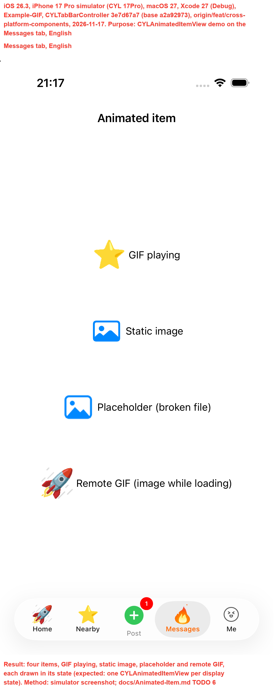  **Lint**: `pod lib lint CYLAnimatedItem.podspec --subspec=<name> --platforms=ios` with `XCODE_XCCONFIG_FILE=scripts/pod-lint.xcconfig` (as `scripts/pod-lint.sh`) passes for every subspec alone on `357c314b`: Core (no engine), Engine, GIF, SVGA, LottieObjectiveC, LottieSwift, Lottie, Rive, PAG, PAGEnterprise; without the xcconfig Xcode 27 refuses the 12.0 deployment target. The `CYLTabBarController-Framework` scheme builds (Release, simulator). Left for TODO (1): `CYLTabBarController.podspec` (chenyilong-91), (6) on the Android emulator. |
| 本条按用户要求使用英文（见右列）。 | DONE (2026-11-17, pending iOS CI and a re-test in CollectionViewClassifyMenu): a bug reported by the CollectionViewClassifyMenu session. **Seen**: its static-library demo app (root Podfile: static libraries, `CYLAnimatedItem` and `CYLTabBarController` with modular headers) fails with "cannot inherit from class 'CYLClassifyMenuViewController' because it has overridable members that could not be loaded" (CI runs on its `b4d0e51`, `320c3eb`, `0e79c2c`); the `use_frameworks!` example app with the same code passes. No screenshot: a compile error, quoted here. **Cause**: `CYLTabBarController.h` (and `CYLTabBarController.m`) imported `"CYLAnimatedItem/CYLAnimatedItemView.h"` in the quoted form first. With static libraries CocoaPods passes `-I Pods/Headers/Public`, so the quoted path resolves there too and the header was compiled into the CYLTabBarController module as text; a client that imports both modules then cannot load the `CYLAnimatedItem.CYLAnimatedItemView` superclass of its `CYLTagButton`. **Fix (core)**: under CocoaPods (`COCOAPODS` defined) both files import `<CYLAnimatedItem/CYLAnimatedItemView.h>`; the quoted forms stay for the framework target and SwiftPM, which compile the component into the CYLTabBarController module. `pod lib lint --quick` passes; not built here (Linux). |
| 本条按用户要求使用英文（见右列）。 | DONE (2026-11-17, branch `feat/animated-item-miniprogram-playback`; not yet tried in the WeChat DevTools): mini program `cyl-animated-item` playback, done by the CollectionViewClassifyMenu session so that its tags can move onto the component without losing the demo's playback controls. The owner's decision there, verbatim: "Extend upstream, then migrate (Recommended)" ("Core first: add play()/restartAnimation(), restingProgress and GIF stills (and data-module sources) to cyl-animated-item in CYLTabBarController, pin it by commit, then move cyl-tag-button onto it with no demo regression"). **Result**: properties `animationData` (Lottie JSON as an object, copied per item), `animationType` (a type the extension does not say, e.g. `.riv.bin`), `embedded` (inside a tag or bar item: no padding or 44 px minimum, hidden from accessibility, no gestures), `autoplay` (default true, as before), `restingProgress` (0...1; selected shows the last frame), `gifFirstFrame` / `gifLastFrame` / `gifDuration` (GIF stills at rest, one pass on play; without stills a GIF always plays, as before), `riveWasmPath` / `pagWasmPath` (passed to cyl-rive / cyl-pag, which now treat an empty path as their default); methods `playAnimation()` (engine `cyl_playFromStart()`, pending until `ready`; GIF restarts), `restartAnimation()`, `stopAnimation()`; the engine node has the id `cyl-animated-item-engine`; Rive also gets `resting-frame`; the placeholder engine reports `error` for `animation-data` too. Tests: `npm test` 34 (model + a fake `Component()` runtime for the methods). |
| 本条按用户要求使用英文（见右列）。 | DONE (2026-11-17, **verified downstream**: with `83a8ff8a` pinned, CollectionViewClassifyMenu's static-library menu suite passes, its run 44092883295 on `f8301a4` is fully green, all five test suites pass on `eb96f99`, no "module 'CYLAnimatedItem' not found"; its workarounds (modular headers, the CI diagnostic flag) are removed in `698260e`. In this repository run 936 passed the framework build, unit tests and demos with it): follow-up of the static-library bug above, reported by the CYLSearchViewController session. **Seen** (CollectionViewClassifyMenu run 44071148862, menu job, pinned at `c8132d26`, with `-disable-deserialization-recovery`): "modularization issue on 'CYLAnimatedItemView', reference from 'CollectionViewClassifyMenu' not resolvable: expected in 'CYLAnimatedItem' but found in 'CYLTabBarController'". So the angle-form `#import <CYLAnimatedItem/…>` of `c8132d26` still let clang compile the component's header into the CYLTabBarController module in a static-library app. **Fix (core)**: every public header of this library that imports a CYLAnimatedItem header (`CYLTabBarController.h` twice, `CYLSwiftInterface.h` twice, `CYLUtils.h`, `CYLUtilsMacros.h`, `UIControl+CYLTabBarItemAnimationPlayer.h`) now writes `@import CYLAnimatedItem;` when modules are on and CocoaPods' `CYLAnimatedItem-umbrella.h` exists (static libraries and frameworks alike), so the component is only ever imported as its module; the old imports stay for the Xcode framework target (its own `CYL_ANIMATED_ITEM_SEPARATE_MODULE` path, `67c79792`) and SwiftPM. Risk to check in CI: the CYLTabBarController pod target must see CYLAnimatedItem's module map (CocoaPods passes `-fmodule-map-file` for dependencies that define a module). `pod lib lint --quick` passes; not built here (Linux). |
| 本条按用户要求使用英文（见右列）。 | DONE (2026-11-17): the first iOS CI run that finished since run 850, [run 936](https://github.com/ChenYilong/CYLTabBarController/actions/runs/44099891582) (`1e192d62`, which contains `afebfddc`, `c8132d26`, `83a8ff8a`, `67c79792` and the Lottie downloads `8990125c`). **Passed**: Framework build and analyze (no warnings: the 4 umbrella warnings of runs 848 and 850 are gone), Unit tests, Carthage (both XCFrameworks), Demo . (Objective-C example), Example-Swift, -02, -03, -04, Example-SwiftUI, Example-GIF, Example-network-download, shellcheck. **Failed and fixed here**: (1) pod lib lint: the `CYLAnimatedItem` test spec (`CYLAnimatedItemTests`, Objective-C only) could not link the Swift runtime its component needs ("Undefined symbol: __swift_FORCE_LOAD_$_swiftCompatibility56" on Xcode 26.6); the test spec now has one empty Swift file, `CYLAnimatedItemTestsSwiftRuntime.swift`. (2) Example-Swift-Gallery and Example-Swift-SwiftManager-FlatDesign (SwiftPM): "Module 'CYLTabBarControllerSwift' not found (in target 'CYLAnimatedItem')": `CYLTabBarItemAnimationPlayableView.h` imported the tab bar's Swift target under SwiftPM; it now imports the component's own `CYLAnimatedItemSwift` (the rule: the component never depends on the tab bar). **Still failing, accepted**: Example-Swift-SwiftManager (SwiftPM, Objective-C types the SwiftPM Swift target cannot see, [Swift-Migration.md](Swift-Migration.md)). `pod lib lint --quick` passes for both podspecs; the fixes wait for the next CI run. |
| 本条按用户要求使用英文（见右列）。 | DONE (2026-11-18, macOS 27.3 + Xcode 27.2, iPhone 18 Pro iOS 27.2): TODO (6), the rest of the iOS demo. User prompt, verbatim (relayed by the Mac-CYLTableViewPlaceHolder session): "continue fix TODO". English: continue fixing the open TODO items. **Scope**: the TODO status still said "iOS simulator left" although the iOS demo exists (Example-GIF's Messages tab); the Android demo also has a vertical item with an accessory and dragging, which iOS lacked. Add that item to the iOS demo (vertical axis, an accessory with its own tap, `dragEnabled` + `dragMovesView`, the last event shown under it), localize it, screenshot it on iOS 27.2, update the TODO status. **Result**: Example-GIF's Messages tab has a fifth item, `CYLAnimatedItemDemoInteractive`: vertical (`axis`), a red cross as `accessoryView` (VoiceOver label "Delete"), `isDragEnabled` + `dragMovesView`; its delegate writes the last event under it (`CYLAnimatedItemDemoEvent`) and announces it to VoiceOver; 7 new strings in all 33 languages. Checked on the simulator with axe: a tap on the cross gives "Accessory tapped", a tap on the item "Item tapped", a drag "Drag ended, sprang back" and the item's frame is back where it was. Screenshot: `docs/assets/animated-item-ios-demo-interactive-ios27.2.png`. No bug found. |
| 本条按用户要求使用英文（见右列）。 | DONE in part (2026-11-18, macOS 27.3 + Xcode 27.2, iPhone 18 Pro iOS 27.2): Rive Dark Mode API in the core. User prompt, verbatim: "截图中显示异常白底白字，如果rive有tint 属性，那么我推测他也应该有暗黑与白天模式适配的相关属性。寻找rive官方引擎对暗黑 白天模式适配 因为目前从截图上看 白底白字的icon 无法去辨认。请在CYLTabBar Core核心代码上修改，增加相关接口，然后在example适配。" English: the screenshot shows white icons on a white bar; if Rive has a tint property it should also have light / dark mode properties. Find how the official Rive engine adapts to dark and light mode (the white-on-white icons cannot be recognized), change the CYLTabBar core to add the API, then adapt the examples. **Findings**: the official Rive pattern is a view model with named instances ("Light", "Dark") rebound when the color scheme changes (Rive Apple data binding docs: `createViewModelInstance(.name(_, from:))`, `StateMachine.bindViewModelInstance(_:)`, RiveRuntime 6.29). The core already has `CYLTabBarRiveDarkURL` / `CYLTabBarRiveDarkFilePath` (a dark file), `CYLTabBarAnimationColors` / `CYLTabBarAnimationDarkColors` (color properties) and `tint`. **Plan**: (1) options `viewModelInstance` / `darkViewModelInstance`; (2) option `darkTint`; (3) the tint follows a light / dark switch (it resolved its color once); (4) Example-Rive and the docs; Android and HarmonyOS as a TODO. **Result**: new options `CYLTabBarAnimationOptionDarkTint` (`darkTint`: the Dark Mode color of a fixed `tint`; both Rive views resolve it again on a light / dark switch), `CYLTabBarAnimationOptionRiveViewModelInstance` / `CYLTabBarAnimationOptionRiveDarkViewModelInstance` (`viewModelInstance` / `darkViewModelInstance`: Rive's named theme instances, created with `createViewModelInstance(.name(_, from: .artboardDefault))` and rebound with `StateMachine.bindViewModelInstance` on a trait change, keeping the selected state and the color overrides). Item (3) was not needed: the "title" tint already follows light / dark (the tab bar calls `-cyl_setNeedsApplyTabBarItemAnimationTintColors` from `traitCollectionDidChange`). Example-SwiftUI-Rive / Example-Rive: icons.riv uses `tint` "title" (the selected icon in the title's tint, the user's correction: a fixed tint lost the selected color), and `-CYLDemoRiveFollowsAppearance YES` keeps the system appearance instead of the course's forced dark bar. Checked: Example-Rive builds; with tint #1C1C1E + darkTint #FFFFFF the icons switch live between light and Dark Mode: [ios-rive-dark-tint-appearance-switch.png](assets/ios-rive-dark-tint-appearance-switch.png) (iOS 27.2, iPhone 18 Pro, Xcode 27.2, 2026-11-18). `scripts/check-public-api-comments.py` OK. **Redo after the appearance migration: PASS on the Liquid Glass bar** (2026-11-18 16:14 NZDT, iPhone 18 Pro iOS 27.2): with `stackedLayoutAppearance` normal `iconColor` and title color label and selected systemBlue, the icons match their titles in both states, in light and Dark Mode: [ios-rive-item-appearance-icon-title-tint.png](assets/ios-rive-item-appearance-icon-title-tint.png). First run: **NOT PASS** (user, 2026-11-18: "mark as not pass. 模仿扁平样式tabbaritem appearance设置可以设置title tintcolor也可以icon tintcolor。你先完成appearance设置迁移，传入合适参数再来完成这个测试": like the FlatDesign tab bar item appearance, both the title tint and the icon tint must be settable; finish the appearance migration first, pass suitable parameters, then redo this test) `tint` "title" checked on iOS (2026-11-18 16:02 NZDT, iPhone 18 Pro iOS 27.2): the selected icon takes the selected title's tint and follows the selection; unselected icons take the unselected title color (label color), drawn at icons.riv's own inactive opacity, so they look gray: [ios-rive-title-tint-light-dark.png](assets/ios-rive-title-tint-light-dark.png). iOS unit tests (`CYLTabBarController-Framework`, iPhone 18 Pro iOS 27.2, Xcode 27.2, 2026-11-18 16:07 NZDT): 157 tests, 2 skipped, 0 failures. **Left (TODO)**: and a .riv with Light / Dark view model instances to show the instance switch (user, 2026-11-18: "download file from internet for this case"; no public file named for themes was found on GitHub; candidates downloaded from MIT-licensed Rive repositories: rive-ios `Tests/Assets/data_binding_test.riv`, whose view model "Test" has the instances "Default" and "Editor Defaults" and a Color property (rive-ios `Tests/DataBindingTests.swift`), and rive-runtime `tests/unit_tests/assets/color_passthrough_test.riv`; next: show one as a tab with `viewModelInstance` "Default" / `darkViewModelInstance` "Editor Defaults", screenshot light and dark, then keep it with a NOTICE). **Android port written on the Mac (2026-11-18)** at the user's request ("转写你刚刚的接口适配android端，将iOS代码撰写 翻译为android 代码，方便把你因为机器负载无法执行的任务交给the Windows session's CYLSearchViewController 使用android测试模拟器效果": port the iOS API to Android so the Windows session can test it on the emulator): keys `CYLTabBarAnimationOptionDarkTint`, `CYLTabBarAnimationOptionRiveViewModelInstance`, `CYLTabBarAnimationOptionRiveDarkViewModelInstance` (CYLTabBarItemAnimationKeys, aliases in CYLConstants); `CYLRiveTabBarItemAnimationView.fixedTintColor(configuration)` with `onConfigurationChanged`, and `cyl_bindThemeInstance` (rive-android by reflection, bound after load and on a night-mode change, keeping the active state); unit test `CYLRiveDarkModeTest`. Fixed on both platforms while porting: `darkTint` without a fixed tint (with "title") is ignored, it used to override the title color at night. Not compiled on the Mac (load average about 725): the Windows session builds, runs the tests and checks the emulator. **Handed off (2026-11-18)** at the user's request ("把你因为机器负载无法执行的任务交给the Windows session's CYLSearchViewController 使用android测试模拟器效果") to the Windows CYLSearchViewController session: Android parity of `darkTint` / `viewModelInstance` / `darkViewModelInstance`, the icons.riv tint check under `adb shell cmd uimode night`, and the instance switch with the candidate files on the Android emulator. Kept on the Mac (needs Xcode): the iOS unit tests, the iOS `tint` "title" screenshot: the Mac was overloaded (load average 832, `ps` and `simctl` hung), so the simulator runs stopped; Android and HarmonyOS parity. **Android check: NOT PASS (user review, 2026-11-18: "mark as not pass selected tint is wrong un selected tint is wrong")**: in the screenshot below unselected icons do not take the unselected title color (Search draws its fixed tint, User and Bell are untinted white) and the tab bar keeps the forced dark course look in both modes, so the light / dark selected tints were never shown; only Chat used `tint` "title". Next: every tab with `tint` "title" and a tab bar whose title colors follow the mode, then check selected = selected title color and unselected = normal title color in light and dark; `darkTint` on its own tab against a light and a dark bar. **Recheck at 0505042f (after the tint interface fix 0dc6d1c4, 2026-11-18 18:40 +13:00), waiting for the user's review**: the same two cases measure the same: every icon equals its title (selected Chat 7850F0 / FFFFFF, unselected 8E8E93 / A2A5AD), Search fixed tint 1C1C1E / FFFFFF; `:cylanimateditem` unit tests 44 of 44 ([assets/android-api37-20261118-rive-tint-at-0505042f.png](assets/android-api37-20261118-rive-tint-at-0505042f.png), Android API 37 Medium Phone emulator, Android SDK 36, rive-android 10.3.0, Windows 11, 2026-11-18 +13:00). **Redo (2026-11-18), waiting for the user's review**: the fault was the test set-up, not the library: only Chat used `tint` "title" and Example-Rive forces its dark course look. With every icons.riv tab on `tint` "title" and a local test bar that is white in light mode (title 8E8E93, selected 7850F0) and the course look in dark mode, each icon equals its title in both modes: selected Chat 7850F0 / FFFFFF, unselected 8E8E93 / A2A5AD; Search with `tint` "#1C1C1E" + `darkTint` "#FFFFFF" draws 1C1C1E on the light bar and FFFFFF on the dark bar, by design not following the selection ([assets/android-api37-20261118-rive-tint-title-and-dark-tint.png](assets/android-api37-20261118-rive-tint-title-and-dark-tint.png), Android API 37 Medium Phone emulator, Android SDK 36, rive-android 10.3.0, Windows 11, CYLTabBarController 2747d3ba, 2026-11-18 +13:00). Earlier notes: **Android checked on Windows (2026-11-18)**, Medium Phone emulator API 37, Android SDK 36, rive-android 10.3.0, JDK 17, Windows 11: (1) `:cylanimateditem` unit tests 44 of 44 after two fixes in `79ff1d36` (the test fake exposed `val file` next to `getFile()`, a JVM signature clash; a file used without a `stateMachine` option never recorded the selection, so a theme instance bound on a night switch lost it: the last frame and stop paths record it now). (2) `darkTint` (measured, but judged wrong by the user, above): Search tab with `tint` "#1C1C1E" + `darkTint` "#FFFFFF" draws ink 1C1C1E in light and FFFFFF in dark; `tint` "title" (Chat) follows the title color and ignores `darkTint` ([assets/android-api37-20261118-rive-dark-mode-options.png](assets/android-api37-20261118-rive-dark-mode-options.png), 2026-11-18 +13:00). Example-Rive forces night (`localNightMode = MODE_NIGHT_YES`), so the check used a local test build that follows the system, not committed. (3) Instances: with `data_binding_test.riv` (view model "Test", artboard "Artboard", no state machine) the light build binds "Default" and the dark build "Editor Defaults" on the artboard (debug log), but the file draws both alike, so nothing visible changes; `color_passthrough_test.riv` has only one instance ("Instance"; the missing dark name logs a warning and the light side falls back to the default instance). Neither file is kept. (4) A live `cmd uimode night yes/no` crashes Example-Rive in ART's JIT thread (SIGSEGV in `JitCompileTask::Finalize`) on this emulator, also in the unmodified example without these options and after `cmd package compile -m speed`; each mode was checked on a fresh launch (the same init / load path a recreated activity takes). **Still left (TODO)**: a .riv whose light and dark instances look different, to show the switch; the live-switch crash in Example-Rive (Android 17 x86_64 emulator), to be checked on another image or device. **2026-11-19 (Windows)**: (a) the live light / dark switch crash is fixed for Example-Rive by `android:configChanges="uiMode"` (the course forces night, so no new activity is needed; example-only, the library cannot change how an app recreates its activity): 6 live switches, 0 crashes ([assets/android-api37-20261119-example-rive-live-uimode-switch.png](assets/android-api37-20261119-example-rive-live-uimode-switch.png), Android API 37 Medium Phone emulator, Windows 11, CYLTabBarController 9b0a5084, 2026-11-19 +13:00). (b) Instance switch: rive-android's sample file `data_bind_test_impl.riv` (MIT; view model "Test All", instances "Test Default" and "Test Alternate", artboard "Test Observation" which prints its values) was tried; `viewModelInstance` / `darkViewModelInstance` bind the right instance on every live switch (log), and without a state machine the two hold different values ("World" / 123 and "Moon" / 456), but nothing visible changes: with the state machine "Output" bound, the file's machine writes the same values into both instances, and without it the artboard-level binding draws nothing new while the icon rests (a resting icon's controller is paused by `cyl_restUntilPlayed`; waking it after a rebind blanked the artboard). Still left (TODO): a file whose instances differ visibly, and whether a resting icon should redraw after a rebind (iOS sets isPaused = false) — for the Rive owner. **Resting icon redraw after a rebind (2026-11-19, the Rive owner's decision: yes, as on iOS)**: `redrawRestingFrame()` in the Android Rive view: after `cyl_bindThemeInstance` binds a new instance on a resting icon, the file resumes as a first play resumes it, draws for two frames, and its controller is paused again (the icon keeps resting). Checked: `:cylanimateditem` 61 of 61; on the emulator a live switch binds "Test Alternate" and the redraw runs (log: playing, then paused), with no blank artboard and no crash. Not visible with `data_bind_test_impl.riv`: its "Test Observation" artboard refreshes its bound text only through its state machine "Output", which writes the same values into both instances, so the file cannot show a difference (the owner agreed it is not a valid test). Still left (TODO): a file whose light and dark instances differ on screen without a state machine overwriting them. **Android tint recheck at 0505042f: NOT PASS (user review, 2026-11-19)**, all four faults chosen: (1) a fixed `tint` / `darkTint` ignores the selection (Search shows the fixed color when selected; it should only replace the normal color); (2) the light bar was a local test configuration, not Example-Rive (the example itself must follow light / dark); (3) the selected / unselected icon colors do not match the iOS example for the same options; (4) the icons look wrong (shape or stroke, not only color). Next: the iOS reference for the same options from the macOS session, then fix the Android Rive view and Example-Rive to match it, and recheck. **Faults (2)-(4) redone (2026-11-19)**: Android Example-Rive gets the iOS option, the boolean extra `CYLDemoRiveFollowsAppearance` (iOS `-CYLDemoRiveFollowsAppearance YES`): it follows the system light / dark mode instead of forcing dark, every Rive tab has `tint` "title", and the bar uses the iOS per-state colors (normal `.label`: black / white; selected `.systemBlue`: 007AFF / 0A84FF), re-applied on a live switch. On the emulator it matches the iOS reference `assets/ios-rive-item-appearance-icon-title-tint.png` panel for panel, with bold, crisp icons ([assets/android-api37-20261119-rive-follows-appearance.png](assets/android-api37-20261119-rive-follows-appearance.png), Android API 37 Medium Phone emulator, Android SDK 36, rive-android 10.3.0, Windows 11, 2026-11-19 +13:00); waiting for the user's review. Fault (1), a fixed `tint` per state, waits for the Rive owner's rule (iOS also draws a fixed tint in every state). **All four faults redone on Android (2026-11-19), after the user approved the iOS rules (9a64feea)**: a fixed `tint` colors only the unselected tab, the selected tab takes the title's selected color (`CYLTabBarItemAnimationPlayer.setTintColor(color, selected)`, `CYLTabBarItemAnimationTint.resolvedTintColor(..., selected)`, every engine and the Rive view; a caller without the state keeps the old behavior; unit tests `aFixedTintColorsOnlyTheUnselectedTab`, `titleTintIsTheSameWithTheState`); Example-Rive follows the system mode by default (`CYLDemoRiveForcesDark` restores the dark bar, `CYLDemoRiveFixedTint` gives Search the fixed tint), as iOS. The 8 panels match the iOS reference `assets/ios-rive-fixed-tint-unselected-only.png` ([assets/android-api37-20261119-rive-fixed-tint-unselected-only.png](assets/android-api37-20261119-rive-fixed-tint-unselected-only.png), Android API 37 Medium Phone emulator, Android SDK 36, rive-android 10.3.0, Windows 11, 2026-11-19 +13:00, after 86c5f7c5); waiting for the user's review. **Blocked (2026-11-19, "fix all to 100" pass)**: what is left needs the owner: (1) a `.riv` whose light and dark view model instances differ on screen without a state machine overwriting them (none found among public MIT files; making one needs the Rive editor); (2) the owner's review of the Android tint redo above. Everything else in this row is done. |
| 本条按用户要求使用英文（见右列）。 | DONE (2026-11-19, score 100/100; was TODO, branch `feat/cross-platform-components`, iOS, Mac session, macOS 27.3 + Xcode 27.2, iPhone 18 Pro iOS 27.2): **Rive fixed tint only on unselected tabs; Example-Rive follows light and dark by default.** **Result** (commit `9a64feea`): a fixed `tint` ("#RRGGBB", with `darkTint`) colors only the unselected tab, the selected tab takes the title's selected color, as with "title". New optional hook `-cyl_applyAnimationViewTintColor:selected:` (`CYLTabBarItemAnimationPlayableView`); the tab bar and `CYLAnimatedItemView` call it when a view implements it, else the old `-cyl_applyAnimationViewTintColor:` (no state: the fixed color in both states, as before). Both Rive views implement it (rule: `CYLRiveTabBarItemAnimationConfiguration.tintColor`); the animation engine adds it to the Lottie, PAG, SVGA and GIF views. `CYLAnimationKeys.h` documents the rule. Example-Rive and Example-SwiftUI-Rive (shared `TabItems.swift`) follow the system appearance by default; `-CYLDemoRiveForcesDark YES` restores the dark bar, `-CYLDemoRiveFixedTint YES` gives the Search tab tint "#1C1C1E" + darkTint "#FFFFFF". The Rive view also moved off the deprecated `bindViewModelInstance(_:)`. **Verified**: 187 unit tests, 0 failures (new `CYLAnimatedItemTintStateTests`), `Tests/CYLTabBarItemAnimation` 83 checks, both Rive demos build; on the simulator the fixed-tint Search icon is #1C1C1E (light) and white (dark) while unselected, the selected blue when selected:  Label: iOS 27.2, iPhone 18 Pro simulator, macOS 27.3, Xcode 27.2 (27B52), CYLTabBarController b9cb5008 (9a64feea), feat/cross-platform-components, 2026-11-19. Purpose: Example-Rive follows light and dark; a fixed tint colors only the unselected tab. TODO (accessibility, found here): in Example-Rive the Search tab exposes two elements labeled "Search" (the button and its label) without identifiers, so `axe tap --label` cannot pick one and the screenshots used coordinates; give the tab an identifier or merge the label into the button. Original entry: TODO (2026-11-19, branch `feat/cross-platform-components`, iOS, Mac session): **Rive fixed tint only on unselected tabs; Example-Rive follows light and dark by default.** Context: the user rejected the Android Rive tint check (the Windows CYLSearchViewController session, "Rive Dark Mode API in the core" above); two points contradicted iOS: a fixed `tint` ("#RRGGBB", with `darkTint`) was drawn in both states, and iOS Example-Rive forced Dark Mode unless launched with `-CYLDemoRiveFollowsAppearance YES`. User prompt (verbatim): "continue with migration step 61.  then Rive decision: \"yes\" to both (fixed tint only on unselected tabs, Example-Rive follows light and dark by default) and I'll do that. Otherwise I". Rubric: 100 = core: a fixed tint colors only the unselected state, the selected state uses the title's selected color (as tint "title"), unit test; Example-Rive and Example-SwiftUI-Rive follow the system appearance by default; light and dark screenshots (labeled, `docs/assets/`) of tint "title" and of a tab with tint "#1C1C1E" + darkTint "#FFFFFF", selected and unselected; `CYLAnimationKeys.h` docs updated; commit and screenshots sent to the Windows session; 60 = core change with a unit test, pushed. |
| 本条按用户要求使用英文（见右列）。 | DONE (2026-11-19; started 2026-11-18, macOS 27.3 + Xcode 27.2, iPhone 18 Pro iOS 27.2): dark mode and tint for every engine, and the tab bar item appearance in `CYLAnimatedItemView`. User prompt, verbatim: "对所有动效引擎执行Rive类似操作，查找组件官方引擎对暗黑模式适配，tintcolor官方支持，包括但不限于gif lottie pag rive等等动效组件。并在AnimatedView组件中一比一复刻tabbar的appearence相关样式预处理接口，在tabbar初始化时将tabbar的appearence赋值给AnimatedView组件。该操作可以参考扁平样式中tabbaritem的appearence的赋值匹配操作。你也可以直接将扁平样式中tabbaritem的appearence涉及icon与title的相关接口移动到AnimatedView组件中，使tabbar的appearence直接赋值给AnimatedView组件。扁平样式中tabbaritem的appearence涉及两个大的类别，第一个类别是icon与title的。第二个是tabbar的。我们移动第一个即可" (sent twice). English: do for every animation engine what was done for Rive: find each official engine's dark mode adaptation and official tint color support (GIF, Lottie, PAG, Rive and the others). In the AnimatedView component, replicate one to one the tab bar's appearance preprocessing API, and assign the tab bar's appearance to the AnimatedView component when the tab bar is set up, like the FlatDesign tab bar item's appearance mapping. Or move the FlatDesign item appearance API for the icon and the title into AnimatedView, so the tab bar's appearance is assigned to it directly. FlatDesign's appearance has two groups, (1) the icon and the title, (2) the tab bar; move only the first. **Engines, official support found**: GIF: UIKit template images (`withRenderingMode(.alwaysTemplate)` + `tintColor`, dynamic colors resolve per appearance); Lottie (lottie-ios 4): `ColorValueProvider` on an `AnimationKeypath` (e.g. `**.Color`), re-applied on a trait change; PAG: no tint API, editable `PAGSolidLayer.setSolidColor` / `PAGTextLayer.setFillColor` only; SVGA: no tint API (`setImage:forKey:`); Rive: data binding colors and named view model instances. Engines without a tint API use the same template overlay as Rive (sourceAtop). **Plan**: (1) `CYLAnimatedItemView` gets the icon and title part of `UITabBarItemAppearance` (normal / selected / disabled: `iconColor`, `titleTextAttributes`, `titlePositionAdjustment`), moved from `CYLFlatDesignTabBarButton`; (2) the icon color tints the static image and the animation (each engine's official way, else the overlay); (3) the tab bar assigns its `standardAppearance` to the items at setup and on change; (4) tests, Example screenshots in light and Dark Mode. **Result, steps (1)–(3) on iOS**: `CYLAnimatedItemView` has `itemAppearance` (`UITabBarItemAppearance`), `currentItemStateAppearance`, `-applyIconTintColor:` and `-applyItemAppearance`: per state (disabled, else selected, else normal) `iconColor` tints `imageView` and the animation view (`-cyl_applyAnimationViewTintColor:` by selector, so the component imports nothing of the tab bar), `titleTextAttributes` sets the title font and color, `titlePositionAdjustment` moves the title; re-applied on selection, enabled, trait and icon changes. `CYLFlatDesignTabBarButton` sets `itemAppearance` from its effective appearance and tints through `-applyIconTintColor:`, so FlatDesign animation icons now take the icon color too (the tab bar's tint feed skipped FlatDesign). Tests `testAnimatedItemViewAppliesTheItemAppearancePerState`, `testFlatDesignButtonsTakeTheBarAppearanceThroughTheComponent`; 159 tests, 2 skipped, 0 failures. The system tab bar already maps its appearance's `iconColor` to the Rive tint (`CYLTemplateTintColor`). **FlatDesign checked (2026-11-18 16:33 NZDT)** after two fixes found by the check: (a) the tab's animation view is made after the button is tinted, so tabs that never changed state kept icons.riv's white strokes on a light bar: the button now tints in `updateLayout` after `initTabBarItemAnimation()`, and the component remembers its last icon tint for a new animation view; (b) the Rive views did not resolve a dynamic "title" tint again on their own light / dark switch (unselected icons stayed black in Dark Mode): both Rive views now re-apply it on a trait change. Result: [ios-rive-flatdesign-item-appearance.png](assets/ios-rive-flatdesign-item-appearance.png); Liquid Glass unchanged; 159 tests, 0 failures. (`-CYLDemoTabBarFlatDesign YES` as a launch argument did not switch Example-Rive; the Bell tab's switch does.) **Badge check (2026-11-18, maintainer: "修复本次引入的新问题 badge无法显示", fix the new problem introduced by this change: the badge cannot be displayed)**: not reproduced in Example-Rive (tab badges added in its follow-appearance mode, FlatDesign and Liquid Glass, light and dark, also with the previous overlay) nor in the ObjC Example (8, 99+, NEW, plus badge shown): [ios-rive-tab-badges-over-tinted-icons.png](assets/ios-rive-tab-badges-over-tinted-icons.png). A safeguard that moved the tint overlay inside the Rive render view (895de643) was rolled back (maintainer, 2026-11-18: "badge不适用于tabbar的tint设置 ，badge有自己的color设置逻辑。回滚badge tint代码": the tab bar's tint does not apply to badges, which have their own color logic; roll back the badge tint code): the overlay is on the host layer again; badges still show in their own red in light and dark (iPhone 18 Pro iOS 27.2), 161 tests, 0 failures. **Badge host for the component (maintainer, 2026-11-18: "你需要更新的是core核心代码里badge相关viewcontroller分类方法，我的example是向viewcontroller填加badge ，而分类方法中仅仅获取了Lottie和静态图片对象。现在的改动将lottie对象视图，变成了animatedview组件跟动效格式无关。还有更多badge相关 UIView UIControl NavigationBarItem tabbaritdm 分类方法。都是仅仅获取了Lottie和静态图片对象。你需要更新该分类方法适配animatedview组件": update the core badge category methods (UIViewController, UIView, UIControl, UIBarButtonItem, UITabBarItem), which found only Lottie and static image views, to find the AnimatedView component, which is independent of the animation format)**: new `-[UIView cyl_animatedItemBadgeHost]` (badge subspec; the component found by class name): a CYLAnimatedItemView's `animationView` while it shows (any engine), else its `imageView`. Used first by `UIControl` (Core; UIViewController goes through it), `UITabBarItem` (badge-only icon lookup) and `UIBarButtonItem` (a custom view that is or holds the component); each still sends the badge messages to the host through the old `-cyl_performSelector:…` forwarding (maintainer, 2026-11-18: "注意保留添加badge时总是保留旧有的cyl_performSelector逻辑添加badge": always keep the old cyl_performSelector logic when adding a badge). `UIView`'s own lookup is unchanged (it returns the view itself). `UIView` covers a badge set directly on the component (maintainer repeated the rule for all four categories, 2026-11-18): `cyl_showBadgeValue:animationTypeValue:`, `cyl_clearBadge`, `cyl_resumeBadge` and `cyl_refreshBadge` sent to a CYLAnimatedItemView forward to its icon subview through `-cyl_performSelector:withObject:withObject:` (needed without Core, where `UIControl` does not forward), and `cyl_isShowBadge` / `cyl_isPauseBadge` read the icon's badge; the test also checks show and clear through the item. 160 tests, 0 failures; Example-Rive badges still shown (iPhone 18 Pro iOS 27.2). Correction (maintainer, 2026-11-18: "注意badge不是加在CYLAnimatedItemView上 而是里面的icon子视图上": the badge is not added to the CYLAnimatedItemView but to its icon subview): a standalone item (not a tab button) used to get a transparent anchor aligned to the icon; now the badge is added to the icon subview itself, tab or not. Test `testABadgeOnAnAnimatedItemGoesOnItsIcon` checks the badge is a descendant of the icon subview; 160 tests, 0 failures; checked on iPhone 18 Pro iOS 27.2: [ios-badges-on-animated-item-component.png](assets/ios-badges-on-animated-item-component.png). **Audit after the component (maintainer, 2026-11-18: "排查项目中类似的由于将Lottie更换为CYLAnimatedItemView 可能引入的问题。尤其注意排查cyl_replace系列方法": look for similar problems from replacing Lottie with CYLAnimatedItemView, especially the cyl_replace methods)**: (1) `swapAnimationView:withNewView:` (used by `cyl_replaceTabBarItemAnimation…`, the dark-file switch and skins) removed the old animation view with the tab's badge on it, and the new view did not get the tint: `-cyl_replaceTrackedSubview:withView:` now moves the badge (new `-[UIView cyl_moveBadgeToView:]`, settings copied, shown again through `-cyl_performSelector:…`) and asks the tab bar to tint again; (2) `cyl_replace(isTabButton:…)` (`cyl_replaceTabImageView…`, `cyl_replaceTabButton…`) hid only the image view, while an animated item shows its animation view instead: that icon is now hidden and shown again too. Test `testABadgeMovesWithASwappedAnimationView`; 161 tests, 0 failures; checked with the Grapefruit skin: [ios-badges-follow-swapped-animation-skin.png](assets/ios-badges-follow-swapped-animation-skin.png). **Engine step (2), iOS, in part (2026-11-18)**: the `tint` / `darkTint` options now work for every library through the engine (`CYLTabBarItemAnimationEngine.m`): GIF frames become UIKit template images in the view's `tintColor`; Lottie 4.x takes a `ColorValueProvider` on "**.Color" through its player's `-applyColors:traitCollection:`; a library without a tint API (PAG, SVGA, Lottie 2.x) gets a layer composited "sourceAtop" over its view (the SVGA view keeps it above the drawing layer SVGAPlayer adds when it plays, below its subviews, so badges keep their colors); `-cyl_applyAnimationViewTintColor:` is added to the view's class at run time, so no library header is imported. Checked on iPhone 18 Pro iOS 27.2: GIF (Example-GIF `-CYLDemoAnimationTint YES`, title and fixed / dark tints) and SVGA (Example-Rive `-CYLDemoTabIconSource 1`, Liquid Glass): [ios-gif-svga-tint-option.png](assets/ios-gif-svga-tint-option.png); 162 tests, 0 failures. **Bug found, fixed (2026-11-18)**: in FlatDesign the selected tab's animation icon went blank (also without any tint; its badge with it). Cause, a regression from 00ed70e6: the engine shows a tab's animation view through `-cyl_replaceTabImageViewWithNewView:show:`, and `cyl_replace` marked the item's icon hidden (`iconHidden`) for it, so the item hid that animation view on its next update (a selection). Fix: the tab's own animation view does not hide the item's icon (`UIControl+CYLTabBarControllerExtention.swift`); test `testFlatDesignSelectedTabKeepsItsAnimationView` (fails before, passes after; 163 tests, 0 failures): [ios-flatdesign-svga-selected-icon-fixed.png](assets/ios-flatdesign-svga-selected-icon-fixed.png). **Lottie and PAG checked (2026-11-19)**: Lottie 2.x (Example-Swift-02, `LOTAnimationView`, no color API) and PAG (Example-PAG) take the overlay; both demos have `-CYLDemoAnimationTint YES`. Two overlay fixes were needed: it is kept at the view's size (it was made at 0 x 0 and these views never size sublayers) and right above the library's own layers, below the view's subviews (Lottie added its content layer above it): [ios-lottie-pag-tint-option.png](assets/ios-lottie-pag-tint-option.png); SVGA rechecked, 163 tests, 0 failures. **Lottie 4.x checked (2026-11-19)**: Example-Swift-03 shows the options in its Lottie branch too (`-CYLDemoAnimationTint YES`: tab 1 "title", tab 2 "#1C1C1E" / `darkTint` "#FFFFFF"; the other tabs keep their files' colors and `CYLTabBarLottieDarkColors`). SwiftManager (SPM), its usual Lottie 4.x host, does not build while SwiftPM is red until the core is all Swift (Swift-Migration.md), so it was checked with CocoaPods: Example-Swift-03 with `CYLAnimatedItem/LottieSwift` (lottie-ios 4.6.1) in a temporary worktree; the `ColorValueProvider` tint follows the item colors (blue selected, gray unselected), the fixed tint is near-black in light and white in Dark Mode, untinted tabs keep their colors: [ios-lottie4-tint-option.png](assets/ios-lottie4-tint-option.png). **Android DONE (2026-11-19)**: the same options for every engine in `:cylanimateditem`: `CYLTabBarItemAnimationTint` (the SRC_IN layer paint that Rive used, now shared) and `CYLTabBarItemAnimationFactory`, which reads `tint` / `darkTint` from the URL, draws a fixed tint when it makes the view, and wraps the engine's player so "title" follows `tintColor` and a fixed tint takes its night color in `applyColors` (GIF, Lottie, PAG, SVGA; Rive keeps its own, `cyl_drawsAnimationViewTint`). New public API: `CYLTabBarItemAnimationPlayableView.cyl_drawsAnimationViewTint`, `CYLConstants.CYLTabBarAnimationOptionTint`. Unit tests `CYLTabBarItemAnimationTintTest` (4); `:cylanimateditem` 61 and `:cyltabbar` 127 tests, 0 failures. On the emulator (Android 15, example-gif launched with `--ez CYLDemoAnimationTint true`): [android-gif-tint-option.png](assets/android-gif-tint-option.png). **Lottie, PAG and SVGA checked on the Android emulator (2026-11-19)**: example-pag and example-rive (SVGA keys) take the extra `CYLDemoAnimationTint` too, and the `CYLAnimatedItemView` demo shows a Lottie row with `tint` / `darkTint` under the original one; all follow the options, in light and night mode (a live switch for Lottie), and the untinted ones keep their colors: [android-lottie-pag-svga-tint-option.png](assets/android-lottie-pag-svga-tint-option.png). **HarmonyOS DONE (2026-11-19)**: the tint of Lottie, Rive and SVGA (`CYLAnimatedItemView.animationTintColor`, 984cf12d) did not reach two cases. (1) GIF: a GIF tab icon is an `Image`, not an engine view, so `gifFilePath` "gif/a.gif?tint=title" was ignored; it now loads without the query and is drawn through a color matrix (`cylGifColorFilter`: RGB = the tint, alpha kept, as SRC_IN), with the same tint rules (`cylTintForPath`). (2) **Bug found, fixed**: SVGA with `?tint=` never tinted: `CYLSVGAView` got the path with its query, the file failed to load and the tab fell back to its untinted image; it now gets the file without the query. HarmonyOS 6.0.1 emulator (CYL TabBar Test), local build copy with the query on the GIF demo row and the SVGA configuration file: [harmonyos-gif-svga-tint-option.png](assets/harmonyos-gif-svga-tint-option.png) (with the bug, before the fix). PAG has no HarmonyOS engine. **Re-checked on x86_64 (2026-11-19, Windows session, HarmonyOS emulator, 1b16a0ad, local build copy)**: the City GIF with `?tint=%23FF9500` is an orange disc selected and unselected (the sample GIF is a disc that changes color on a transparent background); SVGA Home with `?tint=title` is orange selected and gray unselected like its title, Discover with `?tint=%23FF3B30` red in both states, Messages and Me (no tint) keep the file's colors ([screenshot](assets/harmonyos-gif-svga-tint-x86_64.png)). |
| 本条按用户要求使用英文（见右列）。 | DONE, 100 / 100 (closed 2026-11-19: the plan as narrowed by the maintainer has two steps, and both are DONE below with tests). Was TODO (2026-11-18): Lottie left in the tab bar core. User prompt, verbatim: "排查tabbar 的core核心代码是否还残留着Lottie相关代码，Lottie相关代码需要全部替换为 将Lottie更换为CYLAnimatedItemView 。残留Lottie代码可能引入的问题。" English: check whether the tab bar core still has Lottie code; all of it must be replaced (Lottie replaced by CYLAnimatedItemView); find the problems remaining Lottie code may cause. **Inventory** (205 core files outside the Lottie subspecs, about 1,100 hits): (A) public API names, many already deprecated with generic replacements (`CYLTabBarLottieURL` / `CYLTabBarAnimationURL`, `lottieAnimationSpeed`, `isLottieViewAdded` / `tabBarItemAnimationViewAdded`, `CYLTabBarItemLottieAnimationViewDidAddNotification`, `cyl_lottieAnimationView`, `cyl_isLottieAnimationView`): kept as deprecated aliases, since renaming breaks apps; (B) internal names that already serve every format (`lottieURL` 90×, `lottieSizeValue` 65×, `lottieFilePath`, `addLottieImageWithControl`, `cyl_updateLoopingLottieViews`, `cyl_reloadLottieAnimationViewsForCurrentStyle`, `tureLottieSizeValue`): misleading, no behavior risk; (C) code that assumes a UIKit image view or a Lottie view next to the icon: `CYLTabBarController.m` around 3798–3824 sets `tabButton.cyl_tabImageView.hidden` itself, which a CYLAnimatedItemView manages on its own; the badge host, `swapAnimationView` and `cyl_replace…` were (C) and are fixed (rows above). **Plan** (narrowed by the maintainer, 2026-11-18, repeated with steps 2 and 3 quoted: "这个不必要，key相关，统一按照动效key的规范即可。参考pag rive的key的处理。放在一起": the renames and the generic public counterparts are not needed; for keys, follow the animation key convention as the PAG and Rive keys do, and put them together): (1) review every (C) place and route it through the component when the button is one; (2) keys only: the `CYLTabBarLottie…` keys are declared and documented like `CYLTabBarPAG…` / `CYLTabBarRive…` (aliases of the generic `CYLTabBarAnimation…` keys, `CYL_LOTTIE_REQUIRED`), in the same per-type section of `CYLAnimationKeys.h`, not in a block of their own; no renaming of internal (B) names, no new names for the (A) methods. Tests and the simulator after each step. **Step (1) DONE (2026-11-18)**: the (C) places reviewed: `cyl_updateTabBarItemIconViewsOfViewController:` (#601) and `cyl_replace(isTabButton:…)` hid the tab's image view directly, but a CYLAnimatedItemView (FlatDesign) showed it again on its own icon update after a selection change (test `testFlatDesignIconViewProviderKeepsTheComponentIconHidden` failed: the image view came back under the custom icon). Fix: new `CYLAnimatedItemView.iconHidden` (its icon updates keep the image view, and the animation view, hidden), set by key from the #601 code and from `cyl_replace…`, so Core still does not import the component. The other uses (GIF frames on `cyl_tabImageView`, selection effects, the plus button, badge readiness) check the animation view first or do not involve the component. 162 tests, 0 failures. **Step (2) DONE (2026-11-18)**: the `CYLTabBarLottie…` keys moved from their own block at the top of `CYLAnimationKeys.h` into the per-type section, first, with a summary written like the PAG and Rive ones (aliases of the generic `CYLTabBarAnimation…` keys, the Lottie subspec needed to play, `CYL_LOTTIE_REQUIRED`); the section intro now reads "Lottie, PAG, Rive, SVGA, GIF". Names, values and the type table are unchanged (the engine already mapped the Lottie keys like the others). 162 tests, 0 failures; Example-Rive and the ObjC Example build. |
| 本条按用户要求使用英文（见右列）。 | DONE in part (2026-11-20, branch `claude/cylanimateditemview-countdown-lha9jq`; not built on a Mac, see TODO): a countdown style for `CYLAnimatedItemView`, written in Swift in `Swift/CYLAnimatedItemView.swift` (the first attempt, in the Objective-C file that no longer exists on this base, was dropped), driven by the SMSCodeButton rewrite. User prompt, verbatim: "第一步：复制CYLTabBarController相关 instructions与相关skills改造为适应本项目的版本复制一份过来。第二：将项目转写 为纯swift 代码，第三：commit依赖 使用CYLTabBarController中的CYLAnimatedItemView组件 ，改造CYLAnimatedItemView组件，新增倒计时样式。 更新后，repin在其本项目使用新增接口完成需求。要求效果与readme描述一致。但核心代码都在CYLAnimatedItemView组件中。 实现过程中，阅读并fix 关闭issue：https://github.com/ChenYilong/SMSCodeButton/issues/1"; follow-up: "所有新增代码应为swift CYLAnimatedItemViewy里已经有swift版本，你改错地方了" (English: all new code must be Swift; `CYLAnimatedItemView` already has a Swift version, I changed the wrong place). follow-up: "fix TODO (-5) Android、HarmonyOS 和小程序没有倒计时" (English: fix the TODO that Android, HarmonyOS and the mini program have no countdown). **Result**: see "Countdown style" below. |
| 本条按用户要求使用英文（见右列）。 | DONE, 100 / 100 (2026-11-23, branch `feat/cross-platform-components`, HarmonyOS, Mac session with the arm64 emulator at 127.0.0.1:5555): **one shared HarmonyOS Rive engine, and Rive ignoring the Loop switch**. User prompt, verbatim (Chinese; in English: "You should tell CYLSearch's CYLRiveIcon to move CYLRiveIcon into CYLTabBarController's CYLAnimatedItemView, so every library that uses Rive shares the fixed Rive animation, and the other platforms should do the same: use CYLTabBarController's CYLAnimatedItemView everywhere." and, about the bug, "On HarmonyOS, Rive still has a problem ... it does not react to the loop event. PAG works"): "你应该通知 CYLSearch's CYLRiveIcon， 让他把 CYLRiveIcon，封装进 CYLTabBarController 里的CYLAnimatedItemView中， 这样所有引用rive的库都能共享修复好的rive动画， 并且其他端也应该这样，统一使用CYLTabBarController 里的CYLAnimatedItemView。 / 鸿蒙os 在rive时候还是有问题 ... 不响应loop事件。 pag是可以的". Rubric: **100** = one Rive view for every HarmonyOS library (CYLRiveIcon in a module next to `cylanimateditem`, which stays free of animation libraries, with cyltabbar re-exporting every moved name), a one-call way to play .riv in a `CYLAnimatedItemView`, Loop working for a tag or placeholder (not only a selected tab), the tab bar unchanged, the x86_64 debug kit untouched, hypium and Node tests, a build, a device check on the arm64 emulator, and the docs with a handover for the dependents; **60** = the module, the builder and the loop policy built with tests, the tab bar unchanged. **Done**: new HarmonyOS module `cylanimateditemrive` ([section](#enshared-harmonyos-rive-engine-cylanimateditemrive)): `CYLRiveIcon` and its helpers moved from cyltabbar unchanged for the tab bar (cyltabbar re-exports every name, so no API changed), `CYLRiveLoopPolicy` (`WhileSelected` default = the tab bar, `WhilePlaying` = tags and placeholders), `CYLRiveAnimationBuilder` and `cylRegisterRiveEngine`. Tests: `node --test cylanimateditem*/test/*.test.mjs` 41 / 41 (7 new, one proves that registering Rive keeps the x86_64 debug kit's ABI), hypium on the arm64 emulator 20 / 20 (4 new, `CYLRiveLoopPolicy.test.ets`), `hvigorw assembleHap` and the `cylanimateditemrive` HAR build. Device (arm64 emulator, Mate 70 Pro, HarmonyOS 6.0.1, `icons.riv` CHAT, frames compared by md5 of the item's crop): an unselected item with loops on, the old tab policy, never plays (7 identical frames: the reported bug); with `WhilePlaying` it loops (8 different frames in 8), the switch off lets the pass finish and rest (7 identical frames), on again it loops (7 different frames in 7); the Rive tab bar demo is unchanged: loop off, the selected tab plays once and rests (6 identical frames), loop on it keeps changing (10 of 10), the unselected tab stays still, a tapped tab plays. **Not part of this entry (the open TODO below)**: the dependents adopting the module (CYLSearchViewController, CYLTableViewPlaceHolder, CollectionViewClassifyMenu) and a recheck of the other platforms' Rive loop; not run: the x86_64 emulator (`CYLRiveIcon` still reads the x86_64 debug kit exactly as before, covered by a Node test, not by a device) and a before / after comparison of the tab bar from a baseline build (its behavior was measured on the device and matches the old tab semantics). |

## [CN]结构
## [EN]Structure

| 中文 | English |
|:---|:---|
| **规则：`CYLAnimatedItemView` 不依赖 CYLTabBarController（2026-11-17，维护者要求）。** 组件的代码（iOS 的 `CYLAnimatedItem` pod：`CYLAnimatedItemView`、宏、资源、动画 key、引擎与各类型 animator；Android 的 `:cylanimateditem` 模块，包 `com.cyl.animateditem`）不得导入、调用或依赖 CYLTabBarController 的任何代码、子库、模块或资源：不导入 `CYLTabBarController.h`、CYLUtils、`CYLTabBarController-Swift.h`，不使用 `CYLLocalizedString` 等 TabBar 的函数，podspec / Gradle 中不依赖 `CYLTabBarController` 或 `:cyltabbar`。依赖方向只有一个：CYLTabBarController 依赖本组件。**例外：只用于测试的代码可以依赖 CYLTabBarController**（例如 TabBar 测试 target 中的 `CYLAnimatedItemViewTests`，或 `:cyltabbar` 中验证 Tab 按钮继承本组件的测试）。非 CocoaPods 构建（CYLTabBarController.xcodeproj 的 framework target、SwiftPM）把组件编进 CYLTabBarController 模块，因此组件中 `__has_include(<CYLTabBarController/…>)` 之类的回退分支是为这些构建查找组件自己的文件，不算依赖。新增或修改组件代码时检查：`pod lib lint CYLAnimatedItem.podspec` 单独通过；组件源码中没有对 TabBar 文件的必需导入。 | **Rule: `CYLAnimatedItemView` does not depend on CYLTabBarController (2026-11-17, the maintainer's requirement).** The component's code (iOS: the `CYLAnimatedItem` pod, that is `CYLAnimatedItemView`, its macros, resources, animation keys, the engine and the animators; Android: the `:cylanimateditem` module, package `com.cyl.animateditem`) never imports, calls or depends on any code, subspec, module or resource of CYLTabBarController: no `CYLTabBarController.h`, CYLUtils or `CYLTabBarController-Swift.h`, no tab bar function such as `CYLLocalizedString`, no `CYLTabBarController` or `:cyltabbar` dependency in the podspec or Gradle. The dependency goes one way only: CYLTabBarController depends on the component. **Exception: code that is only for tests may depend on CYLTabBarController** (for example `CYLAnimatedItemViewTests` in the tab bar's test target, or the test in `:cyltabbar` that checks the tab button subclasses the component). Builds other than CocoaPods (the framework target of CYLTabBarController.xcodeproj, SwiftPM) compile the component into the CYLTabBarController module, so fallback branches such as `__has_include(<CYLTabBarController/…>)` in the component find the component's own files in those builds and are not a dependency. When adding or changing component code, check that `pod lib lint CYLAnimatedItem.podspec` passes on its own and that the component's sources have no required import of a tab bar file. User prompt, verbatim: "CYLAnimatedItemView should not depend on CYLTabBarController , if any code is only for test is acceptable. Write into docs" |
| ①**动画引擎**（面向协议）：`CYLTabBarItemAnimator`（= 文件匹配 `CYLTabBarItemAnimationFileMatching` + 视图工厂 `CYLTabBarItemAnimationViewFactory`）、播放器 `CYLTabBarItemAnimationPlayer`、注册表 `CYLTabBarItemAnimatorRegistry`、工厂 `CYLTabBarItemAnimationFactory`（实现 `CYLTabBarItemAnimationViewMaking`）。类名保持不变，只是从 TabBar 中移出。②**条目协议**：`CYLAnimatedItemContent`（标题、图片、选中图片）、`CYLAnimatedItemAnimating`（动画文件、速度、循环、静止进度、播放 / 从 0 重播 / 停止 / 末帧）、手势代理（iOS `CYLAnimatedItemViewDelegate`，Android `CYLAnimatedItemGestureListener`）。③**基类** `CYLAnimatedItemView` 实现以上协议，并提供子类钩子。依赖方向：使用方 → `CYLAnimatedItemView` → 引擎协议 ← 各动画库的 animator；没有任何代码依赖 TabBar。 | (1) **The animation engine** (protocol-oriented): `CYLTabBarItemAnimator` (= file matching `CYLTabBarItemAnimationFileMatching` + view factory `CYLTabBarItemAnimationViewFactory`), the player `CYLTabBarItemAnimationPlayer`, the registry `CYLTabBarItemAnimatorRegistry` and the factory `CYLTabBarItemAnimationFactory` (which implements `CYLTabBarItemAnimationViewMaking`). The class names are unchanged; they only moved out of the tab bar. (2) **The item protocols**: `CYLAnimatedItemContent` (title, image, selected image), `CYLAnimatedItemAnimating` (animation file, speed, loops, resting progress, play / restart from 0 / stop / last frame), and the gesture delegate (iOS `CYLAnimatedItemViewDelegate`, Android `CYLAnimatedItemGestureListener`). (3) **The base class** `CYLAnimatedItemView` implements them and offers hooks for subclasses. Dependencies point one way: your view → `CYLAnimatedItemView` → engine protocols ← each library's animator; nothing depends on the tab bar. |

| iOS（Objective-C，Swift 可用） / iOS (Objective-C, usable from Swift) | Android（Kotlin） / Android (Kotlin) | 中文 | English |
|:---|:---|:---|:---|
| 模块 `CYLAnimatedItem`（pod `CYLAnimatedItem`，`import CYLAnimatedItem`） | 包 `com.cyl.animateditem`（模块 `:cylanimateditem`，Maven `cyltabbarcontroller-animateditem`） | 独立的包，不依赖 CYLTabBarController | A package of its own, with no dependency on CYLTabBarController |
| `CYLAnimatedItemView : UIControl`（Swift，`@objc`，2026-11-19 起；`CYLAnimatedItemView.h` 为兼容头文件；SwiftPM：`import CYLAnimatedItemViews`） | `open class CYLAnimatedItemView : FrameLayout` | 基类 | The base class (Swift since 2026-11-19, same Objective-C API; `CYLAnimatedItemView.h` is a compatibility header) |
| `CYLAnimatedItemStackView : UIView`（Swift，`@objc`；SwiftPM：`import CYLAnimatedItemViews`） | `open class CYLAnimatedItemStackView : FrameLayout`（`stackView: LinearLayout`、`ActionHandler`、`contentMarginDp`、`append` / `appendItem` / `remove` / `setAction` / `itemView(action)` / `performAction`） | 每个元素都是 `CYLAnimatedItemView` 的居中竖向堆叠：保留的第一个条目、按动作名执行的处理、背景动作、VoiceOver 分组、标题按宽度换行（CYLTableViewPlaceHolder `CYLPlaceholderStackView` 的通用形式） | A centered vertical stack whose every element is a `CYLAnimatedItemView`: the reserved first item, handlers run by action name, a background action, VoiceOver grouping, titles wrapped to the width (the generic form of CYLTableViewPlaceHolder's `CYLPlaceholderStackView`) |
| `imageView`、`titleLabel`、`animationView`、`animationPlayer` | `iconView`、`titleView`、`animationView`、`animationPlayer` | 子视图与播放器 | Subviews and the player |
| `title`、`image`、`selectedImage`（`CYLAnimatedItemContent`） | `title`、`image`、`selectedImage`（`CYLAnimatedItemContent`） | 内容 | Content |
| `animationURL`（`NSURL`）、`animationSpeed`、`animationLoops`、`animationRestingProgress`、`-playAnimation`、`-restartAnimation`、`-stopAnimation`、`-showAnimationLastFrame` | `animationURL`（`String`）及同名成员 / and the same members | 动画（`CYLAnimatedItemAnimating`）；`-restartAnimation` 即示例的「全部播放」 | Animation (`CYLAnimatedItemAnimating`); `restartAnimation` is the examples' "Play all" |
| `animationSource`（`id<CYLTabBarItemAnimationViewMaking>`，默认 `+sharedFactory`） | `animationSource`（`CYLTabBarItemAnimationViewMaking`，默认 `CYLAnimatedItemAnimationSource.shared`） | 动画视图的来源，可替换（测试、自带注册表的库） | Where animation views come from; replaceable (tests, a library with its own registry) |
| `axis`、`alignment`、`spacing`、`contentInsets`、`iconSize` | `axis`、`alignment`、`spacingDp`、padding、`iconSizeDp` | 布局 | Layout |
| `accessoryView`、`accessoryPlacement`、`accessorySize` | `accessoryView`、`accessoryPlacement`、`accessorySizeDp` | 附加图标（自带点击） | The accessory (with its own tap) |
| `delegate`：`-animatedItemViewDidTap:`、`DidLongPress:`、`DidTapAccessory:`、`ShouldBeginDrag:`、`DidBeginDrag:`、`didDragWithTranslation:`、`didEndDragWithTranslation:cancelled:` | `gestureListener`：`onItemTapped`、`onItemLongPressed`、`onAccessoryTapped`、`shouldBeginDrag`、`onDragBegan`、`onDragChanged`、`onDragEnded` | 手势；`dragEnabled` / `isDragEnabled` 开启拖拽，`dragMovesView` 让视图跟随手指 | Gestures; `dragEnabled` / `isDragEnabled` turns drags on, `dragMovesView` makes the view follow the finger |
| `-contentSizeThatFits:`、`-layoutContentInRect:` | `measureContent`、`layoutContent`（`placeIcon`、`placeAccessory`） | 子类钩子：其他排列 | Subclass hooks: another arrangement |
| `-itemStateDidChange` | `onItemStateChanged` | 子类钩子：选中 / 高亮 / 可用状态的外观 | Subclass hook: the look per state (selected, highlighted, enabled) |
| `-itemAccessibilityLabel`、`-updateItemAccessibility` | `accessibilityText`、`updateAccessibility` | 子类钩子：读屏文本（加入角标、数量、状态） | Subclass hook: what screen readers say (add a badge, a count, a state) |
| 添加手势识别器；`longPressGestureRecognizer`、`panGestureRecognizer` | `onItemTouchEvent` | 子类钩子：自定义手势 | Subclass hook: custom gestures |
| — | `CYLTabBarItemAnimationFailureHandling`（`cyl_animationViewDidFail`） | 动画文件加载失败时恢复静态图标（基类已实现） | Shows the static icon again when a file fails (the base class does it) |

## [CN]接入
## [EN]Integration

| 中文 | English |
|:---|:---|
| **iOS，独立 pod（2026-11-17 起）**：组件是独立的 pod 与模块 `CYLAnimatedItem`（`CYLAnimatedItem.podspec`，与 CYLTabBarController 同一仓库、同一版本），不依赖 CYLTabBarController。`pod 'CYLAnimatedItem', :git => 'https://github.com/ChenYilong/CYLTabBarController.git', :commit => '<sha>'`（只显示静态图片），需要播放时加入 `pod 'CYLAnimatedItem/LottieSwift'`（或 `LottieObjectiveC`、`PAG`、`PAGEnterprise`、`Rive`、`SVGA`、`GIF`，同样的 `:git` 与 `:commit`）。代码中写 `import CYLAnimatedItem`（Objective-C：`@import CYLAnimatedItem;` 或 `#import <CYLAnimatedItem/CYLAnimatedItemView.h>`），不要导入 CYLTabBarController。下文仍出现的 `CYLTabBarController/CYLAnimatedItem…` 子库名保留以兼容，它们只依赖对应的 `CYLAnimatedItem/…` 子库。使用 CYLTabBarController 的项目在其 trunk 发布之前要同时写上 `pod 'CYLAnimatedItem'`（按相同的 `:path` 或 `:git` + `:commit`）；`scripts/latest-cyl-commit.sh --podfile` 会打印两行。CYLTabBarController 重新导出该模块，`import CYLTabBarController` 的代码不需要修改。 | **iOS, its own pod (since 2026-11-17)**: the component is the pod and module `CYLAnimatedItem` (`CYLAnimatedItem.podspec`, same repository and version as CYLTabBarController), with no dependency on CYLTabBarController. `pod 'CYLAnimatedItem', :git => 'https://github.com/ChenYilong/CYLTabBarController.git', :commit => '<sha>'` (static images only); to play files add `pod 'CYLAnimatedItem/LottieSwift'` (or `LottieObjectiveC`, `PAG`, `PAGEnterprise`, `Rive`, `SVGA`, `GIF`, same `:git` and `:commit`). Code writes `import CYLAnimatedItem` (Objective-C: `@import CYLAnimatedItem;` or `#import <CYLAnimatedItem/CYLAnimatedItemView.h>`), never CYLTabBarController. The `CYLTabBarController/CYLAnimatedItem…` subspec names below stay for compatibility and only depend on the matching `CYLAnimatedItem/…` subspec. Until both pods are on the trunk, a project that uses CYLTabBarController also names `pod 'CYLAnimatedItem'` (same `:path`, or `:git` + `:commit`); `scripts/latest-cyl-commit.sh --podfile` prints both lines. CYLTabBarController re-exports the module, so code that writes `import CYLTabBarController` does not change. |
| **iOS 动效引擎**：每种文件类型一个子库：`pod 'CYLAnimatedItem/LottieSwift'`（或 `LottieObjectiveC`、`PAG`、`PAGEnterprise`、`Rive`、`SVGA`、`GIF`），与 `CYLAnimatedItem` 使用相同的 `:git` 与 `:commit`。每个子库只依赖组件的 `Core`、`Engine` 与该动画库，从不依赖 CYLTabBarController。animator 向引擎注册，`CYLAnimatedItemView` 无需任何改动即可播放；所有动效类型做法相同。TabBar 的 Core 依赖 `CYLAnimatedItem/Core`（不依赖任何引擎），`CYLTabBarController/LottieSwift` 等子库是 Core 加对应引擎，TabBar 的 Podfile 只需再写一行 `pod 'CYLAnimatedItem'`（trunk 发布前）。兼容旧名称：`CYLTabBarController/CYLAnimatedItem`、`CYLTabBarController/CYLAnimationEngine`、`CYLTabBarController/CYLAnimatedItem<类型>` 仍可使用，只依赖对应的 `CYLAnimatedItem/…`。Objective-C：`@import CYLAnimatedItem;` 或 `#import <CYLAnimatedItem/CYLAnimatedItemView.h>`；Swift：`import CYLAnimatedItem`。 | **iOS animation engines**: one subspec per file type, `pod 'CYLAnimatedItem/LottieSwift'` (or `LottieObjectiveC`, `PAG`, `PAGEnterprise`, `Rive`, `SVGA`, `GIF`), with the same `:git` and `:commit` as `CYLAnimatedItem`. Each depends on the component's `Core`, `Engine` and its library only, never on CYLTabBarController. Its animator registers with the engine, and `CYLAnimatedItemView` plays it with no change; every animation type works the same way. The tab bar's Core depends on `CYLAnimatedItem/Core` (no engine), and `CYLTabBarController/LottieSwift` and its siblings are Core plus the matching engine, so a tab bar Podfile needs one more line, `pod 'CYLAnimatedItem'` (until the trunk release). Old names still work: `CYLTabBarController/CYLAnimatedItem`, `CYLTabBarController/CYLAnimationEngine` and `CYLTabBarController/CYLAnimatedItem<Type>` only depend on the matching `CYLAnimatedItem/…`. Objective-C: `@import CYLAnimatedItem;` or `#import <CYLAnimatedItem/CYLAnimatedItemView.h>`; Swift: `import CYLAnimatedItem`. |
| **iOS 编译期 guard（与扁平样式 Tab 按钮相同的做法）**：`CYLAnimatedItem/CYLAnimatedItemMacros.h`（CYLAnimatedItem pod；CYLTabBarController 的 `CYLUtilsMacros.h` 导入它）是唯一检查引擎是否存在的地方（与 `CYL_FLATDESIGN_AVAILABLE` 相同），定义 `CYL_ANIMATION_ENGINE_AVAILABLE`，`CYLAnimatedItemView` 与 Core 都使用它（先检查公开头文件 `<CYLTabBarController/CYLTabBarItemAnimationFactory.h>`，再检查 target 自己的头文件）。**默认只支持静态图片**：只依赖 `CYLAnimatedItem`（`Core`）时宏为 0，引擎代码不会被编译，`animationURL` 等属性保留设置的值但不播放，播放方法不做任何事，`animationPlayer`、`animationSource` 不提供。加入任意一个组件动效引擎（`CYLAnimatedItemLottieSwift`、`…LottieObjectiveC`、`…PAG`、`…Rive`、`…SVGA`、`…GIF`，或包含它们的 TabBar 子库）会带入 `CYLAnimationEngine`，宏变为 1，同一份代码即可播放该类文件。这样不使用动效的项目不会带入引擎和动画库，以后加入更多动效类型也不会增大它们的包体积。子类中与引擎相关的代码同样用 `#if CYL_ANIMATION_ENGINE_AVAILABLE` 包起来。Android 无需 guard：引擎通过反射调用动画库，App 不加入 Lottie、libpag、rive-android、SVGAPlayer 时它们不在包中。 | **iOS compile-time guard (the FlatDesign tab bar item's approach)**: `CYLAnimatedItem/CYLAnimatedItemMacros.h` (the CYLAnimatedItem pod; CYLTabBarController's `CYLUtilsMacros.h` imports it) is the one place that asks whether the engine is there (like `CYL_FLATDESIGN_AVAILABLE`), and defines `CYL_ANIMATION_ENGINE_AVAILABLE`, which `CYLAnimatedItemView` and Core both use (the public header `<CYLTabBarController/CYLTabBarItemAnimationFactory.h>` first, then the target's own headers). **Static images by default**: with `CYLAnimatedItem` (`Core`) alone the macro is 0, no engine code is compiled, `animationURL` and its siblings keep their values but play nothing, the playback methods do nothing, and `animationPlayer` / `animationSource` are not declared. Adding any component engine (`CYLAnimatedItemLottieSwift`, `…LottieObjectiveC`, `…PAG`, `…Rive`, `…SVGA`, `…GIF`, or a tab bar subspec that contains one) brings `CYLAnimationEngine`, the macro becomes 1, and the same code plays that file type. A project that never animates carries no engine and no animation library, and more animation types later do not grow it. Guard engine code in subclasses with `#if CYL_ANIMATION_ENGINE_AVAILABLE` too. Android needs no guard: the engine reaches the animation libraries by reflection, so Lottie, libpag, rive-android and SVGAPlayer are not in the app unless it adds them. |
| **每种动效的 guard（组件核心 `CYLAnimatedItem/Core` 的 `CYLAnimatedItemMacros.h`，2026-11-17）**：除 `CYL_ANIMATION_ENGINE_AVAILABLE`（任一引擎）外，每种类型一个开关：`CYL_GIF_AVAILABLE`、`CYL_PAG_AVAILABLE`、`CYL_RIVE_AVAILABLE`、`CYL_SVGA_AVAILABLE` 在该类型的引擎子库（`CYLAnimatedItem/GIF`、`PAG` / `PAGEnterprise`、`Rive`、`SVGA`，通过头文件搜索路径找到其 animator 头文件，从不使用相对路径）与其动画库都存在时为 1；`CYL_LOTTIE_AVAILABLE` 检查 Lottie 库（Lottie animator 头文件是私有的）。开关总有定义（否则为 0），任何文件都能用 `#if` 判断；animator 头文件导入该文件。SwiftPM 为此把各类型文件夹加入头文件搜索路径。 | **A guard per animation type (in the component's core `CYLAnimatedItem/Core`, `CYLAnimatedItemMacros.h`, 2026-11-17)**: next to `CYL_ANIMATION_ENGINE_AVAILABLE` (any engine), one switch per type: `CYL_GIF_AVAILABLE`, `CYL_PAG_AVAILABLE`, `CYL_RIVE_AVAILABLE` and `CYL_SVGA_AVAILABLE` are 1 when that type's engine subspec (`CYLAnimatedItem/GIF`, `PAG` / `PAGEnterprise`, `Rive`, `SVGA`, found by its animator header through the header search paths, never by a relative path) and its library are both there; `CYL_LOTTIE_AVAILABLE` asks for the Lottie library (the Lottie animator header is private). The switches are always defined (0 otherwise), so any file can use them in `#if`; the animator headers import that file. SwiftPM adds the type folders to its header search paths for this. User prompt, verbatim: "请确认除了CYL_ANIMATION_ENGINE_AVAILABLE这个guards还应存在不同类型动效的guard存在于CYLAnimatedItem/Core，以判断gif Lottie pag svga rive等动效引擎是否存在" |
| **传入了类型 key 但没有对应引擎（2026-11-17，iOS 与 Android）**：CYLTabBarController 的初始化参数可以用各类型自己的 key（`CYLTabBarLottie…`、`CYLTabBarPAG…`、`CYLTabBarRive…`、`CYLTabBarSVGA…`、`CYLTabBarGIF…`）。没有引入该类型的引擎时：①**编译通过**：所有 key 都声明在组件核心 `CYLAnimationKeys.h` 中（iOS），使用时只得到编译警告（`CYL_PAG_REQUIRED` 等，由 `CYL_PAG_AVAILABLE` 等开关决定；Android 的 key 是普通字符串常量）；②**主流程不受影响**：组件核心按类型 key 表找到文件（`CYLAnimationAttributesValue()`；Android `CYLAnimationEngines.attributesValue`），Tab 显示静态图片，没有静态图片时显示占位图，TabBar 照常工作；③**debug 提醒**：每种类型输出一次日志，说明缺少哪个引擎及需要加入的 pod / 依赖（iOS `CYLAnimationWarnMissingEngine()`，仅 `DEBUG`；Android `CYLAnimationEngines.warnMissingEngine`，仅可调试的 App），release 构建不输出。 | **A type's key without its engine (2026-11-17, iOS and Android)**: CYLTabBarController's initialization attributes can use each type's own keys (`CYLTabBarLottie…`, `CYLTabBarPAG…`, `CYLTabBarRive…`, `CYLTabBarSVGA…`, `CYLTabBarGIF…`). When that type's engine is not in the build: (1) **it compiles**: every key is declared in the component's core, `CYLAnimationKeys.h` (iOS), and using one only gives a compile warning (`CYL_PAG_REQUIRED` and its siblings, decided by `CYL_PAG_AVAILABLE` and the other switches; on Android the keys are plain string constants); (2) **the main flow is not affected**: the component's core finds the file through its table of every type's keys (`CYLAnimationAttributesValue()`; Android `CYLAnimationEngines.attributesValue`), the tab shows its static image, or the placeholder without one, and the tab bar works as usual; (3) **a debug reminder**: one log per type naming the missing engine and the pod / dependency to add (iOS `CYLAnimationWarnMissingEngine()`, `DEBUG` only; Android `CYLAnimationEngines.warnMissingEngine`, debuggable apps only), nothing in release builds. Tests: Android `CYLAnimationEnginesTest`, `aTypeKeyWithoutItsLibraryFallsBackAndWarns`. User prompt, verbatim: "除了CYL_ANIMATION_ENGINE_AVAILABLE这个guards还应存在不同类型动效的guard存在于CYLAnimatedItem/Core，以判断gif Lottie pag svga rive等动效引擎是否存在  CYL_LOTTIE_AVAILABLE。该操作目的在于CYLTabBarController初始化参数可能会传入不同的key 这些key可以定义不同动效类型。如果没有导入对应引擎，而传入了对应的key。CYLAnimatedItem/Core应该可以通过这些guards感知到，并隔离代码，保证编译通过且不影响项目接入的主流程。该边界情况以显示 静态图片形式，如果没有静态图片显示占位图形式展现。而且应该在debug阶段提醒用户接入，可以是debug状态下的log或者编译警告形式提示。" |
| **鸿蒙与微信小程序（2026-11-17，TODO 5）**：鸿蒙为独立模块 `CrossPlatform/harmonyos-cyltabbar/cylanimateditem`（ohpm 包 `cylanimateditem`，组件 `CYLAnimatedItemView`），不依赖 cyltabbar，也不依赖任何动画库：App 用 `CYLAnimatedItemEngines.register('Lottie')` 等注册能播放的类型，并通过 `animationBuilder` 传入动画视图，动画视图就绪 / 失败时调用上下文的 `onLoaded` / `onFailed`；未注册的类型显示静态图片或占位图，debug 构建输出一次需要加入的包。微信小程序为组件 `src/cyl-animated-item`（cyl-tabbar-miniprogram 包内），通过抽象节点 `cyl-lottie-view` 等使用 App 安装的引擎组件，GIF 由 `<image>` 绘制；引擎组件的 `ready` 显示动画，`error`（没有引擎、文件损坏、下载失败）回到静态图片或占位图，并在开发者工具中输出一次需要安装的包；显示逻辑在 `cyl_animated_item_model.js`，`npm test` 覆盖。其他仓库按 commit 引入（尚未发布）：鸿蒙复制或以 `file:` 依赖固定 commit 的 `cylanimateditem` 目录，小程序以 npm 的 git 依赖（`github:ChenYilong/CYLTabBarController#<sha>`，路径 `CrossPlatform/wechat-miniprogram-cyltabbar`）或复制 `src/cyl-animated-item`。本容器无法运行 DevEco Studio 与微信开发者工具：鸿蒙编译与小程序真机效果待验证。 | **HarmonyOS and the WeChat Mini Program (2026-11-17, TODO 5)**: HarmonyOS has a module of its own, `CrossPlatform/harmonyos-cyltabbar/cylanimateditem` (ohpm package `cylanimateditem`, component `CYLAnimatedItemView`), with no dependency on cyltabbar or on any animation library: an app registers the types it plays (`CYLAnimatedItemEngines.register('Lottie')` and its siblings) and passes the animation view through `animationBuilder`, which calls the context's `onLoaded` / `onFailed` when the view is ready or fails; a type nobody registered shows the static image or the placeholder, and debug builds log once which package to add. The mini program has the component `src/cyl-animated-item` (in the cyl-tabbar-miniprogram package), which uses the engine components the app installs through the abstract nodes `cyl-lottie-view` and its siblings, and draws GIF with `<image>`; the engine's `ready` shows the animation, its `error` (no engine, a corrupt file, a failed download) goes back to the static image or the placeholder and logs once in the developer tools which package to install; the display logic is `cyl_animated_item_model.js`, covered by `npm test`. Other repositories take them by commit while they are unpublished: HarmonyOS copies, or depends with `file:` on, the `cylanimateditem` folder at a pinned commit; the mini program uses an npm git dependency (`github:ChenYilong/CYLTabBarController#<sha>`, folder `CrossPlatform/wechat-miniprogram-cyltabbar`) or copies `src/cyl-animated-item`. DevEco Studio and the WeChat DevTools cannot run in this container: the HarmonyOS build and the mini program on a device are still to verify. |
| **显示优先级（iOS、Android、TabBar 相同）**：①动画能播放时显示动画；②动画不能播放（没有引擎或动画库、未知类型、文件不存在或为空、文件损坏、下载失败、解析错误）时显示**初始化时传入的静态图片**（`image` / `selectedImage`，TabBar 为 `CYLTabBarItemImage` / `CYLTabBarItemSelectedImage`）；③只有在没有静态图片时才显示占位图。也就是说，占位图的前提是没有传入静态图片：同时传入静态图片与动画资源时，动画失败后显示的是静态图片，而不是占位图。 | **Display priority (the same on iOS, Android and the tab bar)**: (1) the animation, when it can play; (2) when it cannot (no engine or library, an unknown type, a missing or empty file, a corrupted file, a failed download, a parse error), **the static image given at setup** (`image` / `selectedImage`; for a tab `CYLTabBarItemImage` / `CYLTabBarItemSelectedImage`); (3) the placeholder, only when there is no static image. So the placeholder requires that no static image was given: with both a static image and an animation file, a failed animation shows the static image, never the placeholder. |
| **URL 动效资源（下载期间）**：与上面的优先级相同，参数传入的静态图片总是优先于占位图。下载期间不显示空图标，也不直接显示占位图：先看是否传入了静态图片，有就显示静态图片，没有才显示占位图；下载完成后显示动画；下载失败或文件损坏时保持静态图片（没有时为占位图）。实现：animator 在等待文件时调用 `CYLTabBarItemAnimationMarkLoading()`（iOS）/ `CYLTabBarItemAnimationFailure.markLoading()`（Android），拿到文件后调用 `…ReportLoaded()` / `reportLoaded()`，失败时调用 `…ReportFailure()` / `reportLater()`；宿主（`CYLAnimatedItemView`、Android Tab 按钮）在等待期间不隐藏图标。 | **URL animation files (while downloading)**: the same priority as above, so the static image passed in always wins over the placeholder. While a file downloads, no empty icon and no placeholder first: the static image shows if one was given, the placeholder only if none was; the animation replaces it once loaded; a failed download or a corrupted file keeps the static image (or the placeholder). How: the animator calls `CYLTabBarItemAnimationMarkLoading()` (iOS) / `CYLTabBarItemAnimationFailure.markLoading()` (Android) while it waits, `…ReportLoaded()` / `reportLoaded()` when the file is in, and `…ReportFailure()` / `reportLater()` when it fails; the hosts (`CYLAnimatedItemView`, the Android tab button) keep the icon visible meanwhile. |

| 动效类型 / Animation type | iOS | Android |
|:---|:---|:---|
| Lottie | 支持（2026-11-17）：Objective-C（lottie-ios 2.x）与 Swift（lottie-ios 4.x，`LottieSwift`）都由 animator 自行下载（共享 URL session），下载期间显示静态图片或占位图，加载成功后播放，下载失败、状态码不小于 400 或文件不是 Lottie 时回退。远程 `.lottie` 压缩包不支持（按 JSON 解析，失败即回退）。 / Supported (2026-11-17): both Objective-C (lottie-ios 2.x) and Swift (lottie-ios 4.x, `LottieSwift`) are downloaded by the animator itself (the shared URL session): the static image or the placeholder shows while downloading, the animation once loaded; a failed download, a status of 400 or above, or a file that is not Lottie falls back. A remote `.lottie` archive is not supported (read as JSON, so it falls back). Test: `CYLAnimatedItemLottieRemoteTests` (test spec of `CYLAnimatedItem.podspec`, run by `pod lib lint`). | 支持（`setAnimationFromUrl`），下载期间按上述规则显示。 / Supported (`setAnimationFromUrl`), the rule above applies while downloading. |
| PAG | 支持（2026-11-17）：远程 URL 通过共享的 `NSURLSession` 下载到缓存目录后用 `+[PAGFile Load:]` 加载，下载期间按上述规则显示，失败时回到静态图片或占位图。 / Supported (2026-11-17): a remote URL is downloaded through the shared `NSURLSession` into the caches folder and loaded with `+[PAGFile Load:]`; the rule above applies while it downloads, and a failure goes back to the static image or the placeholder. | 支持（下载到缓存），下载期间按上述规则显示。 / Supported (downloaded to the cache), the rule above applies. |
| Rive | 支持（新版运行时 `.url`），下载期间按上述规则显示；旧版运行时只读本地文件。 / Supported (the new runtime's `.url`), the rule above applies; the legacy runtime reads local files only. | 支持（下载到缓存），下载期间按上述规则显示。 / Supported (downloaded to the cache), the rule above applies. |
| SVGA | 支持（`-parseWithURL:`），下载期间按上述规则显示。 / Supported (`-parseWithURL:`), the rule above applies. | 支持（下载到缓存），下载期间按上述规则显示。 / Supported (downloaded to the cache), the rule above applies. |
| GIF | 支持（2026-11-17）：远程 URL 通过共享的 `NSURLSession` 下载，下载期间按上述规则显示，下载或解码失败时回到静态图片或占位图。 / Supported (2026-11-17): a remote URL is downloaded through the shared `NSURLSession`, the rule above applies while it downloads, and a failed download or decoding goes back to the static image or the placeholder. | 支持（下载到缓存），下载期间按上述规则显示。 / Supported (downloaded to the cache), the rule above applies. |

| **图片与动画的规则（iOS、Android 相同，有测试）**：①只传动画文件、没有引擎或动画库（或文件无法读取）：不崩溃，显示组件的占位图（适合 Tab 图标的尺寸），播放方法不做任何事，`animationURL` 保留，加入引擎后即播放动画。②同时传静态图片与动画文件、没有引擎：显示静态图片，布局与只有图片时相同。③同时传入且有引擎：优先显示动画，静态图片隐藏在动画下方（位置与尺寸相同），文件无法播放时回到静态图片。`placeholderImage` 可替换占位图，设为没有尺寸的空图片则不显示（只有标题）。TabBar 的 Tab 属性同样如此：只有动画文件且无法播放时显示同一张占位图。测试：Android `CYLAnimatedItemEdgeCaseTest`、`CYLTabBarAnimationFallbackTest`，iOS `CYLAnimatedItemViewTests`。 | **Image and animation rules (the same on iOS and Android, tested)**: (1) only an animation file and no engine or library (or a file it cannot read): no crash, the component's placeholder shows (sized for a tab icon), the playback methods do nothing and `animationURL` is kept, so the animation plays once an engine is added. (2) a static image and an animation file without an engine: the static image shows, with the same layout as the image alone. (3) both, with an engine: the animation shows first and the static image waits under it (same frame); a file that cannot play falls back to the image. `placeholderImage` replaces the placeholder; an empty image with no size shows none (the title alone). Tab attributes work the same: a tab with only an animation file that cannot play shows the same placeholder. Tests: Android `CYLAnimatedItemEdgeCaseTest`, `CYLTabBarAnimationFallbackTest`; iOS `CYLAnimatedItemViewTests`. |
| **异常场景（iOS、Android 相同，有测试）**：下列情况都回退到静态图片；没有静态图片时显示占位图；不会崩溃：①没有引擎或该文件类型没有动画库；②未知的文件类型；③本地文件不存在、不是普通文件或大小为 0（不创建动画视图，也不询问引擎）；④文件已损坏、解析失败（GIF 不是有效 GIF、SVGA / Rive / Lottie 解析错误；接收其他引擎都不处理的文件的 Lottie animator 只接收 Lottie 文档，图片或损坏的本地文件根本不会创建视图，见 `CYLTabBarItemAnimationURLMayBeLottie()`）；⑤远程文件下载失败；⑥animator 或 App 自己的动画来源抛出异常。④⑤ 在视图创建之后才发现：animator 调用 `CYLTabBarItemAnimationReportFailure()`（iOS）/ `CYLTabBarItemAnimationFailure.reportLater()`（Android），在下一次主线程 run loop 中通知最近的 `CYLTabBarItemAnimationFailureHandling` 父视图（`CYLAnimatedItemView` 已实现：移除动画并重新显示图片），iOS 上没有这样的父视图时发送 `CYLTabBarItemAnimationDidFailNotification`。旧动画视图的迟到失败会被忽略。新增动画库时，在其失败回调中调用同一个函数即可。测试：Android `CYLAnimatedItemFailureTest`（含一个真正损坏的 GIF），iOS `CYLAnimatedItemViewTests`。 | **Failure cases (the same on iOS and Android, tested)**: each falls back to the static image, or to the placeholder when there is none, and none crashes: (1) no engine, or no library for the file type; (2) an unknown file type; (3) a local file that is missing, not a regular file or empty (no animation view is made, the engine is not asked); (4) a corrupted file or a parse error (a GIF that is not one, an SVGA / Rive / Lottie parse error; the Lottie animator, which takes the files no other engine claims, only takes a Lottie document, so a picture or a broken local file makes no view at all, see `CYLTabBarItemAnimationURLMayBeLottie()`); (5) a remote file whose download fails; (6) an animator, or the app's own animation source, that throws. (4) and (5) show up after the view was made: the animator calls `CYLTabBarItemAnimationReportFailure()` (iOS) / `CYLTabBarItemAnimationFailure.reportLater()` (Android), which tells the closest superview adopting `CYLTabBarItemAnimationFailureHandling` on the next main run loop turn (`CYLAnimatedItemView` does: it drops the animation and shows its image again); on iOS, with no such superview, `CYLTabBarItemAnimationDidFailNotification` is posted. A late failure of an old animation view is ignored. A new animation library calls the same function from its failure callback. Tests: Android `CYLAnimatedItemFailureTest` (with a really corrupted GIF), iOS `CYLAnimatedItemViewTests`. |
| **依赖配置（Core 依赖本组件，不依赖任何动效引擎）**：CocoaPods：`Core` 依赖 `CYLAnimatedItem`（只有静态图片），动效引擎只随 `CYLTabBarController/LottieSwift` 等子库（Core + `CYLAnimatedItem<类型>`）进入。SwiftPM / Carthage framework：一个 target，Core 中使用引擎的部分由 `CYL_ANIMATION_ENGINE_AVAILABLE` 隔离。Gradle / Maven：`cyltabbar` 以 `api` 依赖 `:cylanimateditem`，发布后 `cyltabbarcontroller` 的 POM 自动依赖 `cyltabbarcontroller-animateditem`；二者都不依赖 Lottie、libpag、rive-android、SVGAPlayer，示例层自行加入动画库后 Tab 与 `CYLAnimatedItemView` 才播放动效（通过反射）。npm（React Native）与 pub.dev（Flutter）：在本仓库内以源码编译时，`react-native-cyltabbar/android/build.gradle` 与 `flutter_cyltabbar/android/build.gradle.kts` 同时加入 `cylanimateditem` 的源码、资源、`META-INF` 与 R8 规则；从 npm / pub.dev 安装时使用 Maven 产物。本模块按名称查找资源（`CYLAnimatedItemResources`），不使用模块的 `R` 类，因此能编译进组件的 `com.cyl.tabbar` 命名空间；iOS 由组件的 podspec 依赖 `CYLTabBarController`（Core）。 | **Dependencies (Core depends on this component, never on an animation engine)**: CocoaPods: `Core` depends on `CYLAnimatedItem` (static images only); an engine comes only with `CYLTabBarController/LottieSwift` and its siblings (Core + `CYLAnimatedItem<Type>`). SwiftPM / the Carthage framework: one target, where Core's engine side sits behind `CYL_ANIMATION_ENGINE_AVAILABLE`. Gradle / Maven: `cyltabbar` has an `api` dependency on `:cylanimateditem`, so the published `cyltabbarcontroller` POM depends on `cyltabbarcontroller-animateditem`; neither depends on Lottie, libpag, rive-android or SVGAPlayer, and the tabs and `CYLAnimatedItemView` animate only once the example adds an animation library (reached by reflection). npm (React Native) and pub.dev (Flutter): built from source inside this repository, `react-native-cyltabbar/android/build.gradle` and `flutter_cyltabbar/android/build.gradle.kts` add `cylanimateditem`'s sources, resources, `META-INF` and R8 rules too; installed from npm / pub.dev, they use the Maven artifacts. The module finds its resources by name (`CYLAnimatedItemResources`), never through its `R` class, so it compiles into the components' `com.cyl.tabbar` namespace; on iOS the components' podspecs depend on `CYLTabBarController` (Core). |
| **资源（每个平台的文件夹不同）**：iOS 为 `CYLTabBarController/CYLAnimatedItem/Resources/CYLAnimatedItem.bundle`（`cyl_animated_item_placeholder@2x.png`、`@3x.png`，25 x 25 pt 模板图，按 HIG 只提供 @2x 与 @3x；`Info.plist`；`LICENSE`；`POLICY.md`；每个发布包的协议文件见 [License-Notices.md](License-Notices.md)），由 `CYLAnimatedItem` 子库、framework target 与 SwiftPM 一同发布，用 `CYLAnimatedItemResourceBundle()`（组件自己的函数，不依赖 CYLUtils）查找，`+[CYLAnimatedItemView defaultPlaceholderImage]` 返回占位图。Android 为 `:cylanimateditem` 的 `res/drawable/cyl_animated_item_placeholder.xml`（24 dp 矢量图，同一图形，按 Material 规范的 Tab 图标尺寸，适配所有屏幕密度，无需 mdpi…xxxhdpi 多份位图）与 `META-INF/cylanimateditem/LICENSE`、`POLICY.md`，`CYLAnimatedItemView.defaultPlaceholderImage(context)` 返回占位图。占位图由本项目绘制，MIT 许可证，不收集任何数据（见 `POLICY.md`）。 | **Resources (each platform has its own folder)**: iOS, `CYLTabBarController/CYLAnimatedItem/Resources/CYLAnimatedItem.bundle` (`cyl_animated_item_placeholder@2x.png`, `@3x.png`, a 25 x 25 pt template image, @2x and @3x only per the HIG; `Info.plist`; `LICENSE`; `POLICY.md`), shipped by the `CYLAnimatedItem` subspec, the framework target and SwiftPM, found with `CYLAnimatedItemResourceBundle()` (the component's own function, no CYLUtils); `+[CYLAnimatedItemView defaultPlaceholderImage]` returns the image. Android, `res/drawable/cyl_animated_item_placeholder.xml` in `:cylanimateditem` (a 24 dp vector of the same drawing, Material's tab icon size, sharp at every screen density, so no mdpi…xxxhdpi bitmaps are needed) with `META-INF/cylanimateditem/LICENSE` and `POLICY.md`; `CYLAnimatedItemView.defaultPlaceholderImage(context)` returns it. The placeholder is drawn by this project, MIT License, and collects no data (see `POLICY.md`). |
| **Android**（Gradle）：`implementation("io.github.chenyilong:cyltabbarcontroller-animateditem:<version>")`。按 commit 构建源码的项目（如 CollectionViewClassifyMenu 的 `android/merged/settings.gradle.kts`）在依赖替换中加一行：`substitute(module("io.github.chenyilong:cyltabbarcontroller-animateditem")).using(project(":cylanimateditem"))`。动画库（Lottie、libpag、rive-android、SVGAPlayer）由 App 自己加入，引擎通过反射使用它们。 | **Android** (Gradle): `implementation("io.github.chenyilong:cyltabbarcontroller-animateditem:<version>")`. A project that builds the sources by commit (for example CollectionViewClassifyMenu's `android/merged/settings.gradle.kts`) adds one substitution: `substitute(module("io.github.chenyilong:cyltabbarcontroller-animateditem")).using(project(":cylanimateditem"))`. The app adds the animation libraries it wants (Lottie, libpag, rive-android, SVGAPlayer); the engine reaches them by reflection. |

```swift
// [EN] iOS: a tag in another repository, by subclassing. [CN] iOS：在其他仓库中通过继承实现一个标签。
import CYLAnimatedItem

open class CYLTagButton: CYLAnimatedItemView {
    public let deleteButton = UIButton(type: .custom)

    public override init(frame: CGRect) {
        super.init(frame: frame)
        deleteButton.accessibilityLabel = CYLMenuLocalizedString("删除")
        accessoryView = deleteButton              // [EN] Its own tap: animatedItemViewDidTapAccessory(_:). [CN] 自己的点击。
        contentInsets = UIEdgeInsets(top: 6, left: 12, bottom: 6, right: 12)
    }
    public required init?(coder: NSCoder) { super.init(coder: coder) }

    open override func itemStateDidChange() {     // [EN] Colors per state. [CN] 各状态的颜色。
        backgroundColor = isSelected ? .systemOrange : .secondarySystemBackground
        titleLabel.textColor = isSelected ? .white : .label
    }

    open override func itemAccessibilityLabel() -> String? {
        [title, isSelected ? CYLMenuLocalizedString("已选中") : nil].compactMap { $0 }.joined(separator: ", ")
    }
}

// [EN] Use: any engine file plays, now and after a new animator is added. [CN] 使用：任何引擎支持的文件都能播放，以后新增的 animator 也一样。
let tag = CYLTagButton()
tag.title = "好评"
tag.animationURL = Bundle.main.url(forResource: "home", withExtension: "json")
tag.animationLoops = true
tag.isDragEnabled = true
tag.delegate = self
tag.restartAnimation()
```

```kotlin
// [EN] Android: the same tag. [CN] Android：同样的标签。
open class CYLTagButton @JvmOverloads constructor(context: Context, attrs: AttributeSet? = null) : CYLAnimatedItemView(context, attrs) {
    init {
        accessoryView = ImageView(context).apply {
            setImageResource(R.drawable.cyl_tag_delete)
            contentDescription = context.getString(R.string.cyl_delete)
        }
        setPadding(dp(12), dp(6), dp(12), dp(6))
    }

    override fun onItemStateChanged() {
        setBackgroundColor(if (isSelected) Color.parseColor("#FF9500") else Color.parseColor("#F2F2F7"))
        titleView.setTextColor(if (isSelected) Color.WHITE else Color.BLACK)
    }

    override fun accessibilityText(): CharSequence =
        CYLAnimatedItemAccessibilityText(title, if (isSelected) context.getString(R.string.cyl_selected) else null)
}

val tag = CYLTagButton(context).apply {
    title = "好评"
    animationURL = "file:///android_asset/home.json"
    animationLoops = true
    isDragEnabled = true
    gestureListener = object : CYLAnimatedItemGestureListener {
        override fun onAccessoryTapped(item: CYLAnimatedItemView) = removeTag(item)
        override fun onDragEnded(item: CYLAnimatedItemView, dx: Float, dy: Float, cancelled: Boolean) = moveTag(item, dx, dy)
    }
}
tag.restartAnimation()
```

## [CN]四个仓库的迁移
## [EN]Migrating the four repositories

| 仓库 / Repository | 中文 | English |
|:---|:---|:---|
| CollectionViewClassifyMenu：`CYLTagButton`（iOS Swift、Android Kotlin） | 继承 `CYLAnimatedItemView`：删除 `CYLTagAnimationEngine`（按 selector 运行时查找引擎）与自己的图标 / 标题 / 动画属性（改用继承的同名成员），`deleteIndicatorLabel` 改为 `accessoryView`，`style` 的各状态外观写在 `itemStateDidChange` / `onItemStateChanged`，删除指示器在前或在后用 `accessoryPlacement`；`width(forTitle:…)` 等静态尺寸计算保留在子类中。Podfile 加入 `pod 'CYLAnimatedItem'`（只有静态图片），需要哪种动效再加入对应的 `CYLAnimatedItem/<类型>`（例如 `CYLAnimatedItem/LottieSwift`、`CYLAnimatedItem/SVGA`，不带入 TabBar），代码写 `import CYLAnimatedItem`，不导入 CYLTabBarController；core 可以静态链接引擎，不再需要运行时查找；占位图、异常回退与下载期间的显示由基类处理。Android 依赖 `cyltabbarcontroller-animateditem`（按 commit 构建时加入 `:cylanimateditem` 的依赖替换），导入 `com.cyl.animateditem`。 | Subclass `CYLAnimatedItemView`: delete `CYLTagAnimationEngine` (the run-time lookup of the engine by selectors) and the own icon / title / animation properties (use the inherited ones), turn `deleteIndicatorLabel` into `accessoryView`, put the `style`'s per-state look in `itemStateDidChange` / `onItemStateChanged`, and the leading / trailing delete indicator in `accessoryPlacement`; keep the static measuring (`width(forTitle:…)`) in the subclass. Add `pod 'CYLAnimatedItem'` to the Podfile (static images), plus `CYLAnimatedItem/<Type>` for each animation type (e.g. `CYLAnimatedItem/LottieSwift`, `CYLAnimatedItem/SVGA`; no tab bar), and write `import CYLAnimatedItem`, never CYLTabBarController; the core can link the engine instead of looking it up at run time; the base class handles the placeholder, the failure fallbacks and what shows while a URL downloads. On Android, depend on `cyltabbarcontroller-animateditem` (with the `:cylanimateditem` substitution when building by commit) and import `com.cyl.animateditem`. |
| CYLSearchViewController | 它通过 CollectionViewClassifyMenu 的 `CYLTagButton` 显示标签建议，跟随上一行的迁移，无需自己的代码。 | It shows tag suggestions through CollectionViewClassifyMenu's `CYLTagButton`, so it follows the row above with no code of its own. |
| CYLTableViewPlaceHolder：`CYLPlaceholderView` | 删除 `CYLPlaceholderAnimation/`（本仓库引擎改名后的副本：`CYLPlaceholderItemAnimatorRegistry` 等）及其各动画库 animator，依赖 `pod 'CYLAnimatedItem'` 与所需的 `CYLAnimatedItem/<类型>`（不依赖 CYLTabBarController），代码写 `import CYLAnimatedItem`；`CYLPlaceholderView` 继承 `CYLAnimatedItemView`（`axis = vertical`），`imageView` / `textLabel` 对应 `imageView` / `titleLabel`，`setAnimationFile:` 设置 `animationURL`，`playPlaceholderAnimation` 等转发到 `playAnimation` 等，`tapHandler` 在 `animatedItemViewDidTap:` 中调用，`registerAnimationFactory:` 改为注册一个 animator（或设置 `animationSource`）。角标与选中指示保留在子类中，或使用本库的 `CYLBadgeView` 子库。公开 API 保持不变。 | Delete `CYLPlaceholderAnimation/` (a renamed copy of this engine: `CYLPlaceholderItemAnimatorRegistry` and the rest) and its animators, depend on `pod 'CYLAnimatedItem'` and the `CYLAnimatedItem/<Type>` subspecs it needs (no CYLTabBarController), and write `import CYLAnimatedItem`; `CYLPlaceholderView` subclasses `CYLAnimatedItemView` (`axis = vertical`): `imageView` / `textLabel` map to `imageView` / `titleLabel`, `setAnimationFile:` sets `animationURL`, `playPlaceholderAnimation` and its siblings forward to `playAnimation` and its siblings, `tapHandler` runs in `animatedItemViewDidTap:`, and `registerAnimationFactory:` registers an animator (or sets `animationSource`). The badge and the selection indicator stay in the subclass, or use this library's `CYLBadgeView` subspec. Its public API stays the same. |
| CYLTabBarController：Tab 按钮 | Core 依赖 `CYLAnimatedItem`，不依赖任何引擎。iOS 的 Tab 按钮是 UIKit 的 `UITabBarButton`，Core 中使用引擎的部分由 `CYL_ANIMATION_ENGINE_AVAILABLE` 包住，并使用组件的占位图；Android 的 `CYLTabBarItemButton` 已使用同一个引擎、加载 / 失败协议与占位图（`:cyltabbar` 依赖 `:cylanimateditem`），并且自 2026-11-17 起**继承 `CYLAnimatedItemView`**（`CYLAnimatedItemView` 改为继承 `FrameLayout`，角标仍可挂在 Tab 按钮上）：`iconView` 与 `titleLabel`（即 `titleView`）来自组件，Tab 保留自己的布局、10 sp 标题、朗读文本与手势，加载 / 失败交给 TabBar 的处理。iOS FlatDesign 的 `CYLFlatDesignTabBarItem` 见下方 TODO。 | Core depends on `CYLAnimatedItem`, never on an engine. The iOS tab button is UIKit's `UITabBarButton`; Core's engine side sits behind `CYL_ANIMATION_ENGINE_AVAILABLE` and uses the component's placeholder. The Android `CYLTabBarItemButton` already uses the same engine, the loading / failure protocol and the placeholder (`:cyltabbar` depends on `:cylanimateditem`), and since 2026-11-17 it **subclasses `CYLAnimatedItemView`** (which now extends `FrameLayout`, so badges still attach to the tab button): `iconView` and `titleLabel` (the component's `titleView`) come from the component; the tab keeps its own layout, 10 sp titles, label and gestures, and its load and failure go to the tab bar's handlers. The iOS FlatDesign `CYLFlatDesignTabBarItem` is a TODO below. |

## [CN]下游仓库的迁移进度
## [EN]Downstream migration status

| 仓库 / Repository | 中文 | English |
|:---|:---|:---|
| [CollectionViewClassifyMenu](https://github.com/ChenYilong/CollectionViewClassifyMenu/tree/feat/harmony)（`feat/harmony`，PR #20） | 已开始（2026-11-17 03:26 UTC）：任务记录于 [`45101fb`](https://github.com/ChenYilong/CollectionViewClassifyMenu/commit/45101fb)（`docs/component-architecture.md`），按 `35aa757` 版本的本文档：`CYLTagButton` 继承 `CYLAnimatedItemView`，删除 `CYLTagAnimationEngine`，core 不依赖动效引擎。该仓库已先把所有 iOS icon + title 组件统一为 `CYLTagButton`（`d05b42e`），迁移一个类即可覆盖全部。**已迁移**（[`1813025`](https://github.com/ChenYilong/CollectionViewClassifyMenu/commit/1813025)，03:39 UTC）：iOS 与 Android 的 `CYLTagButton` 继承 `CYLAnimatedItemView`，删除接入层自己的引擎查找、图标、标题与动画存储，删除按钮即附加图标；podspec 依赖 `CYLTabBarController/CYLAnimatedItem`（不带引擎），示例 Podfile 按需加入 `CYLAnimatedItem<Type>`；Android 依赖 `cyltabbarcontroller-animateditem`；固定 CYLTabBarController `7511f7d`。[`f93974b`](https://github.com/ChenYilong/CollectionViewClassifyMenu/commit/f93974b)（03:49 UTC）修复其 Objective-C 测试未 `@import CYLTabBarController` 导致看不到继承成员的编译错误（下游注意：Objective-C 文件使用继承自 `CYLAnimatedItemView` 的成员时必须导入 CYLTabBarController 模块）。维护者否决了该导入（"Donot import tabbar and fix it"）：[`ff9a763`](https://github.com/ChenYilong/CollectionViewClassifyMenu/commit/ff9a763) 撤销它，[`d3efc5f`](https://github.com/ChenYilong/CollectionViewClassifyMenu/commit/d3efc5f) 让 `CYLTagButton` 重新声明 Objective-C 使用的继承成员，使其出现在本模块的头文件中；自 `c53d2899` 起导入 `CYLAnimatedItem` 模块更简单。[`10c77a8`](https://github.com/ChenYilong/CollectionViewClassifyMenu/commit/10c77a8) 改为基于固定 commit 的 CYLTabBarController 检出目录做 lint（对单独下载的 podspec 使用 `--include-podspecs` 缺少模块与 LICENSE）；[`c350dec`](https://github.com/ChenYilong/CollectionViewClassifyMenu/commit/c350dec) 在 TagCollectionView 的 Podfile 中把所有 pod target 提升到 iOS 15（CYLTabBarController 的 iOS 12 部署版本没有 `UIBarAppearance`）。 | Started (2026-11-17 03:26 UTC): the task is logged in [`45101fb`](https://github.com/ChenYilong/CollectionViewClassifyMenu/commit/45101fb) (`docs/component-architecture.md`), following this guide as of `35aa757`: `CYLTagButton` subclasses `CYLAnimatedItemView`, `CYLTagAnimationEngine` goes, the core depends on no animation engine. That repository had already made every iOS icon + title component a `CYLTagButton` (`d05b42e`), so migrating one class covers them all. **Migrated** ([`1813025`](https://github.com/ChenYilong/CollectionViewClassifyMenu/commit/1813025), 03:39 UTC): `CYLTagButton` on iOS and Android subclasses `CYLAnimatedItemView`; its own engine lookup, icon, title and animation storage are gone and the delete indicator is the accessory; the podspec depends on `CYLTabBarController/CYLAnimatedItem` (no engine) and the example Podfiles add the `CYLAnimatedItem<Type>` they play; Android depends on `cyltabbarcontroller-animateditem`; CYLTabBarController is pinned at `7511f7d`. [`f93974b`](https://github.com/ChenYilong/CollectionViewClassifyMenu/commit/f93974b) (03:49 UTC) fixes its Objective-C test, which did not `@import CYLTabBarController` and so could not see the inherited members (note for downstream: an Objective-C file that uses members inherited from `CYLAnimatedItemView` must import the CYLTabBarController module). The owner rejected that import ("Donot import tabbar and fix it"): [`ff9a763`](https://github.com/ChenYilong/CollectionViewClassifyMenu/commit/ff9a763) reverts it and [`d3efc5f`](https://github.com/ChenYilong/CollectionViewClassifyMenu/commit/d3efc5f) makes `CYLTagButton` redeclare the inherited members Objective-C uses, so its module's header carries them; since `c53d2899` importing the `CYLAnimatedItem` module is the simpler way. [`10c77a8`](https://github.com/ChenYilong/CollectionViewClassifyMenu/commit/10c77a8) lints against a checkout of the pinned CYLTabBarController (`--include-podspecs` on a lone downloaded podspec lacked the module and LICENSE); [`c350dec`](https://github.com/ChenYilong/CollectionViewClassifyMenu/commit/c350dec) raises every pod target to iOS 15 in the TagCollectionView Podfile (CYLTabBarController's iOS 12 deployment target lacks `UIBarAppearance`). |
| CYLSearchViewController | 跟随 CollectionViewClassifyMenu：其搜索栏条目继承 `CYLTagButton`（任务记录：`docs/animated-icon-component.md`）。 | Follows CollectionViewClassifyMenu: its search bar items subclass `CYLTagButton` (task log: `docs/animated-icon-component.md`). |
| [CYLTableViewPlaceHolder](https://github.com/ChenYilong/CYLTableViewPlaceHolder/tree/feat/android-refresh-port-followup)（`feat/android-refresh-port-followup`，PR #31） | 进行中：任务记录于 [`eb03683`](https://github.com/ChenYilong/CYLTableViewPlaceHolder/commit/eb03683)（03:18 UTC）。**依赖部分已完成**（[`f0320c8`](https://github.com/ChenYilong/CYLTableViewPlaceHolder/commit/f0320c8)，03:31 UTC）：podspec 的 Core 依赖 `CYLTabBarController/CYLAnimatedItem`，`LottieSwift`、`PAG`、`PAGEnterprise`、`Rive`、`SVGA`、`GIF` 子库依赖对应的 `CYLAnimatedItem<类型>`；删除了自己的 `CYLPlaceholderItemAnimation` 引擎子库；示例 Podfile 按 commit 依赖本仓库（`7b6fd11d`，`:subspecs => ['CYLAnimatedItem']`）；Carthage 与测试通过 `scripts/cyltabbarcontroller-xcframework.sh` 从本仓库的 `CYLTabBarController-Framework` scheme 生成 XCFramework。自 [`2358f09`](https://github.com/ChenYilong/CYLTableViewPlaceHolder/commit/2358f09)（03:32 UTC）起，其 podspec 与任务记录以本文档最新版本（顶部的分支链接）为准，包括显示优先级、异常场景与 URL 加载规则。Android 迁移进行中（03:32–03:35 UTC）：[`1445404`](https://github.com/ChenYilong/CYLTableViewPlaceHolder/commit/1445404) 删除自带的引擎副本（`CYLPlaceholderAnimation.kt`）与 `placeholder-lottie`、`placeholder-pag`、`placeholder-rive` 模块，改用 `:cylanimateditem`；[`1505e0c`](https://github.com/ChenYilong/CYLTableViewPlaceHolder/commit/1505e0c) 与 [`8c743a9`](https://github.com/ChenYilong/CYLTableViewPlaceHolder/commit/8c743a9) 将 `CYLPlaceholderView`、`CYLPlaceholderStackView`、HUD 与刷新图标迁到该组件上（进行中，iOS 的 `CYLPlaceholderView.h` 也已改动）；[`8791cfa`](https://github.com/ChenYilong/CYLTableViewPlaceHolder/commit/8791cfa)（03:35 UTC）将 Android 示例的动效页与 Rive 刷新头迁到该组件上；[`ad8d34a`](https://github.com/ChenYilong/CYLTableViewPlaceHolder/commit/ad8d34a) 记录上面的下游注意事项，并在 Cartfile 与示例 Podfile 中固定 CYLTabBarController `ab40e2b5`。随后（03:38–03:53 UTC）：[`b903e6d`](https://github.com/ChenYilong/CYLTableViewPlaceHolder/commit/b903e6d) 完成 Android `CYLPlaceholderView` 迁到 `:cylanimateditem`（[`a9a33a9`](https://github.com/ChenYilong/CYLTableViewPlaceHolder/commit/a9a33a9) 重新生成对照表）；[`9f66d92`](https://github.com/ChenYilong/CYLTableViewPlaceHolder/commit/9f66d92) 与 [`5e666b8`](https://github.com/ChenYilong/CYLTableViewPlaceHolder/commit/5e666b8) 固定 CYLTabBarController `7511f7db`；[`724b280`](https://github.com/ChenYilong/CYLTableViewPlaceHolder/commit/724b280) 本地化检查跳过 Carthage 依赖目录；[`933ba13`](https://github.com/ChenYilong/CYLTableViewPlaceHolder/commit/933ba13) 与 [`29d993d`](https://github.com/ChenYilong/CYLTableViewPlaceHolder/commit/29d993d) 继续 iOS 迁移（进行中）。随后（03:54–04:21 UTC）：[`54834b7`](https://github.com/ChenYilong/CYLTableViewPlaceHolder/commit/54834b7) 继续 iOS 迁移；[`8c1b248`](https://github.com/ChenYilong/CYLTableViewPlaceHolder/commit/8c1b248) 为基于组件的 `CYLPlaceholderView` 补充文档（README 子库表、显示优先级）；其 Carthage CI：[`a0b63c3`](https://github.com/ChenYilong/CYLTableViewPlaceHolder/commit/a0b63c3) 构建 XCFramework 时不让 Carthage 构建 CYLTabBarController（Carthage 会列出检出目录中的所有 Xcode 工程，而 Flutter 示例需要生成的 Swift 包），[`4266af9`](https://github.com/ChenYilong/CYLTableViewPlaceHolder/commit/4266af9) 在 iOS 12 任务中用 Xcode 26 及以上构建 CYLTabBarController（它需要 iOS 26 SDK），[`2b04cf2`](https://github.com/ChenYilong/CYLTableViewPlaceHolder/commit/2b04cf2) 把组件与引擎头文件复制进 framework，因为 framework target 把它们标为 project 头文件（已在本仓库核心修复：自本次更新起为 public）。待完成：`CYLPlaceholderView` 改为继承 `CYLAnimatedItemView`、删除 `CYLPlaceholderAnimation/` 源码、Android 依赖 `cyltabbarcontroller-animateditem`；小程序与鸿蒙等待本仓库提供（TODO 5）。此前已让所有动效都经过 `CYLPlaceholderView`（`8a605ca`）。 | In progress: the task is logged in [`eb03683`](https://github.com/ChenYilong/CYLTableViewPlaceHolder/commit/eb03683) (03:18 UTC). **The dependency part is done** ([`f0320c8`](https://github.com/ChenYilong/CYLTableViewPlaceHolder/commit/f0320c8), 03:31 UTC): the podspec's Core depends on `CYLTabBarController/CYLAnimatedItem`, and its `LottieSwift`, `PAG`, `PAGEnterprise`, `Rive`, `SVGA` and `GIF` subspecs on the matching `CYLAnimatedItem<Type>`; its own `CYLPlaceholderItemAnimation` engine subspec is gone; the example Podfile depends on this repository by commit (`7b6fd11d`, `:subspecs => ['CYLAnimatedItem']`); Carthage and the tests build an XCFramework from this repository's `CYLTabBarController-Framework` scheme (`scripts/cyltabbarcontroller-xcframework.sh`). Since [`2358f09`](https://github.com/ChenYilong/CYLTableViewPlaceHolder/commit/2358f09) (03:32 UTC) its podspec and task log follow this guide's latest version (the branch link at the top), including the display priority, the failure cases and the URL loading rule. Android migration under way (03:32–03:35 UTC): [`1445404`](https://github.com/ChenYilong/CYLTableViewPlaceHolder/commit/1445404) removes its own engine copy (`CYLPlaceholderAnimation.kt`) and the `placeholder-lottie`, `placeholder-pag` and `placeholder-rive` modules in favor of `:cylanimateditem`; [`1505e0c`](https://github.com/ChenYilong/CYLTableViewPlaceHolder/commit/1505e0c) and [`8c743a9`](https://github.com/ChenYilong/CYLTableViewPlaceHolder/commit/8c743a9) move `CYLPlaceholderView`, `CYLPlaceholderStackView`, the HUD and the refresh icon onto it (work in progress, also `CYLPlaceholderView.h` on iOS); [`8791cfa`](https://github.com/ChenYilong/CYLTableViewPlaceHolder/commit/8791cfa) (03:35 UTC) moves the Android example's animation page and the Rive refresh header onto it; [`ad8d34a`](https://github.com/ChenYilong/CYLTableViewPlaceHolder/commit/ad8d34a) records the downstream notes above and pins CYLTabBarController `ab40e2b5` in its Cartfile and example Podfiles. Then (03:38–03:53 UTC): [`b903e6d`](https://github.com/ChenYilong/CYLTableViewPlaceHolder/commit/b903e6d) finishes the Android `CYLPlaceholderView` on `:cylanimateditem` ([`a9a33a9`](https://github.com/ChenYilong/CYLTableViewPlaceHolder/commit/a9a33a9) regenerates its parity table); [`9f66d92`](https://github.com/ChenYilong/CYLTableViewPlaceHolder/commit/9f66d92) and [`5e666b8`](https://github.com/ChenYilong/CYLTableViewPlaceHolder/commit/5e666b8) pin CYLTabBarController `7511f7db`; [`724b280`](https://github.com/ChenYilong/CYLTableViewPlaceHolder/commit/724b280) skips Carthage checkouts in its localization check; [`933ba13`](https://github.com/ChenYilong/CYLTableViewPlaceHolder/commit/933ba13) and [`29d993d`](https://github.com/ChenYilong/CYLTableViewPlaceHolder/commit/29d993d) continue the iOS migration (work in progress). Then (03:54–04:21 UTC): [`54834b7`](https://github.com/ChenYilong/CYLTableViewPlaceHolder/commit/54834b7) continues the iOS migration; [`8c1b248`](https://github.com/ChenYilong/CYLTableViewPlaceHolder/commit/8c1b248) documents `CYLPlaceholderView` on the component (README subspec table, display priority); its Carthage CI: [`a0b63c3`](https://github.com/ChenYilong/CYLTableViewPlaceHolder/commit/a0b63c3) builds the XCFramework without letting Carthage build CYLTabBarController (Carthage lists every Xcode project in the checkout, and the Flutter example needs generated Swift packages), [`4266af9`](https://github.com/ChenYilong/CYLTableViewPlaceHolder/commit/4266af9) uses Xcode 26 or later for CYLTabBarController in its iOS 12 jobs (CYLTabBarController needs the iOS 26 SDK), and [`2b04cf2`](https://github.com/ChenYilong/CYLTableViewPlaceHolder/commit/2b04cf2) copies the component and engine headers into the framework because the framework target marked them as project headers (fixed in the core here: they are public since this update). Left: finishing the iOS `CYLPlaceholderView` as a `CYLAnimatedItemView` subclass, removing the iOS `CYLPlaceholderAnimation/` sources, and a green Android CI; the mini program and HarmonyOS wait for this repository (TODO 5). It had already routed every animation through `CYLPlaceholderView` (`8a605ca`). |
| 下游接入注意事项 / Notes for downstream repositories | ⓪**2026-11-17 起组件是独立的 pod `CYLAnimatedItem`**：Podfile 写 `pod 'CYLAnimatedItem', :git => …, :commit => '<sha>'`（加需要的 `CYLAnimatedItem/<类型>`），Swift 写 `import CYLAnimatedItem`，Objective-C 写 `@import CYLAnimatedItem;`，不再需要导入 CYLTabBarController（CollectionViewClassifyMenu 的 `import CYLTabBarController` 与 Objective-C 测试的问题由此消失）；Android 的引擎类在包 `com.cyl.animateditem`（`com.cyl.tabbar` 中保留 Kotlin 类型别名）。①**Carthage / XCFramework 总是带引擎**：framework target 只有一个 target，`CYL_ANIMATION_ENGINE_AVAILABLE` 总为 1，并包含 `CYLAnimatedItem.bundle`；只有 CocoaPods 能做到“不引入动效引擎、只显示静态图片”。②**新 pod 尚未发布到 CocoaPods trunk**：pod `CYLAnimatedItem` 及其 `CYLAnimatedItem/<类型>` 子库（旧名 `CYLTabBarController/CYLAnimatedItem`、`CYLAnimationEngine`、`CYLAnimatedItem<类型>` 只是指向它们的兼容名）只在 `feat/cross-platform-components` 上；在包含它们的版本发布之前，下游 podspec 依赖这些子库时，`pod lib lint` / `pod trunk push` 需要按 commit 的 podspec（例如 `--include-podspecs`，或 Podfile 中 `:git` + `:commit`）。③按 AGENTS.md 每次构建前取本仓库最新的 commit；只改文档的提交不影响下游构建。 | (0) **Since 2026-11-17 the component is its own pod, `CYLAnimatedItem`**: the Podfile writes `pod 'CYLAnimatedItem', :git => …, :commit => '<sha>'` (plus the `CYLAnimatedItem/<Type>` it plays), Swift writes `import CYLAnimatedItem`, Objective-C `@import CYLAnimatedItem;`, and nothing imports CYLTabBarController any more (CollectionViewClassifyMenu's `import CYLTabBarController` and its Objective-C test problem go away); on Android the engine classes are in package `com.cyl.animateditem` (Kotlin type aliases stay in `com.cyl.tabbar`). (1) **Carthage / the XCFramework always include the engine**: the framework is a single target, so `CYL_ANIMATION_ENGINE_AVAILABLE` is always 1, and it ships `CYLAnimatedItem.bundle`; only CocoaPods can leave the engine out and show static images. (2) **The new pod is not on the CocoaPods trunk yet**: the pod `CYLAnimatedItem` and its `CYLAnimatedItem/<Type>` subspecs (the old names `CYLTabBarController/CYLAnimatedItem`, `CYLAnimationEngine` and `CYLAnimatedItem<Type>` are only compatibility names for them) exist on `feat/cross-platform-components` only; until a release contains them, a downstream podspec that depends on them needs the commit's podspec for `pod lib lint` / `pod trunk push` (e.g. `--include-podspecs`, or `:git` + `:commit` in a Podfile). (3) Per AGENTS.md, take this repository's newest commit before every build; documentation-only commits do not change a downstream build. |
| 本文档在其读取之后的变化 / Changes after the versions they read | `35aa757` 之后：①React Native 与 Flutter 的源码构建需要同时编译 `cylanimateditem`（`09e782af`），按 commit 以源码构建 Android 库的仓库同样要加入 `:cylanimateditem`；②`cylanimateditem` 按名称查找资源（`CYLAnimatedItemResources`），可编译进其他命名空间；③迁移表、guard 位置与 TODO 已按当前结构更新（`2659cd06`）。 | After `35aa757`: (1) the React Native and Flutter source builds must compile `cylanimateditem` too (`09e782af`), and so must any repository that builds the Android library from source by commit (add `:cylanimateditem`); (2) `cylanimateditem` finds its resources by name (`CYLAnimatedItemResources`), so it compiles into another namespace; (3) the migration table, the guard's location and the TODO were updated to the current layout (`2659cd06`). |

## [CN]背景：扁平或液态玻璃、圆角与边框
## [EN]Background: flat or Liquid Glass, corner radius and border

| 中文 | English |
|:---|:---|
| 条目的背景、圆角与边框由 `CYLAnimatedItemView` 自己绘制（本节与「跨端引擎 API」无关，不改变该契约）。使用方（CollectionViewClassifyMenu 的标签等）只设置下表的属性；液态玻璃的实现在组件内部，没有单独的库。 | The item's background, corner radius and border are drawn by `CYLAnimatedItemView` itself (this section is separate from "Engine API across platforms" and changes nothing in that contract). A host (the tags of CollectionViewClassifyMenu, for example) only sets the properties below; the Liquid Glass implementation is inside the component, there is no separate library. |
| `itemBackgroundStyle`：`flat`（默认）或 `liquidGlass`（iOS 与鸿蒙为 `.flat` / `.liquidGlass`，Android 为 `Flat` / `LiquidGlass`，小程序为字符串 `'flat'` / `'liquidGlass'`）。`itemBackgroundColor`：扁平时的纯色填充，液态玻璃时的着色。`itemCornerRadius`：取 `min(radius, 高度 / 2)`；液态玻璃的着色是半透明的：宿主颜色的透明度乘以 0.75（`CYLAnimatedItemBackgroundRenderer` 的 `glassTintAlpha`，Android `GLASS_TINT_ALPHA`，鸿蒙 `CYLLiquidGlass.GLASS_TINT_ALPHA`，小程序 `cylAnimatedItemGlassTintAlpha`），因此不透明的颜色（例如选中标签的绿色）是给玻璃着色而不是盖住它；透明度为 0 的颜色（`UIColor.clear`、`Color.TRANSPARENT`、`'#00000000'`、`'transparent'`；iOS 先按当前 trait 解析动态颜色）与未设置颜色相同，使用默认的磨砂着色，边框与圆角不变；`CYLAnimatedItemCornerRadiusCapsule` 是胶囊的命名常量（恰好半高，随尺寸变化），其他数字为点数且最大取半高；本仓库的示例没有单独设置这些属性的页面，它们由 CollectionViewClassifyMenu 的示例（标签使用 `backgroundStyle`）与 `CYLAnimatedItemBackgroundTests` 覆盖。`CYLAnimatedItemStackView`（iOS、Android、鸿蒙）有同名的 `itemBackgroundStyle`、`itemBackgroundColor`、`itemCornerRadius`、`itemBorderWidth`、`itemBorderColor`，规则完全一致（共用同一个实现：iOS/Android 的 `CYLAnimatedItemBackgroundRenderer`，鸿蒙的 `CYLAnimatedItemBackgroundModifier`；小程序没有堆叠视图）；iOS 与 Android 也可在创建时传入样式：`CYLAnimatedItemView(itemBackgroundStyle: .liquidGlass)` / `CYLAnimatedItemView(context, CYLAnimatedItemBackgroundStyle.LiquidGlass)`，0 为直角，胶囊用各平台的常量 `CYLAnimatedItemCornerRadiusCapsule`（值 1000，小程序为 `cylAnimatedItemCornerRadiusCapsule`；不要传数字 1000），其他值没有特殊含义；默认未设置（iOS、Android 为 nil / null，鸿蒙与小程序为 -1）：液态玻璃样式为胶囊，扁平样式为直角，宿主无需设置即得胶囊，要自定义时设置该属性即可。`itemBorderWidth`、`itemBorderColor`：边框。只读 `resolvedItemBackgroundStyle`（iOS、Android）：实际绘制的样式。设置任一 `item…` 背景属性后视图才绘制背景、圆角与边框（倒计时样式保持自己的外观）。 | `itemBackgroundStyle`: `flat` (default) or `liquidGlass` (`.flat` / `.liquidGlass` on iOS and HarmonyOS, `Flat` / `LiquidGlass` on Android, the strings `'flat'` / `'liquidGlass'` in the mini program). `itemBackgroundColor`: the solid fill when flat, the glass tint when Liquid Glass; a color with alpha 0 (`UIColor.clear`, `Color.TRANSPARENT`, `'#00000000'`, `'transparent'`; on iOS after resolving a dynamic color for the trait collection) draws the default frosted tint, exactly like an unset color (border and corner radius unchanged), and any other alpha is multiplied by 0.75. `itemCornerRadius`: applied as `min(radius, height / 2)`, 0 is square, a large value such as 1000 is a capsule. `itemBorderWidth`, `itemBorderColor`: the border. Read-only `resolvedItemBackgroundStyle` (iOS, Android): the style really drawn. The view draws a background, corner radius and border only once an `item…` background property is set (the countdown style keeps its own look). |
| 液态玻璃只在平台绘制它的地方出现，其他地方忽略 `liquidGlass`，保持扁平，其余参数不变。规则 `CYLAnimatedItemView.isLiquidGlassActive()`（iOS、Android 的静态方法；鸿蒙为导出的 `CYLLiquidGlass.isActive()`，ArkUI struct 没有静态成员；小程序为 `cylAnimatedItemLiquidGlassIsActive()`）：iOS 27 及以上总是，iOS 26 上 App 未设置 `UIDesignRequiresCompatibility` 时（`CYLUtils.isLiquidGlassActive()` 转发到它）；Android 12 及以上（Android 13+ 完整玻璃含折射，Android 12 只有模糊，与 TabBar 相同，AGSL 代码在 `:cylanimateditem`）；鸿蒙与小程序始终为真（模糊仿制，与 TabBar 相同；小程序为 CSS `backdrop-filter`，不支持时只剩着色）。测试用 `liquidGlassActiveOverride`（鸿蒙为 `CYLLiquidGlass.activeOverride`，小程序为 `cylAnimatedItemLiquidGlassSetActiveOverride()`）。 | Liquid Glass appears only where the platform draws it; elsewhere `liquidGlass` is ignored, the view stays flat, every other parameter unchanged. The rule `CYLAnimatedItemView.isLiquidGlassActive()` (a static method on iOS and Android; on HarmonyOS the exported `CYLLiquidGlass.isActive()`, since an ArkUI struct has no static members; in the mini program `cylAnimatedItemLiquidGlassIsActive()`): iOS 27 and later always, iOS 26 unless the app sets `UIDesignRequiresCompatibility` (`CYLUtils.isLiquidGlassActive()` forwards to it); Android 12 and later (Android 13+ the full glass with refraction, Android 12 the blur only, as the tab bar; the AGSL code is in `:cylanimateditem`); HarmonyOS and the mini program always (the blur imitation, as the tab bar; in the mini program CSS `backdrop-filter`, only the tint where it is unsupported). Tests use `liquidGlassActiveOverride` (HarmonyOS `CYLLiquidGlass.activeOverride`, mini program `cylAnimatedItemLiquidGlassSetActiveOverride()`). |
| `itemContentHorizontalInset`（可选，默认未设置；Objective-C 桥接 `itemContentHorizontalInsetNumber`，只读 `resolvedItemContentHorizontalInset`）：外边框与内容之间的距离，仅左右，叠加在视图自己的内边距之上（`CYLAnimatedItemView` 的 `contentInsets`，`CYLAnimatedItemStackView` 的 `contentMargin`，后者默认值不变）。未设置时，真正绘制液态玻璃（与未设置的圆角成为胶囊的条件相同，不是仅仅请求了玻璃）取 `CYLAnimatedItemLiquidGlassContentInset`（14 pt，与 `CYLAnimatedItemCornerRadiusCapsule` 并列），扁平为 0；任何显式数字都优先，包括液态玻璃上的 0。设置它会改变尺寸，因此视图重新布局（`invalidateIntrinsicContentSize` 加 `setNeedsLayout`）；堆叠视图在背景样式变化时也更新边距。React Native（`itemContentHorizontalInset`，负数为未设置）与 Flutter（`itemContentHorizontalInset`，null 为未设置）的 iOS 桥接同名，仅在设置时传入；示例保持圆角与此内缩未设置。 | `itemContentHorizontalInset` (optional, unset by default; the Objective-C bridge `itemContentHorizontalInsetNumber`, read-only `resolvedItemContentHorizontalInset`): the space between the OUTER border and the content, left and right only, on top of the view's own padding (`contentInsets` of `CYLAnimatedItemView`, `contentMargin` of `CYLAnimatedItemStackView`, whose default is unchanged). Unset: `CYLAnimatedItemLiquidGlassContentInset` (14 pt, named next to `CYLAnimatedItemCornerRadiusCapsule`) where Liquid Glass is really drawn (the condition that makes an unset corner radius a capsule, not merely a requested glass), 0 when flat; any explicit number wins, including 0 on glass. Setting it changes the size, so the view lays out again (`invalidateIntrinsicContentSize` plus `setNeedsLayout`); the stack view also updates its margins when the background style changes. The React Native (`itemContentHorizontalInset`, a negative number is unset) and Flutter (`itemContentHorizontalInset`, null is unset) iOS bridges use the same name and pass it only when set; the examples leave radius and this inset unset. Tests: `CYLAnimatedItemBackgroundTests` (five cases). |
| 状态：iOS 已在 Mac 上构建并测试；Android、鸿蒙为静态编写，未构建；小程序的 node 测试通过，未在开发者工具中运行（TODO，由 Windows 机器测试）。 | Status: iOS built and tested on a Mac; Android and HarmonyOS written statically, not built; the mini program's node tests pass, not run in DevTools (TODO, tested on the Windows machines). |

## [CN]动画着色与静态图标（tint）
## [EN]Animation tint and static icons (tint)

| 中文 | English |
|:---|:---|
| **接口**（所有平台同名同值，模仿 Rive 的 `tint` / `darkTint` 选项，不另造一套）：`CYLAnimatedItemView.animationTint`（iOS `String?`，Android `String?`，鸿蒙 `@Prop` 字符串，小程序 `animationTint` 属性）与 `animationDarkTint`。`animationTint` 取 `"title"` 或 `"#RRGGBB"` / `"#RRGGBBAA"`；`animationDarkTint` 是固定颜色在深色模式下的颜色，`"title"` 不需要。**颜色文本只接受 `#` 加恰好 6 位或 8 位十六进制（无 `#`、3/4 位、颜色名都算无效，等同未设置；`"title"` 区分大小写）；8 位永远是 `#RRGGBBAA`**（与 iOS、Rive 一致；鸿蒙与小程序此前没有 8 位的配置，不需要转换）。设置后覆盖来源 URL（`file#tint=title&darkTint=…`）中同名的选项，两者各自独立；加载之后设置或清除都有效（清除会把着色从视图上拿掉）；无效文本等同于未设置。 | **Interface** (same names and values on every platform, modelled on Rive's `tint` / `darkTint` options, not a new one): `CYLAnimatedItemView.animationTint` (iOS `String?`, Android `String?`, HarmonyOS `@Prop` string, mini program `animationTint` property) and `animationDarkTint`. `animationTint` is `"title"` or `"#RRGGBB"` / `"#RRGGBBAA"`; `animationDarkTint` is the dark-mode color of a fixed color and is not needed for `"title"`. **Color text is `#` plus exactly 6 or 8 hex digits (no `#`, 3/4 digits or a color name are invalid and count as unset; `"title"` is case-sensitive); an 8-digit hex is always `#RRGGBBAA`** (as iOS and Rive; HarmonyOS and the mini program had no 8-digit configuration before, nothing to convert). A set property overrides the option of the same name in the source URL (`file#tint=title&darkTint=…`), each independently; setting or clearing after the file loaded works (clearing removes the tint from the view); invalid text counts as unset. |
| **内置默认着色（像 `UIView.tintColor` 一样，不设置也能随明暗与选中状态变化）**：每个着色属性都是可选的。优先级：条目显式值 > stack 显式值 > 子类内置（如 `CYLTagButton` 的标签默认）> 组件内置；内置值在解析时按条目自己的 trait / 主题现算，不存储，赋 nil / 空串恢复内置。内置颜色（iOS 实测于 iOS 27.2 模拟器，浅色 \| 深色）：普通状态的图标与标题 = `label`（0,0,0 \| 255,255,255）；选中 = 继承的 `tintColor`（默认 systemBlue 0,136,255 \| 0,145,255，`tintAdjustmentMode = .dimmed` 时随之变灰）；禁用 = 与 `UIButton` 禁用态相同的动态色（134,134,134 @0.45 \| 140,140,140 @0.35）；分割线 = `secondaryLabel`（60,60,67 @0.6 \| 235,235,245 @0.6，与白色 / 黑色背景对比度不低于 3:1；`separator` 对比度只有约 1.2:1，不使用）。Android 使用主题属性（`textColorPrimary`、`colorPrimary`、`textColorSecondary`），鸿蒙使用 `sys.color` 资源（`font_primary`、`interactive_active`、`font_secondary`），资源不可用时使用上面的常数；小程序没有系统着色链，直接使用这些常数（选中色可由 TabBar 传入）。 | **Built-in default tint (like `UIView.tintColor`: nothing set, still adapts to light/dark and to selection)**: every tint property is optional. Precedence: the item's explicit value > the stack's explicit value > a subclass built-in (such as `CYLTagButton`'s tag defaults) > the component built-in; built-ins are evaluated at resolve time with the item's own traits / theme, never stored, and assigning nil / empty resets to them. Built-in colors (iOS, measured on the iOS 27.2 simulator, light \| dark): normal icon and title = `label` (0,0,0 \| 255,255,255); selected = the inherited `tintColor` (systemBlue by default 0,136,255 \| 0,145,255; it greys with `tintAdjustmentMode = .dimmed`); disabled = the dynamic color of a disabled `UIButton` (134,134,134 @0.45 \| 140,140,140 @0.35); divider = `secondaryLabel` (60,60,67 @0.6 \| 235,235,245 @0.6, at least 3:1 against a white or a black bar; `separator` is only about 1.2:1 and is not used). Android uses theme attributes (`textColorPrimary`, `colorPrimary`, `textColorSecondary`), HarmonyOS `sys.color` resources (`font_primary`, `interactive_active`, `font_secondary`), with the constants above where a resource is unavailable; the mini program has no system tint chain and uses these constants (the tab bar may pass the selected color). |
| **动画的渲染模式 `animationRenderingMode`**（条目、stack 与 URL 选项 `renderingMode=` 同名同值；仅在没有 `animationTint` 时生效，显式的 `animationTint` 永远优先）：`automatic`（默认，像 `UIImage.RenderingMode.automatic`）只在文件被检测为**单色**时用有效图标颜色着色，多色或无法检测的文件保持原色（多色的 Lottie / PAG / SVGA 图标不会被压成单色）；`alwaysTemplate` 无论是否单色都着色；`alwaysOriginal` 从不着色。**单色检测**是对文件数据的纯函数（按 URL 缓存，各平台同一算法与夹具）：Lottie JSON 收集可见 `fl` / `st` 的不同 RGB（含关键帧，忽略透明度为 0 的颜色与静态不透明度为 0 的填充，±2/255 视为同色，渐变 `gf` / `gs` 与图片图层 / 图片资源算多色，恰好一种颜色 = 单色，解析失败 = 无法检测）；GIF 取第一帧（反预乘，忽略 alpha < 0.1，每通道量化为 4 位，98% 以上落在同一桶 = 单色）；PAG、SVGA、Rive、dotLottie 无法检测，保持原色。小程序只有 Rive 与播放中的 GIF 能着色，其余引擎的检测只用于对齐与测试。 | **Animation rendering mode `animationRenderingMode`** (same name and values on the item, the stack and as the URL option `renderingMode=`; applies only when `animationTint` is unset, an explicit `animationTint` always wins): `automatic` (default, like `UIImage.RenderingMode.automatic`) tints with the effective icon color ONLY when the file is detected as ONE color; a multi-color or undetectable file keeps its own colors (a multi-color Lottie / PAG / SVGA icon is never flattened); `alwaysTemplate` tints either way; `alwaysOriginal` never tints. **One-color detection** is a pure function over the file data (cached per URL, one algorithm and the same fixtures on every platform): for Lottie JSON it collects the distinct RGB of visible `fl` / `st` (keyframes included; colors with alpha 0 and fills with a static opacity of 0 are ignored; within ±2/255 counts as the same; gradients `gf` / `gs` and image layers / image assets count as multi-color; exactly one color = one-color; a parse failure = undetectable); a GIF uses its first frame (un-premultiplied, alpha < 0.1 ignored, 4 bits per channel, 98% or more in one bucket = one-color); PAG, SVGA, Rive and dotLottie are undetectable and keep their colors. The mini program tints only Rive and a playing GIF; for the other engines the detector exists for parity and tests. |
| **解析规则（真值表 v2，四个平台相同，各有表驱动测试）**：图标颜色分两种：**有效**颜色（显式、stack、内置）与**显式**颜色（不含内置）。①`animationTint` 未设置：按渲染模式（见上）；`automatic` 且单色文件用有效图标颜色，否则保持文件颜色。②`"title"`：未选中用普通状态的有效图标颜色；选中用选中状态的有效图标颜色（默认内置为 tintColor）。③固定颜色：未选中用该颜色（深色模式下 `animationDarkTint` 有效时用它）；选中时**只**让位于显式的选中图标颜色，否则仍用该固定颜色（不会因为内置选中色而变蓝）。无效的颜色文本等同于未设置；`"title"` 区分大小写；颜色文本是 `#` 加恰好 6 或 8 位十六进制（8 位为 `#RRGGBBAA`）；非空属性（无论是否有效）优先于 URL 选项。 | **Resolution rules (truth table v2, the same on four platforms, each with a table-driven test)**: icon colors come in two kinds: the EFFECTIVE color (explicit, stack, built-in) and the EXPLICIT color (no built-ins). (1) `animationTint` unset: by the rendering mode (above); `automatic` with a one-color file uses the effective icon color, otherwise the file keeps its colors. (2) `"title"`: unselected the normal state's effective icon color; selected the selected state's effective icon color (built-in default: the tintColor). (3) A fixed color: unselected uses it (`animationDarkTint` in dark mode when valid); selected yields ONLY to an EXPLICIT selected icon color, else the fixed color stays (it does not turn blue from the built-in selected color). Invalid color text counts as unset; `"title"` is case-sensitive; color text is `#` plus exactly 6 or 8 hex digits (8 digits are `#RRGGBBAA`); a non-blank property (valid or not) wins over the URL option. |
| **为什么没有 `selectedTint` / `highlightedTint`**：选中状态的图标颜色本来就起这个作用（需要固定的选中颜色就设置选中状态的图标颜色，固定 `animationTint` 只覆盖未选中），再加属性会与它重复，多出 Rive 没有的键，四个平台多四条规则要同步，而且仍然需要「未设置时」的退路。按下（高亮）状态没有图标颜色或图片：iOS 按下只把条目的透明度降到 0.5，Android 的按下只用于跟踪触摸，鸿蒙与小程序没有该状态；标签按下时变化的是 `highlightedBackgroundColor`（背景），不是图标颜色。 | **Why there is no `selectedTint` / `highlightedTint`**: the selected state's icon color already plays that role (to get a fixed selected color set the selected state's icon color; the fixed `animationTint` then covers only the unselected state); a property would duplicate it, add a key Rive does not have, add four more rules to keep in sync on four platforms, and still need a fallback for "unset". The pressed (highlighted) state has no icon color or image: on iOS a press only dims the item to alpha 0.5, on Android it only tracks the touch, HarmonyOS and the mini program have no such state; what changes when a tag is pressed is `highlightedBackgroundColor` (a background), not an icon color. |
| **各引擎如何着色**：iOS 对所有引擎都有效，各用官方方式（Lottie 4 用 `ColorValueProvider`、GIF 用模板帧、PAG / SVGA / Lottie 2 在视图上叠一层 `sourceAtop` 合成的图层、Rive 用自己的方法），逻辑在组件的 `CYLTabBarItemAnimationTint`，TabBar 的动画流程（Tab 的 URL 选项）调用它。Android 对五种引擎统一使用图层上的 `SRC_IN` 颜色滤镜（单色图标；多色动画会变成纯色剪影）。鸿蒙使用 `SRC_IN` 混合图层（Rive、PAG 等 `XComponent` 引擎上是否叠加正确，需在模拟器确认）。小程序只有 Rive（`source-atop`）与播放中的 GIF（CSS 滤镜）能着色；Lottie 的颜色接口在颜色变化时会重新加载动画（选中切换会让动画从头开始），所以不用；PAG 与 SVGA 没有颜色接口。 | **How each engine is tinted**: iOS works for every engine, each by its official means (Lottie 4 `ColorValueProvider`, GIF template frames, a `sourceAtop` layer over the view for PAG / SVGA / Lottie 2, Rive's own method); the logic is the component's `CYLTabBarItemAnimationTint`, which the tab bar's animation flow (a tab's URL options) calls. Android uses one `SRC_IN` color filter on the layer for all five engines (one-color icons; a multi-color animation becomes a flat silhouette). HarmonyOS uses an `SRC_IN` blend layer (whether it composes over the `XComponent` engines, Rive and PAG, must be confirmed on the emulator). The mini program tints only Rive (`source-atop`) and a playing GIF (a CSS filter); Lottie's color API reloads the animation when the colors change (a selection change would restart it), so it is not used; PAG and SVGA have no color API. |
| **静态图片（`image` / `selectedImage`）不受这套规则影响，兼容原有设置**：`animationTint` 只给动画视图着色；静态图标沿用各平台原有的方式：iOS 的 `image` / `selectedImage` 分别设置，由当前状态（禁用、选中、普通）的 `iconColor` 作为模板图片着色，动态的 asset catalog 图片与动态颜色在深色模式切换时自动重新解析；Android 的 `image` / `selectedImage` 与 `iconColor` / `selectedIconColor`，带 night 变体的资源自动切换；鸿蒙的 `image` / `selectedImage`（新增 `selectedIconColor`，选中且已设置时静态图标使用它），资源自动切换；小程序的 `image` / `selectedImage` 与 `iconTint` / `selectedIconTint`（新增的 `animationIconTint` / `animationSelectedIconTint` 只给动画使用，不会改变 TabBar 中静态图片的外观）。没有「高亮」图片或颜色，禁用状态只有 iOS 有自己的图标颜色。 | **Static images (`image` / `selectedImage`) are not affected and stay compatible**: `animationTint` tints only the animation view; the static icon keeps each platform's own way: iOS sets `image` / `selectedImage` separately and tints them as template images with the current state's (disabled, selected, normal) `iconColor`, and dynamic asset-catalog images and dynamic colors resolve again on a dark-mode switch; Android has `image` / `selectedImage` with `iconColor` / `selectedIconColor`, resources with a night variant switch by themselves; HarmonyOS has `image` / `selectedImage` (new `selectedIconColor`, used by the static icon when selected and set), resources switch by themselves; the mini program has `image` / `selectedImage` with `iconTint` / `selectedIconTint` (the new `animationIconTint` / `animationSelectedIconTint` serve the animation only and do not change how static images look in a tab bar). There is no "highlighted" image or color; only iOS has its own icon color for the disabled state. |
| **集成方注意事项**：①TabBar：鸿蒙 `cyltabbar` 与小程序 `cyl-tab-bar-item` 不再自己解析着色，改为把 `animationTint` / `animationDarkTint` 与标题颜色（作为图标颜色）交给组件，由组件统一解析；Android 的 `:cyltabbar` 把标题颜色交给条目；iOS 的 TabBar 动画流程调用组件的 `CYLTabBarItemAnimationPrepareTint`。现有 Tab 配置（`#tint=title`、固定 `#tint=#RRGGBB&darkTint=#RRGGBB`）行为保持，唯一变化：固定着色的选中 Tab 取标题的选中颜色（与真值表一致，iOS 一直如此）。②条目本身以前忽略来源里的 `tint=`（鸿蒙），现在会生效：来源 URL 里写了 `tint=` 且设置了图标颜色的宿主会被着色，不想要就去掉该选项。③无效的 tint 文本（颜色名、非十六进制）等同于未设置，不再当作颜色；鸿蒙的无效属性文本不会退回 URL 选项。④小程序的 `animationTint` 只对 Rive 与播放中的 GIF 生效，其余引擎请换文件或接受原色。⑤Android：条目新增 `hostIconColor` / `hostSelectedIconColor`（`@RestrictTo(LIBRARY_GROUP)`，宿主即 TabBar 传入的标题颜色，在条目自己与 stack 都没有图标颜色时作为真值表的图标颜色，不会给静态图标着色；不复用 `iconColor`，因为设置它还会给 Tab 的静态图标加颜色滤镜）；一个非空但无效的 `animationTint` 属性仍然覆盖有效的 URL 选项，结果为未设置；`"title"` 区分大小写；来源里的选项由共同的解析器读取（`#` 与 `?`、内联 JSON、带 http 查询串的 URL 也会得到查询串里的键）。⑥iOS 的 Rive 视图自行从 URL 选项解析着色，条目因此把最终颜色交给它（`cyl_applyAnimationViewResolvedTintColor:`），`animationTint` 对 Rive 同样生效。⑦通过 Podfile / Package.swift / gradle 按 commit 引用的仓库，把 CYLTabBarController 的引用移到包含本功能的提交（新增了 `CYLTabBarItemAnimationTint.{h,m}`，podspec、SwiftPM、模块映射与 Xcode 工程已加入，自带 podspec 的仓库要同时更新其排除列表）。 | **Notes for integrators**: (1) Tab bar: HarmonyOS `cyltabbar` and the mini program `cyl-tab-bar-item` no longer resolve tint themselves; they hand `animationTint` / `animationDarkTint` and their title colors (as the icon colors) to the component, which resolves it in one place; Android's `:cyltabbar` hands the title colors to the item; iOS's tab bar animation flow calls the component's `CYLTabBarItemAnimationPrepareTint`. Existing tab configurations (`#tint=title`, a fixed `#tint=#RRGGBB&darkTint=#RRGGBB`) behave as before, with one change: a selected tab with a fixed tint takes the title's selected color (as the truth table says; iOS always did). (2) The item itself used to ignore `tint=` in the source (HarmonyOS) and now honors it: a host with `tint=` in a source URL and an icon color gets tinted; remove the option if that is not wanted. (3) Invalid tint text (a color name, non-hex) counts as unset instead of a color; on HarmonyOS an invalid property text does not fall back to the URL option. (4) The mini program's `animationTint` works only for Rive and a playing GIF; for the other engines change the file or accept its colors. (5) Android: the item gains `hostIconColor` / `hostSelectedIconColor` (`@RestrictTo(LIBRARY_GROUP)`; the host, the tab bar, hands its title colors, used as the truth table's icon colors when neither the item nor its stack has one; they never tint the static icon; `iconColor` is not reused because setting it also puts a color filter on a tab's static icon); a non-blank but invalid `animationTint` property still overrides a valid URL option, so the result is unset; `"title"` is case-sensitive; the options of a source are read by the one shared parser (`#` and `?`, inline JSON; a URL with an http query string also yields the query's keys). (6) On iOS the Rive view resolves its tint from URL options itself, so the item hands it the final color (`cyl_applyAnimationViewResolvedTintColor:`); `animationTint` works for Rive too. (7) Repositories that reference CYLTabBarController by commit (Podfile / Package.swift / gradle) move to a commit with this feature (new `CYLTabBarItemAnimationTint.{h,m}`, added to the podspecs, SwiftPM, the module map and the Xcode project; a repository with its own podspec updates its exclusion list too). |
| 状态：iOS 已在 Mac 上构建并测试（完整 `CYLTabBarControllerTests` 273 个用例 0 失败）；Android、鸿蒙静态编写，未构建；小程序的 node 测试通过，未在开发者工具中运行（TODO，由 Windows 机器测试，含鸿蒙 `XComponent` 上的着色层）。 | Status: iOS built and tested on a Mac (the full `CYLTabBarControllerTests`: 273 cases, 0 failures); Android and HarmonyOS written statically, not built; the mini program's node tests pass, not run in DevTools (TODO, tested on the Windows machines, including the tint layer over the HarmonyOS `XComponent` engines). |

## [CN]Stack 的统一着色与内置分割线
## [EN]Stack-level tint and built-in dividers

| 中文 | English |
|:---|---|
| **Stack 层着色**：`CYLAnimatedItemStackView` 的 `animationTint`、`animationDarkTint`（取值同条目）与默认外观（iOS `itemAppearance`、Android / 鸿蒙 / 小程序的 `iconColor` / `selectedIconColor`、`titleColor`）只设置一次，交给它持有的每个 `CYLAnimatedItemView`，包括之后追加的条目，明暗切换时重新应用。**条目自己设置了的值永远优先**；条目为空（nil / 空串）表示继承；清除 stack 的值会把继承来的值从没有自己设置的条目上拿掉。继承在条目内部解析（有效值 = 条目自己的 ?? stack 的），着色真值表使用有效值。 | **Stack tint**: set `animationTint`, `animationDarkTint` (same values as an item) and the default look (iOS `itemAppearance`; `iconColor` / `selectedIconColor` / `titleColor` on Android, HarmonyOS and the mini program) ONCE on `CYLAnimatedItemStackView`; every `CYLAnimatedItemView` it holds gets them, items appended later included, and they are applied again on appearance changes. **A value an item sets itself always wins**; an empty item value (nil / empty string) inherits; clearing the stack's value removes it from items that did not set their own. Inheritance is resolved inside the item (effective = the item's own ?? the stack's) and the tint truth table uses the effective values. |
| **分割线由 stack 内置，不需要自己创建**：分割线是 stack 内部创建并持有的 `CYLAnimatedItemView`（内部分割线模式，不是公开 API，不会出现在条目列表里），因此与条目走同一套着色与明暗解析，无需手动调整 tint。分割线属于「某个条目之后的间隙」：条目重排时跟着走，条目移除时一起删除。 | **Dividers are built into the stack; you never create one**: a divider is a `CYLAnimatedItemView` the stack creates and owns internally (an internal divider mode, not public API, never in the item list), so it follows the same tint and appearance pipeline and needs no manual tint. A divider belongs to the gap after an item: it moves with that item on reorder and is deleted with it. |
| **追加接口**（iOS 名称；Android 的长度带 `Dp`；鸿蒙是模型方法；小程序是条目字段 `dividerAfter: true \| { spacingBefore, spacingAfter }` 加辅助函数）：`appendDivider(spacingBefore:spacingAfter:)` 在当前最后一个条目之后加分割线（空 stack 无效果），例如 `append(camera)`、`appendDivider(8, 8)`、`append(search)`；`setDivider(after:…)`、`removeDivider(after:)`、`hasDivider(after:)`；`showsDividers`（每个间隙都加；`removeDivider` 可关掉某一个）；stack 默认值 `dividerSpacingBefore` / `dividerSpacingAfter`；`dividerLength`（默认 20，线宽 1 px）；`dividerColor`（nil 时取显式图标颜色的 60% 透明度，再没有则用内置的 `secondaryLabel`，按分割线自己的明暗解析）。 | **Append interface** (iOS names; Android lengths end in `Dp`; HarmonyOS are model methods; the mini program uses the item field `dividerAfter: true \| { spacingBefore, spacingAfter }` plus helper functions): `appendDivider(spacingBefore:spacingAfter:)` puts a divider after the current last item (nothing on an empty stack), e.g. `append(camera)`, `appendDivider(8, 8)`, `append(search)`; `setDivider(after:…)`, `removeDivider(after:)`, `hasDivider(after:)`; `showsDividers` (every gap; `removeDivider` turns one off); stack defaults `dividerSpacingBefore` / `dividerSpacingAfter`; `dividerLength` (default 20, 1 px thick); `dividerColor` (nil: the explicit icon color at alpha 0.6, else the built-in `secondaryLabel`, resolved with the divider's own appearance). |
| **间隙规则（四个平台相同）**：有分割线的间隙 = 前间距 + 线宽 + 后间距。前间距 = 分割线自己的值 ?? stack 的 `dividerSpacingBefore` ?? `spacing`；后间距 = 分割线自己的值 ?? stack 的 `dividerSpacingAfter` ?? 下一个条目的 `spacingBefore` ?? `spacing`；下一个条目的 `spacingBefore` 只作后备，不叠加。例：`spacing` 12、分割线 (8, 8)：8 + 1 + 8 = 17，不是 12 + 8 + 1 + 8 + 12。分割线只在其所属条目可见、且后面还有可见条目时显示；隐藏的条目既不留分割线也不留间距。 | **Gap rule (same on four platforms)**: a gap with a divider = before + thickness + after. before = the divider's own value ?? the stack's `dividerSpacingBefore` ?? `spacing`; after = the divider's own value ?? the stack's `dividerSpacingAfter` ?? the next item's `spacingBefore` ?? `spacing`; the next item's `spacingBefore` is only the fallback, never added on top. Example: `spacing` 12, divider (8, 8): 8 + 1 + 8 = 17, not 12 + 8 + 1 + 8 + 12. A divider shows only when its owner item is visible and a later visible item exists; a hidden item leaves neither divider nor spacing. |
| **TabBar、React Native、Flutter 与 ClassifyMenu 的集成**：①各平台的 TabBar 流程（iOS 的 `CYLTabBarItemAnimationPrepareTint`、Android 的 `CYLTabBar`、鸿蒙的 `cyltabbar`、小程序的 `cyl-tab-bar-item`）在 Tab 的 URL 没有 `tint` 选项时传 `alwaysOriginal`，已发布 Tab 图标的外观不变；URL 里写 `renderingMode=` 或 `tint` 则按其含义。②React Native（`CYLAnimationView`）与 Flutter（`CYLAnimationView`）只是原生条目的包装：新增 `animationTint`、`animationDarkTint`、`animationRenderingMode`（Flutter 是枚举 `CYLAnimationRenderingMode`），`tintColor` 现在真正可选（不设置 = 内置默认，从设置改回未设置会重置原生值）；它们没有 stack / 分割线包装。③ClassifyMenu（iOS）：`CYLTagAppearance` 与 `CYLMenuStyle` 的颜色是可重置的（`UIColor!`：读取得到有效值，赋 nil 重置，`explicit*` / `isXSet` 报告是否显式设置，复制与相等保留未设置状态）；标签现有的默认外观是 `CYLTagButton` 的内置（子类层）；`CYLTagButton` 把标签的图标颜色交给组件，所以标签不会用到组件的选中 tint，选中外观来自显式的选中外观。④液态玻璃下标签**未设置**的背景被忽略（组件用默认毛玻璃着色，彩色背景可以透出来），显式设置的背景（如选中标签，透明度 1）照常着色。⑤`imageView.tintColor` 现在是用条目自己的 trait 解析后的普通颜色，不是动态颜色；明暗切换时由条目重新解析。 | **Integrating the tab bar, React Native, Flutter and ClassifyMenu**: (1) every platform's tab bar flow (iOS `CYLTabBarItemAnimationPrepareTint`, Android `CYLTabBar`, HarmonyOS `cyltabbar`, mini program `cyl-tab-bar-item`) passes `alwaysOriginal` when a tab's URL has no `tint` option, so the look of shipped tab icons does not change; `renderingMode=` or a `tint` in the URL means what it says. (2) React Native (`CYLAnimationView`) and Flutter (`CYLAnimationView`) only wrap the native item: they gain `animationTint`, `animationDarkTint`, `animationRenderingMode` (Flutter: the enum `CYLAnimationRenderingMode`); `tintColor` is now truly optional (unset = the built-in default; going from set to unset resets the native value); they have no stack / divider wrapper. (3) ClassifyMenu (iOS): the colors of `CYLTagAppearance` and `CYLMenuStyle` are resettable (`UIColor!`: reading gives the effective value, assigning nil resets, `explicit*` / `isXSet` report whether one was set, copy and equality keep the unset state); the tag's existing default look is `CYLTagButton`'s built-in (the subclass level); `CYLTagButton` hands the tag's icon color to the component, so a tag never uses the component's selected tint and its selected look comes from the explicit selected appearance. (4) Under Liquid Glass a tag's **unset** background is ignored (the component draws its default frosted tint, so a colorful backdrop shows through); an explicit background (such as the selected tag's, alpha 1) still tints. (5) `imageView.tintColor` is now a plain color resolved with the item's own traits, not a dynamic color; the item re-resolves it on light / dark switches. |
| **作为一行使用的宿主**：横向（`axis`）按各条目的固有尺寸排列，stack 自身贴合内容（iOS 的 `intrinsicContentSize` 随动态字体变化；小程序 `hugsContent`），`contentMargin` 可为 0（默认仍为 16）；条目可随时追加、移除、重排（`move`、`replaceItemViews` / `insert` / `setItemViews`）、隐藏或淡出（隐藏不留间距，淡出保留位置）；`dispatchesItemTaps = false` 时 stack 不处理点击（宿主自己处理，无障碍顺序也由宿主决定）；条目可以是 `CYLAnimatedItemView` 的子类（如 ClassifyMenu 的 `CYLTagButton`），子类通过 `applyIconTintColor` 设置的图标颜色优先于 stack 的默认值。 | **A host using it as a row**: horizontal (`axis`) lays items out at their intrinsic sizes and the stack hugs its content (iOS `intrinsicContentSize` follows Dynamic Type; mini program `hugsContent`); `contentMargin` can be 0 (default still 16); items can be appended, removed, reordered (`move`, `replaceItemViews` / `insert` / `setItemViews`), hidden or faded at any time (hidden leaves no spacing, faded keeps its place); with `dispatchesItemTaps = false` the stack handles no taps (the host does, and decides the accessibility order); items may be subclasses of `CYLAnimatedItemView` (such as ClassifyMenu's `CYLTagButton`), and an icon color a subclass sets through `applyIconTintColor` wins over the stack's default. |
| **注意事项**：①分割线颜色来自 stack 的默认图标颜色（iOS 是 `itemAppearance.normal.iconColor`），不是宿主通过 `applyIconTintColor` 手动设置的颜色。②一个条目自己有固定 `animationTint` 而没有 `animationDarkTint` 时，深色模式会继承 stack 的 `animationDarkTint`（按属性分别继承）。③Android 分割线的分隔色是固定的 Material 12% 黑 / 白（没有 `UIColor.separator`）；带透明度的 30% 只对十六进制 / `rgb()` 颜色有效，颜色名回退为分隔色。④Android、鸿蒙为静态编写未构建，鸿蒙 `dispatchesItemTaps = false` 时根视图 `HitTestMode.None` 的点击穿透需要在设备上确认（TODO，Windows 机器）；小程序的 node 测试已通过，未在开发者工具中运行。 | **Notes**: (1) the divider color comes from the stack's default icon color (iOS `itemAppearance.normal.iconColor`), not from a color a host sets by hand through `applyIconTintColor`. (2) An item with its own fixed `animationTint` and no `animationDarkTint` inherits the stack's `animationDarkTint` in dark mode (each property inherits separately). (3) On Android the separator is a fixed Material 12% black / white (there is no `UIColor.separator`); the 30% alpha works only for hex / `rgb()` colors, a color name falls back to the separator. (4) Android and HarmonyOS are written statically, not built; on HarmonyOS the tap pass-through of the root's `HitTestMode.None` with `dispatchesItemTaps = false` must be confirmed on a device (TODO, Windows machines); the mini program's node tests pass, not run in DevTools. |

## [CN]深色模式对比度调整（玻璃与扁平）、颜色角色与统一的动画着色策略
## [EN]Dark-mode contrast adaptation (glass and flat), colour roles and the unified animation tint policy

| 中文 | English |
|:---|:---|
| **颜色角色模型**：`CYLAnimatedItemView` 用同一套机制处理所有颜色元素。一个 `CYLAnimatedItemColorRole`（struct）声明一个元素：`id`、`kind`（标题 4.5:1 或图标 3:1）、从 `UITabBarItemStateAppearance` 取显式颜色的提取器（仅子类使用的角色为 nil）、组件各状态内置值、以条目为参数且不捕获 self 的 `apply` 钩子。条目自己注册三个角色：`title`、`icon`、`animationTint`（由图标角色推导，所有引擎相同）；子类用 `register(_:)` 增加第三个、第四个元素，不需要其他处理（ClassifyMenu 的 `CYLTagButton` 用它注册删除指示器标签、叉号与编辑图标）。 | **The colour role model**: `CYLAnimatedItemView` handles every colour element through ONE mechanism. A `CYLAnimatedItemColorRole` (a struct) declares one element: `id`, `kind` (title 4.5:1 or icon 3:1), an extractor of the explicit colour from a `UITabBarItemStateAppearance` (nil for a subclass-only role), the component's built-in per state, and an `apply` hook that takes the ITEM as a parameter and does not capture self. The item registers three roles itself: `title`, `icon`, `animationTint` (derived from the icon role, the same for every engine); a subclass adds a third or fourth element with `register(_:)` and nothing else (ClassifyMenu's `CYLTagButton` registers its delete-indicator label, cross and editing icons). |
| **优先级链（唯一的解析器 `resolvedColor(role, state)`）**：条目自己的 `itemAppearance`（不含继承）> 子类显式（`setSubclassColor(_:for:role:)`）> stack 继承的 `itemAppearance` > 子类内置（`applyBuiltInColor(_:role:)`）> 组件内置；之后只做一次调整（禁用外观与动态颜色从不调整）。一个 `refreshColors()` 遍历所有角色。 | **The precedence chain (ONE resolver, `resolvedColor(role, state)`)**: the item's own `itemAppearance` (not inherited) > subclass-explicit (`setSubclassColor(_:for:role:)`) > the stack's inherited `itemAppearance` > subclass built-in (`applyBuiltInColor(_:role:)`) > the component's built-in; then ONE adaptation step (never for the disabled look, never for EXPLICIT dynamic colours (a dynamic built-in is resolved to a static colour first)). ONE `refreshColors()` iterates the roles. |
| **调整规则**：只在本条目自己的 trait 为深色，并且条目背后有已知内容时适用（唯一判断 `contrastApplies`）：绘制的液态玻璃，或绘制了填充的扁平背景。颜色被提亮到 `kind` 要求的对比度（标题 4.5:1、图标 3:1）：同色相、同饱和度、同透明度，亮度最低的通过值。**三种对照（唯一函数 `contrastReferenceLuminance`）**：①绘制的玻璃 = max(共享模型磨砂白 0.14，各平台实测渲染下限 0.28)；②有填充的扁平 = 条目当前绘制的填充（`effectiveItemBackgroundColor`，含按下颜色；未使用条目背景时为视图自己的 `backgroundColor`，如倒计时按钮的内置填充），用条目自己的 trait 解析，按透明度叠在黑色上；③没有填充或透明填充的扁平（Tab 栏条目、没有背景的标签）：不调整。预期效果：扁平内置深色填充（secondarySystemBackground 约 28,28,30）上的 `#3C3C43` 从约 1.5:1 提到 4.5:1 以上；默认深色标签不变。 | **The adaptation rule**: it applies only when THIS item's own traits are dark AND something known is behind the content (the ONE predicate `contrastApplies`): drawn Liquid Glass, or a flat background that draws a fill. A colour is raised to the contrast of its `kind` (title 4.5:1, icon 3:1): same hue, saturation and alpha, the lowest lightness that passes. **The three references (the ONE function `contrastReferenceLuminance`)**: (1) drawn glass = max(the shared model, frosted white 0.14, the per-platform rendered floor 0.28); (2) flat with a fill = the fill the item draws now (`effectiveItemBackgroundColor`, the pressed colour included; the view's own `backgroundColor` when no item background is in use, like the countdown button's built-in fill), resolved with the item's own traits and composited over black by its alpha; (3) flat with no fill or a clear one (tab bar items, tags without a background): NOT adapted. Expected effect: `#3C3C43` on the flat built-in dark fill (secondarySystemBackground, about 28,28,30) goes from about 1.5:1 to at least 4.5:1; the default dark label passes unchanged. |
| **限制（写入了 API 注释）**：(a) 规则只会**提亮**：浅色模式从不调整，也没有压暗规则，所以中等亮度填充上的浅色文字（例如选中的橙色填充上的白色，2.89:1）**不会**被修复（白色是上限）。(b) 显式的动态颜色从不调整（只调整静态颜色：浅色与深色解析结果相同；动态的内置颜色先变为静态再被调整）；禁用外观从不调整。(c) 对照：绘制的玻璃 = max(共享模型磨砂白 0.14，各平台实测渲染下限 0.28，iOS 27.2 实测再加余量)；有填充的扁平 = 该填充叠在黑色上；**没有填充的扁平不调整**：条目无法知道其后是什么（深色模式下放在浅色页面上的无填充条目、有填充条目的外部背景都检测不到）。(d) 下限 0.28 因平台而异，且仅用于玻璃。(e) 动画：只有设置了 `animationTint` 或渲染模式要求时动画视图才着色；Tab 流程默认保持文件自己的颜色；固定的 `animationTint` 只在玻璃上调整，扁平不调整。(f) 颜色不是图标颜色的单色素材跟随条目的有效图标颜色。(g) ClassifyMenu 标签的删除指示器标签、叉号、编辑图标角色：显式颜色（样式的 `deleteIndicatorColor` 或状态的显式文本颜色）按角色类型调整，标签默认值不调整；角标暂缓。 | **Limits (written into the API comments)**: (a) the rule only RAISES lightness: light mode is never adapted and there is no darkening rule, so LIGHT text on a mid-luminance fill (for example white on a selected orange fill, 2.89:1) is NOT fixed (white is the cap). (b) EXPLICIT dynamic colours are never adapted (only static ones: the light and dark resolutions are equal; a dynamic built-in becomes static first and is then adapted); the disabled look is never adapted. (c) The reference: drawn glass = max(the shared model, frosted white 0.14, the per-platform rendered floor 0.28 measured on iOS 27.2 plus a margin); flat with a fill = that fill over black; **flat without a fill is not adapted**: the item cannot know what is behind it (a flat item without a fill on a light page in dark mode, or what is behind a filled item, is not detected). (d) The floor 0.28 is per platform and glass-only. (e) Animations: the animation view is tinted only when `animationTint` is set or the rendering mode asks; tab flows keep the file's own colours by default; a fixed `animationTint` is adapted on glass only, not on flat. (f) One-colour artwork whose colour is not the icon colour follows the item's effective icon colour. (g) ClassifyMenu tags: the delete-indicator label, cross and editing-icons roles: an explicit colour (the style's `deleteIndicatorColor`, or the state's explicit text colour) is adapted by the role's kind, the tag default is not; the badge is deferred. |
| **审计发现的其他限制（写入了 API 注释）**：①半透明填充按叠在黑色上判断，仅提亮的规则不可能超过白色的对比度：白色 0.5 透明度填充（0.5 灰，亮度 0.214）的上限是 3.98:1，标题提亮到白色为止，达不到 4.5:1（测试 `testDarkFlatWithAHalfAlphaWhiteFill…` 断言上限，`…HalfAlphaDarkFill…` 断言 4.5:1 可达）。②多色 / 调色板 SF Symbol 与 `alwaysOriginal` / 原始图片忽略 `tintColor`：角色颜色已写入，UIKit 不应用。③角标圆点与胶囊图片是 `alwaysOriginal` 位图，不调整。④ClassifyMenu 的头部「更多 / 清除」按钮、头部标题 / 图标与头部 / 底部折叠箭头按样式自己的 `CYLTintContrast`（不透明的带状 / 列表背景）判断，不是玻璃规则。⑤固定的 `animationTint` 只在玻璃上调整。⑥创建的单元格加号图标是动态的 `tertiaryLabel`（不调整）。⑦内置颜色：动态的内置颜色先变为静态（按条目的 trait 解析）再被调整；显式的动态颜色从不调整（旧说法「动态颜色从不调整」不准确）。⑧FlatDesign 的 Tab 栏按钮与角标视图没有对比度规则。⑨选中的 Lottie 标签显示最后一帧（progress 1，`tab_home_animate.json` 的环形箭头；房子是第 0 帧），这是设计如此。⑩GIF 的 `UIImageView` 模板帧分支（`respondsToSelector:@"frames"`）是死代码：GIF 视图的 `frames` 是 `private var`（非 `@objc`），GIF 与 PAG、SVGA 一样走叠加层路径（各引擎统一）。 | **Further limits found by the audit (written into the API comments)**: (1) A half-alpha fill is judged over black and a lift-only rule cannot exceed white's contrast: on a white 0.5-alpha fill (0.5 grey, luminance 0.214) the cap is 1.05 / (0.214 + 0.05) = 3.98:1, so the title is lifted as far as white goes, not to 4.5:1 (the test `testDarkFlatWithAHalfAlphaWhiteFill…` asserts the cap, `…HalfAlphaDarkFill…` asserts that 4.5:1 is reachable on a dark one). (2) Multicolour / palette SF Symbols and `alwaysOriginal` / original images ignore `tintColor`: the role colour is written, UIKit does not apply it. (3) The badge dot and capsule images are `alwaysOriginal` bitmaps and are not adapted. (4) The ClassifyMenu header More / Clear buttons, the header title / icon and the header / footer fold chevron are judged by the style's own `CYLTintContrast` (the opaque band / list background), not by the glass rule. (5) A fixed `animationTint` is adapted on glass only. (6) The created-cell plus icon is a dynamic `tertiaryLabel` (not adapted). (7) Built-in colours: a dynamic built-in becomes static (resolved with the item's traits) and is then adapted; EXPLICIT dynamic colours are never adapted (the older wording "dynamic colours are never adapted" was imprecise). (8) The FlatDesign tab bar button and badge view have no contrast rule. (9) The selected Lottie tag shows the LAST frame (progress 1, the circular arrow of `tab_home_animate.json`; the house is frame 0), by design. (10) The GIF `UIImageView` template-frames branch (`respondsToSelector:@"frames"`) in `CYLTabBarItemAnimationTint.m` is dead code: the GIF view's `frames` is a `private var` (not `@objc`), so the GIF takes the overlay path like PAG and SVGA (engine-uniform); making it work would change GIF colours, so it is left as it is. |
| **统一的动画渲染策略 `renderingMode=automatic`（所有引擎相同，条目内没有按引擎的分支）**：单色文件按 "title" 着色（有效图标颜色），多色文件保持原色。检测：Lottie 与 GIF 可检测；PAG、SVGA、Rive 无法检测，视为多色（保持原样）。显式 `tint=title` 对任何引擎强制模板外观，即使是多色文件，不要把它当作按引擎的修补手段。 | **The unified animation rendering policy `renderingMode=automatic` (the same for every engine, no engine branch in the item)**: a ONE-colour file is tinted like "title" (the effective icon colour), a multi-colour file keeps its colours. Detection: Lottie and GIF are detectable; PAG, SVGA and Rive are UNDETECTABLE and treated as multi-colour (kept as they are). An explicit `tint=title` forces the template look on ANY engine, even a multi-colour file; do not use it as a per-engine fix. |

| 引擎 | automatic 的检测 / Engine, detection under automatic | 结果 / Result |
|:---|:---|:---|
| Lottie | 可检测 / detectable (`fl` / `st` ±2/255) | 单色着色，多色保持 / one-colour tinted, multi-colour kept |
| GIF | 可检测 / detectable (first frame, 4-bit buckets, 98%) | 单色着色，多色保持 / one-colour tinted, multi-colour kept |
| PAG | 无法检测 / undetectable | 视为多色，保持原样 / treated as multi-colour, kept |
| SVGA | 无法检测 / undetectable | 视为多色，保持原样 / treated as multi-colour, kept |
| Rive | 无法检测 / undetectable | 视为多色，保持原样 / treated as multi-colour, kept |

| 中文 | English |
|:---|:---|
| **公开 API（iOS）**：名称不变（一行包装，Windows 按旧名移植）：`setSubclassTitleColor(_:for:)`、`setSubclassIconColor(_:for:)`、`applyTitleTintColor(_:)`、`applyIconTintColor(_:)`、`adaptedOnGlass(_:kind:)`（不弃用，转发到新名称）、`drawsLiquidGlass`、`drawsFlatBackground`。新增：`register(_:)`、`setSubclassColor(_:for:role:)`、`applyBuiltInColor(_:role:)`、中性名称 `adaptedForContrast(_:kind:)`、`CYLAnimatedItemContrast.flatReferenceLuminance(fill:traits:)`，以及类型 `CYLAnimatedItemColorRole`、`CYLAnimatedItemResolvedColor`。`drawsLiquidGlass` 仍用于仅玻璃的规则（nil 着色的默认着色、下限、显式颜色决定的玻璃边框、选中着色透明度 1）。 | **Public API (iOS)**: names that did not change (one-line wrappers; Windows ports them under the old names): `setSubclassTitleColor(_:for:)`, `setSubclassIconColor(_:for:)`, `applyTitleTintColor(_:)`, `applyIconTintColor(_:)`, `adaptedOnGlass(_:kind:)` (not deprecated, it forwards to the new name), `drawsLiquidGlass`, `drawsFlatBackground`. New: `register(_:)`, `setSubclassColor(_:for:role:)`, `applyBuiltInColor(_:role:)`, the neutral `adaptedForContrast(_:kind:)`, `CYLAnimatedItemContrast.flatReferenceLuminance(fill:traits:)`, and the types `CYLAnimatedItemColorRole`, `CYLAnimatedItemResolvedColor`. `drawsLiquidGlass` still gates the glass-only rules (the default tint of a nil tint, the floor, the glass border decided by an explicit colour, selected tint alpha 1). |
| **验证状态**：仅由作者做了编译检查（Framework 的 build-for-testing、ClassifyMenu 的 `library-warnings.sh` 与 Example 的 build-for-testing）；没有运行任何测试套件，没有 pod lint，没有模拟器、Android、鸿蒙与小程序。新增与修改的测试见提交说明（`CYLAnimatedItemSubclassChannelTests` 的扁平用例、`CYLAnimatedItemColorRoleTests`）。 | **Verification status**: compile checked only, by the author (the Framework's build-for-testing, ClassifyMenu's `library-warnings.sh` and the Example's build-for-testing); no test suite was run, no pod lint, no simulator, Android, HarmonyOS or mini program. The new and changed tests are listed in the commit message (the flat cases of `CYLAnimatedItemSubclassChannelTests`, `CYLAnimatedItemColorRoleTests`). |
| **Android（2026-11-27，Win 会话）**：已移植扁平填充规则：`contrastApplies`（夜间模式且绘制玻璃或扁平填充）、`contrastReferenceLuminance`（玻璃：渲染玻璃，下限 0.37 不变；扁平：填充叠在黑色上，`CYLAnimatedItemContrast.flatReferenceLuminance`）、`flatFill`（按下颜色、倒计时内置填充 `#F2F2F7`、`itemBackgroundColor`；透明为 null）、公开的 `adaptedForContrast`（`adaptedOnGlass` 转发）。固定的 `animationTint` 仍只在玻璃上调整；禁用外观不调整。测试 `CYLAnimatedItemFlatContrastTest`（12 个）。`0x80` 白色填充的上限是 3.95:1（128/255，不是恰好 0.5）。尚未完成：角色注册（`register` 等）、鸿蒙与小程序移植、设备测量。 | **Android (2026-11-27, Win session)**: the flat-fill rule is ported: `contrastApplies` (night AND drawn glass or a flat fill), `contrastReferenceLuminance` (glass: the rendered glass, floor 0.37 unchanged; flat: the fill over black, `CYLAnimatedItemContrast.flatReferenceLuminance`), `flatFill` (the pressed colour while drawn, the countdown's built-in fill `#F2F2F7`, else `itemBackgroundColor`; clear is null), the public `adaptedForContrast` (`adaptedOnGlass` forwards, so it now adapts on a flat fill too). A fixed `animationTint` is still adapted on glass only; the disabled look never. Tests: `CYLAnimatedItemFlatContrastTest` (13). The cap on a `0x80` white fill is 3.95:1 (alpha 128 / 255, not exactly 0.5 as on iOS). Known limit: the countdown's light built-in fill with a light dark-mode title is not fixed (lift-only). **Role registry (same day)**: `CYLAnimatedItemColorRole` (`id`, `kind`, `componentBuiltIn(item, state)`, `apply(item, resolved)`; built-in `title` and `icon`), `CYLAnimatedItemColorLevel`, `CYLAnimatedItemResolvedColor`, protected `register(role)`, `setSubclassColor(color, state, role)`, `applyBuiltInColor(color, role)`, public `resolvedColor(role)` and `refreshColors()`. `title` / `icon` keep today's chain (own > subclass-explicit > stack > subclass built-in > component built-in; the old names are the implementation); a subclass role: subclass-explicit > subclass built-in > `componentBuiltIn`, then the one contrast step by `kind`; re-applied on state, configuration, colour and background changes. Tests `CYLAnimatedItemColorRoleTest`. **Light-reference guard**: `adjusted` used to end at white when lifting could not pass (a light flat fill: #8E8E93 on white went from 3.3:1 to 1:1); it now keeps whichever of the two has more contrast (test `aLightFillNeverTurnsAMidGreyTitleWhite`); iOS has the same loop, the Mac session was told. Not done yet: the HarmonyOS and mini program ports, a device measurement. |

## [CN]TabBar 着色优先级
## [EN]Tab bar tint priority

| 中文 | English |
|:---|:---|
| **栏级默认渲染模式（新增，2026-11-26）**：`CYLTabBarController.tabBarItemAnimationRenderingMode`（`@objc open var`，类型 `CYLAnimatedItemRenderingMode`，默认 `.automatic`），用于扁平样式、液态玻璃与经典 TabBar 的动画 Tab 图标，运行中修改立即生效。`.automatic` 表示**未设置**：Tab 图标与以前一样保持文件自己的颜色（Tab 流程的回退一直是 `alwaysOriginal`，不做单色检测）；单色检测只能按 Tab 用 URL 选项 `renderingMode=automatic` 要求，没有栏级开关。此前没有作用于动画 Tab 图标的栏级设置（`CYLTabBarControllerIconRenderingMode` 只管静态图片，`CYLAnimatedItemStackView.animationRenderingMode` 只管堆叠视图）。 | **Bar-wide default rendering mode (new, 2026-11-26)**: `CYLTabBarController.tabBarItemAnimationRenderingMode` (`@objc open var`, `CYLAnimatedItemRenderingMode`, default `.automatic`) for the animated tab icons of the flat design, Liquid Glass and classic tab bars; a change at runtime applies at once. `.automatic` means **unset**: tab icons keep the files' own colors, as before (the tab flow's fallback has always been `alwaysOriginal`, with no one-color detection); detection can only be asked per tab with the URL option `renderingMode=automatic`, there is no bar-wide switch for it. No bar-wide setting for animated tab icons existed before (`CYLTabBarControllerIconRenderingMode` covers static images, `CYLAnimatedItemStackView.animationRenderingMode` covers stacks). |
| **URL 选项的两种写法**：fragment（`CYLTabBarAnimationURLWithOptions()`、配置文件的 `animationOptions`，两者写法相同）以及文件 URL 的 query（`file:///…/a.json?tint=title`；同名时 fragment 优先；query 中的 `#` 写作 `%23`）。远程 URL 的 query 属于服务器，不读取。 | **The two forms of the URL options**: the fragment (`CYLTabBarAnimationURLWithOptions()` and the configuration files' `animationOptions` write the same form) and a file URL's query (`file:///…/a.json?tint=title`; the fragment wins on the same name; write `#` as `%23` in a query). A remote URL's query belongs to its server and is not read. |
| **着色会对图形做什么**：不透明的着色把多色图形变成单色剪影（双色的 `menu_button.riv` 在 Tint 页面上变成了实心圆盘）。请只对单色图标开启。 | **What tinting does to artwork**: an opaque tint turns multi-colour art into a one-colour silhouette (the two-colour `menu_button.riv` became a solid disc on the Tint page). Opt in only for one-colour icons. |

### [CN]动画图标
### [EN]Animated icons

| 层级 / Tier | 设置 / Setting | 效果 / Effect |
|:---|:---|:---|
| 1 | 按 Tab 的 `animationTint`（仅扁平样式的 Tab 按钮有此属性），否则 URL 的 `tint=#RRGGBB(AA)` / `tint=title` / per-tab `animationTint` (only the flat design's tab button has the property), else the URL's `tint=#RRGGBB(AA)` / `tint=title` | 对所有引擎总是着色，包括 Rive。URL 的固定色：未选中显示固定色，选中时使用标题颜色（扁平与玻璃相同）。按钮的 `animationTint` 固定色遵循条目规则：选中时仍为固定色，除非设置了显式的选中图标颜色。 / always tints, every engine, Rive included. A fixed URL tint shows on an unselected tab; a selected tab takes the title color (flat and glass alike). A fixed `animationTint` on the button follows the item rule: it stays when selected unless an explicit selected icon color is set. |
| 2 | 按 Tab 的 `renderingMode`（URL 选项；扁平按钮的 `animationRenderingMode`） / per-tab `renderingMode` (URL option; the flat button's `animationRenderingMode`) | `alwaysTemplate` 用解析出的图标颜色（随状态与深浅色变化）；`alwaysOriginal` 从不着色；`automatic`（写在 URL 里）只给检测为单色的文件（Lottie JSON、GIF）着色。 / `alwaysTemplate` uses the resolved icon color (follows state and light / dark); `alwaysOriginal` never tints; `automatic` (written in the URL) tints only files detected as one-colour (Lottie JSON, GIF). |
| 3 | `tabBarItemAnimationRenderingMode`（栏级）/ (bar-wide) | 只在该 Tab 什么都没设置时生效。 / applies only where the tab sets nothing. |
| 4 | 默认（全部未设置）/ default (nothing set) | 文件自己的颜色，单色文件也一样。 / the file's own colors, one-color files too. |

### [CN]扁平样式的标题与图标颜色（从高到低）
### [EN]Flat title and icon colours (high to low)

| 层级 / Tier | 标题 / Title | 图标 / Icon |
|:---|:---|:---|
| 1：App 按 Tab 设置 / set by the app per tab | item 当前状态的 `titleTextAttributes` 前景色（含 `cylTabBarItemTitleColor` / `…SelectedTitleColor`）/ the item's `titleTextAttributes` foreground color for the state (`cylTabBarItemTitleColor` / `…SelectedTitleColor` included) | —（动画见上表）/ — (animations: table above) |
| 2：栏 appearance（按状态）/ bar appearance (per state) | `titleTextAttributes` | `iconColor` |
| 2b：item 普通状态颜色（仅当该状态没有任何 item 属性，与 ObjC 按钮相同）/ the item's normal-state color (only when it sets nothing for the state, as the ObjC button) | `titleTextAttributes(for: .normal)` | — |
| 3：栏颜色（共用，也是库默认值）/ bar colours (shared; also the library default) | 选中：`tintColor`（默认 `systemBlue`）；其他：`systemGray` / selected: `tintColor` (`systemBlue` by default); otherwise `systemGray` | 同左 / same |

| 中文 | English |
|:---|:---|
| **可见变化**：库不再给每个扁平 item 写入选中标题颜色 `systemYellow`（`efd0b90e` 在 Objective-C 中加入，`ed112701` 移植），没有设置颜色的 App 选中标题从黄色变为 `tintColor`；item 设置的前景色现在优先于栏 appearance 的颜色（字体等其他属性仍由 appearance 覆盖）。扁平栏没有 `unselectedItemTintColor` 这样的普通状态颜色 API。 | **Visible changes**: the library no longer writes the selected title color `systemYellow` into every flat item (added in Objective-C in `efd0b90e`, ported by `ed112701`), so an app that sets no color goes from yellow to its `tintColor`; a foreground color the item sets now wins over the bar appearance's (the appearance still overrides the font and other attributes). The flat bar has no normal-state color API such as `unselectedItemTintColor`. |

## [CN]倒计时样式
## [EN]Countdown style

| 中文 | English |
|:---|:---|
| `CYLAnimatedItemView.itemStyle = .countdown`（Objective-C：`CYLAnimatedItemStyleCountdown`）把控件变为倒计时按钮（例如短信登录的「获取验证码」，[SMSCodeButton](https://github.com/ChenYilong/SMSCodeButton) 就是用它实现的）。代码在 `Swift/CYLAnimatedItemView.swift`（"Countdown" 部分）；所有逻辑都在组件内，使用方只设置文本与图标、调用 `startCountdown()`。 | `CYLAnimatedItemView.itemStyle = .countdown` (Objective-C: `CYLAnimatedItemStyleCountdown`) turns the control into a countdown button (e.g. the "Get code" button of an SMS login; [SMSCodeButton](https://github.com/ChenYilong/SMSCodeButton) is built on it). The code is in `Swift/CYLAnimatedItemView.swift` (the "Countdown" part); all the logic is in the component, and an app sets the texts and icons and calls `startCountdown()`. |
| 三个阶段（`countdownState`）：待机（`countdownIdleTitle` 与 `image`）→ 倒计时中（`countdownRunningTitleFormat`，含一个 `%ld`，与 `countdownImage`；控件不可用，标题变灰）→ 结束（`countdownFinishedTitle`，可再次点击）。 | Three states (`countdownState`): idle (`countdownIdleTitle` and `image`), running (`countdownRunningTitleFormat` with one `%ld`, and `countdownImage`; the control is disabled and the title gray), finished (`countdownFinishedTitle`; it can be tapped again). |
| 开始方式：`startCountdown()`（时长为 `countdownDuration`，默认 60 秒）、`startCountdown(withDuration:)`（例如服务器返回的「多少秒后重试」），或设置 `startsCountdownOnTap`，点击后在代理的 `animatedItemViewDidTap(_:)` 之后自动开始。`resetCountdown()` 回到待机，不触发结束回调。代理方法：`animatedItemViewDidStartCountdown(_:)`、`animatedItemView(_:didTickCountdown:)`（每秒一次）、`animatedItemViewDidFinishCountdown(_:)`。 | Starting: `startCountdown()` (`countdownDuration` seconds, 60 by default), `startCountdown(withDuration:)` (e.g. the server's "retry after"), or `startsCountdownOnTap`, which starts it after the delegate's `animatedItemViewDidTap(_:)`. `resetCountdown()` goes back to idle with no finish callback. Delegate: `animatedItemViewDidStartCountdown(_:)`, `animatedItemView(_:didTickCountdown:)` (once per second), `animatedItemViewDidFinishCountdown(_:)`. |
| 默认文本是英文（"Get code"、"%ld s left"、"Resend"）：请设置 App 本地化后的文本。 | The default texts are English ("Get code", "%ld s left", "Resend"): set the app's localized texts. |

### [CN]其他平台
### [EN]The other platforms

| 中文 | English |
|:---|:---|
| 四个平台的倒计时规则相同（结束是时间点、时钟过头或被调回时关闭、可选缓存、倒计时中不可用、标题宽度不变），状态机各自独立实现，用例相同。 | The four platforms share the rules (the end is a time, a clock past the end or set back closes it, an optional cache, disabled while counting, one title width), each with its own state machine and the same test cases. |
| Android：`com.cyl.animateditem`，`CYLAnimatedItemView.itemStyle = CYLAnimatedItemStyle.Countdown`，`startCountdown(durationSeconds)`、`resetCountdown()`、`refreshCountdown()`、`countdownCacheKey`（默认存入 `SharedPreferences`）、`startsCountdownOnTap`、监听者 `onCountdownStarted` / `onCountdownTicked` / `onCountdownFinished`。状态机 `CYLAnimatedItemCountdown.kt` 不含 Android 类。窗口再次显示（`onWindowVisibilityChanged`）与定时器读取时钟。 | Android: `com.cyl.animateditem`, `CYLAnimatedItemView.itemStyle = CYLAnimatedItemStyle.Countdown`, `startCountdown(durationSeconds)`, `resetCountdown()`, `refreshCountdown()`, `countdownCacheKey` (kept in `SharedPreferences` by default), `startsCountdownOnTap`, and the listener's `onCountdownStarted` / `onCountdownTicked` / `onCountdownFinished`. The state machine `CYLAnimatedItemCountdown.kt` holds no Android class. The window shown again (`onWindowVisibilityChanged`) and a timer read the clock. |
| HarmonyOS：`CYLAnimatedItemView` 的 `itemStyle = CYLAnimatedItemStyle.Countdown`、`countdown…` prop、`controller.startCountdown(seconds)` / `resetCountdown()` / `refreshCountdown()`、`countdownCacheKey`（存入 App 的 preferences）、`startsCountdownOnTap`、`onCountdownStart` / `onCountdownTick` / `onCountdownFinish`。状态机 `CYLAnimatedItemCountdown.ts` 不含 ArkUI 或系统 API；App 回到前台（`applicationStateChange`）与定时器读取时钟。 | HarmonyOS: `itemStyle = CYLAnimatedItemStyle.Countdown` of `CYLAnimatedItemView`, the `countdown…` props, `controller.startCountdown(seconds)` / `resetCountdown()` / `refreshCountdown()`, `countdownCacheKey` (kept in the app's preferences), `startsCountdownOnTap`, and `onCountdownStart` / `onCountdownTick` / `onCountdownFinish`. The state machine `CYLAnimatedItemCountdown.ts` holds no ArkUI or system API; the app coming to the foreground (`applicationStateChange`) and a timer read the clock. |
| 微信小程序：`cyl-animated-item` 的 `itemStyle="countdown"`（与 iOS、Android、HarmonyOS 同名；`style` 是宿主自己的属性）、`countdown…` 属性、方法 `startCountdown(seconds)` / `resetCountdown()` / `refreshCountdown()`、`countdownCacheKey`（存入 `wx.setStorageSync`）、`startsCountdownOnTap`、事件 `countdownstart` / `countdowntick` / `countdownfinish`。状态机 `cyl_animated_item_countdown.js` 不含 wx API；`wx.onAppShow` 与定时器读取时钟。 | WeChat Mini Program: `itemStyle="countdown"` of `cyl-animated-item` (the same name as on iOS, Android and HarmonyOS; `style` is the host's own attribute), the `countdown…` properties, the methods `startCountdown(seconds)` / `resetCountdown()` / `refreshCountdown()`, `countdownCacheKey` (kept with `wx.setStorageSync`), `startsCountdownOnTap`, and the events `countdownstart` / `countdowntick` / `countdownfinish`. The state machine `cyl_animated_item_countdown.js` holds no wx API; `wx.onAppShow` and a timer read the clock. |
| 验证（2026-11-20，Linux）：小程序 `npm test` 通过（80 项，含 10 项倒计时）；Android 状态机用 Kotlin 2.0.21 在 JVM 上编译并运行 `CYLAnimatedItemCountdownTest`（8 项通过）；鸿蒙状态机用 Node 22 运行 `CYLAnimatedItemCountdown.test.mjs`（通过）。**未验证**：Android 视图接入与 Robolectric 测试 `CYLAnimatedItemCountdownViewTest`（没有 Android SDK）、鸿蒙 `.ets` 视图接入（没有 DevEco Studio）、小程序在开发者工具与真机上的表现。 | Verified (2026-11-20, Linux): the mini program's `npm test` passes (80 tests, 10 of them for the countdown); the Android state machine was compiled with Kotlin 2.0.21 and `CYLAnimatedItemCountdownTest` run on the JVM (8 tests pass); the HarmonyOS state machine's `CYLAnimatedItemCountdown.test.mjs` runs on Node 22 and passes. **Not verified**: the Android view integration and its Robolectric test `CYLAnimatedItemCountdownViewTest` (no Android SDK), the HarmonyOS `.ets` view integration (no DevEco Studio), and the mini program in the developer tools and on a device. |

### [CN]SMSCodeButton 的 issue #1
### [EN]SMSCodeButton issue #1

| 中文 | English |
|:---|:---|
| [issue #1](https://github.com/ChenYilong/SMSCodeButton/issues/1) 报告了两个问题：进入后台这段时间没有计入（回来后剩余秒数不变），以及秒数变化时按钮一闪一闪（评论的解决办法是把按钮改为 `UIButtonTypeCustom`）。按本仓库规则，在核心（组件）中修复，而不是在示例中。 | [Issue #1](https://github.com/ChenYilong/SMSCodeButton/issues/1) reports two problems: the time spent in the background was not counted (the seconds left stayed the same on return), and the button flickered when the seconds changed (the comment's workaround: make the button `UIButtonTypeCustom`). Per this repository's rule, both are fixed in the core, the component, not in the example. |
| 后台：结束时间保存为日期，每 0.25 秒读取一次时钟，只在剩余整秒数变化时才改变标题；App 回到前台（`UIApplication.willEnterForegroundNotification`、`didBecomeActiveNotification`）时立即读取，所以后台与锁屏的时间都计入；时间已到则直接结束。原实现靠计数器累减，并且把进入后台的处理注释掉了。 | Background: the end is kept as a date, the clock is read every 0.25 s, and the title changes only when the whole seconds left change; when the app returns (`UIApplication.willEnterForegroundNotification`, `didBecomeActiveNotification`) it reads at once, so the time in the background or with the screen locked counts, and a countdown that ended meanwhile finishes. The old code decremented a counter and had its background handling commented out. |
| 闪烁：组件是 `UIControl`，不是系统按钮，每秒只改变同一个 `titleLabel` 的文字，不重建系统按钮的标题与图片；同时控件保持最宽标题（待机、结束、位数最多的倒计时）的宽度，数字位数变化也不会抖动。 | Flicker: the component is a `UIControl`, not a system button, and changes only the text of the same `titleLabel` each second, so no system button title or image is rebuilt; the control also keeps the width of its widest title (idle, finished, the running title with the most digits), so a change in the number of digits does not make it jump. |
| 所有者的评论（2026-11-20）：倒计时应与本地时钟对齐，前后台切换时以本地时钟为准更新数字；记录最长倒计时，回到前台时若本地时钟超过最长时长，应关闭倒计时，恢复可以重新倒计时的可响应状态；必要时增加本地缓存，以支持前后台切换恢复倒计时状态。 | The owner's comment (2026-11-20): the countdown must align with the local clock and update its number from it on every foreground / background switch; record the longest duration, and when the app returns and the local clock is past it, close the countdown and go back to a state that responds and can count down again; add a local cache if needed, so that a foreground / background switch can restore the countdown. |
| 对齐本地时钟：见上，结束时间是日期。最长倒计时：开始时记录 `countdownStartDate`、结束时间与时长；回到前台时，如果时间已过，或时钟被调回到开始之前（剩余时间超过最长时长，允许 1 秒误差），都关闭倒计时：状态变为 `.finished`，控件恢复可用，可以重新开始。 | Aligned with the local clock: see above, the end is a date. The longest duration: the start, the end and the duration are recorded at the start; when the app returns and the time is over, or the clock was set back to before the start (a time left longer than the longest duration, one second of tolerance), the countdown is closed: the state becomes `.finished`, the control is enabled and can start again. |
| 本地缓存：设置 `countdownCacheKey`（每个被计时的对象一个 key，例如每个手机号一个）后，运行中的倒计时（开始、结束、最长时长）保存到 `countdownCacheStore`（默认 `UserDefaults.standard`）。App 在后台被系统结束或退出后再次启动时，样式为倒计时且 key 相同的视图接续倒计时（期间的秒数计入，不触发开始回调）。时间到、`resetCountdown()`、或缓存已失效（已过期、来自未来、剩余时间超过记录的最长时长）时丢弃缓存。默认不缓存。 | Local cache: with `countdownCacheKey` set (one key per thing counted, e.g. one per phone number), the running countdown (start, end, longest duration) is kept in `countdownCacheStore` (`UserDefaults.standard` by default). When the app was ended by the system in the background, or quit, and is started again, a view in the countdown style with the same key takes the countdown up (the seconds meanwhile counted, no start callback). The cache is dropped when the time is up, on `resetCountdown()`, and when it is no longer valid (over, from the future, a time left longer than the recorded longest duration). Nothing is cached by default. |
| 验证：`CYLAnimatedItemCountdownTests.swift`，使用手动拨动的时钟（`countdownDateProvider`），不需要等待。真机验证仍需要（issue 评论指出模拟器测不出后台问题）。 | Verification: `CYLAnimatedItemCountdownTests.swift`, on a clock the test moves (`countdownDateProvider`), so nothing is waited for. A test on a real device is still needed (the issue's comment says the simulator cannot show the background problem). |

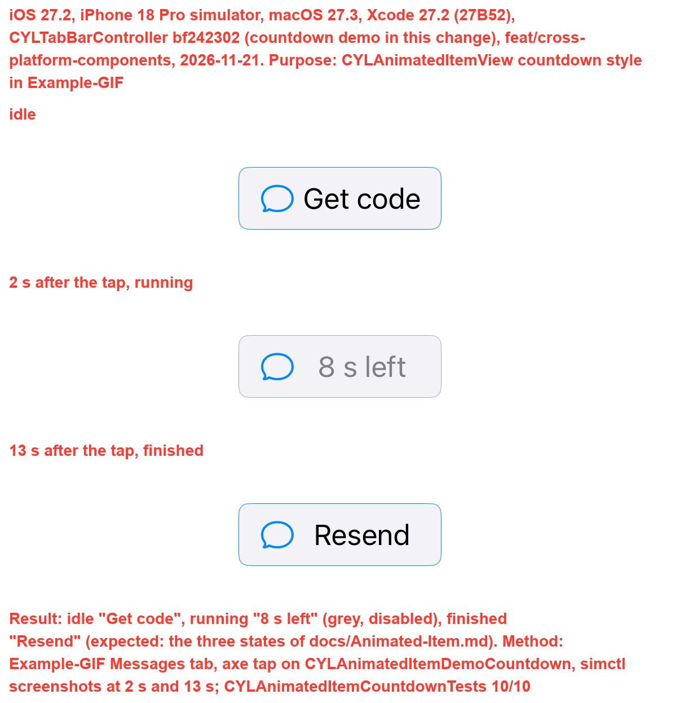

## [CN]图标对齐：图片中的角标部分
## [EN]Icon alignment: the badge part of an image

| 中文 | English |
|:---|:---|
| `CYLAnimatedItemView` 以图标本身对齐，而不是以整张图片对齐。图片用 `alignmentRectInsets` 标出不属于图标的部分（例如从一角伸出的角标）时：图标位于中线上（横向与纵向）；测量时该部分在两侧都预留，图标不会被裁剪；图片视图围绕图标扩展；右上角附加视图跟随图标。没有内边距的图片、符号图片（其很小的基线内边距不算伸出）与动画保持原布局。要把视图和它的角标合成这样一张图片，使用角标组件的 `UIView.cylBadgeSnapshotImage(hidingBadge:traitCollection:)`（Objective-C：`-cyl_badgeSnapshotImageHidingBadge:traitCollection:`）：图片围绕视图均匀扩展，内边距标出视图本身，`hidingBadge` 在相同尺寸下只画视图，无障碍标签为角标描述。接入方无须计算几何。测试：`CYLAnimatedItemIconAlignmentTests`。Android 与鸿蒙尚未同步（TODO）。 | `CYLAnimatedItemView` aligns by the icon itself, not by the whole image. When an image marks the part that is not the icon (e.g. a badge sticking out at one corner) with its `alignmentRectInsets`: the icon sits on the centre line (both directions); measuring reserves that part on both sides, so nothing is clipped; the image view grows around the icon; the top-trailing accessory follows the icon. Images without insets, symbol images (their small baseline insets are not an overhang) and animations keep the old layout. To turn a view and its badge into such an image, use the badge component's `UIView.cylBadgeSnapshotImage(hidingBadge:traitCollection:)` (Objective-C `-cyl_badgeSnapshotImageHidingBadge:traitCollection:`): the image grows evenly around the view, its insets mark the view, `hidingBadge` draws the view alone at the same size, and the accessibility label is the badge's description. The adopter computes no geometry. Tests: `CYLAnimatedItemIconAlignmentTests`. Android and HarmonyOS are not mirrored yet (TODO). Proposed next step, a badge API on the item itself (design, waiting for approval): [Animated-Item-Badge.md](Animated-Item-Badge.md). |

## [CN]动画结束后显示静态图片
## [EN]Still image after the animation ends

| 中文 | English |
|:---|:---|
| `showsImageWhenAnimationEnds`（默认 `false`）：只播放一次的动画（`animationLoops` / `loop` 关闭）播放结束时，隐藏动画，显示条目的静态图片（选中时为 `selectedImage`，否则为 `image`，都没有时为占位图）。默认关闭时保留最后一帧，与之前相同。用于最后一帧为空的动画，例如逐渐消失的成功对勾。 | `showsImageWhenAnimationEnds` (default `false`): when a play-once animation (`animationLoops` / `loop` off) ends, the animation is hidden and the item's still image shows (`selectedImage` while selected, else `image`, else the placeholder). Off, the last frame stays, as before. For an animation whose last frame is empty, such as a success check that fades out. |
| 下一次播放会重新显示动画：iOS 与 Android 的 `playAnimation()`、`restartAnimation()`、`stopAnimation()`、`showAnimationLastFrame()`；鸿蒙的重播（`animationRestartToken`、`controller.restartAnimation()`）或重新选中；小程序的 `playAnimation()`、`stopAnimation()`、重新选中或新文件。开启循环或关闭此开关时同样重新显示动画。 | The next play shows the animation again: iOS and Android `playAnimation()`, `restartAnimation()`, `stopAnimation()`, `showAnimationLastFrame()`; HarmonyOS a restart (`animationRestartToken`, `controller.restartAnimation()`) or a new selection; the mini program `playAnimation()`, `stopAnimation()`, a new selection or a new file. Turning looping on, or this switch off, shows it again too. |
| 结束回调：iOS `onAnimationEnd`（`(() -> Void)?`，开关关闭时也会调用）；Android `animationEndListener`（`CYLAnimatedItemAnimationEndListener.onAnimationEnd(item)`，开关关闭时也会调用）；鸿蒙 `onAnimationEnd`；小程序已有的 `animationcomplete` 事件（现在有静帧的 GIF 一遍计时结束时也会发送，`detail.type` 为 `'gif'`）。循环动画与 `stopAnimation()` 不触发。 | The end callback: iOS `onAnimationEnd` (`(() -> Void)?`, called with the switch off too); Android `animationEndListener` (`CYLAnimatedItemAnimationEndListener.onAnimationEnd(item)`, called with the switch off too); HarmonyOS `onAnimationEnd`; the mini program's existing `animationcomplete` event (now also sent when a timed pass of a GIF with stills ends, `detail.type` `'gif'`). Not sent for a looping animation, nor after `stopAnimation()`. |
| 如何发现结束：Android 每帧读取播放器新增的可选成员 `CYLTabBarItemAnimationPlayer.isPlaying`（Lottie `isAnimating`、PAG `isPlaying`、SVGA `isAnimating`、Rive `isPlaying`、GIF 视图；自定义播放器默认返回 null，此时判断 `progress` 是否到达 1），先看到正在播放再看到停止才算结束，因此晚一帧开始的引擎不会被提前结束。鸿蒙由引擎调用 `CYLAnimatedItemAnimationContext.onEnded`（cyltabbar 的 `CYLLottieIcon` 在 lottie 的 "complete" 时、`CYLSVGAView` 在最后一帧时、`CYLRiveIcon` 在这一遍开始后 `isPlaying()` 变为 false 时）。小程序使用引擎的 `complete`。 | How the end is found: Android reads the player's new optional `CYLTabBarItemAnimationPlayer.isPlaying` on every frame (Lottie `isAnimating`, PAG `isPlaying`, SVGA `isAnimating`, Rive `isPlaying`, the GIF view; an app's own player answers null by default, and then `progress` reaching 1 counts), and only playing followed by stopped is an end, so an engine that starts a frame late is not ended early. HarmonyOS: the engine calls `CYLAnimatedItemAnimationContext.onEnded` (cyltabbar's `CYLLottieIcon` on lottie's "complete", `CYLSVGAView` on the last frame, and `CYLRiveIcon` when `isPlaying()` goes false after the pass started). The mini program: the engine's `complete`. |
| 示例（iOS）：`item.showsImageWhenAnimationEnds = true; item.onAnimationEnd = { … }`；示例（Android）：`item.showsImageWhenAnimationEnds = true; item.animationEndListener = CYLAnimatedItemAnimationEndListener { … }`；鸿蒙：`CYLAnimatedItemView({ showsImageWhenAnimationEnds: true, onAnimationEnd: () => { … } })`；小程序：`<cyl-animated-item shows-image-when-animation-ends bind:animationcomplete="onEnd" />`。 | Example (iOS): `item.showsImageWhenAnimationEnds = true; item.onAnimationEnd = { … }`; example (Android): `item.showsImageWhenAnimationEnds = true; item.animationEndListener = CYLAnimatedItemAnimationEndListener { … }`; HarmonyOS: `CYLAnimatedItemView({ showsImageWhenAnimationEnds: true, onAnimationEnd: () => { … } })`; mini program: `<cyl-animated-item shows-image-when-animation-ends bind:animationcomplete="onEnd" />`. |
| 已验证（2026-11-22）：Android 17 模拟器上 Success 占位图的 Lottie 动画结束后显示静态对勾（CYLTableViewPlaceHolder 会话，[截图](https://github.com/ChenYilong/CYLTableViewPlaceHolder/blob/feat/android-refresh-port-followup/docs/assets/android-harmonyos-success-still-image-150772a-20261122-sheet.png)）；鸿蒙 x86_64 模拟器上示例的 `pages/AnimatedItemEnd`（同城 Tab）中 Lottie 条目结束后显示静态图片、重新播放时重新显示动画、关闭开关时保留最后一帧；微信开发者工具（基础库 3.17.6）中示例 cyl-lottie 页面相同（见下方截图）。测试中发现并修复：cyl-lottie 的 loop / autoplay / restingFrame 观察者在值未变化时也会重新播放，每一遍发送两次 "complete"（84ae4795）。TODO：iOS 尚未实现（需要 Mac 会话，`chenyilong-0b`）；鸿蒙 Rive 的结束已实现但未在设备上验证（@ohos/rive 没有 x86_64 库，需要 arm64 设备）。 | Verified (2026-11-22): on an Android 17 emulator the Success placeholder's Lottie animation ends on the still check mark (by the CYLTableViewPlaceHolder session, [screenshots](https://github.com/ChenYilong/CYLTableViewPlaceHolder/blob/feat/android-refresh-port-followup/docs/assets/android-harmonyos-success-still-image-150772a-20261122-sheet.png)); on the HarmonyOS x86_64 emulator the example's `pages/AnimatedItemEnd` (City tab) Lottie item ends on its still image, Replay shows the animation again and the switch off keeps the last frame; the same in WeChat DevTools (base library 3.17.6) on the example's cyl-lottie page (screenshots below). Bug found and fixed while testing: cyl-lottie's loop / autoplay / restingFrame observer replayed on unchanged values, so "complete" came twice per pass (84ae4795). TODO: iOS is not done yet (needs a Mac session, `chenyilong-0b`); the HarmonyOS Rive end is built but not seen on a device (@ohos/rive has no x86_64 library; needs an arm64 device). |
| DONE（2026-11-24，iOS 部分，分支 `parity-shows`，Mac 会话）：`CYLAnimatedItemView.showsImageWhenAnimationEnds`（默认 false，与鸿蒙、Android 相同）与只读的 `isShowingImageAfterAnimationEnd`；结束回调使用已有的 `onAnimationEnd`；下一次 `playAnimation()`、`restartAnimation()`、`stopAnimation()`、`showAnimationLastFrame()`、新地址或关闭开关时重新显示动画。结束由播放器的 `onEnded` 报告（Lottie、PAG、Rive、SVGA、GIF 的播放器已有），没有 `onEnded` 的自定义播放器从不结束。 | DONE (2026-11-24, the iOS part, branch `parity-shows`, Mac session): `CYLAnimatedItemView.showsImageWhenAnimationEnds` (default false, as HarmonyOS and Android) and the read-only `isShowingImageAfterAnimationEnd`; the end callback is the existing `onAnimationEnd`; the next `playAnimation()`, `restartAnimation()`, `stopAnimation()`, `showAnimationLastFrame()`, a new URL or the switch off shows the animation again. The end comes from the player's `onEnded` (the Lottie, PAG, Rive, SVGA and GIF players have it), so a custom player without `onEnded` never ends (unlike Android, which also watches `isPlaying` / `progress`). Unit test `CYLAnimationEndCallbackTests.testTheStillImageReplacesAnEndedAnimationOnlyWhenAsked`; demo toggle "Show image when ended" on the Example-Rive Engine API page (screenshot below). |
|  |  |
|  |  |

## [CN]x86_64 鸿蒙模拟器
## [EN]x86_64 HarmonyOS emulator

| 中文 | English |
|:---|:---|
| 本地鸿蒙模拟器是 x86_64；@ohos/rive 1.0.4 与 @tencent/libpag 4.4.31 只提供 arm64-v8a 原生库，带有它们的 HAP 无法安装（错误 9568347），去掉原生库后第一个 PAG 或 Rive 视图会崩溃。鸿蒙 `cylanimateditem` 负责 x86_64 测试方案，依赖它的示例与库（cyltabbar 示例、CollectionViewClassifyMenu、CYLTableViewPlaceHolder、CYLSearchViewController）都能在 x86_64 模拟器上完整测试。 | The local HarmonyOS emulator is x86_64; @ohos/rive 1.0.4 and @tencent/libpag 4.4.31 ship arm64-v8a native libraries only, so a HAP that bundles them does not install (error 9568347), and without them the first PAG or Rive view crashes. The HarmonyOS `cylanimateditem` owns the x86_64 test path, so the examples and libraries that depend on it (the cyltabbar example, CollectionViewClassifyMenu, CYLTableViewPlaceHolder, CYLSearchViewController) can test fully on the x86_64 emulator. |
| 运行时检查：`CYLAnimatedItemEngines` 读取 `deviceInfo.abiList`，PAG 与 Rive 需要 arm64-v8a；设备没有时 `canPlay` 为 false，不创建引擎视图，条目显示静态图片；`isSupportedOnDevice(type)`、`unsupportedReason(url)`（debug 构建输出一次日志）、`setRequiredNativeAbis(type, abis)`、`setDeviceAbis`（测试）。 | Runtime check: `CYLAnimatedItemEngines` reads `deviceInfo.abiList`; PAG and Rive need arm64-v8a; without it `canPlay` is false, no engine view is created and the item shows its still image; `isSupportedOnDevice(type)`, `unsupportedReason(url)` (logged once in debug builds), `setRequiredNativeAbis(type, abis)`, `setDeviceAbis` (tests). |
| TODO（2026-11-22，CollectionViewClassifyMenu 会话 chen-yilong-a8 发现）：x86_64 上深色标签中的 PAG / Rive 条目显示的回退占位图为黑色，在深蓝背景上几乎看不见（ClassifyMenu "Rive · icons.riv（深色标签）"）；占位图应随 `iconColor` 着色，或在深色背景下使用浅色版本。 | TODO (2026-11-22, found by the CollectionViewClassifyMenu session chen-yilong-a8): on x86_64, a PAG / Rive item on a dark tag shows the fallback placeholder in black on navy, nearly invisible (ClassifyMenu "Rive · icons.riv (dark tags)"); the placeholder should take `iconColor` or a light variant on dark backgrounds. Its screenshot will be ClassifyMenu docs/assets/harmonyos-x86_64-animations-pag-rive-still.jpeg. |
| 模拟器 HAP：应用的 `entry/build-profile.json5` 中加入 `emulator` 构建选项（`nativeLib.filter.excludes: ["**/arm64-v8a/*.so"]`）、`emulator` target 与 `emulatorTest` 构建模式；`hvigorw --mode module -p module=entry@emulator -p product=default assembleHap`。没有该 target 时用 `cylanimateditem/tools/cyl_hap_x86_64.py install`（检查 ABI、去掉原生库、hdc install）。完整说明与测试方案：`CrossPlatform/harmonyos-cyltabbar/cylanimateditem/README.md`。 | Emulator HAP: the app's `entry/build-profile.json5` gets an `emulator` build option (`nativeLib.filter.excludes: ["**/arm64-v8a/*.so"]`), an `emulator` target and an `emulatorTest` build mode; `hvigorw --mode module -p module=entry@emulator -p product=default assembleHap`. Without that target, `cylanimateditem/tools/cyl_hap_x86_64.py install` (ABI check, strip the native libraries, hdc install). Full text and the test plan: `CrossPlatform/harmonyos-cyltabbar/cylanimateditem/README.md`. |

## [CN]鸿蒙共享 Rive 引擎：cylanimateditemrive
## [EN]Shared HarmonyOS Rive engine: cylanimateditemrive

| 中文 | English |
|:---|:---|
| 本节按用户要求使用英文（见右列）。 | The Rive view of every HarmonyOS library lives in one module, `CrossPlatform/harmonyos-cyltabbar/cylanimateditemrive` (ohpm HAR, depends on `cylanimateditem` and `@ohos/rive` 1.0.4). `cylanimateditem` keeps depending on no animation library: a HAP that bundles `@ohos/rive` does not install on the x86_64 emulator, and CYLTableViewPlaceHolder, CollectionViewClassifyMenu and CYLSearchViewController rely on that. A library that plays .riv adds `cylanimateditemrive`; cyltabbar depends on it and re-exports every name that moved out of `CYLRiveTabBarItemAnimator.ets` (`CYLRiveIcon`, the `CYLTabBarAnimationOptionRive*` options, `cylRiveFileAndOptions`, `cylRiveNextNumber`, `cylRiveRendererType`, `cylEnsureRiveInitialized`, `cylRiveIsSupported`), so no cyltabbar API changed. |
| 本节按用户要求使用英文（见右列）。 | Public API: `CYLRiveIcon` (the Rive view: one per item, driven by `selected`, `replayToken`, `loops`, `loopPolicy`; `onLoaded`, `onEnded`, `onLoadError`, `registerReplay`); `CYLRiveLoopPolicy` (`WhileSelected`, `WhilePlaying`, and the pure rules `isActive`, `schedulesNextPass`, `updateAction`); `CYLRiveAnimationBuilder` (a ready `animationBuilder` for `CYLAnimatedItemView`, loop policy `WhilePlaying`); `cylRegisterRiveEngine(context?)` (registers `Rive` with the `arm64-v8a` requirement and, with a context, lets debug builds with the x86_64 debug engine kit play Rive on the x86_64 emulator, as before). |
| 本节按用户要求使用英文（见右列）。 | **The loop policy (the Loop bug).** `CYLRiveIcon` repeated a pass only while `selected` (tab semantics), so a tag, a placeholder or any `CYLAnimatedItemView` that is not "selected" never looped: the item with loops on stayed on its first frame. `loopPolicy` chooses: `WhileSelected` (default, the tab bar, unchanged) or `WhilePlaying` (as the mini program's `cyl-rive` `loop`): the item plays at load, selected or not; with `loops` on, every pass (state machine with a trigger, a boolean input, a number input or no input, and a linear animation) schedules the next; turning `loops` on while it rests plays at once; turning it off lets the pass playing finish and rest (`onEnded` comes); a restart plays again, also after a stop; an item that was selected and is then unselected stops. |
| 本节按用户要求使用英文（见右列）。 | **How a library plays .riv with it** (`CYLTableViewPlaceHolder`, `CYLSearchViewController`, `CollectionViewClassifyMenu`): add `"cylanimateditemrive": "file:../cylanimateditemrive"` (or import through `cyltabbar`), then `aboutToAppear(): void { cylRegisterRiveEngine(this.getUIContext().getHostContext()); }` and `CYLAnimatedItemView({ image: $r('app.media.chat'), animationUrl: 'rive/icons.riv#artboard=CHAT&stateMachine=CHAT_Interactivity&input=active', animationLoops: this.loops, animationBuilder: CYLRiveAnimationBuilder })`. Options go in the file's fragment (`artboard`, `stateMachine`, `input`, `trigger`, `triggerInput`, `numberInput` + `values`, `animation`, `legacy`, `duration`). A device without `arm64-v8a` (and no debug kit) shows the item's still image. A library that has its own `CYLRiveIcon` copy (CYLSearchViewController's) deletes it and uses this one, so every library shares the fixes (the replay, the artboard kept by `reset()`, the end watch, the loop). |
| 本节按用户要求使用英文（见右列）。 | Tests: `cylanimateditemrive/test/CYLRiveLoopPolicy.test.mjs` (Node: the default is the tab policy, a loop while playing schedules the next pass without a selection, stop and restart); the cyltabbar example's hypium `CYLRiveLoopPolicy.test.ets` (the names re-exported by cyltabbar, the default policy, the loop without selection, the registration). Device check (2026-11-23, arm64 emulator): see the task log. |

## [CN]跨端引擎 API（以鸿蒙为准）
## [EN]Engine API across platforms (HarmonyOS is the reference)

| 中文 | English |
|:---|:---|
| 本节按用户要求使用英文（见右列）。 | Written 2026-11-23 for the owner's request "PR #824 only did HarmonyOS and Android; iOS, the mini program, React Native and Flutter are missing: imitate the HarmonyOS API design". The inventory found that the premise is only partly true: iOS and Android already have the item view and engines (`CYLAnimatedItemView`, `cylanimateditem`), the mini program has `cyl-animated-item` with one generic engine slot per type, React Native and Flutter have a thin `CYLAnimationView`. What is missing is the **same contract everywhere**: the table below. HarmonyOS is the reference (`cylanimateditem/README.md`, "Engine views"). The `#` option test vectors are one file read by every platform's parser test: `CrossPlatform/animated-item-fixtures/source-options.json`. |

| Concept (HarmonyOS name) | iOS (state 2026-11-23) | WeChat Mini Program | React Native | Flutter | Android |
|:---|:---|:---|:---|:---|:---|
| Source with `#` options (`CYLAnimatedItemSource`, `cylAnimatedItemFileAndOptions`) | `CYLTabBarAnimationURLWithOptions` writes, `CYLTabBarAnimationOptionsFromURL` reads (one reader for the view animator and the tab engine) and `CYLAnimationSource(parsing:)` reads the text form, all with the fixture rules; **done 2026-11-23**: `CYLAnimatedItemSourceOptionsTests` reads `animated-item-fixtures/source-options.json` (every case, plus the rules). The old Objective-C readers dropped an undecodable text; they now keep it | `cylAnimatedItemSource` in `cyl_animated_item_model.js` (new; the vectors' `cylParsePath` named in the task is only the SVG path parser of the SVGA engine): fixture test `test/cyl_animated_item_source.test.js` passes all 7 vectors. `cyl-rive`'s own `cylRiveRoute` follows the shared rules too (2026-11-23: `?` or `#`, `asset:`, undecodable text kept; only its 12 names; an http / https query stays in the path) and its test reads the fixture (`rive-miniprogram/test/cyl_rive_options.test.js`) | file + `options` map, serialised by `animationURLWithOptions`: **done**, jest test over `source-options.json` (`src/__tests__/animationView.test.tsx`) | same as React Native (`cyl_animation_view.dart`): **done**, `test/cyl_animation_view_test.dart` over `source-options.json` | in `cylanimateditem`: **done** (2026-11-23): `CYLAnimatedItemSource.parse` (`#` and `?` options, percent-decoded, inline JSON, type from the extension); `CYLAnimatedItemSourceFixtureTest` passes every vector of `source-options.json`. `CYLTabBarAnimationFileAndOptions` (fragment only) is unchanged |
| Player (`CYLAnimatedItemPlayer`: `play()`, `stopAtProgress(p)`, `speed`, `loops`, `supports*`, `isPlaying`, `progress`, `onEnded`, `supportsColors` / `applyColors`) | `CYLTabBarItemAnimationPlayer`: `play`, `showLastFrame`, `stop`, `progress`, `animationSpeed` (HarmonyOS `speed`: also `speed`), `loops`, `applyColors(_:traitCollection:)`; **done 2026-11-23** (optional members, answered by `CYLTabBarItemAnimationBasePlayer`): `supportsSpeed`, `supportsLoops`, `supportsProgress`, `supportsColors`, `isPlaying`, `speed`, `onEnded`, `applyColors(_:)`. `isPlaying` and `onEnded` are wired for Lottie 2 and 4, PAG (Swift and Enterprise), GIF, SVGA and Rive (a boolean state machine with an `activeDuration`; a trigger has no end); the legacy Rive view reports neither | **done** (2026-11-23): `item.cyl_player()` returns one `CYLAnimatedItemPlayer` (`cyl_animated_item_player.js`, pure JS): `play()`, `stopAtProgress(p)`, `speed`, `loops`, `supportsSpeed` / `supportsLoops` / `supportsProgress` / `supportsColors` (by type: Lottie speed, progress, colors; PAG and SVGA speed, progress; Rive speed, colors; GIF none, loops with stills), `isPlaying`, `onEnded(cb)`, `applyColors(colors)`; over `playAnimation()`, `cyl_stopAtProgress()` and the engines' `cyl_pause` / `cyl_setProgress` / `cyl_goToAndStop` / `cyl_stop`. **Missing**: `progress` (no engine component reports its position); a GIF `image` (canvas) has no end | **done** (Android and iOS 2026-11-23): ref commands `play()`, `stopAtProgress(p)`, `restart()` (`CYLAnimationViewHandle`); iOS `CyltabbarAnimationView` calls `animationPlayer.play()` and sets `progress` after `stop()`; the engine's `supports*` stay in the native item | **done** (Android and iOS 2026-11-23): `CYLAnimationController` with `play()`, `stopAtProgress(p)`, `restart()`; iOS `CYLFlutterAnimationView` calls `animationPlayer.play()` and sets `progress` after `stop()` | **done** (2026-11-23): `item.animatedItemPlayer` (`CYLAnimatedItemPlayer`): `play()`, `stopAtProgress(p)`, `speed`, `loops`, `supportsSpeed` / `supportsLoops` / `supportsProgress` / `supportsColors` (by type, as the mini program), `isPlaying` (null when the engine cannot tell), `progress`, `onEnded`, `applyColors(colors)`; over the existing `CYLTabBarItemAnimationPlayer`, which is unchanged |
| Item props (`selected`, `animationSpeed`, `animationLoops`, `animationRestartToken`, tint, `onAnimationEnd`, `onAnimationLoaded` / `Failed`) | `selected` through the item state, `animationSpeed`, `animationLoops`, `restartAnimation()`; **done 2026-11-23**: `animationRestartToken` (read only, grows on `restartAnimation()`), `onAnimationEnd` (a play-once pass ended, not on a stop, not while looping) | `selected`, `speed`, `loop`, `restartAnimation()`, **`restartToken`** (new: restarts when it grows; the value at creation is not a restart), `animationcomplete` (the end event: no separate `animationend`), `animationready` / `animationerror` | **done** (Android native + TS, 2026-11-23): props `selected`, `animationSpeed`, `animationLoops`, `animationRestartToken`, `drivesAnimationPlayback` (default true), `iconSize`, `tintColor` next to `file`, `options`, `playing`; events `onAnimationLoaded` / `onAnimationFailed` / `onAnimationEnd`; iOS native half **done and run 2026-11-23** (`CyltabbarAnimationView` over `CYLAnimatedItemView`, Fabric, simulator screenshot below): `selected` true plays, false stops at the resting progress, a selected item plays once ready | **done** (Android native + Dart, 2026-11-23): the same parameters and callbacks on `CYLAnimationView`; a local Flutter version other than the one CI uses needs `./gradlew dependencies :app:dependencies :flutter_cyltabbar:dependencies --write-locks` in `example/android` to run the Android example, and the rewritten `gradle.lockfile` files must not be committed (they pin the Flutter version CI uses); iOS native half **done and run 2026-11-23** (`CYLFlutterAnimationView`, channel `flutter_cyltabbar/CYLAnimationView/<id>`, simulator screenshot below): `selected` true plays, false stops at the resting progress, a selected item plays once ready | `animationSpeed`, `animationLoops`, `animationEndListener` existed; **added** `animationRestartToken`, `onAnimationLoaded` / `onAnimationFailed` (`selected` is the view's `isSelected`) |
| Still image when a play-once animation ends (`showsImageWhenAnimationEnds`, default false) | **done 2026-11-24**: `showsImageWhenAnimationEnds` and read-only `isShowingImageAfterAnimationEnd`; unit test and the Engine API demo toggle | `shows-image-when-animation-ends` (already there) | **done 2026-11-24** (new prop): spec `showsImageWhenAnimationEnds` (default false), JS wrapper, iOS `.mm` forwards to `CYLAnimatedItemView`; Android manager forwards to the core prop, plus the `image` prop (`setImage`, the item's own `image`): **done 2026-11-24, run on an Android 17 emulator** (`docs/assets/android-rn-image-end-rule.png`) | **done 2026-11-24** (new parameter, channel method `setShowsImageWhenAnimationEnds`): Dart, iOS plugin, Kotlin view; Android half **done 2026-11-24**: creation argument `image` and channel method `setImage` (the item's own `image`, selected or not); run on the emulator: `docs/assets/android-flutter-image-end-rule.png`; the Rive `icons.riv` timer of the example rows never reports an end on Android (TODO, engine detection, not the bridge) | `showsImageWhenAnimationEnds` and `isShowingImageAfterAnimationEnd` (reference implementation, unchanged); its default of `drivesAnimationPlayback` is true as on iOS and HarmonyOS (since 2026-11-24) |
| Host-driven mode (`drivesAnimationPlayback: false` and the player in `onAnimationPlayer`) | `animationPlayer` is public; **done 2026-11-23**: `drivesAnimationPlayback` (default true; false: no speed, loops, resting progress or loop-restart rules, the player is only handed out); example page: Example-Rive "Engine API" (screenshot below) | **done**: `drivesAnimationPlayback` (default true); false = no default rule (a selection change touches no engine, no autoplay on `ready`, `restartToken` ignored) and the host plays through `cyl_player()`; `playAnimation()` / `restartAnimation()` / `stopAnimation()` still work | **done** (Android and iOS): `drivesAnimationPlayback` prop (default true), the host plays through the ref; iOS code path only, not run (no example sets it to false) | **done** (Android and iOS): `drivesAnimationPlayback` parameter (default true), the host plays through the controller; iOS code path only, not run (no example sets it to false) | **done**: `drivesAnimationPlayback` on `CYLAnimatedItemView`, **true by default on Android since 2026-11-24**, as on iOS and HarmonyOS (it was false before, so existing users kept their behavior); `CYLTabBarItemButton` sets false (the tab bar plays its icons itself, no double play), the React Native and Flutter views set it explicitly; true = selected plays once from the start, unselected rests at `animationRestingProgress`, a grown `animationRestartToken` restarts, a ready selected item plays |
| Default rules (selected: play once from the start; unselected: progress 0; restart: again; speed and loops live) | in `CYLAnimatedItemView`: speed, loops, resting progress and the loop restart apply to the player; the view does **not** play on `isSelected` (the tab engine, `CYLTabBarItemAnimationEngine`, plays and rests tab icons; items are played by `playAnimation()` / `restartAnimation()`): unchanged on purpose, see the task log | in `cyl-animated-item` (tab-switch contract, `cyl_halt`) | native view | native view | in the view |
| Engine registry (`CYLAnimatedItemEngines.register`, `isSupportedOnDevice`, per-engine `register()`) | CocoaPods subspecs and `CYL_*_AVAILABLE`, `CYLAnimationWarnMissingEngine()`: no change | generics per type (`cyl-lottie-view`...), each engine package ships its own default; no change | native pods and Gradle modules: no change | same | `CYLAnimationEngines`: no change |

| 中文 | English |
|:---|:---|
| 本节按用户要求使用英文（见右列）。 | **Plan** (advisor, 2026-11-23). Phase A in parallel: iOS (additive player members, `animationRestartToken`, `onAnimationEnd`, `drivesAnimationPlayback`, `applyColors`; Swift first, every selector kept, `-Swift.h` diff additions only; `CYLAnimatedItem` must not import CYLTabBarController) and the mini program (a player object handed to the host, host-driven mode, without listing all engines in `usingComponents`: the 2 MB limit). Phase B after the iOS API is pushed: React Native and Flutter, thin native views over iOS `CYLAnimatedItemView` and Android `cylanimateditem` with the contract's prop names and the player through a ref / controller; no engine logic in JS or Dart. Rubric for each platform: **100** = the contract implemented with every engine of the platform behind it, host-driven mode, fixture tests, an example page with Play all / speed slider / loop switch with accessibility, a labeled screenshot, no public API removed; **60** = the API with two engines, tests and a build. |


| Bridge names, frozen 2026-11-23 (React Native and Flutter, both native halves) | |
|:---|:---|
| Props (React Native props, Flutter widget parameters) | keep `file`, `options`, `playing`; add `selected`, `animationSpeed`, `animationLoops`, `animationRestartToken`, `drivesAnimationPlayback` (default `true`), `showsImageWhenAnimationEnds` (default `false`; added to the frozen list on 2026-11-24), `image` (optional string, added on 2026-11-24 by the owner: the still image that `showsImageWhenAnimationEnds` shows after a play-once pass, resolved exactly like `file`: same asset / path / URL resolution; **rule (HarmonyOS `CYLAnimatedItemView.ets`, every platform): the end shows `selectedImage` / `image`, else the placeholder; with the prop off the last frame stays; iOS: `CYLAnimatedItemView` shows its `placeholderImage` when it has no image, matching this**; React Native Android manager `setImage(view, value: String?)`, Flutter channel method `setImage` with a `String?`), `iconSize`, `tintColor`; the **item background** (added 2026-11-25 to the frozen list, the same names and rules as the native `CYLAnimatedItemView`, [Background section](#enbackground-flat-or-liquid-glass-corner-radius-and-border)): `itemBackgroundStyle` (`'flat'` default or `'liquidGlass'`; Dart enum `CYLAnimatedItemBackgroundStyle { flat, liquidGlass }`, sent as the string `name`), `itemBackgroundColor` (color), `itemCornerRadius` (points, limited to half the height; unset = a capsule for glass, square for flat; the constant `cylAnimatedItemCornerRadiusCapsule` = 1000 is exactly a capsule; React Native codegen default `-1` = unset, Dart `null` = unset), `itemBorderWidth` (points, default 0), `itemBorderColor` (color) |
| Events | `onAnimationLoaded`, `onAnimationFailed`, `onAnimationEnd`, and since 2026-11-25 `onResourceMissing` (React Native: the prop `onResourceMissing`, handler argument `{ resource, reason }`; Flutter: the callback `onResourceMissing(String resource, String reason)`, a channel call `onResourceMissing` with the map `{resource, reason}`; both pass the native `onResourceMissing` through unchanged) |
| Missing resource, frozen 2026-11-25 (all platforms) | `resource` = the file name or path as configured (a source's `#` options are not part of it); `reason` = one of the four strings `not found`, `unreadable`, `decode failed`, `engine library missing`. Fired once per resource per view, on the main thread; nothing else changes (the item still shows its image or the placeholder; no crash); debuggable Android builds also log a warning (tag `CYLAnimatedItem`). **Per view**: Android `CYLAnimatedItemView.onResourceMissing: ((resource: String, reason: String) -> Unit)?`; iOS `CYLAnimatedItemView.onResourceMissing: ((String, String) -> Void)?` (Objective-C `void (^)(NSString *, NSString *)`); HarmonyOS the `onResourceMissing` callback prop of `CYLAnimatedItemView`; WeChat Mini Program the event `resourcemissing` (`bind:resourcemissing`, `detail` `{ resource, reason }`); React Native the prop `onResourceMissing`; Flutter `CYLAnimationView.onResourceMissing`. **Global listener, so a host needs no view reference** (CYLPlaceholder's status bar): Android `CYLAnimationEngines.resourceMissingListener`, iOS `CYLAnimationEngines.resourceMissingListener` (a static var of the new class `CYLAnimationEngines`, same signature, `@objc`), HarmonyOS `CYLAnimatedItemEngines.resourceMissingListener`; no global listener on the mini program, React Native and Flutter (they have the per-view callback). Helper for a host that resolves the name itself (the React Native and Flutter iOS bridges, for a name that is not in the app): iOS `CYLAnimatedItemView.reportResourceMissing(_:reason:)`. The reasons: `not found` = a missing local file, asset or rawfile, or a failed download; `unreadable` = the file exists but is empty or is not a regular file, or an engine cannot read it; `decode failed` = the engine cannot decode it, or the file is of no known type; `engine library missing` = a known type whose engine (pod, Gradle dependency, HarmonyOS package or mini program component) is not in the app. A remote file that fails with no error is `not found` on iOS (best effort). **iOS tab bar buttons** (2026-11-25): a UIKit tab button is not a `CYLAnimatedItemView`, so the tab animation engine (`CYLTabBarItemAnimationEngine`) reports a tab's file itself, as Android's `CYLTabBar` does through `CYLTabBarItemAnimationFailure.missingResource`: `CYLAnimationEngines.resourceMissingListener` fires once per resource per tab button (not per animation view: a trait or style refresh builds a new view for the same file), on the main queue, for a local file that is not there (`not found`, or `unreadable` when empty), for a file no library made a view for (`engine library missing` when the engine is not in the build, else `unreadable` or `decode failed`) and for a failure after the view was made (the reason of the error, as for an item). There is no per-tab `onResourceMissing` callback on iOS (open question to the owner); the tab bar of the FlatDesign style is made of `CYLAnimatedItemView`s and has the per-view callback. A remote URL on the tab path is not reported (the engine plays local files only there). |
| Commands (React Native: a ref; Flutter: a controller) | `play()`, `stopAtProgress(progress)`, `restart()` |
| Flutter channel `<viewType>/<id>` | one method per prop named `set` + the prop (`setSelected`, `setAnimationSpeed`, `setAnimationLoops`, `setAnimationRestartToken`, `setDrivesAnimationPlayback`, `setShowsImageWhenAnimationEnds`, `setPlaying`, and since 2026-11-25 `setItemBackgroundStyle` (the string `flat` / `liquidGlass`), `setItemBackgroundColor` (ARGB int or null), `setItemCornerRadius` (number or null), `setItemBorderWidth`, `setItemBorderColor` (ARGB int or null); the same keys are the creation parameters) and the commands as methods (`play`, `stopAtProgress`, `restart`); native calls back `onAnimationLoaded`, `onAnimationFailed`, `onAnimationEnd` and, since 2026-11-25, `onResourceMissing` with the map `{resource, reason}` |
| Native views | iOS `CYLAnimatedItemView` (names from `f865f9ad`: `isSelected`, `animationSpeed`, `animationLoops`, `restartAnimation()` for the restart token, `drivesAnimationPlayback`, `onAnimationEnd`, `animationPlayer` with `play` and `progress` for `stopAtProgress`) and Android `cylanimateditem` view; no engine logic in JavaScript or Dart | Android halves written 2026-11-23: React Native `CyltabbarAnimationView` / `CyltabbarAnimationViewManager` and Flutter `CYLFlutterAnimationView` wrap `com.cyl.animateditem.CYLAnimatedItemView` (icon only), set `drivesAnimationPlayback = true` from the bridge (default true; the Android view's own default is also true since 2026-11-24, the bridges keep setting it explicitly), `iconSize` is dp, `tintColor` an ARGB int, `playing` keeps its meaning (true plays, false stops); React Native commands and event names `topAnimationLoaded` / `topAnimationFailed` / `topAnimationEnd`; the React Native codegen spec must declare the props, the three direct events and the commands (`play()`, `stopAtProgress(progress: Float)`, `restart()`). Flutter compiled (`flutter build apk --debug`); React Native not compiled (needs the spec and an app build) |

| 中文 | English |
|:---|:---|
| Android 端引擎 API 实机截图（Flutter 示例，`CYLAnimationView` 由「全部播放」、倍速与循环控件驱动）：下图三帧中图标像素不同，说明重启令牌通过 `CYLAnimatedItemView` 重新播放了 Rive 动画。 | Android engine API on an emulator (the Flutter example, `CYLAnimationView` driven by Play all, speed and loop): the icon's pixels differ between the three frames, so the restart token restarts the Rive animation through `CYLAnimatedItemView`. |

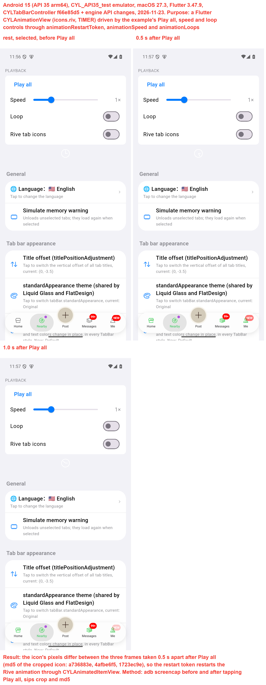

| 中文 | English |
|:---|:---|
| iOS 端引擎 API 实机截图（Flutter 示例，`CYLFlutterAnimationView` 由「全部播放」驱动）：三帧中图标像素不同，播放结束后回到静止帧。 | iOS engine API on the simulator (the Flutter example, `CYLFlutterAnimationView` driven by Play all): the icon's pixels differ between the three frames and it returns to the rest frame after the pass. |

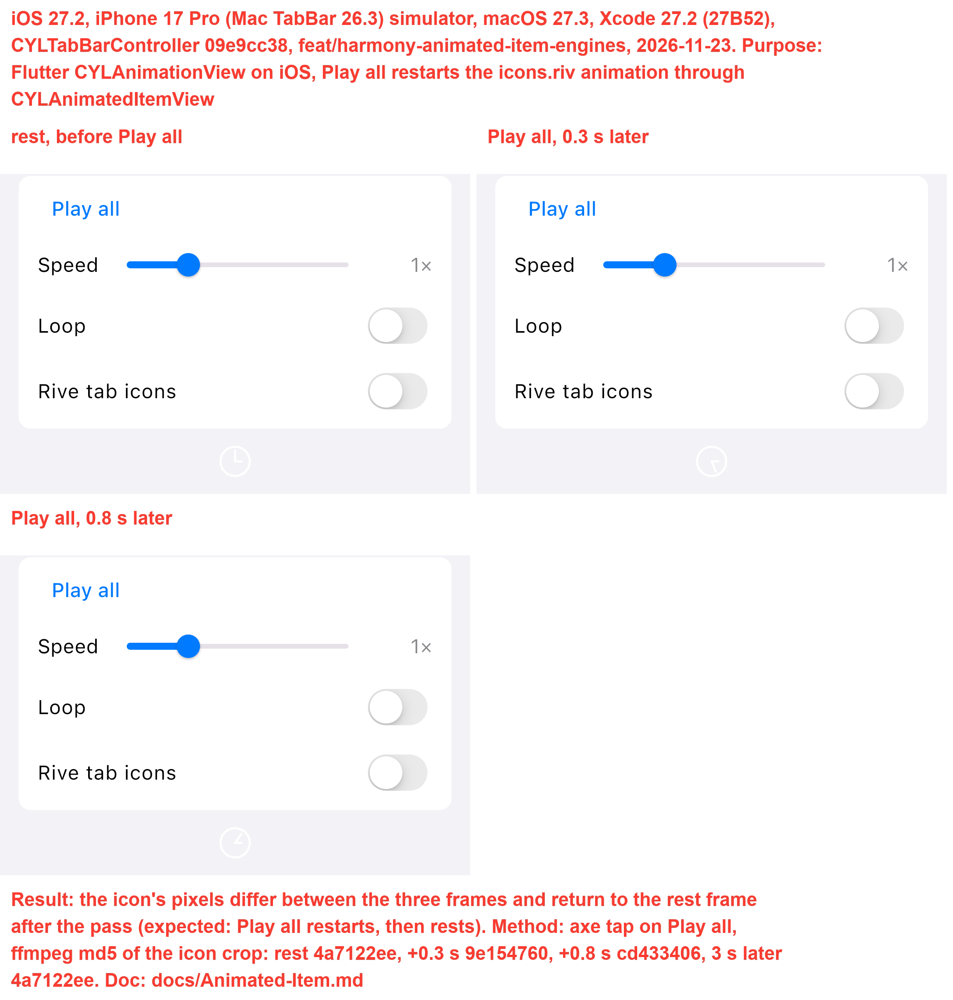

| iOS 引擎 API 示例页（Example-Rive 的 User Tab，「Engine API」按钮）。 | iOS engine API page (Example-Rive, User tab, "Engine API" button): iOS 27.2, iPhone 18 Pro (Mac TabBar) simulator, macOS 27.3, Xcode 27.2 (27B52), CYLTabBarController 9838a2e3 + working tree, 2026-11-23. Three `CYLAnimatedItemView`s with `drivesAnimationPlayback = false`, driven by Play all, Stop at 50%, a speed slider and a loop switch; the labels show `animationRestartToken` and `onAnimationEnd`. |

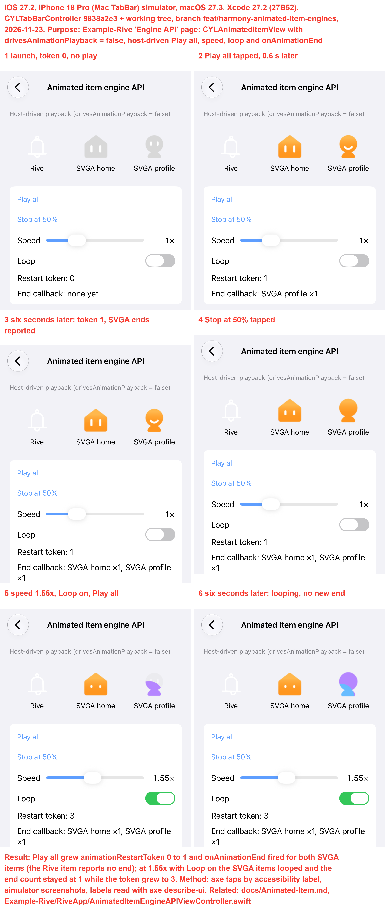

| 中文 | English |
|:---|:---|
| iOS 端引擎 API 实机截图（React Native 示例 example-rive 的 Bell 页，`CyltabbarAnimationView` 由「全部播放」与循环开关驱动）：各帧中图标像素不同，播放结束后回到静止帧。 | iOS engine API on the simulator (the React Native example-rive, Bell tab, `CyltabbarAnimationView` driven by Play all and the Loop switch): the icon's pixels differ between the frames and it returns to the rest frame after the pass. |

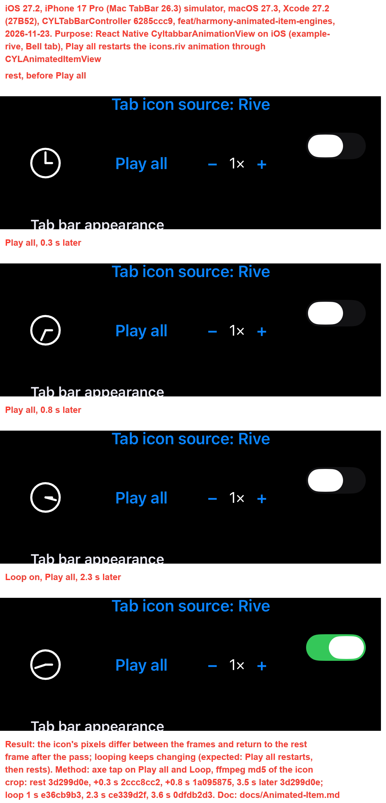

## [CN]新增一种动画类型
## [EN]Adding an animation type

| 中文 | English |
|:---|:---|
| 只改这个子库：写一个 animator（iOS 实现 `CYLTabBarItemAnimator`，或继承 `CYLTabBarItemViewAnimator` 用于自己会播放的视图；Android 实现 `CYLTabBarItemAnimator`），声明文件扩展名，向 `CYLTabBarItemAnimatorRegistry` 注册（iOS `+registerAnimator:`，Android `CYLTabBarItemAnimatorRegistry.registerAnimator`）。iOS 上把它放在 `CYLTabBarItemAnimation/<库名>/`，在 `CYLAnimatedItem.podspec` 中新建子库 `CYLAnimatedItem/<库名>`（`Engine` 加该库，绝不依赖 CYLTabBarController），在 `CYLAnimatedItemMacros.h` 中新增开关 `CYL_<库名>_AVAILABLE` 与 `CYL_<库名>_REQUIRED`，在 `CYLAnimationKeys.h/.m` 中新增该类型的 key（标记 `CYL_<库名>_REQUIRED`）并加入类型表（`CYLAnimationKnownTypes()`、`CYLAnimationSubspecOfType()`、`CYLAnimationFileExtensionsOfType()`），再在 `CYLTabBarController.podspec` 中新建 TabBar 子库 `<库名>`（Core 加 `CYLAnimatedItem/<库名>`）；Android 上放在 `:cylanimateditem`，通过反射调用该库，并加入 `CYLAnimationEngines` 的类型表；HarmonyOS 在 `CYLAnimatedItemEngines`（`cylanimateditem` 模块）的类型表中加一行，小程序在 `cyl_animated_item_model.js` 的 `CYL_ANIMATED_ITEM_TYPES` 中加一行并新增抽象节点。所有 `CYLAnimatedItemView` 子类、Tab 按钮以及接入本子库的其他仓库都会自动支持，无需第二处修改。 | Change this sub-library only: write an animator (iOS: implement `CYLTabBarItemAnimator`, or subclass `CYLTabBarItemViewAnimator` for a view that plays itself; Android: implement `CYLTabBarItemAnimator`), declare its file extensions, and register it with `CYLTabBarItemAnimatorRegistry` (iOS `+registerAnimator:`, Android `CYLTabBarItemAnimatorRegistry.registerAnimator`). On iOS it goes in `CYLTabBarItemAnimation/<Library>/` with a subspec `CYLAnimatedItem/<Library>` in `CYLAnimatedItem.podspec` (`Engine` plus the library, never CYLTabBarController), a switch `CYL_<LIBRARY>_AVAILABLE` and a marker `CYL_<LIBRARY>_REQUIRED` in `CYLAnimatedItemMacros.h`, the type's keys in `CYLAnimationKeys.h/.m` (marked `CYL_<LIBRARY>_REQUIRED`) and a row in the type table (`CYLAnimationKnownTypes()`, `CYLAnimationSubspecOfType()`, `CYLAnimationFileExtensionsOfType()`), then a tab bar subspec `<Library>` in `CYLTabBarController.podspec` (Core plus `CYLAnimatedItem/<Library>`); on Android in `:cylanimateditem`, reaching the library by reflection, with a row in `CYLAnimationEngines`'s type table; on HarmonyOS a row in `CYLAnimatedItemEngines` (the `cylanimateditem` module); in the mini program a row in `CYL_ANIMATED_ITEM_TYPES` (`cyl_animated_item_model.js`) and a new abstract node. Every `CYLAnimatedItemView` subclass, the tab buttons and the other repositories built on this sub-library support it at once, with no second change. |

## [CN]提交记录
## [EN]Commits

| 中文 | English |
|:---|:---|
| 分支 `feat/cross-platform-components`（PR #788）上本组件的全部提交，按时间顺序。iOS CI 状态（2026-11-17 05:20 UTC）：每次推送都取消了上一次运行，因此 iOS 尚未完成过一次完整运行。已通过的任务：[run 829](https://github.com/ChenYilong/CYLTabBarController/actions/runs/44011382775)（`7511f7db`）中 Demo Example-Swift；[run 839](https://github.com/ChenYilong/CYLTabBarController/actions/runs/44020228054)（`caf0a38d`，独立 pod `CYLAnimatedItem`、按类型的 guard 与 key）中 **Carthage（XCFramework）、Demo .（Objective-C 示例，根 Podfile 含 `pod 'CYLAnimatedItem'`）、Demo Example-Swift-03**，其余任务在排队中被 `ee106e82` 的推送取消，没有任务失败；合并 PR #814 后的 [run 843](https://github.com/ChenYilong/CYLTabBarController/actions/runs/44023891584)（`9a54e26a`）中 Carthage 已通过，其余排队中。[run 848](https://github.com/ChenYilong/CYLTabBarController/actions/runs/44028645016)（`842aef88`，含 `ab29a846`、`d875dd12`）：Carthage、Demo Example-Swift、Demo Example-Swift-04、shellcheck 通过；**两个任务失败并已修复**：Framework build and analyze（伞头文件没有包含 framework target 公开的 `CYLTabBarItemViewAnimator.h` 与 GIF / PAG / Rive animator 头文件，4 个警告；现在当 CYLAnimatedItem 不是独立模块时由伞头文件导入）与 Unit tests（`testAccessoryIsPlacedAndReachableFromVoiceOver`：逻辑测试没有宿主 App，`-sendActionsForControlEvents:` 不派发事件；测试改为直接调用 target，组件代码无问题）。[run 850](https://github.com/ChenYilong/CYLTabBarController/actions/runs/44035625781)（`e3ebc242`，含 `57a527ef`）：**Unit tests 通过**（含 `CYLAnimatedItemViewTests`），Carthage、Demo Example-Swift、Example-Swift-04、Example-SwiftUI 通过；Framework build and analyze 仍有同样 4 个警告（`__has_include(<CYLAnimatedItem/…>)` 在 framework target 中也为真，因为源码文件夹同名），已改为用 `COCOAPODS` 宏判断；Demo Example-Swift-SwiftManager（SwiftPM）失败：SwiftPM 的 Swift target 看不到 Objective-C 类型（`CYLBadgeAnimationType`、`CYLFlatDesignTabBar` 等），这是 [Swift-Migration.md](Swift-Migration.md) 中维护者已决定接受的状态（核心全部迁移到 Swift 前 SwiftPM 构建失败），与本组件无关；其余任务被 `219b54b4` 的推送取消。Android 在 Linux 上验证：`cylanimateditem` 30 个测试（含 `1e53d7a1` 的引擎报告）、`cyltabbar` 127 个测试全部通过，lint 无问题，App 发布版构建通过，两个发布版 AAR 都包含 `META-INF/<模块>/LICENSE`。 | Every commit of this component on branch `feat/cross-platform-components` (PR #788), oldest first. iOS CI status (2026-11-17 05:20 UTC): each push cancelled the run before it, so iOS has not completed a full run yet. Jobs that passed: Demo Example-Swift in [run 829](https://github.com/ChenYilong/CYLTabBarController/actions/runs/44011382775) (`7511f7db`); in [run 839](https://github.com/ChenYilong/CYLTabBarController/actions/runs/44020228054) (`caf0a38d`: the `CYLAnimatedItem` pod, the per-type guards and keys) **Carthage (XCFramework), Demo . (the Objective-C example, root Podfile with `pod 'CYLAnimatedItem'`) and Demo Example-Swift-03**; the rest were cancelled while queued by the push of `ee106e82`; no job failed. In [run 843](https://github.com/ChenYilong/CYLTabBarController/actions/runs/44023891584) (`9a54e26a`, after merging PR #814) Carthage passed and the rest are queued. [Run 848](https://github.com/ChenYilong/CYLTabBarController/actions/runs/44028645016) (`842aef88`, with `ab29a846` and `d875dd12`): Carthage, Demo Example-Swift, Demo Example-Swift-04 and shellcheck passed; **two jobs failed and are fixed**: Framework build and analyze (the umbrella header did not include `CYLTabBarItemViewAnimator.h` and the GIF / PAG / Rive animator headers that the framework target makes public, 4 warnings; the umbrella header now imports them when CYLAnimatedItem is not a module of its own) and Unit tests (`testAccessoryIsPlacedAndReachableFromVoiceOver`: the logic tests have no host app, so `-sendActionsForControlEvents:` delivers nothing; the test now calls the targets directly, the component was right). [Run 850](https://github.com/ChenYilong/CYLTabBarController/actions/runs/44035625781) (`e3ebc242`, with `57a527ef`): **Unit tests pass** (with `CYLAnimatedItemViewTests`), and so do Carthage, Demo Example-Swift, Example-Swift-04 and Example-SwiftUI; Framework build and analyze still had the same 4 warnings (`__has_include(<CYLAnimatedItem/…>)` is true in the framework target too, because the source folder has that name), now decided by the `COCOAPODS` macro; Demo Example-Swift-SwiftManager (SwiftPM) failed because SwiftPM's Swift target cannot see Objective-C types (`CYLBadgeAnimationType`, `CYLFlatDesignTabBar`…), the state the maintainer accepted in [Swift-Migration.md](Swift-Migration.md) (SwiftPM fails until the whole core is Swift), unrelated to this component; the rest was cancelled by the push of `219b54b4`. Android is verified on Linux: `cylanimateditem` 30 tests (with the engine report of `1e53d7a1`) and `cyltabbar` 127 tests pass, lint is clean, the app's release build passes, and both release AARs contain `META-INF/<module>/LICENSE`. |

| 提交 / Commit | 中文 | English |
|:---|:---|:---|
| [`ffba28a2`](https://github.com/ChenYilong/CYLTabBarController/commit/ffba28a2) | 记录任务 | Task recorded |
| [`86653bc1`](https://github.com/ChenYilong/CYLTabBarController/commit/86653bc1) | Android：`:cylanimateditem` 模块（引擎移入，`CYLAnimatedItemView`、协议、测试） | Android: the `:cylanimateditem` module (engine moved in, `CYLAnimatedItemView`, protocols, tests) |
| [`2e6db787`](https://github.com/ChenYilong/CYLTabBarController/commit/2e6db787) | iOS：`CYLAnimatedItem` 子库与 `CYLAnimatedItemView`（Objective-C，Swift 可用） | iOS: the `CYLAnimatedItem` subspec and `CYLAnimatedItemView` (Objective-C, usable from Swift) |
| [`61939e82`](https://github.com/ChenYilong/CYLTabBarController/commit/61939e82) | 本接入文档 | This integration guide |
| [`4010b60f`](https://github.com/ChenYilong/CYLTabBarController/commit/4010b60f) | 编译期 guard：默认只有静态图片，引擎为 `CYLAnimationEngine` 子库 | Compile-time guard: static images by default, the engine is the `CYLAnimationEngine` subspec |
| [`3427d9ad`](https://github.com/ChenYilong/CYLTabBarController/commit/3427d9ad) | 动画 key 移入 CYLUtils，可播放视图协议移入引擎，各动画库不再需要 Core | Animation keys moved to CYLUtils, playable view protocols to the engine, so no animator needs Core |
| [`8fd2e503`](https://github.com/ChenYilong/CYLTabBarController/commit/8fd2e503) | Core 中使用引擎的部分由 `CYL_ANIMATION_ENGINE_AVAILABLE`（CYLUtilsMacros.h）包住 | Core's engine side behind `CYL_ANIMATION_ENGINE_AVAILABLE` (CYLUtilsMacros.h) |
| [`13e717c9`](https://github.com/ChenYilong/CYLTabBarController/commit/13e717c9) | 最终结构：Core 依赖 `CYLAnimatedItem`；每种类型一个 `CYLAnimatedItem<类型>`；TabBar 的动画子库 = Core + 对应引擎 | Final layout: Core depends on `CYLAnimatedItem`; one `CYLAnimatedItem<Type>` per type; the tab bar's animation subspecs = Core + the matching engine |
| [`8dffb160`](https://github.com/ChenYilong/CYLTabBarController/commit/8dffb160) | 边界情况；修复 Android 图标尺寸在无法播放时仍按动画计算的问题 | Edge cases; fix: Android sized the icon for an animation that could not play |
| [`a7cc10c2`](https://github.com/ChenYilong/CYLTabBarController/commit/a7cc10c2) | `CYLAnimatedItem.bundle`：Tab 图标尺寸的占位图、LICENSE、POLICY.md；Android 资源与 META-INF | `CYLAnimatedItem.bundle`: the tab-icon-sized placeholder, LICENSE, POLICY.md; Android resources and META-INF |
| [`81c9fefa`](https://github.com/ChenYilong/CYLTabBarController/commit/81c9fefa) | 占位图遵循 HIG：只提供 @2x、@3x | Placeholder per the HIG: @2x and @3x only |
| [`0cb0baec`](https://github.com/ChenYilong/CYLTabBarController/commit/0cb0baec) | 异常场景：文件不存在 / 为空 / 损坏、下载失败、解析错误；iOS 的失败报告协议 | Failure cases: missing, empty or corrupted files, failed downloads, parse errors; the iOS failure reporting protocol |
| [`523e348e`](https://github.com/ChenYilong/CYLTabBarController/commit/523e348e) | 显示优先级：动画 → 静态图片 → 占位图 | Display priority: animation, then the static image, then the placeholder |
| [`35aa7577`](https://github.com/ChenYilong/CYLTabBarController/commit/35aa7577) | URL 动效下载期间显示静态图片或占位图（加载状态） | URL files: the static image or placeholder while downloading (a loading state) |
| [`09e782af`](https://github.com/ChenYilong/CYLTabBarController/commit/09e782af) | React Native 与 Flutter 的源码构建加入 `cylanimateditem`；模块按名称查找资源 | The React Native and Flutter source builds include `cylanimateditem`; the module finds resources by name |
| [`2659cd06`](https://github.com/ChenYilong/CYLTabBarController/commit/2659cd06) | 按当前结构刷新本文档 | This guide refreshed to the current layout |
| [`7b6fd11d`](https://github.com/ChenYilong/CYLTabBarController/commit/7b6fd11d) | 提交记录与 CI 状态 | Commit history and CI status |
| [`6b08e77d`](https://github.com/ChenYilong/CYLTabBarController/commit/6b08e77d) | 下游仓库的迁移进度 | Downstream migration status |
| [`ab40e2b5`](https://github.com/ChenYilong/CYLTabBarController/commit/ab40e2b5) | CYLTableViewPlaceHolder 的依赖步骤与下游注意事项 | CYLTableViewPlaceHolder's dependency step and notes for downstream repositories |
| [`3a17d3d6`](https://github.com/ChenYilong/CYLTabBarController/commit/3a17d3d6) | CYLTableViewPlaceHolder 以本文档最新版本为准 | CYLTableViewPlaceHolder follows this guide's latest version |
| [`64f19ee3`](https://github.com/ChenYilong/CYLTabBarController/commit/64f19ee3) | CYLTableViewPlaceHolder 的 Android 迁移进度 | CYLTableViewPlaceHolder's Android migration status |
| [`7511f7db`](https://github.com/ChenYilong/CYLTabBarController/commit/7511f7db) | CYLTableViewPlaceHolder `8791cfa` | CYLTableViewPlaceHolder `8791cfa` |
| [`d4dea857`](https://github.com/ChenYilong/CYLTabBarController/commit/d4dea857) | Android `CYLTabBarItemButton` 继承 `CYLAnimatedItemView`（TODO 4 的 Android 部分） | Android `CYLTabBarItemButton` subclasses `CYLAnimatedItemView` (TODO 4, Android part) |
| [`21e1e492`](https://github.com/ChenYilong/CYLTabBarController/commit/21e1e492) | 下游迁移与第一个 iOS 编译证据 | Downstream migrations and the first iOS compile evidence |
| [`c53d2899`](https://github.com/ChenYilong/CYLTabBarController/commit/c53d2899) | `CYLAnimatedItem` 成为独立的 pod 与模块，不依赖 CYLTabBarController；Android 引擎类移到 `com.cyl.animateditem` | `CYLAnimatedItem` becomes its own pod and module, with no dependency on CYLTabBarController; Android engine classes move to `com.cyl.animateditem` |
| [`0b06b65a`](https://github.com/ChenYilong/CYLTabBarController/commit/0b06b65a) | 提交列表 | The commit list |
| [`13352269`](https://github.com/ChenYilong/CYLTabBarController/commit/13352269) | 规则：`CYLAnimatedItemView` 不依赖 CYLTabBarController（测试代码除外） | Rule: `CYLAnimatedItemView` never depends on CYLTabBarController (test code excepted) |
| [`1f0fccec`](https://github.com/ChenYilong/CYLTabBarController/commit/1f0fccec) | framework target 的引擎头文件改为 public；下游提交记录 | The framework target's engine headers are public; downstream commits |
| [`b53011fa`](https://github.com/ChenYilong/CYLTabBarController/commit/b53011fa) | 本文档按独立 pod 描述 | This guide describes the CYLAnimatedItem pod |
| [`c0e11c4a`](https://github.com/ChenYilong/CYLTabBarController/commit/c0e11c4a) | Core 在 CYLAnimatedItem pod 中查找引擎头文件 | Core finds the engine headers in the CYLAnimatedItem pod |
| [`d1c24183`](https://github.com/ChenYilong/CYLTabBarController/commit/d1c24183) | 组件核心中按类型的 guard（`CYL_GIF_AVAILABLE` 等） | Per-type guards in the component's core (`CYL_GIF_AVAILABLE` and its siblings) |
| [`caf0a38d`](https://github.com/ChenYilong/CYLTabBarController/commit/caf0a38d) | 没有对应引擎时类型 key 仍能编译并回退，debug 提醒 | Type keys without their engine compile and fall back, with a debug reminder |
| [`ee106e82`](https://github.com/ChenYilong/CYLTabBarController/commit/ee106e82) | 每个发布包都带协议声明（见 License-Notices.md） | A license notice in every published package (see License-Notices.md) |
| [`ec12a9d8`](https://github.com/ChenYilong/CYLTabBarController/commit/ec12a9d8) | 本文档跟随最新提交 | This guide follows the latest commits |
| [`fbd05d59`](https://github.com/ChenYilong/CYLTabBarController/commit/fbd05d59) | PR #814：Lottie 只接收 Lottie 文档；`CYLAnimatedItem` 定义 module | PR #814: Lottie takes only Lottie documents; `CYLAnimatedItem` defines a module |
| [`9a54e26a`](https://github.com/ChenYilong/CYLTabBarController/commit/9a54e26a) | 把 PR #814 合并到 `feat/cross-platform-components` | Merge of PR #814 into `feat/cross-platform-components` |
| [`1e53d7a1`](https://github.com/ChenYilong/CYLTabBarController/commit/1e53d7a1) | 报告已注册与缺失的动画引擎（iOS 与 Android；Android 测试在本机通过） | Report of the registered and missing animation engines (iOS and Android; the Android tests pass here) |
| [`0a63bed5`](https://github.com/ChenYilong/CYLTabBarController/commit/0a63bed5) | tabpages 与各小程序 npm 包的协议声明（检查 20 个包） | License notices in tabpages and the mini program npm packages (20 packages checked) |

## [CN]问题记录（除 iOS 外）
## [EN]Bug log (platforms other than iOS)

| 本节按用户要求使用英文（见右列）。 | Recorded first, then fixed in the component (AGENTS.md, "Code rules"), 2026-11-17. Screenshots: none for B1–B3 (unit-test failures; the test output is quoted); B4 waits for a WeChat DevTools screenshot. |
| --- | --- |
| B1 | **Android, `CYLAnimatedItemView.localFileIsMissing` and the engine's `openLocal` / `localFile`**: a local file was recognised only by a leading `/`, so on a JVM whose absolute paths start with a drive (`C:\...`, the unit tests on Windows) a missing local file was handed to the engine and an existing one was not read. Seen as 3 failures of `CYLAnimatedItemFailureTest` on Windows (`expected:<0> but was:<1>`; "a corrupted GIF does not stay as an empty animation"). Fix in `:cylanimateditem`: `File(path).isAbsolute` (the same on Android). |
| B2 | **Android, `CYLTabBarManifestTest`**: 4 assertions compared file paths with `/` (`expected:<[light/]home@3x.png> but was:<[C:\...\light\]home@3x.png>`); the library is right (paths use the platform separator). Fix in the tests: compare with `File.separatorChar` replaced by `/`. |
| B3 | **Android, TODO 4**: the tab button (a `CYLAnimatedItemView`) had two animation views, the component's (`animationView`, always null) and the tab bar's (`cyl_tabBarItemAnimationView`), so `animationView`, `animationPlayer` and `isAnimationReady` were wrong on tab buttons. Fix: the tab bar hands its view to the component (`animationView` has a protected setter), and the tab button routes load / failure to the tab bar's handlers; test in `gifAnimatorIsRegisteredAndGIFKeysAreRead`. Checked on the Android emulator (API 37, 2026-11-17): `docs/assets/animated-item-android-gif-tabs.png` (GIF tab icons drawn, City selected by a tap) and `docs/assets/animated-item-android-demo.png` (the main demo's tab bar, badges and plus button). |
| B4 | **WeChat Mini Program, `cyl-tab-bar-item`**: it drew Lottie / PAG / Rive / SVGA itself, without GIF and without any `error` handling, so a GIF tab icon, a missing engine or a failed file left an empty icon (no static image, no placeholder). Fix in the component: the tab icon is `cyl-animated-item` (new properties `colors`, `autoplay`, `iconTint`, `iconWidth`, `iconHeight`, `bare`, `accessibilityHidden`, and `cyl_playFromStart` / `cyl_stop`); `npm test` 30 pass. Left: a WeChat DevTools screenshot. |
| B5 | **Not a bug (closed 2026-11-17), Android, SVGA on a `CYLAnimatedItemView` that is not a tab button** (reported by the CYLSearchViewController session, its `docs/animated-icon-component.md` row 28, screenshot `docs/assets/android-medium-phone-api37-20261117-svga-tagbutton-still.png` there; CollectionViewClassifyMenu `CYLTagButton`, `file:///android_asset/tab_activity.svga`, 64 dp, Medium Phone API 37): the still frame shows and `playAnimation()` never animates, right after creation or on a tap seconds later; the same file animates as a tab icon. Checked 2026-11-17 with the real SVGAPlayer 2.6.1 in Robolectric: the file parses, the drawable is set, and right after `playAnimation()` `SVGAImageView.isAnimating()` is true (the same `setLoops` + `stepToFrame(0, true)` as the tab bar); Robolectric's main-loop pass also ends a direct SVGAPlayer play, so what stops it on the device is not visible there. Next: a device trace (isAnimating at once and 200 ms later, whether the view was rebuilt or detached), asked of that session; then the fix in `:cylanimateditem`. **Device trace (that session, same day)**: `playAnimation()` right after creation is queued while the file parses and plays about 300 ms later (same view, `SVGAPlayer`); on a tap `isAnimating` is true at once and 200 ms later (same view, attached, 168 × 168). The report had two causes outside the component: taps landed on the clickable `CYLTagButton`, so the row's click (which plays) never ran (the example now sets `isClickable = false`, the documented way to leave touches to a parent), and 0.3 s screencaps missed the short animation. No change to `:cylanimateditem`. |
| B6 | **WeChat Mini Program, `cyl-animated-item`** (reported by the CYLSearchViewController session in WeChat DevTools, base library 3.6.6, its row 29, screenshot `docs/assets/miniprogram-devtools-20261117-svga-tagbutton-no-icon.jpg` there; CollectionViewClassifyMenu `cyl-tag-button`, `/assets/tab/svga/tab_activity.svga.bin`): the title showed but no icon, neither the animation nor the placeholder. Two causes in the component: (1) `cylAnimatedItemType()` read only the last extension (`bin`), and a mini program package must name SVGA / PAG / Rive files `*.svga.bin` and alike, so the type was unknown; since B4 this also hit tab icons named that way; (2) the placeholder was the relative path `./cyl_animated_item_placeholder.png`, which an `<image>` in a component resolves against the page, so it never showed. Fix in the component: a trailing `.bin` is skipped, a new property `animationType` names the type when the file name cannot, and the placeholder is a data URI of the same PNG; `npm test` 32 pass. A stray "GA" text at the top left reported with it is not explained by these: left to check in WeChat DevTools after the fix. Follow-up (same day): the SVGA still did not show in that app because CollectionViewClassifyMenu's own `cyl-tag-list/model.js` keeps a separate extension list without SVGA and passes an empty URL; that repository is asked to use this component's `cylAnimatedItemType()` (exported by `cyl_animated_item_model.js`) instead of its own list. |
| B7 | **TODO, low priority, WeChat Mini Program, not confirmed to be this repository's**: a stray clipped text ("GA", other letters on other pages) at y ≈ 0 above the status bar, on every tab page of CYLSearchViewController's example (base library 3.6.6, DevTools on Windows), seen before the SVGA header existed. `cyl-tab-bar` and `cyl-tab-bar-item` draw no text near the top (checked: their only `<text>` are titles and badges inside the bar). Next: the WXML node of that text in DevTools (its automation answered APPID_ERROR under touristappid), then fix it here if it is ours. |
| B8 | **WeChat Mini Program, `cyl-lottie` (`CrossPlatform/lottie-miniprogram`), caused by B4** (reported by the CYLTableViewPlaceHolder session, its MP2 in `docs/WeChat-MiniProgram.md`, screenshot `docs/assets/wechat-miniprogram-speed-bug.jpg` there; DevTools 2.02.2609250, base library 3.17.6): a speed of 3 never reached the playing Lottie and Replay did nothing. Cause found by that session: since 56a89d56 `cyl-animated-item` binds `colors="{{colors}}"`, every parent re-render sets that Object property again, and the `'path, animationData, colors, fit'` observer calls `cyl_load()` although nothing changed: about 32 reloads a second (`cylLoadToken` 1269 in 40 s), so each load restarts from the stand-in and no Lottie plays. Fix (the owner asked that session for it; its PR on a branch off `feat/cross-platform-components`): reload only when one of those four values really changed. Also suggested to it: apply the current `speed` / `loop` / `autoplay` at `DOMLoaded` instead of the values captured when the load began, and read `playSpeed` from the animation behind the stand-in in `cyl_playFromStart`. A `DOMLoaded` listener added after a path animation loaded is still called (checked with the built library in Node, not the cause). |
| B9 | **React Native and Flutter Android bridges** (reported by the CYLSearchViewController session building its React Native example at c8132d26, Windows, x86_64 debug; no screenshot: a build failure, the log is quoted): `:app:mergeDebugJavaResource` failed with "2 files found with path 'META-INF/cylanimateditem/LICENSE' from inputs: project(":react-native-cyltabbar") and project(":cylanimateditem")". With local sources the bridge compiled `cylanimateditem`'s sources, resources and Java resources into itself, so an app that also has the real `:cylanimateditem` module (here through CollectionViewClassifyMenu) got the component twice (duplicate classes would fail dex next). Fix in `react-native-cyltabbar/android/build.gradle` and `flutter_cyltabbar/android/build.gradle.kts`: when the build has a `:cylanimateditem` project, the bridge depends on it and no longer compiles its sources (or its R8 rules); otherwise unchanged. Not built here (the React Native example has no `node_modules`, and Flutter is not installed): to confirm in that session's React Native build. Second pass (same day, 927cc6fa did not fix that app): there `:cylanimateditem` is a project of an included build (`includeBuild('../../../../android/merged')` with a substitution of `io.github.chenyilong:cyltabbarcontroller-animateditem`), so `rootProject.findProject` returned null; the bridges now also look for an included build with a `cylanimateditem` folder and then depend on that coordinate, which the substitution maps to the project. Third pass (same day): that included build maps `:cylanimateditem`'s projectDir elsewhere (`.cyl-deps/CYLTabBarController/Example-Android/cylanimateditem`), so the folder check missed it; the bridges now also read the included build's `settings.gradle(.kts)` for `":cylanimateditem"`, and an app can say so itself with the Gradle property `cylAnimatedItemProvided=true` (the supported switch when no detection fits a layout). **Confirmed** by that session: its React Native Android example builds with the detection alone (`mergeDebugJavaResource` and dex pass). Also noted by that session: a checkout moved to a new commit keeps `react-native-cyltabbar/android/build`, and stale Kotlin caches gave bogus errors until it was deleted. |
| B10 | **(recorded as B7 on its branch, PR #817; renumbered when merged, B7 to B9 were taken) WeChat Mini Program, engine components `cyl-lottie` / `cyl-pag` / `cyl-rive` / `cyl-svga`** (found by the CollectionViewClassifyMenu session in WeChat DevTools 2.02.2609250, 2026-11-17; its tag list Animations tab, `docs/assets/animated-item-miniprogram-b7-engines-overflow.jpg`): every animated tag icon drew far larger than its 20 px icon box, below and around the chip. Cause: each engine's `:host` was fixed at 100 × 100 px, and inside a host component (here CollectionViewClassifyMenu's engine dispatcher, which gives the engine a 100% class) that fixed host size won, so the canvas and its DevTools snapshot were 100 px. Checked by elimination: with only this change (no `embedded`, no other edit) every Lottie / PAG / Rive icon sits in its tag (`docs/assets/animated-item-miniprogram-b7-engines-fixed.jpg`). Fix in the engines: `:host` fills the box it is given (`width` / `height` 100%, a 1 px minimum); pages that size an engine (the example's 200 × 140 px Lottie page, the tab bar's 28 px icon box) are unchanged. `npm test`: cyltabbar 32, lottie 12, rive 3, svga 8 pass. |
| B11 | **WeChat Mini Program engines `cyl-svga`, `cyl-pag`, `cyl-rive`** (reported by the CYLSearchViewController session, the owner's screenshot `docs/assets/miniprogram-devtools-20261117-svga-tagbutton-no-play.jpg` there, its row 30): the SVGA of a `cyl-tag-button` never played, on open or on tap. Measured there: `cylLoadToken` rose 72 in 2 s (about 36 loads a second), each load cleared `cylMovie` and dropped the pending play. Same loop as B8 (B10 is the engines' host size, another bug): `ready` makes `cyl-animated-item` re-render, the host sets the same `path` again, and WeChat runs the `'path, fit'` observer on every set. Fix in each engine: reload only when its inputs (`path`, `fit`; Rive also `artboard`, `stateMachine`, `colors`) really change, or after a failed load (`cyl_reportError` marks it); `cyl-svga` tests 10 pass (two new: the same path sets again keep the movie and play; a failed path loads again), `cyl-rive` 3 pass, `cyl-pag` syntax checked (no tests). Left: confirm in DevTools (frames advance). |
| B12 | **Android, Rive tab icons have no tint** (reported by the CYLSearchViewController session and by the owner directly, "android tabbar item icon 显示失败", screenshots `docs/assets/android-medium-phone-api37-20261117-rn-rive-icons-faint.png` and `docs/assets/android-20261117-rn-tab-icons-user-report.png` there; its React Native example): the CHAT / SEARCH / BELL / USER artboards of icons.riv draw light strokes that are nearly invisible on a light tab bar, and the selected tab is not highlighted; `CYLRiveTabBarItemAnimationView` had no way to take the tab's colors. Fix (an API; an app only sets it): the option `tint` in `CYLTabBarAnimationOptions` (`CYLTabBarItemAnimationKeys.CYLTabBarAnimationOptionTint`): `"title"` draws the icon in the tab's title color, normal or selected, like a template image; a color such as `"#007AFF"` is fixed. The player protocol gains `tintColor` (set by the tab bar on every state change and when the animation view is added) and playable views `cyl_applyAnimationViewTintColor`; the Rive view draws its layer through a SRC_IN color filter (`setLayerPaint` on rive-android's TextureView). Android tests pass and Example-Rive builds. **Confirmed** the same day by that session on the Android emulator (Medium Phone, API 37), its React Native example with `tint: 'title'`: unselected Rive icons draw gray, the selected one in the blue title color (CHAT, then BELL after a tap); screenshots in its `docs/assets`. |
| B9 | **React Native and Flutter Android bridges** (reported by the CYLSearchViewController session building its React Native example at c8132d26, Windows, x86_64 debug; no screenshot: a build failure, the log is quoted): `:app:mergeDebugJavaResource` failed with "2 files found with path 'META-INF/cylanimateditem/LICENSE' from inputs: project(":react-native-cyltabbar") and project(":cylanimateditem")". With local sources the bridge compiled `cylanimateditem`'s sources, resources and Java resources into itself, so an app that also has the real `:cylanimateditem` module (here through CollectionViewClassifyMenu) got the component twice (duplicate classes would fail dex next). Fix in `react-native-cyltabbar/android/build.gradle` and `flutter_cyltabbar/android/build.gradle.kts`: when the build has a `:cylanimateditem` project, the bridge depends on it and no longer compiles its sources (or its R8 rules); otherwise unchanged. Not built here (the React Native example has no `node_modules`, and Flutter is not installed): to confirm in that session's React Native build. Second pass (same day, 927cc6fa did not fix that app): there `:cylanimateditem` is a project of an included build (`includeBuild('../../../../android/merged')` with a substitution of `io.github.chenyilong:cyltabbarcontroller-animateditem`), so `rootProject.findProject` returned null; the bridges now also look for an included build with a `cylanimateditem` folder and then depend on that coordinate, which the substitution maps to the project. Also noted by that session: a checkout moved to a new commit keeps `react-native-cyltabbar/android/build`, and stale Kotlin caches gave bogus errors until it was deleted. |
| B13 | **DONE (2026-11-17), iOS FlatDesign, caused by TODO (4) step 1 (`22282646`)**: found by running Example-GIF on the CYL 17Pro simulator (iOS 26.3, base `66aaf840`): the static image of an animated tab stayed visible under the tab bar's animation (the house under the rocket GIF on Home), selected and not selected; Liquid Glass was not affected, and the commit before `22282646` drew it correctly. Cause: the tab bar draws the animation in its own view and hides `imageView`, but `CYLAnimatedItemView` shows `imageView` again on every content or selection change because it only counts its own `animationView`. Fix: `CYLFlatDesignTabBarButton.hideImageUnderTabBarAnimation()` hides it again while the tab bar's animation view is on screen (after the content update and the layout); TODO (4) step 2 (one animation view) makes it unnecessary: confirmed and removed 2026-11-17 (the workaround off, Example-GIF on an iPhone 17 Pro simulator, iOS 26.4, Xcode 27.2, base `5ba3a089`: no house under the rocket GIF, selected or not; `testFlatDesignTabButtonsComponentAnimationIsTheTabsAnimation` now also checks that the image stays hidden under the animation and after a selection change; unit tests 156, 0 failures). Screenshot, left Home selected, right Messages selected: 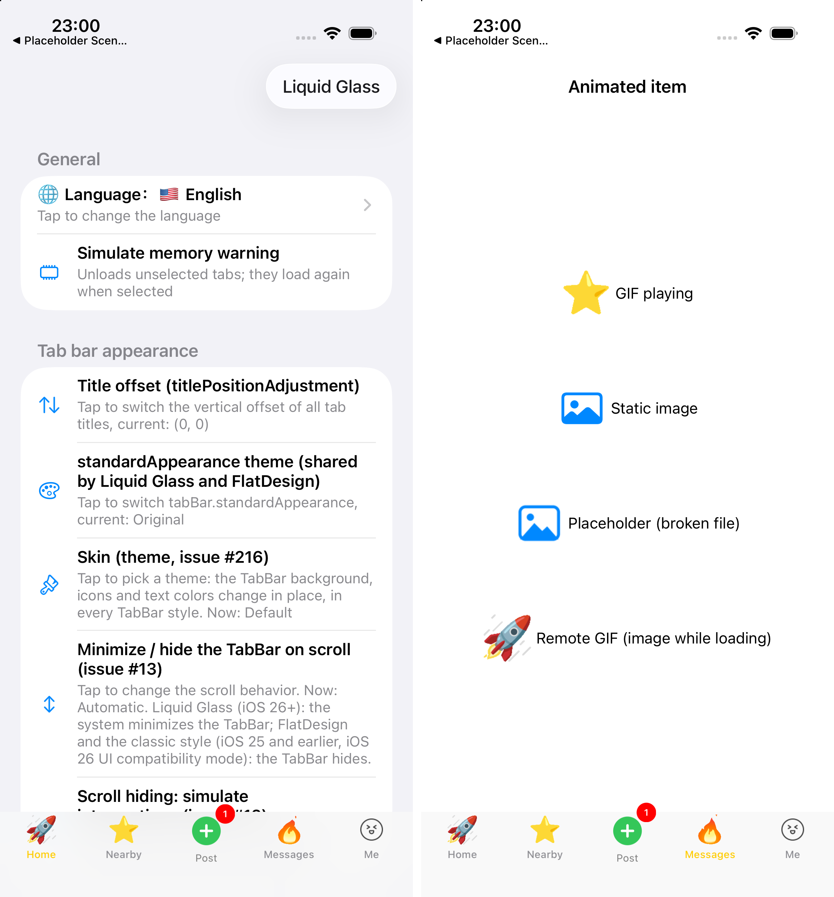 Screenshots, top to bottom: before, after (Messages selected, Home not). 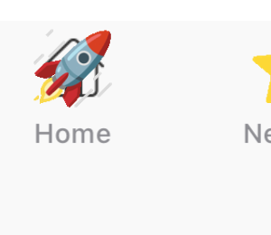  Also added: `testFlatDesignTabButtonsAreAccessibilityElements` (each FlatDesign tab button is an accessibility element labeled with its title, no ancestor hides it; passes). |
| B14 | **Not a bug (closed 2026-11-17)**: on the iPhone 18 Pro simulator (iOS 27.2, Xcode 27.2) the same row draws 🌐 and the flag correctly (screenshot below), so the boxes come from the iOS 26.3 simulator. Original report: the language row of the demos (`cyl_languageCell(for:)`) shows "?" boxes for its emoji (🌐 and the flag of `CYLLanguageNames.flaggedName`) on the CYL 17Pro simulator (iOS 26.3), in every tab bar style. Suspected: the simulator's emoji font; check on another simulator or a device before changing code. 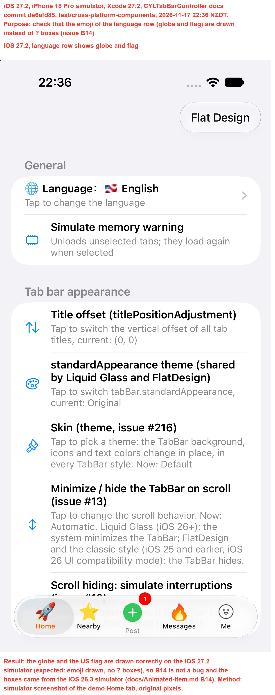 |
| B15 | **DONE (2026-11-21; was TODO, fix not merged yet)**: PR #819 is merged into `feat/cross-platform-components` (2026-11-17, merge commit 264ee632); the fix is in `Example-Android/cylanimateditem/src/main/kotlin/com/cyl/animateditem/CYLTabBarItemAnimation.kt` (`enableMergePathsForKitKatAndAbove(true)` on every view the Lottie animator creates); `CYLTabBarControllerPortTest` 16 / 16 (`lottieAnimatorWorksWithLottieAndroid` checks it) and all Android unit tests 249 / 249 (`gradle -p Example-Android testDebugUnitTest :tabpages:test`, Windows 11, Gradle 9.4.1, JDK 21; JDK 25 fails Robolectric with "Unsupported class file major version 69"). Original entry: **Android, `CYLLottieTabBarItemAnimator` did not enable merge paths** (found and fixed by the CYLTableViewPlaceHolder session, commit 1dc25418 on the branch of PR #818, pushed after #818 was merged at a43c124d, so not on `feat/cross-platform-components` yet): lottie-android draws a file with merge paths (CYLTableViewPlaceHolder's `CYLPlaceholderEmpty.json`) wrongly or not at all and logs "Animation contains merge paths ... must be manually enabled". Fix in the animator: every view it creates calls `enableMergePathsForKitKatAndAbove(true)`; `CYLTabBarControllerPortTest` checks it (16 / 16); verified by that session on the emulator. Now PR #819 (1dc25418 cherry-picked onto the merged branch as e8b66957, `fix/android-lottie-merge-paths`), which CYLTableViewPlaceHolder pins and verified on the emulator; left: the owner's merge. |
| B16 | **Flutter examples: Android Gradle Plugin below Flutter 3.50's minimum** (found by the CYLTableViewPlaceHolder session with Flutter 3.50.0; a build error, no screenshot): `flutter build apk` of `example/` failed with "Your project's Android Gradle Plugin version (9.1.0) is lower than Flutter's minimum supported version 9.1.1". Fix: AGP 9.1.1 in `example`, `example_pag` and `example_rive` (`android/settings.gradle.kts`) and in the plugin's own `android/build.gradle.kts`. Built here with Flutter 3.50.0 (`flutter build apk`, example), which also warned that Kotlin 2.4.10 support will be dropped: the examples' Kotlin Gradle plugin is now 2.4.21 (the warning is gone). Plugin `flutter test`: 5 pass. Lockfiles refreshed (2026-11-18, `gradlew buildEnvironment :app:dependencies :flutter_cyltabbar:dependencies --write-locks` in `example`, `example_pag` and `example_rive`; they now record AGP 9.1.1 and Kotlin 2.4.21, plus each `settings-gradle.lockfile`, as `Example-Android` has); `flutter build apk --debug` of `example` passes with them. **Fixed.** |
| B17 | **Flutter and React Native main examples: Rive tab icons nearly invisible** (found here 2026-11-17 on the Android emulator, Flutter 3.50.0 example with the "Rive tab icons" switch on; screenshot `docs/assets/animated-item-flutter-rive-icons-faint.png`: top, Home selected; bottom, Nearby selected, its search icon white on the light bar): the B12 API exists, but the two examples did not set it. Fix in the examples only, through the library's API: their Rive options add `tint: 'title'`. **Checked** in the Flutter example (Android emulator, Flutter 3.50.0): with the switch on, the selected Nearby icon draws in the green title color and the others in gray (`docs/assets/animated-item-flutter-rive-icons-tinted.png`). **Checked** in the React Native example too (2026-11-18, Android emulator after a cold boot, JS from Metro at 4cb61807; checked by the CYLTableViewPlaceHolder session): Messages tab, "Rive tab icons" on, then Nearby. The selected Nearby icon is #34C759, the same as its title; the unselected icons (Messages, Me) are #1C1C1E, the same as the unselected titles, and clearly visible on the #FAFAFA bar (`docs/assets/animated-item-rn-rive-icons-tinted.png`). The unselected shade is the theme's unselected title color, not something the tint chooses. **Fixed.** |
| B18 | **Not a core bug (2026-11-17), iOS Example-GIF, Messages tab "Animated item" page** (reported by the owner with the screenshot below, iPhone 17 Pro simulator, iOS 26.4): the "Static image" row and the "Placeholder (broken file)" row showed what looked like the same picture. Checked first: the example passes different inputs (`image: UIImage(systemName: "photo")` and no animation for the first; no image and a broken `cyl_broken.gif` for the second), and the component shows them correctly (`-cyl_updateIcon`: the static image when there is one, `placeholderImage` only without one, so the second row shows `cyl_animated_item_placeholder` from `CYLAnimatedItem.bundle`). The placeholder is itself a picture-frame icon, tinted blue like the SF Symbol `photo`, so the two looked alike. Fix in the example only (the core is right): the static row uses `house.fill`. Screenshots, before then after (iOS, iPhone 17 Pro simulator, iOS 26.4, Xcode 27.2 / iOS SDK 27.2, Example-GIF, base [`c096a1af`](https://github.com/ChenYilong/CYLTabBarController/commit/c096a1af), 2026-11-17 23:54 NZDT): 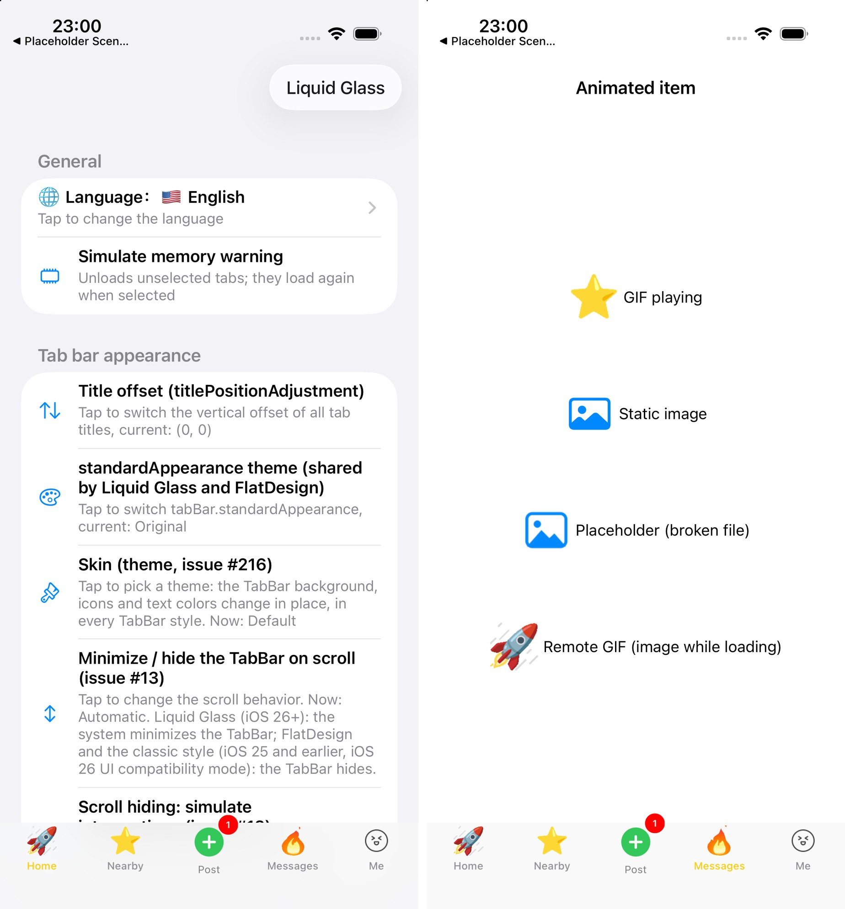  |
| B19 | **HarmonyOS, tab badges at the icon's top-left after the tab icons moved onto `CYLAnimatedItemView` (760dfba2, this session)** (found and fixed by the Mac CYLTabBarController session, its HarmonyOS issue list row 51; verified on the emulator): the component's root Flex had no size, so in `isBare` mode it filled the tab slot and the tab's icon Stack, which places the badge, grew with it. Fix in `cylanimateditem` (fa221021): a bare, icon-only item takes the icon's width and height. Keep that sizing when changing the component's `build()` or the tab icon Stack. (This session's own screenshot of 760dfba2 shows the 99+ badge left of the Messages icon; it was missed.) |
| B20 | **Flutter main example: the "Rive tab icons" switch jumps back to the first tab** (found by the CYLTableViewPlaceHolder session on 2026-11-18, Android emulator, `com.cyl.tabbar.flutter_cyltabbar_example`; screenshot `docs/assets/animated-item-flutter-rive-switch-before.png`, taken during that check): on the Messages tab, turning on "Rive tab icons" rebuilt the page and selected the first tab. The React Native example stays on Messages. Cause: the example's switch handler bumps `_generation`, the page's `ValueKey`, so the page state (with `_selectedIndex`) is created again. The core needs no change: `CYLTabBar.didUpdateWidget` already sends a changed configuration with `setConfiguration`, and the Android host re-applies `selectedIndex` after the rebuild (`CYLTabBarHostView.applySelectedIndex`). Fix in the example only, as the bug is only there: the switch no longer bumps `_generation`; the core API it needs already exists. **Checked** (Android emulator, same day): on Messages, turning the switch on swaps the icons to Rive and Messages stays selected; turning it off swaps them back, still on Messages (`docs/assets/animated-item-flutter-rive-switch-after.png`). **Fixed.** |
| B21 | **HarmonyOS `CYLAnimatedItemView`: `spacing` is ignored, the title touches the icon; no title line count** (found by the CYLTableViewPlaceHolder session on 2026-11-18, x86_64 emulator, its animation detail page on `CYLAnimatedItemView`; screenshot `docs/assets/animated-item-harmonyos-spacing-before.png`): `@Prop spacing: number = 4` is declared but never read, so with `axis: Vertical, iconSize: 180, spacing: 8` the layout dump shows the icon Stack ending at y 1642 and the title starting at y 1642: a gap of 0 px whatever `spacing` is. A static image or a tight animation touches the title. Android (`spacingDp`), iOS (`spacing`) and the mini program (`titleSpacing`) leave the gap. Also asked: the title is always one line (`maxLines(1)`), while the mini program item has `titleLines` (1 by default, 0 no limit); without it that page keeps another view for long wrapping texts. Fix in the component (`cylanimateditem`): the title gets a margin of `spacing` vp after a shown icon (top on the vertical axis, left on the horizontal one) and is centered on the vertical axis; an inline accessory keeps `spacing` from the icon and title, as on Android; new `@Prop titleLines` (1 by default, one line with an ellipsis; 0 no limit). Built (`scripts/harmonyos-build.sh`, HAP + HAR); the demo's tab bar (bare icons, no title) is unchanged on the x86_64 emulator. **Checked** by the CYLTableViewPlaceHolder session (same day, its animation detail page, pinned at 0ce518a8): with `spacing: 8` the icon box ends at 1628 px and the title starts at 1656 px, 28 px = 8 vp (0 before), icon and title on one center line; its HarmonyOS unit tests 89 / 89; screenshot in that repository, `docs/assets/harmonyos-animation-detail-item-spacing.jpeg`. `titleLines: 0` on a long title is not exercised yet (its titles are short). **Fixed.** |
| B22 | **HarmonyOS `CYLAnimatedItemView`: no speed, loop or restart of its own, so the host kept handling playback** (asked by the user on 2026-11-18: "Fix HarmonyOS's CYLAnimatedItemView has no speed, loop or restart of its own, so the model keeps handling playback."). The engine context carried only the file, size and selection, built once per file; the tab bar passed its own speed, loops and replay token straight to each engine view, and CYLTableViewPlaceHolder needed a bridge (`CYLPlaceholderAnimatedItem`). Fix in the component (`cylanimateditem`): props `animationSpeed` (1), `animationLoops` (false) and `animationRestartToken` (any change plays from progress 0), and `CYLAnimatedItemController.restartAnimation()` (exported) for imperative use, as iOS / Android `restartAnimation`; the context gains `speed`, `loops` and `restartToken`. The builder is now called with one object literal whose fields read state, so ArkUI passes it by reference and the engine view gets new values live; a context object alone is rendered once (the first try, replacing a `@State` context, did not reach the engine). cyltabbar now gives its playback to the component, and its engine views read it from the context; `CYLLottieIcon.speed` is now a watched prop applied with `setSpeed` (it was set once at load). **Checked** on the HarmonyOS x86_64 emulator (demo, Lottie tab 消息, frames compared in the icon box without its badge): Loop on, the icon still changes 3 to 6 s after selection; Loop off (from the start, or after being on), it is still after one pass (0 changed pixels at 4 s, 6 s and 12 s). Speed and restart **checked** by the CYLTableViewPlaceHolder session (same day, x86_64 emulator, its animation detail page driven by item props only, pinned at ad3dca0e which includes 238a384a; 12 screenshots per case of the one-shot `CYLPlaceholderCelebrate.json`): `CYLAnimatedItemController.restartAnimation()` draws the finished one-shot again; at 3× the one-shot ends after 6 captures, at 1× it still draws at capture 12; with Loop on it keeps cycling; layout unchanged (centered, 8 vp spacing). Its bridge `CYLPlaceholderAnimatedItem` is no longer needed there. Built: `scripts/harmonyos-build.sh`, HAP + HAR. **Fixed.** |
| B23 | **Fixed (2026-11-18), HarmonyOS: a re-tap on the selected Lottie tab did not replay its icon.** Found while checking B22 on the x86_64 emulator, tab 消息. hilog showed that the re-tap reached the tab bar (`replayTokens[2]` = 1) and `CYLAnimatedItemView` (`animationRestartToken` = 1), but `CYLLottieIcon.cylReplay` never ran. Cause: the tab bar wraps its engine builder in an arrow function (to bind `this`), so ArkUI copies the builder values once. The new restart token never reaches the engine view's `replayToken` prop. Passing them as one object literal did not help either (tried). Fix (in the component): `CYLAnimatedItemAnimationContext.setRestartHandler` lets the engine view register its replay, and `CYLAnimatedItemView` calls it each time the restart token grows (prop or `CYLAnimatedItemController.restartAnimation()`). `CYLLottieIcon`, `CYLRiveIcon` and `CYLSVGAView` register it through the new `registerReplay`, and the tab bar passes `context.setRestartHandler`. Checked on the emulator: the frames right after the re-tap differ from the resting icon in 1364-2401 pixels of the icon box (0 before the fix), and the icon plays from its first frame to the end. A tab switch still plays. Screenshot: [animated-item-harmonyos-retap-replay.png](assets/animated-item-harmonyos-retap-replay.png). Rive re-tap **checked (2026-11-18, Mac session, arm64 emulator "CYL TabBar Test", HarmonyOS 6.0.1, at 711babc1)**: in the demo's Rive configuration, a re-tap on the selected CHAT tab replays its icon (172-1688 changed pixels in the icon box during the replay) and it rests again on its first frame (0 changed pixels 3 s and 6 s later). Screenshot: [animated-item-harmonyos-rive-retap-replay.png](assets/animated-item-harmonyos-rive-retap-replay.png). SVGA re-tap **checked (2026-11-18, Windows session, x86_64 emulator, at 0edd818b)** on the demo page "SVGA Tab 图标（配置文件）" (the earlier note "the demo has no SVGA tab" was wrong): a re-tap on the selected Home tab replays its icon from the first frame (4715, 1114, 439 and 252 changed pixels in the icon box in the frames after the tap) and it rests on its last frame again (0 changed pixels 3 s and 6 s later). Screenshot: [animated-item-harmonyos-svga-retap-replay.png](assets/animated-item-harmonyos-svga-retap-replay.png). |
| B24 | **Fixed (2026-11-18), Android: the GIF animation view ignored `animationLoops`, `animationSpeed` and `restartAnimation()`** (requested by the Windows CYLTableViewPlaceHolder session, whose refresh demo needs a looping GIF on a plain `CYLAnimatedItemView`). `CYLGIFTabBarItemAnimationView` played once in `cyl_playAnimationView` whatever the player said. Fix: two optional hooks on `CYLTabBarItemAnimationPlayableView`, `cyl_setAnimationViewSpeed` and `cyl_setAnimationViewProgress`, which the view animator's player forwards `animationSpeed` and `progress` to, as it already forwarded `loops`. The GIF view repeats through ValueAnimator's own `repeatCount`. Restarting from an end listener would spin when the animator duration scale is 0 (found here: the first version hung the unit test worker). Turning loops off lets the pass playing end on the last frame. A speed change applies to the pass playing, and progress 0 before play starts from frame 0. Tests: `CYLGIFPlaybackTest` (5), `:cylanimateditem` 46 / 46 and lint clean, with JDK 17 (Robolectric 4.14 rejects class files of the JDK 25 that ships with Android Studio). Robolectric does not time animators, so the tests check the animator's setup. The timing check on the emulator (loop on/off, 3x, Play all) is done by the CYLTableViewPlaceHolder session after it pins this commit. **The device check failed at ad385a5a** (Windows CYLTableViewPlaceHolder session, emulator-5556, API 37): the GIF sat on its last frame. The ClassifyMenu session saw the same, at older commits too: Fire never changed, Rocket and Star changed once. Two causes, both older than B24. (1) `android.graphics.Movie` (deprecated) draws one frame on API 37 whatever time it is given, so Fire, a GIF given as an image (`CYLGIFDrawable`), never moved. Fixed with `CYLGIFDecoder` / `CYLGIFFrames` in cylanimateditem: a small GIF decoder with LZW, color tables, interlacing, transparency, the disposal methods, and per-frame delays (10 ms or less shows for 100 ms, as browsers do). Both the GIF view and `CYLGIFDrawable` draw its frames. (2) The GIF view played with a ValueAnimator, and on this emulator the app process got an animator duration scale of 0 with the setting unset. A log showed `tick 0`, then `tick 2189` 23 ms later; with `animator_duration_scale` set to 1 it played. Lottie kept playing because it computes frames itself. Fix: the view plays on the display frame clock (`postOnAnimationDelayed`, at least 10 ms apart) with the GIF time from the elapsed time × speed, as Lottie does. Checked on emulator-5556 with the setting unset, in Example-Android example-gif: Star changes 10, 643, 377, 234 px between successive frames after the tap and then rests (0 px), Rocket 189 and 72 px, and Fire about 950 px in every frame pair ([screenshot](assets/android-gif-decoder-frame-clock.png)). Tests: `CYLGIFDecoderTest` (5: frames, delays, colors, an interlaced 40 x 30 image with 9-bit codes, not a GIF, the view's frame at a time) and `CYLGIFPlaybackTest` (5, now timed: one pass, loops until turned off, 3x / 0.5x, restart from frame 0, playing with an animator scale of 0); `:cylanimateditem` 54 / 54, lint clean; `:cyltabbar` and `:example-gif` 129 / 129 with the decoder. **Loop confirmed in an app** (Windows CollectionViewClassifyMenu session, its Android example on emulator-5556, API 37, animator scale unset, 4f73209c): with Play all and no loop, Fire (838-885 px), Rocket (142-185) and Star (358-406) play one pass and rest at 0; with Loop on they repeat (Fire 512-835, Rocket 51-191, Star 103-511 px per 0.6 s pair); before the fix Fire showed 0 and Rocket and Star changed once (CollectionViewClassifyMenu feat/harmony docs/assets/android-gif-rive-home-fixed-4f73209c.png, panels 1-4). **Speed, loop off and Play all confirmed in an app** (Windows CYLTableViewPlaceHolder session, android/merged Animations detail on a plain `CYLAnimatedItemView`, emulator-5556, 4f73209c): loop on at 1x, 19 of 20 captures changed over 14 s; loop off plays one pass and rests on frame 19 from 2.1 s on; Play all with loop off plays one pass; NoFavorites.gif (2190 ms) at 3x ends 1.9 / 1.8 s after the tap and at 1x 3.1 / 3.1 s (about 0.9 s of tap latency: a 0.73 s pass against 2.19 s); evidence: CYLTableViewPlaceHolder feat/android-refresh-port-followup docs/assets/android-17-api37-x86_64-emulator-gif-item-b2cbe6a-20261118-sheet.png (ad385a5a stuck on the last frame, 4f73209c loop on, loop off, 3x; pinned in e52f7b5). B24 is closed. |
| B25 | **Fixed (2026-11-19), HarmonyOS: the Rive tab icons ignored the icon color settings, so `tint=title` does not draw them as the tab bar's icon colors.** User prompt, verbatim: "harmony rive 动效tabbar tint 效果不好，请按图标参数正确显示。修改harmony 在cyltabbar里的core代码。正确显示参数" (English: the HarmonyOS Rive animated tab bar tint looks bad; draw it from the icon parameters; change the HarmonyOS core code in cyltabbar; show the parameters correctly). Seen on the arm64 emulator at 5dda9f42 ([before](assets/animated-item-harmonyos-rive-tint-option.png)): the HarmonyOS core has no icon color keys at all (`CYLTabBarItemIconColor`, `CYLTabBarItemSelectedIconColor`, `CYLTabBarControllerIconColor`, `CYLTabBarControllerSelectedIconColor`, which iOS and Android have), so the demo theme's `CYLTabBarItemSelectedIconColor` is dropped, and `tint=title` follows only the title colors; iOS draws a `title` tint in the tab's icon (template) color. Reproduce: demo row "Rive Tab 图标（配置文件）" with `tint=title` in the Rive URLs. Plan (core, `cyltabbar`): (1) the four keys on items, themes and the controller; (2) `tint=title` = the icon color for the tab's state, else the title color; (3) the demo's Rive configuration uses `tint=title`, as iOS. Rubric: 100 = keys parsed and used, tint follows them on the arm64 emulator (selected and unselected, screenshot), build passes, docs updated, pushed; 60 = keys parsed and the tint follows them in a build. **Result** (score 100/100): (1) `cyltabbar` reads `CYLTabBarItemIconColor` / `CYLTabBarItemSelectedIconColor` on a tab and in the theme, and `CYLTabBarControllerIconColor` / `CYLTabBarControllerSelectedIconColor`; new item attributes `iconColor` / `selectedIconColor` (exported keys) and controller props `iconColor` / `selectedIconColor`; a tab without its own gets the theme's. (2) `tint=title` = the item's icon color for its state, then the controller's, then the title color (`cylTabAnimationTint`). (3) Found on the way: `CYLAnimatedItemView` composited the tint "source atop", so a semi-transparent tint left a white icon white; it is now "source in" (the shape takes the color and its alpha, as Android's SRC_IN). (4) Demo: both Rive configurations use `tint=title` on the icons.riv tabs and set `CYLTabBarItemIconColor`; their `#99FFFFFF` (meant as 60 % white) is now `#FFFFFF99`, because files use `#RRGGBBAA`; the configuration page now passes the file's unselected title color and icon colors to the controller. Checked on the arm64 emulator: the selected Rive icon is white and the others 60 % white, like the titles; a local copy with orange / gray icon colors draws the icons orange / gray while the titles stay white ([screenshot](assets/animated-item-harmonyos-rive-icon-color-tint.png)). Lottie tint re-checked after the "source in" change (Windows session, x86_64 emulator, 506df1b5, local build copy with `tint=title` on Messages and `tint=%23FF3B30` on City): unchanged, Messages gray (128,128,128) unselected and orange (248,120,0) selected like its title, City red in both states ([screenshot](assets/animated-item-harmonyos-lottie-tint-src-in.png)). Static icons (Windows session, 2026-11-19, score raised to 100/100): a static (non-animated) HarmonyOS tab icon now takes the icon colors too, the same rule as Android's "automatic" (#787): the item's `iconColor` / `selectedIconColor`, then the controller's, drawn SRC_IN (`cylIconColorFilter`, shared matrix `cylTintColorFilter`, also used by the GIF `tint`); with no icon color set the image keeps its own colors. Checked on the x86_64 emulator (local build copy, Me and City without Lottie, Me with `#8E8E93` / `#FF3B30`): Me measured (144,144,146) unselected and (251,64,54) selected while its title keeps the bar tint; City, without an icon color, keeps its black image ([screenshot](assets/animated-item-harmonyos-static-icon-color.png)). |
| B26 | **Fixed (2026-11-19), Flutter hosts on Android: Rive icons in a texture-layer platform view (`AndroidView`) stay empty until something redraws the view.** Found by the Windows CollectionViewClassifyMenu session while checking Flutter and React Native Android for the Mac session (CollectionViewClassifyMenu `cyl_tag_list` example, emulator-5556, API 37 x86_64, core 776b4635, rive-android 10.3.0). At rest, the Rive row (Home, Done, Menu) was empty on most launches (all three 27 s after start; on another launch only Menu); after Play all every icon drew and looped. The React Native example with the same core, and native Android, showed the resting frame ([before](assets/animated-item-android-flutter-rive-blank-at-rest.png)). Cause, from logs in the view: rive-android's renderer was attached, active and running on its own thread, drawing the resting frame into its TextureView, but in a Flutter `AndroidView` (texture-layer composition, SurfaceProducer backend) a new TextureView frame reached the screen only when something else redrew the platform view: a small scroll showed all three resting frames at once (Menu on its X); during Play all the Lottie icons and the button redrew it. Invalidation from inside the platform view did not redraw it either: a wrapper that invalidated itself on every frame drew 12 times in 2 s. Two core changes were tried and dropped (replaying the settled machine when the surface arrives; redrawing the wrapper while Rive draws): the core cannot reach Flutter's composition from Android. **Fix, in the host:** host the native view with Hybrid Composition (`PlatformViewLink` + `AndroidViewSurface` + `PlatformViewsService.initExpensiveAndroidView`), as this repository's `CrossPlatform/flutter_cyltabbar` does for its tab bar and `CYLAnimationView` since 273a4175. A Flutter plugin that shows Rive (or any TextureView, such as PAG's `PAGView`) icons through `cylanimateditem` must do the same. Applied in CollectionViewClassifyMenu's `cyl_tag_list` (`lib/cyl_tag_list.dart`, Android branch). **Checked** on the same emulator: Home, Done and Menu (on its X) drawn 20 s after start on 3 launches of 3; Play all plays them; with Loop on all three change in every frame pair over about 7 s; a tap still selects a tag ([after](assets/animated-item-android-flutter-rive-hybrid-composition.png)). |
| B27 | **TODO (filed as B20 in PR #820; renumbered on merge, B20 was taken). WeChat Mini Program, `cyl-rive`: some Rive icons play once, then neither loop nor play again** (reported by the owner, 2026-11-18; CollectionViewClassifyMenu's mini program Animations page, section "Rive · pod 'CYLTabBarController/Rive'", `cyl-tag-button` → `cyl-animated-item` → `cyl-rive`; tracked there in `docs/animated-item-migration.md` TODO 6): with loop on, some Rive icons play once and never repeat, and after that Play all (`cyl_playFromStart`) does not play them either: they stay static. Screenshot: TODO (the section is below the fold; WeChat DevTools' `automation_*` tools, needed to scroll, do not connect from the Windows CLI). Cause read in `cyl_playFromStart` (to confirm in DevTools), per file of that section: (1) a **state machine without input** (`house.riv`, `State Machine 1`; also `legacy` files with a state machine, since `legacy` is not read): nothing to set and the state machine is never restarted, so it plays once on load and every later play does nothing; (2) a **boolean input held on** (`menu_button.riv`, `input=isOpen`, `duration=0`): 0 keeps the input true, it never goes back to false, so setting true again changes nothing; (3) a **trigger** (`check.riv`, `triggerInput=Check`): fired on each play, but there is no loop path; (4) a **linear animation** (`button.riv`, `animation=active`): `time = 0` on play, repeats only when the file's own loop type does; (5) on the tab bar (boolean `active`, 1 s): the fixed 1.4 s repeat does not follow the state machine, and a reload (B11) or a stop clears `inputTimer`. Fix in `cyl-rive`: restart a state machine without input (a new `StateMachineInstance`), turn a held boolean off before setting it again, give triggers and linear animations a loop (on `loop`, after the machine settles / the animation ends), tests in `rive-miniprogram/test`. **All platforms (2026-11-18, the owner also saw it in CollectionViewClassifyMenu's React Native example, where some Rive tags never play)**: the engines share the same single-shot design, with no loop of their own: Android `CYLRiveTabBarItemAnimator.cyl_playAnimationView` (also React Native and Flutter on Android), iOS `CYLRiveTabBarItemAnimationView.playAnimation` / `CYLRiveLegacyTabBarItemAnimationView.playAnimation`, HarmonyOS `CYLRiveTabBarItemAnimator.ets` (tab bar only, linear animations `Loop.ONESHOT`) and `cyl-rive`. Per case: a state machine without the input to set (`house.riv`, `stateMachine=State Machine 1`): Android sets the default `active`, `hasInput` is false, so **it never plays**, and iOS legacy returns at `guard let input` (no play); a boolean held by `duration=0` (`menu_button.riv`, `isOpen`): true once, never false, so later plays change nothing (Android, iOS, HarmonyOS, mini program); a trigger (`check.riv`, `Check`): fired per play, no loop. Seen on the Android emulator (API 37) in the React Native example, loop on, Play all, frames over 12 s (CollectionViewClassifyMenu `docs/assets/react-native-android-rive-b20-frames.png`): the Lottie row changes in every frame; Rive Home never moves; Done shows only a small arc, the check never draws; Menu plays once (an arrow) and then stays at x. **iOS, seen** (the Mac CollectionViewClassifyMenu session, 2026-11-18; iPhone 17 Pro simulator, iOS 27.2, pins `fe5c3ae`, launch screen `-CYLExampleScreen animations-rive-loop`, loop on, Play all, frames 4 to 14 s after; CollectionViewClassifyMenu `docs/assets/ios-rive-b20-frames.jpeg`, `ios-rive-b20-play-all.png`): Shapes and Truck loop; Home (`house.riv`) never moves; Done stays on the finished check; Menu stays on its menu icon; Button stays on its small arc; the `icons.riv` dark tags never move. Same as Android. Fix (all engines, one behaviour): a play with nothing to set restarts the state machine (a new instance, or `reset` + `play`); a held boolean goes false then true; with `loop` the engine (or `CYLAnimatedItemView`) replays after the machine settles or the animation ends. |
| B28 | **Fixed (2026-11-19), WeChat Mini Program: the Rive `tint` option never reached the icon, so `tint=title` Rive tabs kept the file's white.** Found by the Windows session while checking 046c194d / 474a02c6 in WeChat DevTools for the Mac 小程序开发 session (example with `npm run setup -- --animation=rive`, Windows 11 DevTools, logged in). The models were right and tested (`cyl-tab-bar` computes `animationTint`, `cyl-tab-bar-item` resolves "title" per state, `cyl-rive` fills source-atop), but a runtime read of the components showed `animationTint` = '' on every tab item, its `cyl-animated-item` and `cyl-rive`: cause, `src/cyl-tab-bar/index.wxml` never bound `animation-tint` on `<cyl-tab-bar-item>`. Fix (component): `animation-tint="{{item.item.animationTint}}"`; new test `cyl-tab-bar passes every icon color option to cyl-tab-bar-item (B28)` reads the template (fails without the fix); `npm test` 53 / 53. Checked in DevTools: `cyl-rive` `tint` is #34C759 on the selected tab and #FF0000 on the others, the example's title colors (`app.json` `selectedColor` / `color`); the selected Nearby icon is green and the unselected icons red, white before the fix ([screenshot](assets/wechat-miniprogram-rive-tint-title.png)). Rubric: 100 = cause found, fixed in the component, test, DevTools screenshot before / after, docs, pushed; 60 = cause found and fixed. Score 100/100. Not covered here: a phone (the canvas is drawn on screen there, not through a snapshot), with the Mac 小程序开发 session. |
| B29 | **Fixed (2026-11-19), HarmonyOS: `CYLAnimatedItemView` filled its parent, so in a column the first item took the whole height and hid the items below.** Found by the Windows HarmonyOS session while building `CYLAnimatedItemStackView` (first emulator run: only "No messages yet" showed, its bounds 576–2678 px of a 520–2734 px stack). Cause: the view is a `Flex` without a size, and an ArkUI `Flex` without a size fills its parent; a tag in a fixed-size cell wants that, an item in a stack does not. Also found: a tap on an item view inside a wrapper always reached the item view's own `Flex` click, whatever hit test mode the wrapper set on the custom component. Fix (in the component, `cylanimateditem`): new option `sizesToContent` (width and height `auto`; default off, so tags and the tab bar are unchanged); the stack uses it with `isBare` (the item view only draws, the stack's wrapper is the touch target and the screen reader element). Checked on the x86_64 emulator: five items centered, the hint wrapped, every tap reaching the right action ([screenshot](assets/animated-item-harmonyos-stack-view.png), first cell before the fix). Score 100/100. |
| B30 | **Fixed (2026-11-19), HarmonyOS: a system symbol image (`$r('sys.symbol.xmark')`, `$r('sys.symbol.square_and_pencil')`) drew nothing in `CYLAnimatedItemView`.** Reported by the winCollectionViewClassifyMenu session (its tag draws its edit and close icons with `CYLAnimatedItemStackView`, 97b87b7b), reproduced in the stack demo (build copy): the row of two symbol items was blank. Cause: an ArkUI `Image` does not draw `sys.symbol` resources (runtime resource type 40000; media is 20000, logged on the emulator). Fix in the component: `cylIsSymbolResource` (new `CYLAnimatedItemResources.ts`, exported) and `CYLAnimatedItemView` draws such an image as a `SymbolGlyph` sized to `iconSize`, in `iconColor` (the theme's primary font color without one). Test: `node --test CrossPlatform/harmonyos-cyltabbar/cylanimateditem/test/*.test.mjs` 19 / 19 (1 new). [Before / after](assets/harmonyos-animated-item-sys-symbol-b30.png). |

## [CN]截图（iOS 27）
## [EN]Screenshots (iOS 27)

| 中文 | English |
|:---|:---|
|  | iOS, iPhone 17 Pro simulator, iOS 27.0, Xcode 27.2 (27B52, iOS 27.2 SDK), macOS 27.3, Example-GIF (FlatDesign, GIF tab icons), commit [c8132d26](https://github.com/ChenYilong/CYLTabBarController/commit/c8132d26) plus the macro fix of this change, 2026-11-17 22:00 NZDT; top: Home selected, bottom: Messages selected. |
| 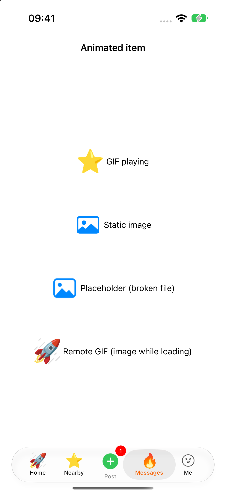 | iOS, iPhone 17 Pro simulator, iOS 27.0, Xcode 27.2 (27B52, iOS 27.2 SDK), macOS 27.3, Example-GIF (FlatDesign, GIF tab icons), commit [c8132d26](https://github.com/ChenYilong/CYLTabBarController/commit/c8132d26) plus the macro fix of this change, 2026-11-17 22:00 NZDT; the demo page on the Messages tab. |
| 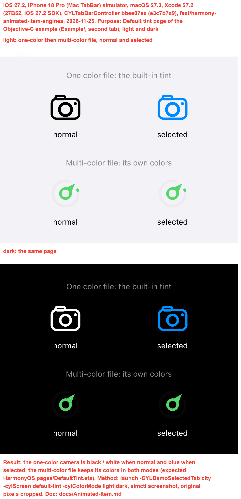 | iOS 27.2, iPhone 18 Pro (Mac TabBar) simulator, Xcode 27.2, Example (second tab, Default tint), commit [bbee07ea](https://github.com/ChenYilong/CYLTabBarController/commit/bbee07ea) (change [e3c7b7a9](https://github.com/ChenYilong/CYLTabBarController/commit/e3c7b7a9)), 2026-11-25: the Default tint page, light and dark. |
| 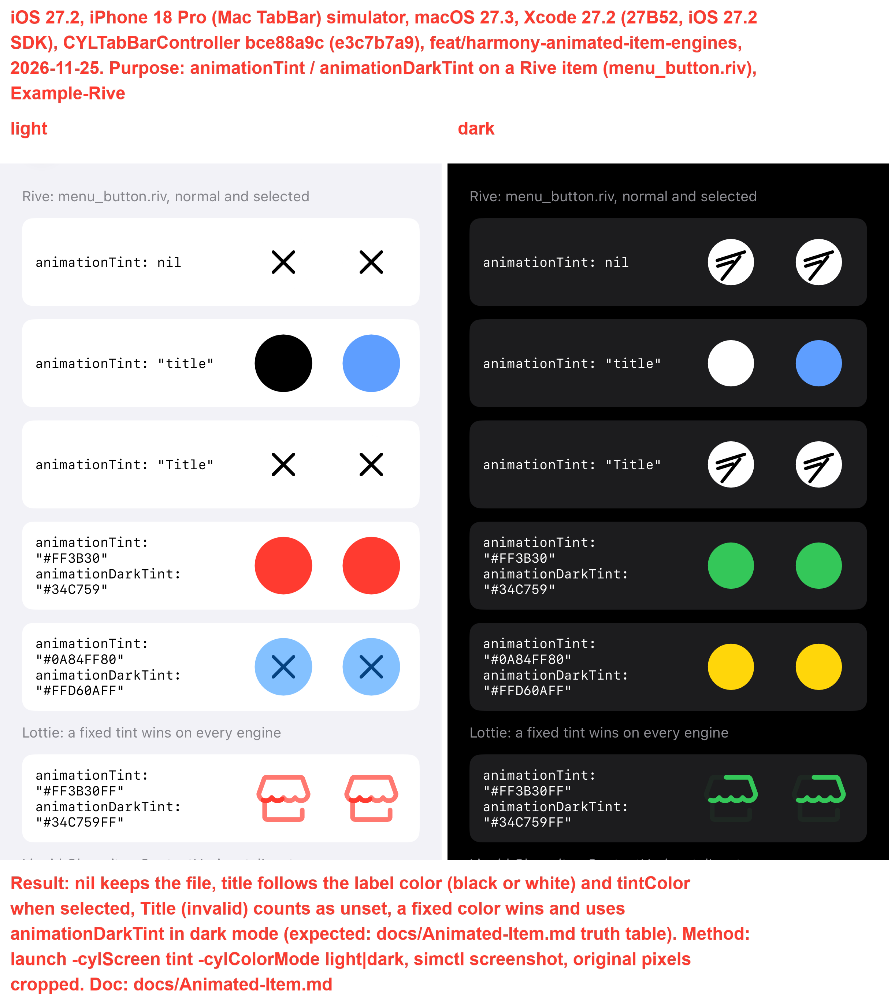 | iOS 27.2, iPhone 18 Pro (Mac TabBar) simulator, Xcode 27.2, Example-Rive tint page, commit bbee07ea, 2026-11-25: `animationTint` / `animationDarkTint` on menu_button.riv and a Lottie file, normal and selected, light and dark. |
| 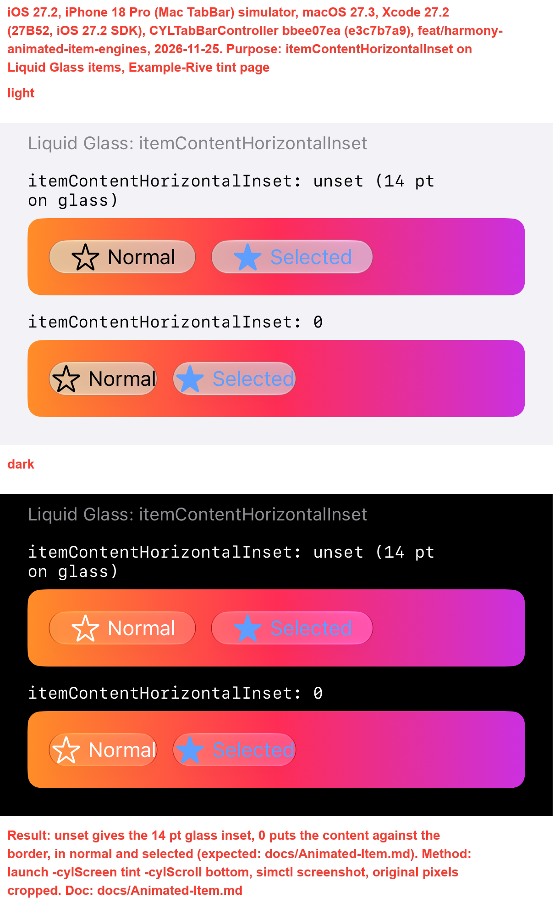 | iOS 27.2, iPhone 18 Pro (Mac TabBar) simulator, Xcode 27.2, Example-Rive tint page, commit bbee07ea, 2026-11-25: `itemContentHorizontalInset` unset (14 pt) and 0 on Liquid Glass items, normal and selected, light and dark. |

## [CN]TODO
## [EN]TODO

| 中文 | English |
|:---|:---|
| 本条按用户要求使用英文（见右列）。 | TODO (2026-11-25, iOS examples round, 85 / 100): (1) **Tag lists on iOS `Example/` and `Example-Swift/` (`docs/instructions/examples.md`)** not converted. Blocker: the iOS tag list (`CYLTagListView`, `CYLTagButton`, `CYLMenuFoldControl`, `CYLTagLongPressAction`) lives only in the CollectionViewClassifyMenu repository (pod `CollectionViewClassifyMenu`, pin b79d2031); this repository has no iOS component and `scripts/fetch-classifymenu.sh` has no iOS target. Pinning it needs a `pod 'CollectionViewClassifyMenu', :git, :commit` line in the Podfiles of `Example/` and `Example-Swift/` (the rule says examples' Podfiles must not need changes: owner decision), with `CYLAnimatedItem` resolved to the local `:path`. Most iOS rows are badge rows, which the rule keeps as rows; only the Gallery row (Home), the Default tint row (Nearby) and the teardown / push rows (Messages, which also carry badges) are candidates. (2) The new example strings ("Default tint", "Animation tint", "Tint", the captions) are English only, not in the 33 locales of `Example-Shared/CYLDemo.bundle` (HarmonyOS' own "Default tint" strings are English only too). (3) The "Play all / speed / loop" card (`CYLDemoPlaybackControlsView`) controls the tab bar's icons, not the items of these two pages; the pages loop their animations. (4) The Default tint row in the Nearby list is below the first screen (after the demo sections), so no screenshot of the list row itself; the page is opened by launch argument. (5) The one-color rule: the multi-color Lottie of the Default tint page is grey in both modes (file colors), as HarmonyOS. (6) `pod lib lint CYLTabBarController.podspec --quick --allow-warnings`, own `TMPDIR` (`/tmp/xpr/cyl-ios-lint-tmp`, sandbox off): **passed** ("CYLTabBarController passed validation", 1.100.0); the full lint without `--quick` (every subspec built) was not run. |
| 本条按用户要求使用英文（见右列）。 | Status, 2026-11-17 (latest at the link above). **Done**: the iOS pod `CYLAnimatedItem` (its own module, no dependency on CYLTabBarController; before 2026-11-17 the subspecs below; the component's core, static images, `CYLAnimatedItem.bundle` with the @2x / @3x placeholder, LICENSE and POLICY.md), its `Engine` and one `CYLAnimatedItem/<Type>` subspec per animation type (the old subspec names are compatibility names), Core depending on `CYLAnimatedItem/Core` and on no engine (`CYL_ANIMATION_ENGINE_AVAILABLE`), the tab bar's animation subspecs = Core + the matching `CYLAnimatedItem/<Type>`; HarmonyOS module `cylanimateditem` and mini program component `cyl-animated-item` (the HarmonyOS HAR builds; the mini program's `cyl-tab-bar-item` draws its icon with `cyl-animated-item`, bug B4); Android modules `:cylanimateditem` (view, engine, placeholder, notices) and `:cyltabbar` on it, Maven artifact `cyltabbarcontroller-animateditem`, the React Native and Flutter builds compiling it; the display priority (animation, then the static image, then the placeholder), the failure cases, the loading state for URL files. Per-type guards in the component's core (`CYL_LOTTIE_AVAILABLE`, `CYL_GIF_AVAILABLE`, `CYL_PAG_AVAILABLE`, `CYL_RIVE_AVAILABLE`, `CYL_SVGA_AVAILABLE`); every type's keys always exist, compile with a warning without their engine, fall back to the image or the placeholder and log the pod to add in debug builds; a license notice in every published package. Tests: Android 30 + 127 (lint clean); mini program 27 (`npm test`); iOS XCTests in `CYLAnimatedItemViewTests` (run 848: one test fixed in `57a527ef`, it could not deliver taps without a host app). **TODO**: (1) DONE locally 2026-11-17 (macOS 27.3, Xcode 27.2, iPhone 17 Pro simulator, iOS 27.2 SDK): `scripts/unit-tests.sh` passes (153 tests, 2 skipped, 0 failures, all `CYLAnimatedItemViewTests`; one run had an intermittent 5 s timeout in `CYLTabBarHostViewTests testTheControllerKeepsItsOwnDelegateBehavior`, which passed in the three other runs); every `CYLAnimatedItem` subspec alone passes `pod lib lint --skip-tests` with `XCODE_XCCONFIG_FILE=scripts/pod-lint.xcconfig` and the CYLTabBarController-Framework scheme builds (chenyilong-fe, 3e7d67a7); the full `pod lib lint CYLTabBarController.podspec --include-podspecs=CYLAnimatedItem.podspec` (every subspec) passes with no warnings at c03e59bf, except `CYLFlatDesignTabBar-ObjectiveC`, which failed once on Xcode's shared build database ("disk I/O error", another lint running at the same time) and passes when linted alone after the Carthage split; left: iOS CI on macOS 26; (2) DONE 2026-11-17 (macOS): iOS Lottie remote files, Objective-C (lottie-ios 2.x) and Swift (4.x), are downloaded by the animator through the shared URL session, marked as loading, then reported as loaded or failed, as GIF and PAG; test `CYLAnimatedItemLottieRemoteTests` (test spec `Tests` of `CYLAnimatedItem.podspec`, with lottie-ios 2.x; a stubbed URL protocol serves the files) passes under `pod lib lint CYLAnimatedItem.podspec --no-subspecs`; the LottieSwift path is compile-checked by `pod lib lint --subspec=LottieSwift` (a test spec of the 12.0 root cannot resolve the iOS 13 LottieSwift subspec); (3) DONE 2026-11-17, iOS tab bar: a late failure (`CYLTabBarItemAnimationDidFailNotification`) removes the tab's animation view and shows its image again, or the placeholder; the tab bar plays local files only, so a remote URL or a missing file shows the image or the placeholder from the start (the tab bar does not download; `CYLAnimatedItemView` does); (4) iOS FlatDesign `CYLFlatDesignTabBarItem` drawn by `CYLAnimatedItemView` itself: DONE 2026-11-17 for iOS too, the first step as on Android: `CYLFlatDesignTabBarButton` subclasses `CYLAnimatedItemView`, the item's image and title are the component's content (`image`, `title`, shown by the same `imageView` and `titleLabel`), the tab bar's layout overrides `-layoutContentInRect:`, the component's long press is off; test `testFlatDesignTabButtonIsTheAnimatedItemComponent` (Android: `CYLTabBarItemButton`, test `theTabButtonIsTheAnimatedItemComponent`); screenshots on iOS 27 ("Screenshots (iOS 27)" above: the tab bar looks as before); second step DONE for iOS 2026-11-17: the button's component animation is the tab's (`animationView`, `animationReady`, `reloadAnimation`, `playAnimation`, `restartAnimation`, `stopAnimation` answer with and act on the tab bar's animation view, so there is one animation view and the tab bar keeps late failures, speed, loops, dark colors and themes), test `testFlatDesignTabButtonsComponentAnimationIsTheTabsAnimation`; DONE on Android 2026-11-17 (bug B3): `CYLTabBarItemButton.animationView` is the tab bar's animation view; (5) HarmonyOS and the WeChat Mini Program: written 2026-11-17 (`cylanimateditem` module, `src/cyl-animated-item`; mini program model tests pass; the mini program component's playback, resting progress, GIF stills, Lottie data, `animationType` and `embedded` added by PR #815, merged 2026-11-17, `npm test` 41 after the merge); the HarmonyOS module builds (2026-11-17: `hvigorw assembleHar` succeeds; `scripts/harmonyos-build.sh` now copies and builds `cylanimateditem`, which it skipped before, so nothing had compiled it); left: try both on DevEco Studio / the WeChat DevTools, and cyltabbar's own animated tab icons are drawn by `CYLAnimatedItemView` since 2026-11-17 (`cyltabbar` depends on `cylanimateditem`; the component's `isBare` mode leaves taps and accessibility to the tab; the Lottie, Rive and SVGA views report `onLoaded`; checked on the HarmonyOS emulator, x86_64 test build without native libraries: `docs/assets/animated-item-harmonyos-tabbar.jpeg`, a tap on 消息 plays its Lottie, `animated-item-harmonyos-lottie-playing.png` at 0.3 s and `animated-item-harmonyos-lottie-done.png` after; Rive and SVGA need an arm64 device or the native libraries); (6) a demo page with screenshots: Android DONE 2026-11-17 (`DemoAnimatedItemActivity`, the Home tab's row "CYLAnimatedItemView": a GIF, a Lottie file, a missing file with the placeholder, a vertical item with an accessory and dragging; `docs/assets/animated-item-android-demo-page.png`, and `animated-item-android-demo-interaction.png`: a tap plays the Lottie, a drag is reported and the item springs back); iOS DONE 2026-11-17 (Example-GIF's Messages tab: GIF, static image, placeholder, remote GIF) and 2026-11-18 (a vertical item with an accessory and dragging, `docs/assets/animated-item-ios-demo-interactive-ios27.2.png`); (7) run the React Native and Flutter example builds with their toolchains; (9) the CYLAnimatedItem pod: confirm in iOS CI (`scripts/pod-lint.sh lib` lints both podspecs, the demos build with the new Podfile line); Swift Package Manager: DONE 2026-11-17, a separate `CYLAnimatedItem` product (targets `CYLAnimatedItemSwift` + `CYLAnimatedItem`, module map `CYLTabBarController/CYLAnimatedItem/include`; the tab bar's targets depend on it; the resource bundle is `CYLTabBarController_CYLAnimatedItemSwift.bundle`); Carthage: DONE 2026-11-17 (macOS 27.3, Xcode 27.2), a separate `CYLAnimatedItem` framework target and shared scheme in CYLTabBarController.xcodeproj (objectVersion 46): the component's sources, its 13 headers (public, umbrella `CYLAnimatedItem/CYLAnimatedItem.h`), the per-type animators (as in the CocoaPods pod) and `CYLAnimatedItem.bundle`; `CYLTabBarController-Framework` and the tests link it and define `CYL_ANIMATED_ITEM_SEPARATE_MODULE`, which makes the umbrella header and CYLTabBarController.m import the component as a module (as under CocoaPods); the framework builds and analyzes without warnings, `scripts/unit-tests.sh` 155 tests 0 failures, `CYLAnimatedItemView` only in CYLAnimatedItem.framework, which links nothing of the tab bar; `scripts/pod-lint.sh xcframework` zips both XCFrameworks and the Carthage demo embeds both (docs/Carthage-Example.md, screenshot). Was: TODO: the Carthage framework (CYLTabBarController.xcodeproj) still compiles the component into the CYLTabBarController module (a separate framework target); publish order on release: `CYLAnimatedItem` first (`scripts/pod-lint.sh push` does it); (8) migrate CollectionViewClassifyMenu, CYLSearchViewController and CYLTableViewPlaceHolder with this guide: started in both repositories on 2026-11-17, see "Downstream migration status". |
| 本条按用户要求使用英文（见右列）。 | TODO (2026-11-20), countdown style. **Update (2026-11-21, chenyilong-0b, macOS 27.3 + Xcode 27.2, iPhone 18 Pro iOS 27.2 simulator): (1) is DONE**: `pod lib lint CYLAnimatedItem.podspec --quick --allow-warnings` passes (CYLAnimatedItem 1.100.0); the Swift code compiles, `scripts/unit-tests.sh` runs 209 tests with 0 failures, among them `CYLAnimatedItemCountdownTests` 10 / 10; Example-GIF's "Animated item" page (Messages tab) has a countdown item (`CYLAnimatedItemDemoCountdown`, 10 s, starts on tap) and the screenshot above shows idle, running and finished. Left: (2) the real device, (3) the other platforms' builds, (4) the localization table. Original text: (1) written on Linux, with no Xcode: the Swift code is not compiled, `CYLAnimatedItemCountdownTests` was not run, `pod lib lint` was not run, so run `scripts/unit-tests.sh "iPhone 17 Pro Max"` and take simulator screenshots (idle, running, finished) for this document and the README; (2) test the background case on a real device (issue #1 of SMSCodeButton: lock the screen and send the app to the background in the middle of a countdown); (3) DONE in code (2026-11-20): Android, HarmonyOS and the WeChat Mini Program have the countdown too ("The other platforms"); open: build and run them (Gradle `:cylanimateditem:testDebugUnitTest`, `hvigorw assembleHap` and the emulator, the mini program in the developer tools), and the generated `docs/Android-API-Map.md` and `docs/HarmonyOS-API-Map.md` (stale on the base branch, not regenerated here) for the new symbols; (4) the default texts are English literals: the component has no localization table of its own yet, so an app sets its localized texts. |
| 本条按用户要求使用英文（见右列）。 | TODO (2026-11-23, handover note for the Windows HarmonyOS session): adopt `cylanimateditemrive` (module added on branch `feat/cross-platform-components`; the Mac session could not edit other repositories). (1) CYLSearchViewController: delete its own `CYLRiveIcon`, depend on `cylanimateditemrive` and use `CYLRiveAnimationBuilder`, and pin the commit. (2) CYLTableViewPlaceHolder: its Success placeholder plays Rive through its own end watcher; use `CYLRiveAnimationBuilder` (the end watch is inside `CYLRiveIcon`) and drop the copy. (3) CollectionViewClassifyMenu: the Rive tags (icons.riv) use `CYLRiveAnimationBuilder` with `animationLoops`; check Loop and Play all on the arm64 emulator (the x86_64 emulator with the debug kit plays too). (4) Keep `cylanimateditem` free of animation libraries; only the app or library that plays Rive depends on `cylanimateditemrive`. (5) The other platforms: iOS `CYLAnimatedItem/Rive`, Android `cylanimateditem`'s Rive view and the mini program's `cyl-rive` are already the shared engines of their `CYLAnimatedItemView`; each dependent must use them instead of a private Rive view (check CYLSearch's iOS, Android and mini program Rive icons). Done when each dependent's Loop switch works on a tag that is not selected. |
