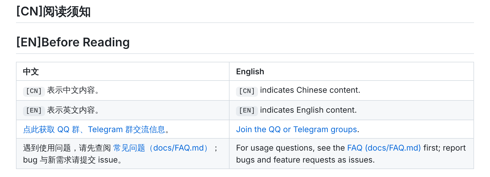
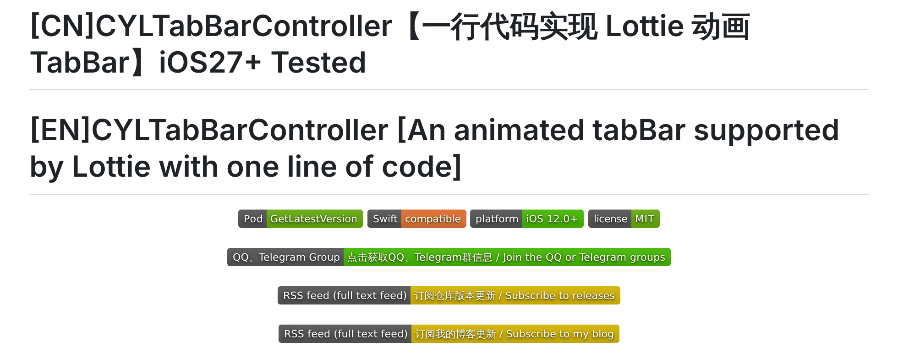
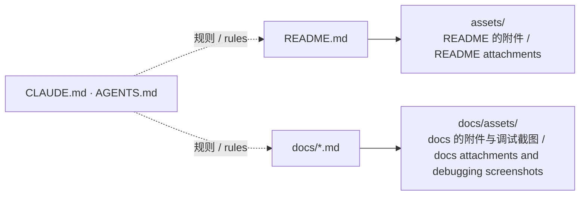
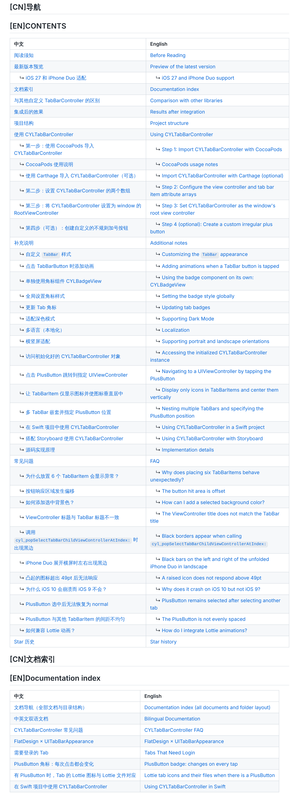
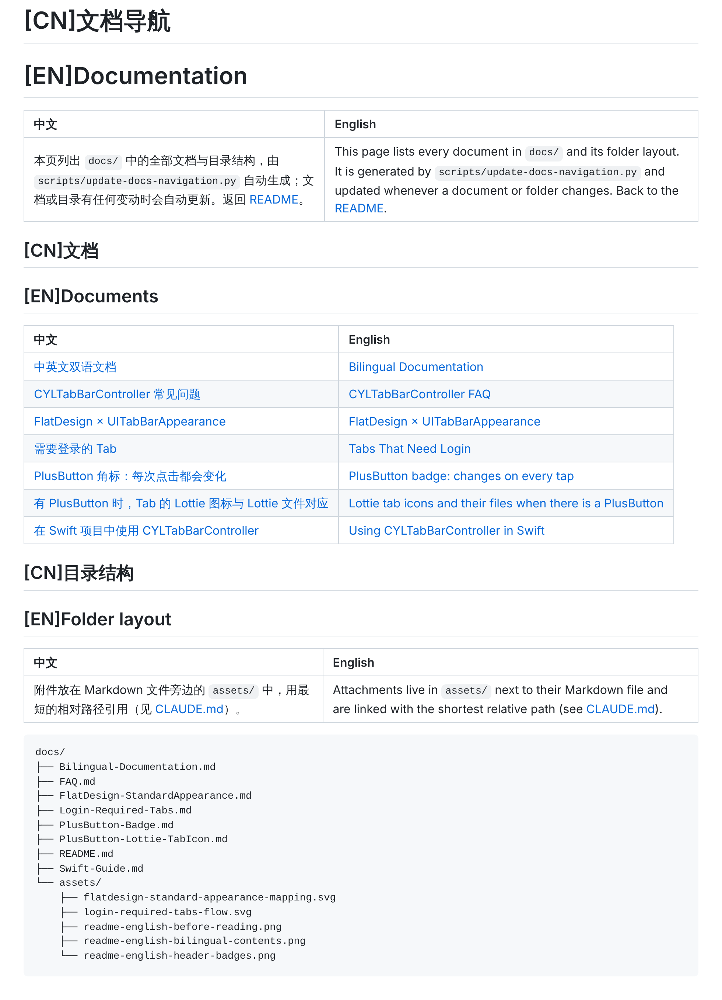

# 中英文双语文档 / Bilingual Documentation

<!-- bound-classes: none -->
<!-- binding:start -->
<!-- Generated by scripts/update-docs-navigation.py; do not edit by hand. -->

| 中文 | English |
|:---|:---|
| 本文档不绑定代码类。 | This document is not bound to a code class. |

<!-- binding:end -->

| 中文 | English |
|:---|:---|
| [#42](https://github.com/ChenYilong/CYLTabBarController/issues/42)：README 现已完整提供英文。每一段说明都有对应的中文与英文，世界各地的开发者都可以直接阅读。 | [#42](https://github.com/ChenYilong/CYLTabBarController/issues/42): the README is now fully available in English. Every passage has both Chinese and English, so developers everywhere can read it directly. |
| 本文说明 README 的阅读方式，以及今后所有新功能都要遵守的双语文档规则（规则全文见仓库根目录的 [CLAUDE.md](../CLAUDE.md)）。 | This page explains how to read the README and the bilingual documentation rules every new feature follows from now on (the full rules are in [CLAUDE.md](../CLAUDE.md) at the repository root). |

## 目录 / Contents

<!-- navigation:start -->
<!-- Generated by scripts/update-docs-navigation.py; do not edit by hand. -->

| 中文 | English |
|:---|:---|
| [如何阅读 README](#如何阅读-readme--how-to-read-the-readme) | [How to read the README](#如何阅读-readme--how-to-read-the-readme) |
| [本次修改](#本次修改--what-changed) | [What changed](#本次修改--what-changed) |
| [新功能的文档规则](#新功能的文档规则--documentation-rules-for-new-features) | [Documentation rules for new features](#新功能的文档规则--documentation-rules-for-new-features) |
| [附件目录](#附件目录--attachment-layout) | [Attachment layout](#附件目录--attachment-layout) |
| [截图](#截图--screenshots) | [Screenshots](#截图--screenshots) |

<!-- navigation:end -->

## 如何阅读 README / How to read the README

| 中文 | English |
|:---|:---|
| 标题成对出现：`[CN]` 为中文标题，紧随其后的 `[EN]` 为英文标题。 | Headings come in pairs: a `[CN]` Chinese heading followed by its `[EN]` English heading. |
| 正文使用两列表格：左列中文，右列英文，每行内容相同。 | Body text is a two-column table: Chinese on the left, English on the right, the same content in each row. |
| 多列的 API 表格先给中文表，紧接着给内容相同的英文表。 | API tables with more columns come as a Chinese table followed by an English table with the same rows. |
| 代码示例两种语言共用，注释为双语。 | Code samples are shared, with bilingual comments. |
| 「导航 / CONTENTS」是双语目录：每行左侧链接到中文标题，右侧链接到英文标题。 | "导航 / CONTENTS" is a bilingual table of contents: each row links to the Chinese heading on the left and the English heading on the right. |

## 本次修改 / What changed

| 中文 | English |
|:---|:---|
| 原目录由 doctoc 生成，只有中文，而且标题加上 `[CN]` / `[EN]` 前缀后，27 个页内链接已全部失效。现改为双语目录表格，并修复了所有页内链接（README 中 100 个页内链接全部指向存在的标题）。 | The old contents were generated by doctoc in Chinese only, and since the headings gained the `[CN]` / `[EN]` prefixes, 27 in-page links no longer worked. They are now a bilingual contents table, and every in-page link is fixed (all 100 in-page links in the README point to an existing heading). |
| 补齐了仅有中文的内容：QQ / Telegram 与 RSS 徽章、项目结构中的注释、使用者 App 列表的说明文字。App 名称为专有名词，保持原样。 | Filled in the Chinese-only parts: the QQ / Telegram and RSS badges, the comments in the project structure, and the notes in the list of apps using the library. App names are proper names and stay as they are. |
| 新增仓库说明文件 [CLAUDE.md](../CLAUDE.md)（英文），以及指向它的 [AGENTS.md](../AGENTS.md)，规定今后所有新功能都必须提供中英文双语文档。 | Added the repository instructions [CLAUDE.md](../CLAUDE.md) (in English), with [AGENTS.md](../AGENTS.md) pointing to it; they require bilingual Chinese–English documentation for every new feature from now on. |
| 导航改为自动生成：`scripts/update-docs-navigation.py` 生成 README 与每篇文档的双语目录、文档索引，以及 `docs/` 的目录结构（见 [docs/README.md](README.md)）。Markdown 或目录有任何变动后运行该脚本即可；GitHub Actions 的 `Docs navigation` 检查会在导航过期时失败。 | The navigation is now generated: `scripts/update-docs-navigation.py` writes the bilingual contents of the README and of every document, the documentation index, and the folder layout of `docs/` (see [docs/README.md](README.md)). Run the script after any Markdown or folder change; the `Docs navigation` GitHub Actions check fails when the navigation is out of date. |

## 新功能的文档规则 / Documentation rules for new features

| 中文 | English |
|:---|:---|
| 每个新功能都需要两份双语文档：在 `docs/` 中新建一份以功能命名的文档，并更新 `README.md`（至少在最新版本预览中加一行并链接到该文档）。 | Every new feature needs bilingual documentation in two places: a new document named after the feature in `docs/`, and an update to `README.md` (at least a line in the latest-version preview that links to the document). |
| 中英文对照使用表格，一列中文、一列英文，两列内容相同。 | Chinese and English are side by side in a table: one Chinese column, one English column, saying the same thing. |
| 调试过程中没有 bug 的截图保存到 `docs/assets/`，并在该功能的 `docs/` 文档中引用；最终成品截图放进 `README.md`。无法运行时在文档中如实说明，不要用示意图冒充截图。 | Bug-free screenshots taken while debugging go into `docs/assets/` and are embedded in the feature's `docs/` document; final screenshots go into `README.md`. If the change could not be run, say so in the document, and never present a diagram as a screenshot. |
| 每篇 `docs/` 文档在标题下方声明所绑定的代码类：`<!-- bound-classes: 类名, 类名 -->`（与代码无关的文档写 `none`）。脚本会在文档中生成绑定表（类名与头文件路径），并在每个绑定类的头文件顶部、版权声明下方写入该类所有文档的 GitHub 链接。文档或类的头文件新增、重命名、移动后重新运行脚本即可同步。 | Every `docs/` document declares the code classes it is bound to under its title: `<!-- bound-classes: ClassName, ClassName -->` (`none` for a document about no code). The script writes a binding table (class and header path) into the document, and the GitHub links of all its documents at the top of each bound class header, below the copyright comment. Run the script again after adding, renaming or moving a document or a class header to keep them in step. |
| 修改 README 或 `docs/`（编辑 Markdown，或增删、重命名、移动文件与文件夹）后，运行 `python3 scripts/update-docs-navigation.py` 更新导航；不要手动修改生成的导航区块。 | After changing the README or `docs/` (a Markdown edit, or a file or folder added, removed, renamed or moved), run `python3 scripts/update-docs-navigation.py` to update the navigation; never edit the generated navigation blocks by hand. |

## 附件目录 / Attachment layout

| 中文 | English |
|:---|:---|
| 遵循 Obsidian 的附件规则：附件放在 Markdown 文件所在目录下的 `assets/` 子文件夹中，用最短的相对路径引用。 | Following the Obsidian attachment rule, attachments live in an `assets/` folder next to the Markdown file and are linked with the shortest relative path. |
| `docs/*.md` 的附件 → `docs/assets/`，链接写作 `assets/文件名.png`。 | Attachments of `docs/*.md` → `docs/assets/`, linked as `assets/name.png`. |
| `README.md` 的附件 → 仓库根目录的 `assets/`，链接写作 `assets/文件名.png`。 | Attachments of `README.md` → `assets/` at the repository root, linked as `assets/name.png`. |
| 不使用绝对路径、`../` 路径或其他附件目录；文件名使用小写字母与连字符，并以功能命名。 | No absolute paths, no `../` paths, no other attachment folders; file names are lowercase with hyphens and name the feature. |

## 截图 / Screenshots

| 中文 | English |
|:---|:---|
| 以下截图来自测试：将 README 按 GitHub 的方式渲染（GitHub 样式、GitHub 标题锚点规则），并检查所有页内链接。截图中没有错误。 | The screenshots below come from testing: the README rendered the way GitHub renders it (GitHub styles and heading anchor rules), with every in-page link checked. No errors are visible in them. |

