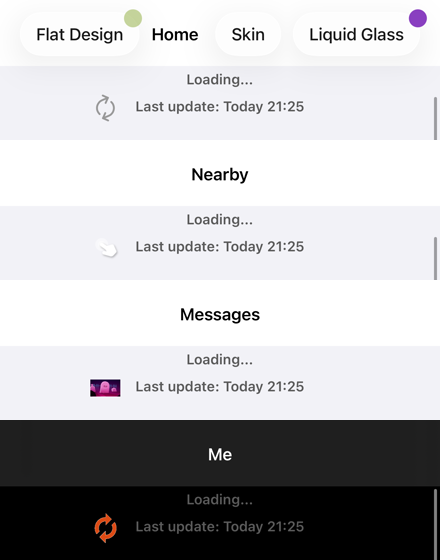
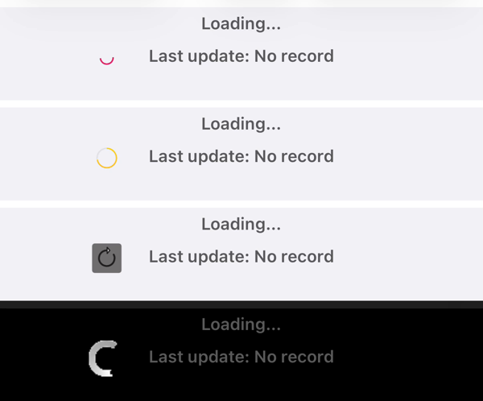
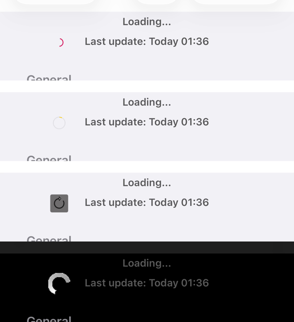
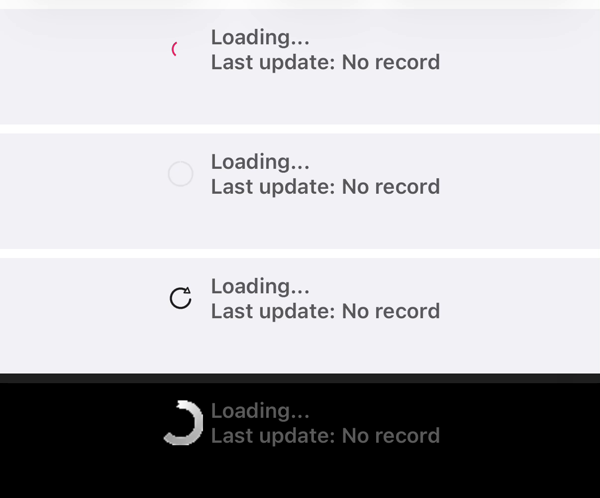

# CYLTableViewPlaceHolder 集成问题 / CYLTableViewPlaceHolder Integration Issues

<!-- bound-classes: none -->
<!-- binding:start -->
<!-- Generated by scripts/update-docs-navigation.py; do not edit by hand. -->

| 中文 | English |
|:---|:---|
| 本文档不绑定代码类。 | This document is not bound to a code class. |

<!-- binding:end -->

| 中文 | English |
|:---|:---|
| 本文记录在 CYLTabBarController 的示例中集成 [CYLTableViewPlaceHolder](https://github.com/ChenYilong/CYLTableViewPlaceHolder) 时，由该库引起的编译错误及其他问题与原因，供在该库中修复（AGENTS.md「Depending on CYLTableViewPlaceHolder」）。示例自身的错误不记录在这里，直接在示例中修复。 | This document lists the build errors and other problems that [CYLTableViewPlaceHolder](https://github.com/ChenYilong/CYLTableViewPlaceHolder) causes while CYLTabBarController's examples integrate it, with their causes, so they can be fixed in that library (AGENTS.md, "Depending on CYLTableViewPlaceHolder"). Errors of the examples themselves are fixed in the examples and not listed here. |

## 目录 / Contents

<!-- navigation:start -->
<!-- Generated by scripts/update-docs-navigation.py; do not edit by hand. -->

| 中文 | English |
|:---|:---|
| [集成方式](#集成方式--how-it-is-integrated) | [How it is integrated](#集成方式--how-it-is-integrated) |
| [集成状态](#集成状态--status) | [Status](#集成状态--status) |
| [刷新图标（`40ec453`）](#刷新图标40ec453--refresh-icons-40ec453) | [Refresh icons (`40ec453`)](#刷新图标40ec453--refresh-icons-40ec453) |
| [刷新图标（`2e748b7`）](#刷新图标2e748b7--refresh-icons-2e748b7) | [Refresh icons (`2e748b7`)](#刷新图标2e748b7--refresh-icons-2e748b7) |
| [问题](#问题--issues) | [Issues](#问题--issues) |
| [任务记录](#任务记录--task-log) | [Task log](#任务记录--task-log) |

<!-- navigation:end -->

## 集成方式 / How it is integrated

| 中文 | English |
|:---|:---|
| 每个示例通过 CocoaPods 依赖该库在任意分支上最新的提交（`scripts/latest-cyl-commit.sh`，`CYL_REPO_URL` 指向该库），并引入全部动画子规格（`LottieSwift`、`PAG`、`Rive`、`GIF`）。共用的 `Example-Shared/CYLDemoPlaceholder.swift` 为滚动视图安装带动画图标的下拉刷新（`cyl_header` 为 `CYLRefreshAnimationHeader`，`setIconAnimation(bundled:size:for:)` 设置空闲与刷新中图标；列表自带的刷新头保留回调并换成动画刷新头；只有没有该类型刷新图标时才用 `CYLRefreshNormalHeader`）、带动画的无数据占位图（`cyl_placeholderViewBlock:`，按场景示例的方式以 item 属性初始化）、断网时的无网络占位图，以及断网时页面顶部的红色状态条（`cyl_showsStatusViewWhenOffline`）。MJRefresh 已删除：`mj_` 改为 `cyl_`，`MJRefresh…` 类改为 `CYLRefresh…`。 | Every example depends on the library's latest commit on any branch through CocoaPods (`scripts/latest-cyl-commit.sh` with `CYL_REPO_URL` set to the library), with every animation subspec (`LottieSwift`, `PAG`, `Rive`, `GIF`). The shared `Example-Shared/CYLDemoPlaceholder.swift` gives a scroll view pull to refresh with an animated icon (`cyl_header` is a `CYLRefreshAnimationHeader`; `setIconAnimation(bundled:size:for:)` sets the idle and refreshing icons; a list's own header keeps its block and becomes an animation header; `CYLRefreshNormalHeader` only when no refresh icon of the kind is bundled), an animated empty-data placeholder (`cyl_placeholderViewBlock:`, initialized with item attributes as in the scenario example), a no-network placeholder while offline, and the red status bar at the top of the page while offline (`cyl_showsStatusViewWhenOffline`). MJRefresh is removed: `mj_` became `cyl_`, the `MJRefresh…` classes `CYLRefresh…`. |

| 每个列表使用一种动画类型（`CYLDemoPlaceholderAnimation`），全部类型都有列表使用：Lottie（首页、扁平样式列表、图库重复点击列表）、PAG（同城、扁平样式演示页）、Rive（消息、Pop/Push 演示）、GIF（我的、图库）。 | Every list uses one animation type (`CYLDemoPlaceholderAnimation`), and every type is used: Lottie (Home, the FlatDesign list, the gallery's reselect list), PAG (Nearby, the FlatDesign demo page), Rive (Message, the Pop/Push demo), GIF (Me, the gallery). |

## 集成状态 / Status

| 示例 / Example | 提交 / Commit | 结果 / Result |
|:---|:---|:---|
| 根目录 ObjC / Swift 示例（`CYLTabBarController.xcworkspace`） / Root Objective-C / Swift demo | `2e748b7`（2026-11-12，`fix/rive-refresh-icon-background`，PR #22：Rive 刷新图标背景透明；基于 `87666f3`；之前为 `511e423`、`28a0ec1`、`40ec453`、`fceb339`、`44e16c4` / PR #22: transparent Rive refresh icon background; based on `87666f3`; earlier `511e423`, `28a0ec1`, `40ec453`, `fceb339`, `44e16c4`）| `40ec453` 把图标动画接口从 `CYLRefreshComponent` 移到 `CYLRefreshIconAnimating`（`CYLRefreshAnimationHeader` 等），`CYLRefreshNormalHeader` 不再有 `setIconAnimation`；刷新图标只保留 `CYLRefresh…` 文件与 `CYLPlaceholderRefresh.json`、`CYLPlaceholderProgress.pag`。示例改用 `CYLRefreshAnimationHeader` 与刷新主题图标（Lottie `CYLRefreshPullArrow.json` / `CYLRefreshMaterialSpinner.json`，PAG `CYLPlaceholderProgress.pag`，Rive `CYLRefreshIcon.riv`，GIF `CYLRefreshArrows.gif` / `CYLRefreshRing.gif`）。干净编译通过，示例代码 0 个错误、0 个警告。运行截图（2026-11-12，本地 macOS 27.3、Xcode 27.2，iOS 26.1 iPhone 17 Pro）见下方「刷新图标（`40ec453`）」。 / `40ec453` moved the icon animation API from `CYLRefreshComponent` to `CYLRefreshIconAnimating` (`CYLRefreshAnimationHeader` and the others), so `CYLRefreshNormalHeader` no longer has `setIconAnimation`; the refresh icons are only the `CYLRefresh…` files plus `CYLPlaceholderRefresh.json` and `CYLPlaceholderProgress.pag`. The demo now uses `CYLRefreshAnimationHeader` with refresh-themed icons (Lottie `CYLRefreshPullArrow.json` / `CYLRefreshMaterialSpinner.json`, PAG `CYLPlaceholderProgress.pag`, Rive `CYLRefreshIcon.riv`, GIF `CYLRefreshArrows.gif` / `CYLRefreshRing.gif`). Clean build passes with no errors or warnings in the example code. Runtime screenshots (2026-11-12, locally on macOS 27.3 with Xcode 27.2, iOS 26.1 iPhone 17 Pro): see "Refresh icons (`40ec453`)" below. |

## 刷新图标（`40ec453`） / Refresh icons (`40ec453`)

| 中文 | English |
|:---|:---|
| 示例启动参数 `-CYLDemoHoldRefresh YES` 让每个列表开始刷新并保持刷新状态，`-CYLDemoSelectedTab <identifier>`（`home`、`city`、`message`、`CYLMineViewController`）在启动 2 秒后登录并选中该 Tab；再次点击已选中的 Tab 也会回到顶部并开始刷新。从上到下：首页 Lottie（`CYLRefreshMaterialSpinner.json`，细弧旋转）、同城 PAG（`CYLPlaceholderProgress.pag`）、消息 Rive（`CYLRefreshIcon.riv`）、我的 GIF（`CYLRefreshRing.gif`，深色模式页面）。每个都录屏 2.5 秒确认：Lottie、Rive、GIF 图标在动；PAG 圆环在各帧之间几乎不变（问题 4）。 | The example's launch argument `-CYLDemoHoldRefresh YES` makes every list start refreshing and stay refreshing, and `-CYLDemoSelectedTab <identifier>` (`home`, `city`, `message`, `CYLMineViewController`) logs in and selects that tab 2 s after launch; a second tap on the selected tab also scrolls back to the top and starts refreshing. Top to bottom: Home Lottie (`CYLRefreshMaterialSpinner.json`, a thin turning arc), Nearby PAG (`CYLPlaceholderProgress.pag`), Messages Rive (`CYLRefreshIcon.riv`), Me GIF (`CYLRefreshRing.gif`, a dark-mode page). Each was recorded for 2.5 s: the Lottie, Rive and GIF icons move; the PAG ring barely changes from frame to frame (issue 4). |

| 中文 | English |
|:---|:---|
| **再次点击刷新**（2026-11-12，`511e423`，干净编译，本地 macOS 27.3、Xcode 27.2，iOS 26.1 iPhone 17 Pro）：用 `-CYLDemoSelectedTab` 依次打开首页、同城、消息、我的，录屏中点击已选中的 Tab 一次，每个页面都回到顶部并显示刷新头（「Loading...」与该页的刷新图标），约 1 秒后结束（「Last update: Today」）。从上到下：首页 Lottie、同城 PAG（圆环中的黄色进度段在变化）、消息 Rive、我的 GIF。 | **Second tap refreshes** (2026-11-12, `511e423`, clean build, locally on macOS 27.3 with Xcode 27.2, iOS 26.1 iPhone 17 Pro): Home, Nearby, Messages and Me opened in turn with `-CYLDemoSelectedTab`, and one tap on the selected tab while recording: every page scrolls to the top and shows its refresh header ("Loading..." and that page's refresh icon), which ends about 1 s later ("Last update: Today"). Top to bottom: Home Lottie, Nearby PAG (the yellow progress segment in the ring moves), Messages Rive, Me GIF. |

## 刷新图标（`2e748b7`） / Refresh icons (`2e748b7`)

| 中文 | English |
|:---|:---|
| 2026-11-12，`2e748b7`（PR #22），干净编译，本地 macOS 27.3、Xcode 27.2，iOS 26.1 iPhone 17 Pro，`-CYLDemoHoldRefresh YES -CYLDemoSelectedTab <identifier>`。从上到下：首页 Lottie、同城 PAG、消息 Rive（箭头在透明背景上旋转，问题 2 已修复）、我的 GIF（与文字重叠，问题 5）。 | 2026-11-12, `2e748b7` (PR #22), clean build, locally on macOS 27.3 with Xcode 27.2, iOS 26.1 iPhone 17 Pro, `-CYLDemoHoldRefresh YES -CYLDemoSelectedTab <identifier>`. Top to bottom: Home Lottie, Nearby PAG, Messages Rive (the arrow turns on a transparent background, issue 2 fixed), Me GIF (overlaps the text, issue 5). |

## 问题 / Issues

| 中文 | English |
|:---|:---|
| 目前没有由该库引起的编译错误。 | No build error caused by the library so far. |
| 1. 已修复（`2978b70`，在 `fceb339` 中确认，截图见上）/ Fixed (`2978b70`, confirmed with `fceb339`, picture above). 刷新图标与文字重叠：`CYLRefreshNormalHeader` 设置动画图标后（`setIconAnimation(bundled:size:for:)`），图标视图放在原箭头的位置，没有按图标宽度让出空间，图标右侧压到「最后更新」文字上（28 pt 时仍接触，40 pt 时明显重叠，见上图）。原因：布局沿用箭头的中心位置与箭头宽度，而不是图标视图的实际宽度。建议：按 `iconView` 的宽度计算它与文字之间的间距（`labelLeftInset`）。 | 1. The refresh icon overlaps the text: after an animated icon is set on `CYLRefreshNormalHeader` (`setIconAnimation(bundled:size:for:)`), the icon view sits where the arrow was and does not make room for its own width, so its right side runs into the "Last update" text (touching at 28 pt, clearly overlapping at 40 pt; picture above). Cause: the layout keeps the arrow's center and width, not the icon view's actual width. Suggestion: space the icon and the text by the `iconView` width (`labelLeftInset`). |
| 2. 已修复（`2e748b7`，PR #22，2026-11-12 在示例「消息」页确认，见下方「刷新图标（`2e748b7`）」）/ Fixed (`2e748b7`, PR #22, confirmed on the example's Messages page on 2026-11-12; see "Refresh icons (`2e748b7`)" below). 原因在文件本身：画板中名为 `BG` 的圆角矩形填充为 `#ff6f6e6e`；修复只把其 alpha 改为 0（6 个字节）。/ The cause was the file: a rounded rectangle named `BG` filled `#ff6f6e6e`; the fix only sets its alpha to 0 (6 bytes). 原记录 / Original note: Rive 刷新图标显示矩形背景：`CYLPlaceholderPullToRefresh.riv` 作为刷新图标时，在 28 pt 下显示其画板的深色矩形背景，与 Lottie、PAG、GIF 图标的透明背景不一致（见上图「Messages」）。原因可能是该文件的画板背景，或 Rive 视图未使用透明背景 / 合适的 fit。 | 2. The Rive refresh icon shows a rectangle: `CYLPlaceholderPullToRefresh.riv` as a refresh icon shows its artboard's dark rectangle at 28 pt, unlike the transparent Lottie, PAG and GIF icons ("Messages" in the picture above). The cause may be the file's artboard background, or the Rive view not using a clear background / a suitable fit. |
| 3. 编译警告（`fceb339`，`40ec453` 仍存在，行号变为 `CYLRefreshComponent.m:236`–`238`、`CYLRefreshNormalHeader.m:64`、`CYLRefreshAutoNormalFooter.m:51`、`CYLRefreshBackNormalFooter.m:62`；不是错误，以源码方式编译该 Pod 时出现）：`CYLRefresh/Base/CYLRefreshComponent.m:284`–`286` 把 `CYLRefreshHeader` / `CYLRefreshFooter` / `CYLRefreshTrailer *`（`_Nullable`）传给 `CYLRefreshComponent * _Nonnull` 参数（`-Wincompatible-pointer-types`，可空性与类型都不匹配）；`CYLRefreshNormalHeader.m:65`、`CYLRefreshAutoNormalFooter.m:52`、`CYLRefreshBackNormalFooter.m:63` 使用 iOS 13 起废弃的 `UIActivityIndicatorViewStyleGray`（`-Wdeprecated-declarations`）。原因：前者是参数类型声明为父类且非空，调用处传入可能为 nil 的子类属性；后者沿用旧的菊花样式。建议：参数改为 `nullable`（或调用前判断）并用正确的类型；iOS 13+ 使用 `UIActivityIndicatorViewStyleMedium`。 | 3. Build warnings (`fceb339`; still in `40ec453` at `CYLRefreshComponent.m:236`–`238`, `CYLRefreshNormalHeader.m:64`, `CYLRefreshAutoNormalFooter.m:51`, `CYLRefreshBackNormalFooter.m:62`; not errors, seen when the pod is compiled from source): `CYLRefresh/Base/CYLRefreshComponent.m:284`–`286` pass `CYLRefreshHeader` / `CYLRefreshFooter` / `CYLRefreshTrailer *` (`_Nullable`) to a `CYLRefreshComponent * _Nonnull` parameter (`-Wincompatible-pointer-types`: both nullability and type disagree); `CYLRefreshNormalHeader.m:65`, `CYLRefreshAutoNormalFooter.m:52` and `CYLRefreshBackNormalFooter.m:63` use `UIActivityIndicatorViewStyleGray`, deprecated since iOS 13 (`-Wdeprecated-declarations`). Cause: the first declares the parameter as the non-null base class while callers pass a possibly nil subclass property; the second keeps the old spinner style. Suggestion: make the parameter `nullable` (or check before the call) with the right type; use `UIActivityIndicatorViewStyleMedium` on iOS 13+. |
| 4. 待确认（`40ec453`）：PAG 刷新图标 `CYLPlaceholderProgress.pag` 在刷新中 2.5 秒的录屏里几乎没有变化（静止的黄色圆环），而 Lottie、Rive、GIF 图标在动。原因可能是该文件本身是进度动画（随下拉百分比变化，刷新中停在某一帧），或刷新中状态没有让 PAG 循环播放。建议：确认刷新中的播放策略，或为 PAG 提供一个循环的刷新动画。 | 4. To check (`40ec453`): the PAG refresh icon `CYLPlaceholderProgress.pag` barely changes in a 2.5 s recording while refreshing (a still yellow ring), while the Lottie, Rive and GIF icons move. The cause may be that the file is a progress animation (following the pull percent, stopping on one frame while refreshing), or that the refreshing state does not loop PAG. Suggestion: check the refreshing playback policy, or ship a looping refresh animation for PAG. |
| 5. 新问题（`2e748b7`，来自 `87666f3`，另一个会话尚未完成的修改）：刷新头改为把图标与两行文字作为一个整体居中（`CYLPlaceholderView`），我的页面的 GIF 刷新图标（`CYLRefreshRing.gif`，30 pt）与「Loading...」文字重叠（见「刷新图标（`2e748b7`）」最下方一行）。原因可能是整体布局没有按图标的实际绘制宽度留出间距。建议：在该修改完成时检查图标与文字的间距。 | 5. New (`2e748b7`, from `87666f3`, another session's unfinished change): the refresh header now centers the icon and both lines of text as one unit (`CYLPlaceholderView`), and on the Me page the GIF refresh icon (`CYLRefreshRing.gif`, 30 pt) overlaps the "Loading..." text (bottom row of "Refresh icons (`2e748b7`)"). The cause may be that the combined layout does not leave room for the icon's drawn width. Suggestion: check the gap between icon and text when that change is finished. |
| 不由该库引起（仅记录）：`pod install` 提示 `libpag (4.5.102)` 的 LICENSE 文件无法读取（libpag 的 podspec）；RiveRuntime 的 umbrella header 警告其中的 `._*` 文件，是本机所在磁盘生成的 AppleDouble 文件，不是该库的问题。 | Not caused by the library (noted only): `pod install` says the LICENSE of `libpag (4.5.102)` cannot be read (libpag's podspec); RiveRuntime's umbrella header warns about `._*` files, AppleDouble files this machine's disk creates, not the library. |
| TODO（未验证，不是编译错误）：无数据占位图、无网络占位图与顶部红条只在列表为空或设备断网时出现。模拟器使用 Mac 的网络、示例列表总有数据，因此本次未能在运行时看到它们；需要在真机上关闭网络，或为示例增加清空数据的入口后截图确认。 | TODO (not verified, not a build error): the empty-data placeholder, the no-network placeholder and the red bar only appear when a list is empty or the device is offline. The simulator uses the Mac's network and the example lists always have rows, so they were not seen at runtime this time; check them on a device with the network off, or add a way to empty a list in the examples, and take screenshots. |

## 任务记录 / Task log

| 中文 | English |
|:---|:---|
| TODO（2026-11-12，Rive 背景方块）：用户提示词：「根据其他组件Rive动画，相关的issue修复。https://github.com/ChenYilong/CYLTableViewPlaceHolder/pull/22 搜索本项目中Rive关键词，排查我们的项目中是否也存在该bug 如果存在，在本分支修复Rive相关issue」。上下文：CYLTableViewPlaceHolder PR #22 把 `CYLRefreshIcon.riv` 中 6 个 `BG` 填充改为透明，修复刷新图标后的深灰方块。要求：在本项目中搜索 Rive，排查是否有同类问题（.riv 文件自带的可见背景填充），存在则在本分支（`feat/cross-platform-components`）修复。进展：本项目自己的 `.riv`（Example-SwiftUI-Rive）中，`menu_button` / `button` / `shapes` 的画板填充已隐藏，`house.riv` 有可见灰色填充但页面未被使用；示例使用的 CYLTableViewPlaceHolder `CYLPlaceholderLoading.riv` 有可见的 `#313131` 画板填充，且示例未传 `legacy` 选项导致 Rive 空列表占位图从不播放。 | TODO (2026-11-12, Rive background square): user prompt: "根据其他组件Rive动画，相关的issue修复。https://github.com/ChenYilong/CYLTableViewPlaceHolder/pull/22 搜索本项目中Rive关键词，排查我们的项目中是否也存在该bug 如果存在，在本分支修复Rive相关issue". Context: CYLTableViewPlaceHolder PR #22 made the 6 `BG` fills of `CYLRefreshIcon.riv` transparent, fixing a dark grey square behind the refresh icon. Requirement: search this project for Rive, check for the same kind of bug (a visible background fill baked into a .riv file), and fix it on this branch (`feat/cross-platform-components`) if found. Progress: this project's own `.riv` files (Example-SwiftUI-Rive): `menu_button` / `button` / `shapes` hide their artboard fill, `house.riv` has a visible grey fill but its page is not used; the example's CYLTableViewPlaceHolder `CYLPlaceholderLoading.riv` has a visible `#313131` artboard fill, and the example passed no `legacy` option, so the Rive empty-list placeholder never played. |
