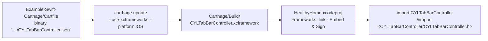

# [CN]Carthage 集成演示工程
# [EN]Carthage integration demo project

<!-- bound-classes: none -->
<!-- binding:start -->
<!-- Generated by scripts/update-docs-navigation.py; do not edit by hand. -->

| 中文 | English |
|:---|:---|
| 本文档不绑定代码类。 | This document is not bound to a code class. |

<!-- binding:end -->

| 中文 | English |
|:---|:---|
| `Example-Swift-Carthage` 复制自 `Example-Swift-03`，按 [docs/Carthage.md](Carthage.md) 的步骤改为用 Carthage 集成 CYLTabBarController，不使用 CocoaPods。App 代码与 `Example-Swift-03` 相同，只有集成方式不同，可以直接对照两者的差异（[#384](https://github.com/ChenYilong/CYLTabBarController/issues/384)）。 | `Example-Swift-Carthage` is a copy of `Example-Swift-03` that integrates CYLTabBarController with Carthage, following [docs/Carthage.md](Carthage.md), instead of CocoaPods. The app code is the same as in `Example-Swift-03`; only the integration differs, so the two can be compared directly ([#384](https://github.com/ChenYilong/CYLTabBarController/issues/384)). |



## [CN]目录
## [EN]Contents

<!-- navigation:start -->
<!-- Generated by scripts/update-docs-navigation.py; do not edit by hand. -->

| 中文 | English |
|:---|:---|
| [运行步骤](#cn运行步骤) | [Running it](#enrunning-it) |
| [与 Example-Swift-03 的差异](#cn与-example-swift-03-的差异) | [How it differs from Example-Swift-03](#enhow-it-differs-from-example-swift-03) |
| [验证与剩余步骤](#cn验证与剩余步骤) | [Verification and remaining steps](#enverification-and-remaining-steps) |
| [截图](#cn截图) | [Screenshots](#enscreenshots) |

<!-- navigation:end -->

## [CN]运行步骤
## [EN]Running it

| 中文 | English |
|:---|:---|
| 1. 安装 Carthage（例如 `brew install carthage`）。 | 1. Install Carthage (e.g. `brew install carthage`). |
| 2. 在 `Example-Swift-Carthage` 目录执行下面的命令。Carthage 读取二进制规格 `CYLTabBarController.json`，下载该版本 Release 附带的 XCFramework，放到 `Carthage/Build/CYLTabBarController.xcframework`（不在本机编译，见 [docs/Carthage.md](Carthage.md#cn为什么使用预编译的-xcframework)）。 | 2. Run the command below in the `Example-Swift-Carthage` folder. Carthage reads the binary spec `CYLTabBarController.json`, downloads the XCFramework attached to that release, and puts it in `Carthage/Build/CYLTabBarController.xcframework` (nothing is built locally; see [docs/Carthage.md](Carthage.md#enwhy-a-prebuilt-xcframework)). |

```sh
cd Example-Swift-Carthage
carthage update --use-xcframeworks --platform iOS
```

| 中文 | English |
|:---|:---|
| 3. 打开 `HealthyHome.xcodeproj`（不是 `.xcworkspace`，本工程没有 CocoaPods），选择 `HealthyHome` scheme 运行。 | 3. Open `HealthyHome.xcodeproj` (not an `.xcworkspace`: this project has no CocoaPods), choose the `HealthyHome` scheme and run it. |

## [CN]与 Example-Swift-03 的差异
## [EN]How it differs from Example-Swift-03

| 中文 | English |
|:---|:---|
| **依赖声明**：用 `Cartfile` 代替 `Podfile`。它目前是 `github "ChenYilong/CYLTabBarController" ~> 1.100.0`（1.100.0 没有 XCFramework 附件）；下一次 `scripts/pod-lint.sh bump <版本号>` 会把它改为 `binary "…/CYLTabBarController.json" ~> <版本号>`，之后每次发布都随之更新。在自己的 App 中请指定发布版本。 | **Dependencies**: a `Cartfile` replaces the `Podfile`. It is `github "ChenYilong/CYLTabBarController" ~> 1.100.0` for now (1.100.0 has no XCFramework asset); the next `scripts/pod-lint.sh bump <version>` turns it into `binary "…/CYLTabBarController.json" ~> <version>`, and every release moves it on. In your own app, pin a release. |
| **工程设置**：去掉了 CocoaPods 的全部集成（`[CP]` 构建阶段、`Pods_*.framework`、Pods 的 xcconfig 与 Pods 分组），在 App target 的 Frameworks 中链接 `Carthage/Build/CYLTabBarController.xcframework`，并在 `Embed Frameworks` 阶段以 `Embed & Sign` 方式嵌入。 | **Project settings**: all CocoaPods integration is removed (the `[CP]` build phases, `Pods_*.framework`, the Pods xcconfig files and the Pods group). The app target links `Carthage/Build/CYLTabBarController.xcframework` in Frameworks and embeds it, `Embed & Sign`, in an `Embed Frameworks` phase. |
| **桥接头文件**：`#import "CYLTabBarController.h"` 改为 `#import <CYLTabBarController/CYLTabBarController.h>`。带引号的写法依赖 CocoaPods 设置的头文件搜索路径，framework 需要按模块路径引入。Swift 代码中的 `import CYLTabBarController` 不变。 | **Bridging header**: `#import "CYLTabBarController.h"` becomes `#import <CYLTabBarController/CYLTabBarController.h>`. The quoted form relies on the header search paths CocoaPods sets; a framework is imported by module path. `import CYLTabBarController` in the Swift code is unchanged. |
| **Bundle ID**：改为 `com.HealthyHome.Carthage`（测试 target 同理），可以与 `Example-Swift-03` 同时安装。 | **Bundle ID**: `com.HealthyHome.Carthage` (and likewise for the test targets), so it can be installed next to `Example-Swift-03`. |
| **未提交的文件**：`Carthage/` 与 `Cartfile.resolved` 由 `carthage update` 生成，已在本目录的 `.gitignore` 中忽略。 | **Not committed**: `Carthage/` and `Cartfile.resolved` are produced by `carthage update` and ignored by the folder's `.gitignore`. |
| **Lottie**：Carthage 使用的 framework 不含 Lottie，因此 Tab 图标显示为静态图片；Lottie 动画请使用 CocoaPods 或 SPM（见 [docs/Carthage.md](Carthage.md)）。 | **Lottie**: the Carthage framework has no Lottie, so the tab icons show as still images; for Lottie animations use CocoaPods or SPM (see [docs/Carthage.md](Carthage.md)). |

## [CN]验证与剩余步骤
## [EN]Verification and remaining steps

| 中文 | English |
|:---|:---|
| **DONE 构建 framework**：`scripts/pod-lint.sh xcframework` 生成的 XCFramework 包含真机（`ios-arm64`）与模拟器（`ios-arm64_x86_64-simulator`）两个切片，构建没有警告。CI 的 `Carthage` job 在每个 PR 上执行同一命令。 | **DONE Build the framework**: the XCFramework that `scripts/pod-lint.sh xcframework` builds has both the device (`ios-arm64`) and the simulator (`ios-arm64_x86_64-simulator`) slices, with no build warning. CI's `Carthage` job runs the same command on every pull request. |
| **DONE 二进制安装**：该 zip 通过 `file://` 二进制规格用 `carthage update --use-xcframeworks --platform iOS` 安装后，`Example-Swift-Carthage` 构建成功且没有警告。 | **DONE Binary install**: installed through a `file://` binary spec with `carthage update --use-xcframeworks --platform iOS`, the zip builds `Example-Swift-Carthage` with no warnings. |
| **DONE 演示工程的 delegate**：Carthage 框架包含扁平样式，其 `delegate` 类型为 `CYLTabBarControllerDelegate & CYLFlatDesignUITabBarControllerDelegate`，因此 `RootTabBarController` 同时遵守两者才能设置 `delegate = self`。 | **DONE The demo's delegate**: the Carthage framework includes FlatDesign, whose `delegate` is `CYLTabBarControllerDelegate & CYLFlatDesignUITabBarControllerDelegate`, so `RootTabBarController` adopts both to set `delegate = self`. |
| **TODO 运行与截图**：在模拟器上运行，确认 TabBar、PlusButton、角标、页面切换正常，把没有 bug 的截图放入 `docs/assets/` 并在下方引用。 | **TODO Run and screenshots**: run it on a simulator, check the tab bar, the plus button, badges and switching tabs, then put bug-free screenshots in `docs/assets/` and reference them below. |
| **TODO 第一个二进制版本**：下一次发布（`scripts/pod-lint.sh bump <版本号>` → PR → 合并 → tag）后，确认 Release 带有 `CYLTabBarController.xcframework.zip`，并在一个空 App 中用 `binary "https://raw.githubusercontent.com/ChenYilong/CYLTabBarController/master/CYLTabBarController.json"` 执行 `carthage update --use-xcframeworks --platform iOS`。 | **TODO First binary release**: after the next release (`scripts/pod-lint.sh bump <version>` → pull request → merge → tag), check that the release has `CYLTabBarController.xcframework.zip`, and run `carthage update --use-xcframeworks --platform iOS` in an empty app with `binary "https://raw.githubusercontent.com/ChenYilong/CYLTabBarController/master/CYLTabBarController.json"`. |

## [CN]截图
## [EN]Screenshots

| 中文 | English |
|:---|:---|
| 暂无运行截图（见上方「TODO 运行与截图」）。 | No run screenshot yet (see "TODO Run and screenshots" above). |
