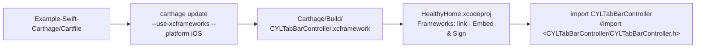

# [CN]Carthage 集成演示工程
# [EN]Carthage integration demo project

<!-- bound-classes: none -->
<!-- binding:start -->
<!-- Generated by scripts/update-docs-navigation.py; do not edit by hand. -->

| 中文 | English |
|:---|:---|
| 本文档不绑定代码类。 | This document is not bound to a code class. |

<!-- binding:end -->

| 中文 | English |
|:---|:---|
| `Example-Swift-Carthage` 复制自 `Example-Swift-03`，按 [docs/Carthage.md](Carthage.md) 的步骤改为用 Carthage 集成 CYLTabBarController，不使用 CocoaPods。App 代码与 `Example-Swift-03` 相同，只有集成方式不同，可以直接对照两者的差异（[#384](https://github.com/ChenYilong/CYLTabBarController/issues/384)）。 | `Example-Swift-Carthage` is a copy of `Example-Swift-03` that integrates CYLTabBarController with Carthage, following [docs/Carthage.md](Carthage.md), instead of CocoaPods. The app code is the same as in `Example-Swift-03`; only the integration differs, so the two can be compared directly ([#384](https://github.com/ChenYilong/CYLTabBarController/issues/384)). |



## [CN]目录
## [EN]Contents

<!-- navigation:start -->
<!-- Generated by scripts/update-docs-navigation.py; do not edit by hand. -->

| 中文 | English |
|:---|:---|
| [运行步骤](#cn运行步骤) | [Running it](#enrunning-it) |
| [与 Example-Swift-03 的差异](#cn与-example-swift-03-的差异) | [How it differs from Example-Swift-03](#enhow-it-differs-from-example-swift-03) |
| [TODO：开发者需要完成的步骤](#cntodo开发者需要完成的步骤) | [TODO: steps for the maintainer](#entodo-steps-for-the-maintainer) |
| [截图](#cn截图) | [Screenshots](#enscreenshots) |

<!-- navigation:end -->

## [CN]运行步骤
## [EN]Running it

| 中文 | English |
|:---|:---|
| 1. 安装 Carthage（例如 `brew install carthage`）。 | 1. Install Carthage (e.g. `brew install carthage`). |
| 2. 在 `Example-Swift-Carthage` 目录执行下面的命令。Carthage 会下载 CYLTabBarController，构建共享 scheme `CYLTabBarController-Framework`，并生成 `Carthage/Build/CYLTabBarController.xcframework`。 | 2. Run the command below in the `Example-Swift-Carthage` folder. Carthage downloads CYLTabBarController, builds the shared scheme `CYLTabBarController-Framework`, and produces `Carthage/Build/CYLTabBarController.xcframework`. |

```sh
cd Example-Swift-Carthage
carthage update --use-xcframeworks --platform iOS
```

| 中文 | English |
|:---|:---|
| 3. 打开 `HealthyHome.xcodeproj`（不是 `.xcworkspace`，本工程没有 CocoaPods），选择 `HealthyHome` scheme 运行。 | 3. Open `HealthyHome.xcodeproj` (not an `.xcworkspace`: this project has no CocoaPods), choose the `HealthyHome` scheme and run it. |

## [CN]与 Example-Swift-03 的差异
## [EN]How it differs from Example-Swift-03

| 中文 | English |
|:---|:---|
| **依赖声明**：用 `Cartfile` 代替 `Podfile`。在添加本演示后的第一次发布之前，它依赖 `"master"`；之后每次发布，`scripts/pod-lint.sh push` 都会把它更新为新版本（`~> <版本号>`）。在自己的 App 中请指定发布版本，例如 `~> 1.99`。 | **Dependencies**: a `Cartfile` replaces the `Podfile`. Until the first release after this demo was added it requires `"master"`; from then on, `scripts/pod-lint.sh push` moves it to each new release (`~> <version>`). In your own app, pin a release, e.g. `~> 1.99`. |
| **工程设置**：去掉了 CocoaPods 的全部集成（`[CP]` 构建阶段、`Pods_*.framework`、Pods 的 xcconfig 与 Pods 分组），在 App target 的 Frameworks 中链接 `Carthage/Build/CYLTabBarController.xcframework`，并在 `Embed Frameworks` 阶段以 `Embed & Sign` 方式嵌入。 | **Project settings**: all CocoaPods integration is removed (the `[CP]` build phases, `Pods_*.framework`, the Pods xcconfig files and the Pods group). The app target links `Carthage/Build/CYLTabBarController.xcframework` in Frameworks and embeds it, `Embed & Sign`, in an `Embed Frameworks` phase. |
| **桥接头文件**：`#import "CYLTabBarController.h"` 改为 `#import <CYLTabBarController/CYLTabBarController.h>`。带引号的写法依赖 CocoaPods 设置的头文件搜索路径，framework 需要按模块路径引入。Swift 代码中的 `import CYLTabBarController` 不变。 | **Bridging header**: `#import "CYLTabBarController.h"` becomes `#import <CYLTabBarController/CYLTabBarController.h>`. The quoted form relies on the header search paths CocoaPods sets; a framework is imported by module path. `import CYLTabBarController` in the Swift code is unchanged. |
| **Bundle ID**：改为 `com.HealthyHome.Carthage`（测试 target 同理），可以与 `Example-Swift-03` 同时安装。 | **Bundle ID**: `com.HealthyHome.Carthage` (and likewise for the test targets), so it can be installed next to `Example-Swift-03`. |
| **未提交的文件**：`Carthage/` 与 `Cartfile.resolved` 由 `carthage update` 生成，已在本目录的 `.gitignore` 中忽略。 | **Not committed**: `Carthage/` and `Cartfile.resolved` are produced by `carthage update` and ignored by the folder's `.gitignore`. |
| **Lottie**：Carthage 构建的 framework 不含 Lottie，因此 Tab 图标显示为静态图片；Lottie 动画请使用 CocoaPods 或 SPM（见 [docs/Carthage.md](Carthage.md)）。 | **Lottie**: the framework Carthage builds has no Lottie, so the tab icons show as still images; for Lottie animations use CocoaPods or SPM (see [docs/Carthage.md](Carthage.md)). |

## [CN]TODO：开发者需要完成的步骤
## [EN]TODO: steps for the maintainer

| 中文 | English |
|:---|:---|
| 以下步骤需要在 macOS 上由开发者完成（本次修改所在的环境没有 Xcode 与 Carthage，无法代为执行）。完成一项后，可将对应行的 `TODO` 改为 `DONE`。 | The steps below need the maintainer on macOS (the environment of this change has no Xcode or Carthage, so they could not be done here). Change a row's `TODO` to `DONE` once it is done. |
| **TODO 1 构建 framework**：在 `Example-Swift-Carthage` 目录执行 `carthage update --use-xcframeworks --platform iOS`，确认生成 `Carthage/Build/CYLTabBarController.xcframework`，且同时包含真机（`ios-arm64`）与模拟器（`ios-arm64_x86_64-simulator`）两个切片。 | **TODO 1 Build the framework**: in `Example-Swift-Carthage`, run `carthage update --use-xcframeworks --platform iOS` and confirm that `Carthage/Build/CYLTabBarController.xcframework` is produced with both the device (`ios-arm64`) and the simulator (`ios-arm64_x86_64-simulator`) slices. |
| **TODO 2 修复构建警告**：检查 `carthage update` 的构建日志（或在 Xcode 中构建 `CYLTabBarController-Framework` scheme），按 [CLAUDE.md](../CLAUDE.md) 的规则修复出现的所有警告。 | **TODO 2 Fix build warnings**: check the build log of `carthage update` (or build the `CYLTabBarController-Framework` scheme in Xcode) and fix every warning, as [CLAUDE.md](../CLAUDE.md) requires. |
| **TODO 3 运行演示工程**：打开 `HealthyHome.xcodeproj`，选择 `HealthyHome` scheme 在模拟器和真机上运行，确认 TabBar、PlusButton、角标、页面切换、多语言正常；Tab 图标应为静态图片（Carthage 构建不含 Lottie）。 | **TODO 3 Run the demo**: open `HealthyHome.xcodeproj` and run the `HealthyHome` scheme on a simulator and a device; check the tab bar, the plus button, badges, switching tabs and localization. The tab icons should be still images (the Carthage build has no Lottie). |
| **TODO 4 保存截图**：将运行过程中没有 bug 的截图保存到 `docs/assets/`（例如 `carthage-example-tabbar.png`），在本文「截图」一节引用，并把最终效果截图加入 README 的 Carthage 一节（README 的附件放在根目录 `assets/`），然后运行 `python3 scripts/update-docs-navigation.py`。 | **TODO 4 Save screenshots**: save bug-free screenshots from the run in `docs/assets/` (e.g. `carthage-example-tabbar.png`), reference them in the Screenshots section below, add the final screenshot to the README's Carthage section (README attachments go in `assets/` at the root), then run `python3 scripts/update-docs-navigation.py`. |
| **TODO 5 合并 PR**：确认以上步骤无误后，合并 [PR #740](https://github.com/ChenYilong/CYLTabBarController/pull/740)。 | **TODO 5 Merge the PR**: once the steps above check out, merge [PR #740](https://github.com/ChenYilong/CYLTabBarController/pull/740). |
| **TODO 6 发布新版本（必须）**：Carthage 默认解析到最新的 **tag**，而现有 tag（至 `1.99.72`）仍包含引用自身的 `Cartfile`，所以必须发布新版本（例如 `1.99.73`）：更新 podspec 的 `s.version`，打 tag 并推送，然后执行 `scripts/pod-lint.sh push`。该脚本在 `pod trunk push` 成功后会自动把 `Example-Swift-Carthage/Cartfile` 更新为 `~> 1.99.73`，并把文档中 Swift Package Manager 示例的 `from: "..."` 更新为 `1.99.73`、重新生成文档导航，请提交这些修改。 | **TODO 6 Publish a release (required)**: Carthage resolves to the latest **tag** by default, and the existing tags (up to `1.99.72`) still contain the self-referencing `Cartfile`, so a new release is required (e.g. `1.99.73`): bump `s.version` in the podspec, tag it and push the tag, then run `scripts/pod-lint.sh push`. After `pod trunk push` succeeds, the script moves `Example-Swift-Carthage/Cartfile` to `~> 1.99.73`, moves the Swift Package Manager snippets in the docs to `from: "1.99.73"` and regenerates the docs navigation; commit those changes. |
| **TODO 7 用新版本验证**：在一个新建的空 App 中写入 `github "ChenYilong/CYLTabBarController"`，执行 `carthage update --use-xcframeworks --platform iOS`，确认解析到新版本、没有依赖循环错误；再在 `Example-Swift-Carthage` 中执行一次，确认演示工程使用脚本更新后的版本也能构建。 | **TODO 7 Verify with the release**: in a new empty app, put `github "ChenYilong/CYLTabBarController"` in the `Cartfile`, run `carthage update --use-xcframeworks --platform iOS`, and confirm it resolves to the new release with no dependency cycle error; then run it again in `Example-Swift-Carthage` to confirm the demo builds with the version the script set. |
| **TODO 8 回复 issue**：在 [#384](https://github.com/ChenYilong/CYLTabBarController/issues/384) 中告知新版本号，邀请提出者用新版本重试。 | **TODO 8 Reply on the issue**: post the new version number on [#384](https://github.com/ChenYilong/CYLTabBarController/issues/384) and invite the reporter to try again with it. |
| **TODO 9（可选）持续集成**：`.travis.yml` 中有 `carthage build --no-skip-current`，但仓库目前只使用 GitHub Actions。可以考虑新增一个 macOS 工作流来执行 `carthage build --no-skip-current --use-xcframeworks`，防止 Carthage 支持再次失效。 | **TODO 9 (optional) CI**: `.travis.yml` has `carthage build --no-skip-current`, but the repository only uses GitHub Actions now. Consider a macOS workflow that runs `carthage build --no-skip-current --use-xcframeworks`, so Carthage support cannot silently break again. |

## [CN]截图
## [EN]Screenshots

| 中文 | English |
|:---|:---|
| 本演示工程在没有 Xcode 与 Carthage 的环境（Linux）中创建，无法实际执行 `carthage update` 与运行 App，因此暂无测试截图。工程修改已用 `xcodeproj` 检查（无任何 CocoaPods 引用，xcframework 已链接并嵌入）。在 macOS 上运行成功后，可将截图放入 `docs/assets/` 并在此引用。 | This demo was created in an environment without Xcode or Carthage (Linux), so `carthage update` and the app could not be run, and there are no test screenshots. The project changes were checked with `xcodeproj` (no CocoaPods reference left; the xcframework is linked and embedded). After a successful run on macOS, put screenshots in `docs/assets/` and reference them here. |
