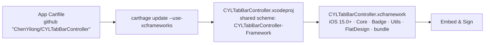

# [CN]使用 Carthage 集成
# [EN]Integrating with Carthage

<!-- bound-classes: none -->
<!-- binding:start -->
<!-- Generated by scripts/update-docs-navigation.py; do not edit by hand. -->

| 中文 | English |
|:---|:---|
| 本文档不绑定代码类。 | This document is not bound to a code class. |

<!-- binding:end -->

| 中文 | English |
|:---|:---|
| [#384](https://github.com/ChenYilong/CYLTabBarController/issues/384)：除了 CocoaPods 和 Swift Package Manager，本库也可以通过 [Carthage](https://github.com/Carthage/Carthage) 集成。本文说明用法、包含的内容，以及本次修复的问题。 | [#384](https://github.com/ChenYilong/CYLTabBarController/issues/384): besides CocoaPods and Swift Package Manager, the library can be integrated with [Carthage](https://github.com/Carthage/Carthage). This page covers usage, what is included, and what this change fixes. |

## [CN]目录
## [EN]Contents

<!-- navigation:start -->
<!-- Generated by scripts/update-docs-navigation.py; do not edit by hand. -->

| 中文 | English |
|:---|:---|
| [用法](#cn用法) | [Usage](#enusage) |
| [包含的内容](#cn包含的内容) | [What is included](#enwhat-is-included) |
| [本次修复](#cn本次修复) | [What this change fixes](#enwhat-this-change-fixes) |
| [截图](#cn截图) | [Screenshots](#enscreenshots) |

<!-- navigation:end -->

## [CN]用法
## [EN]Usage

| 中文 | English |
|:---|:---|
| 在 App 的 `Cartfile` 中添加： | Add to your app's `Cartfile`: |

```
github "ChenYilong/CYLTabBarController"
```

| 中文 | English |
|:---|:---|
| 然后执行（Xcode 12 及以上需要 `--use-xcframeworks`）： | Then run (`--use-xcframeworks` is needed with Xcode 12 and later): |

```
carthage update --use-xcframeworks --platform iOS
```

| 中文 | English |
|:---|:---|
| 将生成的 `Carthage/Build/CYLTabBarController.xcframework` 拖入工程，在「Frameworks, Libraries, and Embedded Content」中设置为 `Embed & Sign`。代码中的引入方式与 CocoaPods 相同：`#import <CYLTabBarController/CYLTabBarController.h>`（Swift：`import CYLTabBarController`）。 | Drag the built `Carthage/Build/CYLTabBarController.xcframework` into your project and set it to `Embed & Sign` under "Frameworks, Libraries, and Embedded Content". Import it as with CocoaPods: `#import <CYLTabBarController/CYLTabBarController.h>` (Swift: `import CYLTabBarController`). |

## [CN]包含的内容
## [EN]What is included

| 中文 | English |
|:---|:---|
| Carthage 构建仓库中共享的 `CYLTabBarController-Framework` scheme，产物为 `CYLTabBarController.framework`（动态库）。 | Carthage builds the shared `CYLTabBarController-Framework` scheme, which produces `CYLTabBarController.framework` (a dynamic framework). |
| 包含：核心功能、角标（CYLBadgeView）、工具（CYLUtils）、扁平样式（CYLFlatDesignTabBar），以及资源包 `CYLTabBarController.bundle`（33 种语言的本地化文案）。 | Included: the core, badges (CYLBadgeView), utilities (CYLUtils), the flat design style (CYLFlatDesignTabBar), and the resource bundle `CYLTabBarController.bundle` (localized strings in 33 languages). |
| 不包含 Lottie 动画（`LottieSwift` 目录）：Lottie 相关功能通过 `__has_include` 判断，没有 Lottie 时自动关闭，其他功能不受影响。需要 Lottie 动画请使用 CocoaPods（`CYLTabBarController/Lottie`）或 Swift Package Manager。 | Lottie animations (the `LottieSwift` folder) are not included: the Lottie features are guarded with `__has_include` and switch off without Lottie, leaving everything else working. For Lottie animations, use CocoaPods (`CYLTabBarController/Lottie`) or Swift Package Manager. |
| 最低系统版本：framework 以 iOS 15.0 为最低版本构建。当前 Xcode（27 及以上）只支持 iOS 15.0 及以上，与 `scripts/pod-lint.xcconfig` 的设置一致。 | Minimum system version: the framework is built for iOS 15.0 and later. Current Xcode (27 and later) only supports iOS 15.0 and later, as `scripts/pod-lint.xcconfig` also sets. |
| 版本：Carthage 的版本就是 git tag。发布时 `scripts/pod-lint.sh push` 在 `pod trunk push` 成功后，会把演示工程的 `Cartfile` 更新为新版本（`~> <版本号>`）；也可以单独执行 `scripts/pod-lint.sh carthage`（同时更新 SPM 文档示例的版本：`scripts/pod-lint.sh versions`）。 | Versions: a Carthage version is a git tag. On release, after `pod trunk push` succeeds, `scripts/pod-lint.sh push` moves the demo's `Cartfile` to the new version (`~> <version>`); `scripts/pod-lint.sh carthage` does only that step (`scripts/pod-lint.sh versions` also updates the version in the SPM doc snippets). |
| 完整的演示工程见 [Carthage 集成演示工程](Carthage-Example.md)（`Example-Swift-Carthage`）。 | For a complete demo project, see [Carthage integration demo project](Carthage-Example.md) (`Example-Swift-Carthage`). |
| **TODO**：开发者需要在 macOS 上完成的验证、截图与发布步骤（包括必须发布新版本）见 [TODO：开发者需要完成的步骤](Carthage-Example.md#cntodo开发者需要完成的步骤)。 | **TODO**: the verification, screenshot and release steps the maintainer has to do on macOS (including the required new release) are in [TODO: steps for the maintainer](Carthage-Example.md#entodo-steps-for-the-maintainer). |

## [CN]本次修复
## [EN]What this change fixes

| 中文 | English |
|:---|:---|
| 仓库根目录曾有一个声明依赖本库自身的 `Cartfile`（`github "ChenYilong/CYLTabBarController" ~> 1.99.55`）及其 `Cartfile.resolved`。Carthage 会读取每个依赖自己的 `Cartfile`，因此在 App 中添加本库时，依赖关系中出现了本库依赖自身的循环。本库不依赖任何 Carthage 库，这两个文件已删除。 | The repository root used to have a `Cartfile` that declared a dependency on the library itself (`github "ChenYilong/CYLTabBarController" ~> 1.99.55`), with its `Cartfile.resolved`. Carthage reads the `Cartfile` of every dependency, so adding the library to an app put the library in its own dependency graph, a cycle. The library depends on no Carthage packages, so both files are removed. |
| 已确认 `CYLTabBarController-Framework` 以 iOS 15.0 为最低版本构建：当前 Xcode 不支持更低的版本，改低只会产生构建警告。 | Confirmed that `CYLTabBarController-Framework` is built for iOS 15.0 and later: current Xcode does not support lower versions, so lowering it would only add a build warning. |
| 已核对 framework target 包含所有源文件、公开头文件与资源包（`LottieSwift` 除外），共享 scheme 指向该 target。 | Checked: the framework target contains every source file, public header and the resource bundle (except `LottieSwift`), and the shared scheme points to that target. |



## [CN]截图
## [EN]Screenshots

| 中文 | English |
|:---|:---|
| 本次修改在没有 Xcode 与 Carthage 的环境（Linux）中完成，无法实际执行 `carthage update`，因此暂无测试截图。修改已通过对工程文件的检查验证（见上文）；在 macOS 上执行 `carthage update --use-xcframeworks` 成功后，可将截图放入 `docs/assets/` 并在此引用。 | This change was made in an environment without Xcode or Carthage (Linux), so `carthage update` could not actually be run and there are no test screenshots. It was verified by checking the project files (see above); after a successful `carthage update --use-xcframeworks` on macOS, put screenshots in `docs/assets/` and reference them here. |
