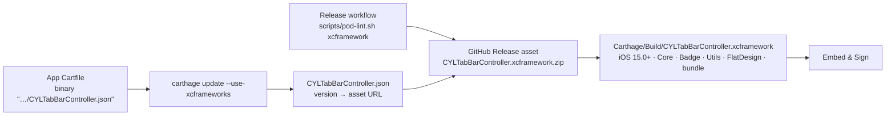

# [CN]使用 Carthage 集成
# [EN]Integrating with Carthage

<!-- bound-classes: none -->
<!-- binding:start -->
<!-- Generated by scripts/update-docs-navigation.py; do not edit by hand. -->

| 中文 | English |
|:---|:---|
| 本文档不绑定代码类。 | This document is not bound to a code class. |

<!-- binding:end -->

| 中文 | English |
|:---|:---|
| [#384](https://github.com/ChenYilong/CYLTabBarController/issues/384)：除了 CocoaPods 和 Swift Package Manager，本库也可以通过 [Carthage](https://github.com/Carthage/Carthage) 集成。本文说明用法、包含的内容，以及本次修复的问题。 | [#384](https://github.com/ChenYilong/CYLTabBarController/issues/384): besides CocoaPods and Swift Package Manager, the library can be integrated with [Carthage](https://github.com/Carthage/Carthage). This page covers usage, what is included, and what this change fixes. |

## [CN]目录
## [EN]Contents

<!-- navigation:start -->
<!-- Generated by scripts/update-docs-navigation.py; do not edit by hand. -->

| 中文 | English |
|:---|:---|
| [用法](#cn用法) | [Usage](#enusage) |
| [包含的内容](#cn包含的内容) | [What is included](#enwhat-is-included) |
| [为什么使用预编译的 XCFramework](#cn为什么使用预编译的-xcframework) | [Why a prebuilt XCFramework](#enwhy-a-prebuilt-xcframework) |
| [本次修复](#cn本次修复) | [What this change fixes](#enwhat-this-change-fixes) |
| [截图](#cn截图) | [Screenshots](#enscreenshots) |

<!-- navigation:end -->

## [CN]用法
## [EN]Usage

| 中文 | English |
|:---|:---|
| 在 App 的 `Cartfile` 中添加（预编译的 XCFramework，原因见[为什么使用预编译的 XCFramework](#cn为什么使用预编译的-xcframework)）： | Add to your app's `Cartfile` (a prebuilt XCFramework; see [Why a prebuilt XCFramework](#enwhy-a-prebuilt-xcframework)): |

```
binary "https://raw.githubusercontent.com/ChenYilong/CYLTabBarController/master/CYLTabBarController.json"
```

| 中文 | English |
|:---|:---|
| 第一个提供 XCFramework 的版本是 1.100.0 之后的下一个版本；在此之前（至 1.100.0）仍可使用 `github "ChenYilong/CYLTabBarController" ~> 1.100.0`。指定版本的写法相同，例如 `binary "…/CYLTabBarController.json" ~> 1.101`。 | The first release with an XCFramework is the one after 1.100.0; up to 1.100.0, `github "ChenYilong/CYLTabBarController" ~> 1.100.0` still works. Pin a version the same way, e.g. `binary "…/CYLTabBarController.json" ~> 1.101`. |

| 中文 | English |
|:---|:---|
| 然后执行（Xcode 12 及以上需要 `--use-xcframeworks`）： | Then run (`--use-xcframeworks` is needed with Xcode 12 and later): |

```
carthage update --use-xcframeworks --platform iOS
```

| 中文 | English |
|:---|:---|
| 将下载的 `Carthage/Build/CYLTabBarController.xcframework` 拖入工程，在「Frameworks, Libraries, and Embedded Content」中设置为 `Embed & Sign`。代码中的引入方式与 CocoaPods 相同：`#import <CYLTabBarController/CYLTabBarController.h>`（Swift：`import CYLTabBarController`）。 | Drag the downloaded `Carthage/Build/CYLTabBarController.xcframework` into your project and set it to `Embed & Sign` under "Frameworks, Libraries, and Embedded Content". Import it as with CocoaPods: `#import <CYLTabBarController/CYLTabBarController.h>` (Swift: `import CYLTabBarController`). |

## [CN]包含的内容
## [EN]What is included

| 中文 | English |
|:---|:---|
| 每次发布附带的 `CYLTabBarController.xcframework.zip` 由共享的 `CYLTabBarController-Framework` scheme 构建（`scripts/pod-lint.sh xcframework`），内含 `CYLTabBarController.framework`（动态库）的真机（`ios-arm64`）与模拟器（`ios-arm64_x86_64-simulator`）切片。 | The `CYLTabBarController.xcframework.zip` attached to each release is built from the shared `CYLTabBarController-Framework` scheme (`scripts/pod-lint.sh xcframework`): `CYLTabBarController.framework` (a dynamic framework) with its device (`ios-arm64`) and simulator (`ios-arm64_x86_64-simulator`) slices. |
| 包含：核心功能、角标（CYLBadgeView）、工具（CYLUtils）、扁平样式（CYLFlatDesignTabBar），以及资源包 `CYLTabBarController.bundle`（33 种语言的本地化文案）。 | Included: the core, badges (CYLBadgeView), utilities (CYLUtils), the flat design style (CYLFlatDesignTabBar), and the resource bundle `CYLTabBarController.bundle` (localized strings in 33 languages). |
| 不包含 Lottie 动画（`LottieSwift` 目录）：Lottie 相关功能通过 `__has_include` 判断，没有 Lottie 时自动关闭，其他功能不受影响。需要 Lottie 动画请使用 CocoaPods（`CYLTabBarController/Lottie`）或 Swift Package Manager。 | Lottie animations (the `LottieSwift` folder) are not included: the Lottie features are guarded with `__has_include` and switch off without Lottie, leaving everything else working. For Lottie animations, use CocoaPods (`CYLTabBarController/Lottie`) or Swift Package Manager. |
| 最低系统版本：framework 以 iOS 15.0 为最低版本构建。当前 Xcode（27 及以上）只支持 iOS 15.0 及以上，与 `scripts/pod-lint.xcconfig` 的设置一致。 | Minimum system version: the framework is built for iOS 15.0 and later. Current Xcode (27 and later) only supports iOS 15.0 and later, as `scripts/pod-lint.xcconfig` also sets. |
| 版本：二进制规格文件 [`CYLTabBarController.json`](../CYLTabBarController.json) 为每个版本列出其 Release 附件的 URL。附件 URL 在发布前就已确定，因此 `scripts/pod-lint.sh bump <版本号>` 会在发布 PR 中添加该版本的条目，并把演示工程的 `Cartfile` 改为 `binary "…" ~> <版本号>`（`scripts/pod-lint.sh carthage` 只做这一步）。推送 tag 后，Release workflow 用 `scripts/pod-lint.sh xcframework` 构建 zip 并上传到该版本的 GitHub Release；`CYLTabBarController.json` 中缺少该版本时会给出警告。 | Versions: the binary spec [`CYLTabBarController.json`](../CYLTabBarController.json) lists the URL of each release's asset. The asset URL is known before the release, so `scripts/pod-lint.sh bump <version>` adds the version's entry in the release pull request and moves the demo's `Cartfile` to `binary "…" ~> <version>` (`scripts/pod-lint.sh carthage` does only that step). Once the tag is pushed, the Release workflow builds the zip with `scripts/pod-lint.sh xcframework` and uploads it to the version's GitHub Release; it warns when `CYLTabBarController.json` has no entry for the version. |
| 完整的演示工程见 [Carthage 集成演示工程](Carthage-Example.md)（`Example-Swift-Carthage`）。 | For a complete demo project, see [Carthage integration demo project](Carthage-Example.md) (`Example-Swift-Carthage`). |
| 验证状态与剩余步骤见 [验证与剩余步骤](Carthage-Example.md#cn验证与剩余步骤)。 | Verification status and remaining steps: [Verification and remaining steps](Carthage-Example.md#enverification-and-remaining-steps). |

## [CN]为什么使用预编译的 XCFramework
## [EN]Why a prebuilt XCFramework

| 中文 | English |
|:---|:---|
| `github "…"` 让 Carthage 检出源码并自己编译：它会对检出目录中找到的**每一个** Xcode 工程执行 `xcodebuild -list`。本仓库包含 React Native 与 Flutter 组件（`CrossPlatform/`），Flutter 示例的 `Runner.xcodeproj` 引用只有 `flutter pub get` 才会生成的本地 Swift 包（`Flutter/ephemeral`），因此 Carthage 会以 “Could not resolve package dependencies” 失败。Carthage 没有忽略文件：它只跳过隐藏目录、git submodule 路径与 `Carthage/Checkouts`。 | `github "…"` makes Carthage check out the sources and build them itself: it runs `xcodebuild -list` on **every** Xcode project in the checkout. This repository holds the React Native and Flutter components (`CrossPlatform/`), and the Flutter examples' `Runner.xcodeproj` reference a local Swift package that only `flutter pub get` creates (`Flutter/ephemeral`), so Carthage fails with "Could not resolve package dependencies". Carthage has no ignore file: it skips only hidden folders, git submodule paths and `Carthage/Checkouts`. |
| 考虑过的其他做法：把 Flutter 示例列入 `.gitmodules` 会让 Carthage 把它们当作子模块去克隆（并检出一个文件夹的哈希），`carthage update` 直接失败；把示例移到隐藏目录会破坏 Flutter 的 `example/` 约定。预编译的 XCFramework 是 Carthage 为此提供的标准做法，还省去了每个 App 的编译时间。 | Other options considered: listing the Flutter examples in `.gitmodules` makes Carthage clone them as submodules (and check out a folder's hash), so `carthage update` fails outright; moving the examples to hidden folders breaks Flutter's `example/` convention. A prebuilt XCFramework is Carthage's standard answer to this, and it also saves every app the build time. |

## [CN]本次修复
## [EN]What this change fixes

| 中文 | English |
|:---|:---|
| 仓库根目录曾有一个声明依赖本库自身的 `Cartfile`（`github "ChenYilong/CYLTabBarController" ~> 1.99.55`）及其 `Cartfile.resolved`。Carthage 会读取每个依赖自己的 `Cartfile`，因此在 App 中添加本库时，依赖关系中出现了本库依赖自身的循环。本库不依赖任何 Carthage 库，这两个文件已删除。 | The repository root used to have a `Cartfile` that declared a dependency on the library itself (`github "ChenYilong/CYLTabBarController" ~> 1.99.55`), with its `Cartfile.resolved`. Carthage reads the `Cartfile` of every dependency, so adding the library to an app put the library in its own dependency graph, a cycle. The library depends on no Carthage packages, so both files are removed. |
| 已确认 `CYLTabBarController-Framework` 以 iOS 15.0 为最低版本构建：当前 Xcode 不支持更低的版本，改低只会产生构建警告。 | Confirmed that `CYLTabBarController-Framework` is built for iOS 15.0 and later: current Xcode does not support lower versions, so lowering it would only add a build warning. |
| 已核对 framework target 包含所有源文件、公开头文件与资源包（`LottieSwift` 除外），共享 scheme 指向该 target。 | Checked: the framework target contains every source file, public header and the resource bundle (except `LottieSwift`), and the shared scheme points to that target. |



## [CN]截图
## [EN]Screenshots

| 中文 | English |
|:---|:---|
| 已在 macOS（Xcode 27.2，Carthage 0.40.0）上验证：`scripts/pod-lint.sh xcframework` 生成的 zip 通过 `file://` 二进制规格用 `carthage update --use-xcframeworks --platform iOS` 安装，`Example-Swift-Carthage` 构建成功且没有警告。运行截图尚未添加。 | Verified on macOS (Xcode 27.2, Carthage 0.40.0): the zip that `scripts/pod-lint.sh xcframework` builds installs through a `file://` binary spec with `carthage update --use-xcframeworks --platform iOS`, and `Example-Swift-Carthage` builds with no warnings. No run screenshot has been added yet. |
