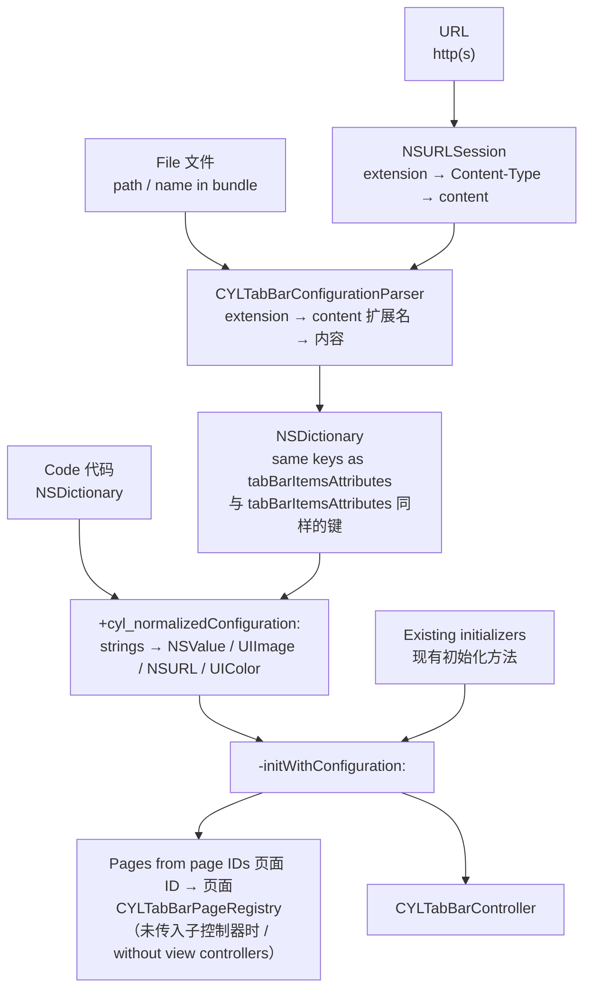
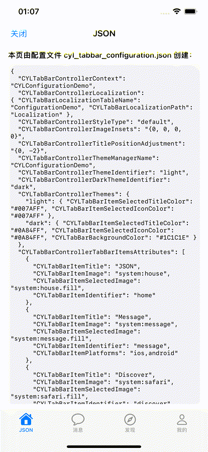
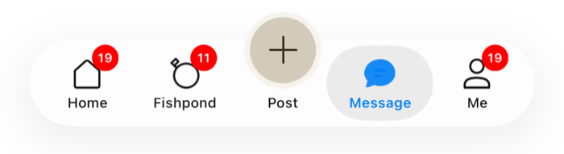
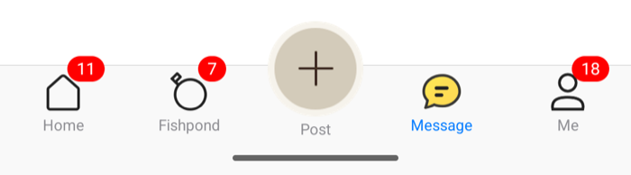
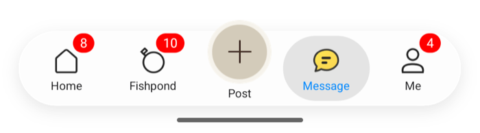

# [CN]一个配置文件生成 TabBarController
# [EN]One configuration file, one TabBarController

<!-- bound-classes: CYLTabBarController, CYLTabBarConfigurationParser -->
<!-- binding:start -->
<!-- Generated by scripts/update-docs-navigation.py; do not edit by hand. -->

| 中文 | English |
|:---|:---|
| 绑定的代码类 `CYLTabBarController`：[`CYLTabBarController/CYLTabBarController.h`](../CYLTabBarController/CYLTabBarController.h) | Bound to the class `CYLTabBarController`: [`CYLTabBarController/CYLTabBarController.h`](../CYLTabBarController/CYLTabBarController.h) |
| 绑定的代码类 `CYLTabBarConfigurationParser`：[`CYLTabBarController/CYLTabBarConfigurationParser.h`](../CYLTabBarController/CYLTabBarConfigurationParser.h) | Bound to the class `CYLTabBarConfigurationParser`: [`CYLTabBarController/CYLTabBarConfigurationParser.h`](../CYLTabBarController/CYLTabBarConfigurationParser.h) |

<!-- binding:end -->

| 中文 | English |
|:---|:---|
| 用一个参数初始化 `CYLTabBarController`：配置字典包含现有初始化方法的全部参数。同样的键可以写在配置文件中（JSON、JSON5、plist、YAML、TOML、INI、.properties、.env、XML、Protocol Buffers 等），也可以从网络 URL 下载，一个文件即可生成整个 TabBar。 | Create a `CYLTabBarController` from one parameter: a configuration dictionary that holds every parameter of the existing initializers. The same keys can be written in a configuration file (JSON, JSON5, plist, YAML, TOML, INI, .properties, .env, XML, Protocol Buffers and more) or downloaded from a URL: one file builds the whole tab bar. |

## [CN]目录
## [EN]Contents

<!-- navigation:start -->
<!-- Generated by scripts/update-docs-navigation.py; do not edit by hand. -->

| 中文 | English |
|:---|:---|
| [场景](#cn场景) | [Use case](#enuse-case) |
| [一个参数的初始化方法](#cn一个参数的初始化方法) | [The one-parameter initializer](#enthe-one-parameter-initializer) |
| &nbsp;&nbsp;&nbsp;&nbsp;↳ [配置键](#cn配置键) | &nbsp;&nbsp;&nbsp;&nbsp;↳ [Configuration keys](#enconfiguration-keys) |
| &nbsp;&nbsp;&nbsp;&nbsp;↳ [新增的 item 键与文件中的写法](#cn新增的-item-键与文件中的写法) | &nbsp;&nbsp;&nbsp;&nbsp;↳ [New item keys and file values](#ennew-item-keys-and-file-values) |
| [从文件或 URL 创建](#cn从文件或-url-创建) | [From a file or a URL](#enfrom-a-file-or-a-url) |
| [皮肤](#cn皮肤) | [Skins](#enskins) |
| [本地化文本](#cn本地化文本) | [Localized texts](#enlocalized-texts) |
| [支持的格式](#cn支持的格式) | [Supported formats](#ensupported-formats) |
| &nbsp;&nbsp;&nbsp;&nbsp;↳ [Protocol Buffers](#cnprotocol-buffers) | &nbsp;&nbsp;&nbsp;&nbsp;↳ [Protocol Buffers](#enprotocol-buffers) |
| [流程](#cn流程) | [Flow](#enflow) |
| [演示](#cn演示) | [Demo](#endemo) |
| [把代码中的配置导出为配置文件](#cn把代码中的配置导出为配置文件) | [Export the configuration written in code to files](#enexport-the-configuration-written-in-code-to-files) |
| &nbsp;&nbsp;&nbsp;&nbsp;↳ [错误码](#cn错误码) | &nbsp;&nbsp;&nbsp;&nbsp;↳ [Error codes](#enerror-codes) |
| [边界情况与评分](#cn边界情况与评分) | [Edge cases and score](#enedge-cases-and-score) |
| [限制](#cn限制) | [Limits](#enlimits) |
| [测试与截图](#cn测试与截图) | [Testing and screenshots](#entesting-and-screenshots) |

<!-- navigation:end -->

## [CN]场景
## [EN]Use case

| 中文 | English |
|:---|:---|
| 以前初始化时除了 `tabBarItemsAttributes`，还要分别传入子控制器、`imageInsets`、`titlePositionAdjustment`、样式与 `context`，这些参数无法放进配置文件。现在它们都是配置字典中的键，因此 TabBar 可以完全由文件描述：由产品或运营在服务器上调整 Tab 的数量、标题、图标、样式，App 只需加载文件。 | Until now, besides `tabBarItemsAttributes`, an initializer also took the view controllers, `imageInsets`, `titlePositionAdjustment`, the style and the `context` as separate parameters, which a file could not hold. They are now keys of the configuration dictionary, so a file can describe the whole tab bar: the server can change the number of tabs, their titles, icons and style, and the app only loads the file. |

## [CN]一个参数的初始化方法
## [EN]The one-parameter initializer

```objc
// Objective-C
CYLTabBarController *tabBarController = [[CYLTabBarController alloc] initWithConfiguration:@{
    CYLTabBarControllerViewControllers : viewControllers,              // optional 可选
    CYLTabBarControllerTabBarItemsAttributes : tabBarItemsAttributes,
    CYLTabBarControllerImageInsets : [NSValue valueWithUIEdgeInsets:UIEdgeInsetsZero],
    CYLTabBarControllerTitlePositionAdjustment : [NSValue valueWithUIOffset:UIOffsetMake(0, -3)],
    CYLTabBarControllerStyleType : @(CYLTabBarStyleTypeLiquidGlass),
    CYLTabBarControllerContext : @"Home",
}];
```

```swift
// Swift
let tabBarController = CYLTabBarController(configuration: [
    CYLTabBarControllerTabBarItemsAttributes: tabBarItemsAttributes,
    CYLTabBarControllerStyleType: "liquidGlass",
])
```

| 中文 | English |
|:---|:---|
| 现有的所有初始化方法都改为调用 `-initWithConfiguration:`，行为不变。子类若要统一定制所有初始化方式，请重写 `-initWithConfiguration:`。 | Every existing initializer now calls `-initWithConfiguration:`, with no change in behavior. A subclass that wants to customize every way of initializing overrides `-initWithConfiguration:`. |
| 缺少的键使用其他初始化方法的默认值。没有 `CYLTabBarControllerViewControllers` 时，每个 Tab 的页面根据其跨端页面 ID 获得（`CYLTabBarItemPageIdentifier`，未设置时为 `CYLTabBarItemIdentifier`）：App 用 `CYLTabBarPageRegistry` 注册每个 ID 创建什么页面，找不到页面的 Tab 会被跳过。完整说明见 [按页面 ID 获得 Tab 页面（页面注册表）](Tab-Page-Registry.md)。 | Missing keys take the defaults of the other initializers. Without `CYLTabBarControllerViewControllers`, each tab's page comes from its cross-platform page ID (`CYLTabBarItemPageIdentifier`, else `CYLTabBarItemIdentifier`): the app registers what each ID creates with `CYLTabBarPageRegistry`, and a tab whose page is not found is skipped. See [Tab pages from page IDs (the page registry)](Tab-Page-Registry.md). |

### [CN]配置键
### [EN]Configuration keys

| 键 Key | 代码中的类型 Type in code | 文件中的写法 In a file | 默认值 Default |
|:---|:---|:---|:---|
| `CYLTabBarControllerViewControllers` | `NSArray<UIViewController *>`，按下标对应 / matched by index | 不支持（仅代码） / not supported (code only) | 按页面 ID 获得 / from the page IDs |
| `CYLTabBarControllerTabBarItemsAttributes` | `NSArray<NSDictionary *>` | 字典数组 / a list of dictionaries | `@[]` |
| `CYLTabBarControllerImageInsets` | `NSValue` (UIEdgeInsets) | `"{top, left, bottom, right}"`、`[t, l, b, r]`、`{top: …}` | `UIEdgeInsetsZero` |
| `CYLTabBarControllerTitlePositionAdjustment` | `NSValue` (UIOffset) | `"{horizontal, vertical}"`、`[h, v]`、`{horizontal: …}` | `UIOffsetZero` |
| `CYLTabBarControllerStyleType` | `NSNumber` (CYLTabBarStyleType) | `default`、`system`、`flatDesign`、`liquidGlass` 或数字 / or a number | `default` |
| `CYLTabBarControllerContext` | `NSString` | 字符串 / a string | `nil` |
| `CYLTabBarControllerPlusButton` | `NSDictionary`：`CYLTabBarItemTitle`、`CYLTabBarItemImage`（UIImage 或名称 / or a name）、可选 / optional `CYLTabBarItemSelectedTitle`、`CYLTabBarItemSelectedTitleColor` | 字典，图片写名称、`"system:…"` 或路径；Protobuf 字段 12（`CYLTabBarItem` 消息） / a dictionary, the image as a name, `"system:…"` or a path; Protobuf field 12 (a `CYLTabBarItem` message) | 不注册 PlusButton / no plus button |
| `CYLTabBarControllerPlusButtonAction` | `void (^)(CYLPlusButton *)` block，每次点击执行 / run on each tap | 不支持（仅代码） / not supported (code only) | `nil` |
| `CYLTabBarControllerPlusButton` 中的其他键 / more keys inside `CYLTabBarControllerPlusButton` | `CYLPlusButtonBackgroundImage`（背景图，标题画在上面，按钮采用图片尺寸 / a background image with the title drawn on it; the button takes its size）、`CYLPlusButtonIndexInTabBar`（NSNumber，位置 / its place）、`CYLPlusButtonCenterYMultiplier` / `CYLPlusButtonCenterYOffset`（NSNumber，垂直中心 / its vertical center）、`CYLPlusButtonAlignsTitle`、`CYLPlusButtonKeepsTitleVisible`（BOOL）、`CYLPlusButtonShowsSelection`（BOOL，液态玻璃下选中 PlusButton 的页面时在其下方显示选中效果，等同代理方法返回 YES；Android 总是显示 / Liquid Glass shows the selection under it while its page is selected, as the delegate returning YES; Android always shows it）、`CYLPlusButtonSize`（按钮尺寸，如 / the button's size, e.g. "{55, 80}"）、`CYLPlusButtonImageSize`（图片按此尺寸等比绘制，例如 512px 的网络图片 / the images drawn aspect fit in this size, e.g. a 512 px network image），以及 / plus `CYLTabBarItemSelectedImage`（选中图片 / the selected image）、`CYLTabBarItemTitleColor`、`CYLTabBarItemTitleFont`、`CYLTabBarItemIdentifier`、`CYLTabBarItemPageIdentifier`（PlusButton 自己的页面 / the plus button's own page） | 同左，图片写名称或路径，布尔写 `true` / `false` / the same, images as names or paths, booleans as `true` / `false` | 居中；有标题且无背景图时对齐标题 / the middle; titles aligned when it has a title and no background image |
| `CYLTabBarControllerUserInterfaceStyle` | `NSString`：`light`、`dark`、`system`（TabBarController 的 `overrideUserInterfaceStyle`，iOS 13+；Android 跟随系统 / the controller's `overrideUserInterfaceStyle`, iOS 13+; Android follows the system） | 字符串 / a string | `system` |
| `CYLTabBarControllerTabButtonTapAnimation` | `NSString`：`none`、`scale`、`zoomIn`、`bounce`、`bounceWithFireworks`、`rotation`、`flip`、`fume`（`cyl_tabButtonTapAnimationType`） | 字符串 / a string | `none` |
| `CYLTabBarControllerSwipeToSwitchTab` | `NSNumber`（BOOL，`cyl_swipeToSwitchTabEnabled`） | `true` / `false` | `false` |
| `CYLTabBarControllerPageRegistry` | `CYLTabBarPageRegistry` 或任何 `CYLTabBarPageProviding` / or any `CYLTabBarPageProviding` | 不支持（仅代码） / not supported (code only) | `nil`：只用全局注册表 / the shared registry only |
| `CYLTabBarControllerPageResolver` | `CYLTabBarPageProvider` block | 不支持（仅代码） / not supported (code only) | `nil` |
| `CYLTabBarControllerPageLookupOrder` | `NSArray<CYLTabBarPageSource>` | `"instance, shared"` 或数组 / or a list of `instance`、`resolver`、`shared`、`automatic` | 全部四个，顺序同左 / all four, in that order |
| `CYLTabBarControllerAutomaticPageRegistration` | `NSNumber`（BOOL） | `true` / `false`、`yes` / `no`、`1` / `0` | `true` |
| `CYLTabBarControllerTabBarItemAnimationSpeed` | `NSNumber`（`tabBarItemAnimationSpeed`） | 大于 0 的数字，如 `1.5` / a number above 0, e.g. `1.5` | 库的默认速度 / the library's default |
| `CYLTabBarControllerLoginRequiredTabBarItemIdentifiers` | `NSArray<NSString *>`：需要登录的 Tab 的标识（`cyl_loginRequiredTabBarItemIdentifiers`，见[需要登录的 Tab](Login-Required-Tabs.md)） / the identifiers of the tabs that need login (see [Tabs That Need Login](Login-Required-Tabs.md)) | 字符串数组，或用逗号分隔的字符串 / a list of strings, or one comma-separated string | 无 / none |
| `CYLTabBarControllerUnloadsUnselectedViewsOnMemoryWarning` | `NSNumber`（BOOL，`unloadsUnselectedViewsOnMemoryWarning`，issue #426） | `true` / `false` | `false` |
| `CYLTabBarControllerKeepsLoadedTabBarItemIdentifiers` | `NSArray<NSString *>`：内存警告时不卸载的 Tab（`cyl_keepsLoadedTabBarItemIdentifiers`，相当于重写 `-shouldUnloadViewOfViewController:`） / the tabs a memory warning never unloads (`cyl_keepsLoadedTabBarItemIdentifiers`, what overriding `-shouldUnloadViewOfViewController:` does) | 字符串数组，或用逗号分隔的字符串 / a list of strings, or one comma-separated string | 无 / none |
| `CYLTabBarControllerThemes` | `NSDictionary`（标识 → 命名值）或数组 / (identifier → named values) or a list | `{light: {…}, dark: {…}}`，或 `[{CYLTabBarThemeIdentifier: …, CYLTabBarThemeValues: {…}}]`（见[皮肤](#cn皮肤) / see [Skins](#enskins)） | 无皮肤 / no skins |
| `CYLTabBarControllerThemeIdentifier` | `NSString` | 字符串 / a string | 按字母顺序的第一个皮肤 / the first skin alphabetically |
| `CYLTabBarControllerDarkThemeIdentifier` | `NSString` | 字符串 / a string | 不跟随深色模式 / no Dark Mode skin |
| `CYLTabBarControllerThemeManagerName` | `NSString` | 字符串 / a string | TabBarController 的 `cyl_themeManager` / the controller's `cyl_themeManager` |

### [CN]新增的 item 键与文件中的写法
### [EN]New item keys and file values

| 键 Key | 说明 | Description |
|:---|:---|:---|
| `CYLTabBarItemPageIdentifier` | Tab 页面的跨端 ID，例如 `"web"`；未设置或为 `""` 时使用 `CYLTabBarItemIdentifier`。见 [页面注册表](Tab-Page-Registry.md)。 | The cross-platform ID of the tab's page, e.g. `"web"`; missing or `""`: `CYLTabBarItemIdentifier`. See [the page registry](Tab-Page-Registry.md). |
| `CYLTabBarItemPageParameters` | 字典，随 Tab 的属性传给页面提供者，例如 `{url: "https://…"}`；不是字典时移除（B25）。 | A dictionary passed to the page provider with the tab's attributes, e.g. `{url: "https://…"}`; removed when it is not a dictionary (B25). |
| `CYLTabBarItemPlatforms` | 字符串数组或逗号分隔的字符串，例如 `"ios,android"`；不含 `ios` 时 iOS 上不显示该 Tab（B22）。 | A list of strings or a comma-separated string, e.g. `"ios,android"`; without `ios`, the tab is left out on iOS (B22). |
| `CYLTabBarItemMinimumAppVersion` | 例如 `"2.3.0"`；App 版本更低时不显示该 Tab，按数字逐段比较（B22、B24）。 | E.g. `"2.3.0"`; the tab is left out when the app is older, compared number by number (B22, B24). |
| 图片键 / image keys | `CYLTabBarItemImage` 等支持 `"system:house.fill"`（SF Symbol，iOS 13+）或图片名称。 | `CYLTabBarItemImage` and the like take `"system:house.fill"` (an SF Symbol, iOS 13+) or an image name. |
| `CYLTabBarItemImageInsets` 等 | 与上表相同的 `"{…}"`、数组或字典写法。 | The same `"{…}"`, list or dictionary forms as above. |
| `CYLTabBarItemImageURLSize`、`CYLTabBarLottieSize` | `"{width, height}"`、`[w, h]` 或 `{width: …}`。 | `"{width, height}"`, `[w, h]` or `{width: …}`. |
| `CYLTabBarLottieURL`、`CYLTabBarLottieDarkURL` | http(s) URL、路径，或 main bundle 中的文件名（如 `tab_home.json`）。 | An http(s) URL, a path, or a file name in the main bundle (e.g. `tab_home.json`). |
| `CYLTabBarLottieDarkColors` | keypath → `"#RRGGBB"` / `"#RRGGBBAA"`。 | keypath → `"#RRGGBB"` / `"#RRGGBBAA"`. |
| `CYLTabBarAnimationURL`、`CYLTabBarAnimationFilePath`、`CYLTabBarAnimationDarkURL`、`CYLTabBarAnimationDarkFilePath`、`CYLTabBarAnimationSize` | 任何动画库的通用键（[Tab-Bar-Item-Animation](Tab-Bar-Item-Animation.md)）：由文件类型决定动画库（`.json` Lottie、`.pag` PAG、`.riv` Rive、`.gif` GIF）；写法与 Lottie 键相同。 | The generic keys of any animation library ([Tab-Bar-Item-Animation](Tab-Bar-Item-Animation.md)): the file type picks the library (`.json` Lottie, `.pag` PAG, `.riv` Rive); written like the Lottie keys. |
| `CYLTabBarPAGURL`、`CYLTabBarPAGFilePath`、`CYLTabBarPAGDarkURL`、`CYLTabBarPAGDarkFilePath`、`CYLTabBarPAGSize`；`CYLTabBarRiveURL`、`CYLTabBarRiveFilePath`、`CYLTabBarRiveDarkURL`、`CYLTabBarRiveDarkFilePath`、`CYLTabBarRiveSize`、`CYLTabBarRiveDarkColors` | PAG 与 Rive 自己的键，写法同上；按名称识别，因此不依赖子库是否参与编译：未安装的库忽略自己的键，Tab 显示图片（B29）。 | PAG's and Rive's own keys, written as above; known by name, so they do not depend on the subspec being compiled: a library that is not installed ignores its keys and the tab shows its image (B29). |
| `CYLTabBarGIFURL`、`CYLTabBarGIFFilePath`、`CYLTabBarGIFDarkURL`、`CYLTabBarGIFDarkFilePath`、`CYLTabBarGIFSize`（#605） | GIF 自己的键，写法同上，按名称识别（没有 `GIF` 子库时被忽略，Tab 显示图片）；选中 Tab 时播放一次并停在最后一帧。`.gif` 文件必须以 GIF87a / GIF89a 开头，否则移除并输出警告（B30）。GIF 没有颜色图层，因此没有深色颜色键，请提供深色文件。Protobuf 字段 57–61。 | GIF's own keys, written the same way and known by name (ignored without the `GIF` subspec: the tab shows its image); it plays once when the tab is selected and stays on its last frame. A `.gif` file must start with GIF87a / GIF89a, otherwise it is removed with a warning (B30). A GIF has no color layers, so there is no dark colors key: give a dark file. Protobuf fields 57–61. |
| `CYLTabBarAnimationOptions` | 字典（选项名 → 字符串，数字会转为字符串），写入该 Tab 所有动画 URL 的 fragment（`CYLTabBarAnimationURLWithOptions()`）；只有路径时生成带选项的 file URL。Rive 的选项名：`artboard`、`stateMachine`、`active`、`duration`、`trigger`、`color`、`input`、`triggerInput`、`animation`、`legacy`。不是字典时忽略（B28）。 | A dictionary (option name → string; numbers become strings), written into the fragment of every animation URL of the tab (`CYLTabBarAnimationURLWithOptions()`); a path alone gets a file URL with the options. Rive's option names: `artboard`, `stateMachine`, `active`, `duration`, `trigger`, `color`, `input`, `triggerInput`, `animation`, `legacy`. Not a dictionary: ignored (B28). |
| `CYLTabBarAnimationColors`、`CYLTabBarAnimationDarkColors` | 与 `CYLTabBarLottieDarkColors` 相同：keypath → `"#RRGGBB"` / `"#RRGGBBAA"`（Lottie 4.x、Rive）。 | Like `CYLTabBarLottieDarkColors`: keypath → `"#RRGGBB"` / `"#RRGGBBAA"` (Lottie 4.x, Rive). |
| `CYLTabBarLottieLoopsWhenUnselected` | `true` / `false`（未选中时循环播放）。 | `true` / `false` (loops while unselected). |
| `CYLTabBarItemTitleColor`、`CYLTabBarItemSelectedTitleColor`、`CYLTabBarItemIconColor`、`CYLTabBarItemSelectedIconColor`、`CYLTabBarItemBackgroundColor`、`CYLTabBarItemSelectedBackgroundColor` | `"#RGB"`、`"#RRGGBB"` 或 `"#RRGGBBAA"`（代码中为 UIColor）；无效时移除（B19）。 | `"#RGB"`, `"#RRGGBB"` or `"#RRGGBBAA"` (a UIColor in code); removed when invalid (B19). |
| `CYLTabBarItemIconRenderingMode`；整个 TabBar：`CYLTabBarControllerIconRenderingMode`、`CYLTabBarControllerIconColor`、`CYLTabBarControllerSelectedIconColor`（#787） | `"template"`（一张图随状态着色）、`"original"`（保持原色）或 `"automatic"`，不区分大小写，其他值移除并输出警告；TabBar 级的键作为没有单独设置的 Tab 的默认值，颜色写法同上。Protobuf 字段 62 与 13–15。见 [Tab-Item-Colors](Tab-Item-Colors.md)。 | `"template"` (one image tinted per state), `"original"` (own colors) or `"automatic"`, case-insensitive; other values are removed with a warning. The tab bar keys are the defaults of every tab without its own; colors are written as above. Protobuf fields 62 and 13–15. See [Tab-Item-Colors](Tab-Item-Colors.md). |
| `CYLTabBarItemTitleFont`、`CYLTabBarItemSelectedTitleFont` | 数字（系统字体字号，如 `15`）、`"bold:15"`（指定字重的系统字体：ultralight、thin、light、regular、medium、semibold、bold、heavy、black）、`"Menlo-Regular:12"`（按名称）或 `{name, size, weight}`；字号 1–200，字体不存在时移除（B20）。 | A number (a system font size, e.g. `15`), `"bold:15"` (a system font with a weight: ultralight, thin, light, regular, medium, semibold, bold, heavy, black), `"Menlo-Regular:12"` (by name) or `{name, size, weight}`; size 1–200, removed when the font does not exist (B20). |
| `CYLTabBarItemAccessibilityIdentifier`、`CYLTabBarItemAccessibilityLabel`、`CYLTabBarItemAccessibilityHint`、`CYLTabBarItemSelectedTitle` | 字符串（数字会转为字符串）。 | Strings (numbers become strings). |

## [CN]从文件或 URL 创建
## [EN]From a file or a URL

```objc
// A path, a file URL string, or a file name in the main bundle.
// 路径、文件 URL 字符串或 main bundle 中的文件名。
NSError *error = nil;
CYLTabBarController *tabBarController = [CYLTabBarController tabBarControllerWithConfigurationFile:@"tabbar.yaml" error:&error];

// Downloaded; the completion runs on the main queue. 网络下载，回调在主队列执行。
[CYLTabBarController loadTabBarControllerWithConfigurationURL:[NSURL URLWithString:@"https://example.com/tabbar.json"]
                                                   completion:^(CYLTabBarController *tabBarController, NSError *error) {
    self.window.rootViewController = tabBarController
        ?: [CYLTabBarController tabBarControllerWithConfigurationFile:@"tabbar.json" error:NULL]; // fallback 兜底
}];

// Only the dictionary, to change it before creating the controller (e.g. add view controllers).
// 只取字典，在创建控制器前修改（例如加入子控制器）。
NSDictionary *configuration = [CYLTabBarController configurationWithContentsOfFile:@"tabbar.toml" error:&error];
```

```swift
// Swift
let tabBarController = try CYLTabBarController(configurationFile: "tabbar.yaml")
CYLTabBarController.loadTabBarController(withConfigurationURL: url) { tabBarController, error in /* ... */ }
```

| 中文 | English |
|:---|:---|
| 格式依次由文件扩展名、HTTP `Content-Type`、文件内容识别；扩展名未知或缺失时会根据内容自动识别。所有格式都解析为同一个字典，键与 `tabBarItemsAttributes` 完全一致。 | The format comes from the file name extension, then the HTTP `Content-Type`, then the content: an unknown or missing extension is detected from the content. Every format becomes the same dictionary, with the same keys as `tabBarItemsAttributes`. |
| 文件不存在、格式错误或顶层不是字典时返回 nil，`error` 的 domain 为 `CYLTabBarConfigurationErrorDomain`，描述中包含行号。 | A missing file, a syntax error or a top level that is not a dictionary returns nil; `error` is in `CYLTabBarConfigurationErrorDomain`, and its description names the line. |
| 下载使用 `NSURLSession`，遵循 URL 加载系统的缓存策略；返回的任务可以取消。建议准备一个本地文件作为下载失败时的兜底。 | Downloads use `NSURLSession` and follow the URL loading system's cache policy; the returned task can be cancelled. Keep a local file as a fallback for when the download fails. |

## [CN]皮肤
## [EN]Skins

| 中文 | English |
|:---|:---|
| 参照 QMUI 的换肤（视图按名称引用皮肤中的值，皮肤切换时重新取值），配置文件可以带多套皮肤：`CYLTabBarControllerThemes` 中每个皮肤是一组命名值，Tab 的值写成 `"@name"` 时取当前皮肤中名为 `name` 的值。每个皮肤成为一个 `CYLTabBarConfigurationTheme`（`CYLTabBarTheme`），注册到主题管理器；切换皮肤沿用已有的原地更新与恢复（见[换肤](Theme-Switching.md)），不重新创建 TabBar 与页面。iOS 与 Android 读取同一个文件，行为相同。 | Following QMUI's skins (a view names a value of the skin, and takes it again when the skin changes), a configuration file can carry several skins: each skin in `CYLTabBarControllerThemes` is a set of named values, and a tab value written `"@name"` takes the value `name` of the current skin. Each skin becomes a `CYLTabBarConfigurationTheme` (a `CYLTabBarTheme`) registered with the theme manager; switching skins reuses the existing in-place update and restore (see [theme switching](Theme-Switching.md)), with no new tab bar and no new pages. iOS and Android read the same file the same way. |

```json
{
  "CYLTabBarControllerThemeIdentifier": "light",
  "CYLTabBarControllerDarkThemeIdentifier": "dark",
  "CYLTabBarControllerThemes": {
    "light": { "accent": "#007AFF", "homeIcon": "system:house", "CYLTabBarBackgroundColor": "#F9F9F9" },
    "dark":  { "accent": "#0A84FF", "CYLTabBarBackgroundColor": "#1C1C1E" }
  },
  "CYLTabBarControllerTabBarItemsAttributes": [
    { "CYLTabBarItemTitle": "Home", "CYLTabBarItemImage": "@homeIcon", "CYLTabBarItemSelectedTitleColor": "@accent", "CYLTabBarItemIdentifier": "home" }
  ]
}
```

```objc
// [EN] Switch, from anywhere. [CN] 在任何地方切换。
CYLThemeManagerCenter.defaultThemeManager.currentThemeIdentifier = @"dark";
// [EN] Views of the app follow the same skins. [CN] App 的视图跟随同样的皮肤。
label.textColor = [CYLTabBarConfigurationTheme colorNamed:@"accent"];
```

```kotlin
CYLThemeManagerCenter.defaultThemeManager.currentThemeIdentifier = "dark"
label.cyl_themeValue = "textColor:accent"                       // Android theme values 主题值
val accent = CYLTabBarConfigurationTheme.colorNamed("accent")   // a CYLThemeColor
```

| 规则 | Rule |
|:---|:---|
| 引用：Tab 的任何字符串值都可以是 `"@name"`（标题、图片、颜色、字体、URL、动画文件……），取值后按该键原有的规则转换与校验；`"@@text"` 表示普通文本 `"@text"`。没有皮肤时 `"@"` 开头的值保持原样。 | References: any string value of a tab can be `"@name"` (a title, an image, a color, a font, a URL, an animation file...); the value goes through that key's usual conversion and checks. `"@@text"` is the literal `"@text"`. Without skins, values starting with `"@"` stay as they are. |
| 回退：某个皮肤没有的名称取自 `CYLTabBarControllerThemeIdentifier` 对应的基础皮肤（类似 QMUI 皮肤 style 的继承）；所有皮肤都没有时，该键被移除并输出警告。 | Fallback: a name a skin does not give comes from the base skin of `CYLTabBarControllerThemeIdentifier` (like QMUI skin styles inheriting); when no skin gives it, the key is left out with a warning. |
| 整个 TabBar：保留名称 `CYLTabBarBackgroundColor`、`CYLTabBarShadowColor`、`CYLTabBarItemTitleColor`、`CYLTabBarItemSelectedTitleColor`、`CYLTabBarItemIconColor`、`CYLTabBarItemSelectedIconColor`、`CYLTabBarItemTitleFont`、`CYLTabBarItemSelectedTitleFont` 给出外观（iOS 13+ 为新的 `UITabBarAppearance`；Android 为 `CYLTabBarAppearance` 与标题字体）。皮肤没有这些名称时保留 App 自己的外观。 | The whole bar: the reserved names `CYLTabBarBackgroundColor`, `CYLTabBarShadowColor`, `CYLTabBarItemTitleColor`, `CYLTabBarItemSelectedTitleColor`, `CYLTabBarItemIconColor`, `CYLTabBarItemSelectedIconColor`, `CYLTabBarItemTitleFont` and `CYLTabBarItemSelectedTitleFont` give the appearance (a new `UITabBarAppearance` on iOS 13+; `CYLTabBarAppearance` and the title fonts on Android). A skin without them keeps the app's own appearance. |
| TabBar 的图片与 Item 布局：保留名称 `CYLTabBarBackgroundImage`（整个 TabBar 的背景图片：名称、"system:<名称>" 或路径）、`CYLTabBarShadowImage`（顶部线条的图片）、`CYLTabBarStackedItemPositioning`（"centered"、"fill" 或 "automatic"）、`CYLTabBarStackedItemWidth`（居中时每个 Item 的宽度，pt / dp，0 表示平分）、`CYLTabBarStackedItemSpacing`（居中的 Item 之间的间距，pt / dp）。iOS 写入 `UITabBarAppearance`（`backgroundImage`、`shadowImage`、`stackedItemPositioning`、`stackedItemWidth`、`stackedItemSpacing`），系统 TabBar 与扁平样式都会使用；Android 写入 TabBar 的 `standardAppearance`，经典与扁平样式绘制图片并让 Item 居中，液态玻璃保持其胶囊外观。放不下时 Item 仍铺满宽度。 | The bar's images and item layout: the reserved names `CYLTabBarBackgroundImage` (an image behind the whole bar: a name, "system:<name>" or a path), `CYLTabBarShadowImage` (the image of the top line), `CYLTabBarStackedItemPositioning` ("centered", "fill" or "automatic"), `CYLTabBarStackedItemWidth` (each item's width when centered, pt / dp, 0 for an equal share) and `CYLTabBarStackedItemSpacing` (the space between centered items, pt / dp). iOS writes them into `UITabBarAppearance` (`backgroundImage`, `shadowImage`, `stackedItemPositioning`, `stackedItemWidth`, `stackedItemSpacing`), which the system tab bar and FlatDesign both use; Android writes them into the bar's `standardAppearance`: the classic and FlatDesign styles draw the images and center the items, and Liquid Glass keeps its capsule. Items that do not fit still fill the width. |
| Tab 对应：按 `CYLTabBarItemIdentifier`（没有标识时按保留 Tab 中的位置），因此被平台、最低版本或页面查找排除的 Tab 不会错位。没有 `"@name"` 的 Tab 保持不变。皮肤中的图标与其他 `CYLTabBarTheme` 一样，以图片原色显示；需要着色的图标请为皮肤提供图标颜色。 | Matching tabs: by `CYLTabBarItemIdentifier` (by position among the kept tabs without one), so tabs left out by platform, minimum version or page lookup do not shift. A tab without `"@name"` values stays as it is. A skin's icons show in their own colors, as with any `CYLTabBarTheme`; give icon colors for tinted icons. |
| 首个皮肤：管理器之前已选择的皮肤（持久化，或 App 设置）保持不变；否则深色模式下用 `CYLTabBarControllerDarkThemeIdentifier`，其他情况用 `CYLTabBarControllerThemeIdentifier`。之前配置中的皮肤、而本配置中没有时，不再保留，改用本配置的首个皮肤（例如 React Native / Flutter 切换皮肤时传入只含新皮肤的配置）。 | The first skin: a skin the manager had before (persisted, or set by the app) stays; otherwise the dark skin in Dark Mode, else `CYLTabBarControllerThemeIdentifier`. A skin of an earlier configuration that this one does not have is not kept: this configuration's first skin is used (e.g. a React Native / Flutter app passing a configuration with only the new skin). |
| 背景色：皮肤的 `CYLTabBarBackgroundColor` 生成不透明的 TabBar（`configureWithOpaqueBackground`），与示例的皮肤相同；液态玻璃的玻璃不使用该颜色（iOS 26 与 Android 相同），经典样式与扁平样式显示该颜色。切换皮肤时，上一个皮肤设置、而新皮肤没有的颜色会被清除（Android 与 iOS 相同）。 | Background: a skin's `CYLTabBarBackgroundColor` gives an opaque bar (`configureWithOpaqueBackground`), as the example's skins; the Liquid Glass glass does not take it (iOS 26 and Android alike), the classic bar and FlatDesign show it. When skins change, a color the previous skin set and the new one does not is cleared (Android as iOS). |
| 深色模式：有深色皮肤时，管理器跟随系统外观（iOS 设置 `identifierForTrait` 与 `respondsSystemStyleAutomatically`；Android 设置 `identifierForTrait`，TabBar 在配置变化时切换），除非管理器已有自己的 `identifierForTrait`，或已选择了其他皮肤。 | Dark Mode: with a dark skin, the manager follows the system appearance (iOS sets `identifierForTrait` and `respondsSystemStyleAutomatically`; Android sets `identifierForTrait` and the tab bar switches on a configuration change), unless the manager already has its own `identifierForTrait`, or another skin was chosen. |
| 每个示例文件（17 种格式，包括二进制 plist 与 Protobuf）都带有同样的两套皮肤 `light` 与 `dark`（深色模式下使用 `dark`），写法见各文件；`scripts/configuration-tests/run-tests.sh` 与 Android 的 `CYLConfigurationThemesTest` 检查每种格式读出的皮肤相同。 | Every sample file (17 formats, binary plist and Protobuf included) carries the same two skins, `light` and `dark` (`dark` in Dark Mode); see each file for the syntax. `scripts/configuration-tests/run-tests.sh` and Android's `CYLConfigurationThemesTest` check that every format gives the same skins. |
| 管理器：默认是 TabBarController 的 `cyl_themeManager`（即默认管理器），因此 App 的视图与换肤菜单也能看到这些皮肤；示例文件用 `CYLTabBarControllerThemeManagerName: "CYLConfigurationDemo"`，不影响演示 App 自己的皮肤。 | The manager: by default the controller's `cyl_themeManager` (the default manager), so the app's views and skin menus see the skins too; the sample files use `CYLTabBarControllerThemeManagerName: "CYLConfigurationDemo"` so the demo app's own skins are not touched. |
| 格式：字典形式适用于有嵌套字典的格式；列表形式 `{CYLTabBarThemeIdentifier, CYLTabBarThemeValues}` 用于 Protobuf（字段 8–11，消息 `CYLTabBarTheme`），XML 与 Protobuf 文本中只有一个皮肤时也可以直接写。示例 JSON、YAML、Protobuf 文本文件带有浅色 / 深色两套皮肤。 | Formats: the dictionary form fits every format with nested dictionaries; the list form `{CYLTabBarThemeIdentifier, CYLTabBarThemeValues}` is for Protobuf (fields 8–11, message `CYLTabBarTheme`), and a single skin can be written as is in XML and Protobuf text. The sample JSON, YAML and Protobuf text files carry a light and a dark skin. |

## [CN]本地化文本
## [EN]Localized texts

| 中文 | English |
|:---|:---|
| 配置中的标题可以写成本地化键，译文放在 App 的 `.strings` 字符串表中（内置或下载到沙盒）：`CYLTabBarControllerLocalization`，以及从 App 内置资源、沙盒或本地路径读取的位置路由，见 [配置文件的本地化文本](Configuration-Localization.md)。 | The titles of a configuration can be localization keys translated from the app's `.strings` tables (built in or downloaded into the sandbox): `CYLTabBarControllerLocalization`, and the location routes that read from the app's resources, the sandbox or a local path, are in [Localized texts in a configuration file](Configuration-Localization.md). |

## [CN]支持的格式
## [EN]Supported formats

| 格式 Format | 扩展名 Extensions | 示例文件 Sample file | 说明 | Notes |
|:---|:---|:---|:---|:---|
| JSON | `.json` | `cyl_tabbar_configuration.json` | 标准 JSON。 | Standard JSON. |
| JSON5 / JSONC | `.json5`、`.jsonc` | `cyl_tabbar_configuration.json5`、`.jsonc` | 支持注释、尾逗号、单引号、不加引号的键。 | Comments, trailing commas, single quotes, unquoted keys. |
| Property List | `.plist` | `cyl_tabbar_configuration.plist`、`_binary.plist`、`_openstep.plist` | XML、二进制与 OpenStep（旧式）格式。 | XML, binary and OpenStep (old-style). |
| .strings | `.strings` | `cyl_tabbar_configuration.strings` | 本地化文件格式 `"key" = "value";`，嵌套值用 OpenStep 语法。 | The localization format `"key" = "value";`, nested values in OpenStep syntax. |
| YAML | `.yaml`、`.yml` | `cyl_tabbar_configuration.yaml`、`.yml` | 块样式与流式样式、注释、`|` / `>` 块标量。 | Block and flow style, comments, `|` / `>` block scalars. |
| TOML | `.toml` | `cyl_tabbar_configuration.toml` | 表、`[[数组表]]`、内联表、多行字符串。 | Tables, `[[arrays of tables]]`, inline tables, multi-line strings. |
| INI | `.ini`、`.cfg`、`.conf` | `cyl_tabbar_configuration.ini`、`.cfg` | `[节.路径]`，数字表示数组元素（`[CYLTabBarControllerTabBarItemsAttributes.0]`）。 | `[section.path]`, numbers for list elements (`[CYLTabBarControllerTabBarItemsAttributes.0]`). |
| .properties | `.properties` | `cyl_tabbar_configuration.properties` | `点.分隔.路径 = 值`，支持 Java 转义与续行。 | `dotted.key.path = value`, Java escapes and line continuation. |
| .env | `.env` | `cyl_tabbar_configuration.env` | `KEY=value`、`export`，用 `__` 分隔路径。 | `KEY=value`, `export`, `__` separates the path. |
| XML | `.xml` | `cyl_tabbar_configuration.xml` | 元素即键，`<item>` 组成数组，`<item>` 也可以用属性。 | Elements are keys, `<item>` children make a list, an `<item>` can also use attributes. |
| Protobuf 文本格式 / text format | `.textproto`、`.txtpb`、`.pbtxt`、`.prototxt` | `cyl_tabbar_configuration.textproto` | 无需结构定义：`name: value`、`name { … }`，同名字段写多次即数组。 | No schema needed: `name: value`, `name { … }`; a field written several times makes a list. |
| Protobuf 二进制 / binary | `.binpb`、`.pb`、`.protobuf` | `cyl_tabbar_configuration.binpb` | `cyl.CYLTabBarConfiguration` 消息，结构定义内置（`cyl_tabbar_configuration.proto`），无需 protobuf 运行库。 | A `cyl.CYLTabBarConfiguration` message; the schema is built in (`cyl_tabbar_configuration.proto`), no protobuf runtime needed. |

| 中文 | English |
|:---|:---|
| 示例文件位于 `Example-Shared/Configurations/`，都描述同一个 4 个 Tab 的 TabBar（另有 Protobuf 结构定义 `cyl_tabbar_configuration.proto`）（第一个 Tab 的标题为格式名称）。解析器 `CYLTabBarConfigurationParser` 只依赖 Foundation，也可以单独使用。 | The sample files are in `Example-Shared/Configurations/`. They all describe the same 4-tab bar (with the Protobuf schema `cyl_tabbar_configuration.proto` next to them) (the first tab's title is the name of the format). The parser, `CYLTabBarConfigurationParser`, uses Foundation only and can be used on its own. |

A YAML file 一个 YAML 文件：

```yaml
CYLTabBarControllerContext: CYLConfigurationDemo
CYLTabBarControllerStyleType: default
CYLTabBarControllerTitlePositionAdjustment: "{0, -2}"
CYLTabBarControllerTabBarItemsAttributes:
  - CYLTabBarItemTitle: Home
    CYLTabBarItemImage: system:house
    CYLTabBarItemSelectedImage: system:house.fill
    CYLTabBarItemIdentifier: home            # page ID "home" 页面 ID "home"
  - CYLTabBarItemTitle: Discover
    CYLTabBarItemImage: system:safari
    CYLTabBarItemIdentifier: discover
    CYLTabBarItemPageIdentifier: web         # page ID "web" 页面 ID "web"
    CYLTabBarItemPageParameters:
      url: https://github.com/ChenYilong/CYLTabBarController
  - CYLTabBarItemTitle: Me
    CYLTabBarItemImage: system:person
    CYLTabBarItemSelectedImage: system:person.fill
    CYLTabBarItemIdentifier: me
    CYLTabBarItemMinimumAppVersion: "1.0.0"
    CYLTabBarItemTitlePositionAdjustment: [0, -1]
```

The same in TOML 同样的内容写成 TOML：

```toml
CYLTabBarControllerContext = "CYLConfigurationDemo"
CYLTabBarControllerTitlePositionAdjustment = "{0, -2}"

[[CYLTabBarControllerTabBarItemsAttributes]]
CYLTabBarItemTitle = "Home"
CYLTabBarItemImage = "system:house"
CYLTabBarItemIdentifier = "home"
CYLTabBarItemPlatforms = "ios,android"
```

### [CN]Protocol Buffers
### [EN]Protocol Buffers

| 中文 | English |
|:---|:---|
| 二进制 protobuf 只保存字段编号，因此需要结构定义。本库内置了 `cyl_tabbar_configuration.proto`（位于示例文件目录），字段名即配置键，字段编号永不改变；解析器自带解码器，App 不需要引入 protobuf 运行库。服务器可以用任何语言的官方 protobuf 库生成 `.binpb`，`Content-Type` 为 `application/x-protobuf` 时也能识别。未知字段（例如更新的结构定义中新增的字段）会被跳过。 | Binary protobuf only stores field numbers, so it needs a schema. The library has `cyl_tabbar_configuration.proto` built in (in the sample folder): its field names are the configuration keys and its field numbers never change; the parser has its own decoder, so the app needs no protobuf runtime. A server can write `.binpb` with the official protobuf library of any language; a `Content-Type` of `application/x-protobuf` is recognized too. Unknown fields (e.g. added by a newer schema) are skipped. |
| 文本格式不需要结构定义。protobuf 的 `map` 在文本格式中写作多个 `{ key: … value: … }` 条目，`CYLTabBarLottieDarkColors`、`CYLTabBarItemPageParameters`、`CYLTabBarAnimationOptions`、`CYLTabBarAnimationColors`、`CYLTabBarAnimationDarkColors` 与 `CYLTabBarRiveDarkColors` 会自动转换为字典；只有一个 Tab 时（文本格式没有列表语法）也会自动当作列表。 | The text format needs no schema. A protobuf `map` is written as `{ key: … value: … }` entries in the text format: `CYLTabBarLottieDarkColors`, `CYLTabBarItemPageParameters`, `CYLTabBarAnimationOptions`, `CYLTabBarAnimationColors`, `CYLTabBarAnimationDarkColors` and `CYLTabBarRiveDarkColors` turn them into a dictionary; with a single tab (the text format has no list syntax) the tab is taken as a list too. |
| 用 protoc 由文本格式生成二进制：`protoc --encode=cyl.CYLTabBarConfiguration cyl_tabbar_configuration.proto < cyl_tabbar_configuration.textproto > cyl_tabbar_configuration.binpb` | Encode the text format with protoc: `protoc --encode=cyl.CYLTabBarConfiguration cyl_tabbar_configuration.proto < cyl_tabbar_configuration.textproto > cyl_tabbar_configuration.binpb` |

```textproto
# proto-message: cyl.CYLTabBarConfiguration
CYLTabBarControllerContext: "CYLConfigurationDemo"
CYLTabBarControllerTabBarItemsAttributes {
  CYLTabBarItemTitle: "Home"
  CYLTabBarItemImage: "system:house"
  CYLTabBarItemIdentifier: "home"
}
CYLTabBarControllerTabBarItemsAttributes {
  CYLTabBarItemTitle: "Me"
  CYLTabBarItemImage: "system:person"
}
```

## [CN]流程
## [EN]Flow



## [CN]演示
## [EN]Demo

| 中文 | English |
|:---|:---|
| Example 的设置列表中“跳转与对比”分组的第一行“从配置文件创建 TabBarController”：选择 17 个示例文件之一（JSON、JSON5、JSONC、XML / 二进制 / OpenStep plist、.strings、YAML、YML、TOML、INI、CFG、.properties、.env、XML、Protobuf 文本与二进制），或“从网络 URL 加载”（GitHub 上的 YAML 示例）。生成的 TabBarController 全屏展示，每个页面显示其来源文件的内容，左上角“关闭”返回。 | In the Example's settings list, the first row of the "Navigation and comparisons" section, "Create a TabBarController from a configuration file": choose one of the 17 sample files (JSON, JSON5, JSONC, XML / binary / OpenStep plist, .strings, YAML, YML, TOML, INI, CFG, .properties, .env, XML, Protobuf text and binary), or "Load from a URL" (the YAML sample on GitHub). The tab bar controller it creates is presented full screen; every page shows the file it came from, and Close (top left) goes back. |
| 演示代码：`UIViewController+CYLConfigurationDemo.h/.m`；示例 URL 在合并到 master 后可用。 | Demo code: `UIViewController+CYLConfigurationDemo.h/.m`; the sample URL works once this is merged into master. |
| 示例文件属于 App，不在本库中：它们位于 `Example-Shared/Configurations/`（字符串表在其中的 `Localization/`），ObjC Example 以 `Configurations` 文件夹打包（Xcode 中的蓝色文件夹引用），Android 示例把它作为 assets。演示读取 `bundle:Configurations`；没有打包该文件夹的示例只显示“从网络 URL 加载”。 | The sample files belong to the app, not to the library: they are in `Example-Shared/Configurations/` (the string tables in its `Localization/`), the ObjC Example bundles it as the folder `Configurations` (a blue folder reference in Xcode), and the Android examples use it as assets. The demo reads `bundle:Configurations`; an example that does not bundle the folder shows only "Load from a URL". |
| 示例文件的 Tab 标题使用本地化键（`Message`、`Discover`、`Me`），译文在 `Localization/{language}.lproj/ConfigurationDemo.strings`（33 种语言），见[配置文件的本地化文本](Configuration-Localization.md)。第一个 Tab 的标题是格式名称，不翻译。 | The sample files' tab titles are localization keys (`Message`, `Discover`, `Me`), translated in `Localization/{language}.lproj/ConfigurationDemo.strings` (33 languages), see [Localized texts in a configuration file](Configuration-Localization.md). The first tab's title is the name of the format and is not translated. |
| 同一个操作表中还有两个资源路由（见[资源路由](Resource-Routes.md)）：`bundle:Configurations?name=cyl_tabbar_configuration`（App 内置），以及 `sandbox:Caches/CYLConfigurationDemo?name=tabbar&theme=dark`（先复制到沙盒，代替下载）。 | The same action sheet has two resource routes too (see [Resource routes](Resource-Routes.md)): `bundle:Configurations?name=cyl_tabbar_configuration` (built into the app), and `sandbox:Caches/CYLConfigurationDemo?name=tabbar&theme=dark` (copied into the sandbox first, standing in for a download). |
| 下发场景（版本、平台、App 版本与时间段、PlusButton、多套主题及其图片、哈希校验、失败回退与回调）请使用[TabBar 配置清单](Configuration-Manifest.md)：它参照 uni-app、Expo Updates 与 Firebase Remote Config，转换为本文的配置字典。 | For delivered configurations (version, platforms, app versions and a time window, the plus button, several themes with their images, hash checks, fallbacks and callbacks) use the [tab bar configuration manifest](Configuration-Manifest.md): it follows uni-app, Expo Updates and Firebase Remote Config and turns into this document's configuration dictionary. |
| 简体中文下的 JSON 示例： | The JSON sample in Simplified Chinese: |
|  |  |
| “配置文件：模拟意外情况”分组：41 行，每行把一种损坏、恶意或特殊的输入交给真实 API（空文件、只有注释、语法错误、编码错误、UTF-16、嵌套 1 万层、6 MB 文件、没有 Tab、HTML 页面、错误的类型与 null、NaN、未知样式、未注册的页面 ID、抛出异常或返回无效页面的提供者、自动注册（`CYLTabBarPage`）、类型错误的注册表、两个 TabBar 共用页面 ID、其他平台与更高版本的 Tab、无效的平台 / 版本 / 页面参数、无效 URL 与 Lottie 文件、重复标识、拼写错误、无效的颜色与字体、空字符串、截断的 protobuf、损坏的二进制 plist、XXE、文件不存在、后台线程、代码中的非控制器对象与非字典配置、空的子控制器列表、HTTP 404、域名无法解析、3 秒超时、请求取消、没有 URL 的请求、网络返回 HTML）。行标题以下方“边界情况与评分”表格中的编号开头；结果显示在该行下方并弹窗说明，成功创建的控制器可点“查看”打开。 | The "Configuration: simulated failures" section: 41 rows, each feeding one broken, hostile or unusual input to the real API (an empty file, comments only, a syntax error, a bad encoding, UTF-16, 10,000 levels of nesting, a 6 MB file, no tabs, an HTML page, wrong types and null, NaN, an unknown style, unregistered page IDs, providers that raise or return invalid pages, automatic registration (`CYLTabBarPage`), a registry of the wrong type, two tab bars sharing page IDs, tabs for other platforms and newer versions, invalid platforms / versions / page parameters, invalid URLs and Lottie files, duplicate identifiers, typos, invalid colors and fonts, empty strings, a truncated protobuf, a corrupted binary plist, XXE, a missing file, a background thread, objects that are not view controllers and a configuration that is not a dictionary in code, an empty view controller list, HTTP 404, an unknown host, a 3 s timeout, a cancelled request, a request without a URL, HTML from the network). Each row starts with the ID of its case in the "Edge cases and score" table below; the outcome shows under the row and in an alert, and a controller that was created can be opened with "View". |

## [CN]把代码中的配置导出为配置文件
## [EN]Export the configuration written in code to files

| 中文 | English |
|:---|:---|
| 网络配置不可信，最稳妥的做法是随 App 打包一份本地配置作为兜底。`scripts/export-tabbar-configurations.py`（仅依赖 Python 3 标准库）在 Objective-C 与 Swift 源码中查找 TabBar 配置并生成配置文件：`CYLTabBarItemTitle : ...` 字典字面量、`CYLLocalizedTabBarItemsAttributes(...)`、`CYLTabBarItemsAttributesAddingLottieFiles(...)`（自动找到 `_dark.json`）、用 `.map` 生成的 Lottie 深色颜色、子控制器类与导航控制器类，以及初始化参数（context、样式、内边距、标题偏移）。只在运行时才有的值（变量、枚举、方法调用）不会写入，并在报告中列出：文件只会不完整，不会出错。 | A downloaded configuration cannot be trusted; the safest setup ships a local configuration in the app as a fallback. `scripts/export-tabbar-configurations.py` (Python 3 standard library only) finds the tab bar configuration in Objective-C and Swift sources and writes configuration files: `CYLTabBarItemTitle : ...` dictionary literals, `CYLLocalizedTabBarItemsAttributes(...)`, `CYLTabBarItemsAttributesAddingLottieFiles(...)` (finding the `_dark.json` files), Lottie dark colors built with `.map`, the view controller and navigation controller classes, and the initializer parameters (context, style, insets, title offset). Values that only exist at runtime (variables, enums, method calls) are left out and listed in the report: a file can be incomplete, never wrong. |
| 写法会被转换为文件中的形式：`CYLLocalizedString(@"首页")` 写入本地化 key `首页`，`[UIImage systemImageNamed:@"house"]` 写入 `system:house`，`[NSValue valueWithUIOffset:UIOffsetMake(0, -3)]` 写入 `{0, -3}`，`[[NSBundle mainBundle] pathForResource:@"a" ofType:@"json"]` 写入 `a.json`，`UIColor(white: 0.78, alpha: 1)` 写入 `#C7C7C7FF`。 | Expressions become their file form: `CYLLocalizedString(@"首页")` the localization key `首页`, `[UIImage systemImageNamed:@"house"]` `system:house`, `[NSValue valueWithUIOffset:UIOffsetMake(0, -3)]` `{0, -3}`, `[[NSBundle mainBundle] pathForResource:@"a" ofType:@"json"]` `a.json`, `UIColor(white: 0.78, alpha: 1)` `#C7C7C7FF`. |

```sh
python3 scripts/export-tabbar-configurations.py                       # every Example*/, JSON + YAML 所有 Example，JSON + YAML
python3 scripts/export-tabbar-configurations.py --format all          # 12 formats 12 种格式
python3 scripts/export-tabbar-configurations.py --format toml,binpb path/to/MyTabBarController.m
python3 scripts/export-tabbar-configurations.py --stdout --format yaml path/to/MyTabBarController.swift
python3 scripts/export-tabbar-configurations.py --check               # exit 1 when a file is out of date 文件过期时返回 1
```

| 中文 | English |
|:---|:---|
| 已对所有 Example 运行，结果（JSON 与 YAML）提交在各 Example 的 `Configurations/` 中：`Example/MainTabBarController.*`（4 个 Tab，Lottie 与深色 Lottie、子控制器类、`CYLBaseNavigationController`）、`Example-Swift`（4 个 Tab，Lottie 深色颜色、Liquid Glass）、`Example-Swift-02`、`Example-Swift-03`、`Example-Swift-04`、`Example-Swift-Carthage`、`Example-SwiftUI`（各 4 个 Tab）、`Example-network-download`（5 个 Tab，SF Symbol 与网络图标）。`Example-Swift-SwiftManager-FlatDesign` 的 Tab 由枚举在运行时生成，脚本报告无法导出而不生成文件。 | Run on every Example; the results (JSON and YAML) are committed in each Example's `Configurations/`: `Example/MainTabBarController.*` (4 tabs, Lottie and dark Lottie files, view controller classes, `CYLBaseNavigationController`), `Example-Swift` (4 tabs, Lottie dark colors, Liquid Glass), `Example-Swift-02`, `Example-Swift-03`, `Example-Swift-04`, `Example-Swift-Carthage`, `Example-SwiftUI` (4 tabs each), `Example-network-download` (5 tabs, SF Symbols and network icons). `Example-Swift-SwiftManager-FlatDesign` builds its tabs from an enum at runtime: the script reports that it cannot be exported and writes no file. |
| 脚本的完整用法（参数、能读取的写法、报告、推荐用法与 CI）、边界情况评分脚本与测试套件见 [配置文件相关脚本](Configuration-Scripts.md)。 | Full usage of the script (options, what it reads, the report, the recommended setup and CI), the edge-case scoring script and the test suite: [Configuration scripts](Configuration-Scripts.md). |
| 验证：所有 Example 的 12 种格式共 96 个文件，用本库的解析器读取（按扩展名与按内容识别）全部得到与 JSON 相同的配置。 | Verified: the 96 files of all Examples in all 12 formats, read with the library's parser (by extension and by content), all give the same configuration as the JSON one. |

### [CN]错误码
### [EN]Error codes

| 错误码 Code | 名称 Name | 中文 | English |
|:---|:---|:---|:---|
| 1 | `FileNotFound` | 文件不存在、是目录或无法读取；URL 为 nil | The file is missing, a directory or unreadable; a nil URL |
| 2 | `UnsupportedFormat` | 无法识别格式 | The format could not be detected |
| 3 | `InvalidSyntax` | 内容不符合格式，描述中包含行号 | The content is invalid in its format; the description names the line |
| 4 | `NotADictionary` | 顶层不是字典 | The top level is not a dictionary |
| 5 | `Network` | 下载失败，`NSUnderlyingErrorKey` 为原始错误 | The download failed; `NSUnderlyingErrorKey` holds the original error |
| 6 | `Empty` | 文件或响应为空，或只有空白与注释 | The file or response is empty, or only whitespace and comments |
| 7 | `TooLarge` | 超过 5 MB（`CYLTabBarConfigurationMaximumLength`） | Over 5 MB (`CYLTabBarConfigurationMaximumLength`) |
| 8 | `TooDeep` | 嵌套超过 64 层（`CYLTabBarConfigurationMaximumDepth`） | Nested deeper than 64 levels (`CYLTabBarConfigurationMaximumDepth`) |
| 9 | `NoTabs` | 文件或 URL 中没有 Tab（例如下载到 HTML 页面） | A file or URL with no tab (e.g. an HTML page was downloaded) |
| 10 | `MainThreadRequired` | 在非主线程通过文件接口创建控制器 | A controller created from a file off the main thread |

```objc
// A safe pattern: the remote configuration, else the one shipped in the app. 稳妥的写法：优先网络配置，失败时使用随 App 打包的配置。
[CYLTabBarController loadTabBarControllerWithConfigurationURL:remoteURL completion:^(CYLTabBarController *tabBarController, NSError *error) {
    if (!tabBarController) {
        NSLog(@"Remote configuration refused: %@ (%ld)", error.localizedDescription, (long)error.code);
        tabBarController = [CYLTabBarController tabBarControllerWithConfigurationFile:@"tabbar.json" error:NULL];
    }
    self.window.rootViewController = tabBarController;
}];
```

## [CN]边界情况与评分
## [EN]Edge cases and score

| 中文 | English |
|:---|:---|
| 配置文件可能来自网络，内容不可信。下表列出所有已考虑的边界情况及其处理方式。评分 = 已处理的情况 / 全部情况（部分处理计一半），每一轮修复后重新评分；复查中新发现的情况会加入表格，因此分数可能下降。Demo 中“配置文件：模拟意外情况”分组可以逐一触发这些情况。 | A configuration may come from the network: its content cannot be trusted. The table lists every edge case considered and how it is handled. Score = handled cases / all cases (partly handled counts half), scored again after each round of fixes; cases found during a review are added to the table, so the score can drop. The demo's "Configuration: simulated failures" section triggers them one by one. |

<!-- edge-cases:start -->
<!-- Generated from the edge-case checklist; the status column is the round that handled each case. -->

| 编号 ID | 情况 | Case | 处理 | Handling | 状态 Status |
|:---|:---|:---|:---|:---|:---|
| A1 | 文件路径为 nil 或空字符串 | The file path is nil or empty | 返回 nil 与 FileNotFound 错误 | nil and a FileNotFound error | ✅ 第 1 轮 / round 1 |
| A2 | 文件不存在、是目录或无读取权限 | The file is missing, a directory or unreadable | 返回 nil 与 FileNotFound 错误 | nil and a FileNotFound error | ✅ 第 1 轮 / round 1 |
| A3 | 文件为 0 字节 | The file has 0 bytes | Empty 错误（以前 YAML 等格式会生成没有 Tab 的控制器） | An Empty error (YAML and others used to give a controller with no tabs) | ✅ 第 3 轮 / round 3 |
| A4 | 文件只有空白或注释 | The file has only whitespace or comments | Empty 错误 | An Empty error | ✅ 第 3 轮 / round 3 |
| A5 | 不是合法的 UTF-8 文本 | Not valid UTF-8 text | InvalidSyntax 错误 | An InvalidSyntax error | ✅ 第 1 轮 / round 1 |
| A6 | 以 UTF-8 BOM 开头 | Starts with a UTF-8 BOM | 自动去掉 BOM | The BOM is skipped | ✅ 第 1 轮 / round 1 |
| A7 | 扩展名与内容不符（如 .json 中是 YAML） | The extension does not match the content (YAML in a .json file) | 按扩展名解析失败后根据内容识别并重试 | When the extension's format fails, the content is detected and parsed again | ✅ 第 4 轮 / round 4 |
| A8 | 扩展名未知或缺失 | An unknown or missing extension | 根据内容识别格式 | The format is detected from the content | ✅ 第 1 轮 / round 1 |
| A9 | 文件过大（例如 1 GB） | A huge file (e.g. 1 GB) | 超过 5 MB 时返回 TooLarge 错误，不读入内存解析 | Over 5 MB: a TooLarge error, nothing is parsed | ✅ 第 3 轮 / round 3 |
| A10 | 嵌套过深（如 10 万层 `[[[[`）导致栈溢出 | Deep nesting (e.g. 100,000 levels of `[[[[`) overflows the stack | 超过 64 层时返回 TooDeep 错误，所有递归解析器都有层数限制 | Over 64 levels: a TooDeep error; every recursive parser has a depth limit | ✅ 第 2 轮 / round 2 |
| A11 | 顶层不是字典（数组、字符串、数字） | The top level is not a dictionary (a list, a string, a number) | NotADictionary 错误 | A NotADictionary error | ✅ 第 1 轮 / round 1 |
| A12 | 截断或无效的二进制 plist / protobuf | A truncated or invalid binary plist / protobuf | InvalidSyntax 错误，越界读取被拒绝 | An InvalidSyntax error; out-of-bounds reads are refused | ✅ 第 1 轮 / round 1 |
| A13 | 语法错误 | A syntax error | 错误描述包含格式与行号 | The error names the format and the line | ✅ 第 1 轮 / round 1 |
| A14 | XML 外部实体（XXE） | XML external entities (XXE) | 显式关闭外部实体解析 | External entities are explicitly not resolved | ✅ 第 4 轮 / round 4 |
| A15 | 重复的键 | Duplicate keys | 后出现的值生效，不崩溃 | The last value wins, no crash | ✅ 第 1 轮 / round 1 |
| A16 | UTF-16 / UTF-32 编码的文本文件（带 BOM） | A UTF-16 / UTF-32 text file (with a BOM) | 根据 BOM 识别编码 | The encoding is detected from the BOM | ✅ 第 6 轮 / round 6 |
| A17 | A7 的重试掩盖了语法错误（.properties、INI、Protobuf 文本几乎接受任何文本；TOML 曾接受 `[1, 2]` 这样的表名） | The retry of A7 hid syntax errors (.properties, INI and Protobuf text accept almost any text; TOML accepted a table named `[1, 2]`) | 重试只使用结构明确的格式（JSON、YAML、TOML、plist、XML、二进制 Protobuf），TOML 裸键只接受规范允许的字符；由测试套件发现 | The retry only uses formats with a distinctive structure (JSON, YAML, TOML, plist, XML, binary Protobuf), and TOML bare keys only take the characters of the specification; found by the test suite | ✅ 第 7 轮 / round 7 |
| B1 | 没有 Tab（缺少或为空的 `CYLTabBarControllerTabBarItemsAttributes`） | No tabs (missing or empty `CYLTabBarControllerTabBarItemsAttributes`) | 读取文件或 URL 时返回 NoTabs 错误；代码中初始化时保持原行为并输出警告 | Files and URLs: a NoTabs error; in code: unchanged behavior and a warning | ✅ 第 3 轮 / round 3 |
| B2 | Tab 列表不是数组（字符串、数字） | The tab list is not a list (a string, a number) | 视为没有 Tab，见 B1 | Treated as no tabs, see B1 | ✅ 第 3 轮 / round 3 |
| B3 | 只有一个 Tab 且写成字典（Protobuf 文本、XML） | A single tab written as a dictionary (Protobuf text, XML) | 自动包装为列表 | Wrapped into a list | ✅ 第 1 轮 / round 1 |
| B4 | Tab 列表中的元素不是字典 | A tab entry is not a dictionary | 代码传入子控制器时用空字典占位，保持下标对应；根据配置创建子控制器时跳过 | With view controllers from code: an empty placeholder keeps the indexes; when they are created: skipped | ✅ 第 4 轮 / round 4 |
| B5 | 字符串键的值类型错误（标题为数组、字典） | A string key has the wrong type (a title that is a list or a dictionary) | 数字转换为字符串，其他类型移除；以前会因 unrecognized selector 崩溃 | Numbers become strings, other types are removed; this used to crash (unrecognized selector) | ✅ 第 2 轮 / round 2 |
| B6 | 值为 null（JSON null、YAML ~） | A value is null (JSON null, YAML ~) | 移除该键；以前在 item 中会崩溃 | The key is removed; inside an item this used to crash | ✅ 第 2 轮 / round 2 |
| B7 | 内边距 / 偏移为 NaN、Infinity 或极大值 | Insets / offsets are NaN, Infinity or huge | 非有限值或绝对值超过 1000 时移除；以前会触发 CALayer NaN 异常 | Non-finite values or values over 1000 are removed; this used to raise a CALayer NaN exception | ✅ 第 2 轮 / round 2 |
| B8 | 尺寸为负数、0 或极大值 | A size is negative, zero or huge | 要求 0 < 值 ≤ 1000，否则移除 | Requires 0 < value ≤ 1000, removed otherwise | ✅ 第 2 轮 / round 2 |
| B9 | 未知的样式名称或超出范围的样式编号（如 99） | An unknown style name or an out-of-range style number (e.g. 99) | 使用默认样式并输出警告 | The default style and a warning | ✅ 第 2 轮 / round 2 |
| B10 | 请求扁平样式但未集成 FlatDesign 子库 | FlatDesign requested without the FlatDesign subspec | 使用默认样式并输出警告 | The default style and a warning | ✅ 第 4 轮 / round 4 |
| B11 | 拼写错误的键（如 `CYLTabBarItemTitel`） | A misspelled key (e.g. `CYLTabBarItemTitel`) | 保留（App 可能有自定义键），DEBUG 下提示最接近的已知键 | Kept (the app may use its own keys); DEBUG names the closest known key | ✅ 第 4 轮 / round 4 |
| B12 | 重复的 `CYLTabBarItemIdentifier` | A duplicate `CYLTabBarItemIdentifier` | 后出现的改为「标识_2」等并输出警告 | Later ones become "identifier_2"..., with a warning | ✅ 第 4 轮 / round 4 |
| B13 | 无效的图片 / Lottie URL，或不存在的本地 Lottie 文件 | An invalid image / Lottie URL, or a missing local Lottie file | 只接受 http(s) 与存在的本地文件，否则移除 | Only http(s) URLs and existing local files are kept | ✅ 第 4 轮 / round 4 |
| B14 | 图片名称或 SF Symbol 不存在 | An image name or SF Symbol that does not exist | 该 Tab 没有图标，不崩溃 | The tab has no icon, no crash | ✅ 第 1 轮 / round 1 |
| B15 | Tab 很多（超过 5 个） | Many tabs (more than 5) | 由 UIKit 处理（“更多”） | Handled by UIKit ("More") | ✅ 第 1 轮 / round 1 |
| B16 | 超长标题 | A very long title | 不崩溃，由 UIKit 截断显示 | No crash; UIKit truncates it | ✅ 第 1 轮 / round 1 |
| B17 | Lottie 文件不是合法的 JSON 动画 | A Lottie file that is not a valid JSON animation | 解析检查失败时移除，避免 Lottie 内部异常 | Removed when it does not parse as a JSON object, so Lottie never sees it | ✅ 第 6 轮 / round 6 |
| B18 | 代码中传入的配置不是字典（如类型不明的 JSON 数组） | The configuration passed in code is not a dictionary (e.g. an untyped JSON list) | 视为空配置并输出警告；以前会因 unrecognized selector 崩溃 | Treated as empty, with a warning; this used to crash (unrecognized selector) | ✅ 第 6 轮 / round 6 |
| B19 | 无效的颜色（`CYLTabBarItemTitleColor` 等为错误的十六进制串或数字） | An invalid color (`CYLTabBarItemTitleColor`... a wrong hex string or a number) | 接受 UIColor 与 "#RGB" / "#RRGGBB" / "#RRGGBBAA"，其他移除并输出警告 | UIColor and "#RGB" / "#RRGGBB" / "#RRGGBBAA" are accepted; anything else is removed, with a warning | ✅ 第 8 轮 / round 8 |
| B20 | 无效的字体（字号为 0、NaN、超过 200，或字体名称不存在） | An invalid font (size 0, NaN, over 200, or a font name that does not exist) | 字号必须在 1 到 200 之间，字体必须存在，否则移除并输出警告 | The size must be between 1 and 200 and the font must exist; removed otherwise, with a warning | ✅ 第 8 轮 / round 8 |
| B21 | 空字符串作为 URL、Lottie 文件、图片 URL、类名、颜色或字体（`""`） | An empty string (`""`) as a URL, Lottie file, image URL, class, color or font | 视为未提供并输出警告；以前空的 Lottie URL 会传给 +fileURLWithPath:（要求非空路径） | Treated as missing, with a warning; an empty Lottie URL used to reach +fileURLWithPath:, which requires a non-empty path | ✅ 第 10 轮 / round 10 |
| B22 | Tab 只适用于其他平台（`CYLTabBarItemPlatforms`），或需要更新的 App 版本（`CYLTabBarItemMinimumAppVersion`） | A tab only for other platforms (`CYLTabBarItemPlatforms`), or for a newer app version (`CYLTabBarItemMinimumAppVersion`) | 该 Tab 在 iOS 上不显示；子控制器由代码传入时，连同对应的子控制器一起移除，其余下标仍然对应 | The tab is left out on iOS; with view controllers from code, its view controller goes too and the other indexes still match | ✅ 第 11 轮 / round 11 |
| B23 | `CYLTabBarItemPlatforms` 无效（数字、空字符串、非字符串元素） | An invalid `CYLTabBarItemPlatforms` (a number, an empty string, non-string elements) | 忽略并输出警告，该 Tab 在所有平台显示 | Ignored, with a warning; the tab shows on every platform | ✅ 第 11 轮 / round 11 |
| B24 | `CYLTabBarItemMinimumAppVersion` 无效（"abc"、"2.x"），或按字符串比较会出错（"2.10" 与 "2.9"） | An invalid `CYLTabBarItemMinimumAppVersion` ("abc", "2.x"), or one a string comparison gets wrong ("2.10" vs "2.9") | 按数字逐段比较；无效版本被忽略并输出警告 | Compared number by number; an invalid version is ignored, with a warning | ✅ 第 11 轮 / round 11 |
| B25 | `CYLTabBarItemPageParameters` 不是字典 | `CYLTabBarItemPageParameters` is not a dictionary | 移除并输出警告；Protobuf 的 key / value 条目转换为字典 | Removed, with a warning; Protobuf key / value entries become a dictionary | ✅ 第 11 轮 / round 11 |
| B26 | 复用已有 TabBarController 的 `viewControllers` / `tabBarItemsAttributes`，其中带有 PlusButton 的 slot（占位控制器、PlusButton 子控制器、带标记的 slot 项，#774） | Re-using the `viewControllers` / `tabBarItemsAttributes` of an existing tab bar controller, which carry the PlusButton slot (placeholder, plus child view controller, the marked slot entry, #774) | 先去掉 slot 再按下标对应 Tab 与子控制器，slot 由 `-setViewControllers:` 重新插入且只插入一次；不再误报未知键 | The slot is removed before tabs and view controllers are matched by index, and `-setViewControllers:` inserts it again, once; no false unknown-key warning | ✅ 第 12 轮 / round 12 |
| B27 | 由页面 ID 创建的控制器调用 `-reloadTabBarItemsWithAttributes:`（远程配置更新、登录后换 Tab） | `-reloadTabBarItemsWithAttributes:` on a controller created from page IDs (a remote update, tabs after login) | 控制器保留注册表、解析回调与查找顺序：新 Tab 的页面按 ID 解析，页面 ID 已有页面的 Tab 复用它，找不到的跳过并记录在 `cyl_skippedTabs` | The controller keeps its registry, resolver and lookup order: new tabs are resolved by ID, a tab whose page ID already has a page reuses it, the rest are skipped and listed in `cyl_skippedTabs` | ✅ 第 13 轮 / round 13 |
| B28 | 动画键无效：`CYLTabBarAnimationOptions` 不是字典或含非字符串值，`CYLTabBarControllerTabBarItemAnimationSpeed` 为 0、负数或 "fast"，`CYLTabBarLottieLoopsWhenUnselected` 不是布尔值，动画 URL / 路径指向不存在的文件 | Invalid animation keys: `CYLTabBarAnimationOptions` not a dictionary or with non-string values, `CYLTabBarControllerTabBarItemAnimationSpeed` 0, negative or "fast", `CYLTabBarLottieLoopsWhenUnselected` not a boolean, an animation URL / path of a missing file | 选项逐项检查（数字转为字符串，其余丢弃）；速度必须是大于 0 的有限数字，否则忽略并警告；布尔值同 `CYLTabBarControllerAutomaticPageRegistration`；本地文件必须存在（Lottie 文件还须可读）；有效选项写入动画 URL 的 fragment（`CYLTabBarAnimationURLWithOptions()`） | Options are checked one by one (numbers become strings, the rest is dropped); the speed must be a finite number above 0, else ignored with a warning; the boolean works like `CYLTabBarControllerAutomaticPageRegistration`; a local file must exist (a Lottie file must also be readable); valid options go into the fragment of the animation URLs (`CYLTabBarAnimationURLWithOptions()`) | ✅ 第 15 轮 / round 15 |
| B29 | 配置使用了未安装的动画库的键（例如没有 `Rive` 子库时写 `CYLTabBarRiveURL`），或同一 Tab 写了多个动画库的键 | A configuration names the keys of an animation library that is not installed (e.g. `CYLTabBarRiveURL` without the `Rive` subspec), or one tab names several libraries | PAG / Rive 的键按名称识别（不依赖子库的常量），值照常转换并传给库：未安装的库忽略自己的键，Tab 显示图片；多个库时由库按键选择（#752） | The PAG / Rive keys are known by name (no dependency on the subspec constants), converted as usual and handed to the library: a library that is not installed ignores its keys and the tab shows its image; with several libraries the library chooses by key (#752) | ✅ 第 15 轮 / round 15 |
| B30 | GIF 键（#605）：没有 `GIF` 子库时写 `CYLTabBarGIFURL`，或 `.gif` 文件不是 GIF（扩展名对、内容不对） | GIF keys (#605): `CYLTabBarGIFURL` without the `GIF` subspec, or a `.gif` file that is not a GIF (the right extension, the wrong content) | GIF 的键按名称识别，值照常转换（Protobuf 字段 57–61）；`.gif` 文件必须以 GIF87a / GIF89a 开头，否则移除并输出警告，Tab 显示图片 | The GIF keys are known by name and converted as usual (Protobuf fields 57–61); a `.gif` file must start with GIF87a / GIF89a, otherwise it is removed with a warning and the tab shows its image | ✅ 第 16 轮 / round 16 |
| C6 | `CYLTabBarControllerViewControllers` 中有非控制器对象 | `CYLTabBarControllerViewControllers` holds objects that are not view controllers | 移除这些对象；以前会崩溃 | They are removed; this used to crash | ✅ 第 2 轮 / round 2 |
| C7 | 同一个子控制器出现两次 | The same view controller twice | 移除重复项；以前 UIKit 会抛异常 | The duplicate is removed; UIKit used to raise | ✅ 第 2 轮 / round 2 |
| C8 | 子控制器数量与 Tab 数量不一致 | More or fewer view controllers than tabs | 本库按下标保护，不越界 | The library checks indexes, no out-of-bounds access | ✅ 第 1 轮 / round 1 |
| C9 | `CYLTabBarControllerViewControllers` 为空数组 | `CYLTabBarControllerViewControllers` is an empty list | 视为未提供，根据 Tab 创建子控制器 | Treated as missing: the view controllers are created from the tabs | ✅ 第 6 轮 / round 6 |
| C10 | 没有 URL 的 NSURLRequest，或代码中传入 nil 请求 / URL（声明为 nonnull） | An NSURLRequest without a URL, or a nil request / URL from code (declared nonnull) | 返回 FileNotFound 错误；本地与缺失 URL 由同一个文件内私有函数处理，不再把 nil 传给 nonnull 参数（CI 静态分析 nullability.NullPassedToNonnull） | A FileNotFound error; local and missing URLs go through one file-private function, so nil never reaches a nonnull parameter (CI static analyzer, nullability.NullPassedToNonnull) | ✅ 第 10 轮 / round 10 |
| C11 | Tab 的页面 ID 没有注册，或 Tab 没有任何 ID | A tab's page ID is not registered, or the tab has no ID at all | 跳过该 Tab 并输出警告；由文件或 URL 创建且没有任何 Tab 找到页面时，返回 NoPages 错误（11） | The tab is skipped, with a warning; from a file or a URL, when no tab finds its page, a NoPages error (11) | ✅ 第 11 轮 / round 11 |
| C12 | 页面提供者抛出 Objective-C 异常 | A page provider raises an Objective-C exception | 捕获异常，跳过该 Tab | The exception is caught; the tab is skipped | ✅ 第 11 轮 / round 11 |
| C13 | 页面提供者返回 nil、非控制器对象、TabBarController、已属于其他容器的页面，或两个 Tab 返回同一个页面 | A page provider returns nil, an object that is not a view controller, a tab bar controller, a page that belongs to another container, or one page for two tabs | 拒绝并跳过该 Tab，UIKit 不会移动或嵌套页面 | Refused and the tab skipped; UIKit never moves or nests the page | ✅ 第 11 轮 / round 11 |
| C14 | 两个遵守 `CYLTabBarPage` 的类声明同一个页面 ID | Two classes that adopt `CYLTabBarPage` claim the same page ID | 按类名顺序使用第一个，DEBUG 下输出警告；扫描只读取类信息，不触发 +initialize | The first in class name order is used, with a warning in DEBUG; the scan only reads class data, no +initialize runs | ✅ 第 11 轮 / round 11 |
| C15 | `CYLTabBarControllerPageRegistry` / `CYLTabBarControllerPageResolver` 类型错误（例如文件中的字符串） | `CYLTabBarControllerPageRegistry` / `CYLTabBarControllerPageResolver` of the wrong type (e.g. a string from a file) | 忽略并输出警告，继续使用全局注册表 | Ignored, with a warning; the shared registry is still used | ✅ 第 11 轮 / round 11 |
| C16 | 多个 TabBar 把同一个页面 ID 对应到不同页面 | Several tab bars map one page ID to different pages | 每个 TabBar 传入自己的 `CYLTabBarControllerPageRegistry`，先于全局注册表查找 | Each tab bar passes its own `CYLTabBarControllerPageRegistry`, looked up before the shared registry | ✅ 第 11 轮 / round 11 |
| C17 | 重复的 Tab 标识被改名后，页面 ID 也随之改变 | A duplicate tab identifier, once renamed, changes the page ID too | 改名前把原标识保存为 `CYLTabBarItemPageIdentifier`，页面仍能找到 | The original identifier is kept as `CYLTabBarItemPageIdentifier` before renaming, so the page is still found | ✅ 第 11 轮 / round 11 |
| D1 | URL 为 nil | A nil URL | 回调返回 FileNotFound 错误 | The completion gets a FileNotFound error | ✅ 第 1 轮 / round 1 |
| D2 | 不支持的 scheme 或无效 URL | An unsupported scheme or an invalid URL | 回调返回 Network 错误 | The completion gets a Network error | ✅ 第 1 轮 / round 1 |
| D3 | HTTP 4xx / 5xx | HTTP 4xx / 5xx | Network 错误，包含状态码 | A Network error with the status code | ✅ 第 1 轮 / round 1 |
| D4 | 无网络、DNS 失败 | No network, a DNS failure | Network 错误（NSUnderlyingErrorKey 为原始错误） | A Network error (NSUnderlyingErrorKey holds the original) | ✅ 第 1 轮 / round 1 |
| D5 | 服务器不响应 | The server does not answer | 默认 15 秒超时（以前为系统默认的 60 秒）；可传入自定义 NSURLRequest | A 15 s timeout by default (it was the system's 60 s); a custom NSURLRequest can be passed | ✅ 第 5 轮 / round 5 |
| D6 | 响应体为空 | An empty response body | Empty 错误 | An Empty error | ✅ 第 3 轮 / round 3 |
| D7 | 返回 HTML 页面（如公共 Wi-Fi 的登录页） | An HTML page instead (e.g. a captive Wi-Fi portal) | 识别为没有 Tab 的配置，返回 NoTabs 错误；以前会生成空的 TabBar | Detected as a configuration with no tabs: a NoTabs error; it used to give an empty tab bar | ✅ 第 3 轮 / round 3 |
| D8 | 响应过大 | A huge response | 超过 5 MB 时返回 TooLarge 错误 | Over 5 MB: a TooLarge error | ✅ 第 3 轮 / round 3 |
| D9 | Content-Type 错误（如 text/plain） | A wrong Content-Type (e.g. text/plain) | 根据扩展名或内容识别 | Detected from the extension or the content | ✅ 第 1 轮 / round 1 |
| D10 | 请求被取消 | The request is cancelled | 回调仍会执行一次，返回 Network 错误 | The completion still runs once, with a Network error | ✅ 第 1 轮 / round 1 |
| D11 | 回调线程与次数 | Completion thread and count | 总在主队列执行且只执行一次 | Always on the main queue, exactly once | ✅ 第 1 轮 / round 1 |
| D12 | completion 为 nil | A nil completion | 不发起请求，返回 nil | No request is made; returns nil | ✅ 第 1 轮 / round 1 |
| C18 | `CYLTabBarControllerPageLookupOrder` 含未知项或为空，`CYLTabBarControllerAutomaticPageRegistration` 不是布尔值 | `CYLTabBarControllerPageLookupOrder` with unknown entries or empty, `CYLTabBarControllerAutomaticPageRegistration` not a boolean | 未知项丢弃并警告，没有剩余项时用默认顺序；非布尔值忽略并警告 | Unknown entries are dropped with a warning, the default order is used when nothing is left; a non-boolean is ignored with a warning | ✅ 第 13 轮 / round 13 |
| C19 | 被跳过的 Tab 在 Release 中无法观测 | Skipped tabs cannot be observed in Release | `cyl_skippedTabs` 列出每个没有页面的 Tab 及原因（排除、无 ID、未注册、提供者失败、无效） | `cyl_skippedTabs` lists every tab without a page and why (excluded, no ID, unregistered, provider failed, invalid) | ✅ 第 13 轮 / round 13 |
| C20 | 异步页面工厂：completion 在非主线程调用、调用两次、交付 nil 或不能作为 Tab 的页面、在控制器释放后调用，或同步完成 | An asynchronous page factory: the completion called off the main thread, twice, with nil or a page that cannot be a tab, after the controller is gone, or synchronously | 切回主线程、只接受第一次；nil / 无效页面移除该 Tab 并记录在 `cyl_skippedTabs`；控制器已释放时忽略；同步完成在下一次 run loop 换入 | Delivered on the main thread, the first call only; nil / an invalid page removes the tab and lists it in `cyl_skippedTabs`; ignored when the controller is gone; a synchronous completion is swapped on the next run loop turn | ✅ 第 14 轮 / round 14 |
| E1 | 在后台线程读取文件并创建控制器 | Reading a file and creating the controller on a background thread | 文件接口返回 MainThreadRequired 错误；代码初始化输出警告（与原行为一致） | The file APIs return a MainThreadRequired error; the code initializer warns (as before) | ✅ 第 5 轮 / round 5 |
| E2 | 在后台线程只解析配置字典 | Only parsing the dictionary on a background thread | 解析器只依赖 Foundation，线程安全 | The parser is Foundation only and thread-safe | ✅ 第 1 轮 / round 1 |
| L1 | 字符串表位于配置文件旁（相对路径）或运行时下载到沙盒（"sandbox:Caches/…"） | The tables sit next to the configuration file (a relative path) or were downloaded into the sandbox at run time ("sandbox:Caches/…") | 按位置路由找到 `<语言>.lproj/<表名>.strings` 并翻译文本；iOS 与 Android 读取同样的文件 | The location route finds `<language>.lproj/<table>.strings` and the texts are translated; iOS and Android read the same files | ✅ 第 17 轮 / round 17 |
| L2 | 找不到当前语言的字符串表 | No table for the current language | 依次尝试语言、文字、语言代码、Base、en；都没有时文本保持原样（DEBUG 日志） | The language, its script, its code, Base and en are tried; with none, the texts stay as they are (DEBUG log) | ✅ 第 17 轮 / round 17 |
| L3 | 字符串表中没有某个键 | A key is missing from the table | 该文本保持原样，与 NSLocalizedString 相同 | That text stays as it is, as with NSLocalizedString | ✅ 第 17 轮 / round 17 |
| L4 | `CYLTabBarControllerLocalization` 的值类型错误，或资源包不存在 | A `CYLTabBarControllerLocalization` value of the wrong type, or a missing resource bundle | 忽略并输出 DEBUG 日志，文本不变 | Ignored with a DEBUG log; the texts do not change | ✅ 第 17 轮 / round 17 |
| L5 | 配置来自代码或网络（没有文件目录） | The configuration comes from code or the network (no file folder) | 相对路径相对于 App 资源（Android：assets）；可用 "bundle:"、"sandbox:"、"file:" 或绝对路径 | A relative path is relative to the app's resources (Android: the assets); "bundle:", "sandbox:", "file:" or an absolute path work too | ✅ 第 17 轮 / round 17 |

| 轮次 Round | 分数 Score | 情况数 Cases | 说明 | Notes | 减分项 Deductions |
|:---|:---|:---|:---|:---|:---|
| 1 | 55 | 53 | 基线：解析器已能拒绝大部分无效文件，但值的类型、NaN、嵌套深度、空文件与 HTML 页面等会导致崩溃或生成空 TabBar。 | Baseline: the parser already refuses most invalid files, but wrong value types, NaN, deep nesting, empty files and HTML pages crash or give an empty tab bar. | A3, A4, A7, A9, A10, A14, B1, B2, B4, B5, B6, B7, B8, B9, B10, B11, B12, B13, C3, C4, C6, C7, D5, D6, D7, D8, E1 |
| 2 | 69 | 53 | 修复会崩溃的情况：值的类型检查、null、NaN / Infinity、尺寸范围、样式编号范围、非控制器对象、重复的控制器、嵌套深度限制。 | Crash fixes: value type checks, null, NaN / Infinity, size ranges, style number range, objects that are not view controllers, duplicate view controllers, nesting depth limit. | A3, A4, A7, A9, A14, B1, B2, B4, B10, B11, B12, B13, C3, C4, D5, D6, D7, D8, E1 |
| 3 | 81 | 53 | 语义校验：空文件、没有 Tab、HTML 页面、文件 / 响应大小限制，新增错误码 Empty、TooLarge、TooDeep、NoTabs。 | Semantic checks: empty files, no tabs, HTML pages, file / response size limits; new error codes Empty, TooLarge, TooDeep, NoTabs. | A7, A14, B4, B10, B11, B12, B13, C3, C4, D5, E1 |
| 4 | 96 | 53 | 容错：扩展名不符时重试、XXE、容器类与 -init 异常、无效 Tab 占位、FlatDesign 不可用、拼写错误提示、重复标识、URL 与本地文件检查。 | Tolerance: retry when the extension is wrong, XXE, container classes and -init exceptions, placeholders for invalid tabs, FlatDesign missing, typo hints, duplicate identifiers, URL and local file checks. | D5, E1 |
| 5 | 95 | 56 | 网络超时与线程：默认 15 秒超时、可传入 NSURLRequest、后台线程保护。复查时新发现 4 个问题（A16、B17、C9），总分下降。 | Network timeout and threads: a 15 s default timeout, a custom NSURLRequest, background-thread protection. The review found new cases (A16, B17, C9), so the score dropped. | A16, B17, C9 |
| 6 | 100 | 57 | 修复新发现的问题：UTF-16 / UTF-32、无效的 Lottie 文件、空的子控制器数组；复查又发现并修复了 B18（配置不是字典）。全部情况均已处理。 | Fixes for the new cases: UTF-16 / UTF-32, invalid Lottie files, an empty view controller list; the review also found and fixed B18 (a configuration that is not a dictionary). Every case is handled. | — |
| 7 | 100 | 58 | 测试固化为 scripts/configuration-tests/run-tests.sh 后，测试套件发现第 4 轮的回归（A17）：A7 的重试会把 .json 中的数组、无效的 TOML、缩进错误的 YAML 当作 .properties、TOML 表或 Protobuf 文本读取，掩盖其错误。已修复，所有测试通过。 | With the tests kept as scripts/configuration-tests/run-tests.sh, the suite found a regression of round 4 (A17): the retry of A7 read a list in a .json file, invalid TOML and badly indented YAML as .properties, a TOML table or Protobuf text, hiding their errors. Fixed; every test passes. | — |
| 8 | 100 | 60 | 合并 master 后，新增的 11 个 Tab 键（颜色、字体、无障碍）加入配置：文件中颜色写作 "#RRGGBB"，字体写作字号、"bold:15" 或 "Menlo-Regular:12"，无障碍键做字符串检查；导出脚本与 Protobuf 结构定义（字段 22–32）同步更新。新增并处理 B19、B20。 | After merging master, its 11 new tab keys (colors, fonts, accessibility) join the configuration: colors as "#RRGGBB" in files, fonts as a size, "bold:15" or "Menlo-Regular:12", the accessibility keys checked as strings; the export script and the Protobuf schema (fields 22-32) follow. B19 and B20 added and handled. | — |
| 9 | 97 | 62 | 首次在 iOS CI 上运行静态分析：发现 `-loadConfigurationWithURLRequest:` 会把 nil URL 传给声明为 nonnull 的参数（C10）。据此复查所有 nil 与 nonnull 的边界，另发现空字符串作为 Lottie URL 会传给 +fileURLWithPath:（B21）。总分下降。 | The static analyzer ran on iOS CI for the first time: `-loadConfigurationWithURLRequest:` passed a nil URL to a nonnull parameter (C10). A review of every nil / nonnull boundary then found that an empty string as a Lottie URL reached +fileURLWithPath: (B21). The score dropped. | B21, C10 |
| 10 | 100 | 62 | 修复 C10 与 B21：本地 / 缺失 URL 由 CYLLoadLocalConfiguration() 统一处理，空字符串不再生成 file URL，演示中的请求不会带 nil URL；演示新增“B21 · Empty strings”与“C10 · Request without a URL”两行。全部情况均已处理。 | C10 and B21 fixed: local / missing URLs go through CYLLoadLocalConfiguration(), an empty string no longer becomes a file URL, the demo never builds a request with a nil URL; two demo rows added, "B21 · Empty strings" and "C10 · Request without a URL". Every case is handled. | — |
| 11 | 100 | 68 | 页面改为由跨端页面 ID 获得：删除类名键（`CYLTabBarItemViewControllerClass`、`…NavigationControllerClass`，未发布），C1–C5 随之不再适用；新增 `CYLTabBarPageRegistry`（全局与每个 TabBar 各一份）、`CYLTabBarControllerPageResolver`、自动注册的 `CYLTabBarPage`，以及远程配置字段 `CYLTabBarItemPlatforms`、`CYLTabBarItemMinimumAppVersion`、`CYLTabBarItemPageParameters`。设计时列出的新情况 B22–B25、C11–C17 在同一轮处理。 | Pages now come from cross-platform page IDs: the class-name keys (`CYLTabBarItemViewControllerClass`, `…NavigationControllerClass`, unreleased) are removed, so C1–C5 no longer apply; new `CYLTabBarPageRegistry` (global and one per tab bar), `CYLTabBarControllerPageResolver`, automatically registered `CYLTabBarPage` classes, and the remote keys `CYLTabBarItemPlatforms`, `CYLTabBarItemMinimumAppVersion`, `CYLTabBarItemPageParameters`. The new cases listed during the design, B22–B25 and C11–C17, are handled in the same round. | — |
| 12 | 97 | 71 | 合并 master 的 #774（PlusButton slot 只按一条规则插入）后复查：复用已有 TabBarController 的数组时，其中的 slot 会让按下标的对应错位，slot 项还会被报告为未知键（B26）。现在先去掉 slot，再由 `-setViewControllers:` 插入一次。 | Review after merging #774 from master (the PlusButton slot is inserted by one rule): re-using the arrays of an existing tab bar controller, their slot shifted the index matching and its entry was reported as an unknown key (B26). The slot is now removed first, and `-setViewControllers:` inserts it once. | B27, C19 |
| 13 | 100 | 72 | 按评审（docs/Tab-Page-Registry-Review.md）改造：页面查找移到 `+[CYLTabBarPageRegistry pagesOfTabs:…]`，控制器保留页面来源并在重新加载时解析新 Tab（B27），`cyl_skippedTabs` 报告被跳过的 Tab（C19），`CYLTabBarPageProviding` 协议、`CYLTabBarPageRequest`、可配置的查找顺序与自动注册开关（C18）。 | Refactored after the review (docs/Tab-Page-Registry-Review.md): page lookup moved to `+[CYLTabBarPageRegistry pagesOfTabs:…]`, the controller keeps its page sources and resolves new tabs on reload (B27), `cyl_skippedTabs` reports skipped tabs (C19), the `CYLTabBarPageProviding` protocol, `CYLTabBarPageRequest`, a configurable lookup order and an automatic-registration switch (C18). | — |
| 14 | 100 | 73 | 评审剩余项：异步页面（`CYLTabBarAsyncPageFactory`、`CYLTabBarPagePlaceholder`、`cyl_pendingPages`，C20）、自动注册的后台预热、Android 增加 plist 与 properties 格式并与 iOS 的查找顺序 / 跳过报告 / 复用对齐。 | The remaining review items: asynchronous pages (`CYLTabBarAsyncPageFactory`, `CYLTabBarPagePlaceholder`, `cyl_pendingPages`, C20), background warm-up of automatic registration, and Android gains plist and properties formats plus the lookup order / skipped tabs / reuse of iOS. | — |
| 15 | 100 | 75 | 合并 #752（Rive、PAG 与共享动画层）后：通用动画键（`CYLTabBarAnimation…`）、`CYLTabBarAnimationOptions`、`CYLTabBarLottieLoopsWhenUnselected`、PAG 与 Rive 的键、顶层 `CYLTabBarControllerTabBarItemAnimationSpeed` 加入配置（Protobuf 字段 37–56 与顶层 7）；B28、B29。 | After merging #752 (Rive, PAG and the shared animation layer): the generic animation keys (`CYLTabBarAnimation…`), `CYLTabBarAnimationOptions`, `CYLTabBarLottieLoopsWhenUnselected`, the PAG and Rive keys and the top-level `CYLTabBarControllerTabBarItemAnimationSpeed` join the configuration (Protobuf fields 37–56 and top-level 7); B28, B29. | — |
| 16 | 100 | 76 | 合并 #752 的 GIF Tab 图标（#605）后：GIF 的 5 个键加入配置（按名称识别，Protobuf 字段 57–61，导出脚本），并检查 `.gif` 文件的签名（B30）；Android 端新增 GIF animator 与 `CYLTabBarGIF…` 常量。 | After merging the GIF tab icons of #752 (#605): the 5 GIF keys join the configuration (known by name, Protobuf fields 57–61, the export script), and a `.gif` file is checked by its signature (B30); Android gains the GIF animator and the `CYLTabBarGIF…` constants. | — |
| 17 | 100 | 81 | 新增 `CYLTabBarControllerLocalization`：配置中的文本作为键，在 App 的 `<语言>.lproj/<表名>.strings` 中查找（iOS、Android，以及经由宿主视图的 React Native 与 Flutter），字符串表的位置用位置路由指定（"bundle:"、"sandbox:"、"file:"、绝对路径、"~/"、相对路径）。新增并处理 L1–L5。 | New `CYLTabBarControllerLocalization`: the texts of a configuration are keys looked up in the app's `<language>.lproj/<table>.strings` (iOS, Android, and React Native and Flutter through the host view), with the location of the tables given as a location route ("bundle:", "sandbox:", "file:", an absolute path, "~/", a relative path). L1–L5 added and handled. | — |
<!-- edge-cases:end -->

## [CN]限制
## [EN]Limits

| 中文 | English |
|:---|:---|
| 配置文件无法包含对象：页面由 App 按页面 ID 注册的提供者创建（可以使用任意初始化方法与依赖注入）。每个 TabBar 自己的注册表或解析回调只能在代码中传入：先用 `+configurationWithContentsOfFile:error:` 读取字典，加入 `CYLTabBarControllerPageRegistry`，再调用 `-initWithConfiguration:`。 | A file cannot hold objects: pages are created by the providers the app registers per page ID (any initializer, any dependency injection). A tab bar's own registry or resolver can only be passed in code: read the dictionary with `+configurationWithContentsOfFile:error:`, add `CYLTabBarControllerPageRegistry`, then call `-initWithConfiguration:`. |
| YAML 与 TOML 支持配置文件常用的子集：YAML 不支持锚点、别名与标签；TOML 不支持日期时间。 | YAML and TOML support the subset configurations use: no anchors, aliases or tags in YAML; no date-times in TOML. |
| PlusButton 仍按 `context` 注册（`+[CYLPlusButton tabBarContext]`）。配置可以通过 `CYLTabBarControllerContext` 选择代码中注册的 PlusButton，也可以用 `CYLTabBarControllerPlusButton` 描述一个（标题、图片、选中标题与颜色），它在设置 Tab 前为配置的 context 注册，每个 context 保留自己的 PlusButton 与点击回调；自定义布局仍需代码中的子类。按 ID 注册 PlusButton 的设计提案见 [调研：PlusButton 注册](PlusButton-Registration-Research.md)。 | The plus button is still registered by `context` (`+[CYLPlusButton tabBarContext]`). A configuration can choose a plus button registered in code through `CYLTabBarControllerContext`, or describe one with `CYLTabBarControllerPlusButton` (title, image, selected title and color), registered for the configuration's context before the tabs are set, and each context keeps its own plus button and tap action; a custom layout still needs a subclass in code. A design proposal for registering plus buttons by ID: [Research: PlusButton registration](PlusButton-Registration-Research.md). |

## [CN]测试与截图
## [EN]Testing and screenshots

| 中文 | English |
|:---|:---|
| 2026-11-09 在 macOS（Xcode 27，iOS 模拟器与 Android 模拟器）上验证：iOS 单元测试 `CYLTabBarHostViewTests`（由配置创建 TabBar，含登录、内存警告、语言等键）、`CYLThemeTests`（配置中的皮肤），Android 单元测试 `CYLTabBarConfigurationParserTest`、`CYLConfigurationThemesTest`、`CYLTabBarHostViewTest`；React Native 与 Flutter 示例的每个 TabBar 都由配置创建（`CYLTabBarHostView`），已在 iOS 与 Android 上运行（截图见下）。最初的版本在 Linux 上完成，当时已验证：解析器（仅依赖 Foundation）在 GNUstep 上编译运行，17 个示例文件按扩展名与按内容识别都解析为相同的字典；Protobuf 样例由官方 protobuf 库生成，并测试了中文（UTF-8 与八进制转义）、map 字段、截断与无效的二进制数据，并测试了错误、转义、数字与数组顺序等情况；示例文件也用 Python 的标准解析器（PyYAML、tomllib、plistlib、protobuf）交叉验证；新增的 UIKit 代码用 UIKit 头文件桩做了语法检查（`-Wall -Wextra`，Release 与 DEBUG 均无警告）。边界情况：解析器层面的情况（嵌套 10 万层的各种格式、损坏与超大文件、空文件、编码、XXE、扩展名不符等）均在 GNUstep 上运行验证；值的转换、子控制器与网络部分只做了代码审查与语法检查。合并前请在 Example 中运行演示行、每种格式，以及“模拟意外情况”分组的每一行。 | Checked on macOS on 2026-11-09 (Xcode 27, the iOS simulator and the Android emulator): the iOS unit tests `CYLTabBarHostViewTests` (tab bars built from configurations, with the login, memory warning and language keys) and `CYLThemeTests` (configuration skins), the Android unit tests `CYLTabBarConfigurationParserTest`, `CYLConfigurationThemesTest` and `CYLTabBarHostViewTest`; every tab bar of the React Native and Flutter examples is built from a configuration (`CYLTabBarHostView`) and was run on iOS and Android (screenshots below). The first version was made on Linux, where it was checked as follows: the parser (Foundation only) was built and run on GNUstep; the 17 sample files give the same dictionary whether the format comes from the extension or from the content; the Protobuf samples were written by the official protobuf library, and Chinese text (UTF-8 and octal escapes), the map field, truncated and invalid binary data were tested, and errors, escapes, numbers and list order were tested; the samples were also cross-checked with Python's standard parsers (PyYAML, tomllib, plistlib, protobuf); the new UIKit code was syntax-checked against UIKit header stubs (no warnings with `-Wall -Wextra`, Release and DEBUG). Edge cases: those of the parser (100,000 levels of nesting in every format, corrupted and huge files, empty files, encodings, XXE, wrong extensions...) were run on GNUstep; the value conversion, view controller and network cases were only reviewed and syntax-checked. Before merging, run the demo row, every format, and every row of the "simulated failures" section in the Example. |
| 由配置创建的 TabBar：React Native（iOS、Android）与 Flutter（iOS、Android）示例。 | Tab bars built from configurations: the React Native (iOS, Android) and Flutter (iOS, Android) examples. |
|  |  |
|  |  |
