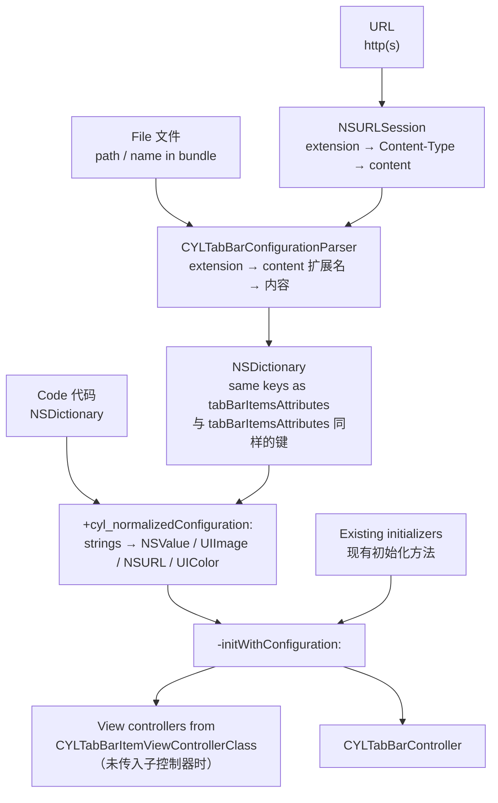

# [CN]一个配置文件生成 TabBarController
# [EN]One configuration file, one TabBarController

<!-- bound-classes: CYLTabBarController, CYLTabBarConfigurationParser -->
<!-- binding:start -->
<!-- Generated by scripts/update-docs-navigation.py; do not edit by hand. -->

| 中文 | English |
|:---|:---|
| 绑定的代码类 `CYLTabBarController`：[`CYLTabBarController/CYLTabBarController.h`](../CYLTabBarController/CYLTabBarController.h) | Bound to the class `CYLTabBarController`: [`CYLTabBarController/CYLTabBarController.h`](../CYLTabBarController/CYLTabBarController.h) |
| 绑定的代码类 `CYLTabBarConfigurationParser`：[`CYLTabBarController/CYLTabBarConfigurationParser.h`](../CYLTabBarController/CYLTabBarConfigurationParser.h) | Bound to the class `CYLTabBarConfigurationParser`: [`CYLTabBarController/CYLTabBarConfigurationParser.h`](../CYLTabBarController/CYLTabBarConfigurationParser.h) |

<!-- binding:end -->

| 中文 | English |
|:---|:---|
| 用一个参数初始化 `CYLTabBarController`：配置字典包含现有初始化方法的全部参数。同样的键可以写在配置文件中（JSON、JSON5、plist、YAML、TOML、INI、.properties、.env、XML、Protocol Buffers 等），也可以从网络 URL 下载，一个文件即可生成整个 TabBar。 | Create a `CYLTabBarController` from one parameter: a configuration dictionary that holds every parameter of the existing initializers. The same keys can be written in a configuration file (JSON, JSON5, plist, YAML, TOML, INI, .properties, .env, XML, Protocol Buffers and more) or downloaded from a URL: one file builds the whole tab bar. |

## [CN]目录
## [EN]Contents

<!-- navigation:start -->
<!-- Generated by scripts/update-docs-navigation.py; do not edit by hand. -->

| 中文 | English |
|:---|:---|
| [场景](#cn场景) | [Use case](#enuse-case) |
| [一个参数的初始化方法](#cn一个参数的初始化方法) | [The one-parameter initializer](#enthe-one-parameter-initializer) |
| &nbsp;&nbsp;&nbsp;&nbsp;↳ [配置键](#cn配置键) | &nbsp;&nbsp;&nbsp;&nbsp;↳ [Configuration keys](#enconfiguration-keys) |
| &nbsp;&nbsp;&nbsp;&nbsp;↳ [新增的 item 键与文件中的写法](#cn新增的-item-键与文件中的写法) | &nbsp;&nbsp;&nbsp;&nbsp;↳ [New item keys and file values](#ennew-item-keys-and-file-values) |
| [从文件或 URL 创建](#cn从文件或-url-创建) | [From a file or a URL](#enfrom-a-file-or-a-url) |
| [支持的格式](#cn支持的格式) | [Supported formats](#ensupported-formats) |
| &nbsp;&nbsp;&nbsp;&nbsp;↳ [Protocol Buffers](#cnprotocol-buffers) | &nbsp;&nbsp;&nbsp;&nbsp;↳ [Protocol Buffers](#enprotocol-buffers) |
| [流程](#cn流程) | [Flow](#enflow) |
| [演示](#cn演示) | [Demo](#endemo) |
| [把代码中的配置导出为配置文件](#cn把代码中的配置导出为配置文件) | [Export the configuration written in code to files](#enexport-the-configuration-written-in-code-to-files) |
| &nbsp;&nbsp;&nbsp;&nbsp;↳ [错误码](#cn错误码) | &nbsp;&nbsp;&nbsp;&nbsp;↳ [Error codes](#enerror-codes) |
| [边界情况与评分](#cn边界情况与评分) | [Edge cases and score](#enedge-cases-and-score) |
| [限制](#cn限制) | [Limits](#enlimits) |
| [测试与截图](#cn测试与截图) | [Testing and screenshots](#entesting-and-screenshots) |

<!-- navigation:end -->

## [CN]场景
## [EN]Use case

| 中文 | English |
|:---|:---|
| 以前初始化时除了 `tabBarItemsAttributes`，还要分别传入子控制器、`imageInsets`、`titlePositionAdjustment`、样式与 `context`，这些参数无法放进配置文件。现在它们都是配置字典中的键，因此 TabBar 可以完全由文件描述：由产品或运营在服务器上调整 Tab 的数量、标题、图标、样式，App 只需加载文件。 | Until now, besides `tabBarItemsAttributes`, an initializer also took the view controllers, `imageInsets`, `titlePositionAdjustment`, the style and the `context` as separate parameters, which a file could not hold. They are now keys of the configuration dictionary, so a file can describe the whole tab bar: the server can change the number of tabs, their titles, icons and style, and the app only loads the file. |

## [CN]一个参数的初始化方法
## [EN]The one-parameter initializer

```objc
// Objective-C
CYLTabBarController *tabBarController = [[CYLTabBarController alloc] initWithConfiguration:@{
    CYLTabBarControllerViewControllers : viewControllers,              // optional 可选
    CYLTabBarControllerTabBarItemsAttributes : tabBarItemsAttributes,
    CYLTabBarControllerImageInsets : [NSValue valueWithUIEdgeInsets:UIEdgeInsetsZero],
    CYLTabBarControllerTitlePositionAdjustment : [NSValue valueWithUIOffset:UIOffsetMake(0, -3)],
    CYLTabBarControllerStyleType : @(CYLTabBarStyleTypeLiquidGlass),
    CYLTabBarControllerContext : @"Home",
}];
```

```swift
// Swift
let tabBarController = CYLTabBarController(configuration: [
    CYLTabBarControllerTabBarItemsAttributes: tabBarItemsAttributes,
    CYLTabBarControllerStyleType: "liquidGlass",
])
```

| 中文 | English |
|:---|:---|
| 现有的所有初始化方法都改为调用 `-initWithConfiguration:`，行为不变。子类若要统一定制所有初始化方式，请重写 `-initWithConfiguration:`。 | Every existing initializer now calls `-initWithConfiguration:`, with no change in behavior. A subclass that wants to customize every way of initializing overrides `-initWithConfiguration:`. |
| 缺少的键使用其他初始化方法的默认值。没有 `CYLTabBarControllerViewControllers` 时，根据每个 item 的 `CYLTabBarItemViewControllerClass` 创建子控制器（配置文件中只能这样写）。 | Missing keys take the defaults of the other initializers. Without `CYLTabBarControllerViewControllers`, the view controllers are created from each item's `CYLTabBarItemViewControllerClass` (the only way in a file). |

### [CN]配置键
### [EN]Configuration keys

| 键 Key | 代码中的类型 Type in code | 文件中的写法 In a file | 默认值 Default |
|:---|:---|:---|:---|
| `CYLTabBarControllerViewControllers` | `NSArray<UIViewController *>` | 不支持（仅代码） / not supported (code only) | 根据 item 创建 / created from the items |
| `CYLTabBarControllerTabBarItemsAttributes` | `NSArray<NSDictionary *>` | 字典数组 / a list of dictionaries | `@[]` |
| `CYLTabBarControllerImageInsets` | `NSValue` (UIEdgeInsets) | `"{top, left, bottom, right}"`、`[t, l, b, r]`、`{top: …}` | `UIEdgeInsetsZero` |
| `CYLTabBarControllerTitlePositionAdjustment` | `NSValue` (UIOffset) | `"{horizontal, vertical}"`、`[h, v]`、`{horizontal: …}` | `UIOffsetZero` |
| `CYLTabBarControllerStyleType` | `NSNumber` (CYLTabBarStyleType) | `default`、`system`、`flatDesign`、`liquidGlass` 或数字 / or a number | `default` |
| `CYLTabBarControllerContext` | `NSString` | 字符串 / a string | `nil` |
| `CYLTabBarControllerNavigationControllerClass` | `NSString` | 例如 / e.g. `UINavigationController` | 不嵌入 / not embedded |

### [CN]新增的 item 键与文件中的写法
### [EN]New item keys and file values

| 键 Key | 说明 | Description |
|:---|:---|:---|
| `CYLTabBarItemViewControllerClass` | Tab 子控制器的类名，用 `-init` 创建，默认 `UIViewController`。Swift 类可写类名或 `模块名.类名`，建议加 `@objc(类名)`。 | The tab's view controller class, created with `-init`; default `UIViewController`. A Swift class: its name or `Module.Name`; adding `@objc(Name)` is safest. |
| `CYLTabBarItemNavigationControllerClass` | 覆盖该 Tab 的导航控制器类；`""` 或 `none` 表示不嵌入。 | Overrides the navigation controller class for this tab; `""` or `none`: not embedded. |
| 图片键 / image keys | `CYLTabBarItemImage` 等支持 `"system:house.fill"`（SF Symbol，iOS 13+）或图片名称。 | `CYLTabBarItemImage` and the like take `"system:house.fill"` (an SF Symbol, iOS 13+) or an image name. |
| `CYLTabBarItemImageInsets` 等 | 与上表相同的 `"{…}"`、数组或字典写法。 | The same `"{…}"`, list or dictionary forms as above. |
| `CYLTabBarItemImageURLSize`、`CYLTabBarLottieSize` | `"{width, height}"`、`[w, h]` 或 `{width: …}`。 | `"{width, height}"`, `[w, h]` or `{width: …}`. |
| `CYLTabBarLottieURL`、`CYLTabBarLottieDarkURL` | http(s) URL、路径，或 main bundle 中的文件名（如 `tab_home.json`）。 | An http(s) URL, a path, or a file name in the main bundle (e.g. `tab_home.json`). |
| `CYLTabBarLottieDarkColors` | keypath → `"#RRGGBB"` / `"#RRGGBBAA"`。 | keypath → `"#RRGGBB"` / `"#RRGGBBAA"`. |
| `CYLTabBarItemTitleColor`、`CYLTabBarItemSelectedTitleColor`、`CYLTabBarItemIconColor`、`CYLTabBarItemSelectedIconColor`、`CYLTabBarItemBackgroundColor`、`CYLTabBarItemSelectedBackgroundColor` | `"#RGB"`、`"#RRGGBB"` 或 `"#RRGGBBAA"`（代码中为 UIColor）；无效时移除（B19）。 | `"#RGB"`, `"#RRGGBB"` or `"#RRGGBBAA"` (a UIColor in code); removed when invalid (B19). |
| `CYLTabBarItemTitleFont`、`CYLTabBarItemSelectedTitleFont` | 数字（系统字体字号，如 `15`）、`"bold:15"`（指定字重的系统字体：ultralight、thin、light、regular、medium、semibold、bold、heavy、black）、`"Menlo-Regular:12"`（按名称）或 `{name, size, weight}`；字号 1–200，字体不存在时移除（B20）。 | A number (a system font size, e.g. `15`), `"bold:15"` (a system font with a weight: ultralight, thin, light, regular, medium, semibold, bold, heavy, black), `"Menlo-Regular:12"` (by name) or `{name, size, weight}`; size 1–200, removed when the font does not exist (B20). |
| `CYLTabBarItemAccessibilityIdentifier`、`CYLTabBarItemAccessibilityLabel`、`CYLTabBarItemAccessibilityHint`、`CYLTabBarItemSelectedTitle` | 字符串（数字会转为字符串）。 | Strings (numbers become strings). |

## [CN]从文件或 URL 创建
## [EN]From a file or a URL

```objc
// A path, a file URL string, or a file name in the main bundle.
// 路径、文件 URL 字符串或 main bundle 中的文件名。
NSError *error = nil;
CYLTabBarController *tabBarController = [CYLTabBarController tabBarControllerWithConfigurationFile:@"tabbar.yaml" error:&error];

// Downloaded; the completion runs on the main queue. 网络下载，回调在主队列执行。
[CYLTabBarController loadTabBarControllerWithConfigurationURL:[NSURL URLWithString:@"https://example.com/tabbar.json"]
                                                   completion:^(CYLTabBarController *tabBarController, NSError *error) {
    self.window.rootViewController = tabBarController
        ?: [CYLTabBarController tabBarControllerWithConfigurationFile:@"tabbar.json" error:NULL]; // fallback 兜底
}];

// Only the dictionary, to change it before creating the controller (e.g. add view controllers).
// 只取字典，在创建控制器前修改（例如加入子控制器）。
NSDictionary *configuration = [CYLTabBarController configurationWithContentsOfFile:@"tabbar.toml" error:&error];
```

```swift
// Swift
let tabBarController = try CYLTabBarController(configurationFile: "tabbar.yaml")
CYLTabBarController.loadTabBarController(withConfigurationURL: url) { tabBarController, error in /* ... */ }
```

| 中文 | English |
|:---|:---|
| 格式依次由文件扩展名、HTTP `Content-Type`、文件内容识别；扩展名未知或缺失时会根据内容自动识别。所有格式都解析为同一个字典，键与 `tabBarItemsAttributes` 完全一致。 | The format comes from the file name extension, then the HTTP `Content-Type`, then the content: an unknown or missing extension is detected from the content. Every format becomes the same dictionary, with the same keys as `tabBarItemsAttributes`. |
| 文件不存在、格式错误或顶层不是字典时返回 nil，`error` 的 domain 为 `CYLTabBarConfigurationErrorDomain`，描述中包含行号。 | A missing file, a syntax error or a top level that is not a dictionary returns nil; `error` is in `CYLTabBarConfigurationErrorDomain`, and its description names the line. |
| 下载使用 `NSURLSession`，遵循 URL 加载系统的缓存策略；返回的任务可以取消。建议准备一个本地文件作为下载失败时的兜底。 | Downloads use `NSURLSession` and follow the URL loading system's cache policy; the returned task can be cancelled. Keep a local file as a fallback for when the download fails. |

## [CN]支持的格式
## [EN]Supported formats

| 格式 Format | 扩展名 Extensions | 示例文件 Sample file | 说明 | Notes |
|:---|:---|:---|:---|:---|
| JSON | `.json` | `cyl_tabbar_configuration.json` | 标准 JSON。 | Standard JSON. |
| JSON5 / JSONC | `.json5`、`.jsonc` | `cyl_tabbar_configuration.json5`、`.jsonc` | 支持注释、尾逗号、单引号、不加引号的键。 | Comments, trailing commas, single quotes, unquoted keys. |
| Property List | `.plist` | `cyl_tabbar_configuration.plist`、`_binary.plist`、`_openstep.plist` | XML、二进制与 OpenStep（旧式）格式。 | XML, binary and OpenStep (old-style). |
| .strings | `.strings` | `cyl_tabbar_configuration.strings` | 本地化文件格式 `"key" = "value";`，嵌套值用 OpenStep 语法。 | The localization format `"key" = "value";`, nested values in OpenStep syntax. |
| YAML | `.yaml`、`.yml` | `cyl_tabbar_configuration.yaml`、`.yml` | 块样式与流式样式、注释、`|` / `>` 块标量。 | Block and flow style, comments, `|` / `>` block scalars. |
| TOML | `.toml` | `cyl_tabbar_configuration.toml` | 表、`[[数组表]]`、内联表、多行字符串。 | Tables, `[[arrays of tables]]`, inline tables, multi-line strings. |
| INI | `.ini`、`.cfg`、`.conf` | `cyl_tabbar_configuration.ini`、`.cfg` | `[节.路径]`，数字表示数组元素（`[CYLTabBarControllerTabBarItemsAttributes.0]`）。 | `[section.path]`, numbers for list elements (`[CYLTabBarControllerTabBarItemsAttributes.0]`). |
| .properties | `.properties` | `cyl_tabbar_configuration.properties` | `点.分隔.路径 = 值`，支持 Java 转义与续行。 | `dotted.key.path = value`, Java escapes and line continuation. |
| .env | `.env` | `cyl_tabbar_configuration.env` | `KEY=value`、`export`，用 `__` 分隔路径。 | `KEY=value`, `export`, `__` separates the path. |
| XML | `.xml` | `cyl_tabbar_configuration.xml` | 元素即键，`<item>` 组成数组，`<item>` 也可以用属性。 | Elements are keys, `<item>` children make a list, an `<item>` can also use attributes. |
| Protobuf 文本格式 / text format | `.textproto`、`.txtpb`、`.pbtxt`、`.prototxt` | `cyl_tabbar_configuration.textproto` | 无需结构定义：`name: value`、`name { … }`，同名字段写多次即数组。 | No schema needed: `name: value`, `name { … }`; a field written several times makes a list. |
| Protobuf 二进制 / binary | `.binpb`、`.pb`、`.protobuf` | `cyl_tabbar_configuration.binpb` | `cyl.CYLTabBarConfiguration` 消息，结构定义内置（`cyl_tabbar_configuration.proto`），无需 protobuf 运行库。 | A `cyl.CYLTabBarConfiguration` message; the schema is built in (`cyl_tabbar_configuration.proto`), no protobuf runtime needed. |

| 中文 | English |
|:---|:---|
| 示例文件位于 `CYLTabBarController/Resources/CYLTabBarController.bundle/Configurations/`，都描述同一个 4 个 Tab 的 TabBar（另有 Protobuf 结构定义 `cyl_tabbar_configuration.proto`）（第一个 Tab 的标题为格式名称）。解析器 `CYLTabBarConfigurationParser` 只依赖 Foundation，也可以单独使用。 | The sample files are in `CYLTabBarController/Resources/CYLTabBarController.bundle/Configurations/`. They all describe the same 4-tab bar (with the Protobuf schema `cyl_tabbar_configuration.proto` next to them) (the first tab's title is the name of the format). The parser, `CYLTabBarConfigurationParser`, uses Foundation only and can be used on its own. |

A YAML file 一个 YAML 文件：

```yaml
CYLTabBarControllerContext: CYLConfigurationDemo
CYLTabBarControllerStyleType: default
CYLTabBarControllerTitlePositionAdjustment: "{0, -2}"
CYLTabBarControllerNavigationControllerClass: UINavigationController
CYLTabBarControllerTabBarItemsAttributes:
  - CYLTabBarItemTitle: Home
    CYLTabBarItemImage: system:house
    CYLTabBarItemSelectedImage: system:house.fill
    CYLTabBarItemViewControllerClass: HomeViewController
  - CYLTabBarItemTitle: Me
    CYLTabBarItemImage: system:person
    CYLTabBarItemSelectedImage: system:person.fill
    CYLTabBarItemViewControllerClass: MeViewController
    CYLTabBarItemTitlePositionAdjustment: [0, -1]
```

The same in TOML 同样的内容写成 TOML：

```toml
CYLTabBarControllerContext = "CYLConfigurationDemo"
CYLTabBarControllerTitlePositionAdjustment = "{0, -2}"

[[CYLTabBarControllerTabBarItemsAttributes]]
CYLTabBarItemTitle = "Home"
CYLTabBarItemImage = "system:house"
CYLTabBarItemViewControllerClass = "HomeViewController"
```

### [CN]Protocol Buffers
### [EN]Protocol Buffers

| 中文 | English |
|:---|:---|
| 二进制 protobuf 只保存字段编号，因此需要结构定义。本库内置了 `cyl_tabbar_configuration.proto`（位于示例文件目录），字段名即配置键，字段编号永不改变；解析器自带解码器，App 不需要引入 protobuf 运行库。服务器可以用任何语言的官方 protobuf 库生成 `.binpb`，`Content-Type` 为 `application/x-protobuf` 时也能识别。未知字段（例如更新的结构定义中新增的字段）会被跳过。 | Binary protobuf only stores field numbers, so it needs a schema. The library has `cyl_tabbar_configuration.proto` built in (in the sample folder): its field names are the configuration keys and its field numbers never change; the parser has its own decoder, so the app needs no protobuf runtime. A server can write `.binpb` with the official protobuf library of any language; a `Content-Type` of `application/x-protobuf` is recognized too. Unknown fields (e.g. added by a newer schema) are skipped. |
| 文本格式不需要结构定义。protobuf 的 `map` 在文本格式中写作多个 `{ key: … value: … }` 条目，`CYLTabBarLottieDarkColors` 会自动转换为字典；只有一个 Tab 时（文本格式没有列表语法）也会自动当作列表。 | The text format needs no schema. A protobuf `map` is written as `{ key: … value: … }` entries in the text format: `CYLTabBarLottieDarkColors` turns them into a dictionary; with a single tab (the text format has no list syntax) the tab is taken as a list too. |
| 用 protoc 由文本格式生成二进制：`protoc --encode=cyl.CYLTabBarConfiguration cyl_tabbar_configuration.proto < cyl_tabbar_configuration.textproto > cyl_tabbar_configuration.binpb` | Encode the text format with protoc: `protoc --encode=cyl.CYLTabBarConfiguration cyl_tabbar_configuration.proto < cyl_tabbar_configuration.textproto > cyl_tabbar_configuration.binpb` |

```textproto
# proto-message: cyl.CYLTabBarConfiguration
CYLTabBarControllerContext: "CYLConfigurationDemo"
CYLTabBarControllerTabBarItemsAttributes {
  CYLTabBarItemTitle: "Home"
  CYLTabBarItemImage: "system:house"
  CYLTabBarItemViewControllerClass: "HomeViewController"
}
CYLTabBarControllerTabBarItemsAttributes {
  CYLTabBarItemTitle: "Me"
  CYLTabBarItemImage: "system:person"
}
```

## [CN]流程
## [EN]Flow



## [CN]演示
## [EN]Demo

| 中文 | English |
|:---|:---|
| Example 的设置列表中“跳转与对比”分组的第一行“从配置文件创建 TabBarController”：选择 17 个示例文件之一（JSON、JSON5、JSONC、XML / 二进制 / OpenStep plist、.strings、YAML、YML、TOML、INI、CFG、.properties、.env、XML、Protobuf 文本与二进制），或“从网络 URL 加载”（GitHub 上的 YAML 示例）。生成的 TabBarController 全屏展示，每个页面显示其来源文件的内容，左上角“关闭”返回。 | In the Example's settings list, the first row of the "Navigation and comparisons" section, "Create a TabBarController from a configuration file": choose one of the 17 sample files (JSON, JSON5, JSONC, XML / binary / OpenStep plist, .strings, YAML, YML, TOML, INI, CFG, .properties, .env, XML, Protobuf text and binary), or "Load from a URL" (the YAML sample on GitHub). The tab bar controller it creates is presented full screen; every page shows the file it came from, and Close (top left) goes back. |
| 演示代码：`UIViewController+CYLConfigurationDemo.h/.m`；示例 URL 在合并到 master 后可用。 | Demo code: `UIViewController+CYLConfigurationDemo.h/.m`; the sample URL works once this is merged into master. |
| “配置文件：模拟意外情况”分组：36 行，每行把一种损坏、恶意或特殊的输入交给真实 API（空文件、只有注释、语法错误、编码错误、UTF-16、嵌套 1 万层、6 MB 文件、没有 Tab、HTML 页面、错误的类型与 null、NaN、未知样式、不存在或错误的类、容器类、无效 URL 与 Lottie 文件、重复标识、拼写错误、无效的颜色与字体、空字符串、截断的 protobuf、损坏的二进制 plist、XXE、文件不存在、后台线程、代码中的非控制器对象与非字典配置、空的子控制器列表、HTTP 404、域名无法解析、3 秒超时、请求取消、没有 URL 的请求、网络返回 HTML）。行标题以下方“边界情况与评分”表格中的编号开头；结果显示在该行下方并弹窗说明，成功创建的控制器可点“查看”打开。 | The "Configuration: simulated failures" section: 36 rows, each feeding one broken, hostile or unusual input to the real API (an empty file, comments only, a syntax error, a bad encoding, UTF-16, 10,000 levels of nesting, a 6 MB file, no tabs, an HTML page, wrong types and null, NaN, an unknown style, missing or wrong classes, a container class, invalid URLs and Lottie files, duplicate identifiers, typos, invalid colors and fonts, empty strings, a truncated protobuf, a corrupted binary plist, XXE, a missing file, a background thread, objects that are not view controllers and a configuration that is not a dictionary in code, an empty view controller list, HTTP 404, an unknown host, a 3 s timeout, a cancelled request, a request without a URL, HTML from the network). Each row starts with the ID of its case in the "Edge cases and score" table below; the outcome shows under the row and in an alert, and a controller that was created can be opened with "View". |

## [CN]把代码中的配置导出为配置文件
## [EN]Export the configuration written in code to files

| 中文 | English |
|:---|:---|
| 网络配置不可信，最稳妥的做法是随 App 打包一份本地配置作为兜底。`scripts/export-tabbar-configurations.py`（仅依赖 Python 3 标准库）在 Objective-C 与 Swift 源码中查找 TabBar 配置并生成配置文件：`CYLTabBarItemTitle : ...` 字典字面量、`CYLLocalizedTabBarItemsAttributes(...)`、`CYLTabBarItemsAttributesAddingLottieFiles(...)`（自动找到 `_dark.json`）、用 `.map` 生成的 Lottie 深色颜色、子控制器类与导航控制器类，以及初始化参数（context、样式、内边距、标题偏移）。只在运行时才有的值（变量、枚举、方法调用）不会写入，并在报告中列出：文件只会不完整，不会出错。 | A downloaded configuration cannot be trusted; the safest setup ships a local configuration in the app as a fallback. `scripts/export-tabbar-configurations.py` (Python 3 standard library only) finds the tab bar configuration in Objective-C and Swift sources and writes configuration files: `CYLTabBarItemTitle : ...` dictionary literals, `CYLLocalizedTabBarItemsAttributes(...)`, `CYLTabBarItemsAttributesAddingLottieFiles(...)` (finding the `_dark.json` files), Lottie dark colors built with `.map`, the view controller and navigation controller classes, and the initializer parameters (context, style, insets, title offset). Values that only exist at runtime (variables, enums, method calls) are left out and listed in the report: a file can be incomplete, never wrong. |
| 写法会被转换为文件中的形式：`CYLLocalizedString(@"首页")` 写入本地化 key `首页`，`[UIImage systemImageNamed:@"house"]` 写入 `system:house`，`[NSValue valueWithUIOffset:UIOffsetMake(0, -3)]` 写入 `{0, -3}`，`[[NSBundle mainBundle] pathForResource:@"a" ofType:@"json"]` 写入 `a.json`，`UIColor(white: 0.78, alpha: 1)` 写入 `#C7C7C7FF`。 | Expressions become their file form: `CYLLocalizedString(@"首页")` the localization key `首页`, `[UIImage systemImageNamed:@"house"]` `system:house`, `[NSValue valueWithUIOffset:UIOffsetMake(0, -3)]` `{0, -3}`, `[[NSBundle mainBundle] pathForResource:@"a" ofType:@"json"]` `a.json`, `UIColor(white: 0.78, alpha: 1)` `#C7C7C7FF`. |

```sh
python3 scripts/export-tabbar-configurations.py                       # every Example*/, JSON + YAML 所有 Example，JSON + YAML
python3 scripts/export-tabbar-configurations.py --format all          # 12 formats 12 种格式
python3 scripts/export-tabbar-configurations.py --format toml,binpb path/to/MyTabBarController.m
python3 scripts/export-tabbar-configurations.py --stdout --format yaml path/to/MyTabBarController.swift
python3 scripts/export-tabbar-configurations.py --check               # exit 1 when a file is out of date 文件过期时返回 1
```

| 中文 | English |
|:---|:---|
| 已对所有 Example 运行，结果（JSON 与 YAML）提交在各 Example 的 `Configurations/` 中：`Example/MainTabBarController.*`（4 个 Tab，Lottie 与深色 Lottie、子控制器类、`CYLBaseNavigationController`）、`Example-Swift`（4 个 Tab，Lottie 深色颜色、Liquid Glass）、`Example-Swift-02`、`Example-Swift-03`、`Example-Swift-04`、`Example-Swift-Carthage`、`Example-SwiftUI`（各 4 个 Tab）、`Example-network-download`（5 个 Tab，SF Symbol 与网络图标）。`Example-Swift-SwiftManager-FlatDesign` 的 Tab 由枚举在运行时生成，脚本报告无法导出而不生成文件。 | Run on every Example; the results (JSON and YAML) are committed in each Example's `Configurations/`: `Example/MainTabBarController.*` (4 tabs, Lottie and dark Lottie files, view controller classes, `CYLBaseNavigationController`), `Example-Swift` (4 tabs, Lottie dark colors, Liquid Glass), `Example-Swift-02`, `Example-Swift-03`, `Example-Swift-04`, `Example-Swift-Carthage`, `Example-SwiftUI` (4 tabs each), `Example-network-download` (5 tabs, SF Symbols and network icons). `Example-Swift-SwiftManager-FlatDesign` builds its tabs from an enum at runtime: the script reports that it cannot be exported and writes no file. |
| 脚本的完整用法（参数、能读取的写法、报告、推荐用法与 CI）、边界情况评分脚本与测试套件见 [配置文件相关脚本](Configuration-Scripts.md)。 | Full usage of the script (options, what it reads, the report, the recommended setup and CI), the edge-case scoring script and the test suite: [Configuration scripts](Configuration-Scripts.md). |
| 验证：所有 Example 的 12 种格式共 96 个文件，用本库的解析器读取（按扩展名与按内容识别）全部得到与 JSON 相同的配置。 | Verified: the 96 files of all Examples in all 12 formats, read with the library's parser (by extension and by content), all give the same configuration as the JSON one. |

### [CN]错误码
### [EN]Error codes

| 错误码 Code | 名称 Name | 中文 | English |
|:---|:---|:---|:---|
| 1 | `FileNotFound` | 文件不存在、是目录或无法读取；URL 为 nil | The file is missing, a directory or unreadable; a nil URL |
| 2 | `UnsupportedFormat` | 无法识别格式 | The format could not be detected |
| 3 | `InvalidSyntax` | 内容不符合格式，描述中包含行号 | The content is invalid in its format; the description names the line |
| 4 | `NotADictionary` | 顶层不是字典 | The top level is not a dictionary |
| 5 | `Network` | 下载失败，`NSUnderlyingErrorKey` 为原始错误 | The download failed; `NSUnderlyingErrorKey` holds the original error |
| 6 | `Empty` | 文件或响应为空，或只有空白与注释 | The file or response is empty, or only whitespace and comments |
| 7 | `TooLarge` | 超过 5 MB（`CYLTabBarConfigurationMaximumLength`） | Over 5 MB (`CYLTabBarConfigurationMaximumLength`) |
| 8 | `TooDeep` | 嵌套超过 64 层（`CYLTabBarConfigurationMaximumDepth`） | Nested deeper than 64 levels (`CYLTabBarConfigurationMaximumDepth`) |
| 9 | `NoTabs` | 文件或 URL 中没有 Tab（例如下载到 HTML 页面） | A file or URL with no tab (e.g. an HTML page was downloaded) |
| 10 | `MainThreadRequired` | 在非主线程通过文件接口创建控制器 | A controller created from a file off the main thread |

```objc
// A safe pattern: the remote configuration, else the one shipped in the app. 稳妥的写法：优先网络配置，失败时使用随 App 打包的配置。
[CYLTabBarController loadTabBarControllerWithConfigurationURL:remoteURL completion:^(CYLTabBarController *tabBarController, NSError *error) {
    if (!tabBarController) {
        NSLog(@"Remote configuration refused: %@ (%ld)", error.localizedDescription, (long)error.code);
        tabBarController = [CYLTabBarController tabBarControllerWithConfigurationFile:@"tabbar.json" error:NULL];
    }
    self.window.rootViewController = tabBarController;
}];
```

## [CN]边界情况与评分
## [EN]Edge cases and score

| 中文 | English |
|:---|:---|
| 配置文件可能来自网络，内容不可信。下表列出所有已考虑的边界情况及其处理方式。评分 = 已处理的情况 / 全部情况（部分处理计一半），每一轮修复后重新评分；复查中新发现的情况会加入表格，因此分数可能下降。Demo 中“配置文件：模拟意外情况”分组可以逐一触发这些情况。 | A configuration may come from the network: its content cannot be trusted. The table lists every edge case considered and how it is handled. Score = handled cases / all cases (partly handled counts half), scored again after each round of fixes; cases found during a review are added to the table, so the score can drop. The demo's "Configuration: simulated failures" section triggers them one by one. |

<!-- edge-cases:start -->
<!-- Generated from the edge-case checklist; the status column is the round that handled each case. -->

| 编号 ID | 情况 | Case | 处理 | Handling | 状态 Status |
|:---|:---|:---|:---|:---|:---|
| A1 | 文件路径为 nil 或空字符串 | The file path is nil or empty | 返回 nil 与 FileNotFound 错误 | nil and a FileNotFound error | ✅ 第 1 轮 / round 1 |
| A2 | 文件不存在、是目录或无读取权限 | The file is missing, a directory or unreadable | 返回 nil 与 FileNotFound 错误 | nil and a FileNotFound error | ✅ 第 1 轮 / round 1 |
| A3 | 文件为 0 字节 | The file has 0 bytes | Empty 错误（以前 YAML 等格式会生成没有 Tab 的控制器） | An Empty error (YAML and others used to give a controller with no tabs) | ✅ 第 3 轮 / round 3 |
| A4 | 文件只有空白或注释 | The file has only whitespace or comments | Empty 错误 | An Empty error | ✅ 第 3 轮 / round 3 |
| A5 | 不是合法的 UTF-8 文本 | Not valid UTF-8 text | InvalidSyntax 错误 | An InvalidSyntax error | ✅ 第 1 轮 / round 1 |
| A6 | 以 UTF-8 BOM 开头 | Starts with a UTF-8 BOM | 自动去掉 BOM | The BOM is skipped | ✅ 第 1 轮 / round 1 |
| A7 | 扩展名与内容不符（如 .json 中是 YAML） | The extension does not match the content (YAML in a .json file) | 按扩展名解析失败后根据内容识别并重试 | When the extension's format fails, the content is detected and parsed again | ✅ 第 4 轮 / round 4 |
| A8 | 扩展名未知或缺失 | An unknown or missing extension | 根据内容识别格式 | The format is detected from the content | ✅ 第 1 轮 / round 1 |
| A9 | 文件过大（例如 1 GB） | A huge file (e.g. 1 GB) | 超过 5 MB 时返回 TooLarge 错误，不读入内存解析 | Over 5 MB: a TooLarge error, nothing is parsed | ✅ 第 3 轮 / round 3 |
| A10 | 嵌套过深（如 10 万层 `[[[[`）导致栈溢出 | Deep nesting (e.g. 100,000 levels of `[[[[`) overflows the stack | 超过 64 层时返回 TooDeep 错误，所有递归解析器都有层数限制 | Over 64 levels: a TooDeep error; every recursive parser has a depth limit | ✅ 第 2 轮 / round 2 |
| A11 | 顶层不是字典（数组、字符串、数字） | The top level is not a dictionary (a list, a string, a number) | NotADictionary 错误 | A NotADictionary error | ✅ 第 1 轮 / round 1 |
| A12 | 截断或无效的二进制 plist / protobuf | A truncated or invalid binary plist / protobuf | InvalidSyntax 错误，越界读取被拒绝 | An InvalidSyntax error; out-of-bounds reads are refused | ✅ 第 1 轮 / round 1 |
| A13 | 语法错误 | A syntax error | 错误描述包含格式与行号 | The error names the format and the line | ✅ 第 1 轮 / round 1 |
| A14 | XML 外部实体（XXE） | XML external entities (XXE) | 显式关闭外部实体解析 | External entities are explicitly not resolved | ✅ 第 4 轮 / round 4 |
| A15 | 重复的键 | Duplicate keys | 后出现的值生效，不崩溃 | The last value wins, no crash | ✅ 第 1 轮 / round 1 |
| A16 | UTF-16 / UTF-32 编码的文本文件（带 BOM） | A UTF-16 / UTF-32 text file (with a BOM) | 根据 BOM 识别编码 | The encoding is detected from the BOM | ✅ 第 6 轮 / round 6 |
| A17 | A7 的重试掩盖了语法错误（.properties、INI、Protobuf 文本几乎接受任何文本；TOML 曾接受 `[1, 2]` 这样的表名） | The retry of A7 hid syntax errors (.properties, INI and Protobuf text accept almost any text; TOML accepted a table named `[1, 2]`) | 重试只使用结构明确的格式（JSON、YAML、TOML、plist、XML、二进制 Protobuf），TOML 裸键只接受规范允许的字符；由测试套件发现 | The retry only uses formats with a distinctive structure (JSON, YAML, TOML, plist, XML, binary Protobuf), and TOML bare keys only take the characters of the specification; found by the test suite | ✅ 第 7 轮 / round 7 |
| B1 | 没有 Tab（缺少或为空的 `CYLTabBarControllerTabBarItemsAttributes`） | No tabs (missing or empty `CYLTabBarControllerTabBarItemsAttributes`) | 读取文件或 URL 时返回 NoTabs 错误；代码中初始化时保持原行为并输出警告 | Files and URLs: a NoTabs error; in code: unchanged behavior and a warning | ✅ 第 3 轮 / round 3 |
| B2 | Tab 列表不是数组（字符串、数字） | The tab list is not a list (a string, a number) | 视为没有 Tab，见 B1 | Treated as no tabs, see B1 | ✅ 第 3 轮 / round 3 |
| B3 | 只有一个 Tab 且写成字典（Protobuf 文本、XML） | A single tab written as a dictionary (Protobuf text, XML) | 自动包装为列表 | Wrapped into a list | ✅ 第 1 轮 / round 1 |
| B4 | Tab 列表中的元素不是字典 | A tab entry is not a dictionary | 代码传入子控制器时用空字典占位，保持下标对应；根据配置创建子控制器时跳过 | With view controllers from code: an empty placeholder keeps the indexes; when they are created: skipped | ✅ 第 4 轮 / round 4 |
| B5 | 字符串键的值类型错误（标题为数组、字典） | A string key has the wrong type (a title that is a list or a dictionary) | 数字转换为字符串，其他类型移除；以前会因 unrecognized selector 崩溃 | Numbers become strings, other types are removed; this used to crash (unrecognized selector) | ✅ 第 2 轮 / round 2 |
| B6 | 值为 null（JSON null、YAML ~） | A value is null (JSON null, YAML ~) | 移除该键；以前在 item 中会崩溃 | The key is removed; inside an item this used to crash | ✅ 第 2 轮 / round 2 |
| B7 | 内边距 / 偏移为 NaN、Infinity 或极大值 | Insets / offsets are NaN, Infinity or huge | 非有限值或绝对值超过 1000 时移除；以前会触发 CALayer NaN 异常 | Non-finite values or values over 1000 are removed; this used to raise a CALayer NaN exception | ✅ 第 2 轮 / round 2 |
| B8 | 尺寸为负数、0 或极大值 | A size is negative, zero or huge | 要求 0 < 值 ≤ 1000，否则移除 | Requires 0 < value ≤ 1000, removed otherwise | ✅ 第 2 轮 / round 2 |
| B9 | 未知的样式名称或超出范围的样式编号（如 99） | An unknown style name or an out-of-range style number (e.g. 99) | 使用默认样式并输出警告 | The default style and a warning | ✅ 第 2 轮 / round 2 |
| B10 | 请求扁平样式但未集成 FlatDesign 子库 | FlatDesign requested without the FlatDesign subspec | 使用默认样式并输出警告 | The default style and a warning | ✅ 第 4 轮 / round 4 |
| B11 | 拼写错误的键（如 `CYLTabBarItemTitel`） | A misspelled key (e.g. `CYLTabBarItemTitel`) | 保留（App 可能有自定义键），DEBUG 下提示最接近的已知键 | Kept (the app may use its own keys); DEBUG names the closest known key | ✅ 第 4 轮 / round 4 |
| B12 | 重复的 `CYLTabBarItemIdentifier` | A duplicate `CYLTabBarItemIdentifier` | 后出现的改为「标识_2」等并输出警告 | Later ones become "identifier_2"..., with a warning | ✅ 第 4 轮 / round 4 |
| B13 | 无效的图片 / Lottie URL，或不存在的本地 Lottie 文件 | An invalid image / Lottie URL, or a missing local Lottie file | 只接受 http(s) 与存在的本地文件，否则移除 | Only http(s) URLs and existing local files are kept | ✅ 第 4 轮 / round 4 |
| B14 | 图片名称或 SF Symbol 不存在 | An image name or SF Symbol that does not exist | 该 Tab 没有图标，不崩溃 | The tab has no icon, no crash | ✅ 第 1 轮 / round 1 |
| B15 | Tab 很多（超过 5 个） | Many tabs (more than 5) | 由 UIKit 处理（“更多”） | Handled by UIKit ("More") | ✅ 第 1 轮 / round 1 |
| B16 | 超长标题 | A very long title | 不崩溃，由 UIKit 截断显示 | No crash; UIKit truncates it | ✅ 第 1 轮 / round 1 |
| B17 | Lottie 文件不是合法的 JSON 动画 | A Lottie file that is not a valid JSON animation | 解析检查失败时移除，避免 Lottie 内部异常 | Removed when it does not parse as a JSON object, so Lottie never sees it | ✅ 第 6 轮 / round 6 |
| B18 | 代码中传入的配置不是字典（如类型不明的 JSON 数组） | The configuration passed in code is not a dictionary (e.g. an untyped JSON list) | 视为空配置并输出警告；以前会因 unrecognized selector 崩溃 | Treated as empty, with a warning; this used to crash (unrecognized selector) | ✅ 第 6 轮 / round 6 |
| B19 | 无效的颜色（`CYLTabBarItemTitleColor` 等为错误的十六进制串或数字） | An invalid color (`CYLTabBarItemTitleColor`... a wrong hex string or a number) | 接受 UIColor 与 "#RGB" / "#RRGGBB" / "#RRGGBBAA"，其他移除并输出警告 | UIColor and "#RGB" / "#RRGGBB" / "#RRGGBBAA" are accepted; anything else is removed, with a warning | ✅ 第 8 轮 / round 8 |
| B20 | 无效的字体（字号为 0、NaN、超过 200，或字体名称不存在） | An invalid font (size 0, NaN, over 200, or a font name that does not exist) | 字号必须在 1 到 200 之间，字体必须存在，否则移除并输出警告 | The size must be between 1 and 200 and the font must exist; removed otherwise, with a warning | ✅ 第 8 轮 / round 8 |
| B21 | 空字符串作为 URL、Lottie 文件、图片 URL、类名、颜色或字体（`""`） | An empty string (`""`) as a URL, Lottie file, image URL, class, color or font | 视为未提供并输出警告；以前空的 Lottie URL 会传给 +fileURLWithPath:（要求非空路径） | Treated as missing, with a warning; an empty Lottie URL used to reach +fileURLWithPath:, which requires a non-empty path | ✅ 第 10 轮 / round 10 |
| C1 | 子控制器类不存在 | The view controller class does not exist | 使用 UIViewController 并输出警告 | UIViewController and a warning | ✅ 第 1 轮 / round 1 |
| C2 | 类不是 UIViewController（如 NSString） | The class is not a UIViewController (e.g. NSString) | 使用 UIViewController 并输出警告 | UIViewController and a warning | ✅ 第 1 轮 / round 1 |
| C3 | 子控制器类是 UITabBarController / UINavigationController / UIAlertController 等容器 | The class is a container: UITabBarController, UINavigationController, UIAlertController... | 拒绝并使用 UIViewController | Refused; UIViewController is used | ✅ 第 4 轮 / round 4 |
| C4 | 子控制器的 -init 抛出异常 | The view controller's -init raises an exception | 捕获异常并使用 UIViewController | The exception is caught; UIViewController is used | ✅ 第 4 轮 / round 4 |
| C5 | 导航控制器类无效 | An invalid navigation controller class | 不嵌入导航控制器 | Not embedded | ✅ 第 1 轮 / round 1 |
| C6 | `CYLTabBarControllerViewControllers` 中有非控制器对象 | `CYLTabBarControllerViewControllers` holds objects that are not view controllers | 移除这些对象；以前会崩溃 | They are removed; this used to crash | ✅ 第 2 轮 / round 2 |
| C7 | 同一个子控制器出现两次 | The same view controller twice | 移除重复项；以前 UIKit 会抛异常 | The duplicate is removed; UIKit used to raise | ✅ 第 2 轮 / round 2 |
| C8 | 子控制器数量与 Tab 数量不一致 | More or fewer view controllers than tabs | 本库按下标保护，不越界 | The library checks indexes, no out-of-bounds access | ✅ 第 1 轮 / round 1 |
| C9 | `CYLTabBarControllerViewControllers` 为空数组 | `CYLTabBarControllerViewControllers` is an empty list | 视为未提供，根据 Tab 创建子控制器 | Treated as missing: the view controllers are created from the tabs | ✅ 第 6 轮 / round 6 |
| C10 | 没有 URL 的 NSURLRequest，或代码中传入 nil 请求 / URL（声明为 nonnull） | An NSURLRequest without a URL, or a nil request / URL from code (declared nonnull) | 返回 FileNotFound 错误；本地与缺失 URL 由同一个文件内私有函数处理，不再把 nil 传给 nonnull 参数（CI 静态分析 nullability.NullPassedToNonnull） | A FileNotFound error; local and missing URLs go through one file-private function, so nil never reaches a nonnull parameter (CI static analyzer, nullability.NullPassedToNonnull) | ✅ 第 10 轮 / round 10 |
| D1 | URL 为 nil | A nil URL | 回调返回 FileNotFound 错误 | The completion gets a FileNotFound error | ✅ 第 1 轮 / round 1 |
| D2 | 不支持的 scheme 或无效 URL | An unsupported scheme or an invalid URL | 回调返回 Network 错误 | The completion gets a Network error | ✅ 第 1 轮 / round 1 |
| D3 | HTTP 4xx / 5xx | HTTP 4xx / 5xx | Network 错误，包含状态码 | A Network error with the status code | ✅ 第 1 轮 / round 1 |
| D4 | 无网络、DNS 失败 | No network, a DNS failure | Network 错误（NSUnderlyingErrorKey 为原始错误） | A Network error (NSUnderlyingErrorKey holds the original) | ✅ 第 1 轮 / round 1 |
| D5 | 服务器不响应 | The server does not answer | 默认 15 秒超时（以前为系统默认的 60 秒）；可传入自定义 NSURLRequest | A 15 s timeout by default (it was the system's 60 s); a custom NSURLRequest can be passed | ✅ 第 5 轮 / round 5 |
| D6 | 响应体为空 | An empty response body | Empty 错误 | An Empty error | ✅ 第 3 轮 / round 3 |
| D7 | 返回 HTML 页面（如公共 Wi-Fi 的登录页） | An HTML page instead (e.g. a captive Wi-Fi portal) | 识别为没有 Tab 的配置，返回 NoTabs 错误；以前会生成空的 TabBar | Detected as a configuration with no tabs: a NoTabs error; it used to give an empty tab bar | ✅ 第 3 轮 / round 3 |
| D8 | 响应过大 | A huge response | 超过 5 MB 时返回 TooLarge 错误 | Over 5 MB: a TooLarge error | ✅ 第 3 轮 / round 3 |
| D9 | Content-Type 错误（如 text/plain） | A wrong Content-Type (e.g. text/plain) | 根据扩展名或内容识别 | Detected from the extension or the content | ✅ 第 1 轮 / round 1 |
| D10 | 请求被取消 | The request is cancelled | 回调仍会执行一次，返回 Network 错误 | The completion still runs once, with a Network error | ✅ 第 1 轮 / round 1 |
| D11 | 回调线程与次数 | Completion thread and count | 总在主队列执行且只执行一次 | Always on the main queue, exactly once | ✅ 第 1 轮 / round 1 |
| D12 | completion 为 nil | A nil completion | 不发起请求，返回 nil | No request is made; returns nil | ✅ 第 1 轮 / round 1 |
| E1 | 在后台线程读取文件并创建控制器 | Reading a file and creating the controller on a background thread | 文件接口返回 MainThreadRequired 错误；代码初始化输出警告（与原行为一致） | The file APIs return a MainThreadRequired error; the code initializer warns (as before) | ✅ 第 5 轮 / round 5 |
| E2 | 在后台线程只解析配置字典 | Only parsing the dictionary on a background thread | 解析器只依赖 Foundation，线程安全 | The parser is Foundation only and thread-safe | ✅ 第 1 轮 / round 1 |

| 轮次 Round | 分数 Score | 情况数 Cases | 说明 | Notes | 减分项 Deductions |
|:---|:---|:---|:---|:---|:---|
| 1 | 55 | 53 | 基线：解析器已能拒绝大部分无效文件，但值的类型、NaN、嵌套深度、空文件与 HTML 页面等会导致崩溃或生成空 TabBar。 | Baseline: the parser already refuses most invalid files, but wrong value types, NaN, deep nesting, empty files and HTML pages crash or give an empty tab bar. | A3, A4, A7, A9, A10, A14, B1, B2, B4, B5, B6, B7, B8, B9, B10, B11, B12, B13, C3, C4, C6, C7, D5, D6, D7, D8, E1 |
| 2 | 69 | 53 | 修复会崩溃的情况：值的类型检查、null、NaN / Infinity、尺寸范围、样式编号范围、非控制器对象、重复的控制器、嵌套深度限制。 | Crash fixes: value type checks, null, NaN / Infinity, size ranges, style number range, objects that are not view controllers, duplicate view controllers, nesting depth limit. | A3, A4, A7, A9, A14, B1, B2, B4, B10, B11, B12, B13, C3, C4, D5, D6, D7, D8, E1 |
| 3 | 81 | 53 | 语义校验：空文件、没有 Tab、HTML 页面、文件 / 响应大小限制，新增错误码 Empty、TooLarge、TooDeep、NoTabs。 | Semantic checks: empty files, no tabs, HTML pages, file / response size limits; new error codes Empty, TooLarge, TooDeep, NoTabs. | A7, A14, B4, B10, B11, B12, B13, C3, C4, D5, E1 |
| 4 | 96 | 53 | 容错：扩展名不符时重试、XXE、容器类与 -init 异常、无效 Tab 占位、FlatDesign 不可用、拼写错误提示、重复标识、URL 与本地文件检查。 | Tolerance: retry when the extension is wrong, XXE, container classes and -init exceptions, placeholders for invalid tabs, FlatDesign missing, typo hints, duplicate identifiers, URL and local file checks. | D5, E1 |
| 5 | 95 | 56 | 网络超时与线程：默认 15 秒超时、可传入 NSURLRequest、后台线程保护。复查时新发现 4 个问题（A16、B17、C9），总分下降。 | Network timeout and threads: a 15 s default timeout, a custom NSURLRequest, background-thread protection. The review found new cases (A16, B17, C9), so the score dropped. | A16, B17, C9 |
| 6 | 100 | 57 | 修复新发现的问题：UTF-16 / UTF-32、无效的 Lottie 文件、空的子控制器数组；复查又发现并修复了 B18（配置不是字典）。全部情况均已处理。 | Fixes for the new cases: UTF-16 / UTF-32, invalid Lottie files, an empty view controller list; the review also found and fixed B18 (a configuration that is not a dictionary). Every case is handled. | — |
| 7 | 100 | 58 | 测试固化为 scripts/configuration-tests/run-tests.sh 后，测试套件发现第 4 轮的回归（A17）：A7 的重试会把 .json 中的数组、无效的 TOML、缩进错误的 YAML 当作 .properties、TOML 表或 Protobuf 文本读取，掩盖其错误。已修复，所有测试通过。 | With the tests kept as scripts/configuration-tests/run-tests.sh, the suite found a regression of round 4 (A17): the retry of A7 read a list in a .json file, invalid TOML and badly indented YAML as .properties, a TOML table or Protobuf text, hiding their errors. Fixed; every test passes. | — |
| 8 | 100 | 60 | 合并 master 后，新增的 11 个 Tab 键（颜色、字体、无障碍）加入配置：文件中颜色写作 "#RRGGBB"，字体写作字号、"bold:15" 或 "Menlo-Regular:12"，无障碍键做字符串检查；导出脚本与 Protobuf 结构定义（字段 22–32）同步更新。新增并处理 B19、B20。 | After merging master, its 11 new tab keys (colors, fonts, accessibility) join the configuration: colors as "#RRGGBB" in files, fonts as a size, "bold:15" or "Menlo-Regular:12", the accessibility keys checked as strings; the export script and the Protobuf schema (fields 22-32) follow. B19 and B20 added and handled. | — |
| 9 | 97 | 62 | 首次在 iOS CI 上运行静态分析：发现 `-loadConfigurationWithURLRequest:` 会把 nil URL 传给声明为 nonnull 的参数（C10）。据此复查所有 nil 与 nonnull 的边界，另发现空字符串作为 Lottie URL 会传给 +fileURLWithPath:（B21）。总分下降。 | The static analyzer ran on iOS CI for the first time: `-loadConfigurationWithURLRequest:` passed a nil URL to a nonnull parameter (C10). A review of every nil / nonnull boundary then found that an empty string as a Lottie URL reached +fileURLWithPath: (B21). The score dropped. | B21, C10 |
| 10 | 100 | 62 | 修复 C10 与 B21：本地 / 缺失 URL 由 CYLLoadLocalConfiguration() 统一处理，空字符串不再生成 file URL，演示中的请求不会带 nil URL；演示新增“B21 · Empty strings”与“C10 · Request without a URL”两行。全部情况均已处理。 | C10 and B21 fixed: local / missing URLs go through CYLLoadLocalConfiguration(), an empty string no longer becomes a file URL, the demo never builds a request with a nil URL; two demo rows added, "B21 · Empty strings" and "C10 · Request without a URL". Every case is handled. | — |
<!-- edge-cases:end -->

## [CN]限制
## [EN]Limits

| 中文 | English |
|:---|:---|
| 配置文件无法包含对象，子控制器只能通过类名创建（`-init`）；需要自定义初始化或依赖注入时，先用 `+configurationWithContentsOfFile:error:` 读取字典，再加入 `CYLTabBarControllerViewControllers`。 | A file cannot hold objects: view controllers can only be created from class names (`-init`). For custom initializers or dependency injection, read the dictionary with `+configurationWithContentsOfFile:error:` and add `CYLTabBarControllerViewControllers`. |
| YAML 与 TOML 支持配置文件常用的子集：YAML 不支持锚点、别名与标签；TOML 不支持日期时间。 | YAML and TOML support the subset configurations use: no anchors, aliases or tags in YAML; no date-times in TOML. |
| PlusButton 仍按 `context` 注册（`+[CYLPlusButton tabBarContext]`），不在配置文件中描述。 | The plus button is still registered by `context` (`+[CYLPlusButton tabBarContext]`), not described in the file. |

## [CN]测试与截图
## [EN]Testing and screenshots

| 中文 | English |
|:---|:---|
| 本次修改在 Linux 环境中完成，没有 Xcode、iOS SDK 与模拟器，因此没有截图，UIKit 部分也未能编译运行。已验证：解析器（仅依赖 Foundation）在 GNUstep 上编译运行，17 个示例文件按扩展名与按内容识别都解析为相同的字典；Protobuf 样例由官方 protobuf 库生成，并测试了中文（UTF-8 与八进制转义）、map 字段、截断与无效的二进制数据，并测试了错误、转义、数字与数组顺序等情况；示例文件也用 Python 的标准解析器（PyYAML、tomllib、plistlib、protobuf）交叉验证；新增的 UIKit 代码用 UIKit 头文件桩做了语法检查（`-Wall -Wextra`，Release 与 DEBUG 均无警告）。边界情况：解析器层面的情况（嵌套 10 万层的各种格式、损坏与超大文件、空文件、编码、XXE、扩展名不符等）均在 GNUstep 上运行验证；值的转换、子控制器与网络部分只做了代码审查与语法检查。合并前请在 Example 中运行演示行、每种格式，以及“模拟意外情况”分组的每一行。 | This change was made on Linux without Xcode, the iOS SDK or a simulator, so there are no screenshots and the UIKit parts were not built or run. Verified: the parser (Foundation only) was built and run on GNUstep; the 17 sample files give the same dictionary whether the format comes from the extension or from the content; the Protobuf samples were written by the official protobuf library, and Chinese text (UTF-8 and octal escapes), the map field, truncated and invalid binary data were tested, and errors, escapes, numbers and list order were tested; the samples were also cross-checked with Python's standard parsers (PyYAML, tomllib, plistlib, protobuf); the new UIKit code was syntax-checked against UIKit header stubs (no warnings with `-Wall -Wextra`, Release and DEBUG). Edge cases: those of the parser (100,000 levels of nesting in every format, corrupted and huge files, empty files, encodings, XXE, wrong extensions...) were run on GNUstep; the value conversion, view controller and network cases were only reviewed and syntax-checked. Before merging, run the demo row, every format, and every row of the "simulated failures" section in the Example. |
