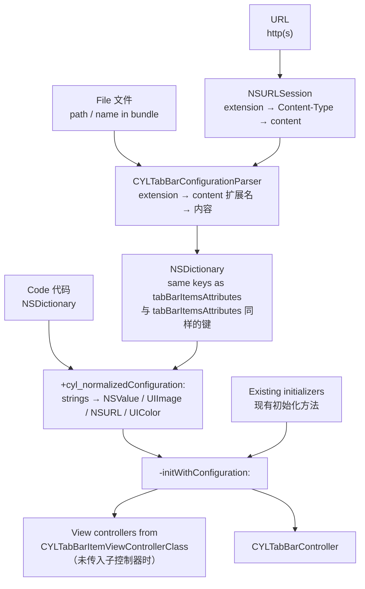

# [CN]一个配置文件生成 TabBarController
# [EN]One configuration file, one TabBarController

<!-- bound-classes: CYLTabBarController, CYLTabBarConfigurationParser -->
<!-- binding:start -->
<!-- Generated by scripts/update-docs-navigation.py; do not edit by hand. -->

| 中文 | English |
|:---|:---|
| 绑定的代码类 `CYLTabBarController`：[`CYLTabBarController/CYLTabBarController.h`](../CYLTabBarController/CYLTabBarController.h) | Bound to the class `CYLTabBarController`: [`CYLTabBarController/CYLTabBarController.h`](../CYLTabBarController/CYLTabBarController.h) |
| 绑定的代码类 `CYLTabBarConfigurationParser`：[`CYLTabBarController/CYLTabBarConfigurationParser.h`](../CYLTabBarController/CYLTabBarConfigurationParser.h) | Bound to the class `CYLTabBarConfigurationParser`: [`CYLTabBarController/CYLTabBarConfigurationParser.h`](../CYLTabBarController/CYLTabBarConfigurationParser.h) |

<!-- binding:end -->

| 中文 | English |
|:---|:---|
| 用一个参数初始化 `CYLTabBarController`：配置字典包含现有初始化方法的全部参数。同样的键可以写在配置文件中（JSON、JSON5、plist、YAML、TOML、INI、.properties、.env、XML 等），也可以从网络 URL 下载，一个文件即可生成整个 TabBar。 | Create a `CYLTabBarController` from one parameter: a configuration dictionary that holds every parameter of the existing initializers. The same keys can be written in a configuration file (JSON, JSON5, plist, YAML, TOML, INI, .properties, .env, XML and more) or downloaded from a URL: one file builds the whole tab bar. |

## [CN]目录
## [EN]Contents

<!-- navigation:start -->
<!-- Generated by scripts/update-docs-navigation.py; do not edit by hand. -->

| 中文 | English |
|:---|:---|
| [场景](#cn场景) | [Use case](#enuse-case) |
| [一个参数的初始化方法](#cn一个参数的初始化方法) | [The one-parameter initializer](#enthe-one-parameter-initializer) |
| &nbsp;&nbsp;&nbsp;&nbsp;↳ [配置键](#cn配置键) | &nbsp;&nbsp;&nbsp;&nbsp;↳ [Configuration keys](#enconfiguration-keys) |
| &nbsp;&nbsp;&nbsp;&nbsp;↳ [新增的 item 键与文件中的写法](#cn新增的-item-键与文件中的写法) | &nbsp;&nbsp;&nbsp;&nbsp;↳ [New item keys and file values](#ennew-item-keys-and-file-values) |
| [从文件或 URL 创建](#cn从文件或-url-创建) | [From a file or a URL](#enfrom-a-file-or-a-url) |
| [支持的格式](#cn支持的格式) | [Supported formats](#ensupported-formats) |
| [流程](#cn流程) | [Flow](#enflow) |
| [演示](#cn演示) | [Demo](#endemo) |
| [限制](#cn限制) | [Limits](#enlimits) |
| [测试与截图](#cn测试与截图) | [Testing and screenshots](#entesting-and-screenshots) |

<!-- navigation:end -->

## [CN]场景
## [EN]Use case

| 中文 | English |
|:---|:---|
| 以前初始化时除了 `tabBarItemsAttributes`，还要分别传入子控制器、`imageInsets`、`titlePositionAdjustment`、样式与 `context`，这些参数无法放进配置文件。现在它们都是配置字典中的键，因此 TabBar 可以完全由文件描述：由产品或运营在服务器上调整 Tab 的数量、标题、图标、样式，App 只需加载文件。 | Until now, besides `tabBarItemsAttributes`, an initializer also took the view controllers, `imageInsets`, `titlePositionAdjustment`, the style and the `context` as separate parameters, which a file could not hold. They are now keys of the configuration dictionary, so a file can describe the whole tab bar: the server can change the number of tabs, their titles, icons and style, and the app only loads the file. |

## [CN]一个参数的初始化方法
## [EN]The one-parameter initializer

```objc
// Objective-C
CYLTabBarController *tabBarController = [[CYLTabBarController alloc] initWithConfiguration:@{
    CYLTabBarControllerViewControllers : viewControllers,              // optional 可选
    CYLTabBarControllerTabBarItemsAttributes : tabBarItemsAttributes,
    CYLTabBarControllerImageInsets : [NSValue valueWithUIEdgeInsets:UIEdgeInsetsZero],
    CYLTabBarControllerTitlePositionAdjustment : [NSValue valueWithUIOffset:UIOffsetMake(0, -3)],
    CYLTabBarControllerStyleType : @(CYLTabBarStyleTypeLiquidGlass),
    CYLTabBarControllerContext : @"Home",
}];
```

```swift
// Swift
let tabBarController = CYLTabBarController(configuration: [
    CYLTabBarControllerTabBarItemsAttributes: tabBarItemsAttributes,
    CYLTabBarControllerStyleType: "liquidGlass",
])
```

| 中文 | English |
|:---|:---|
| 现有的所有初始化方法都改为调用 `-initWithConfiguration:`，行为不变。子类若要统一定制所有初始化方式，请重写 `-initWithConfiguration:`。 | Every existing initializer now calls `-initWithConfiguration:`, with no change in behavior. A subclass that wants to customize every way of initializing overrides `-initWithConfiguration:`. |
| 缺少的键使用其他初始化方法的默认值。没有 `CYLTabBarControllerViewControllers` 时，根据每个 item 的 `CYLTabBarItemViewControllerClass` 创建子控制器（配置文件中只能这样写）。 | Missing keys take the defaults of the other initializers. Without `CYLTabBarControllerViewControllers`, the view controllers are created from each item's `CYLTabBarItemViewControllerClass` (the only way in a file). |

### [CN]配置键
### [EN]Configuration keys

| 键 Key | 代码中的类型 Type in code | 文件中的写法 In a file | 默认值 Default |
|:---|:---|:---|:---|
| `CYLTabBarControllerViewControllers` | `NSArray<UIViewController *>` | 不支持（仅代码） / not supported (code only) | 根据 item 创建 / created from the items |
| `CYLTabBarControllerTabBarItemsAttributes` | `NSArray<NSDictionary *>` | 字典数组 / a list of dictionaries | `@[]` |
| `CYLTabBarControllerImageInsets` | `NSValue` (UIEdgeInsets) | `"{top, left, bottom, right}"`、`[t, l, b, r]`、`{top: …}` | `UIEdgeInsetsZero` |
| `CYLTabBarControllerTitlePositionAdjustment` | `NSValue` (UIOffset) | `"{horizontal, vertical}"`、`[h, v]`、`{horizontal: …}` | `UIOffsetZero` |
| `CYLTabBarControllerStyleType` | `NSNumber` (CYLTabBarStyleType) | `default`、`system`、`flatDesign`、`liquidGlass` 或数字 / or a number | `default` |
| `CYLTabBarControllerContext` | `NSString` | 字符串 / a string | `nil` |
| `CYLTabBarControllerNavigationControllerClass` | `NSString` | 例如 / e.g. `UINavigationController` | 不嵌入 / not embedded |

### [CN]新增的 item 键与文件中的写法
### [EN]New item keys and file values

| 键 Key | 说明 | Description |
|:---|:---|:---|
| `CYLTabBarItemViewControllerClass` | Tab 子控制器的类名，用 `-init` 创建，默认 `UIViewController`。Swift 类可写类名或 `模块名.类名`，建议加 `@objc(类名)`。 | The tab's view controller class, created with `-init`; default `UIViewController`. A Swift class: its name or `Module.Name`; adding `@objc(Name)` is safest. |
| `CYLTabBarItemNavigationControllerClass` | 覆盖该 Tab 的导航控制器类；`""` 或 `none` 表示不嵌入。 | Overrides the navigation controller class for this tab; `""` or `none`: not embedded. |
| 图片键 / image keys | `CYLTabBarItemImage` 等支持 `"system:house.fill"`（SF Symbol，iOS 13+）或图片名称。 | `CYLTabBarItemImage` and the like take `"system:house.fill"` (an SF Symbol, iOS 13+) or an image name. |
| `CYLTabBarItemImageInsets` 等 | 与上表相同的 `"{…}"`、数组或字典写法。 | The same `"{…}"`, list or dictionary forms as above. |
| `CYLTabBarItemImageURLSize`、`CYLTabBarLottieSize` | `"{width, height}"`、`[w, h]` 或 `{width: …}`。 | `"{width, height}"`, `[w, h]` or `{width: …}`. |
| `CYLTabBarLottieURL`、`CYLTabBarLottieDarkURL` | http(s) URL、路径，或 main bundle 中的文件名（如 `tab_home.json`）。 | An http(s) URL, a path, or a file name in the main bundle (e.g. `tab_home.json`). |
| `CYLTabBarLottieDarkColors` | keypath → `"#RRGGBB"` / `"#RRGGBBAA"`。 | keypath → `"#RRGGBB"` / `"#RRGGBBAA"`. |

## [CN]从文件或 URL 创建
## [EN]From a file or a URL

```objc
// A path, a file URL string, or a file name in the main bundle.
// 路径、文件 URL 字符串或 main bundle 中的文件名。
NSError *error = nil;
CYLTabBarController *tabBarController = [CYLTabBarController tabBarControllerWithConfigurationFile:@"tabbar.yaml" error:&error];

// Downloaded; the completion runs on the main queue. 网络下载，回调在主队列执行。
[CYLTabBarController loadTabBarControllerWithConfigurationURL:[NSURL URLWithString:@"https://example.com/tabbar.json"]
                                                   completion:^(CYLTabBarController *tabBarController, NSError *error) {
    self.window.rootViewController = tabBarController
        ?: [CYLTabBarController tabBarControllerWithConfigurationFile:@"tabbar.json" error:NULL]; // fallback 兜底
}];

// Only the dictionary, to change it before creating the controller (e.g. add view controllers).
// 只取字典，在创建控制器前修改（例如加入子控制器）。
NSDictionary *configuration = [CYLTabBarController configurationWithContentsOfFile:@"tabbar.toml" error:&error];
```

```swift
// Swift
let tabBarController = try CYLTabBarController(configurationFile: "tabbar.yaml")
CYLTabBarController.loadTabBarController(withConfigurationURL: url) { tabBarController, error in /* ... */ }
```

| 中文 | English |
|:---|:---|
| 格式依次由文件扩展名、HTTP `Content-Type`、文件内容识别；扩展名未知或缺失时会根据内容自动识别。所有格式都解析为同一个字典，键与 `tabBarItemsAttributes` 完全一致。 | The format comes from the file name extension, then the HTTP `Content-Type`, then the content: an unknown or missing extension is detected from the content. Every format becomes the same dictionary, with the same keys as `tabBarItemsAttributes`. |
| 文件不存在、格式错误或顶层不是字典时返回 nil，`error` 的 domain 为 `CYLTabBarConfigurationErrorDomain`，描述中包含行号。 | A missing file, a syntax error or a top level that is not a dictionary returns nil; `error` is in `CYLTabBarConfigurationErrorDomain`, and its description names the line. |
| 下载使用 `NSURLSession`，遵循 URL 加载系统的缓存策略；返回的任务可以取消。建议准备一个本地文件作为下载失败时的兜底。 | Downloads use `NSURLSession` and follow the URL loading system's cache policy; the returned task can be cancelled. Keep a local file as a fallback for when the download fails. |

## [CN]支持的格式
## [EN]Supported formats

| 格式 Format | 扩展名 Extensions | 示例文件 Sample file | 说明 | Notes |
|:---|:---|:---|:---|:---|
| JSON | `.json` | `cyl_tabbar_configuration.json` | 标准 JSON。 | Standard JSON. |
| JSON5 / JSONC | `.json5`、`.jsonc` | `cyl_tabbar_configuration.json5`、`.jsonc` | 支持注释、尾逗号、单引号、不加引号的键。 | Comments, trailing commas, single quotes, unquoted keys. |
| Property List | `.plist` | `cyl_tabbar_configuration.plist`、`_binary.plist`、`_openstep.plist` | XML、二进制与 OpenStep（旧式）格式。 | XML, binary and OpenStep (old-style). |
| .strings | `.strings` | `cyl_tabbar_configuration.strings` | 本地化文件格式 `"key" = "value";`，嵌套值用 OpenStep 语法。 | The localization format `"key" = "value";`, nested values in OpenStep syntax. |
| YAML | `.yaml`、`.yml` | `cyl_tabbar_configuration.yaml`、`.yml` | 块样式与流式样式、注释、`|` / `>` 块标量。 | Block and flow style, comments, `|` / `>` block scalars. |
| TOML | `.toml` | `cyl_tabbar_configuration.toml` | 表、`[[数组表]]`、内联表、多行字符串。 | Tables, `[[arrays of tables]]`, inline tables, multi-line strings. |
| INI | `.ini`、`.cfg`、`.conf` | `cyl_tabbar_configuration.ini`、`.cfg` | `[节.路径]`，数字表示数组元素（`[CYLTabBarControllerTabBarItemsAttributes.0]`）。 | `[section.path]`, numbers for list elements (`[CYLTabBarControllerTabBarItemsAttributes.0]`). |
| .properties | `.properties` | `cyl_tabbar_configuration.properties` | `点.分隔.路径 = 值`，支持 Java 转义与续行。 | `dotted.key.path = value`, Java escapes and line continuation. |
| .env | `.env` | `cyl_tabbar_configuration.env` | `KEY=value`、`export`，用 `__` 分隔路径。 | `KEY=value`, `export`, `__` separates the path. |
| XML | `.xml` | `cyl_tabbar_configuration.xml` | 元素即键，`<item>` 组成数组，`<item>` 也可以用属性。 | Elements are keys, `<item>` children make a list, an `<item>` can also use attributes. |

| 中文 | English |
|:---|:---|
| 示例文件位于 `CYLTabBarController/Resources/CYLTabBarController.bundle/Configurations/`，都描述同一个 4 个 Tab 的 TabBar（第一个 Tab 的标题为格式名称）。解析器 `CYLTabBarConfigurationParser` 只依赖 Foundation，也可以单独使用。 | The sample files are in `CYLTabBarController/Resources/CYLTabBarController.bundle/Configurations/`. They all describe the same 4-tab bar (the first tab's title is the name of the format). The parser, `CYLTabBarConfigurationParser`, uses Foundation only and can be used on its own. |

A YAML file 一个 YAML 文件：

```yaml
CYLTabBarControllerContext: CYLConfigurationDemo
CYLTabBarControllerStyleType: default
CYLTabBarControllerTitlePositionAdjustment: "{0, -2}"
CYLTabBarControllerNavigationControllerClass: UINavigationController
CYLTabBarControllerTabBarItemsAttributes:
  - CYLTabBarItemTitle: Home
    CYLTabBarItemImage: system:house
    CYLTabBarItemSelectedImage: system:house.fill
    CYLTabBarItemViewControllerClass: HomeViewController
  - CYLTabBarItemTitle: Me
    CYLTabBarItemImage: system:person
    CYLTabBarItemSelectedImage: system:person.fill
    CYLTabBarItemViewControllerClass: MeViewController
    CYLTabBarItemTitlePositionAdjustment: [0, -1]
```

The same in TOML 同样的内容写成 TOML：

```toml
CYLTabBarControllerContext = "CYLConfigurationDemo"
CYLTabBarControllerTitlePositionAdjustment = "{0, -2}"

[[CYLTabBarControllerTabBarItemsAttributes]]
CYLTabBarItemTitle = "Home"
CYLTabBarItemImage = "system:house"
CYLTabBarItemViewControllerClass = "HomeViewController"
```

## [CN]流程
## [EN]Flow



## [CN]演示
## [EN]Demo

| 中文 | English |
|:---|:---|
| Example 的设置列表中“跳转与对比”分组的第一行“从配置文件创建 TabBarController”：选择 15 个示例文件之一（JSON、JSON5、JSONC、XML / 二进制 / OpenStep plist、.strings、YAML、YML、TOML、INI、CFG、.properties、.env、XML），或“从网络 URL 加载”（GitHub 上的 YAML 示例）。生成的 TabBarController 全屏展示，每个页面显示其来源文件的内容，左上角“关闭”返回。 | In the Example's settings list, the first row of the "Navigation and comparisons" section, "Create a TabBarController from a configuration file": choose one of the 15 sample files (JSON, JSON5, JSONC, XML / binary / OpenStep plist, .strings, YAML, YML, TOML, INI, CFG, .properties, .env, XML), or "Load from a URL" (the YAML sample on GitHub). The tab bar controller it creates is presented full screen; every page shows the file it came from, and Close (top left) goes back. |
| 演示代码：`UIViewController+CYLConfigurationDemo.h/.m`；示例 URL 在合并到 master 后可用。 | Demo code: `UIViewController+CYLConfigurationDemo.h/.m`; the sample URL works once this is merged into master. |

## [CN]限制
## [EN]Limits

| 中文 | English |
|:---|:---|
| 配置文件无法包含对象，子控制器只能通过类名创建（`-init`）；需要自定义初始化或依赖注入时，先用 `+configurationWithContentsOfFile:error:` 读取字典，再加入 `CYLTabBarControllerViewControllers`。 | A file cannot hold objects: view controllers can only be created from class names (`-init`). For custom initializers or dependency injection, read the dictionary with `+configurationWithContentsOfFile:error:` and add `CYLTabBarControllerViewControllers`. |
| YAML 与 TOML 支持配置文件常用的子集：YAML 不支持锚点、别名与标签；TOML 不支持日期时间。 | YAML and TOML support the subset configurations use: no anchors, aliases or tags in YAML; no date-times in TOML. |
| PlusButton 仍按 `context` 注册（`+[CYLPlusButton tabBarContext]`），不在配置文件中描述。 | The plus button is still registered by `context` (`+[CYLPlusButton tabBarContext]`), not described in the file. |

## [CN]测试与截图
## [EN]Testing and screenshots

| 中文 | English |
|:---|:---|
| 本次修改在 Linux 环境中完成，没有 Xcode、iOS SDK 与模拟器，因此没有截图，UIKit 部分也未能编译运行。已验证：解析器（仅依赖 Foundation）在 GNUstep 上编译运行，15 个示例文件按扩展名与按内容识别都解析为相同的字典，并测试了错误、转义、数字与数组顺序等情况；示例文件也用 Python 的标准解析器（PyYAML、tomllib、plistlib）交叉验证；新增的 UIKit 代码用 UIKit 头文件桩做了语法检查（`-Wall -Wextra` 无警告）。合并前请在 Example 中运行演示行并检查每种格式。 | This change was made on Linux without Xcode, the iOS SDK or a simulator, so there are no screenshots and the UIKit parts were not built or run. Verified: the parser (Foundation only) was built and run on GNUstep; the 15 sample files give the same dictionary whether the format comes from the extension or from the content, and errors, escapes, numbers and list order were tested; the samples were also cross-checked with Python's standard parsers (PyYAML, tomllib, plistlib); the new UIKit code was syntax-checked against UIKit header stubs (no warnings with `-Wall -Wextra`). Before merging, run the demo row in the Example and check every format. |
