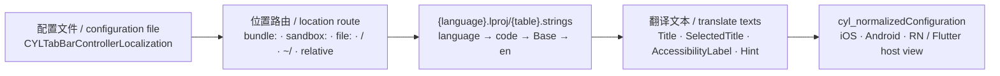
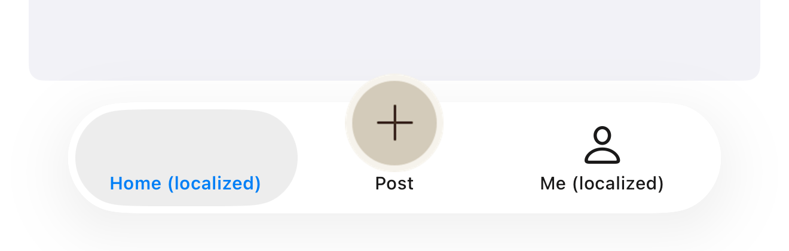

# [CN]配置文件的本地化文本
# [EN]Localized texts in a configuration file

<!-- bound-classes: CYLTabBarController -->
<!-- binding:start -->
<!-- Generated by scripts/update-docs-navigation.py; do not edit by hand. -->

| 中文 | English |
|:---|:---|
| 绑定的代码类 `CYLTabBarController`：[`CYLTabBarController/CYLTabBarController.h`](../CYLTabBarController/CYLTabBarController.h) | Bound to the class `CYLTabBarController`: [`CYLTabBarController/CYLTabBarController.h`](../CYLTabBarController/CYLTabBarController.h) |

<!-- binding:end -->

| 中文 | English |
|:---|:---|
| 用一个配置文件（JSON、YAML、XML、plist、TOML 等，见[一个配置文件生成 TabBarController](Configuration-File.md)）创建 TabBar 时，Tab 标题可以按语言显示：配置中写本地化键，译文放在 App 的 `.strings` 字符串表中。字符串表可以内置在 App 中，也可以运行时下载到沙盒；iOS 与 Android 读取同样的文件，React Native 与 Flutter 通过宿主视图（`CYLTabBarHostView`）使用同样的配置。 | When a configuration file (JSON, YAML, XML, plist, TOML and more, see [One configuration file, one TabBarController](Configuration-File.md)) builds the tab bar, the tab titles can follow the language: the configuration holds localization keys, and the translations are in the app's `.strings` tables. The tables can ship in the app or be downloaded into the sandbox at run time; iOS and Android read the same files, and React Native and Flutter use the same configuration through the host view (`CYLTabBarHostView`). |

## [CN]目录
## [EN]Contents

<!-- navigation:start -->
<!-- Generated by scripts/update-docs-navigation.py; do not edit by hand. -->

| 中文 | English |
|:---|:---|
| [用法](#cn用法) | [Usage](#enusage) |
| [键](#cn键) | [Keys](#enkeys) |
| [位置路由](#cn位置路由) | [Location routes](#enlocation-routes) |
| [流程](#cn流程) | [Flow](#enflow) |
| [限制](#cn限制) | [Limits](#enlimits) |
| [测试与截图](#cn测试与截图) | [Testing and screenshots](#entesting-and-screenshots) |
| [待办](#cn待办) | [TODO](#entodo) |

<!-- navigation:end -->

## [CN]用法
## [EN]Usage

| 中文 | English |
|:---|:---|
| 在配置中加入 `CYLTabBarControllerLocalization`，把标题写成本地化键： | Add `CYLTabBarControllerLocalization` to the configuration and write the titles as localization keys: |

```json
{
  "CYLTabBarControllerLocalization": {
    "CYLTabBarLocalizationTableName": "Tabs",
    "CYLTabBarLocalizationPath": "sandbox:Caches/i18n"
  },
  "CYLTabBarControllerTabBarItemsAttributes": [
    { "CYLTabBarItemTitle": "tab.home", "CYLTabBarItemImage": "system:house", "CYLTabBarItemIdentifier": "home" },
    { "CYLTabBarItemTitle": "tab.me", "CYLTabBarItemImage": "system:person", "CYLTabBarItemIdentifier": "me" }
  ]
}
```

| 中文 | English |
|:---|:---|
| 字符串表与 iOS 的 `.strings` 格式相同，每种语言一个 `.lproj` 文件夹（例如 `sandbox:Caches/i18n/zh-Hans.lproj/Tabs.strings`）： | The tables use the iOS `.strings` format, one `.lproj` folder per language (e.g. `sandbox:Caches/i18n/zh-Hans.lproj/Tabs.strings`): |

```
/* zh-Hans.lproj/Tabs.strings */
"tab.home" = "首页";
"tab.me" = "我的";
```

| 中文 | English |
|:---|:---|
| 翻译的键：配置中任意位置（Tab、PlusButton、皮肤）的 `CYLTabBarItemTitle`、`CYLTabBarItemSelectedTitle`、`CYLTabBarItemAccessibilityLabel`、`CYLTabBarItemAccessibilityHint`。没有译文的键保持原样，与 `NSLocalizedString` 相同，因此可以逐步补充译文。 | The translated keys: `CYLTabBarItemTitle`, `CYLTabBarItemSelectedTitle`, `CYLTabBarItemAccessibilityLabel` and `CYLTabBarItemAccessibilityHint`, anywhere in the configuration (tabs, the plus button, skins). A key without a translation stays as it is, as with `NSLocalizedString`, so translations can be added bit by bit. |
| 语言：iOS 使用本库的语言（`CYLLocalizationLanguage()`，跟随 `CYLSetLocalizationLanguage` 与系统设置）；Android 使用 App 的语言。依次尝试该语言（如 `zh-Hans`、`pt-BR`）、语言代码（`zh`、`pt`）、`Base` 与 `en`。 | The language: on iOS, the library's language (`CYLLocalizationLanguage()`, which follows `CYLSetLocalizationLanguage` and the system settings); on Android, the app's language. The language (e.g. `zh-Hans`, `pt-BR`), its code (`zh`, `pt`), `Base` and `en` are tried in this order. |
| 字符串表总是属于 App（示例层），本库不提供、也不会在自己的资源包 `CYLTabBarController.bundle` 中查找这些译文。 | The tables always belong to the app (the example layer): the library ships none and never looks in its own `CYLTabBarController.bundle` for them. |

| 中文 | English |
|:---|:---|
| [TabBar 配置清单](Configuration-Manifest.md)用 `localization`（`tableName`、`route`）写同样的设置，`route` 相对于清单所在目录。 | A [tab bar configuration manifest](Configuration-Manifest.md) writes the same setting as `localization` (`tableName`, `route`), the `route` relative to the manifest's folder. |

## [CN]键
## [EN]Keys

| 键 / Key | 中文 | English |
|:---|:---|:---|
| `CYLTabBarControllerLocalization` | YES（或 "true"）：使用 App 内置的 `Localizable` 表；字符串：表名；字典：下面三个键。 | YES (or "true"): the app's built-in `Localizable` table; a string: the table name; a dictionary: the three keys below. |
| `CYLTabBarLocalizationTableName` | 表名，不含 `.strings`，默认 `Localizable`。 | The table name, without `.strings`; default `Localizable`. |
| `CYLTabBarLocalizationPath` | 存放 `.lproj` 文件夹的位置，写作位置路由（见下一节）；优先于 `CYLTabBarLocalizationBundleName`。 | Where the `.lproj` folders are, as a location route (next section); takes precedence over `CYLTabBarLocalizationBundleName`. |
| `CYLTabBarLocalizationBundleName` | App 中的资源包：iOS 为 `Texts` 或 `Texts.bundle`，Android 为 assets 中的同名文件夹；默认 main bundle（Android：assets 根目录）。 | A resource bundle in the app: on iOS `Texts` or `Texts.bundle`, on Android the folder of that name in the assets; default the main bundle (Android: the assets root). |

## [CN]位置路由
## [EN]Location routes

| 中文 | English |
|:---|:---|
| 这些规则由 `CYLResourceRoute`（CYLUtils）实现，配置文件本身也可以用路由读取，并按名称、主题、版本与格式选择，见[资源路由](Resource-Routes.md)。 | These rules are implemented by `CYLResourceRoute` (CYLUtils); configuration files can be read with a route too, picked by name, theme, version and format, see [Resource routes](Resource-Routes.md). |
| `CYLTabBarLocalizationPath` 的值按下表的顺序匹配（左侧为匹配规则的正则表达式），由前缀判断从 App 内置资源、沙盒还是本地路径读取。iOS 与 Android 使用相同的规则，同一份配置在两个平台上找到对应的位置。 | The value of `CYLTabBarLocalizationPath` is matched against the table below in order (the left column is the matching rule as a regular expression); its prefix says whether the tables come from the app's built-in resources, the sandbox or a local path. iOS and Android use the same rules, so one configuration finds the matching place on both. |

| 规则 / Rule | 示例 / Example | 中文 | English |
|:---|:---|:---|:---|
| `^bundle:` | `bundle:i18n` | App 内置资源：iOS main bundle 的资源目录，Android 的 assets。 | Built into the app: the main bundle's resources on iOS, the assets on Android. |
| `^sandbox:Documents/` | `sandbox:Documents/i18n` | 沙盒：iOS 的 Documents，Android 的 `filesDir`。 | The sandbox: Documents on iOS, `filesDir` on Android. |
| `^sandbox:(Caches\|tmp)/` | `sandbox:Caches/i18n` | 沙盒缓存：iOS 的 Library/Caches（`tmp` 为临时目录），Android 的 `cacheDir`。适合运行时下载的字符串表。 | The sandbox caches: Library/Caches on iOS (`tmp`: the temporary folder), `cacheDir` on Android. Suits tables downloaded at run time. |
| `^sandbox:` | `sandbox:Library/i18n` | 沙盒中 App 主目录之下的其他路径（Android：App 数据目录）。 | Any other path below the app's home folder (Android: the app's data folder). |
| `^file:` | `file:///…/i18n` | 本地文件 URL。 | A local file URL. |
| `^/` | `/var/…/i18n` | 本地绝对路径。 | An absolute local path. |
| `^~/` | `~/Documents/i18n` | App 主目录（iOS 沙盒根目录；Android：App 数据目录）。 | The app's home folder (iOS: the sandbox root; Android: the app's data folder). |
| 其他 / anything else | `i18n` | 相对于配置文件所在目录（Android：所在 asset 目录）；配置不是来自文件（代码、网络、React Native、Flutter）时相对于 App 内置资源。 | Relative to the configuration file's folder (Android: the folder of its asset); relative to the app's built-in resources when the configuration does not come from a file (code, the network, React Native, Flutter). |

| 中文 | English |
|:---|:---|
| 运行时下载：先把 `.lproj` 文件夹下载到沙盒（例如 Caches/i18n），再用 `sandbox:Caches/i18n` 创建 TabBar；与配置文件一起下载到同一目录时，直接写相对路径即可。 | Downloaded at run time: download the `.lproj` folders into the sandbox first (e.g. Caches/i18n), then create the tab bar with `sandbox:Caches/i18n`; downloaded into the same folder as the configuration file, a relative path is enough. |
| React Native 与 Flutter：配置在 JavaScript / Dart 中创建，没有文件目录，因此使用 `bundle:`（字符串表放在 iOS App 资源与 Android assets 中）或 `sandbox:`。 | React Native and Flutter: the configuration is made in JavaScript / Dart and has no file folder, so use `bundle:` (the tables in the iOS app's resources and the Android assets) or `sandbox:`. |

## [CN]流程
## [EN]Flow



## [CN]限制
## [EN]Limits

| 中文 | English |
|:---|:---|
| 文本在创建 TabBar 时翻译：之后切换语言不会自动更新已创建的 TabBar，请重新创建，或用 `-updateTabBarItemsWithAttributes:` 设置新标题。 | The texts are translated when the tab bar is created: a later language change does not update a tab bar that exists; create it again, or set the new titles with `-updateTabBarItemsWithAttributes:`. |
| 只支持 `.strings` 格式（UTF-8 或 UTF-16），不读取 `.stringsdict`、`.xcstrings` 或 Android 的 `strings.xml`。 | Only the `.strings` format (UTF-8 or UTF-16) is read, not `.stringsdict`, `.xcstrings` or Android's `strings.xml`. |

## [CN]测试与截图
## [EN]Testing and screenshots

| 中文 | English |
|:---|:---|
| 单元测试：iOS `testConfigurationFileLocalization`（相对路径、语言切换、缺失的键、没有该键、`sandbox:Caches`）；Android `CYLConfigurationLocalizationTest`（同样的情况，另含 `.strings` 解析与语言名称）。 | Unit tests: iOS `testConfigurationFileLocalization` (a relative path, the language switch, a missing key, no key, `sandbox:Caches`); Android `CYLConfigurationLocalizationTest` (the same cases, plus `.strings` parsing and language names). |
| 2026-11-09 在 iPhone 17 Pro Max 模拟器（iOS 26.1，Xcode 27.2）上运行 ObjC 示例的 L1 演示（「Localized texts (tables in the sandbox)」）：App 把字符串表写入 Caches（如同下载），配置用 `sandbox:Caches/…` 指定。英文与简体中文（`-AppleLanguages (zh-Hans)`）分别显示对应的标题；「发布」来自示例共用的 PlusButton。 | Verified on 2026-11-09 with the ObjC example's L1 demo ("Localized texts (tables in the sandbox)") on an iPhone 17 Pro Max simulator (iOS 26.1, Xcode 27.2): the app writes the tables into Caches (as if downloaded), and the configuration names them with `sandbox:Caches/…`. English and Simplified Chinese (`-AppleLanguages (zh-Hans)`) each show their titles; "Post" / "发布" is the example's shared plus button. |
| 英文： | English: |
|  |  |
| 简体中文： | Simplified Chinese: |
|  |  |

## [CN]待办
## [EN]TODO

| 中文 | English |
|:---|:---|
| 规则见 `AGENTS.md`「Localization (i18n / l10n) file structure」（2026-11-10）：本地化文件按所有者放进 `.bundle`，核心 bundle 永久保留并谨慎更新，示例使用示例级 bundle，每个 bundle 有一个宏。以下为当前不符合之处（2026-11-10 统计）。 | The rule is in `AGENTS.md`, "Localization (i18n / l10n) file structure" (2026-11-10): localized files go into one `.bundle` per owner, the core bundle is permanent and updated carefully, examples use example-level bundles, and every bundle has one macro. Below are the current gaps (counted on 2026-11-10). |
| TODO（示例文字在核心 bundle 中，60/100，2026-11-11）：已完成：示例级 bundle `Example-Shared/CYLDemo.bundle`（33 种语言，106 个只有示例使用的键，译文复制自核心表）、宏 `CYLDemoLocalizedString`（`Example-Shared/CYLDemoLocalization.h/.m`，语言跟随 `CYLLocalizationLanguage()`，示例表中没有的键回退到 `CYLLocalizedString()`）；ObjC 示例 `Example/` 的 17 个文件全部改用新宏，bundle 与源文件已加入根工程。验证：ObjC 示例在 iOS 26.1 模拟器上以英文、简体中文、日文启动显示正确；临时把日文 bundle 中「我的」改为「マイページ★」后 TabBar 显示「マイページ★」，证明文字来自示例 bundle（已改回）。未完成：Swift 示例（Example-Swift-03 及引用其源文件的 HealthyHome 系列、Example-network-download、Example-Swift-02、Example-Swift-SwiftManager-FlatDesign、Example-SwiftUI、Example-Swift、Example-Rive）仍用核心宏，需要同名 Swift 函数 `CYLDemoLocalizedString` 并把 bundle 加入各工程；核心表中的 106 个示例键暂时保留（按「核心 bundle 谨慎更新」，移除前需在发布说明中写明）。 | TODO (example texts in the core bundle, 60/100, 2026-11-11): done: the example-level bundle `Example-Shared/CYLDemo.bundle` (33 languages, the 106 keys only the examples use, translations copied from the core tables) and the macro `CYLDemoLocalizedString` (`Example-Shared/CYLDemoLocalization.h/.m`; the language follows `CYLLocalizationLanguage()`, a key missing from the demo table falls back to `CYLLocalizedString()`); all 17 files of the ObjC example `Example/` use the new macro, and the bundle and sources are in the root project. Verified: the ObjC example on an iOS 26.1 simulator in English, Simplified Chinese and Japanese; with 「我的」 temporarily changed to 「マイページ★」 in the Japanese demo table the tab bar showed 「マイページ★」, so the text comes from the demo bundle (changed back). Open: the Swift examples (Example-Swift-03 and the HealthyHome demos that compile its sources, Example-network-download, Example-Swift-02, Example-Swift-SwiftManager-FlatDesign, Example-SwiftUI, Example-Swift, Example-Rive) still use the core macro and need a Swift function `CYLDemoLocalizedString` plus the bundle in each project; the 106 example keys stay in the core tables for now (the core bundle is updated carefully; removing them goes into the release notes). |
| TODO（示例配置的字符串表为散落的 `.lproj`，0/100）：`Example-Shared/Configurations/Localization/` 下有 33 个 `.lproj`（`ConfigurationDemo.strings`），随 `Configurations` 文件夹引用打包，没有放进 `.bundle`。它们是 `CYLTabBarLocalizationPath`（值为 `Localization`）资源路由的示例：改为 `.bundle` 时需同时更新 17 种格式的示例配置、iOS 与 Android 的路由测试和本文档。验证：`scripts/configuration-tests/run-tests.sh`、iOS `CYLResourceRouteTests`、Android `CYLResourceRouteTest` 与本文的语言截图。 | TODO (the sample configuration tables are loose `.lproj` folders, 0/100): `Example-Shared/Configurations/Localization/` holds 33 `.lproj` folders (`ConfigurationDemo.strings`), packaged with the `Configurations` folder reference, not in a `.bundle`. They are the sample of the `CYLTabBarLocalizationPath` resource route (value `Localization`): moving them into a `.bundle` also changes the sample configurations in 17 formats, the iOS and Android route tests and this document. Verify: `scripts/configuration-tests/run-tests.sh`, iOS `CYLResourceRouteTests`, Android `CYLResourceRouteTest` and the language screenshots here. |
| TODO（Android 示例字符串，未检查）：`Example-Android/demokit` 自有 `res/values`、`res/values-zh-rCN`，与 iOS 的 33 种语言不一致；示例使用的辅助函数未统一。验证：列出 demokit 与 app 模块的字符串键，与示例级 iOS bundle 对照。 | TODO (Android example strings, not checked): `Example-Android/demokit` has its own `res/values` and `res/values-zh-rCN`, unlike iOS's 33 languages, and no single helper reads them. Verify: list the string keys of the demokit and app modules and compare them with the example-level iOS bundle. |

