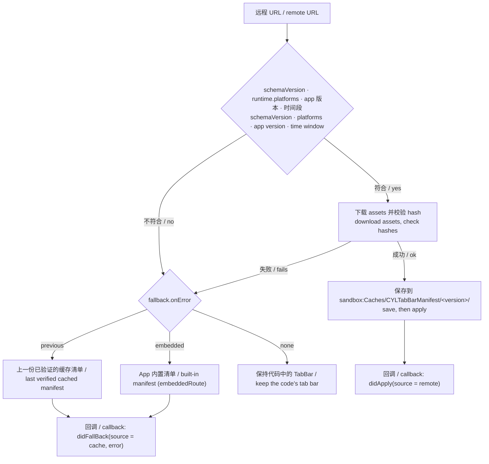
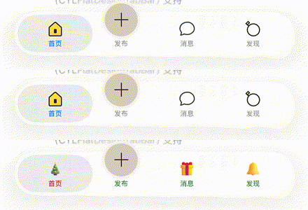
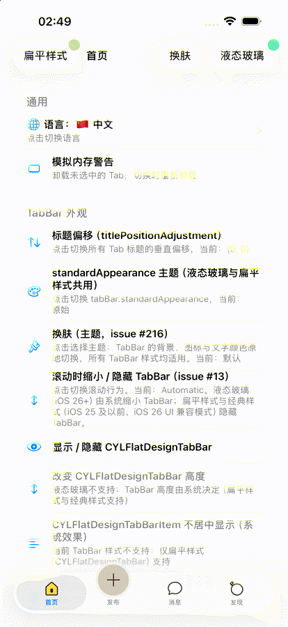
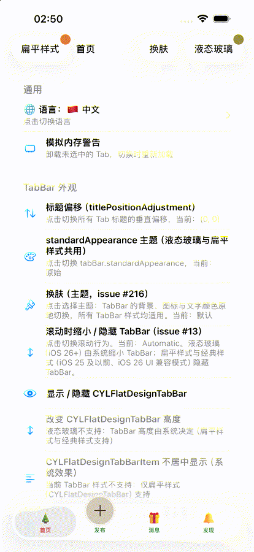

# [CN]TabBar 配置清单
# [EN]Tab bar configuration manifest

<!-- bound-classes: CYLTabBarController -->
<!-- binding:start -->
<!-- Generated by scripts/update-docs-navigation.py; do not edit by hand. -->

| 中文 | English |
|:---|:---|
| 绑定的代码类 `CYLTabBarController`：[`CYLTabBarController/CYLTabBarController.h`](../CYLTabBarController/CYLTabBarController.h) | Bound to the class `CYLTabBarController`: [`CYLTabBarController/CYLTabBarController.h`](../CYLTabBarController/CYLTabBarController.h) |

<!-- binding:end -->

| 中文 | English |
|:---|:---|
| **状态：iOS 与 Android 已实现（2026-11-10），React Native 与 Flutter 通过 `manifestRoute` 使用；进度见[进度与评分](#cn进度与评分)。** 本文描述一份下发给 App 的 TabBar 配置清单：一个文件说明 TabBar、PlusButton、多套主题、主题的图片资源、版本、平台限制、失败时的备用方案与回调。它不再按本库 Example 的写法设计，而是复用三个成熟方案的字段与规则（见下一节），再映射到本库已有的配置键。 | **Status: implemented on iOS and Android (2026-11-10); React Native and Flutter use it through `manifestRoute`; see [Progress and score](#enprogress-and-score).** This document describes a tab bar manifest sent to the app: one file for the tab bar, the plus button, several themes, the themes' image assets, the version, platform limits, the fallback when something fails, and the callbacks. It is not designed after this library's examples any more: it reuses the fields and rules of three mature schemes (next section), then maps them onto this library's existing configuration keys. |

## [CN]目录
## [EN]Contents

<!-- navigation:start -->
<!-- Generated by scripts/update-docs-navigation.py; do not edit by hand. -->

| 中文 | English |
|:---|:---|
| [参考的成熟方案](#cn参考的成熟方案) | [The mature schemes it follows](#enthe-mature-schemes-it-follows) |
| [清单示例](#cn清单示例) | [A manifest](#ena-manifest) |
| [字段](#cn字段) | [Fields](#enfields) |
| [资源引用：版本、主题、Tab、状态](#cn资源引用版本主题tab状态) | [Asset references: version, theme, tab, state](#enasset-references-version-theme-tab-state) |
| [加载流程、备用方案与回调](#cn加载流程备用方案与回调) | [Loading, fallback and callbacks](#enloading-fallback-and-callbacks) |
| [映射到本库的配置键](#cn映射到本库的配置键) | [Mapping onto this library's keys](#enmapping-onto-this-librarys-keys) |
| [用法](#cn用法) | [Usage](#enusage) |
| [边界情况](#cn边界情况) | [Edge cases](#enedge-cases) |
| [进度与评分](#cn进度与评分) | [Progress and score](#enprogress-and-score) |
| &nbsp;&nbsp;&nbsp;&nbsp;↳ [TODO](#cntodo) | &nbsp;&nbsp;&nbsp;&nbsp;↳ [TODO](#entodo) |
| [测试与截图](#cn测试与截图) | [Testing and screenshots](#entesting-and-screenshots) |

<!-- navigation:end -->

## [CN]参考的成熟方案
## [EN]The mature schemes it follows

| 方案 / Scheme | 借用的部分 / What is borrowed | 中文 | English |
|:---|:---|:---|:---|
| [uni-app `pages.json` tabBar](https://uniapp.dcloud.net.cn/collocation/pages.html) 与 [`theme.json` 深色模式](https://uniapp.dcloud.net.cn/tutorial/darkmode.html) | `tabBar`、`list`、`midButton`、`@变量` | 跨端（iOS、Android、H5、小程序）最常用的 TabBar 描述：`color`、`selectedColor`、`backgroundColor`、`list[]`（`pagePath`、`text`、`iconPath`、`selectedIconPath`、`visible`），中间凸起按钮 `midButton`（`width`、`height`、`text`、`iconPath`、`iconWidth`、`backgroundImage`）；`theme.json` 中 `light` / `dark` 两组变量，`tabBar` 的值写成 `@变量名`，图标路径也可以是变量。 | The most used cross-platform tab bar description (iOS, Android, H5, mini programs): `color`, `selectedColor`, `backgroundColor`, `list[]` (`pagePath`, `text`, `iconPath`, `selectedIconPath`, `visible`), the raised middle button `midButton` (`width`, `height`, `text`, `iconPath`, `iconWidth`, `backgroundImage`); `theme.json` holds `light` / `dark` variables, and `tabBar` values are written `@name`, icon paths included. |
| [Expo Updates 协议（React Native）](https://docs.expo.dev/technical-specs/expo-updates-1/) | `id`、`createdAt`、`runtimeVersion`、`assets[]`、`rollBackToEmbedded` | React Native 下发更新的清单：唯一 `id`、`createdAt`（多份可用时取最新）、`runtimeVersion`（只接受与原生版本匹配的清单）、`assets[]`（`key`、`hash` 为 SHA-256、`contentType`、`url`，全部下载并校验后才生效），以及回退到 App 内置版本的指令 `rollBackToEmbedded`；平台由请求说明（`ios` / `android`）。 | React Native's update manifest: a unique `id`, `createdAt` (the newest eligible one wins), `runtimeVersion` (only manifests that match the native build are accepted), `assets[]` (`key`, `hash` a SHA-256, `contentType`, `url`; all are downloaded and checked before the update is used), and the directive `rollBackToEmbedded`, back to the version built into the app; the platform is part of the request (`ios` / `android`). |
| [Firebase Remote Config](https://firebase.google.com/docs/reference/remote-config/rest/v1/RemoteConfig)（[条件表达式](https://firebase.google.com/docs/remote-config/condition-reference)） | `conditions[]`、`expression`、默认值与条件值 | 跨端（iOS、Android、Flutter、Unity）的远程配置：`conditions[]` 按顺序给出 `name` 与 `expression`（`device.os == 'android'`、`app.version >= '1.2.3'`、`device.language in [...]`、`percent <= 10`，用 ` && ` 连接），参数有默认值与按条件取的值；App 内置默认值是取不到远程配置时的备用。 | Cross-platform remote configuration (iOS, Android, Flutter, Unity): `conditions[]` give a `name` and an `expression` in order (`device.os == 'android'`, `app.version >= '1.2.3'`, `device.language in [...]`, `percent <= 10`, joined with ` && `), and parameters have a default and per-condition values; in-app defaults are the fallback when no remote configuration can be fetched. |

## [CN]清单示例
## [EN]A manifest

| 中文 | English |
|:---|:---|
| 完整示例：`Example-Shared/Configurations/Manifests/cyl_tabbar_manifest.json`。下面逐段说明。 | The full sample: `Example-Shared/Configurations/Manifests/cyl_tabbar_manifest.json`. Each part is explained below. |

```json
{
  "schemaVersion": 1,
  "id": "7c1d2b0e-5f6a-4b8e-9c3d-1a2b3c4d5e6f",
  "version": "2.1.0",
  "createdAt": "2026-11-10T00:00:00Z",

  "runtime": {
    "platforms": ["ios", "android"],
    "minAppVersion": "1.0.0",
    "maxAppVersion": "",
    "startTime": "",
    "endTime": ""
  },

  "fallback": { "onError": "previous" },

  "assets": {
    "baseRoute": "../Skins/2.1.0",
    "list": [
      { "key": "home", "theme": "light", "state": "normal",   "path": "light/home@3x.png",          "hash": "sha256-…" },
      { "key": "home", "theme": "light", "state": "selected", "path": "light/home_selected@3x.png", "hash": "sha256-…" },
      { "key": "home", "theme": "dark",  "state": "normal",   "path": "dark/home@3x.png",           "hash": "sha256-…" },
      { "key": "home", "theme": "christmas", "state": "normal", "path": "christmas/home@3x.png",    "hash": "sha256-…" }
    ]
  },

  "themes": {
    "default": "light",
    "darkMode": "dark",
    "managerName": "CYLConfigurationDemo",
    "list": {
      "light":     { "tabColor": "#8E8E93", "tabSelectedColor": "#007AFF", "tabBackgroundColor": "#FFFFFF" },
      "dark":      { "tabColor": "#8E8E93", "tabSelectedColor": "#0A84FF", "tabBackgroundColor": "#1C1C1E" },
      "christmas": { "tabColor": "#2E7D32", "tabSelectedColor": "#C62828", "tabBackgroundColor": "#FFF8E1" }
    }
  },

  "tabBar": {
    "styleType": "liquidGlass",
    "color": "@tabColor",
    "selectedColor": "@tabSelectedColor",
    "backgroundColor": "@tabBackgroundColor",
    "list": [
      { "key": "home",    "pagePath": "home",    "text": "Home",
        "iconPath": "asset:home", "selectedIconPath": "asset:home?state=selected" },
      { "key": "message", "pagePath": "message", "text": "Message",
        "iconPath": "asset:message", "selectedIconPath": "asset:message?state=selected",
        "platforms": ["ios"] },
      { "key": "me",      "pagePath": "me",      "text": "Me",
        "iconPath": "asset:me", "selectedIconPath": "asset:me?state=selected",
        "minAppVersion": "2.0.0" }
    ],
    "midButton": {
      "key": "plus", "index": 2, "text": "Post",
      "width": 55, "height": 80, "iconPath": "asset:plus", "backgroundImage": "",
      "action": "page", "pagePath": "publish",
      "platforms": ["ios", "android"]
    }
  },

  "localization": { "tableName": "ConfigurationDemo", "route": "../Localization" },

  "conditions": [
    { "name": "android_new", "expression": "device.os == 'android' && app.version >= '2.0.0'" }
  ],
  "overrides": [
    { "condition": "android_new", "tabBar": { "midButton": { "height": 64 } } }
  ]
}
```

## [CN]字段
## [EN]Fields

| 字段 / Field | 来源 / From | 中文 | English |
|:---|:---|:---|:---|
| `schemaVersion` | — | 清单格式的版本。App 只接受自己认识的版本，不认识时按“备用方案”处理。 | The version of the manifest format. The app accepts only versions it knows; anything else goes to the fallback. |
| `id` | Expo | 本份清单的唯一 ID（UUID），用于缓存与回调。 | This manifest's unique ID (a UUID), for the cache and the callbacks. |
| `version` | Expo `runtimeVersion` / Firebase `version` | 清单内容的版本（语义化版本）。多份可用时取最高版本；资源目录以它命名（`Skins/<version>/`）。 | The version of the content (semantic versioning). When several are available the highest wins; the asset folder is named after it (`Skins/<version>/`). |
| `createdAt` | Expo | 发布时间（ISO 8601），版本相同时用于比较。 | When it was published (ISO 8601); compares manifests of the same version. |
| `runtime.platforms` | Expo `expo-platform` | `["all"]`、`["ios"]`、`["android"]` 或组合。不包含当前平台时整份清单不生效。 | `["all"]`, `["ios"]`, `["android"]` or a mix. A manifest that does not include the current platform is not used at all. |
| `runtime.minAppVersion` / `maxAppVersion` | Firebase `app.version` | App 版本范围，空字符串表示不限。 | The app version range; an empty string means no limit. |
| `runtime.startTime` / `endTime` | 节日皮肤 / holiday skins | 生效时间段（ISO 8601），用于节日皮肤；空字符串表示不限。 | The time window (ISO 8601), for holiday skins; an empty string means no limit. |
| `fallback.onError` | Expo `rollBackToEmbedded`、Firebase 内置默认值 | 清单或资源不可用时：`previous`（上一份已验证的缓存清单）、`embedded`（App 内置清单）、`none`（保持代码中的 TabBar）。 | When the manifest or an asset cannot be used: `previous` (the last verified cached manifest), `embedded` (the manifest built into the app), `none` (keep the tab bar made in code). |
| `fallback.embeddedRoute` | Expo embedded update | 可选：App 内置清单的资源路由（[资源路由](Resource-Routes.md)）。`bundle:` 在 iOS 与 Android 上指向的目录不同，因此通常由 App 在代码中设置（`embeddedManifestRoute`），清单本身只写相对路由。 | Optional: the resource route of the manifest built into the app ([Resource routes](Resource-Routes.md)). `bundle:` leads to different folders on iOS and Android, so the app usually sets it in code (`embeddedManifestRoute`) and the manifest keeps relative routes. |
| `themes.managerName` | 本库 / this library | 可选：主题使用的管理器（`CYLTabBarControllerThemeManagerName`），使清单的主题与 App 自己的皮肤分开。 | Optional: the manager the themes use (`CYLTabBarControllerThemeManagerName`), so the manifest's themes stay apart from the app's own skins. |
| `assets.baseRoute` | Expo `assets` | 资源目录的路由，相对路由以清单所在目录为起点（示例：`../Skins/2.1.0`，iOS 与 Android 相同）。下载的清单缓存后读取 `sandbox:Caches/CYLTabBarManifest/<version>/`；`assets.baseURL`（可选）为下载资源的地址，默认是清单 URL 所在目录；资源项也可以写自己的 `url`。 | The route of the asset folder; a relative route starts from the manifest's folder (the sample: `../Skins/2.1.0`, the same on iOS and Android). A downloaded manifest reads `sandbox:Caches/CYLTabBarManifest/<version>/` once cached; `assets.baseURL` (optional) is where its assets are downloaded from, by default the manifest URL's folder; an entry may give its own `url`. |
| `assets.list[]` | Expo `assets[]` | 每张图片一项：`key`（Tab 的标识）、`theme`、`state`（`normal` / `selected`）、`path`（相对 `baseRoute`）、`hash`（`sha256-` 加 Base64URL，可选，校验失败按备用方案处理）、可选 `platforms`。 | One entry per image: `key` (the tab's identifier), `theme`, `state` (`normal` / `selected`), `path` (relative to `baseRoute`), `hash` (`sha256-` plus Base64URL, optional; a mismatch goes to the fallback), optional `platforms`. |
| `themes.default` / `themes.darkMode` | uni-app `theme.json` | 默认主题与深色模式下使用的主题。 | The default theme and the theme used in Dark Mode. |
| `themes.list` | uni-app `light` / `dark` | 主题名 → 变量。不限于 `light` / `dark`，节日皮肤也是一套主题。映射到本库的 `CYLTabBarControllerThemes`。 | Theme name → variables. Not only `light` / `dark`: a holiday skin is a theme too. Maps to this library's `CYLTabBarControllerThemes`. |
| `tabBar.color` / `selectedColor` / `backgroundColor` | uni-app | 值可以是 `@变量`，从当前主题取值。 | A value can be `@name`, read from the current theme. |
| `tabBar.styleType` | 本库 / this library | `liquidGlass`、`flatDesign` 等，即 `CYLTabBarControllerStyleType`。 | `liquidGlass`, `flatDesign`…, that is `CYLTabBarControllerStyleType`. |
| `tabBar.list[]` | uni-app `list` | `key`（标识，也用于找资源）、`pagePath`（页面 ID，见 [Tab-Page-Registry](Tab-Page-Registry.md)）、`text`（本地化键）、`iconPath` / `selectedIconPath`（资源引用，见下一节）、`visible`，以及可选的 `platforms`、`minAppVersion`、`maxAppVersion`。 | `key` (the identifier, also used to find assets), `pagePath` (a page ID, see [Tab-Page-Registry](Tab-Page-Registry.md)), `text` (a localization key), `iconPath` / `selectedIconPath` (asset references, next section), `visible`, and optional `platforms`, `minAppVersion`, `maxAppVersion`. |
| `tabBar.midButton` | uni-app `midButton` | PlusButton：`index`、`text`、`width`、`height`、`iconPath`、`backgroundImage`、`action`（`page` 打开 `pagePath`；`callback` 只回调，对应 uni-app 的 `onTabBarMidButtonTap`）、`platforms`。映射到 `CYLTabBarControllerPlusButton`。 | The plus button: `index`, `text`, `width`, `height`, `iconPath`, `backgroundImage`, `action` (`page` opens `pagePath`; `callback` only calls back, like uni-app's `onTabBarMidButtonTap`), `platforms`. Maps to `CYLTabBarControllerPlusButton`. |
| `localization` | 本库 / this library | 字符串表的表名与位置（路由），即 `CYLTabBarControllerLocalization`。 | The string table's name and place (a route), that is `CYLTabBarControllerLocalization`. |
| `conditions[]` / `overrides[]` | Firebase | 有序的条件（`device.os`、`app.version`、`device.language`、`percent`，用 ` && ` 连接）；条件成立时把 `overrides` 中的同名字段合并进清单。 | Ordered conditions (`device.os`, `app.version`, `device.language`, `percent`, joined with ` && `); when one holds, the fields of its `overrides` entry are merged into the manifest. |

## [CN]资源引用：版本、主题、Tab、状态
## [EN]Asset references: version, theme, tab, state

| 中文 | English |
|:---|:---|
| 图标不写文件路径，也不写 `system:` 之类的系统图标名，而写资源引用 `asset:<key>?state=<normal\|selected>&theme=<主题>`。查找顺序：`baseRoute`（包含版本）→ `assets.list` 中 `key`、`theme`、`state` 都匹配的一项 → `path`。不写 `theme` 时用当前主题；当前主题没有这张图时用 `themes.default` 的图。因此一张图由“版本 + 主题 + Tab + 状态”唯一确定。 | An icon is neither a file path nor a system image name such as `system:`: it is an asset reference, `asset:<key>?state=<normal\|selected>&theme=<theme>`. Lookup: `baseRoute` (which holds the version) → the `assets.list` entry whose `key`, `theme` and `state` match → its `path`. Without `theme` the current theme is used; when the current theme has no such image, the image of `themes.default`. One image is therefore fixed by version + theme + tab + state. |
| 资源目录约定（下载与内置相同）： | The asset folder layout (the same downloaded or built in): |

```
Configurations/
├── Manifests/cyl_tabbar_manifest.json            # 内置清单 / the built-in manifest (fallback.embeddedRoute)
├── Skins/
│   ├── 2.1.0/                                    # version
│   │   ├── light/  home@3x.png  home_selected@3x.png  message@3x.png …  plus@3x.png
│   │   ├── dark/   home@3x.png  message@3x.png  me@3x.png
│   │   └── christmas/  home@3x.png  message@3x.png  discover@3x.png  me@3x.png  plus@3x.png
│   └── 1.0.0/<theme>/<icon>@3x.png               # 演示的节日皮肤 / the demo's holiday skins
│                                                 # (spring-festival, christmas, halloween, …)
└── Localization/<language>.lproj/ConfigurationDemo.strings
```

| 中文 | English |
|:---|:---|
| 下载时，整个 `Skins/<version>/` 与清单一起保存到 `sandbox:Caches/CYLTabBarManifest/<version>/`，`baseRoute` 指向那里；所有资源下载并通过 `hash` 校验后才切换（与 Expo 相同），否则按 `fallback.onError` 处理。 | When downloaded, the whole `Skins/<version>/` is saved with the manifest into `sandbox:Caches/CYLTabBarManifest/<version>/`, and `baseRoute` points there; the app switches only after every asset is downloaded and matches its `hash` (as Expo does), else `fallback.onError` applies. |
| 本库资源包中不再有主题图片：原来的 `cyl_theme_*` 节日图标已移到 `Example-Shared/Configurations/Skins/1.0.0/<主题>/`（主题文件夹为小写标识，空格换成 "-"），iOS 演示与 Android demokit 通过资源路由读取；ObjC Example 与 GIF / PAG / Rive / SwiftUI-Rive 打包整个 `Configurations` 文件夹，Android 示例把它作为 assets。每个资源一张 `@3x` 图片，因此每项可以校验哈希。 | The library's resource bundle has no theme images any more: the former `cyl_theme_*` holiday icons are in `Example-Shared/Configurations/Skins/1.0.0/<theme>/` (the theme folder is the identifier in lowercase with "-" for spaces), read through resource routes by the iOS demo and the Android demokit; the ObjC Example and GIF / PAG / Rive / SwiftUI-Rive bundle the whole `Configurations` folder, and the Android examples use it as assets. One `@3x` image per asset, so each entry can be hash-checked. |

## [CN]加载流程、备用方案与回调
## [EN]Loading, fallback and callbacks



| 回调 / Callback | 中文 | English |
|:---|:---|:---|
| `-manifestLoader:shouldApplyManifest:source:`（Android `shouldApplyManifest`） | 校验通过、即将生效；返回 NO 可以拒绝（例如 App 自己的灰度规则）。 | Checked and about to be used; return NO to refuse it (e.g. the app's own rollout rules). |
| `-manifestLoader:didApplyManifest:source:`（Android `didApplyManifest`） | 已生效；`source` 为 `Remote`、`Cache` 或 `Embedded`。 | Applied; `source` is `Remote`, `Cache` or `Embedded`. |
| `-manifestLoader:didFailWithError:fallbackSource:`（Android `didFail`） | 失败原因（错误码 `UnsupportedManifest`、`NotEligible`、`AssetInvalid`、网络与格式错误），以及改用的来源。 | Why it failed (the codes `UnsupportedManifest`, `NotEligible`, `AssetInvalid`, network and format errors) and the source used instead. |
| `CYLTabBarControllerPlusButtonAction`（代码中的 block） | `midButton.action` 为 `callback` 时不打开页面；点击 PlusButton 时执行 App 加入配置的 block（宿主视图：`didTapPlusButton`）。 | With `midButton.action` `callback`, no page opens; a tap runs the block the app adds to the configuration (host view: `didTapPlusButton`). |

| 中文 | English |
|:---|:---|
| React Native 与 Flutter：`manifestRoute`（写入 `CYLTabBarControllerManifestRoute`）读取内置或沙盒中的清单；PlusButton 点击沿用 `onPlusButtonTap`。下载与回退回调尚未提供给 JavaScript / Dart（见 TODO）。 | React Native and Flutter: `manifestRoute` (it writes `CYLTabBarControllerManifestRoute`) reads a built-in or sandbox manifest; plus button taps keep `onPlusButtonTap`. The download and fallback callbacks are not given to JavaScript / Dart yet (see TODO). |

## [CN]映射到本库的配置键
## [EN]Mapping onto this library's keys

| 清单 / Manifest | 本库 / Library key |
|:---|:---|
| `tabBar.styleType` | `CYLTabBarControllerStyleType` |
| `tabBar.list[].key` / `text` / `pagePath` | `CYLTabBarItemIdentifier` / `CYLTabBarItemTitle` / `CYLTabBarItemPageIdentifier` |
| `tabBar.list[].iconPath` / `selectedIconPath` | `CYLTabBarItemImage` / `CYLTabBarItemSelectedImage`（解析后的文件路径 / the resolved file path） |
| `tabBar.list[].platforms` / `minAppVersion` | `CYLTabBarItemPlatforms` / `CYLTabBarItemMinimumAppVersion` |
| `tabBar.midButton` | `CYLTabBarControllerPlusButton`（`CYLPlusButtonIndexInTabBar`、`CYLTabBarItemTitle`、`CYLTabBarItemImage`、`CYLPlusButtonBackgroundImage`…） |
| `themes` 与 `@变量` / and `@name` values | `CYLTabBarControllerThemes`、`CYLTabBarControllerThemeIdentifier`、`CYLTabBarControllerDarkThemeIdentifier` |
| `localization` | `CYLTabBarControllerLocalization` |

## [CN]用法
## [EN]Usage

```objc
// [EN] Built in. [CN] App 内置。
NSError *error = nil;
CYLTabBarManifest *manifest = [CYLTabBarManifest manifestWithRoute:@"bundle:Configurations/Manifests/cyl_tabbar_manifest.json" error:&error];
CYLTabBarController *tabBarController = [manifest tabBarControllerWithError:&error];

// [EN] Downloaded, cached, with fallbacks and callbacks. [CN] 下载、缓存，带备用方案与回调。
CYLTabBarManifestLoader *loader = [[CYLTabBarManifestLoader alloc] init];
loader.delegate = self;
loader.embeddedManifestRoute = @"bundle:Configurations/Manifests/cyl_tabbar_manifest.json";
[loader loadManifestWithURL:URL completion:^(CYLTabBarManifest *manifest, CYLTabBarManifestSource source, NSError *error) {
    self.window.rootViewController = [manifest tabBarControllerWithError:NULL];
}];

// [EN] In a configuration dictionary (React Native / Flutter send one). [CN] 写在配置字典中（React Native / Flutter 发送的就是字典）。
[CYLTabBarController tabBarControllerWithConfiguration:@{ CYLTabBarControllerManifestRoute : @"sandbox:Caches/tabbar/manifest.json" }];
```

```kotlin
val manifest = CYLTabBarManifest.manifestWithRoute(context, "bundle:Manifests/cyl_tabbar_manifest.json")
val controller = manifest.tabBarController(activity)
CYLTabBarManifestLoader(context).apply { embeddedManifestRoute = "bundle:Manifests/cyl_tabbar_manifest.json" }
    .loadManifestWithURL(url) { manifest, source, error -> /* … */ }
```

```tsx
<CYLTabBar manifestRoute="sandbox:Caches/tabbar/manifest.json" />
```

```dart
CYLTabBar(manifestRoute: 'bundle:Configurations/Manifests/cyl_tabbar_manifest.json')
```

| 中文 | English |
|:---|:---|
| ObjC Example：设置列表中“从配置文件创建 TabBarController”的操作表新增 4 项：`Manifest · light`、`Manifest · christmas`（内置清单与主题）、`download into sandbox:Caches`（模拟服务器目录 → 下载、校验、缓存）、`download with a bad asset → fallback`（哈希错误 → 回退到缓存或内置清单，并显示原因）。用启动参数 `-CYLDemoManifestTheme light\|dark\|christmas` 启动时，整个根 TabBar 由清单创建，页面 ID 打开示例自己的页面（`CYLMainRootViewController`）。 | ObjC Example: the action sheet of "Create a TabBarController from a configuration file" gains 4 items: `Manifest · light`, `Manifest · christmas` (the built-in manifest and a theme), `download into sandbox:Caches` (a simulated server folder → download, check, cache), `download with a bad asset → fallback` (a wrong hash → back to the cached or built-in manifest, with the reason). Launched with `-CYLDemoManifestTheme light\|dark\|christmas`, the whole root tab bar comes from the manifest, its page IDs opening the example's own pages (`CYLMainRootViewController`). |
| 选择浅色 / 深色以外的主题时，先关闭管理器的系统外观跟随（`respondsSystemStyleAutomatically = NO`），否则系统外观变化会重新选择浅色或深色。 | To choose a theme other than light / dark, stop the manager following the system appearance first (`respondsSystemStyleAutomatically = NO`), or an appearance change chooses light or dark again. |

## [CN]边界情况
## [EN]Edge cases

| 编号 ID | 中文 | English | 状态 Status |
|:---|:---|:---|:---|
| M1 | 不是清单、缺少 `tabBar`、未知 `schemaVersion`：错误 `UnsupportedManifest`。 | Not a manifest, no `tabBar`, an unknown `schemaVersion`: `UnsupportedManifest`. | ✅ |
| M2 | `runtime.platforms` 不包含当前平台：`NotEligible`，整份清单不生效。 | `runtime.platforms` without this platform: `NotEligible`, nothing is used. | ✅ |
| M3 | App 版本低于 `minAppVersion` 或高于 `maxAppVersion`（逐段数值比较）：`NotEligible`。 | The app version below `minAppVersion` or above `maxAppVersion` (number by number): `NotEligible`. | ✅ |
| M4 | 当前时间早于 `startTime` 或不早于 `endTime`（ISO 8601，含时区）：`NotEligible`。 | Now before `startTime` or not before `endTime` (ISO 8601 with a time zone): `NotEligible`. | ✅ |
| M5 | 图片查找：主题 + 状态 → 主题 normal → 默认主题状态 → 默认主题 normal → 任意主题；都没有时为空。 | Image lookup: theme + state → theme normal → default theme's state → default normal → any theme; none: empty. | ✅ |
| M6 | `path` 含 `../` 跳出资源目录：拒绝（文件与 assets 都检查）。 | A `path` with `../` leaving the assets folder: refused (files and assets alike). | ✅ |
| M7 | 资源缺失或与 `hash` 不一致：`AssetInvalid`，下载的清单不会生效。 | A missing asset or a `hash` mismatch: `AssetInvalid`; a downloaded manifest is not used. | ✅ |
| M8 | 条件：`device.os`、`app.version`、`device.language in [...]`、`percent`（每次安装固定）、` && `；未知表达式为假并打印日志；覆盖项逐键合并。 | Conditions: `device.os`, `app.version`, `device.language in [...]`, `percent` (fixed per install), ` && `; an unknown expression is false and logged; overrides merge key by key. | ✅ |
| M9 | 只适用于其他平台、版本过高或 `visible: false` 的 Tab 被排除，其他 Tab 不错位。 | Tabs for other platforms, newer versions or `visible: false` are left out without shifting the others. | ✅ |
| M10 | `@变量` 在当前主题中没有时取默认主题；主题中的颜色映射到保留名称。 | An `@name` missing from a theme comes from the default theme; colors map to the reserved names. | ✅ |
| M11 | PlusButton：位置、尺寸、`page` / `callback`、独立的 context。 | The plus button: index, size, `page` / `callback`, its own context. | ✅ |
| M12 | 没有页面：`NoPages`；非主线程：`MainThreadRequired`。 | No pages: `NoPages`; not the main thread: `MainThreadRequired`. | ✅ |
| M13 | 下载：先下载全部资源到临时目录，全部校验通过后才替换缓存（Expo）。 | Download: every asset into a staging folder first; the cache is replaced only when all match (Expo). | ✅ |
| M14 | 回退：`previous`（上一份已验证的缓存）→ `embedded` → `none`；回调报告原因与来源。 | Fallback: `previous` (the last verified cache) → `embedded` → `none`; callbacks report the reason and the source. | ✅ |
| M15 | 配置键 `CYLTabBarControllerManifestRoute`：清单在其他键之下；不可用的清单被忽略并打印日志。 | The key `CYLTabBarControllerManifestRoute`: the manifest under the other keys; an unusable manifest is ignored and logged. | ✅ |

## [CN]进度与评分
## [EN]Progress and score

| 项目 / Item | 状态 / Status | 中文 | English |
|:---|:---|:---|:---|
| 设计（参照 uni-app、Expo、Firebase） | ✅ | 本文。 | This document. |
| iOS `CYLTabBarManifest` / `CYLTabBarManifestLoader` | ✅ | `CYLTabBarController/CYLTabBarManifest.{h,m}`；单元测试 `CYLTabBarManifestTests`（9 个，M1–M15）。 | `CYLTabBarController/CYLTabBarManifest.{h,m}`; unit tests `CYLTabBarManifestTests` (9, M1–M15). |
| Android `CYLTabBarManifest.kt` | ✅ | 同样的规则与回调；单元测试 `CYLTabBarManifestTest`（8 个）。 | The same rules and callbacks; unit tests `CYLTabBarManifestTest` (8). |
| React Native / Flutter `manifestRoute` | ✅（部分 / partly） | 内置或沙盒中的清单可用；下载与回调见 TODO。 | Built-in and sandbox manifests work; downloads and callbacks: see TODO. |
| 资源移出本库、按版本 / 主题 / Tab 存放 | ✅ | `Example-Shared/Configurations/Skins/`、`Manifests/`、`Localization/`。 | `Example-Shared/Configurations/Skins/`, `Manifests/`, `Localization/`. |
| ObjC Example 演示与截图 | ✅ | 见下一节。 | See the next section. |
| 评分 / Score | **90 / 100** | 扣分见 TODO。 | Deductions: see TODO. |

### [CN]TODO
### [EN]TODO

| 中文 | English |
|:---|:---|
| -3：PlusButton 的图标只取默认主题的图片，切换主题时不随之更换（Tab 的图标会更换）。需要让 PlusButton 也接受主题中的 `@名称` 图片。 | -3: the plus button takes the default theme's image only and does not change with the theme (tab icons do). The plus button needs to accept `@name` images of the themes too. |
| -3：React Native 与 Flutter 只能读取已在本地的清单；`CYLTabBarManifestLoader` 的下载、回退与回调尚未通过宿主视图提供给 JavaScript / Dart（计划：宿主视图的 `manifestURL` 与 `onManifestApply` / `onManifestFail`）。 | -3: React Native and Flutter can only read a manifest that is already local; `CYLTabBarManifestLoader`'s download, fallback and callbacks are not given to JavaScript / Dart through the host view yet (planned: the host view's `manifestURL` with `onManifestApply` / `onManifestFail`). |
| -2：示例清单中 `midButton.index` 为 2，但在 3 个 Tab 时 PlusButton 显示在第 2 位；需要确认 `CYLPlusButtonIndexInTabBar` 与带页面的 PlusButton 一起使用时的位置规则。 | -2: the sample's `midButton.index` is 2, but with 3 tabs the plus button shows in the second place; the rule of `CYLPlusButtonIndexInTabBar` with a plus button that has a page needs checking. |
| -2：Android 示例尚未加入清单演示界面（规则与下载由单元测试覆盖）；示例在 Android 模拟器上的截图待补。 | -2: the Android examples have no manifest demo screen yet (the rules and downloads are covered by unit tests); screenshots on the Android emulator are still to come. |
| 待验证：在真机上下载 http(s) 清单（单元测试与演示使用 file URL）。 | To verify: downloading an http(s) manifest on a device (the unit tests and the demo use file URLs). |

## [CN]测试与截图
## [EN]Testing and screenshots

| 中文 | English |
|:---|:---|
| 2026-11-10 在 iPhone 17 Pro Max 模拟器（iOS 26.1，Xcode 27）上验证：iOS 单元测试 112 个、Android 单元测试 106 个全部通过；ObjC Example 用 `-CYLDemoManifestTheme light` 与 `christmas` 启动、简体中文（`-AppleLanguages (zh-Hans)`）。“我的”需要 App 版本 2.0.0，因此不显示（`minAppVersion`）；圣诞主题的图标、标题颜色来自清单的主题与 `Skins/2.1.0/christmas/`。 | Verified on 2026-11-10 on an iPhone 17 Pro Max simulator (iOS 26.1, Xcode 27): 112 iOS and 106 Android unit tests pass; the ObjC Example launched with `-CYLDemoManifestTheme light` and `christmas`, in Simplified Chinese (`-AppleLanguages (zh-Hans)`). "我的" needs app version 2.0.0, so it is not shown (`minAppVersion`); the Christmas icons and title colors come from the manifest's theme and `Skins/2.1.0/christmas/`. |
| 浅色、深色（系统为浅色，因此跟随为浅色）与圣诞主题的 TabBar： | The tab bars of the light, dark (the system is light, so it follows light) and Christmas themes: |
|  |  |
|  |  |
