# [CN]React Native 与 Flutter 组件
# [EN]React Native and Flutter components

<!-- bound-classes: CYLTabBarHostView -->
<!-- binding:start -->
<!-- Generated by scripts/update-docs-navigation.py; do not edit by hand. -->

| 中文 | English |
|:---|:---|
| 绑定的代码类 `CYLTabBarHostView`：[`CYLTabBarController/CYLTabBarHostView.h`](../CYLTabBarController/CYLTabBarHostView.h) | Bound to the class `CYLTabBarHostView`: [`CYLTabBarController/CYLTabBarHostView.h`](../CYLTabBarController/CYLTabBarHostView.h) |

<!-- binding:end -->

| 中文 | English |
|:---|:---|
| `CrossPlatform/` 中有两个组件库，把 CYLTabBarController（iOS）与它的 Android 版本封装为 React Native 组件和 Flutter widget：`react-native-cyltabbar` 与 `flutter_cyltabbar`。两者都用[配置文件](Configuration-File.md)的键描述 TabBar，iOS 与 Android 共用同一份配置。它们都是库中 `CYLTabBarHostView`（iOS 与 Android 各一个）的薄封装，这个视图也可以在原生 App 中直接使用。每个组件库都带一个示例 App，示例直接引用本仓库中的 iOS 与 Android 库源码，修改库代码后重新运行示例即可调试。 | `CrossPlatform/` holds two component libraries that wrap CYLTabBarController (iOS) and its Android port as a React Native component and a Flutter widget: `react-native-cyltabbar` and `flutter_cyltabbar`. Both describe the tab bar with the keys of [the configuration file](Configuration-File.md), so iOS and Android share one configuration. Both are thin wrappers around the library's `CYLTabBarHostView` (one on iOS, one on Android), which native apps can use directly too. Each library comes with an example app that uses the iOS and Android library sources of this repository: change the library, run the example again, and debug it. |

| React Native（iOS） | Flutter（Android） |
|:---|:---|
| 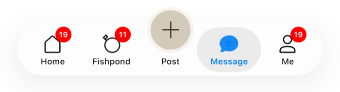 | 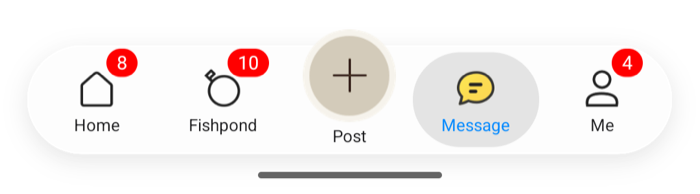 |

## [CN]目录
## [EN]Contents

<!-- navigation:start -->
<!-- Generated by scripts/update-docs-navigation.py; do not edit by hand. -->

| 中文 | English |
|:---|:---|
| [接入指南](#cn接入指南) | [Integration guides](#enintegration-guides) |
| [动效图标示例](#cn动效图标示例) | [Animated-icon demos](#enanimated-icon-demos) |
| [CYLAnimationView：页面中的动画](#cncylanimationview页面中的动画) | [CYLAnimationView: animations in a page](#encylanimationview-animations-in-a-page) |
| [工作方式](#cn工作方式) | [How it works](#enhow-it-works) |
| [在原生 App 中使用 CYLTabBarHostView](#cn在原生-app-中使用-cyltabbarhostview) | [CYLTabBarHostView in a native app](#encyltabbarhostview-in-a-native-app) |
| [限制](#cn限制) | [Limits](#enlimits) |
| [测试与截图](#cn测试与截图) | [Testing and screenshots](#entesting-and-screenshots) |

<!-- navigation:end -->

## [CN]接入指南
## [EN]Integration guides

| 指南 | Guide | 内容 / Content |
|:---|:---|:---|
| [React Native 接入](React-Native-Component.md) | [React Native integration](React-Native-Component.md) | 运行示例、添加依赖、pod install、属性与事件、常见问题。 / Running the example, the dependency, pod install, props and events, troubleshooting. |
| [Flutter 接入](Flutter-Component.md) | [Flutter integration](Flutter-Component.md) | 运行示例、`FlutterFragmentActivity`、Swift Package Manager 或 CocoaPods、字段、常见问题。 / Running the example, `FlutterFragmentActivity`, Swift Package Manager or CocoaPods, fields, troubleshooting. |

## [CN]动效图标示例
## [EN]Animated-icon demos

| 中文 | English |
|:---|:---|
| 原生示例 `Example-PAG` 与 `Example-Rive`（Rive 课程 App，界面与资源在 `Example-SwiftUI-Rive`）各有 React Native 与 Flutter 版本，共 4 个。TabBar 与原生示例一致：同样的 PAG / Rive 图标、标题、PlusButton、角标与样式切换，iOS 与 Android 都是；页面由 JS / Dart 复刻主要内容（Rive 示例含 Play / Stop），设置列表只保留样式切换等几项。 | The native demos `Example-PAG` and `Example-Rive` (the Rive course app, its screens and assets in `Example-SwiftUI-Rive`) each have a React Native and a Flutter version: 4 demos. The tab bar matches the native demo: the same PAG / Rive icons, titles, plus button, badges and style switching, on iOS and Android; JS / Dart redraws the pages' main content (Play / Stop in the Rive demos), and the settings list keeps only a few rows such as the style switch. |

| 示例 | Demo | 运行 / Run |
|:---|:---|:---|
| React Native · PAG | React Native · PAG | `cd CrossPlatform/react-native-cyltabbar && yarn && (cd example-pag/ios && LANG=en_US.UTF-8 pod install) && yarn example-pag ios`（或 / or `yarn example-pag android`） |
| React Native · Rive | React Native · Rive | 同上，把 `pag` 换成 `rive`（iOS 15.1+，React Native 的最低版本）。 / The same with `rive` instead of `pag` (iOS 15.1+, React Native's minimum). |
| Flutter · PAG | Flutter · PAG | `cd CrossPlatform/flutter_cyltabbar/example_pag && flutter run` |
| Flutter · Rive | Flutter · Rive | `cd CrossPlatform/flutter_cyltabbar/example_rive && flutter run`（iOS 15.0+） |

| 中文 | English |
|:---|:---|
| 资源不复制：iOS 工程把 `Example-PAG` / `Example-SwiftUI-Rive` 中的 `.pag`、`.riv` 与图片直接加入 App target；Android 的 `assets.srcDirs` 指向同样的文件夹，并通过 Gradle 任务使用 demokit 的 `DemoAssets.kt`（`MainActivity` 调用 `DemoAssets.install()`）。iOS 使用 CocoaPods 子库 `CYLTabBarController/PAG` 或 `/Rive`（Flutter 示例因此关闭了 Swift Package Manager）；Android 依赖 libpag 4.5.98 或 rive-android 10.3.0。Podfile 的 `post_install` 把所有 pod 的部署版本设为 15.0（React Native 为其最低版本 15.1），见 AGENTS.md「Xcode projects」。`.pag` 文件不在仓库中：先在 `Example-PAG` 中执行一次 `pod install` 下载。 | The assets are not copied: the iOS projects add the `.pag`, `.riv` and image files of `Example-PAG` / `Example-SwiftUI-Rive` to the app target; on Android `assets.srcDirs` points at the same folders, and a Gradle task brings in demokit's `DemoAssets.kt` (`MainActivity` calls `DemoAssets.install()`). iOS uses the CocoaPods subspec `CYLTabBarController/PAG` or `/Rive` (so the Flutter demos turn Swift Package Manager off); Android depends on libpag 4.5.98 or rive-android 10.3.0. The Podfile's `post_install` sets every pod's deployment target to 15.0 (React Native: its minimum, 15.1); see AGENTS.md, "Xcode projects". The `.pag` files are not in the repository: run `pod install` in `Example-PAG` once to download them. |

| 示例 | Demo | iOS | Android |
|:---|:---|:---|:---|
| React Native · PAG | React Native · PAG | 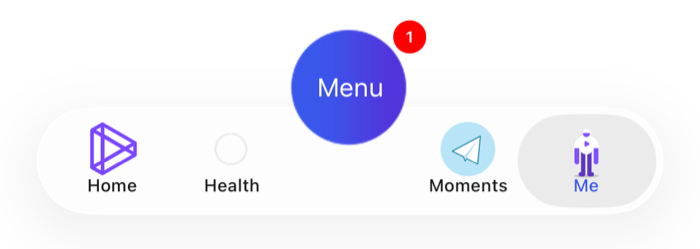 | 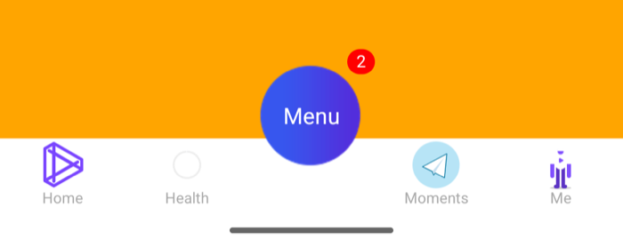 |
| Flutter · PAG | Flutter · PAG | 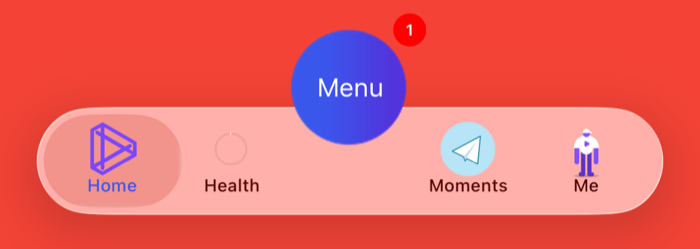 | 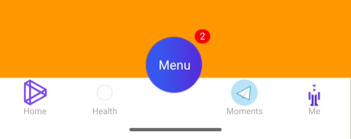 |
| React Native · Rive | React Native · Rive | 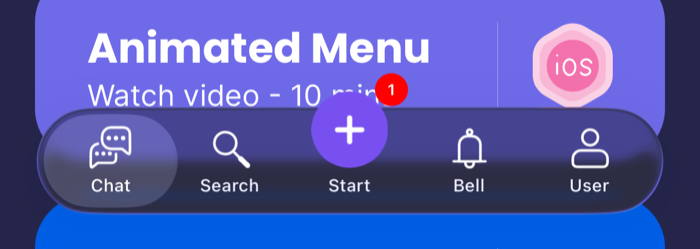 | 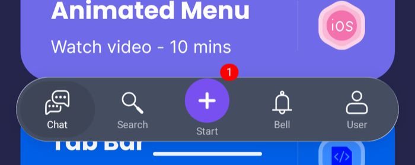 |
| Flutter · Rive | Flutter · Rive | 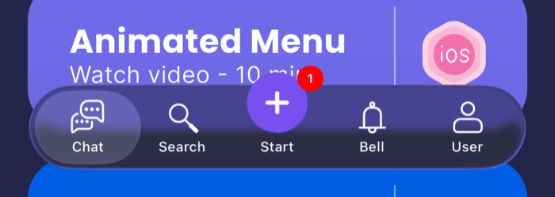 | 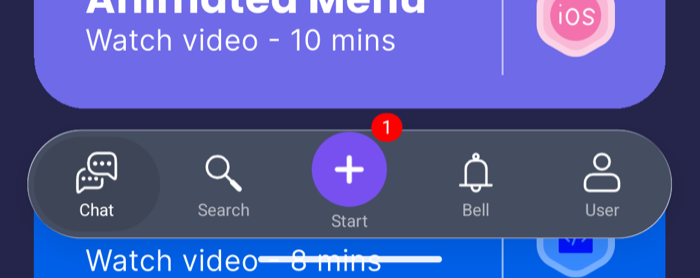 |

| 页面（React Native，iOS） | Pages (React Native, iOS) |
|:---|:---|
| PAG：PlusButton 自己的 Menu 页面 | PAG: the plus button's own Menu page |
| 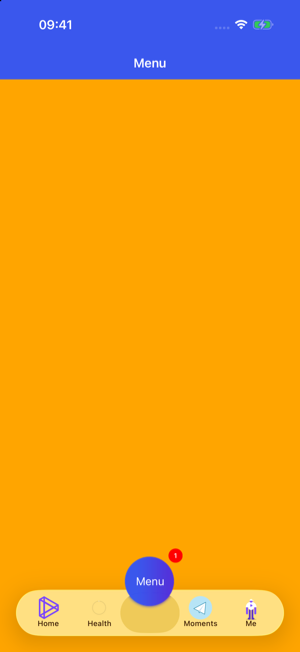 |  |
| Rive：Chat（课程卡片） | Rive: Chat (course cards) |
| 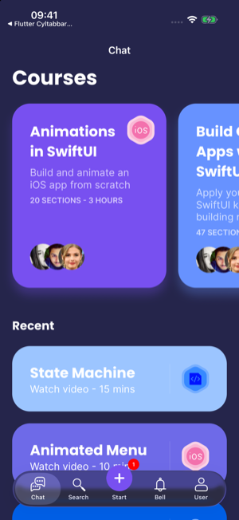 |  |
| Rive：Start（PlusButton 的页面） | Rive: Start (the plus button's page) |
| 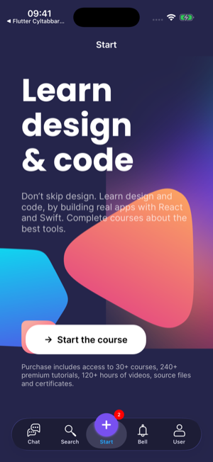 |  |
| Rive：Search | Rive: Search |
| 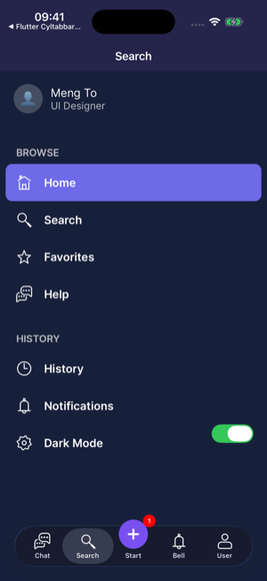 |  |
| Rive：User | Rive: User |
| 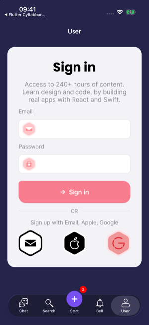 |  |

## [CN]CYLAnimationView：页面中的动画
## [EN]CYLAnimationView: animations in a page

| 中文 | English |
|:---|:---|
| 页面中的 PAG / Rive / Lottie 动画用 `CYLAnimationView`（React Native 组件、Flutter widget）播放，它使用库的动画引擎（`CYLTabBarItemAnimationFactory`），因此支持的文件与 Tab 图标相同，App 只需安装对应的子库。`file` 是文件名（iOS：App 包；Android：assets），`options` 是动画选项，`playing` 控制播放。 | `CYLAnimationView` (a React Native component, a Flutter widget) plays PAG / Rive / Lottie animations in a page through the library's animation engine (`CYLTabBarItemAnimationFactory`), so it supports the same files as tab icons and the app only installs the matching subspec. `file` is a file name (iOS: the app bundle; Android: assets), `options` the animation options, `playing` starts and stops it. |

```tsx
<CYLAnimationView file="button.riv" options={{ stateMachine: 'State Machine 1', input: 'isHover' }} playing={playing} style={{ width: 240, height: 64 }} />
```

```dart
CYLAnimationView(file: 'shapes.riv', options: {'legacy': 1}, playing: true)
```

| 中文 | English |
|:---|:---|
| 选项按名称排序后写入 URL 片段（`file#k=v&…`），Rive 选项：`artboard`、`stateMachine`、`input`、`triggerInput`、`animation`、`duration`、`legacy`。没有安装对应子库时视图为空。Android 的 Rive 由库在首次使用时初始化（`Rive.init`），App 无需调用。 | The options go into the URL fragment, sorted by name (`file#k=v&…`); Rive options: `artboard`, `stateMachine`, `input`, `triggerInput`, `animation`, `duration`, `legacy`. Without the matching subspec the view stays empty. On Android the library initializes Rive on first use (`Rive.init`): the app does not call it. |

## [CN]工作方式
## [EN]How it works

| 中文 | English |
|:---|:---|
| 组件把属性转为配置 JSON，交给 `CYLTabBarHostView`。它用 `+[CYLTabBarController tabBarControllerWithConfiguration:]`（Android：`CYLTabBarController.tabBarControllerWithConfiguration(activity, map)`）创建 TabBarController，加入最近的视图控制器 / Activity，只显示 TabBar。 | The component turns its props into configuration JSON for `CYLTabBarHostView`. The view creates the tab bar controller with `+[CYLTabBarController tabBarControllerWithConfiguration:]` (Android: `CYLTabBarController.tabBarControllerWithConfiguration(activity, map)`), adds it to the nearest view controller / activity, and shows only its bar. |
| 页面由 JS / Dart 绘制：`CYLTabBarControllerPageResolver` 为每个 Tab 返回一个透明的空页面；既没有页面 ID 也没有 identifier 的 Tab 也会得到一个。 | JS / Dart draws the pages: `CYLTabBarControllerPageResolver` returns a transparent, empty page for every tab, including a tab with neither a page ID nor an identifier. |
| 图片：URL 字符串（`require()` 的图片在调试时来自 Metro）在后台线程加载，Flutter asset 由插件的 `imageResolver` 加载，之后才在主线程创建 TabBar；名称与路径原样交给库。 | Images: URL strings (a `require()`d image comes from Metro in debug) are loaded on a background thread, Flutter assets by the plugin's `imageResolver`, and only then is the bar built on the main thread; names and paths go to the library as they are. |
| TabBar 在视图有真实宽度后才创建（宽度为 0 时布局的液态玻璃 TabBar 会截断标题）。 | The bar is built once the view has a real width (a Liquid Glass bar laid out at width 0 keeps its titles cut). |
| PlusButton 由配置键 `CYLTabBarControllerPlusButton`（字典）注册，点击回调为 `CYLTabBarControllerPlusButtonAction`。每个视图使用自己的 `CYLTabBarControllerContext`，每个 context 保留自己的 PlusButton，因此同一个 App 中可以有多个组件。 | The plus button is registered by the configuration key `CYLTabBarControllerPlusButton` (a dictionary), with `CYLTabBarControllerPlusButtonAction` for taps. Each view uses its own `CYLTabBarControllerContext`, and each context keeps its own plus button, so one app can show several components. |
| 下标（`selectedIndex`、`badgeValues`、`onTabSelect`）按配置中的 Tab 计算，不含液态玻璃下 PlusButton 的占位页面。 | Indexes (`selectedIndex`, `badgeValues`, `onTabSelect`) count the configuration's tabs, without the plus button's placeholder page on Liquid Glass. |
| 高度来自原生 TabBar（含底部安全区）；Flutter 中再加上 PlusButton 与角标高出 TabBar 的部分（`heightIncludesOverflow`），因为 Flutter 会裁剪平台视图。Android 的视图只把导航栏的 inset 传给 TabBar，不传状态栏的。TabBar 上方的区域除 PlusButton 与其角标外不接收触摸（见 `touchableRects`）。 | The height comes from the native tab bar (the bottom safe area included); in Flutter it also includes what the plus button and the badges rise above the bar (`heightIncludesOverflow`), since Flutter clips platform views. On Android the view passes the navigation bar's inset to the bar, not the status bar's. The strip above the bar stays transparent to touches, except on the plus button and its badge (see `touchableRects`). |

## [CN]在原生 App 中使用 CYLTabBarHostView
## [EN]CYLTabBarHostView in a native app

| 中文 | English |
|:---|:---|
| 自己绘制页面、只需要 TabBar 的原生 App（例如嵌入 Web 内容或游戏画面）可以直接使用它。 | A native app that draws its own pages and needs only the bar (web content, a game view...) can use it directly. |

```objc
CYLTabBarHostView *bar = [[CYLTabBarHostView alloc] initWithFrame:CGRectZero];
bar.didSelectTab = ^(NSInteger index, NSString *identifier) { [self showPageAtIndex:index]; };
bar.didTapPlusButton = ^{ [self compose]; };
bar.preferredHeightDidChange = ^(CGFloat height) { self.barHeightConstraint.constant = height; };
bar.configuration = @{
    CYLTabBarControllerTabBarItemsAttributes : @[ @{ CYLTabBarItemTitle : @"Home", CYLTabBarItemImage : @"home_normal" },
                                                  @{ CYLTabBarItemTitle : @"Me", CYLTabBarItemImage : @"system:person" } ],
    CYLTabBarControllerPlusButton : @{ CYLTabBarItemTitle : @"Post", CYLTabBarItemImage : [UIImage imageNamed:@"post_normal"] },
};
bar.badgeValues = @[ @"", @"dot" ];
```

```kotlin
val bar = CYLTabBarHostView(activity)
bar.didSelectTab = { index, identifier -> showPage(index) }
bar.setConfigurationJSON(assets.open("tabbar.json").bufferedReader().readText())
```

| API | API | 说明 / Description |
|:---|:---|:---|
| `configuration` / `setConfigurationJSON:` | `configuration` / `setConfigurationJSON` | 配置（字典或 JSON 文本），设置后重新创建 TabBar。 / The configuration (a dictionary or JSON text); setting it rebuilds the bar. |
| `imageResolver` | `imageResolver` | 在后台线程把其他图片值转为图片；返回 nil 时由视图处理。 / Turns other image values into images on a background thread; nil lets the view handle them. |
| `selectedIndex`、`badgeValues` | `selectedIndex`, `badgeValues` | 选中的 Tab（-1 由用户决定）、每个 Tab 的角标。 / The selected tab (-1: the user decides), a badge per tab. |
| `heightIncludesOverflow`、`preferredHeight`、`preferredHeightDidChange` | `heightIncludesOverflow`, `preferredHeight`, `preferredHeightDidChange` | 视图需要的高度，以及是否包含高出 TabBar 的部分。 / The height the view needs, and whether it includes what rises above the bar. |
| `touchableRects`、`touchableRectsDidChange` | `touchableRects`, `touchableRectsDidChange` | 接收触摸的部分（TabBar、PlusButton 与其角标），视图坐标（Android 为 dp）。`heightIncludesOverflow` 时 TabBar 上方的透明区域只有这些部分接收触摸，其他触摸交给下方的视图；Flutter 用它在 Dart 中做命中测试。 / The parts that take touches (the tab bar, the plus button and its badge), in the view's coordinates (dp on Android). With `heightIncludesOverflow`, only these take touches in the transparent strip above the bar, and other touches go to the views below; Flutter uses them to hit-test in Dart. |
| `didSelectTab`、`didTapPlusButton` | `didSelectTab`, `didTapPlusButton` | 点击 Tab、PlusButton；PlusButton 有自己的页面时，选中它报告 `didSelectTab(-1, identifier)`。 / A tab, the plus button was tapped; when the plus button has its own page, selecting it reports `didSelectTab(-1, identifier)`. |
| `didLongPressTab` | `didLongPressTab` | 长按 Tab（下标、identifier、标题）。 / A tab was long-pressed (index, identifier, title). |
| `loggedIn`、`didRequestLogin`、`loginStateDidChange`、`resetLoggedIn` | `loggedIn`, `didRequestLogin`, `loginStateDidChange`, `resetLoggedIn` | 登录（#19）：未登录时点击需要登录的 Tab 不选中，调用 `didRequestLogin`（下标、identifier、标题）；登录后之前设置的 `selectedIndex` 生效；退出登录时离开需要登录的 Tab 并报告 `didSelectTab`。App 未设置 `loggedIn` 时使用库缓存的状态（iOS NSUserDefaults、Android SharedPreferences），由 `loginStateDidChange` 报告；`resetLoggedIn` 恢复使用缓存。见[需要登录的 Tab](Login-Required-Tabs.md)。 / Login (#19): while logged out, a tab that needs login is not selected; `didRequestLogin` (index, identifier, title) is called. After login the `selectedIndex` set before applies; logging out leaves such a tab and reports `didSelectTab`. Until the app sets `loggedIn`, the cached state (iOS NSUserDefaults, Android SharedPreferences) is used and reported by `loginStateDidChange`; `resetLoggedIn` goes back to it. See [Tabs That Need Login](Login-Required-Tabs.md). |
| `language` | `language` | 库自身文字与布局方向使用的语言（如 `ar`、`zh-Hans`；nil / null 跟随设备）。iOS 调用 `CYLSetLocalizationLanguage()`，Android 设置 `CYLLocalization.language`；从右到左的语言使 TabBar 镜像（第一个 Tab 位于最右侧，液态玻璃气泡随之镜像）；然后重新创建 TabBar，与 Objective-C 示例重建根控制器相同。Tab 标题来自配置，请在配置中翻译。 / The language of the library's own texts and of the layout direction (e.g. `ar`, `zh-Hans`; nil / null follows the device). iOS calls `CYLSetLocalizationLanguage()`, Android sets `CYLLocalization.language`; a right-to-left language mirrors the tab bar (the first tab on the right, the Liquid Glass bubble too); then the tab bar is built again, as the Objective-C example rebuilds its root. The tab titles come from the configuration: translate them there. |
| `tabBarHidden` | `tabBarHidden` | 隐藏或显示 TabBar（带动画），所有样式都生效（iOS `-[CYLTabBarController setTabBarHidden:animated:]`，Android `setTabBarHidden`）。隐藏的 TabBar 不接收触摸：`touchableRects` 为空，触摸交给下方的页面。 / Hides or shows the tab bar, animated, in every style (iOS `-[CYLTabBarController setTabBarHidden:animated:]`, Android `setTabBarHidden`). A hidden tab bar takes no touches: `touchableRects` is empty and the page under it gets them. |
| `plusButtonBadgeValue`、`badgeAnimationType` | `plusButtonBadgeValue`, `badgeAnimationType` | PlusButton 的角标；角标动画（`scale`、`shake`、`bounce`、`breathe` 等）。 / The plus button's badge; the badge animation (`scale`, `shake`, `bounce`, `breathe`...). |
| `badgeAttributes`、`plusButtonBadgeAttributes` | `badgeAttributes`, `plusButtonBadgeAttributes` | 带样式的角标（`value`、`color`、`animation`、`radius`、`centerOffset`），每个 Tab 一个，优先于 `badgeValues`。 / Badges with a style (`value`, `color`, `animation`, `radius`, `centerOffset`), one per tab, winning over `badgeValues`. |
| 图片值 | Image values | 宿主由值（文件、asset、URL）加载的图片按原图绘制（`UIImageRenderingModeAlwaysOriginal`），与配置中的图片名或路径相同：全彩图标（例如节日皮肤）不会被画成灰色模板剪影。iOS 扁平样式下，不在导航控制器中的页面（宿主的页面）的角标显示在扁平按钮上。 / An image the host loads from a value (a file, an asset, a URL) is drawn as is (`UIImageRenderingModeAlwaysOriginal`), as an image name or a path in a configuration: full color icons (e.g. holiday skins) are no gray template silhouettes. In iOS FlatDesign, the badges of pages outside a navigation controller (the host's pages) go on the flat buttons. |
| `tabCoverImages` | `tabCoverImages` | 覆盖整个 Tab 按钮（两种状态）的图片，覆盖期间清除角标（iOS `cyl_coverVisiableTabImageViewOrTabButton:`，Android `CYLTabBarItemButton.cyl_coverView`）。 / An image covering the whole tab button in both states, its badge cleared meanwhile (iOS `cyl_coverVisiableTabImageViewOrTabButton:`, Android `CYLTabBarItemButton.cyl_coverView`). |
| delegate | delegate | 宿主是 TabBarController 的 delegate，并把未处理的 delegate 方法交给 controller，使其保留自身行为；`didSelectTab` 在每次点击 Tab 时上报（iOS 来自 `-tabBarController:didSelectControl:`）。 / The host is the tab bar controller's delegate and hands the delegate methods it does not handle to the controller, which keeps its own behavior; `didSelectTab` comes with every tap on a tab (iOS: from `-tabBarController:didSelectControl:`). |
| `tabBarController` | `tabBarController` | 创建后的 TabBarController，可调用库的其他 API。 / The tab bar controller once built, for the library's other APIs. |
| Android：`activityProvider` | Android: `activityProvider` | 承载 Fragment 的 Activity，默认为视图 context 中的 `FragmentActivity`。 / The activity that hosts the fragments; by default the `FragmentActivity` of the view's context. |

## [CN]限制
## [EN]Limits

| 中文 | English |
|:---|:---|
| 原生页面中不能放 React Native / Flutter 内容：组件只提供 TabBar。 | The native pages cannot hold React Native / Flutter content: the components provide the bar only. |
| 透明区域：Flutter 与 Android 上的 React Native 组件包含 TabBar 上方的透明区域（PlusButton 与角标所在）。只有 PlusButton 与角标接收那里的触摸，其他触摸交给下方的视图：Android 的宿主视图不接收这些触摸，React Native 组件为 `box-none`，Flutter 在 Dart 中按 `touchableRects` 命中测试。 | The transparent strip: Flutter, and React Native on Android, include the strip above the bar (where the plus button and the badges rise). Only the plus button and its badge take touches there; other touches go to the views below: the Android host view does not take them, the React Native component is `box-none`, and Flutter hit-tests `touchableRects` in Dart. |
| `CYLTabBarControllerUserInterfaceStyle` 只在 iOS 生效，Android 跟随系统。 | `CYLTabBarControllerUserInterfaceStyle` works on iOS only; Android follows the system. |
| 发布版（R8）：组件在本仓库中直接编译 Android 库源码，因此封装层通过 `consumerProguardFiles` 带上库的 `consumer-rules.pro`（反射使用的 libpag、Rive、Lottie 类）。 | Release builds (R8): inside this repository the components compile the Android library's sources, so the wrappers bring the library's `consumer-rules.pro` along with `consumerProguardFiles` (the libpag, Rive and Lottie classes used by reflection). |
| 组件库尚未发布到 npm / pub.dev。 | The components are not published to npm / pub.dev yet. |

## [CN]测试与截图
## [EN]Testing and screenshots

| 中文 | English |
|:---|:---|
| 六个示例（基础、PAG、Rive，各有 React Native 与 Flutter 版本）各在 iOS 与 Android 上运行，在 iPhone 17 Pro 模拟器（iOS 26.5）与 Android 模拟器（API 35，arm64）上逐项验证：点击每个 Tab、PlusButton 与它的页面、角标递增、长按、样式切换、Rive 的 Play / Stop。单元测试：iOS `CYLTabBarHostViewTests`（17 个：透明区域的触摸与 `touchableRects`、PlusButton 键与每个 context 独立、新的 PlusButton 键与顶层键、Protobuf / JSON / 文本格式中的 PlusButton、宿主视图的创建、下标、PlusButton 页面、长按、角标、图片加载、高度）；Android `CYLTabBarHostViewTest`（14 个：另含配置的标题颜色、角标位置、透明区域）；Flutter `cyl_touch_regions_test.dart`。透明区域在 iOS 与 Android 上都实际点击验证：区域中的点击交给下方页面，PlusButton 伸入区域的部分可以点击。React Native Android 的 debug 版通过 `adb reverse tcp:8081 tcp:8081` 连接 Metro；Flutter 的 PAG 与 Rive 示例另以开启 R8 的发布版验证。没有在真机上运行。 | Six examples (basic, PAG and Rive, each in React Native and Flutter), each on iOS and Android, were checked one by one on an iPhone 17 Pro simulator (iOS 26.5) and an Android emulator (API 35, arm64): every tab, the plus button and its page, the badge counting up, long press, style switching, Rive's Play / Stop. Unit tests: iOS `CYLTabBarHostViewTests` (17: touches in the transparent strip and `touchableRects`, the plus button key and one per context, the new plus button and top-level keys, the plus button in Protobuf / JSON / text format, building the host view, indexes, the plus button's page, long press, badges, image loading, height); Android `CYLTabBarHostViewTest` (14: also the configured title color, the badge position, the strip); Flutter `cyl_touch_regions_test.dart`. The strip was tapped on iOS and Android: a tap in it reaches the page below, and the plus button's part in it can be tapped. React Native Android debug builds reach Metro through `adb reverse tcp:8081 tcp:8081`; the Flutter PAG and Rive demos were also checked as R8-minified release builds. Not run on a device. |
