# [CN]React Native 与 Flutter 组件
# [EN]React Native and Flutter components

<!-- bound-classes: CYLTabBarHostView -->
<!-- binding:start -->
<!-- Generated by scripts/update-docs-navigation.py; do not edit by hand. -->

| 中文 | English |
|:---|:---|
| 绑定的代码类 `CYLTabBarHostView`：[`CYLTabBarController/CYLTabBarHostView.h`](../CYLTabBarController/CYLTabBarHostView.h) | Bound to the class `CYLTabBarHostView`: [`CYLTabBarController/CYLTabBarHostView.h`](../CYLTabBarController/CYLTabBarHostView.h) |

<!-- binding:end -->

| 中文 | English |
|:---|:---|
| `CrossPlatform/` 中有两个组件库，把 CYLTabBarController（iOS）与它的 Android 版本封装为 React Native 组件和 Flutter widget：`react-native-cyltabbar` 与 `flutter_cyltabbar`。两者都用[配置文件](Configuration-File.md)的键描述 TabBar，iOS 与 Android 共用同一份配置。它们都是库中 `CYLTabBarHostView`（iOS 与 Android 各一个）的薄封装，这个视图也可以在原生 App 中直接使用。每个组件库都带一个示例 App，示例直接引用本仓库中的 iOS 与 Android 库源码，修改库代码后重新运行示例即可调试。 | `CrossPlatform/` holds two component libraries that wrap CYLTabBarController (iOS) and its Android port as a React Native component and a Flutter widget: `react-native-cyltabbar` and `flutter_cyltabbar`. Both describe the tab bar with the keys of [the configuration file](Configuration-File.md), so iOS and Android share one configuration. Both are thin wrappers around the library's `CYLTabBarHostView` (one on iOS, one on Android), which native apps can use directly too. Each library comes with an example app that uses the iOS and Android library sources of this repository: change the library, run the example again, and debug it. |

| React Native（iOS） | Flutter（Android） |
|:---|:---|
| 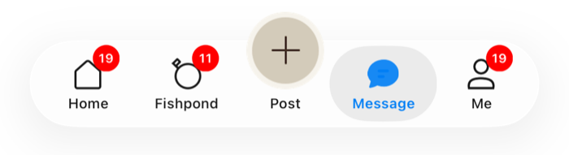 | 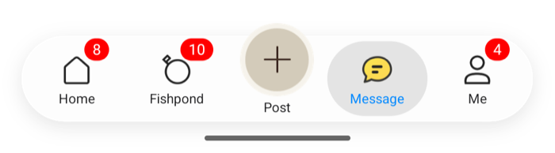 |

## [CN]目录
## [EN]Contents

<!-- navigation:start -->
<!-- Generated by scripts/update-docs-navigation.py; do not edit by hand. -->

| 中文 | English |
|:---|:---|
| [接入指南](#cn接入指南) | [Integration guides](#enintegration-guides) |
| [动效图标示例](#cn动效图标示例) | [Animated-icon demos](#enanimated-icon-demos) |
| [在 App 中使用 SVGA 图标（React Native、Flutter）](#cn在-app-中使用-svga-图标react-nativeflutter) | [SVGA tab icons in your app (React Native, Flutter)](#ensvga-tab-icons-in-your-app-react-native-flutter) |
| [CYLAnimationView：页面中的动画](#cncylanimationview页面中的动画) | [CYLAnimationView: animations in a page](#encylanimationview-animations-in-a-page) |
| [工作方式](#cn工作方式) | [How it works](#enhow-it-works) |
| [在原生 App 中使用 CYLTabBarHostView](#cn在原生-app-中使用-cyltabbarhostview) | [CYLTabBarHostView in a native app](#encyltabbarhostview-in-a-native-app) |
| [限制](#cn限制) | [Limits](#enlimits) |
| [测试与截图](#cn测试与截图) | [Testing and screenshots](#entesting-and-screenshots) |
| [任务记录](#任务记录--task-log) | [Task log](#任务记录--task-log) |

<!-- navigation:end -->

## [CN]接入指南
## [EN]Integration guides

| 指南 | Guide | 内容 / Content |
|:---|:---|:---|
| [React Native 接入](React-Native-Component.md) | [React Native integration](React-Native-Component.md) | 运行示例、添加依赖、pod install、属性与事件、常见问题。 / Running the example, the dependency, pod install, props and events, troubleshooting. |
| [Flutter 接入](Flutter-Component.md) | [Flutter integration](Flutter-Component.md) | 运行示例、`FlutterFragmentActivity`、Swift Package Manager 或 CocoaPods、字段、常见问题。 / Running the example, `FlutterFragmentActivity`, Swift Package Manager or CocoaPods, fields, troubleshooting. |
| [微信小程序版](WeChat-Mini-Program.md) | [WeChat Mini Program](WeChat-Mini-Program.md) | `cyl-tab-bar` 组件（纯小程序实现，读取相同的配置键）、示例、评分与待办。 / The `cyl-tab-bar` component (pure mini program code reading the same configuration keys), the example, the score and the TODO list. |
| [鸿蒙版（开发中）](HarmonyOS-Parity.md) | [HarmonyOS (in progress)](HarmonyOS-Parity.md) | 鸿蒙系统版本（HarmonyOS 6.0.1，API 21）、iOS 公开 API 表与 iOS Example 演示表（第二列为鸿蒙实现，默认 TODO），两表合并实时打分。 / The HarmonyOS version (HarmonyOS 6.0.1, API 21), the table of iOS public APIs and the table of iOS Example demos (second column: the HarmonyOS implementation, TODO by default), scored together live. |

## [CN]动效图标示例
## [EN]Animated-icon demos

| 中文 | English |
|:---|:---|
| 原生示例 `Example-PAG` 与 `Example-Rive`（Rive 课程 App，界面与资源在 `Example-SwiftUI-Rive`）各有 React Native 与 Flutter 版本，共 4 个。TabBar 与原生示例一致：同样的 PAG / Rive 图标、标题、PlusButton、角标与样式切换，iOS 与 Android 都是；页面由 JS / Dart 复刻主要内容（Rive 示例含 Play / Stop），设置列表只保留样式切换等几项。 | The native demos `Example-PAG` and `Example-Rive` (the Rive course app, its screens and assets in `Example-SwiftUI-Rive`) each have a React Native and a Flutter version: 4 demos. The tab bar matches the native demo: the same PAG / Rive icons, titles, plus button, badges and style switching, on iOS and Android; JS / Dart redraws the pages' main content (Play / Stop in the Rive demos), and the settings list keeps only a few rows such as the style switch. |

| 示例 | Demo | 运行 / Run |
|:---|:---|:---|
| React Native · PAG | React Native · PAG | `cd CrossPlatform/react-native-cyltabbar && yarn && (cd example-pag/ios && LANG=en_US.UTF-8 pod install) && yarn example-pag ios`（或 / or `yarn example-pag android`） |
| React Native · Rive | React Native · Rive | 同上，把 `pag` 换成 `rive`（iOS 15.1+，React Native 的最低版本）。 / The same with `rive` instead of `pag` (iOS 15.1+, React Native's minimum). |
| Flutter · PAG | Flutter · PAG | `cd CrossPlatform/flutter_cyltabbar/example_pag && flutter run` |
| Flutter · Rive | Flutter · Rive | `cd CrossPlatform/flutter_cyltabbar/example_rive && flutter run`（iOS 15.0+） |

| 中文 | English |
|:---|:---|
| 资源不复制：iOS 工程把 `Example-PAG` / `Example-SwiftUI-Rive` 中的 `.pag`、`.riv` 与图片直接加入 App target；Android 的 `assets.srcDirs` 指向同样的文件夹，并通过 Gradle 任务使用 demokit 的 `DemoAssets.kt`（`MainActivity` 调用 `DemoAssets.install()`）。iOS 使用 CocoaPods 子库 `CYLTabBarController/PAG` 或 `/Rive`（Flutter 示例因此关闭了 Swift Package Manager）；Android 依赖 libpag 4.5.98 或 rive-android 10.3.0。Podfile 的 `post_install` 把所有 pod 的部署版本设为 15.0（React Native 为其最低版本 15.1），见 AGENTS.md「Xcode projects」。`.pag` 文件不在仓库中：先在 `Example-PAG` 中执行一次 `pod install` 下载。 | The assets are not copied: the iOS projects add the `.pag`, `.riv` and image files of `Example-PAG` / `Example-SwiftUI-Rive` to the app target; on Android `assets.srcDirs` points at the same folders, and a Gradle task brings in demokit's `DemoAssets.kt` (`MainActivity` calls `DemoAssets.install()`). iOS uses the CocoaPods subspec `CYLTabBarController/PAG` or `/Rive` (so the Flutter demos turn Swift Package Manager off); Android depends on libpag 4.5.98 or rive-android 10.3.0. The Podfile's `post_install` sets every pod's deployment target to 15.0 (React Native: its minimum, 15.1); see AGENTS.md, "Xcode projects". The `.pag` files are not in the repository: run `pod install` in `Example-PAG` once to download them. |

| 示例 | Demo | iOS | Android |
|:---|:---|:---|:---|
| React Native · PAG | React Native · PAG | 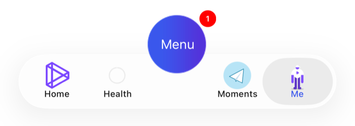 | 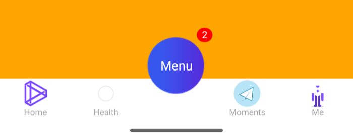 |
| Flutter · PAG | Flutter · PAG | 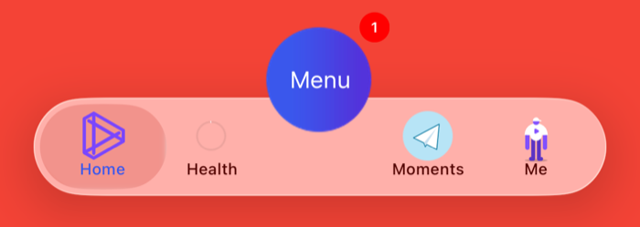 | 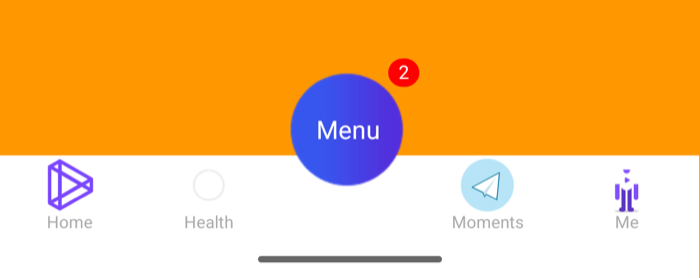 |
| React Native · Rive | React Native · Rive | 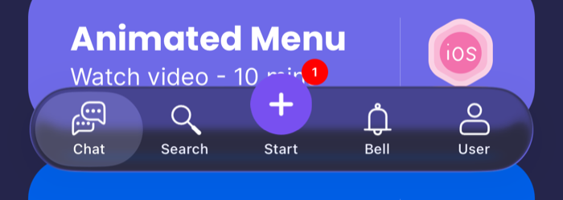 | 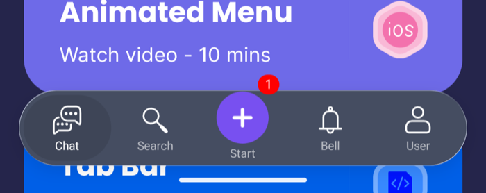 |
| Flutter · Rive | Flutter · Rive | 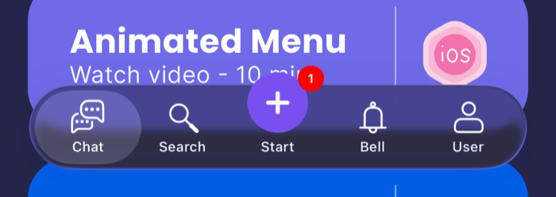 | 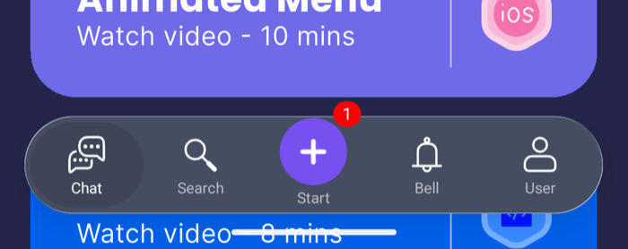 |

| 页面（React Native，iOS） | Pages (React Native, iOS) |
|:---|:---|
| PAG：PlusButton 自己的 Menu 页面 | PAG: the plus button's own Menu page |
| 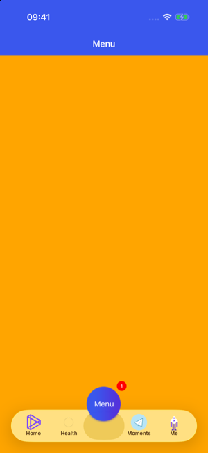 |  |
| Rive：Chat（课程卡片） | Rive: Chat (course cards) |
| 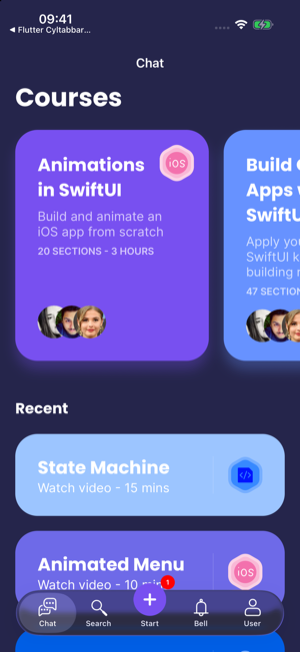 |  |
| Rive：Start（PlusButton 的页面） | Rive: Start (the plus button's page) |
| 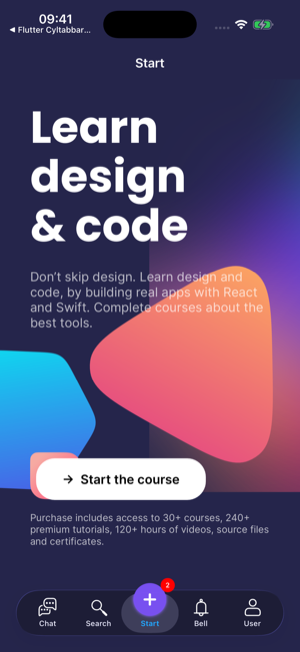 |  |
| Rive：Search | Rive: Search |
| 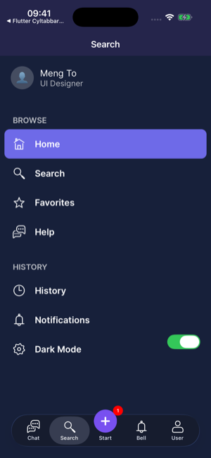 |  |
| Rive：User | Rive: User |
| 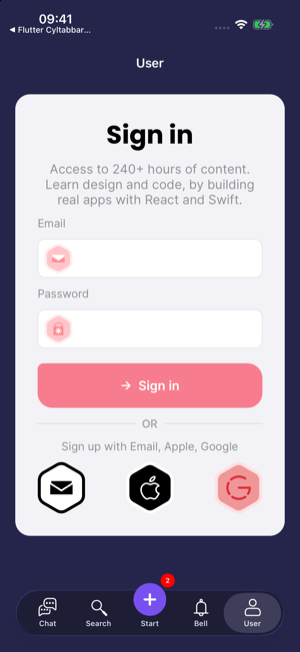 |  |

## [CN]在 App 中使用 SVGA 图标（React Native、Flutter）
## [EN]SVGA tab icons in your app (React Native, Flutter)

| 中文 | English |
|:---|:---|
| React Native 与 Flutter 组件已支持 SVGA Tab 图标（2026-11-16，96c8efc、5682b9e、2707d5a、8feac32）：组件把 Tab 属性原样交给原生库，SVGA 由原生库的 SVGA 播放器播放。组件本身不带 SVGA 播放器，因为它较大且多数 App 不需要：App 按下表加入即可，与 PAG / Rive 相同。完整示例：`react-native-cyltabbar/example-rive`、`flutter_cyltabbar/example_rive`（Bell 页面的「Tab 图标来源」）。 | The React Native and Flutter components support SVGA tab icons (2026-11-16, 96c8efc, 5682b9e, 2707d5a, 8feac32): they pass the tab attributes to the native library unchanged, and its SVGA player plays them. The components do not bundle an SVGA player, which is large and which most apps do not need: an app adds it as below, as for PAG and Rive. Complete examples: `react-native-cyltabbar/example-rive` and `flutter_cyltabbar/example_rive` ("Tab icon source" on the Bell page). |

| 步骤 / Step | iOS | Android |
|:---|:---|:---|
| 1. 播放器 / The player | Podfile：`pod 'CYLTabBarController/SVGA'`；静态库（React Native 默认、Flutter `use_frameworks! :linkage => :static`）还需 `pod 'SVGAPlayer', :modular_headers => true` 与 `pod 'Protobuf', :modular_headers => true`。 / Podfile: `pod 'CYLTabBarController/SVGA'`; with static libraries (React Native's default, Flutter's `use_frameworks! :linkage => :static`) also `pod 'SVGAPlayer', :modular_headers => true` and `pod 'Protobuf', :modular_headers => true`. | `implementation "com.github.yyued:SVGAPlayer-Android:2.6.1"`，仓库加入 `maven { url "https://jitpack.io" }`（只用于 `com.github.yyued`）；`AndroidManifest.xml` 的 `<application>` 加 `tools:replace="android:allowBackup,android:label"`（该库的清单声明了这两项）。 / `implementation "com.github.yyued:SVGAPlayer-Android:2.6.1"` with `maven { url "https://jitpack.io" }` (for `com.github.yyued` only); `tools:replace="android:allowBackup,android:label"` on `<application>` in `AndroidManifest.xml` (the library's manifest declares both). |
| 2. 文件 / The files | `.svga` 文件加入 App target（main bundle）。 / Add the `.svga` files to the app target (main bundle). | `.svga` 文件放入 assets（或 `assets.srcDir`）。 / Put the `.svga` files into the assets (or an `assets.srcDir`). |
| 3. Tab 属性 / Tab attributes | `items` 中每个 Tab：`CYLTabBarSVGAFilePath: 'tab_chat.svga'`（或网络地址 `CYLTabBarSVGAURL`）与 `CYLTabBarSVGASize: '{32, 32}'`；深色模式可另给 `CYLTabBarSVGADarkFilePath` / `CYLTabBarSVGADarkURL`。 / Per tab in `items`: `CYLTabBarSVGAFilePath: 'tab_chat.svga'` (or a network address in `CYLTabBarSVGAURL`) and `CYLTabBarSVGASize: '{32, 32}'`; dark mode may add `CYLTabBarSVGADarkFilePath` / `CYLTabBarSVGADarkURL`. | 同左。 / The same. |
| 4. 或配置文件 / Or a configuration file | `configurationRoute: 'bundle:svga?name=cyl_tabbar_configuration_svga'`，文件中用同样的键；不传 `items` 时 Tab 来自文件。 / `configurationRoute: 'bundle:svga?name=cyl_tabbar_configuration_svga'`, the same keys in the file; without `items` the tabs come from the file. | 同左（assets 中的 `svga/` 目录）。 / The same (an `svga/` folder in the assets). |
| 页面中的 SVGA / SVGA in a page | `<CYLAnimationView file="tab_home.svga" playing />`（React Native）、`CYLAnimationView(file: 'tab_home.svga', playing: true)`（Flutter）。 | 同左。 / The same. |
| 鸿蒙 / HarmonyOS | `HarmonyOS/cyltabbar`（ArkTS）：`CYLTabBarItem.svgaFilePath`（rawfile 路径）/ `svgaURL` / `svgaSize`，见 [HarmonyOS/README.md](../HarmonyOS/README.md)；可编译，尚未在设备上运行。 / `HarmonyOS/cyltabbar` (ArkTS): `CYLTabBarItem.svgaFilePath` (a rawfile path) / `svgaURL` / `svgaSize`, see [HarmonyOS/README.md](../HarmonyOS/README.md); it builds, not run on a device yet. | — |
| 微信小程序 / WeChat Mini Program | 已支持（2026-11-16）：安装 [`svga-miniprogram`](../CrossPlatform/svga-miniprogram)（`cyl-svga` 组件，为小程序 2D 画布编写的 SVGA 2.x 播放器），`<cyl-tab-bar generic:cyl-svga-view="cyl-svga">`；Tab 属性同上；包内文件需命名为 `.svga.bin`。示例：`npm run setup -- --animation=svga`。 / Supported (2026-11-16): install [`svga-miniprogram`](../CrossPlatform/svga-miniprogram) (the `cyl-svga` component, an SVGA 2.x player written for the mini program 2D canvas), `<cyl-tab-bar generic:cyl-svga-view="cyl-svga">`; the same tab attributes; package copies are named `.svga.bin`. Example: `npm run setup -- --animation=svga`. | — |

## [CN]CYLAnimationView：页面中的动画
## [EN]CYLAnimationView: animations in a page

| 中文 | English |
|:---|:---|
| 页面中的 PAG / Rive / Lottie 动画用 `CYLAnimationView`（React Native 组件、Flutter widget）播放，它使用库的动画引擎（`CYLTabBarItemAnimationFactory`），因此支持的文件与 Tab 图标相同，App 只需安装对应的子库。`file` 是文件名（iOS：App 包；Android：assets），`options` 是动画选项，`playing` 控制播放。 | `CYLAnimationView` (a React Native component, a Flutter widget) plays PAG / Rive / Lottie animations in a page through the library's animation engine (`CYLTabBarItemAnimationFactory`), so it supports the same files as tab icons and the app only installs the matching subspec. `file` is a file name (iOS: the app bundle; Android: assets), `options` the animation options, `playing` starts and stops it. |

```tsx
<CYLAnimationView file="button.riv" options={{ stateMachine: 'State Machine 1', input: 'isHover' }} playing={playing} style={{ width: 240, height: 64 }} />
```

```dart
CYLAnimationView(file: 'shapes.riv', options: {'legacy': 1}, playing: true)
```

| 中文 | English |
|:---|:---|
| 选项按名称排序后写入 URL 片段（`file#k=v&…`），Rive 选项：`artboard`、`stateMachine`、`input`、`triggerInput`、`animation`、`duration`、`legacy`。没有安装对应子库时视图为空。Android 的 Rive 由库在首次使用时初始化（`Rive.init`），App 无需调用。 | The options go into the URL fragment, sorted by name (`file#k=v&…`); Rive options: `artboard`, `stateMachine`, `input`, `triggerInput`, `animation`, `duration`, `legacy`. Without the matching subspec the view stays empty. On Android the library initializes Rive on first use (`Rive.init`): the app does not call it. |

## [CN]工作方式
## [EN]How it works

| 中文 | English |
|:---|:---|
| 组件把属性转为配置 JSON，交给 `CYLTabBarHostView`。它用 `+[CYLTabBarController tabBarControllerWithConfiguration:]`（Android：`CYLTabBarController.tabBarControllerWithConfiguration(activity, map)`）创建 TabBarController，加入最近的视图控制器 / Activity，只显示 TabBar。 | The component turns its props into configuration JSON for `CYLTabBarHostView`. The view creates the tab bar controller with `+[CYLTabBarController tabBarControllerWithConfiguration:]` (Android: `CYLTabBarController.tabBarControllerWithConfiguration(activity, map)`), adds it to the nearest view controller / activity, and shows only its bar. |
| 页面由 JS / Dart 绘制：`CYLTabBarControllerPageResolver` 为每个 Tab 返回一个透明的空页面；既没有页面 ID 也没有 identifier 的 Tab 也会得到一个。 | JS / Dart draws the pages: `CYLTabBarControllerPageResolver` returns a transparent, empty page for every tab, including a tab with neither a page ID nor an identifier. |
| 图片：URL 字符串（`require()` 的图片在调试时来自 Metro）在后台线程加载，Flutter asset 由插件的 `imageResolver` 加载，之后才在主线程创建 TabBar；名称与路径原样交给库。 | Images: URL strings (a `require()`d image comes from Metro in debug) are loaded on a background thread, Flutter assets by the plugin's `imageResolver`, and only then is the bar built on the main thread; names and paths go to the library as they are. |
| TabBar 在视图有真实宽度后才创建（宽度为 0 时布局的液态玻璃 TabBar 会截断标题）。 | The bar is built once the view has a real width (a Liquid Glass bar laid out at width 0 keeps its titles cut). |
| PlusButton 由配置键 `CYLTabBarControllerPlusButton`（字典）注册，点击回调为 `CYLTabBarControllerPlusButtonAction`。每个视图使用自己的 `CYLTabBarControllerContext`，每个 context 保留自己的 PlusButton，因此同一个 App 中可以有多个组件。 | The plus button is registered by the configuration key `CYLTabBarControllerPlusButton` (a dictionary), with `CYLTabBarControllerPlusButtonAction` for taps. Each view uses its own `CYLTabBarControllerContext`, and each context keeps its own plus button, so one app can show several components. |
| 下标（`selectedIndex`、`badgeValues`、`onTabSelect`）按配置中的 Tab 计算，不含液态玻璃下 PlusButton 的占位页面。 | Indexes (`selectedIndex`, `badgeValues`, `onTabSelect`) count the configuration's tabs, without the plus button's placeholder page on Liquid Glass. |
| 高度来自原生 TabBar（含底部安全区）；Flutter 中再加上 PlusButton 与角标高出 TabBar 的部分（`heightIncludesOverflow`），因为 Flutter 会裁剪平台视图。Android 的视图只把导航栏的 inset 传给 TabBar，不传状态栏的。TabBar 上方的区域除 PlusButton 与其角标外不接收触摸（见 `touchableRects`）。 | The height comes from the native tab bar (the bottom safe area included); in Flutter it also includes what the plus button and the badges rise above the bar (`heightIncludesOverflow`), since Flutter clips platform views. On Android the view passes the navigation bar's inset to the bar, not the status bar's. The strip above the bar stays transparent to touches, except on the plus button and its badge (see `touchableRects`). |

## [CN]在原生 App 中使用 CYLTabBarHostView
## [EN]CYLTabBarHostView in a native app

| 中文 | English |
|:---|:---|
| 自己绘制页面、只需要 TabBar 的原生 App（例如嵌入 Web 内容或游戏画面）可以直接使用它。 | A native app that draws its own pages and needs only the bar (web content, a game view...) can use it directly. |

```objc
CYLTabBarHostView *bar = [[CYLTabBarHostView alloc] initWithFrame:CGRectZero];
bar.didSelectTab = ^(NSInteger index, NSString *identifier) { [self showPageAtIndex:index]; };
bar.didTapPlusButton = ^{ [self compose]; };
bar.preferredHeightDidChange = ^(CGFloat height) { self.barHeightConstraint.constant = height; };
bar.configuration = @{
    CYLTabBarControllerTabBarItemsAttributes : @[ @{ CYLTabBarItemTitle : @"Home", CYLTabBarItemImage : @"home_normal" },
                                                  @{ CYLTabBarItemTitle : @"Me", CYLTabBarItemImage : @"system:person" } ],
    CYLTabBarControllerPlusButton : @{ CYLTabBarItemTitle : @"Post", CYLTabBarItemImage : [UIImage imageNamed:@"post_normal"] },
};
bar.badgeValues = @[ @"", @"dot" ];
```

```kotlin
val bar = CYLTabBarHostView(activity)
bar.didSelectTab = { index, identifier -> showPage(index) }
bar.setConfigurationJSON(assets.open("tabbar.json").bufferedReader().readText())
```

| API | API | 说明 / Description |
|:---|:---|:---|
| `configuration` / `setConfigurationJSON:` | `configuration` / `setConfigurationJSON` | 配置（字典或 JSON 文本），设置后重新创建 TabBar。 / The configuration (a dictionary or JSON text); setting it rebuilds the bar. |
| `imageResolver` | `imageResolver` | 在后台线程把其他图片值转为图片；返回 nil 时由视图处理。 / Turns other image values into images on a background thread; nil lets the view handle them. |
| `selectedIndex`、`badgeValues` | `selectedIndex`, `badgeValues` | 选中的 Tab（-1 由用户决定）、每个 Tab 的角标。 / The selected tab (-1: the user decides), a badge per tab. |
| `heightIncludesOverflow`、`preferredHeight`、`preferredHeightDidChange` | `heightIncludesOverflow`, `preferredHeight`, `preferredHeightDidChange` | 视图需要的高度，以及是否包含高出 TabBar 的部分。 / The height the view needs, and whether it includes what rises above the bar. |
| `touchableRects`、`touchableRectsDidChange` | `touchableRects`, `touchableRectsDidChange` | 接收触摸的部分（TabBar、PlusButton 与其角标），视图坐标（Android 为 dp）。`heightIncludesOverflow` 时 TabBar 上方的透明区域只有这些部分接收触摸，其他触摸交给下方的视图；Flutter 用它在 Dart 中做命中测试。 / The parts that take touches (the tab bar, the plus button and its badge), in the view's coordinates (dp on Android). With `heightIncludesOverflow`, only these take touches in the transparent strip above the bar, and other touches go to the views below; Flutter uses them to hit-test in Dart. |
| `didSelectTab`、`didTapPlusButton` | `didSelectTab`, `didTapPlusButton` | 点击 Tab、PlusButton；PlusButton 有自己的页面时，选中它报告 `didSelectTab(-1, identifier)`。 / A tab, the plus button was tapped; when the plus button has its own page, selecting it reports `didSelectTab(-1, identifier)`. |
| `didLongPressTab` | `didLongPressTab` | 长按 Tab（下标、identifier、标题）。 / A tab was long-pressed (index, identifier, title). |
| `loggedIn`、`didRequestLogin`、`loginStateDidChange`、`resetLoggedIn` | `loggedIn`, `didRequestLogin`, `loginStateDidChange`, `resetLoggedIn` | 登录（#19）：未登录时点击需要登录的 Tab 不选中，调用 `didRequestLogin`（下标、identifier、标题）；登录后之前设置的 `selectedIndex` 生效；退出登录时离开需要登录的 Tab 并报告 `didSelectTab`。App 未设置 `loggedIn` 时使用库缓存的状态（iOS NSUserDefaults、Android SharedPreferences），由 `loginStateDidChange` 报告；`resetLoggedIn` 恢复使用缓存。见[需要登录的 Tab](Login-Required-Tabs.md)。 / Login (#19): while logged out, a tab that needs login is not selected; `didRequestLogin` (index, identifier, title) is called. After login the `selectedIndex` set before applies; logging out leaves such a tab and reports `didSelectTab`. Until the app sets `loggedIn`, the cached state (iOS NSUserDefaults, Android SharedPreferences) is used and reported by `loginStateDidChange`; `resetLoggedIn` goes back to it. See [Tabs That Need Login](Login-Required-Tabs.md). |
| `language` | `language` | 库自身文字与布局方向使用的语言（如 `ar`、`zh-Hans`；nil / null 跟随设备）。iOS 调用 `CYLSetLocalizationLanguage()`，Android 设置 `CYLLocalization.language`；从右到左的语言使 TabBar 镜像（第一个 Tab 位于最右侧，液态玻璃气泡随之镜像）；然后重新创建 TabBar，与 Objective-C 示例重建根控制器相同。Tab 标题来自配置，请在配置中翻译。 / The language of the library's own texts and of the layout direction (e.g. `ar`, `zh-Hans`; nil / null follows the device). iOS calls `CYLSetLocalizationLanguage()`, Android sets `CYLLocalization.language`; a right-to-left language mirrors the tab bar (the first tab on the right, the Liquid Glass bubble too); then the tab bar is built again, as the Objective-C example rebuilds its root. The tab titles come from the configuration: translate them there. |
| `tabBarHidden` | `tabBarHidden` | 隐藏或显示 TabBar（带动画），所有样式都生效（iOS `-[CYLTabBarController setTabBarHidden:animated:]`，Android `setTabBarHidden`）。隐藏的 TabBar 不接收触摸：`touchableRects` 为空，触摸交给下方的页面。 / Hides or shows the tab bar, animated, in every style (iOS `-[CYLTabBarController setTabBarHidden:animated:]`, Android `setTabBarHidden`). A hidden tab bar takes no touches: `touchableRects` is empty and the page under it gets them. |
| `simulateMemoryWarning` | `simulateMemoryWarning` | 模拟内存警告（`CYLSimulateMemoryWarningReport()`，issue #426），返回每个 Tab 的结果，每个 Tab 一行，使用库的语言。卸载哪些 Tab 由配置决定：`CYLTabBarControllerUnloadsUnselectedViewsOnMemoryWarning`、`CYLTabBarControllerKeepsLoadedTabBarItemIdentifiers`。宿主在创建 TabBar 时创建所有（空白的）页面，因此从未选中的 Tab 显示「已卸载」。 / Simulates a memory warning (`CYLSimulateMemoryWarningReport()`, issue #426) and returns what happened to each tab, one line per tab, in the library's language. The configuration decides what is unloaded: `CYLTabBarControllerUnloadsUnselectedViewsOnMemoryWarning`, `CYLTabBarControllerKeepsLoadedTabBarItemIdentifiers`. The host creates every (empty) page when it builds the tab bar, so a tab never selected reads "unloaded". |
| `titlePositionAdjustment` | `titlePositionAdjustment` | 所有 Tab 的标题偏移，运行时设置（iOS `-[CYLTabBarController setTitlePositionAdjustment:]`，Android `titlePositionAdjustment`），不重新创建 TabBar，优先于配置中的 `CYLTabBarControllerTitlePositionAdjustment`；重新创建的 TabBar 保留它；对齐标题的 PlusButton 随之移动。nil / null 使用配置中的值。 / The title offset of every tab, set at runtime (iOS `-[CYLTabBarController setTitlePositionAdjustment:]`, Android `titlePositionAdjustment`) without building the tab bar again, winning over the configuration's `CYLTabBarControllerTitlePositionAdjustment`; a tab bar built again keeps it; a plus button that aligns its title follows. nil / null keeps the configuration's. |
| `plusButtonBadgeValue`、`badgeAnimationType` | `plusButtonBadgeValue`, `badgeAnimationType` | PlusButton 的角标；角标动画（`scale`、`shake`、`bounce`、`breathe` 等）。 / The plus button's badge; the badge animation (`scale`, `shake`, `bounce`, `breathe`...). |
| `badgeAttributes`、`plusButtonBadgeAttributes` | `badgeAttributes`, `plusButtonBadgeAttributes` | 带样式的角标（`value`、`color`、`animation`、`radius`、`centerOffset`），每个 Tab 一个，优先于 `badgeValues`。 / Badges with a style (`value`, `color`, `animation`, `radius`, `centerOffset`), one per tab, winning over `badgeValues`. |
| 图片值 | Image values | 宿主由值（文件、asset、URL）加载的图片按原图绘制（`UIImageRenderingModeAlwaysOriginal`），与配置中的图片名或路径相同：全彩图标（例如节日皮肤）不会被画成灰色模板剪影。iOS 扁平样式下，不在导航控制器中的页面（宿主的页面）的角标显示在扁平按钮上。 / An image the host loads from a value (a file, an asset, a URL) is drawn as is (`UIImageRenderingModeAlwaysOriginal`), as an image name or a path in a configuration: full color icons (e.g. holiday skins) are no gray template silhouettes. In iOS FlatDesign, the badges of pages outside a navigation controller (the host's pages) go on the flat buttons. |
| `tabCoverImages` | `tabCoverImages` | 覆盖整个 Tab 按钮（两种状态）的图片，覆盖期间清除角标（iOS `cyl_coverVisiableTabImageViewOrTabButton:`，Android `CYLTabBarItemButton.cyl_coverView`）。 / An image covering the whole tab button in both states, its badge cleared meanwhile (iOS `cyl_coverVisiableTabImageViewOrTabButton:`, Android `CYLTabBarItemButton.cyl_coverView`). |
| delegate | delegate | 宿主是 TabBarController 的 delegate，并把未处理的 delegate 方法交给 controller，使其保留自身行为；`didSelectTab` 在每次点击 Tab 时上报（iOS 来自 `-tabBarController:didSelectControl:`）。 / The host is the tab bar controller's delegate and hands the delegate methods it does not handle to the controller, which keeps its own behavior; `didSelectTab` comes with every tap on a tab (iOS: from `-tabBarController:didSelectControl:`). |
| `tabBarController` | `tabBarController` | 创建后的 TabBarController，可调用库的其他 API。 / The tab bar controller once built, for the library's other APIs. |
| Android：`activityProvider` | Android: `activityProvider` | 承载 Fragment 的 Activity，默认为视图 context 中的 `FragmentActivity`。 / The activity that hosts the fragments; by default the `FragmentActivity` of the view's context. |

## [CN]限制
## [EN]Limits

| 中文 | English |
|:---|:---|
| 原生页面中不能放 React Native / Flutter 内容：组件只提供 TabBar。 | The native pages cannot hold React Native / Flutter content: the components provide the bar only. |
| 透明区域：Flutter 与 Android 上的 React Native 组件包含 TabBar 上方的透明区域（PlusButton 与角标所在）。只有 PlusButton 与角标接收那里的触摸，其他触摸交给下方的视图：Android 的宿主视图不接收这些触摸，React Native 组件为 `box-none`，Flutter 在 Dart 中按 `touchableRects` 命中测试。 | The transparent strip: Flutter, and React Native on Android, include the strip above the bar (where the plus button and the badges rise). Only the plus button and its badge take touches there; other touches go to the views below: the Android host view does not take them, the React Native component is `box-none`, and Flutter hit-tests `touchableRects` in Dart. |
| `CYLTabBarControllerUserInterfaceStyle` 只在 iOS 生效，Android 跟随系统。 | `CYLTabBarControllerUserInterfaceStyle` works on iOS only; Android follows the system. |
| 发布版（R8）：组件在本仓库中直接编译 Android 库源码，因此封装层通过 `consumerProguardFiles` 带上库的 `consumer-rules.pro`（反射使用的 libpag、Rive、Lottie 类）。 | Release builds (R8): inside this repository the components compile the Android library's sources, so the wrappers bring the library's `consumer-rules.pro` along with `consumerProguardFiles` (the libpag, Rive and Lottie classes used by reflection). |
| 组件库尚未发布到 npm / pub.dev。 | The components are not published to npm / pub.dev yet. |

## [CN]测试与截图
## [EN]Testing and screenshots

| 中文 | English |
|:---|:---|
| 六个示例（基础、PAG、Rive，各有 React Native 与 Flutter 版本）各在 iOS 与 Android 上运行，在 iPhone 17 Pro 模拟器（iOS 26.5）与 Android 模拟器（API 35，arm64）上逐项验证：点击每个 Tab、PlusButton 与它的页面、角标递增、长按、样式切换、Rive 的 Play / Stop。单元测试：iOS `CYLTabBarHostViewTests`（17 个：透明区域的触摸与 `touchableRects`、PlusButton 键与每个 context 独立、新的 PlusButton 键与顶层键、Protobuf / JSON / 文本格式中的 PlusButton、宿主视图的创建、下标、PlusButton 页面、长按、角标、图片加载、高度）；Android `CYLTabBarHostViewTest`（14 个：另含配置的标题颜色、角标位置、透明区域）；Flutter `cyl_touch_regions_test.dart`。透明区域在 iOS 与 Android 上都实际点击验证：区域中的点击交给下方页面，PlusButton 伸入区域的部分可以点击。React Native Android 的 debug 版通过 `adb reverse tcp:8081 tcp:8081` 连接 Metro；Flutter 的 PAG 与 Rive 示例另以开启 R8 的发布版验证。没有在真机上运行。 | Six examples (basic, PAG and Rive, each in React Native and Flutter), each on iOS and Android, were checked one by one on an iPhone 17 Pro simulator (iOS 26.5) and an Android emulator (API 35, arm64): every tab, the plus button and its page, the badge counting up, long press, style switching, Rive's Play / Stop. Unit tests: iOS `CYLTabBarHostViewTests` (17: touches in the transparent strip and `touchableRects`, the plus button key and one per context, the new plus button and top-level keys, the plus button in Protobuf / JSON / text format, building the host view, indexes, the plus button's page, long press, badges, image loading, height); Android `CYLTabBarHostViewTest` (14: also the configured title color, the badge position, the strip); Flutter `cyl_touch_regions_test.dart`. The strip was tapped on iOS and Android: a tap in it reaches the page below, and the plus button's part in it can be tapped. React Native Android debug builds reach Metro through `adb reverse tcp:8081 tcp:8081`; the Flutter PAG and Rive demos were also checked as R8-minified release builds. Not run on a device. |

## 任务记录 / Task log

| 中文                | English                                                                                                                                                                                                                                                             |
| :---------------- | :------------------------------------------------------------------------------------------------------------------------------------------------------------------------------------------------------------------------------------------------------------------ |
| **TODO**（2026-11-16）：另一个项目报告被 CYLTabBarController 阻塞：「Flutter、React Native 与小程序的 TabBar 包还不支持 SVGA」。用户原话：「other project say Blocked on CYLTabBarController: Flutter, React Native and the mini program. Their tab bar packages don't support SVGA yet,」。React Native 与 Flutter：已支持（见上方「在 App 中使用 SVGA 图标」），缺的是接入文档，现已补上。微信小程序：确实不支持；没有维护中的小程序 SVGA 播放器（`svga` 2.1.1 的解析器与播放器依赖 Web Worker、XMLHttpRequest 与 DOM 画布；`svgaplayer-weapp` 1.0.0 无作者与仓库，2022 年后未更新），需要自己实现播放器（inflate、protobuf 解码、2D 画布绘制）并新增 `cyl-svga-view` 泛型与 SVGA 键，方案待用户决定。 | **TODO** (2026-11-16): another project reports being blocked on CYLTabBarController: "Flutter, React Native and the mini program: their tab bar packages don't support SVGA yet". User prompt, verbatim: "other project say Blocked on CYLTabBarController: Flutter, React Native and the mini program. Their tab bar packages don't support SVGA yet,". React Native and Flutter: supported ("SVGA tab icons in your app" above); what was missing is the setup guide, now added. WeChat Mini Program: really not supported; there is no maintained SVGA player for mini programs (`svga` 2.1.1's parser and player need Web Workers, XMLHttpRequest and DOM canvases; `svgaplayer-weapp` 1.0.0 has no author or repository and no update since 2022), so it needs its own player (inflate, protobuf decoding, 2D canvas drawing) plus a `cyl-svga-view` generic and the SVGA keys; the approach is the user's decision. |
| **进展**（2026-11-16）：按用户选择自己实现小程序 SVGA 播放器：新包 `CrossPlatform/svga-miniprogram`（`cyl_svga_movie.js`：fflate 0.8.2 解压 + 手写 protobuf 解码 svga.proto；`cyl_svga_renderer.js`：位图、矢量形状、透明度、变换、裁剪路径；`cyl-svga` 组件：属性、事件与方法与 cyl-pag 相同）。`cyl-tabbar-miniprogram`：泛型 `cyl-svga-view`、`cylSVGA()` 读取 `CYLTabBarSVGA…` 键、`.svga(.bin)` 文件类型。示例：`--animation=svga` 安装该包与 4 个 `.svga.bin` 图标（代码包 1.03 MB / 2 MB），4 个 Tab 均解析为 SVGA。测试：svga-miniprogram 8 项（解码 6 个示例文件、绘制帧、路径、缩放、组件加载 / 播放 / 完成 / 错误），cyl-tabbar-miniprogram 19 项全部通过；渲染器在 Chrome 无头模式的 2D 画布上（与小程序 2D 画布 API 相同）绘制 6 个文件各 5 帧，见下图。**TODO**：在微信开发者工具（Windows）与真机上运行；遮罩（matteKey）与音频尚未支持。 | **Progress** (2026-11-16): per the user's choice, our own SVGA player for mini programs: the new package `CrossPlatform/svga-miniprogram` (`cyl_svga_movie.js`: fflate 0.8.2 inflate + a hand-written protobuf decoder of svga.proto; `cyl_svga_renderer.js`: bitmaps, vector shapes, alpha, transforms, clip paths; the `cyl-svga` component: the properties, events and methods of cyl-pag). `cyl-tabbar-miniprogram`: the `cyl-svga-view` generic, `cylSVGA()` reading the `CYLTabBarSVGA…` keys, the `.svga(.bin)` file type. Example: `--animation=svga` installs the package and 4 `.svga.bin` icons (code package 1.03 MB of 2 MB); all 4 tabs resolve to SVGA. Tests: svga-miniprogram 8 (decoding the 6 example files, drawing frames, paths, fitting, the component loading / playing / completing / failing), cyl-tabbar-miniprogram 19, all passing; the renderer draws 5 frames of each of the 6 files on a 2D canvas of headless Chrome (the same 2D canvas API as the mini program's), below. **TODO**: run it in WeChat DevTools (Windows) and on a phone; masks (matteKey) and audio are not supported yet. |
| **验证**（2026-11-16 12:24）：CYLSearchViewController 会话在微信开发者工具 2.02.2609250（基础库 3.6.6，Windows 11）中运行其小程序示例（CYLSearchViewController fb15432）：3 个 SVGA Tab 图标（tab_search、tab_list、tab_activity，`.svga.bin`，`{30, 30}`）首次启动即正确绘制，选中的 Search 为文件自身的橙色，其余为灰色，CLI 无错误。尚未检查：切换 Tab 时的动画、深色文件、控制台警告。 | **Checked** (2026-11-16 12:24): the CYLSearchViewController session ran its mini program example (CYLSearchViewController fb15432) in WeChat DevTools 2.02.2609250 (base library 3.6.6, Windows 11): its 3 SVGA tab icons (tab_search, tab_list, tab_activity, `.svga.bin`, `{30, 30}`) draw at first launch, the selected Search in the file's own orange, the others grey, no error through the CLI. Not checked yet: the animation while switching tabs, the dark files, console warnings. |
| 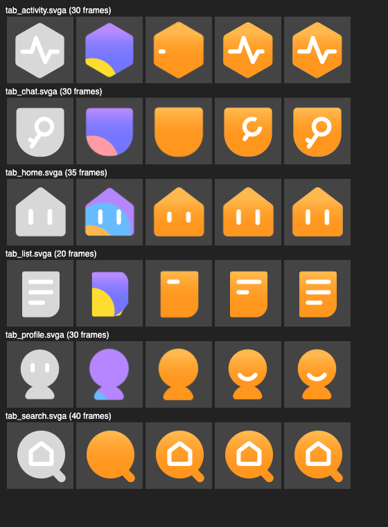 |  |
| **TODO**（2026-11-16）：用户反馈跨端 TabBar 点按 Tab 不切换。先查 React Native（Android 模拟器上 example-rive 点按 Bell 不切换，Rive 与 SVGA 模式相同），再查 Flutter、微信小程序、HarmonyOS。用户原话：「有用户反馈说跨端平台的tabbar切换不成功，先查 RN Tab 不切换再查其他跨端平台」。 | **TODO** (2026-11-16): users report that tapping a tab does not switch it on the cross-platform tab bars. First React Native (on the Android emulator, tapping Bell in example-rive does not switch, in Rive and SVGA modes alike), then Flutter, the WeChat Mini Program and HarmonyOS. User prompt, verbatim: "有用户反馈说跨端平台的tabbar切换不成功，先查 RN Tab 不切换再查其他跨端平台" (users report tab switching fails on the cross-platform tab bars; look into RN tabs not switching first, then the other cross-platform platforms). |
| **进展**（2026-11-16 09:58）：React Native iOS（iOS 26.3 模拟器）点按 Tab 正常切换；React Native Android 在另一会话的模拟器上正常切换（6ca0afa）；我在 emulator-5590 上的「不切换」是主机过载（负载 11.75，后来 589）导致 System UI「无响应」对话框拦截了点按，不是组件问题。Flutter iOS（自己的 iPhone 17 Pro Max 模拟器）单次点按 Search、Chat、Bell 均切换；测试工具 axe 的默认点按样式点不到 Flutter 平台视图中的原生 TabBar，需要 `--tap-style physical`（真实手指不受影响）。共享的 iOS 26.3 模拟器上另一会话的 App 会切到前台，点按会落到它上面。待查：Flutter Android、微信小程序、HarmonyOS（主机负载降下来后再启动模拟器）。 | **Progress** (2026-11-16 09:58): React Native iOS (iOS 26.3 simulator) switches tabs on tap; React Native Android switches on another session's emulator (6ca0afa); my "does not switch" on emulator-5590 was host overload (load average 11.75, later 589): System UI "not responding" dialogs swallowed the taps; not a component bug. Flutter iOS (my own iPhone 17 Pro Max simulator): single taps on Search, Chat and Bell switch; the axe tool's default tap style does not reach the native tab bar inside Flutter's platform view and needs `--tap-style physical` (real fingers are not affected). On the shared iOS 26.3 simulator another session's app comes to the front and takes the taps. To check: Flutter Android, the WeChat Mini Program and HarmonyOS (emulators once the host load drops). |
| **DONE**（2026-11-16 10:15）：真正的 Android 原因由另一会话找到并修复（1cd86c2）：rive-android 的 `RiveAnimationView` 消费触摸，Rive 图标的 Tab 点按不选中；共享库 `CYLRiveTabBarItemAnimationView.dispatchTouchEvent` 返回 false，React Native 与 Flutter 的 Android 重新构建后即生效。验证（自己的 Android 15 模拟器 emulator-5590，基于 1cd86c2 构建的 Flutter example_rive）：Rive 模式点按 Bell、Search 均切换；SVGA（初始化 Key、配置文件）模式点按 Chat 切换。微信小程序：用加载真实 `cyl-tab-bar` 组件的 Node 测试点按每个 Tab：City、Start 触发 `select`（页面 web、publish），Message 与 Mine 触发 `loginrequired`（示例要求登录，弹窗登录后切换，属设计如此）；微信开发者工具未在本机运行（TODO）。HarmonyOS：本仓库尚无鸿蒙 TabBar 实现（HarmonyOS-API-Map.md 全为 TODO），无可测内容。下图从上到下：Flutter Android Rive 模式点按 Bell、Search；SVGA 两种模式；SVGA 模式点按 Chat。 | **DONE** (2026-11-16 10:15): the real Android cause was found and fixed by another session (1cd86c2): rive-android's `RiveAnimationView` consumed touches, so taps on tabs with Rive icons did not select them; in the shared library `CYLRiveTabBarItemAnimationView.dispatchTouchEvent` returns false, which React Native and Flutter on Android pick up when rebuilt. Checked (my own Android 15 emulator emulator-5590, Flutter example_rive built on 1cd86c2): in Rive mode tapping Bell and Search switches; in the SVGA modes (initialization keys, configuration file) tapping Chat switches. WeChat Mini Program: a Node test that loads the real `cyl-tab-bar` component taps every tab: City and Start send `select` (pages web, publish); Message and Mine send `loginrequired` (the example requires login; its alert logs in, then switches, by design); WeChat DevTools not run on this machine (TODO). HarmonyOS: this repository has no HarmonyOS tab bar yet (HarmonyOS-API-Map.md is all TODO), so nothing to test. Below, top to bottom: Flutter Android in Rive mode tapping Bell, Search; the two SVGA modes; tapping Chat in SVGA mode. |
| 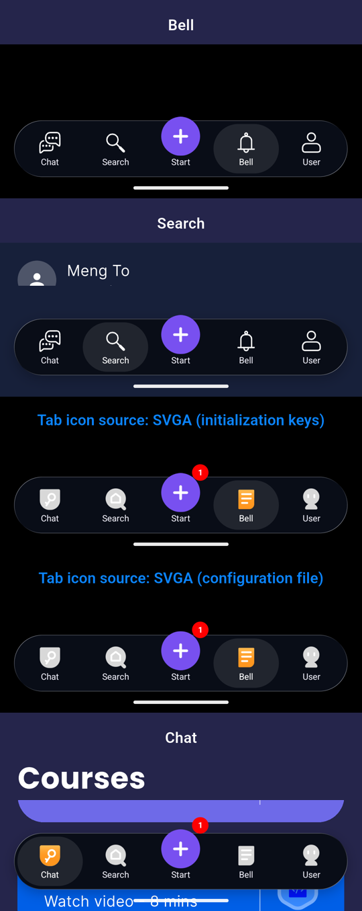 |  |
| 本条按用户要求使用英文（见右列）。 | TODO (2026-11-13, iOS, Flutter tab bar in CYLSearchViewController's Flutter example): user prompt, verbatim: "在跨端相关文件中记录 记录截图中的bug，标记TODO。CYLSearchViewController 的flutter example中，出现以下异常：flutter 的tabbar 实现iOS端异常。plus button title会在被选中后 液态玻璃遮罩消失，title异常消失。两个排查方向：第一个：plus button 问题，排查方向：cyl_updateLiquidGlassMask  实现导致plusbutton的 title 字体异常。 Switch: CYL_PLUS_BUTTON_LENS_MASK_ENABLED is now 1. Your rule still stands in AGENTS.md: on any plus button bug, set it to 0 first and retest. ，通过控制上面的key 禁用该实现查看差异。如无法保证不会引发异常，继续禁用cyl_updateLiquidGlassMask该方法实现。同时寻找CYLTabBarController ，，相关commit 里面有一个more按钮存在时 home button 相关icon消失的bug。搜索docs相关文档，查看上下文。continue  continue continue" **Symptom** (screenshot below; top to bottom, left to right: the Tag style tab selected, the plus button shows its title "Search bar"; its search page; the plus tab "Search bar" selected: the Liquid Glass lens under the plus button is gone and so is its title; the No results page): after the plus button is selected, its Liquid Glass lens disappears and its title disappears. **Example**: `CrossPlatform/flutter_cylsearch/example` on CYLSearchViewController's branch `feat/swift-core` (another session's worktree, not changed here); its iOS Podfile pins CYLTabBarController `74aa25e` (2026-11-13, branch `fix/flutter-viewpager2`). **Direction 1, the lens mask** (`-[CYLPlusButton cyl_updateLiquidGlassMask]`, rule in AGENTS.md: rule it out first): checked: at `74aa25e`, and on `feat/cross-platform-components` today, `CYL_PLUS_BUTTON_LENS_MASK_ENABLED` is **0** (kept off since `289d928`, 2026-11-12), so the mask did not run in the build of the screenshot. The note "is now 1" quoted in the prompt is out of date. Still to do: run the example once with the switch set to 1 and once with 0 and compare, to confirm; the switch stays 0 unless the mask is proven safe. **Direction 2, views hidden and never shown again** (context: `d90802e`, "Home's icon comes back after More editing → Done", [Liquid-Glass-Robustness.md](Liquid-Glass-Robustness.md): UIKit never called `-endCustomizingAnimated:`, so the views hidden when More editing began, Home's star, stayed hidden until the end was detected by polling `isCustomizing`). Same pattern to look for: something hides the plus button's title or stand-in when the plus tab is selected and never restores it. Leads: with titles aligned (`+alignsTitleWithTabBarItemTitles`), `-[CYLPlusButton cyl_layOutForTitleInTabBarItem]` (`CYLPlusButton.m:952`, undone by `-cyl_returnTitleFromTabBarItem`) clears the button's own title and lets the tab item show it; on Liquid Glass, the selected layer (platter) draws the selected tab from its own copy, where the plus tab item may have no title and no stand-in; and the Flutter host (`CYLTabBarHostView`) may select the plus tab in a way the native demo does not (a Flutter route pushed over it). Related: the plus button title color TODO in [Liquid-Glass-Robustness.md](Liquid-Glass-Robustness.md). **Done when**: in the Flutter example and the ObjC demo, with the plus tab selected, the lens stays under the plus button and its title stays visible, before and after a lens drag, with labeled screenshots. Status: not started. |
| 本条按用户要求使用英文（见右列）。 | DONE (2026-11-12, finished 2026-11-13): a third component, **WeChat Mini Program**, in `CrossPlatform/wechat-miniprogram-cyltabbar`, scored against the configuration keys of the iOS library: see [WeChat-Mini-Program.md](WeChat-Mini-Program.md) (task, prompt, plan, score). 2026-11-13: the package `cyl-tabbar-miniprogram` (component `cyl-tab-bar`) with Lottie tab icons through its sub-dependency `cyl-lottie-miniprogram` (our fork of lottie-miniprogram, all 55 upstream issues resolved), and its example, checked in WeChat DevTools with 15 screenshots: key score **100 / 100**, API score 100 / 100. It is a pure mini program component (WXML / WXSS / JS), not a wrapper of `CYLTabBarHostView`: a mini program cannot embed native views. |

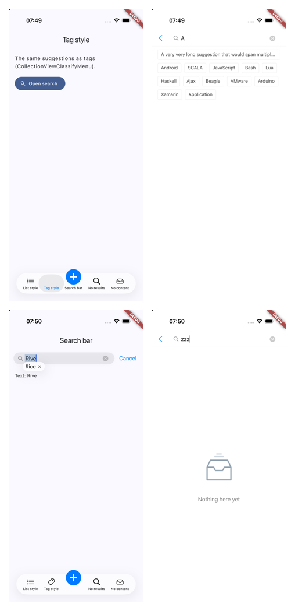

| 中文 | English |
|:---|:---|
| **DONE**（2026-11-16，分支 `feat/harmonyos-demo-7-flatdesign`）：鸿蒙演示 7（导航栏「Flat Design」切换为扁平样式 TabBar）。用户原话：「做演示 7」（与 Windows 上的鸿蒙会话分工：它负责评分表、无障碍与本地化，演示 7 归本会话）。实现：新文件 `cyltabbar/src/main/ets/CYLFlatDesignTabBar.ets`（`CYLTabBarStyleType`、`CYLFlatDesignTabBarModifier`：`BlurStyle.COMPONENT_THICK` + #BFF9F9F9、蓝 / 灰着色）、`entry/src/main/ets/demo/DemoFlatDesign.ets`（「Flat Design」按钮，随机颜色呼吸红点，一个无障碍元素，`id` `cyl-nav-flat-design`）；`CYLTabBarController.ets` 只加 `tabBarStyleType`、`barTintColor` 与一行 `attributeModifier`；`Index.ets` 用新 key 重建 TabBar 并再次显示启动角标。文字使用 iOS key（`FlatDesign`、`FlatDesign扁平设计样式`），`harmonyos-l10n.py` 已重新生成。验证：`hvigorw clean assembleHap` 成功，新文件无 ArkTS 警告；**未在模拟器上运行**（用户要求不用模拟器），截图待做。评分：16 / 100（演示 52 / 56）。差异：扁平样式在 iOS 上页面延伸到 TabBar 下方再模糊，鸿蒙版的页面区域在 TabBar 上方结束，模糊的是 TabBar 自身背景（TODO）。 | **DONE** (2026-11-16, branch `feat/harmonyos-demo-7-flatdesign`): HarmonyOS demo 7 (the navigation bar's "Flat Design" switches to the FlatDesign tab bar). The user's words: "做演示 7" (split with the HarmonyOS session on Windows: it owns the score table, accessibility and localization; demo 7 is this session's). Done: new `cyltabbar/src/main/ets/CYLFlatDesignTabBar.ets` (`CYLTabBarStyleType`, `CYLFlatDesignTabBarModifier`: `BlurStyle.COMPONENT_THICK` + #BFF9F9F9, blue / gray tints) and `entry/src/main/ets/demo/DemoFlatDesign.ets` (the "Flat Design" button with a breathing dot in a random color, one accessibility element, `id` `cyl-nav-flat-design`); `CYLTabBarController.ets` only gets `tabBarStyleType`, `barTintColor` and one `attributeModifier` line; `Index.ets` builds a new tab bar (new key) and shows the launch badges again. Texts use iOS keys (`FlatDesign`, `FlatDesign扁平设计样式`); `harmonyos-l10n.py` regenerated. Checked: `hvigorw clean assembleHap` succeeds, no ArkTS warning in the new files; **not run on an emulator** (the user asked for no emulator), screenshots to do. Score: 16 / 100 (demos 52 / 56). Difference: on iOS the pages run under the FlatDesign bar and are blurred; on HarmonyOS the pages end above the bar, which blurs its own background (TODO). |

| 中文 | English |
|:---|:---|
| 鸿蒙模拟器验证（2026-11-16 12:41，提交 `f20bdff`）：新建专用模拟器实例 “CYL TabBar Test”（Mate 70 Pro 配置，HarmonyOS 6.0.1 API 21，`127.0.0.1:5559`），避免与其他会话共用。用 `uitest dumpLayout -b com.cyl.tabbar.harmony` 按 id 定位（`cyl-nav-flat-design`、`cyl-nav-liquid-glass`）后点按。结果：(1) 首页导航栏位于状态栏下方 ✅；(2) 「液态玻璃」不再压住「首页」标题 ✅；(3) 点「扁平样式」0.5 秒后 TabBar 已重建（角标与封面清空，1.5 秒后重新出现）✅；(4) 点「液态玻璃」出现悬浮胶囊，但胶囊位置过低，与系统手势条重叠、标题被遮挡，左侧没有边距（TODO）。截图 1：启动后首页；截图 2（从左到右）：点扁平样式后 0.5 秒、点液态玻璃后立即、3 秒后。 | HarmonyOS emulator check (2026-11-16 12:41, commit `f20bdff`): a dedicated emulator instance "CYL TabBar Test" (Mate 70 Pro profile, HarmonyOS 6.0.1 API 21, `127.0.0.1:5559`) so no other session shares it. Controls found by id with `uitest dumpLayout -b com.cyl.tabbar.harmony` (`cyl-nav-flat-design`, `cyl-nav-liquid-glass`), then tapped. Results: (1) the Home navigation bar is below the status bar ✅; (2) "液态玻璃" no longer overlaps the "首页" title ✅; (3) 0.5 s after a tap on "扁平样式" the tab bar is rebuilt (badges and cover cleared, back after 1.5 s) ✅; (4) a tap on "液态玻璃" shows the floating capsule, but it sits too low, over the system gesture bar with its titles hidden, and has no left margin (TODO). Picture 1: Home after launch; picture 2 (left to right): 0.5 s after FlatDesign, right after Liquid Glass, 3 s later. |

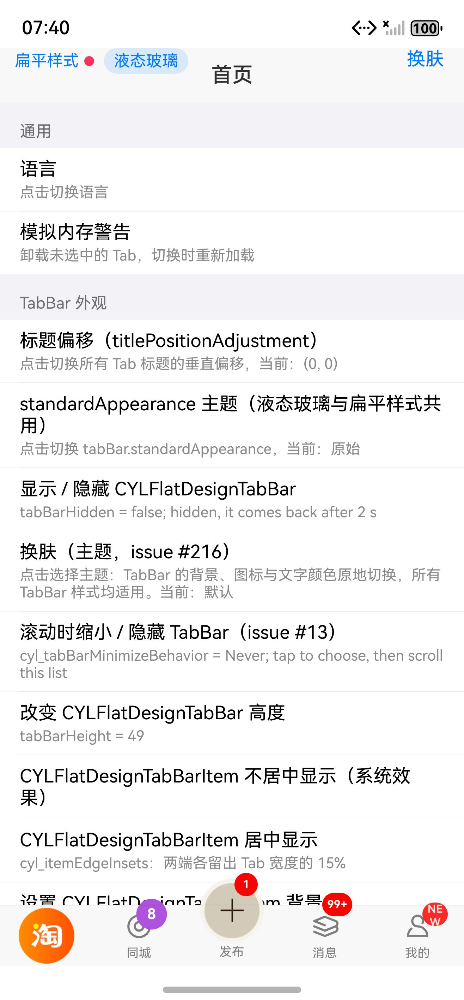

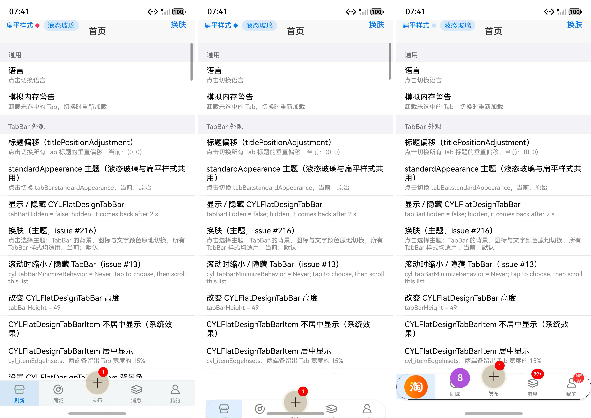

| 中文 | English |
|:---|:---|
| 复查（2026-11-16 12:45，提交 `6befe36`，同一模拟器）：液态玻璃胶囊已位于手势条上方，标题可见 ✅；但左右两侧仍没有 16 vp 间距，胶囊几乎占满屏宽（TODO）。经典与扁平样式的 TabBar 背景与页面颜色接近，无法从截图判断是否延伸到手势条下方（待用深色主题复查）。从左到右：经典、扁平样式、液态玻璃。 | Re-check (2026-11-16 12:45, commit `6befe36`, same emulator): the Liquid Glass capsule now sits above the gesture bar with its titles visible ✅; but there is still no 16 vp gap on the left and right, the capsule spans almost the full width (TODO). The classic and FlatDesign bars are too close in color to the page to tell from the picture whether they reach under the gesture bar (to re-check with a dark skin). Left to right: classic, FlatDesign, Liquid Glass. |

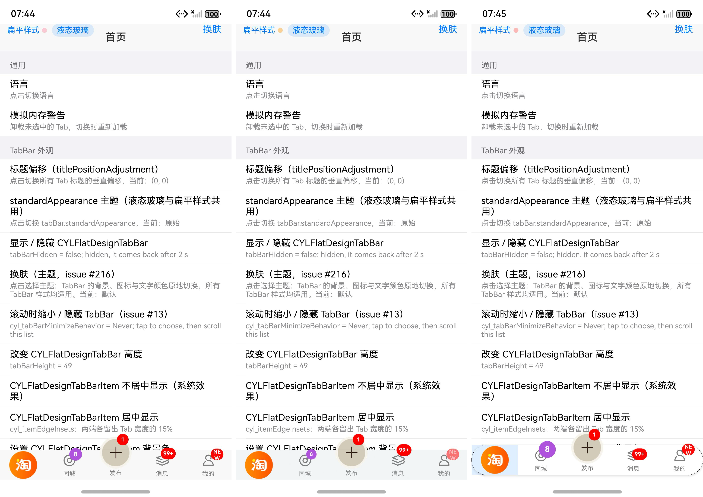
