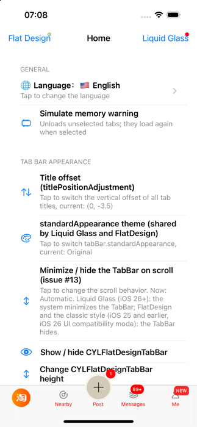
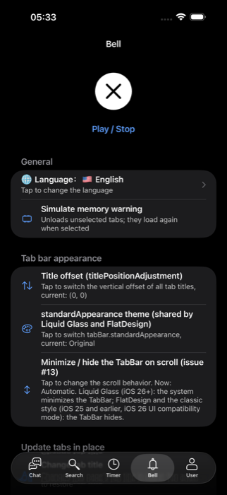
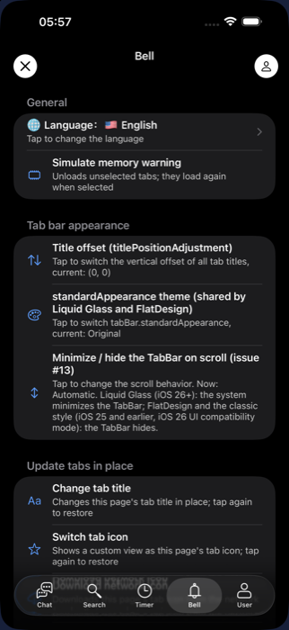
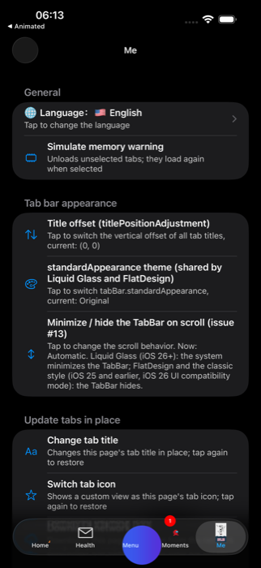

# [CN]Demo 测试列表：设置分组与纯 Swift 版本
# [EN]The demo test list: settings groups and a pure Swift version

<!-- bound-classes: CYLTabBarController -->
<!-- binding:start -->
<!-- Generated by scripts/update-docs-navigation.py; do not edit by hand. -->

| 中文 | English |
|:---|:---|
| 绑定的代码类 `CYLTabBarController`：[`CYLTabBarController/CYLTabBarController.h`](../CYLTabBarController/CYLTabBarController.h) | Bound to the class `CYLTabBarController`: [`CYLTabBarController/CYLTabBarController.h`](../CYLTabBarController/CYLTabBarController.h) |

<!-- binding:end -->

| 中文 | English |
|:---|:---|
| 各 Demo 页面顶部的测试列表（语言、外观、原地更新 Tab、页面与登录、PlusButton、Tab 交互、工具方法）由库中的 `UIViewController (CYLSettingsSection)` 提供：每一行的 cell 与点击后的操作都在库里，列表只负责排列。现在库同时提供了按功能分组的 API，ObjC Demo 与纯 Swift 的测试列表使用同一套分组，新增一行时只需在库中归类一次。 | The test list at the top of each demo page (language, appearance, in-place tab updates, pages and login, the plus button, tab interactions, helpers) comes from the library's `UIViewController (CYLSettingsSection)`: each row's cell and action live in the library, and a list only lays the rows out. The library now also groups the rows by function, so the ObjC demo and the pure Swift test list use the same groups, and a new row is placed once, in the library. |

## [CN]目录
## [EN]Contents

<!-- navigation:start -->
<!-- Generated by scripts/update-docs-navigation.py; do not edit by hand. -->

| 中文 | English |
|:---|:---|
| [分组 API](#cn分组-api) | [The group API](#enthe-group-api) |
| [纯 Swift 测试列表](#cn纯-swift-测试列表) | [The pure Swift test list](#enthe-pure-swift-test-list) |
| [限制](#cn限制) | [Limits](#enlimits) |
| [效果](#cn效果) | [Screenshots](#enscreenshots) |

<!-- navigation:end -->

## [CN]分组 API
## [EN]The group API

| API | 说明 / What it does |
|:---|:---|
| `CYLSettingsGroup` | 分组：通用、TabBar 外观、原地更新 Tab、Tab 页面选中与登录、PlusButton、Tab 交互、无需继承基类与工具方法 / The groups: general, tab bar appearance, in-place tab updates, pages selection and login, the plus button, tab interactions, no base class and helpers |
| `-cyl_settingsGroups` | 有行的分组，按显示顺序 / The groups that have rows, in display order |
| `-cyl_titleForSettingsGroup:` | 分组的本地化标题 / A group's localized title |
| `-cyl_settingsRowsInGroup:` | 分组中的设置行；未归类的新行放入「通用」 / A group's settings rows; a row not placed yet goes to "General" |
| `-cyl_settingsCellForTableView:row:` | 任意 section 中某个设置行的 cell / The cell of a settings row, in any section |
| `-cyl_didSelectSettingsRow:` | 执行某个设置行，不操作列表；调用方随后刷新 / Runs a settings row without touching a table view; the caller reloads |

| 中文 | English |
|:---|:---|
| 原有的三个方法（`-cyl_settingsRowCount`、`-cyl_settingsCellForTableView:atIndexPath:`、`-cyl_didSelectSettingsRowAtIndexPath:inTableView:`）保持不变，仍可把所有行放在一个 section 中。 | The three existing methods (`-cyl_settingsRowCount`, `-cyl_settingsCellForTableView:atIndexPath:`, `-cyl_didSelectSettingsRowAtIndexPath:inTableView:`) are unchanged, for a list that shows every row in one section. |

## [CN]纯 Swift 测试列表
## [EN]The pure Swift test list

| 中文 | English |
|:---|:---|
| `Example-Shared/CYLSettingsDemoTableViewController.swift` 是 ObjC Demo 测试列表的纯 Swift 版本：一个 inset grouped 的 `UITableViewController`，每个分组一个 section；可选的 `headerView` 显示在各行上方。Example-Rive 与 Example-SwiftUI-Rive 的 Bell Tab（两者共用 `TabItems.swift` 中的 `Tab.settingsViewController(headerView:)`）以及 Example-PAG 的「我的」Tab 使用它。 | `Example-Shared/CYLSettingsDemoTableViewController.swift` is the ObjC demo's test list in pure Swift: an inset grouped `UITableViewController`, one section per group, with an optional `headerView` above the rows. The Bell tab of Example-Rive and Example-SwiftUI-Rive (both through `Tab.settingsViewController(headerView:)` in the shared `TabItems.swift`) and the Me tab of Example-PAG use it. |

```swift
override func numberOfSections(in _: UITableView) -> Int { groups.count }
override func tableView(_: UITableView, numberOfRowsInSection section: Int) -> Int {
    cyl_settingsRows(in: groups[section]).count
}
override func tableView(_ tableView: UITableView, cellForRowAt indexPath: IndexPath) -> UITableViewCell {
    cyl_settingsCell(for: tableView, row: settingsRow(at: indexPath))
}
override func tableView(_ tableView: UITableView, didSelectRowAt indexPath: IndexPath) {
    tableView.deselectRow(at: indexPath, animated: true)
    cyl_didSelectSettingsRow(settingsRow(at: indexPath))
    tableView.reloadData()
}
```

## [CN]限制
## [EN]Limits

| 中文 | English |
|:---|:---|
| ObjC Demo 自己的 TabBar 演示行（显示 / 隐藏、高度、扁平样式 TabBarItem 布局、跳转与对比）不在库中，只出现在 ObjC Demo 里。 | The ObjC demo's own tab bar rows (show / hide, height, FlatDesign item layout, navigation and comparisons) are not in the library, so they appear only in the ObjC demo. |
| 列表的表头在每次布局时按宽度计算大小，只有大小或表头变化时才重新设置（否则会无限布局）。 | The list sizes its header to the table's width on each layout pass, and sets it again only when its size or the header changed (otherwise the table would lay itself out forever). |

## [CN]效果
## [EN]Screenshots

| 中文 | English |
|:---|:---|
| 依次为：ObjC Demo（经典样式，iOS 17.5）、Example-Rive 的 Bell Tab（上方为纯 UIKit 中的 Rive 动画）、Example-SwiftUI-Rive 的 Bell Tab、Example-PAG 的「我的」Tab（液态玻璃，iOS 26.5）。 | The ObjC demo (classic style, iOS 17.5), Example-Rive's Bell tab (a Rive animation in plain UIKit above the rows), Example-SwiftUI-Rive's Bell tab, and Example-PAG's Me tab (Liquid Glass, iOS 26.5). |

   
