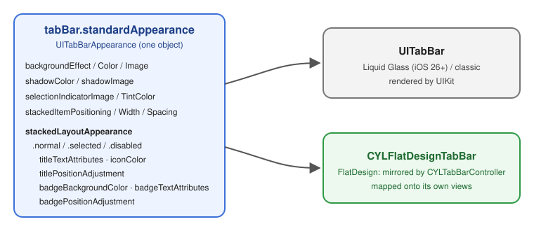
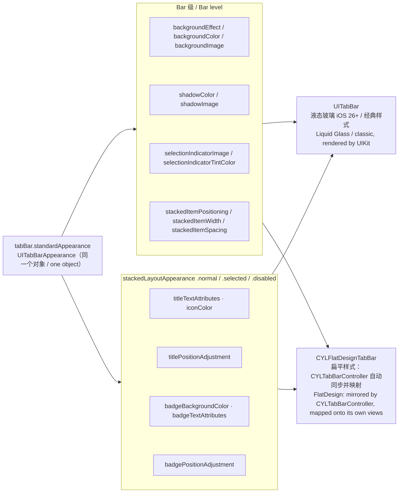
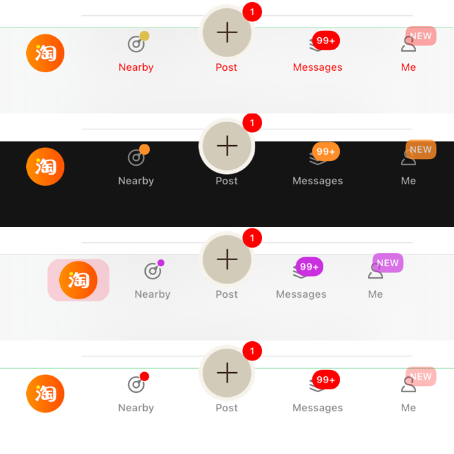

# FlatDesign × UITabBarAppearance

<!-- bound-classes: CYLFlatDesignTabBar, CYLFlatDesignTabBarItem, CYLTabBarController -->
<!-- binding:start -->
<!-- Generated by scripts/update-docs-navigation.py; do not edit by hand. -->

| 中文 | English |
|:---|:---|
| 绑定的代码类 `CYLFlatDesignTabBar`：[`CYLTabBarController/CYLFlatDesignTabBar/CYLFlatDesignTabBar-ObjectiveC/CYLFlatDesignTabBar/CYLFlatDesignTabBar.h`](../CYLTabBarController/CYLFlatDesignTabBar/CYLFlatDesignTabBar-ObjectiveC/CYLFlatDesignTabBar/CYLFlatDesignTabBar.h) | Bound to the class `CYLFlatDesignTabBar`: [`CYLTabBarController/CYLFlatDesignTabBar/CYLFlatDesignTabBar-ObjectiveC/CYLFlatDesignTabBar/CYLFlatDesignTabBar.h`](../CYLTabBarController/CYLFlatDesignTabBar/CYLFlatDesignTabBar-ObjectiveC/CYLFlatDesignTabBar/CYLFlatDesignTabBar.h) |
| 绑定的代码类 `CYLFlatDesignTabBarItem`：[`CYLTabBarController/CYLFlatDesignTabBar/CYLFlatDesignTabBar-ObjectiveC/CYLFlatDesignTabBar/CYLFlatDesignTabBarItem.h`](../CYLTabBarController/CYLFlatDesignTabBar/CYLFlatDesignTabBar-ObjectiveC/CYLFlatDesignTabBar/CYLFlatDesignTabBarItem.h) | Bound to the class `CYLFlatDesignTabBarItem`: [`CYLTabBarController/CYLFlatDesignTabBar/CYLFlatDesignTabBar-ObjectiveC/CYLFlatDesignTabBar/CYLFlatDesignTabBarItem.h`](../CYLTabBarController/CYLFlatDesignTabBar/CYLFlatDesignTabBar-ObjectiveC/CYLFlatDesignTabBar/CYLFlatDesignTabBarItem.h) |
| 绑定的代码类 `CYLTabBarController`：[`CYLTabBarController/CYLTabBarController.h`](../CYLTabBarController/CYLTabBarController.h) | Bound to the class `CYLTabBarController`: [`CYLTabBarController/CYLTabBarController.h`](../CYLTabBarController/CYLTabBarController.h) |

<!-- binding:end -->

| 中文 | English |
|:---|:---|
| 一个 `UITabBarAppearance` 同时控制液态玻璃（系统 `UITabBar`）与扁平样式（`CYLFlatDesignTabBar`）。只需设置 `tabBarController.tabBar.standardAppearance`，扁平样式 TabBar 会读取并映射其中尽可能多的值，效果更接近液态玻璃的设置方式。 | One `UITabBarAppearance` styles both Liquid Glass (the system `UITabBar`) and FlatDesign (`CYLFlatDesignTabBar`). Set `tabBarController.tabBar.standardAppearance` only: the flat design tab bar reads it and maps as many of its values as it can, so styling works the way it does for Liquid Glass. |





## 目录 / Contents

<!-- navigation:start -->
<!-- Generated by scripts/update-docs-navigation.py; do not edit by hand. -->

| 中文 | English |
|:---|:---|
| [用法](#用法--usage) | [Usage](#用法--usage) |
| [映射关系](#映射关系--mapping) | [Mapping](#映射关系--mapping) |
| [Demo](#demo) | [Demo](#demo) |
| [截图](#截图--screenshots) | [Screenshots](#截图--screenshots) |

<!-- navigation:end -->

## 用法 / Usage

| 中文 | English |
|:---|:---|
| 与系统 TabBar 的写法完全相同，不需要针对扁平样式额外写代码： | Exactly as for the system tab bar; no extra code for FlatDesign: |

```objc
if (@available(iOS 13.0, *)) {
    UITabBarAppearance *appearance = [[UITabBarAppearance alloc] init];
    appearance.backgroundColor = UIColor.systemBackgroundColor;
    appearance.shadowColor = UIColor.systemGreenColor;
    appearance.stackedLayoutAppearance.normal.iconColor = UIColor.systemGrayColor;
    appearance.stackedLayoutAppearance.selected.iconColor = UIColor.systemGreenColor;
    appearance.stackedLayoutAppearance.selected.titleTextAttributes = @{ NSForegroundColorAttributeName : UIColor.systemGreenColor };
    // Liquid Glass / classic and FlatDesign alike. 液态玻璃 / 经典样式与扁平样式通用。
    tabBarController.tabBar.standardAppearance = appearance;
}
```

```swift
let appearance = UITabBarAppearance()
appearance.backgroundColor = .systemBackground
appearance.shadowColor = .systemGreen
appearance.stackedLayoutAppearance.selected.iconColor = .systemGreen
appearance.stackedLayoutAppearance.selected.titleTextAttributes = [.foregroundColor: UIColor.systemGreen]
tabBarController.tabBar.standardAppearance = appearance
```

| 中文 | English |
|:---|:---|
| 也可以直接设置扁平样式 TabBar：`((CYLFlatDesignTabBar *)tabBarController.cyl_tabBar).standardAppearance = appearance;` | You can also set it on the flat design tab bar directly: `((CYLFlatDesignTabBar *)tabBarController.cyl_tabBar).standardAppearance = appearance;` |
| 单个 Tab：设置子控制器的 `tabBarItem.standardAppearance`（或 `CYLFlatDesignTabBarItem.standardAppearance`），该 Tab 选中时整个 TabBar 使用它，与 `UITabBar` 相同。 | One tab: set the child's `tabBarItem.standardAppearance` (or `CYLFlatDesignTabBarItem.standardAppearance`); while that tab is selected the whole bar uses it, as `UITabBar` does. |
| 运行时可随时重新赋值，扁平样式 TabBar 立即更新（KVO；未收到 KVO 时在下次布局更新）。 | Assign a new one at any time; the flat design tab bar updates at once (KVO; otherwise on the next layout). |

## 映射关系 / Mapping

| UITabBarAppearance | 扁平样式 TabBar 中的效果 | Effect on the flat design tab bar |
|:---|:---|:---|
| `backgroundEffect` | 背景模糊效果，nil 表示无模糊 | Background blur; nil means none |
| `backgroundColor` | 背景色 | Background color |
| `backgroundImage` / `backgroundImageContentMode` | 背景图及其 contentMode | Background image and its content mode |
| `shadowImage` | 顶部阴影线，使用图片自身高度；模板图由 `shadowColor` 着色 | Top shadow line at the image's own height; a template image is tinted by `shadowColor` |
| `shadowColor` | 没有 `shadowImage` 时顶部 1 像素细线；nil / 透明表示无 | A 1-pixel hairline at the top when there is no `shadowImage`; nil / clear means none |
| `selectionIndicatorImage` | 绘制在选中 Tab 背后；可拉伸图铺满按钮，其他居中 | Drawn behind the selected tab; a resizable image fills the button, others are centered |
| `selectionIndicatorTintColor` | 选中指示图的着色 | Tints the selection indicator |
| `stackedItemPositioning` | `.centered` 时 Tab 居中排列；`.fill` / `.automatic` 铺满宽度 | `.centered` centers the tabs; `.fill` / `.automatic` fill the width |
| `stackedItemWidth` / `stackedItemSpacing` | 居中排列时的 Tab 宽度 / 间距；放不下时回退为铺满 | Tab width / spacing when centered; falls back to filling when they do not fit |
| `stackedLayoutAppearance.{normal, selected, disabled}.titleTextAttributes` | 标题字体、颜色等，覆盖 item 自身的设置 | Title font, color and other attributes; they override the item's own |
| `… .iconColor` | 图标颜色（模板图片） | Icon color (template images) |
| `… .titlePositionAdjustment` | Tab 没有自身偏移时使用；`CYLTabBarController.titlePositionAdjustment` 优先，与系统 TabBar 一致 | Used when the tab has no offset of its own; `CYLTabBarController.titlePositionAdjustment` wins, as on the system tab bar |
| `… .badgeBackgroundColor` | 角标背景色 | Badge background color |
| `… .badgeTextAttributes` | 角标文字颜色与字体 | Badge text color and font |
| `… .badgePositionAdjustment` | 角标中心偏移 | Badge center offset |

| 中文 | English |
|:---|:---|
| 未映射：inline / compactInline 布局（扁平样式始终为 stacked）、`scrollEdgeAppearance`、`badgeTitlePositionAdjustment`、focused 状态。 | Not mapped: the inline / compact inline layouts (FlatDesign is always stacked), `scrollEdgeAppearance`, `badgeTitlePositionAdjustment`, the focused state. |
| 角标值只有在与新建的 `UITabBarAppearance` 不同时才生效，不会覆盖 `CYLBadgeAppearance` 等全局设置。 | Badge values apply only when they differ from a new `UITabBarAppearance`, so they do not override `CYLBadgeAppearance` and other global settings. |
| 未设置 appearance（或恢复为系统默认值）时，扁平样式保持原有外观，`barTintColor` / `backgroundImage` / `shadowImage` 继续生效。 | Without an appearance (or back to the system default), FlatDesign keeps its own look, and `barTintColor` / `backgroundImage` / `shadowImage` still apply. |
| 需要 iOS 13+；更早的系统不受影响。 | Requires iOS 13+; earlier systems are unaffected. |

## Demo

| 中文 | English |
|:---|:---|
| `MainTabBarController +demoStandardAppearanceWithTitlePositionAdjustment:` 创建唯一的 appearance，`MainTabBarController`（液态玻璃）与 `CYLFlatDesignMainTabBarController`（扁平样式）都把它赋给 `tabBar.standardAppearance`。 | `MainTabBarController +demoStandardAppearanceWithTitlePositionAdjustment:` builds the one appearance; `MainTabBarController` (Liquid Glass) and `CYLFlatDesignMainTabBarController` (FlatDesign) both assign it to `tabBar.standardAppearance`. |
| 列表顶部设置分组新增「standardAppearance 主题」行：点击依次切换「原始 → 深色 → 居中胶囊 → 绿色描边」。在液态玻璃与扁平样式下效果一致，演示代码只有一行 `tabBar.standardAppearance = appearance`。 | The settings section at the top of the lists has a new "standardAppearance theme" row: each tap switches Original → Dark → Centered capsule → Green line. It works the same in Liquid Glass and FlatDesign; the demo code is a single `tabBar.standardAppearance = appearance`. |

## 截图 / Screenshots

| 中文 | English |
|:---|:---|
| 已验证（2026-11-10，iOS 26.1，iPhone 17 Pro Max 模拟器，ObjC 示例）：点击导航栏「Flat Design」切换到扁平样式，再多次点击「standardAppearance theme (shared by Liquid Glass and FlatDesign)」行。从上到下：红色标题主题、深色主题、粉色选中背景主题、恢复默认；扁平 TabBar 的背景、标题颜色与选中背景都随 `standardAppearance` 变化。 | Verified (2026-11-10, iOS 26.1, iPhone 17 Pro Max simulator, ObjC example): "Flat Design" in the navigation bar switches to FlatDesign, then the "standardAppearance theme (shared by Liquid Glass and FlatDesign)" row is tapped several times. Top to bottom: a red-title theme, a dark theme, a pink selected-background theme, back to the default; the flat tab bar's background, title colors and selected background all follow `standardAppearance`. |


