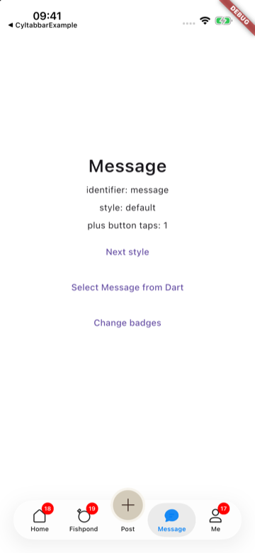
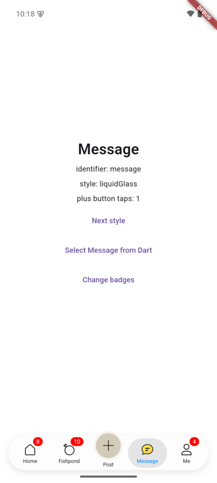
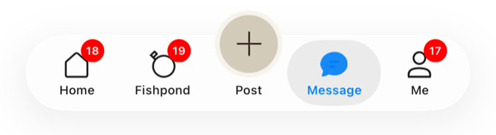
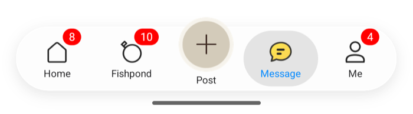

# [CN]Flutter 接入：flutter_cyltabbar
# [EN]Flutter integration: flutter_cyltabbar

<!-- bound-classes: CYLTabBarHostView -->
<!-- binding:start -->
<!-- Generated by scripts/update-docs-navigation.py; do not edit by hand. -->

| 中文 | English |
|:---|:---|
| 绑定的代码类 `CYLTabBarHostView`：[`CYLTabBarController/CYLTabBarHostView.h`](../CYLTabBarController/CYLTabBarHostView.h) | Bound to the class `CYLTabBarHostView`: [`CYLTabBarController/CYLTabBarHostView.h`](../CYLTabBarController/CYLTabBarHostView.h) |

<!-- binding:end -->

| 中文 | English |
|:---|:---|
| `flutter_cyltabbar` 把 CYLTabBarController（iOS）与它的 Android 版本封装为 Flutter widget `CYLTabBar`：TabBar 是原生的（液态玻璃、扁平样式、凸起的 PlusButton、角标都来自原生库），页面由你用 Flutter 绘制。本文按步骤说明如何接入。总览与原理见 [React Native 与 Flutter 组件](Cross-Platform-Components.md)。 | `flutter_cyltabbar` wraps CYLTabBarController (iOS) and its Android port as the Flutter widget `CYLTabBar`: the tab bar is native (Liquid Glass, FlatDesign, the raised plus button and the badges all come from the native libraries) and you draw the pages with Flutter. This page walks through the integration step by step. For the overview and how it works, see [React Native and Flutter components](Cross-Platform-Components.md). |

| iOS | Android |
|:---|:---|
|  |  |

## [CN]目录
## [EN]Contents

<!-- navigation:start -->
<!-- Generated by scripts/update-docs-navigation.py; do not edit by hand. -->

| 中文 | English |
|:---|:---|
| [先体验：运行示例](#cn先体验运行示例) | [Try it first: run the example](#entry-it-first-run-the-example) |
| [接入步骤](#cn接入步骤) | [Steps](#ensteps) |
| &nbsp;&nbsp;&nbsp;&nbsp;↳ [1. 添加依赖](#cn1-添加依赖) | &nbsp;&nbsp;&nbsp;&nbsp;↳ [1. Add the dependency](#en1-add-the-dependency) |
| &nbsp;&nbsp;&nbsp;&nbsp;↳ [2. Android：使用 FlutterFragmentActivity](#cn2-android使用-flutterfragmentactivity) | &nbsp;&nbsp;&nbsp;&nbsp;↳ [2. Android: use FlutterFragmentActivity](#en2-android-use-flutterfragmentactivity) |
| &nbsp;&nbsp;&nbsp;&nbsp;↳ [3. iOS：Swift Package Manager 或 CocoaPods](#cn3-iosswift-package-manager-或-cocoapods) | &nbsp;&nbsp;&nbsp;&nbsp;↳ [3. iOS: Swift Package Manager or CocoaPods](#en3-ios-swift-package-manager-or-cocoapods) |
| &nbsp;&nbsp;&nbsp;&nbsp;↳ [4. 放到页面底部](#cn4-放到页面底部) | &nbsp;&nbsp;&nbsp;&nbsp;↳ [4. Put it at the bottom of the screen](#en4-put-it-at-the-bottom-of-the-screen) |
| [字段](#cn字段) | [Fields](#enfields) |
| [常见问题](#cn常见问题) | [Troubleshooting](#entroubleshooting) |
| [限制](#cn限制) | [Limits](#enlimits) |
| [测试与截图](#cn测试与截图) | [Testing and screenshots](#entesting-and-screenshots) |
| [任务记录](#任务记录--task-log) | [Task log](#任务记录--task-log) |

<!-- navigation:end -->

## [CN]先体验：运行示例
## [EN]Try it first: run the example

| 中文 | English |
|:---|:---|
| **建议先运行示例，点几个 Tab、点 PlusButton、点 “Change badges” 与 “Next style”。** 示例直接引用本仓库的 iOS 与 Android 库源码，改库代码后重新运行即可调试。 | **Run the example first: tap a few tabs, the plus button, "Change badges" and "Next style".** It uses this repository's iOS and Android library sources: change the library and run it again to debug. |
| PAG 与 Rive 动效图标示例：`example_pag/`、`example_rive/`（CocoaPods），见 [动效图标示例](Cross-Platform-Components.md#cn动效图标示例)。 | The PAG and Rive animated-icon demos: `example_pag/`, `example_rive/` (CocoaPods); see [Animated-icon demos](Cross-Platform-Components.md#enanimated-icon-demos). |

```sh
cd CrossPlatform/flutter_cyltabbar/example
flutter run            # pick an iOS simulator or an Android emulator
```

| 中文 | English |
|:---|:---|
| 环境：Flutter 3.47（iOS 默认使用 Swift Package Manager）；Android 需要 JDK 17 与 Android SDK 36。 | Requirements: Flutter 3.47 (Swift Package Manager on iOS, the default); Android needs JDK 17 and Android SDK 36. |

## [CN]接入步骤
## [EN]Steps

### [CN]1. 添加依赖
### [EN]1. Add the dependency

| 中文 | English |
|:---|:---|
| 插件尚未发布到 pub.dev。在 `pubspec.yaml` 中按路径或 git 引用： | The plugin is not on pub.dev yet. Reference it by path or git in `pubspec.yaml`: |

```yaml
dependencies:
  flutter_cyltabbar:
    path: ../CYLTabBarController/CrossPlatform/flutter_cyltabbar
    # or:
    # git:
    #   url: https://github.com/ChenYilong/CYLTabBarController.git
    #   path: CrossPlatform/flutter_cyltabbar
```

### [CN]2. Android：使用 FlutterFragmentActivity
### [EN]2. Android: use FlutterFragmentActivity

| 中文 | English |
|:---|:---|
| **必须做**：Android 版 CYLTabBarController 用 Fragment 管理页面，需要 `FragmentActivity`。否则 TabBar 不显示，日志中有 `CYLTabBar needs a FragmentActivity`。 | **Required**: the Android CYLTabBarController manages its pages with fragments and needs a `FragmentActivity`. Otherwise the bar does not show, and the log says `CYLTabBar needs a FragmentActivity`. |

```kotlin
// android/app/src/main/kotlin/.../MainActivity.kt
import io.flutter.embedding.android.FlutterFragmentActivity

class MainActivity : FlutterFragmentActivity()
```

| 中文 | English |
|:---|:---|
| Gradle 无需修改：插件发现 `../../../Example-Android`（本仓库中的位置）时直接编译其源码，否则使用 Maven 上的 `io.github.chenyilong:cyltabbarcontroller`（可用 `cylAndroidRoot` / `cylAndroidVersion` Gradle 属性修改）。 | Gradle needs no change: the plugin compiles the sources of `../../../Example-Android` when it finds them (its place in this repository), otherwise it uses `io.github.chenyilong:cyltabbarcontroller` from Maven (the `cylAndroidRoot` / `cylAndroidVersion` Gradle properties change that). |

### [CN]3. iOS：Swift Package Manager 或 CocoaPods
### [EN]3. iOS: Swift Package Manager or CocoaPods

| 方式 | Way | 说明 / Description |
|:---|:---|:---|
| Swift Package Manager（默认） | Swift Package Manager (the default) | 无需修改。插件的 `ios/flutter_cyltabbar/Package.swift` 依赖本仓库根目录的 `Package.swift`（`path: "../../../.."`），因此在本仓库中直接使用本地库源码。把插件复制到别处时，把这一行改为 `.package(url: "https://github.com/ChenYilong/CYLTabBarController.git", from: "1.100.0")`。 / Nothing to change. The plugin's `ios/flutter_cyltabbar/Package.swift` depends on this repository's root `Package.swift` (`path: "../../../.."`), so inside this repository it uses the local library sources. When you copy the plugin elsewhere, change that line to `.package(url: "https://github.com/ChenYilong/CYLTabBarController.git", from: "1.100.0")`. |
| CocoaPods（关闭 Swift Package Manager 的 App） | CocoaPods (apps with Swift Package Manager turned off) | 插件的 podspec 依赖 `CYLTabBarController` pod；Podfile 中使用 `use_frameworks! :linkage => :static`（CYLTabBarController 是静态 framework），调试本地源码时加上 `pod 'CYLTabBarController', :path => '<本仓库>'`；需要 PAG / Rive 时改为子库，如 `pod 'CYLTabBarController/Rive', :path => …`。PAG 与 Rive 示例就是这样配置的（在 pubspec 中用 `enable-swift-package-manager: false` 关闭 Swift Package Manager）。 / The plugin's podspec depends on the `CYLTabBarController` pod; the Podfile uses `use_frameworks! :linkage => :static` (CYLTabBarController is a static framework), plus `pod 'CYLTabBarController', :path => '<this repository>'` to debug the local sources; for PAG / Rive use the subspec, e.g. `pod 'CYLTabBarController/Rive', :path => …`. The PAG and Rive demos are set up this way (Swift Package Manager turned off with `enable-swift-package-manager: false` in the pubspec). |

### [CN]4. 放到页面底部
### [EN]4. Put it at the bottom of the screen

```dart
import 'package:flutter/material.dart';
import 'package:flutter_cyltabbar/flutter_cyltabbar.dart';

class HomePage extends StatefulWidget {
  const HomePage({super.key});
  @override
  State<HomePage> createState() => _HomePageState();
}

class _HomePageState extends State<HomePage> {
  int _index = 0;

  @override
  Widget build(BuildContext context) {
    return Scaffold(
      body: IndexedStack(index: _index, children: const [Text('Home'), Text('Message'), Text('Me'), Text('Settings')]),
      bottomNavigationBar: CYLTabBar(
        items: const [
          CYLTabBarItem(title: 'Home', identifier: 'home', image: CYLTabBarImage.asset('assets/home.png')),
          CYLTabBarItem(title: 'Message', identifier: 'message', image: CYLTabBarImage.asset('assets/message.png')),
          CYLTabBarItem(title: 'Me', identifier: 'me', image: CYLTabBarImage.name('system:person')),
          CYLTabBarItem(title: 'Settings', identifier: 'settings', image: CYLTabBarImage.name('system:gear')),
        ],
        styleType: 'liquidGlass',
        plusButton: const CYLTabBarPlusButton(title: 'Post', image: CYLTabBarImage.asset('assets/post.png')),
        selectedIndex: _index,
        badgeValues: const ['', 'dot', '3', ''],
        onTabSelect: (index, identifier) => setState(() => _index = index),
        onPlusButtonPress: () => debugPrint('plus'),
      ),
    );
  }
}
```

| 中文 | English |
|:---|:---|
| 组件只绘制 TabBar，页面由 Flutter 绘制（如上面的 `IndexedStack`）。高度由原生 TabBar 决定：底部安全区，加上 PlusButton 与角标高出 TabBar 的部分（Flutter 会裁剪平台视图）。图片放在 `pubspec.yaml` 的 `assets:` 中，可以有 `2.0x/`、`3.0x/` 版本。 | The widget draws only the bar; Flutter draws the pages (the `IndexedStack` above). Its height comes from the native tab bar: the bottom safe area, plus what the plus button and the badges rise above the bar (Flutter clips platform views). Put the images in `assets:` of `pubspec.yaml`, with `2.0x/` and `3.0x/` variants if you like. |

## [CN]字段
## [EN]Fields

| 字段 | Field | 说明 / Description |
|:---|:---|:---|
| `items` | `items` | `List<CYLTabBarItem>`：`title`、`identifier`、`image`、`selectedImage`，`attributes` 放[配置文件](Configuration-File.md)中 Tab 的其他键。 / `List<CYLTabBarItem>`: `title`, `identifier`, `image`, `selectedImage`; `attributes` holds any other tab key of [the configuration file](Configuration-File.md). |
| `styleType` | `styleType` | `default`、`system`、`flatDesign`、`liquidGlass`。修改后 TabBar 重新创建，选中与角标保留。 / Changing it rebuilds the bar; the selection and the badges stay. |
| `plusButton` | `plusButton` | `CYLTabBarPlusButton(image:, backgroundImage:, title:, titleColor:, selectedTitleColor:, titleFont:, index:, centerYMultiplier:, centerYOffset:, alignsTitle:, keepsTitleVisible:, showsSelection:, size:, imageSize:, identifier:, pageIdentifier:)`，即 `CYLTabBarControllerPlusButton` 与其中的键（见[配置文件](Configuration-File.md#cn配置键)）；`pageIdentifier` 给 PlusButton 一个自己的页面。 / `CYLTabBarControllerPlusButton` and its keys (see [the configuration file](Configuration-File.md#enconfiguration-keys)); `pageIdentifier` gives the plus button its own page. |
| `userInterfaceStyle`、`tapAnimation`、`swipeToSwitchTab`、`animationSpeed` | `userInterfaceStyle`, `tapAnimation`, `swipeToSwitchTab`, `animationSpeed` | `CYLTabBarControllerUserInterfaceStyle`（仅 iOS / iOS only）、`CYLTabBarControllerTabButtonTapAnimation`、`CYLTabBarControllerSwipeToSwitchTab`、`CYLTabBarControllerTabBarItemAnimationSpeed`。 |
| `iconRenderingMode`、`iconColor`、`selectedIconColor`（TabBar 与每个 Tab / bar and each tab） | `iconRenderingMode`, `iconColor`, `selectedIconColor` (bar and each tab) | #787：TabBar 上为 `CYLTabBarControllerIconRenderingMode`、`CYLTabBarControllerIconColor`、`CYLTabBarControllerSelectedIconColor`（没有单独设置的所有 Tab 的默认值），`CYLTabBarItem` 上为 `CYLTabBarItemIconRenderingMode`、`CYLTabBarItemIconColor`、`CYLTabBarItemSelectedIconColor`。`'template'` 一张图随状态着色，`'original'` 保持原色，`'automatic'` 为默认。见 [Tab-Item-Colors](Tab-Item-Colors.md)。 / #787: on the bar `CYLTabBarControllerIconRenderingMode`, `CYLTabBarControllerIconColor`, `CYLTabBarControllerSelectedIconColor` (the defaults of every tab without its own), on `CYLTabBarItem` `CYLTabBarItemIconRenderingMode`, `CYLTabBarItemIconColor`, `CYLTabBarItemSelectedIconColor`. `'template'` tints one image per state, `'original'` keeps its colors, `'automatic'` is the default. See [Tab-Item-Colors](Tab-Item-Colors.md). |
| `configurationRoute` | `CYLTabBarControllerConfigurationRoute` | 指向 App 内置或沙盒中配置文件的资源路由（[资源路由](Resource-Routes.md)），例如 `bundle:Configurations?name=tabbar`；先读取文件，其他字段覆盖文件中的键。 / A resource route to a configuration file built into the app or in its sandbox ([Resource routes](Resource-Routes.md)), e.g. `bundle:Configurations?name=tabbar`; the file is read first and the other fields win over its keys. |
| `configuration` | `configuration` | 配置文件的其他键，优先于上面的字段。 / Any other configuration key; it wins over the fields above. |
| `selectedIndex` | `selectedIndex` | 选中的 Tab（`items` 中的下标，不含 PlusButton）；`null` 时由用户点击决定。 / The selected tab (an index in `items`, the plus button left out); `null`: the user's taps decide. |
| `badgeValues` | `badgeValues` | 每个 Tab 一个：`''` 无、`'dot'` 红点、其他为文字。 / One per tab: `''` none, `'dot'` a red dot, anything else a text. |
| `plusButtonBadgeValue`、`badgeAnimation` | `plusButtonBadgeValue`, `badgeAnimation` | PlusButton 的角标；`CYLTabBarBadgeAnimation`（`none`、`scale`、`shake`、`bounce`、`breathe` 等）。 / The plus button's badge; `CYLTabBarBadgeAnimation` (`none`, `scale`, `shake`, `bounce`, `breathe`...). |
| `badgeStyles`、`plusButtonBadge`、`tabCoverImages` | `badgeStyles`, `plusButtonBadge`, `tabCoverImages` | `CYLTabBarBadge(value, color:, animation:, radius:, centerOffset:)` 列表（null 表示使用 `badgeValues`）、PlusButton 的带样式角标、覆盖 Tab 的图片（`CYLTabBarImage`）。 / A list of `CYLTabBarBadge` (null: `badgeValues`), the plus button's, and images covering the tabs (`CYLTabBarImage`). |
| `onTabSelect` / `onPlusButtonPress` | `onTabSelect` / `onPlusButtonPress` | 用户点击了 Tab（下标与 identifier）/ PlusButton；PlusButton 有自己的页面时，选中它报告 `onTabSelect(-1, identifier)`。 / The user tapped a tab (index and identifier) / the plus button; when the plus button has its own page, selecting it reports `onTabSelect(-1, identifier)`. |
| `onTabLongPress` | `onTabLongPress` | 用户长按了 Tab（下标、identifier、标题）。 / The user long-pressed a tab (index, identifier, title). |
| `loggedIn`、`onLoginRequest`、`onLoginStateChange` | `loggedIn`, `onLoginRequest`, `onLoginStateChange` | 登录（#19）：未登录时点击配置 `CYLTabBarControllerLoginRequiredTabBarItemIdentifiers` 中的 Tab 不会选中它，而是调用 `onLoginRequest`（下标、identifier、标题）；登录后设置 `loggedIn` 与 `selectedIndex`。`loggedIn`（`bool?`）为 null 时使用库缓存的状态（重启后保留），由 `onLoginStateChange` 报告。见[需要登录的 Tab](Login-Required-Tabs.md)。 / Login (#19): while logged out, tapping a tab listed in `CYLTabBarControllerLoginRequiredTabBarItemIdentifiers` calls `onLoginRequest` (index, identifier, title) instead of selecting it; after login set `loggedIn` and `selectedIndex`. Null, `loggedIn` (`bool?`) uses the state the library cached (kept across launches), reported by `onLoginStateChange`. See [Tabs That Need Login](Login-Required-Tabs.md). |
| `language` | `language` | 库自身文字（角标与 PlusButton 的无障碍文字）与布局方向使用的语言，如 `'ar'`、`'zh-Hans'`；null 跟随设备。从右到左的语言使 TabBar 从右到左布局（也适用于未声明 `android:supportsRtl` 的 App，例如 Flutter 模板）。Tab 标题来自 `items`，请在其中翻译。示例：语言行弹出 Objective-C 示例的五种语言与「跟随系统」，用新的 key 重建全部内容，阿拉伯语时使用 `Directionality(TextDirection.rtl)`。 / The language of the library's own texts (badge and plus button accessibility texts) and of the layout direction, e.g. `'ar'`, `'zh-Hans'`; null follows the device. A right-to-left language lays the tab bar out right to left (also in an app without `android:supportsRtl`, such as the Flutter template). The tab titles come from `items`: translate them there. Example: the language row offers the Objective-C example's five languages and "Follow system", rebuilds everything with a new key, and uses `Directionality(TextDirection.rtl)` for Arabic. |
| `tabBarHidden` | `tabBarHidden` | 隐藏或显示 TabBar（带动画），所有样式都生效；隐藏时不接收触摸。示例：列表中的「Show / hide CYLFlatDesignTabBar」行，与 Objective-C 示例相同。 / Hides or shows the tab bar, animated, in every style; a hidden tab bar takes no touches. Example: the "Show / hide CYLFlatDesignTabBar" row, as in the Objective-C example. |
| `memoryWarningRequest`、`onMemoryWarning` | `memoryWarningRequest`, `onMemoryWarning` | 每次增大 `memoryWarningRequest` 模拟一次内存警告（issue #426），`onMemoryWarning` 收到每个 Tab 的结果（每个 Tab 一行，使用库的语言）。示例：「模拟内存警告」行，配置中开启 `CYLTabBarControllerUnloadsUnselectedViewsOnMemoryWarning` 并保留首页（`CYLTabBarControllerKeepsLoadedTabBarItemIdentifiers`），结果显示在弹窗中，与 Objective-C 示例相同。 / Each increase of `memoryWarningRequest` simulates a memory warning once (issue #426); `onMemoryWarning` gets what happened to each tab (one line per tab, in the library's language). Example: the "Simulate memory warning" row, with `CYLTabBarControllerUnloadsUnselectedViewsOnMemoryWarning` on and the home tab kept (`CYLTabBarControllerKeepsLoadedTabBarItemIdentifiers`) in the configuration, the result in an alert, as in the Objective-C example. |
| `titlePositionAdjustment` | `titlePositionAdjustment` | 所有 Tab 的标题偏移（`Offset(dx, dy)`），运行时设置，不重新创建 TabBar，优先于配置中的值；对齐标题的 PlusButton 随之移动。示例：「标题偏移」行在 0、-4、4 之间切换，与 Objective-C 示例相同。 / The title offset of every tab (`Offset(dx, dy)`), set at runtime without building the tab bar again, winning over the configuration's; a plus button that aligns its title follows. Example: the "Title offset" row cycles through 0, -4 and 4, as in the Objective-C example. |
| `CYLAnimationView` | `CYLAnimationView` | 页面中的 PAG / Rive / Lottie 动画（`file`、`options`、`playing`），见 [CYLAnimationView](Cross-Platform-Components.md#encylanimationview-animations-in-a-page)。 / PAG / Rive / Lottie animations in a page. |

| 图片写法 | Image values | 说明 / Description |
|:---|:---|:---|
| `CYLTabBarImage.asset('assets/home.png')` | `CYLTabBarImage.asset('assets/home.png')` | Flutter asset，原生端选择最合适的分辨率版本。 / A Flutter asset; the native side picks the best resolution variant. |
| `CYLTabBarImage.name('system:house.fill')` | `CYLTabBarImage.name('system:house.fill')` | 交给原生库：iOS 的 SF Symbol 或 asset catalog 名，Android 的 drawable 名，或文件路径、URL。 / Left to the native library: an iOS SF Symbol or asset catalog name, an Android drawable name, or a file path, a URL. |

## [CN]常见问题
## [EN]Troubleshooting

| 现象 | Symptom | 原因与处理 / Cause and fix |
|:---|:---|:---|
| Android 上 TabBar 不显示 | The bar does not show on Android | `MainActivity` 不是 `FlutterFragmentActivity`。 / `MainActivity` is not a `FlutterFragmentActivity`. |
| iOS：`274 duplicate symbols`，CocoaPods 与 Swift Package Manager 都引入了 CYLTabBarController | iOS: `274 duplicate symbols`, CYLTabBarController from both CocoaPods and Swift Package Manager | 只用一种：Swift Package Manager 时删除 Podfile 中的 `CYLTabBarController` pod（示例已执行 `pod deintegrate`）。 / Use one: with Swift Package Manager, remove the `CYLTabBarController` pod from the Podfile (the example ran `pod deintegrate`). |
| iOS：`Package.swift cannot be accessed` | iOS: `Package.swift cannot be accessed` | 插件不在本仓库中，`path: "../../../.."` 找不到根目录：改为 `url:` 依赖。 / The plugin is outside this repository and `path: "../../../.."` finds no root: use a `url:` dependency. |
| CocoaPods：`transitive dependencies that include statically linked binaries` | CocoaPods: `transitive dependencies that include statically linked binaries` | Podfile 中使用 `use_frameworks! :linkage => :static`。 / Use `use_frameworks! :linkage => :static` in the Podfile. |
| 开启 R8 的 Android 发布版中 PAG / Rive 图标只显示图片，或启动时崩溃（`ClassNotFoundException: org.libpag.…`） | An R8-minified Android release shows images instead of PAG / Rive icons, or crashes at launch (`ClassNotFoundException: org.libpag.…`) | 库的 R8 规则没有生效。组件的 Gradle 文件通过 `consumerProguardFiles` 带上 `Example-Android/cyltabbar/consumer-rules.pro`；把组件复制到别处并改用源码时也要带上它（使用发布的 Maven 库时自动生效）。 / The library's R8 rules are missing. The component's Gradle file brings `Example-Android/cyltabbar/consumer-rules.pro` with `consumerProguardFiles`; keep it when you copy the component and compile the sources (the published Maven library applies it by itself). |

## [CN]限制
## [EN]Limits

| 中文 | English |
|:---|:---|
| 原生页面中不能放 Flutter 内容：组件只提供 TabBar。 | The native pages cannot hold Flutter content: the widget provides the bar only. |
| TabBar 上方高出的透明区域（PlusButton 与角标所在）只在 PlusButton 与角标上接收触摸，其他触摸交给下方的 widget（`CYLTouchRegions` 按原生报告的 `touchableRects` 命中测试）。 | The transparent strip above the bar (where the plus button and the badges rise) takes touches only on the plus button and its badge; other touches go to the widgets below (`CYLTouchRegions` hit-tests the `touchableRects` the native view reports). |
| 插件尚未发布到 pub.dev。 | The plugin is not on pub.dev yet. |

## [CN]测试与截图
## [EN]Testing and screenshots

| 中文 | English |
|:---|:---|
| 截图来自 iPhone 17 Pro 模拟器（iOS 26.5，Swift Package Manager）与 Android 模拟器（API 35，arm64）上的示例：点击 Message、点击 PlusButton（计数为 1）、点击 “Change badges” 之后；Android 截图另外切换到了 liquidGlass。另外验证了从 Dart 设置 `selectedIndex`、切换样式后保留选中与角标。CocoaPods 方式的 iOS 构建由 PAG 与 Rive 示例验证。没有在真机上运行，也没有测试发布版。 | The screenshots come from the example on an iPhone 17 Pro simulator (iOS 26.5, Swift Package Manager) and an Android emulator (API 35, arm64), after tapping Message, the plus button (count 1) and "Change badges"; the Android one was also switched to liquidGlass. Also checked: `selectedIndex` set from Dart, and switching styles keeping the selection and the badges. The iOS build through CocoaPods is checked by the PAG and Rive demos. Not run on a device; release builds not tested. |

| iOS | Android |
|:---|:---|
|  |  |

## 任务记录 / Task log

| 中文 | English |
|:---|:---|
| TODO（2026-11-13，分支 `fix/flutter-viewpager2`）：从 `feat/cross-platform-components` 的 `50d9018` 起，Android 上 `flutter_cyltabbar` 编译失败：插件直接编译 `cyltabbar` 的源码，`CYLViewPager2Binding.kt` 用到 ViewPager2，`cyltabbar` 以 `compileOnly` 声明它，插件却没有声明（`Unresolved reference 'viewpager2'`）。在 CYLSearchViewController 的 Flutter 示例（`flutter_cylsearch`）中集成本插件时发现。要求：插件在使用本地源码时同样以 `compileOnly` 声明 ViewPager2，与 `cyltabbar` 一致；修复后在示例中验证。用户提示词（CYLSearchViewController 中）：“continue”（继续 Flutter 示例集成 CYLTabBarController 的 Flutter TabBar）。 | TODO (2026-11-13, branch `fix/flutter-viewpager2`): since `50d9018` of `feat/cross-platform-components`, `flutter_cyltabbar` fails to build on Android: the plugin compiles the `cyltabbar` sources directly, `CYLViewPager2Binding.kt` uses ViewPager2, which `cyltabbar` declares `compileOnly`, but the plugin does not declare it (`Unresolved reference 'viewpager2'`). Found while integrating this plugin in CYLSearchViewController's Flutter example (`flutter_cylsearch`). Requirement: with the local sources, the plugin declares ViewPager2 `compileOnly` too, as `cyltabbar` does; verify in that example after the fix. The user's prompt (in CYLSearchViewController): "continue" (continuing the Flutter example's integration of CYLTabBarController's Flutter tab bar). |

