# [CN]GIF Tab 图标：循环的图片，或点击播放一次的动画
# [EN]GIF tab icons: a looping image, or an animation that plays once when tapped

<!-- bound-classes: CYLGIFTabBarItemAnimator, CYLTabBarItemViewAnimator -->
<!-- binding:start -->
<!-- Generated by scripts/update-docs-navigation.py; do not edit by hand. -->

| 中文 | English |
|:---|:---|
| 绑定的代码类 `CYLGIFTabBarItemAnimator`：[`CYLTabBarController/CYLTabBarItemAnimation/GIF/CYLGIFTabBarItemAnimator.h`](../CYLTabBarController/CYLTabBarItemAnimation/GIF/CYLGIFTabBarItemAnimator.h) | Bound to the class `CYLGIFTabBarItemAnimator`: [`CYLTabBarController/CYLTabBarItemAnimation/GIF/CYLGIFTabBarItemAnimator.h`](../CYLTabBarController/CYLTabBarItemAnimation/GIF/CYLGIFTabBarItemAnimator.h) |
| 绑定的代码类 `CYLTabBarItemViewAnimator`：[`CYLTabBarController/CYLTabBarItemAnimation/CYLTabBarItemViewAnimator.h`](../CYLTabBarController/CYLTabBarItemAnimation/CYLTabBarItemViewAnimator.h) | Bound to the class `CYLTabBarItemViewAnimator`: [`CYLTabBarController/CYLTabBarItemAnimation/CYLTabBarItemViewAnimator.h`](../CYLTabBarController/CYLTabBarItemAnimation/CYLTabBarItemViewAnimator.h) |

<!-- binding:end -->

| 中文 | English |
|:---|:---|
| [#605](https://github.com/ChenYilong/CYLTabBarController/issues/605)：GIF 有两种用法，**如何播放取决于传入它的 key**。作为普通图片传入时，GIF 一直循环，这是原有的行为，没有改变。使用新增的 GIF key 时，它和 Lottie、PAG、Rive 一样，是一个动画：显示第一帧，选中 Tab 时播放一次，然后停在最后一帧。 | [#605](https://github.com/ChenYilong/CYLTabBarController/issues/605): a GIF can be used in two ways, and **how it plays depends on the key that gives it**. Given as a plain image, it keeps looping: that is the existing behavior, unchanged. Given by the new GIF keys, it is an animation like Lottie, PAG and Rive: it shows its first frame, plays once when the tab is selected, and stays on its last frame. |

## [CN]目录
## [EN]Contents

<!-- navigation:start -->
<!-- Generated by scripts/update-docs-navigation.py; do not edit by hand. -->

| 中文 | English |
|:---|:---|
| [不同设置的播放效果](#cn不同设置的播放效果) | [How each setting plays](#enhow-each-setting-plays) |
| [使用方法](#cn使用方法) | [Usage](#enusage) |
| [实现结构：又一个动画库](#cn实现结构又一个动画库) | [Implementation: one more animation library](#enimplementation-one-more-animation-library) |
| [三种样式](#cn三种样式) | [The three styles](#enthe-three-styles) |
| &nbsp;&nbsp;&nbsp;&nbsp;↳ [截图：先后依次是启动、点击后、播放结束](#cn截图先后依次是启动点击后播放结束) | &nbsp;&nbsp;&nbsp;&nbsp;↳ [Screenshots: launch, just after the tap, and when it has finished](#enscreenshots-launch-just-after-the-tap-and-when-it-has-finished) |
| [Demo](#cndemo) | [Demo](#endemo) |
| [限制](#cn限制) | [Limits](#enlimits) |

<!-- navigation:end -->

## [CN]不同设置的播放效果
## [EN]How each setting plays

| 设置 / Setting | 子库 / Subspec | 未选中 / Not selected | 选中时 / When selected | 切换到其他 Tab / When another tab is selected |
|:---|:---|:---|:---|:---|
| `CYLTabBarItemImage` 传 `+[UIImage cyl_animatedImageWithGIFData:]` | 不需要 / None | 循环 / Loops | 循环 / Loops | 循环 / Loops |
| `CYLTabBarItemImageURL`（`.gif`） | 不需要 / None | 循环 / Loops | 循环 / Loops | 循环 / Loops |
| `-setTabBarItemIconWithURL:selectedURL:size:atIndex:` | 不需要 / None | 循环 / Loops | 循环 / Loops | 循环 / Loops |
| `CYLTabBarGIFURL` / `CYLTabBarGIFFilePath` | `GIF` | 第一帧 / First frame | **播放一次，停在最后一帧 / Plays once, stays on the last frame** | 回到第一帧 / Back to the first frame |
| `CYLTabBarAnimationURL` / `CYLTabBarAnimationFilePath`（`.gif`） | `GIF` | 同上 / As above | 同上 / As above | 同上 / As above |
| `CYLTabBarItemAttributesAddingAnimationFile(attributes, @"home.gif", nil)` | `GIF` | 同上 / As above | 同上 / As above | 同上 / As above |

| 中文 | English |
|:---|:---|
| 启动时选中的 Tab 不播放，直接显示最后一帧（#389），与其他动画库相同。 | The tab selected at launch does not play and shows its last frame (#389), like the other libraries. |

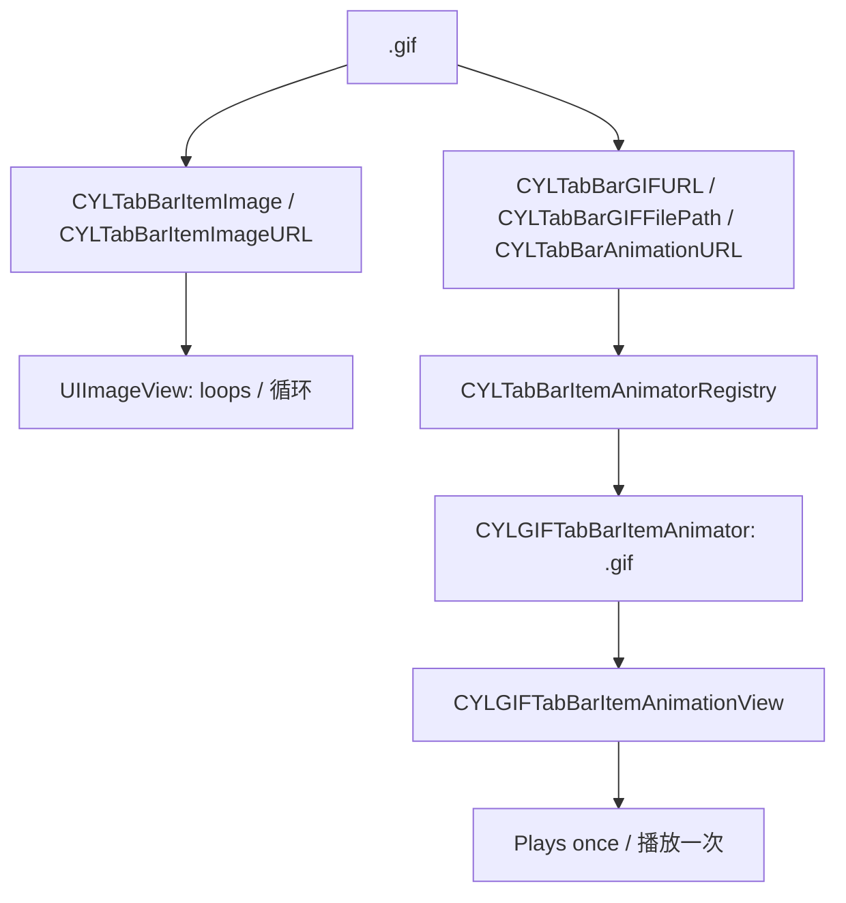

## [CN]使用方法
## [EN]Usage

```ruby
# A GIF as an image needs no subspec. The keys below need this one, which has no third-party dependency.
# 作为图片的 GIF 不需要子库。下面的 key 需要这个子库，它不依赖第三方库。
pod 'CYLTabBarController/GIF'
```

```objc
// Plays once when selected. The image keys stay: they show if the file cannot be loaded.
// 选中时播放一次。图片 key 要保留：文件无法加载时显示。
@{ CYLTabBarItemTitle : @"Home",
   CYLTabBarItemImage : @"home_normal",
   CYLTabBarItemSelectedImage : @"home_highlight",
   CYLTabBarGIFFilePath : [[NSBundle mainBundle] pathForResource:@"tab_rocket" ofType:@"gif"],
   CYLTabBarGIFSize : [NSValue valueWithCGSize:CGSizeMake(30, 30)] }

// Keeps looping: no animation key. 一直循环：没有动画 key。
@{ CYLTabBarItemTitle : @"Messages",
   CYLTabBarItemImage : @"message_normal",
   CYLTabBarItemImageURL : [[NSBundle mainBundle] URLForResource:@"tab_fire" withExtension:@"gif"],
   CYLTabBarItemImageURLSize : [NSValue valueWithCGSize:CGSizeMake(30, 30)] }
```

```swift
// The generic helper finds the file by name and picks the library by its extension. 通用函数按名称查找文件，并按扩展名选择动画库。
var item = CYLTabBarItemAttributesAddingAnimationFile(attributes, "tab_star.gif", nil) as? [String: Any]
item?[CYLTabBarAnimationSize] = NSValue(cgSize: CGSize(width: 30, height: 30))
```

| Key | 说明 / Description |
|:---|:---|
| `CYLTabBarGIFURL` | 本地 `.gif` 文件的 `NSURL` / The `NSURL` of a local `.gif` file |
| `CYLTabBarGIFFilePath` | 其完整路径（`NSString`）；只写文件名时找不到文件，请用 `CYLTabBarItemAttributesAddingAnimationFile()` / Its full path (`NSString`); a bare file name finds nothing, use `CYLTabBarItemAttributesAddingAnimationFile()` |
| `CYLTabBarGIFSize` | 视图尺寸，`CGSize` 的 `NSValue` / The view size, an `NSValue` of `CGSize` |
| `CYLTabBarGIFDarkURL` / `CYLTabBarGIFDarkFilePath` | 深色模式版本 / The Dark Mode version |

## [CN]实现结构：又一个动画库
## [EN]Implementation: one more animation library

| 中文 | English |
|:---|:---|
| GIF 是继 Lottie、PAG、Rive 之后的又一个动画库，严格通过公开协议接入（[Tab-Bar-Item-Animation.md](Tab-Bar-Item-Animation.md) 的方式 A）：只新增一个目录和一个子库，引擎、注册表、Core 都不知道 GIF 的存在。Core 中只新增了一个读取帧时长的方法 `+[UIImage cyl_GIFFrameDelayWithProperties:]`，图片入口与动画入口共用它。 | GIF is one more animation library after Lottie, PAG and Rive, added strictly through the public protocols (way A in [Tab-Bar-Item-Animation.md](Tab-Bar-Item-Animation.md)): one new folder and one new subspec. The engine, the registry and Core do not know about GIF. Core only gains `+[UIImage cyl_GIFFrameDelayWithProperties:]`, which reads a frame's delay and is shared by the image and the animation entries. |
| 各帧通过 layer `contents` 的关键帧动画播放，因此保留各自的时长；`UIImageView.animationImages` 会让每一帧时长相同。 | The frames play through a keyframe animation of the layer's `contents`, so each keeps its own delay; `UIImageView.animationImages` gives every frame the same one. |

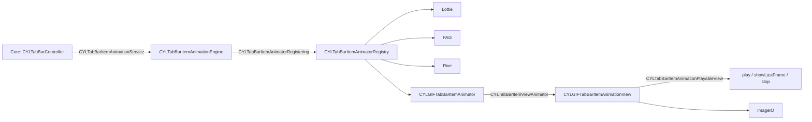

## [CN]三种样式
## [EN]The three styles

| 中文 | English |
|:---|:---|
| GIF、PAG、Rive 都支持液态玻璃、扁平样式与经典 TabBar。`Example-GIF`、`Example-PAG`、`Example-Rive` 的设置列表导航栏右侧有切换按钮：**Flat Design** 切换到扁平样式，再次点击回到系统样式（iOS 26 及以后为液态玻璃，之前为经典 TabBar）。启动参数 `-CYLDemoTabBarFlatDesign YES` 效果相同。扁平样式需要在创建控制器时传入 `styleType:`，创建之后再修改不起作用。 | GIF, PAG and Rive all work with Liquid Glass, FlatDesign and the classic tab bar. In `Example-GIF`, `Example-PAG` and `Example-Rive`, a button on the right of the settings list's navigation bar switches: **Flat Design** goes to FlatDesign, and tapping again returns to the system style (Liquid Glass on iOS 26 and later, the classic tab bar before). The launch argument `-CYLDemoTabBarFlatDesign YES` does the same. FlatDesign must be given as `styleType:` when the controller is created; changing it afterwards has no effect. |

| 中文 | English |
|:---|:---|
| 经典 TabBar：页面设置 `self.title` 时，UIKit 会修改 Tab 的标题，并用新按钮替换该 Tab 的按钮。库会在新按钮上恢复动画并继续播放，这适用于所有动画库。如果不想修改 Tab 的标题，请设置 `navigationItem.title`。 | The classic tab bar: when a page sets `self.title`, UIKit changes the tab's title and replaces the tab's button with a new one. The library restores the animation on the new button and goes on playing, for every animation library. To keep the tab's title, set `navigationItem.title` instead. |

### [CN]截图：先后依次是启动、点击后、播放结束
### [EN]Screenshots: launch, just after the tap, and when it has finished

| 液态玻璃 / Liquid Glass | 扁平样式 / FlatDesign | 经典 TabBar / Classic |
|:---|:---|:---|
| 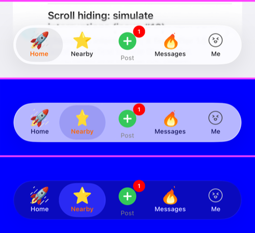 | 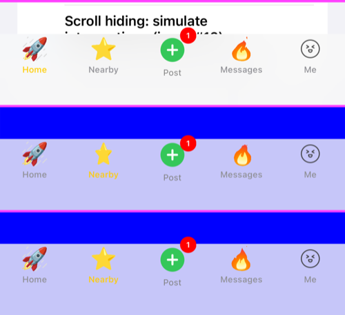 | 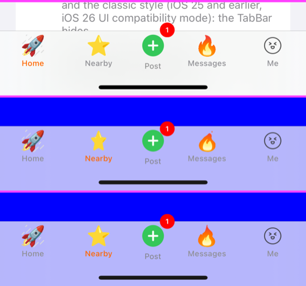 |
| 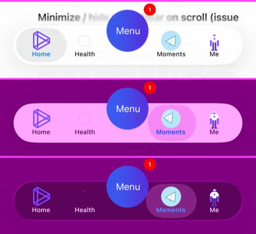 | 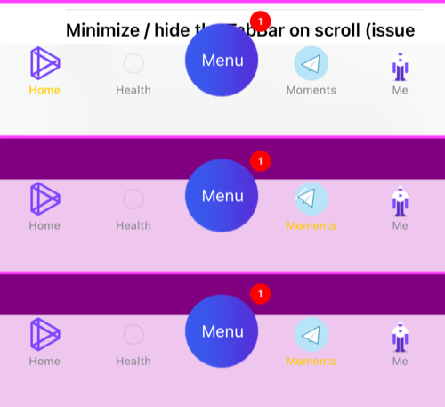 | 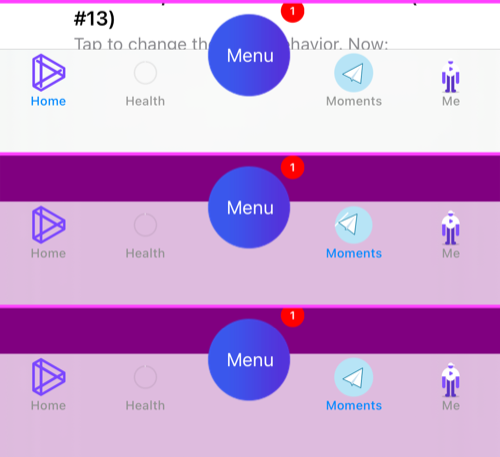 |
| 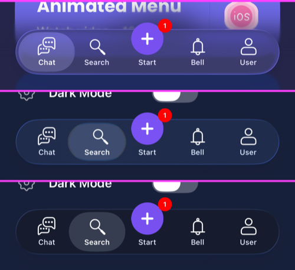 | 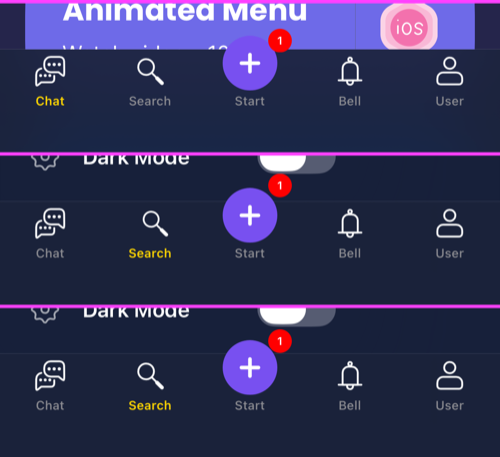 | 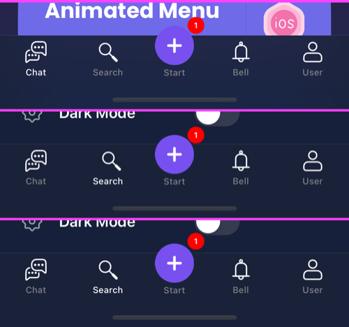 |

## [CN]Demo
## [EN]Demo

| 中文 | English |
|:---|:---|
| `Example-GIF`：第 1 个 Tab 使用 `CYLTabBarGIFFilePath`，第 2 个 Tab 使用 `CYLTabBarItemAttributesAddingAnimationFile()`，都是选中时播放一次；第 3 个 Tab 使用 `CYLTabBarItemImageURL`，一直循环；第 4 个 Tab 是静态图片。素材来自 Google 的 Noto Emoji Animation（CC BY 4.0），见 [Example-GIF/README.md](../Example-GIF/README.md)。 | `Example-GIF`: tab 1 uses `CYLTabBarGIFFilePath` and tab 2 `CYLTabBarItemAttributesAddingAnimationFile()`, both playing once when selected; tab 3 uses `CYLTabBarItemImageURL` and keeps looping; tab 4 is a static image. The icons are Google's Noto Emoji Animation (CC BY 4.0), see [Example-GIF/README.md](../Example-GIF/README.md). |
| Android 版 `example-gif`（[Android-Examples.md](Android-Examples.md)）使用同样的 GIF 文件与 key；Android 库的 `CYLGIFDrawable` 让作为图片传入的 GIF 同样循环播放。 | The Android `example-gif` ([Android-Examples.md](Android-Examples.md)) uses the same GIF files and keys; the Android library's `CYLGIFDrawable` makes a GIF given as an image loop too. |

## [CN]限制
## [EN]Limits

| 中文 | English |
|:---|:---|
| Swift Package Manager 与 Carthage 也会编译 GIF 动画库，但不公开 `CYLTabBarGIF…` key：请使用通用 key `CYLTabBarAnimationURL`、`CYLTabBarAnimationFilePath`、`CYLTabBarAnimationSize`。 | Swift Package Manager and Carthage build the GIF library too, but do not expose the `CYLTabBarGIF…` keys: use the generic keys `CYLTabBarAnimationURL`, `CYLTabBarAnimationFilePath` and `CYLTabBarAnimationSize`. |
| 动画 key 只接受本地文件。网络上的 GIF 请作为图片传入（循环），或先下载到本地再使用动画 key。 | The animation keys take local files only. Give a GIF from the network as an image (it loops), or download it first and use an animation key. |
| GIF 没有颜色图层，因此 `CYLTabBarAnimationColors` 与 `CYLTabBarAnimationDarkColors` 对它无效；深色模式请提供单独的文件。`tabBarItemAnimationSpeed` 对它也无效：各帧使用文件中的时长。 | A GIF has no color layers, so `CYLTabBarAnimationColors` and `CYLTabBarAnimationDarkColors` do not apply; give a separate file for Dark Mode. `tabBarItemAnimationSpeed` does not apply either: the frames use the delays in the file. |
| 所有帧在创建视图时解码到内存，请使用为图标制作的小文件。没有引入 `GIF` 子库时，这些 key 不存在，编译会失败，而不是被静默忽略。 | Every frame is decoded into memory when the view is made, so use a small file made for icons. Without the `GIF` subspec these keys do not exist and the build fails, instead of being silently ignored. |
| 节日皮肤的图标显示在动画之上，会遮住 GIF 动画（[Theme-Switching.md](Theme-Switching.md)）。 | A holiday skin's icons are shown over the animations and hide a GIF animation ([Theme-Switching.md](Theme-Switching.md)). |
