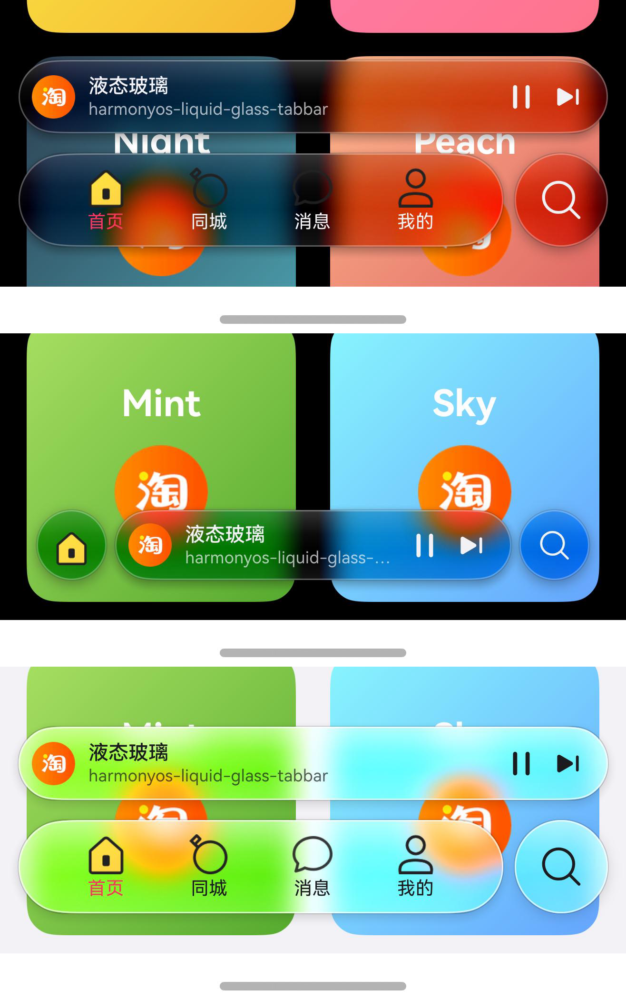

# 鸿蒙液态玻璃对标 / HarmonyOS Liquid Glass parity

<!-- bound-classes: none -->
<!-- binding:start -->
<!-- Generated by scripts/update-docs-navigation.py; do not edit by hand. -->

| 中文 | English |
|:---|:---|
| 本文档不绑定代码类。 | This document is not bound to a code class. |

<!-- binding:end -->

| 中文 | English |
|:---|:---|
| 对比本项目鸿蒙端的液态玻璃 TabBar（`CrossPlatform/harmonyos-cyltabbar`，`CYLTabBarStyleType.LiquidGlass`）与参考工程 [harmonyos-liquid-glass-tabbar](https://github.com/DUDUXXR2/harmonyos-liquid-glass-tabbar)（MIT，提交 `70c09b9`）。目标：效果与参考工程一模一样。满分 100：每一行按差距打分，全部满分即 100。 | Compares this project's HarmonyOS Liquid Glass tab bar (`CrossPlatform/harmonyos-cyltabbar`, `CYLTabBarStyleType.LiquidGlass`) with the reference project [harmonyos-liquid-glass-tabbar](https://github.com/DUDUXXR2/harmonyos-liquid-glass-tabbar) (MIT, commit `70c09b9`). Goal: the same effect as the reference. Full score 100: each row is scored by its gap; every row at full marks is 100. |

## 目录 / Contents

<!-- navigation:start -->
<!-- Generated by scripts/update-docs-navigation.py; do not edit by hand. -->

| 中文 | English |
|:---|:---|
| [范围](#范围--scope) | [Scope](#范围--scope) |
| [待办](#待办--todo) | [TODO](#待办--todo) |
| [当前得分](#当前得分--current-score) | [Current score](#当前得分--current-score) |
| [打分表](#打分表--scoring-table) | [Scoring table](#打分表--scoring-table) |
| [达到满分的路径](#达到满分的路径--path-to-100) | [Path to 100](#达到满分的路径--path-to-100) |
| [任务记录](#任务记录--task-log) | [Task log](#任务记录--task-log) |

<!-- navigation:end -->

## 范围 / Scope

| 中文 | English |
|:---|:---|
| 2026-11-17 起：库（core）的液态玻璃一比一复刻 iOS 端样式（悬浮胶囊距两侧与底部 21 vp、高 61 vp，中性镜片，加号按钮在胶囊内凸起，蓝色选中色、系统文字色的未选中标题；对比图见 harmonyos-liquid-glass-ios-vs-harmonyos.png）。参考工程的效果只在示例层实现：`entry/src/main/ets/demo/CYLGlassDock.ets` 与示例页 `pages/LiquidGlassDock`，从「同城」Tab 的「液态玻璃：参考工程的透视效果」行推入。目标是透视（玻璃）效果与参考工程一模一样，而不是 UI 一模一样。下表为该示例页打分。 | Since 2026-11-17: the library's (core) Liquid Glass is a one-to-one copy of the iOS style (floating capsule 21 vp from the sides and the bottom, 61 vp high, a neutral lens, the plus button raised inside the capsule, blue tint, label-colored unselected titles; comparison: harmonyos-liquid-glass-ios-vs-harmonyos.png). The reference's effect lives in the example layer only: `entry/src/main/ets/demo/CYLGlassDock.ets` and the example page `pages/LiquidGlassDock`, pushed from the row "Liquid Glass: the see-through effect of the reference" on the 同城 tab. The goal is the same see-through (glass) effect as the reference, not the same UI. The table below scores that example page. |

## 待办 / TODO

| 中文 | English |
|:---|:---|
| 本条按用户要求使用英文（见右列）。 | TODO (2026-11-17): the full refraction effect needs SDK 6.1.1 (API 24) and an API 24+ emulator image. The reference's HDS system material (`HdsTabs` `barFloatingStyle.systemMaterialEffect`, `hdsMaterial`, API 26 `uiMaterial.ImmersiveMaterial`) does not exist in the SDK installed here (DevEco Studio SDK 6.0.1, API 21; emulator image HarmonyOS 6.0.1), and API 21's public `uiEffect` has only `blur`. The maintainer installs, in DevEco Studio with a Huawei account: a DevEco Studio with the HarmonyOS 6.1.1 (API 24) SDK or later, and an API 24+ phone image in Device Manager. Then rows 1, 2, 5, 6 and 18 (about 24 points) switch CYLGlassDock to the system material, with the blur kept as the fallback below API 24. |

## 当前得分 / Current score

| 中文 | English |
|:---|:---|
| **73 / 100**（2026-11-17，示例页 `pages/LiquidGlassDock`）。光学 17 / 40，结构与布局 23 / 25，收起与展开 25 / 25，兼容与健壮性 7 / 10。起点为 40 / 100。剩下的 27 分中，约 24 分（第 1、2、5、6、18 行）依赖 API 24+ 的系统材质（见上方待办）。 | **73 / 100** (2026-11-17, example page `pages/LiquidGlassDock`). Optics 17 / 40, structure and layout 23 / 25, collapse and expand 25 / 25, compatibility and robustness 7 / 10. Started at 40 / 100. Of the 27 points left, about 24 (rows 1, 2, 5, 6 and 18) depend on the API 24+ system material (see the TODO above). |
| 最大差距是材质：参考工程使用 HDS 系统材质（`HdsTabs` 的 `barFloatingStyle.systemMaterialEffect`，`hdsMaterial.MaterialType.ADAPTIVE` + `MaterialLevel.EXQUISITE`；API 26 的 `uiMaterial.ImmersiveMaterial`），这些 API 需要 SDK 6.1.1（API 24）及以上。本机 DevEco Studio 的 SDK 与模拟器是 6.0.1（API 21），其中的 `HdsTabs` 没有 `barFloatingStyle`、`systemMaterial` 与 `hdsMaterial`，`materialFilter` 也是 API 23 起才有。因此在 API 21 上光学部分最多约 20 / 40；要到 100 必须先安装 SDK 6.1.1+ 与 API 24+ 的模拟器镜像（需要维护者在 DevEco Studio 中下载）。 | The largest gap is the material: the reference uses HDS system material (`HdsTabs` `barFloatingStyle.systemMaterialEffect`, `hdsMaterial.MaterialType.ADAPTIVE` + `MaterialLevel.EXQUISITE`; `uiMaterial.ImmersiveMaterial` on API 26), which needs SDK 6.1.1 (API 24) or later. This Mac's DevEco Studio SDK and emulator are 6.0.1 (API 21): its `HdsTabs` has no `barFloatingStyle`, `systemMaterial` or `hdsMaterial`, and `materialFilter` starts at API 23. So on API 21 the optics can reach about 20 / 40 at most; reaching 100 needs SDK 6.1.1+ and an API 24+ emulator image first (the maintainer downloads them in DevEco Studio). |

上：参考工程（真机，深色内容）；下：本项目（Mate 70 Pro 模拟器，HarmonyOS 6.0.1，API 21，`4d0de6b`，2026-11-16，浅色内容）。/ Top: the reference (device, dark content); bottom: this project (Mate 70 Pro emulator, HarmonyOS 6.0.1, API 21, `4d0de6b`, 2026-11-16, light content).

## 打分表 / Scoring table

| # | 项目 / Item | 权重 / Weight | 参考工程 / Reference | 本项目 / Ours | 得分 / Score | 状态 / Status |
|:---|:---|:---|:---|:---|:---|:---|
| 1 | 系统材质 / System material | 10 | HDS system material on each capsule (`hdsMaterial` ADAPTIVE, level EXQUISITE), real glass rendered by the system | `backgroundEffect` blur imitation (radius, saturation 1.8, brightness 1.08) | 0 | TODO (needs SDK 6.1.1 / API 24+) |
| 2 | 边缘折射 / Edge refraction | 8 | Content behind is bent and magnified near the capsule edges (lens look), streaks along the long edges | Uniform blur, no bending | 0 | TODO (system material; no API 21 equivalent found) |
| 3 | 模糊强度与色彩 / Blur strength and color | 6 | Strong soft blur, colors kept vivid; dark glass over dark content, light over light | Blur 48 vp with saturation 2.0; light glass `#1AFFFFFF` (brightness 1.12) or dark glass `#2E000000` (brightness 0.8); the colors behind stay vivid | 5 | TODO (material adapts to the content itself) |
| 4 | 立体描边 / Convex rim | 5 | Thin bright rim with an inner shadow, the capsule reads as a convex glass body | Bright outer rim `#99FFFFFF` plus a faint dark inner line (`outline` 0.5 vp `#1F000000`), drawn under the tabs | 4 | TODO |
| 5 | 点光源 / Point light | 5 | Material point light (`lightEffect`) that follows the touch | A soft radial light spot appears where the finger touches and follows it | 3 | TODO (system lightEffect needs API 24+) |
| 6 | 按压形变 / Press deformation | 3 | Material press deformation (`interactive: true`), elastic | Spring lift and 2 % swell of the capsule and the lens | 2 | TODO |
| 7 | 材质阴影 / Material shadow | 3 | `applyShadow: true` | `shadow` radius 20, `#22000000`, offset 6 on every glass shape | 3 | DONE |
| 8 | 三个独立胶囊 / Three separate capsules | 8 | Tab capsule (4 tabs), search ball at the right end, mini music bar above the tab row, each its own glass | Tab capsule, search ball at the right end and a mini music bar above, each its own glass (`CYLGlassDock`) | 8 | DONE |
| 9 | 几何尺寸 / Geometry | 5 | Bottom 24, sides 11, row 56 (42 collapsed), slot 62, icon 24, label 11 vp, gap 2, ball 56 / 42, capsule leaves 63 vp for the ball | Bottom 24, sides 11, row 56 / 42, slot 62, right reserve 63, ball 56 / 42, gap 5, music bar 44 vp ending 92 vp above the bottom, labels 11 vp, gap 2 | 5 | DONE |
| 10 | 选中样式 / Selected style | 4 | Tint only (`#FF375F` icon and label), no pill behind the tab | Tint only (`#FF375F` label, highlighted icon), no pill | 4 | DONE |
| 11 | 自绘内容 / Self-drawn content | 3 | Content drawn by the app over the material, `hitTestBehavior(Transparent)` so the material still gets touches | Content drawn by the controller over the glass | 3 | DONE |
| 12 | 深浅色自适应 / Dark and light | 5 | Material ADAPTIVE; text `#F2F2F7` dark / `#1C1C1E` light | Glass and texts follow dark and light (moon / sun button); checked in both | 4 | TODO (material adapts to content, ours to the mode) |
| 13 | 滚动触发 / Scroll trigger | 6 | Finger on screen only; up 8 vp accumulated collapses, any down frame expands; one switch per gesture; works by default | Finger on the page only; down 8 vp in total minimizes, any frame up expands; one switch per gesture; on by default | 6 | DONE |
| 14 | 收起后的布局 / Collapsed layout | 6 | One row: tab ball (22 vp from the edge), music bar in the middle, search ball at the right, gaps 5 vp | One row: tab ball 22 vp from the edge, music bar in the middle, search ball at the right, gaps 5 vp | 6 | DONE |
| 15 | 收起形变细节 / Morph details | 6 | Selected icon slides to the ball center and scales to half the ball, label fades, other tabs vanish at once (outside the animation) | Selected tab slides to the ball center and scales 24 to 21 vp, titles fade, other tabs vanish at once | 6 | DONE |
| 16 | 单一驱动 / Single driver | 4 | One `@State` and one `animateTo` (300 ms EaseInOut); component box height constant, no flicker | One `animateTo` (300 ms EaseInOut); every shape placed absolutely in a full-page layer, no relayout | 4 | DONE |
| 17 | 收起态点击 / Taps when collapsed | 3 | Tap the tab ball or the search ball: expand first, no action | Tab ball and search ball: the first tap expands only | 3 | DONE |
| 18 | 材质兼容层 / Material compatibility | 5 | `MaterialCompat`: `apiAvailable` + `isImmersiveMaterialSupported`, cached, never at module level, blur fallback by strength | Blur fallback only (`CYLLiquidGlassMaterial.blurFallback`), no runtime probe | 2 | TODO |
| 19 | 无黑纱 / No dark veil | 5 | All three HdsTabs plates turned off (bar color, `barBackgroundStyle`, `barBackgroundBlurStyle(NONE)`) | No HdsTabs, no plate under the capsule | 5 | DONE |

示例页（上：深色展开；中：手指上滑后缩小成一行三段；下：浅色），Mate 70 Pro 模拟器，HarmonyOS 6.0.1，API 21，2026-11-17。/ The example page (top: dark, expanded; middle: minimized after a finger scroll, one row of three shapes; bottom: light); Mate 70 Pro emulator, HarmonyOS 6.0.1, API 21, 2026-11-17.

## 达到满分的路径 / Path to 100

| 中文 | English |
|:---|:---|
| 1. 维护者在 DevEco Studio 中安装 SDK 6.1.1（API 24）或更高版本，以及 API 24+ 的模拟器镜像（第 1、2、5、6、18 行依赖它）。 | 1. The maintainer installs SDK 6.1.1 (API 24) or later in DevEco Studio, and an API 24+ emulator image (rows 1, 2, 5, 6 and 18 depend on it). |
| 2. 按参考工程重写液态玻璃：每个胶囊一个 `HdsTabs`（`barFloatingStyle` + `systemMaterialEffect`，关闭三层底板），内容自绘并 `hitTestBehavior(Transparent)`；移植 `MaterialCompat`（API 24 以下退化为模糊）。 | 2. Rewrite Liquid Glass after the reference: one `HdsTabs` per capsule (`barFloatingStyle` + `systemMaterialEffect`, the three plates off), self-drawn content with `hitTestBehavior(Transparent)`; port `MaterialCompat` (blur fallback below API 24). |
| 3. 第 8、14、17 行：把 PlusButton 映射为右侧独立的球（对应参考工程的搜索球、iOS 26 的搜索角色），并增加可选的底部附属条 API（对应参考工程的音乐条、iOS 26 的 `tabViewBottomAccessory`）。 | 3. Rows 8, 14 and 17: map the plus button to a separate ball at the right (the reference's search ball, iOS 26's search role), and add an optional bottom accessory API (the reference's music bar, iOS 26 `tabViewBottomAccessory`). |
| 4. 第 9、10、12、13、15、16 行：可在 API 21 上先做：参考工程的尺寸（槽宽 62、字号 11、右侧预留 63）、只用颜色表示选中、深浅色、手指判定与非对称阈值、图标缩放、固定组件盒高度。 | 4. Rows 9, 10, 12, 13, 15 and 16 can be done on API 21 first: the reference's sizes (slot 62, label 11, right reserve 63), tint-only selection, dark and light, the finger check and asymmetric thresholds, the icon scale, a constant component box height. |

## 任务记录 / Task log

| 中文 | English |
|:---|:---|
| 本条按用户要求使用英文（见右列）。 | DONE (2026-11-17, scope correction): user prompt, verbatim: "The full refraction effect needs SDK 6.1.1 (API 24) and an API 24+ emulator image 记录成todo 不对。我是想要液态玻璃效果一模一样，透视效果。不是UI一模一样。你的这个代码，做成 example push到下一集页面，在example层实现。core层不改变我们原本的样式 以iOS端效果为准" English: record the API 24 requirement as a TODO; the goal is the same see-through glass effect, not the same UI; move this code into an example page pushed from a row, in the example layer; the core keeps the project's own style, iOS being the standard. Done: core restored to 3a77b0b (CYLTabBarController.ets, CYLFlatDesignTabBar.ets; CYLLiquidGlass.ets removed from the library); example CYLGlassDock + pages/LiquidGlassDock; TODO above. |
| 本条按用户要求使用英文（见右列）。 | SUPERSEDED (2026-11-17, fix to 100; the layout work moved to the example, see the row above): user prompt, verbatim: "修复到100分" English: fix Liquid Glass up to 100. Done on API 21: rows 3, 4, 5, 7 to 10, 12 to 17 (70 / 100). Blocked: rows 1, 2, 5, 6 and 18 need the HDS system material, SDK 6.1.1 (API 24) or later, which must be downloaded in DevEco Studio with the maintainer's Huawei account; this Mac has SDK 6.0.1 (API 21) only. |
| 本条按用户要求使用英文（见右列）。 | DONE (2026-11-17, scoring table): user prompt, verbatim: "我想要和下面这个项目一模一样的效果，我之前在对话中强调过你参考这个项目，https://github.com/DUDUXXR2/harmonyos-liquid-glass-tabbar 现在代码的液态玻璃效果完全需要重构。根据这个项目创建一个打分表格，对比我们的项目与他的项目之间液态玻璃的差距，满分100分，模糊差距。" English: the user wants exactly the reference's effect; the Liquid Glass code needs a full rebuild; create a scoring table comparing our Liquid Glass with the reference, out of 100, including the blur gap. Result: this document, 40 / 100. |
