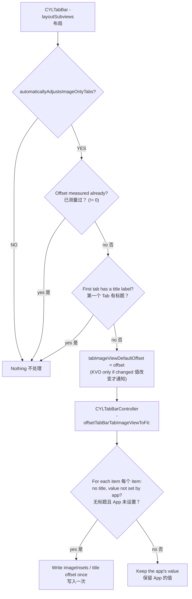

# [CN]纯图标 Tab 的自动居中
# [EN]Automatic centering of image-only tabs

<!-- bound-classes: CYLTabBarController, CYLTabBar -->
<!-- binding:start -->
<!-- Generated by scripts/update-docs-navigation.py; do not edit by hand. -->

| 中文 | English |
|:---|:---|
| 绑定的代码类 `CYLTabBarController`：[`CYLTabBarController/CYLTabBarController.h`](../CYLTabBarController/CYLTabBarController.h) | Bound to the class `CYLTabBarController`: [`CYLTabBarController/CYLTabBarController.h`](../CYLTabBarController/CYLTabBarController.h) |
| 绑定的代码类 `CYLTabBar`：[`CYLTabBarController/CYLTabBar.h`](../CYLTabBarController/CYLTabBar.h) | Bound to the class `CYLTabBar`: [`CYLTabBarController/CYLTabBar.h`](../CYLTabBarController/CYLTabBar.h) |

<!-- binding:end -->

| 中文 | English |
|:---|:---|
| 解决 [#257](https://github.com/ChenYilong/CYLTabBarController/issues/257) 与 [#522](https://github.com/ChenYilong/CYLTabBarController/issues/522)。两个 issue 相关：它们来自同一段代码，即经典 TabBar 对“纯图标 Tab”（没有标题的 Tab）的自动居中。#257 看到的是它在每次布局时被反复触发（在页面上给 label 赋值就会触发 KVO 回调）；#522 看到的是它覆盖了 App 设置的 `titlePositionAdjustment`。 | Solves [#257](https://github.com/ChenYilong/CYLTabBarController/issues/257) and [#522](https://github.com/ChenYilong/CYLTabBarController/issues/522). The two issues are related: both come from the same code, the classic tab bar's automatic centering of "image-only tabs" (tabs without a title). #257 saw it fire again on layout passes (setting a label's text on a page triggered the KVO callback); #522 saw it override the `titlePositionAdjustment` set by the app. |

## [CN]目录
## [EN]Contents

<!-- navigation:start -->
<!-- Generated by scripts/update-docs-navigation.py; do not edit by hand. -->

| 中文 | English |
|:---|:---|
| [原理与问题](#cn原理与问题) | [How it works, and what went wrong](#enhow-it-works-and-what-went-wrong) |
| [现在的规则](#cn现在的规则) | [Rules now](#enrules-now) |
| [新 API](#cn新-api) | [New API](#ennew-api) |
| [代码演示](#cn代码演示) | [Code](#encode) |
| [流程图](#cn流程图) | [Flow](#enflow) |
| [测试与截图](#cn测试与截图) | [Testing and screenshots](#entesting-and-screenshots) |

<!-- navigation:end -->

## [CN]原理与问题
## [EN]How it works, and what went wrong

| 中文 | English |
|:---|:---|
| 1. `CYLTabBar` 在 `-layoutSubviews` 中检查第一个 Tab 按钮：没有标题 label 时，计算图片垂直居中所需的偏移，写入 `tabImageViewDefaultOffset`。 | 1. In `-layoutSubviews`, `CYLTabBar` looks at the first tab button: when it has no title label, it computes how far the image has to move to be vertically centered and stores it in `tabImageViewDefaultOffset`. |
| 2. `CYLTabBarController` 通过 KVO 监听该属性，在回调 `-offsetTabBarTabImageViewToFit:` 中修改 TabBarItem。 | 2. `CYLTabBarController` observes that property with KVO and changes the tab bar items in `-offsetTabBarTabImageViewToFit:`. |
| **#522**：回调以前会给**所有** item 设置 `imageInsets`，并在控制器级别 `titlePositionAdjustment` 为零时把每个 item 的 `titlePositionAdjustment` 设为 `UIOffsetMake(0, MAXFLOAT)`。直接设置在 item 上、或通过 `CYLTabBarItemTitlePositionAdjustment` / `CYLTabBarItemImageInsets` 设置的值都被替换（issue 中说的“一直用的是代码里计算出来的值”）；只要第一个 Tab 没有标题，其他有标题的 Tab 的标题也会被移出屏幕。 | **#522**: the callback set `imageInsets` on **every** item and, while the controller-level `titlePositionAdjustment` was zero, set every item's `titlePositionAdjustment` to `UIOffsetMake(0, MAXFLOAT)`. Values set on the item, or through `CYLTabBarItemTitlePositionAdjustment` / `CYLTabBarItemImageInsets`, were replaced (the issue's "it always uses the value computed in the code"); and as soon as the first tab had no title, the titles of the other tabs were moved off screen too. |
| **#257**：v1.13.1 每次布局都会重新计算并赋值，每次赋值都会发出 KVO 通知；之后加入的 `> 0` 判断对负偏移（图片低于中心）无效。页面上的任何布局（如给 label 赋值）都可能让 TabBar 重新布局，回调再次写入所有 item，写入 item 又导致 TabBar 重新布局；并且每次都基于已被移动过的图片计算，所以图标会跳动。 | **#257**: v1.13.1 computed and assigned the offset on every layout pass, and every assignment sent a KVO notification; the `> 0` check added later does not stop a negative offset (an image below the center). Any layout on the screen (e.g. setting a label's text) can lay the tab bar out again; the callback then wrote every item again, writing the items laid the tab bar out again, and each pass measured an image the previous pass had already moved, so the icons jumped. |

## [CN]现在的规则
## [EN]Rules now

| 中文 | English |
|:---|:---|
| 偏移只计算一次：任何非零值都会结束计算；值不变时不发 KVO 通知。 | The offset is measured once: any non-zero value ends the measurement, and no KVO notification is sent when the value does not change. |
| 只修改没有标题（`title.length == 0`）的 item；有标题的 Tab 保持不变。 | Only items without a title (`title.length == 0`) are changed; tabs with a title are left alone. |
| 只写入 App 保持为零的值：item 已有非零的 `imageInsets`，或已有 `titlePositionAdjustment`（直接设置、`CYLTabBarItemTitlePositionAdjustment` 或控制器级别的偏移）时，该值不会被替换。控制器级别非零的 `imageInsets` 仍然完全关闭该功能，与以前一致。 | Only values the app left at zero are written: an item that already has non-zero `imageInsets`, or a `titlePositionAdjustment` (set directly, through `CYLTabBarItemTitlePositionAdjustment`, or the controller-level offset), keeps it. A non-zero controller-level `imageInsets` still turns the whole feature off, as before. |
| 已写入的值不会重复写入，因此不会再引起额外的布局。 | A value already written is not written again, so it no longer causes extra layout passes. |
| 扁平样式（FlatDesign）不使用该功能，行为不变。 | FlatDesign does not use this feature; nothing changes there. |

## [CN]新 API
## [EN]New API

| 中文 | English |
|:---|:---|
| `CYLTabBarController` 新增 `@property (nonatomic, assign) BOOL automaticallyAdjustsImageOnlyTabs;`，默认 YES（保持原有的自动居中）。设为 NO 时 TabBar 不再测量偏移，回调不再修改 item；已经写入且之后未被 App 修改的值会被还原。这就是 #522 建议的“添加一个 BOOL 值来判断是否使用自定义的 titlePositionAdjustment”。现有 API 不变。 | `CYLTabBarController` gains `@property (nonatomic, assign) BOOL automaticallyAdjustsImageOnlyTabs;`, default YES (the automatic centering as before). Set to NO, the tab bar stops measuring and the callback no longer changes the items; values it already wrote, and the app has not changed since, are restored. This is the "BOOL to decide whether to use the custom titlePositionAdjustment" #522 asked for. No existing API changes. |
| 建议在 TabBar 布局之前（`-init…` 或 `-viewDidLoad`）设置，否则图标可能先移动一次再复原。 | Set it before the tab bar is laid out (in `-init…` or `-viewDidLoad`); otherwise the icons may move once and then move back. |

## [CN]代码演示
## [EN]Code

```objc
// Objective-C
CYLTabBarController *tabBarController = [CYLTabBarController tabBarControllerWithViewControllers:viewControllers
                                                                           tabBarItemsAttributes:tabBarItemsAttributes];
// Lay out image-only tabs yourself. 自行布局纯图标 Tab。
tabBarController.automaticallyAdjustsImageOnlyTabs = NO;

// Per-tab values now stay as set, even with the automatic centering on.
// 即使开启自动居中，每个 Tab 自己的值现在也会保持不变。
viewController.tabBarItem.imageInsets = UIEdgeInsetsMake(6, 0, -6, 0);
viewController.tabBarItem.titlePositionAdjustment = UIOffsetMake(0, -3);
```

```swift
// Swift
tabBarController.automaticallyAdjustsImageOnlyTabs = false
```

## [CN]流程图
## [EN]Flow



## [CN]测试与截图
## [EN]Testing and screenshots

| 中文 | English |
|:---|:---|
| 本次修改在 Linux 环境中完成，没有 Xcode、iOS SDK 与模拟器，未能编译和运行，因此没有截图。请在合并前用 Example 工程验证：纯图标 Tab 仍然居中；给 item 设置的 `titlePositionAdjustment` / `imageInsets` 生效；设置 `automaticallyAdjustsImageOnlyTabs = NO` 后图标保持系统默认位置。 | This change was made on Linux without Xcode, the iOS SDK or a simulator: it could not be built or run, so there are no screenshots. Please check it with the Example project before merging: image-only tabs are still centered; `titlePositionAdjustment` / `imageInsets` set on an item take effect; with `automaticallyAdjustsImageOnlyTabs = NO` the icons stay where UIKit puts them. |
