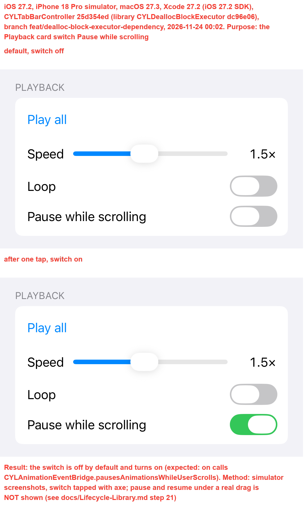
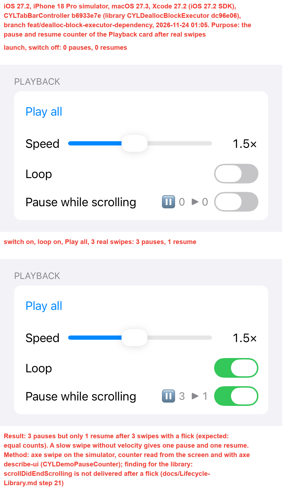
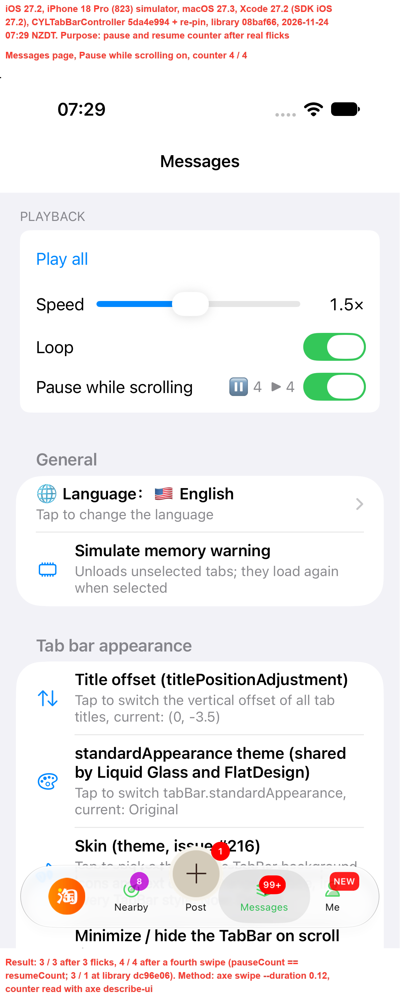
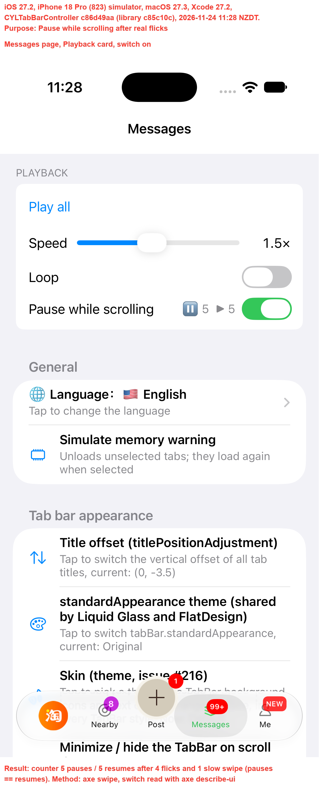

# [CN]生命周期库 CYLDeallocBlockExecutor
# [EN]The lifecycle library CYLDeallocBlockExecutor

<!-- bound-classes: CYLTabBarController -->
<!-- binding:start -->
<!-- Generated by scripts/update-docs-navigation.py; do not edit by hand. -->

| 中文 | English |
|:---|:---|
| 绑定的代码类 `CYLTabBarController`：[`CYLTabBarController/CYLTabBarController.h`](../CYLTabBarController/CYLTabBarController.h) | Bound to the class `CYLTabBarController`: [`CYLTabBarController/CYLTabBarController.h`](../CYLTabBarController/CYLTabBarController.h) |

<!-- binding:end -->

| 中文 | English |
|:---|:---|
| 本文记录把 [CYLDeallocBlockExecutor](https://github.com/ChenYilong/CYLDeallocBlockExecutor)（dealloc block 与 UIViewController 生命周期 block）接入 iOS 核心依赖的任务。 | This document tracks making [CYLDeallocBlockExecutor](https://github.com/ChenYilong/CYLDeallocBlockExecutor) (dealloc blocks and UIViewController lifecycle blocks) a dependency of the iOS core. |

## [CN]目录
## [EN]Contents

<!-- navigation:start -->
<!-- Generated by scripts/update-docs-navigation.py; do not edit by hand. -->

| 中文 | English |
|:---|:---|
| [任务记录](#cn任务记录) | [Task log](#entask-log) |
| &nbsp;&nbsp;&nbsp;&nbsp;↳ [DONE 100 / 100: CI break reported by CYLTableViewPlaceHolder (2026-11-23, branch `feat/dealloc-block-executor-dependency`)](#done-100--100-ci-break-reported-by-cyltableviewplaceholder-2026-11-23-branch-featdealloc-block-executor-dependency) | &nbsp;&nbsp;&nbsp;&nbsp;↳ [DONE 100 / 100: CI break reported by CYLTableViewPlaceHolder (2026-11-23, branch `feat/dealloc-block-executor-dependency`)](#done-100--100-ci-break-reported-by-cyltableviewplaceholder-2026-11-23-branch-featdealloc-block-executor-dependency) |
| &nbsp;&nbsp;&nbsp;&nbsp;↳ [TODO: CYLDeallocBlockExecutor as a core dependency (2026-11-22, branch `feat/dealloc-block-executor-dependency`)](#todo-cyldeallocblockexecutor-as-a-core-dependency-2026-11-22-branch-featdealloc-block-executor-dependency) | &nbsp;&nbsp;&nbsp;&nbsp;↳ [TODO: CYLDeallocBlockExecutor as a core dependency (2026-11-22, branch `feat/dealloc-block-executor-dependency`)](#todo-cyldeallocblockexecutor-as-a-core-dependency-2026-11-22-branch-featdealloc-block-executor-dependency) |
| &nbsp;&nbsp;&nbsp;&nbsp;↳ [TODO: all platforms, step 1 Android (2026-11-23, branch `feat/dealloc-block-executor-dependency`)](#todo-all-platforms-step-1-android-2026-11-23-branch-featdealloc-block-executor-dependency) | &nbsp;&nbsp;&nbsp;&nbsp;↳ [TODO: all platforms, step 1 Android (2026-11-23, branch `feat/dealloc-block-executor-dependency`)](#todo-all-platforms-step-1-android-2026-11-23-branch-featdealloc-block-executor-dependency) |
| &nbsp;&nbsp;&nbsp;&nbsp;↳ [TODO: all platforms, step 2 HarmonyOS (2026-11-23, branch `feat/dealloc-block-executor-dependency`)](#todo-all-platforms-step-2-harmonyos-2026-11-23-branch-featdealloc-block-executor-dependency) | &nbsp;&nbsp;&nbsp;&nbsp;↳ [TODO: all platforms, step 2 HarmonyOS (2026-11-23, branch `feat/dealloc-block-executor-dependency`)](#todo-all-platforms-step-2-harmonyos-2026-11-23-branch-featdealloc-block-executor-dependency) |
| &nbsp;&nbsp;&nbsp;&nbsp;↳ [TODO: all platforms, step 3 Mini program (2026-11-23, branch `feat/dealloc-block-executor-dependency`)](#todo-all-platforms-step-3-mini-program-2026-11-23-branch-featdealloc-block-executor-dependency) | &nbsp;&nbsp;&nbsp;&nbsp;↳ [TODO: all platforms, step 3 Mini program (2026-11-23, branch `feat/dealloc-block-executor-dependency`)](#todo-all-platforms-step-3-mini-program-2026-11-23-branch-featdealloc-block-executor-dependency) |
| &nbsp;&nbsp;&nbsp;&nbsp;↳ [TODO: all platforms, step 4 move to the library's pull request #12 line (2026-11-23, branch `feat/dealloc-block-executor-dependency`)](#todo-all-platforms-step-4-move-to-the-librarys-pull-request-12-line-2026-11-23-branch-featdealloc-block-executor-dependency) | &nbsp;&nbsp;&nbsp;&nbsp;↳ [TODO: all platforms, step 4 move to the library's pull request #12 line (2026-11-23, branch `feat/dealloc-block-executor-dependency`)](#todo-all-platforms-step-4-move-to-the-librarys-pull-request-12-line-2026-11-23-branch-featdealloc-block-executor-dependency) |
| &nbsp;&nbsp;&nbsp;&nbsp;↳ [TODO: observable moments for badges, animation and scrolling, step 8 (2026-11-23, branch `feat/dealloc-block-executor-dependency`)](#todo-observable-moments-for-badges-animation-and-scrolling-step-8-2026-11-23-branch-featdealloc-block-executor-dependency) | &nbsp;&nbsp;&nbsp;&nbsp;↳ [TODO: observable moments for badges, animation and scrolling, step 8 (2026-11-23, branch `feat/dealloc-block-executor-dependency`)](#todo-observable-moments-for-badges-animation-and-scrolling-step-8-2026-11-23-branch-featdealloc-block-executor-dependency) |
| &nbsp;&nbsp;&nbsp;&nbsp;↳ [TODO: observing, debugging and the session split, step 9 (2026-11-23, branch `feat/dealloc-block-executor-dependency`)](#todo-observing-debugging-and-the-session-split-step-9-2026-11-23-branch-featdealloc-block-executor-dependency) | &nbsp;&nbsp;&nbsp;&nbsp;↳ [TODO: observing, debugging and the session split, step 9 (2026-11-23, branch `feat/dealloc-block-executor-dependency`)](#todo-observing-debugging-and-the-session-split-step-9-2026-11-23-branch-featdealloc-block-executor-dependency) |
| [Step 11: iOS animation events (static, not compiled) / 第 11 步：iOS 动画事件（静态编写，未编译）](#step-11-ios-animation-events-static-not-compiled--第-11-步ios-动画事件静态编写未编译) | [Step 11: iOS animation events (static, not compiled) / 第 11 步：iOS 动画事件（静态编写，未编译）](#step-11-ios-animation-events-static-not-compiled--第-11-步ios-动画事件静态编写未编译) |
| [Step 12: native host events for React Native and Flutter (static) / 第 12 步：React Native 与 Flutter 的原生宿主事件（静态）](#step-12-native-host-events-for-react-native-and-flutter-static--第-12-步react-native-与-flutter-的原生宿主事件静态) | [Step 12: native host events for React Native and Flutter (static) / 第 12 步：React Native 与 Flutter 的原生宿主事件（静态）](#step-12-native-host-events-for-react-native-and-flutter-static--第-12-步react-native-与-flutter-的原生宿主事件静态) |
| [Step 13: HarmonyOS wiring (static) / 第 13 步：HarmonyOS 接线（静态）](#step-13-harmonyos-wiring-static--第-13-步harmonyos-接线静态) | [Step 13: HarmonyOS wiring (static) / 第 13 步：HarmonyOS 接线（静态）](#step-13-harmonyos-wiring-static--第-13-步harmonyos-接线静态) |
| [Step 14: one library commit everywhere / 第 14 步：所有位置固定同一个库 commit](#step-14-one-library-commit-everywhere--第-14-步所有位置固定同一个库-commit) | [Step 14: one library commit everywhere / 第 14 步：所有位置固定同一个库 commit](#step-14-one-library-commit-everywhere--第-14-步所有位置固定同一个库-commit) |
| [Step 15: advisor re-score (2026-11-23) / 第 15 步：advisor 重新评分](#step-15-advisor-re-score-2026-11-23--第-15-步advisor-重新评分) | [Step 15: advisor re-score (2026-11-23) / 第 15 步：advisor 重新评分](#step-15-advisor-re-score-2026-11-23--第-15-步advisor-重新评分) |
| [Step 16: closing the re-score gaps (2026-11-23) / 第 16 步：补齐重新评分的缺口](#step-16-closing-the-re-score-gaps-2026-11-23--第-16-步补齐重新评分的缺口) | [Step 16: closing the re-score gaps (2026-11-23) / 第 16 步：补齐重新评分的缺口](#step-16-closing-the-re-score-gaps-2026-11-23--第-16-步补齐重新评分的缺口) |
| [Step 17: pins and players (2026-11-23) / 第 17 步：固定与播放器](#step-17-pins-and-players-2026-11-23--第-17-步固定与播放器) | [Step 17: pins and players (2026-11-23) / 第 17 步：固定与播放器](#step-17-pins-and-players-2026-11-23--第-17-步固定与播放器) |
| [Step 18: the remaining static items (2026-11-23) / 第 18 步：剩余的静态项](#step-18-the-remaining-static-items-2026-11-23--第-18-步剩余的静态项) | [Step 18: the remaining static items (2026-11-23) / 第 18 步：剩余的静态项](#step-18-the-remaining-static-items-2026-11-23--第-18-步剩余的静态项) |
| [Step 19: advisor re-score, merge and pins (2026-11-23) / 第 19 步：advisor 重新评分、合并与固定](#step-19-advisor-re-score-merge-and-pins-2026-11-23--第-19-步advisor-重新评分合并与固定) | [Step 19: advisor re-score, merge and pins (2026-11-23) / 第 19 步：advisor 重新评分、合并与固定](#step-19-advisor-re-score-merge-and-pins-2026-11-23--第-19-步advisor-重新评分合并与固定) |
| [Step 20: first CI and local builds of the native code (2026-11-23) / 第 20 步：原生代码的首次 CI 与本机构建](#step-20-first-ci-and-local-builds-of-the-native-code-2026-11-23--第-20-步原生代码的首次-ci-与本机构建) | [Step 20: first CI and local builds of the native code (2026-11-23) / 第 20 步：原生代码的首次 CI 与本机构建](#step-20-first-ci-and-local-builds-of-the-native-code-2026-11-23--第-20-步原生代码的首次-ci-与本机构建) |
| [Step 21: pins to the merged library master (2026-11-23) / 第 21 步：固定到库合并后的 master](#step-21-pins-to-the-merged-library-master-2026-11-23--第-21-步固定到库合并后的-master) | [Step 21: pins to the merged library master (2026-11-23) / 第 21 步：固定到库合并后的 master](#step-21-pins-to-the-merged-library-master-2026-11-23--第-21-步固定到库合并后的-master) |
| [Step 21: iOS pin to library 38d67f5, builds and tests on this Mac (2026-11-23, branch `feat/dealloc-block-executor-dependency`) / 第 21 步：iOS 固定到库 38d67f5，本机构建与测试](#step-21-ios-pin-to-library-38d67f5-builds-and-tests-on-this-mac-2026-11-23-branch-featdealloc-block-executor-dependency--第-21-步ios-固定到库-38d67f5本机构建与测试) | [Step 21: iOS pin to library 38d67f5, builds and tests on this Mac (2026-11-23, branch `feat/dealloc-block-executor-dependency`) / 第 21 步：iOS 固定到库 38d67f5，本机构建与测试](#step-21-ios-pin-to-library-38d67f5-builds-and-tests-on-this-mac-2026-11-23-branch-featdealloc-block-executor-dependency--第-21-步ios-固定到库-38d67f5本机构建与测试) |

<!-- navigation:end -->

## [CN]任务记录
## [EN]Task log

### DONE 100 / 100: CI break reported by CYLTableViewPlaceHolder (2026-11-23, branch `feat/dealloc-block-executor-dependency`)

| 中文 | English |
|:---|:---|
| 背景：CYLTableViewPlaceHolder 的 CI 失败源于 CYLTabBarController 的提交 `e0d5e960`：`CYLAnimatedItemAnimating` 协议中直接写了 `pauseAnimation()` / `resumeAnimation()` 的函数体，Swift 编译报错，并非该 PR 的问题。原因：`cc74a545` 把两个方法粘贴到了协议里（锚点 `func playAnimation()` 同时出现在协议与类中，粘贴落在第一个匹配处）。 | Context: the CI failure of CYLTableViewPlaceHolder comes from CYLTabBarController commit `e0d5e960`: the bodies of `pauseAnimation()` / `resumeAnimation()` are written inside the `CYLAnimatedItemAnimating` protocol and Swift rejects them; it is not that PR's problem. Cause: `cc74a545` pasted both methods into the protocol (the anchor `func playAnimation()` occurs in the protocol and in the class, and the paste landed at the first match). |
| 原始提示：见右列。 | Prompt (verbatim, Chinese, with its English): "在修复过程中修复ci <CYLTableViewPlaceHolder run link> 有集成方反馈CI 失败源于 CYLTabBarController 的最新提交 e0d5e960，其 CYLAnimatedItemAnimating 协议中直接写了 pauseAnimation() / resumeAnimation() 的函数体导致 Swift 编译报错，并非本 PR 的问题；发一条评论说明。 请advisor给出指导意见 具体怎么避免这个问题 更新说明文档指导意见" (EN: "while fixing, fix the CI at <link>; an integrator reports the CI failure comes from CYLTabBarController's latest commit e0d5e960, whose CYLAnimatedItemAnimating protocol has pauseAnimation() / resumeAnimation() bodies written in it, a Swift compile error, not this PR's problem; post a comment saying so; ask the advisor for guidance on how exactly to avoid this; update the documentation with it"). |

| 中文 | English |
|:---|:---|
| 评分：100 = 两个方法移回类、协议恢复为原来的 9 个要求、iOS CI 全绿、评论已发到 CYLTableViewPlaceHolder 的 PR、指导写入文档与 skill；60 = 代码修复并推送，指导已写入。**已完成**：修复提交 `c9ca8b05`（协议恢复，类含两个方法；桥接代码保存的是 `CYLAnimatedItemView`，无其他遵守者，因此不改公开 API）；`scripts/check-swift-protocol-bodies.py`（在出错的提交上发现 2 处，修复后全库 0 处）；规则写入 `docs/instructions/code.md`、`testing.md`、`AGENTS.md` 与 `cyl-verify`。**未完成**：iOS CI 结果（本机无 Xcode，未编译）；给 CYLTableViewPlaceHolder 的评论（本会话无该仓库权限）；负责本分支的会话未能收到通知（需要可信设备）。 | Score: 100 = both methods back in the class, the protocol again its original nine requirements, iOS CI green, the comment posted on the CYLTableViewPlaceHolder PR, the guidance in the docs and the skill; 60 = the code fixed and pushed, the guidance written. **Done**: fix commit `c9ca8b05` (the protocol restored, the class has both methods; the event bridge stores `CYLAnimatedItemView` and nothing else conforms, so no public API changes); `scripts/check-swift-protocol-bodies.py` (2 hits on the broken commit, 0 across the repository after the fix); the rules in `docs/instructions/code.md`, `testing.md`, `AGENTS.md` and `cyl-verify`. **Not done**: the iOS CI result (no Xcode here, not compiled); the comment on CYLTableViewPlaceHolder (this session has no access to that repository); the session that owns this branch could not be notified (needs a trusted device). **Owner decisions raised**: (1) pin downstream repositories to the latest commit with green iOS CI instead of the latest commit on any branch (`scripts/latest-cyl-commit.sh`, the `dependencies` rule); (2) run `check-swift-protocol-bodies.py` in the fast Linux `check` job of CI. |

| 证据（2026-11-23，协调会话）：见右列。 | Evidence (2026-11-23, coordinator): iOS workflow run 45114630300 on head `65563794` is green on every job including `pod lib lint`; Android, Docs navigation and Mini Program are green too. This closes the open item "iOS CI result" for fix `c9ca8b05`, `scripts/check-swift-protocol-bodies.py` and the SonarCloud regex fix `a51d7510`; marked DONE 100 at the coordinator's instruction. |

### TODO: CYLDeallocBlockExecutor as a core dependency (2026-11-22, branch `feat/dealloc-block-executor-dependency`)

| 中文 | English |
|:---|:---|
| 背景：CYLDeallocBlockExecutor 的 PR #12（分支 `feat/lifecycle-callbacks`）新增了生命周期 block（事件、时机、只执行一次、key）。1.4.0 尚未发布，维护者选择方案 B：先用分支依赖开 draft PR，发布后改回版本依赖。 | Context: CYLDeallocBlockExecutor PR #12 (branch `feat/lifecycle-callbacks`) adds lifecycle blocks (event, timing, invoke once, key). 1.4.0 is not published; the maintainer chose option B: a draft pull request with branch dependencies now, versioned dependencies after the release. |
| 需求（英文翻译）：在本机找到 CYLTabBarController，新建 PR，把我们的库安装为核心依赖，然后推送。 | Requirement (English translation): find CYLTabBarController on this Mac, create a new pull request, install our library as a core dependency, and push. |
| 原始提示：见右列。 | Prompt (verbatim): "in this mac finder find CYLTabBarController , create new pr, install our librasy to core dependence, and push"; then "b" (option B: branch pins). |

| 中文 | English |
|:---|:---|
| 评分：100 = CocoaPods、Swift Package Manager、Carthage 三种方式都依赖该库，并有一个真实调用点（只执行一次的布局 block 使用 key `cyl.core.layoutBlock`），ObjC Example 与 Example-Swift 编译并在模拟器上运行，单元测试通过，CI 通过（发布 1.4.0 前 `pod lib lint` 除外）。60 = CocoaPods 与 SPM 依赖加真实调用点，主 Example 编译运行。 | Rubric: 100 = CocoaPods, Swift Package Manager and Carthage all depend on the library, with one real call site (the one-time layout block uses the key `cyl.core.layoutBlock`); the ObjC Example and Example-Swift build and run on a simulator; unit tests pass; CI passes (except `pod lib lint` before 1.4.0 is published). 60 = the CocoaPods and SPM dependencies plus the call site, with the main Example built and run. |

| 中文 | English |
|:---|:---|
| 进度（2026-11-22，提交 6994a0ca）：见右列。 | Progress (2026-11-22, commit 6994a0ca): CocoaPods (Core subspec `'CYLDeallocBlockExecutor', '~> 1.4'`, 17 Podfiles pin the branch), Swift Package Manager (`Package.swift` + `Package.resolved`, branch `feat/lifecycle-callbacks` at d6db301) and the Xcode framework target (SPM package reference, `SWIFT_INCLUDE_PATHS`, `internal import`, linked statically, so the Carthage XCFramework needs no extra framework) depend on the library. Call site: the one-time layout block is the keyed block `cyl.core.layoutBlock` with `.end` dispatched by the core. Local checks (macOS 27.3, Xcode 27.2, iPhone 18 Pro simulator iOS 27.2): `scripts/unit-tests.sh` 217 tests, 0 failures, 2 skipped, including the new `CYLLayoutBlockTests` (3); the ObjC Example and Example-Swift build; the ObjC Example launches with its tab bar, plus button and badges. |
| 截图：见右列。 | Screenshot:  |
| 得分：80 / 100。 | Score: 80 / 100. |
| TODO（-5）：见右列。 | TODO (-5) Carthage: the framework target links CYLDeallocBlockExecutor statically, so an app that also adds CYLDeallocBlockExecutor gets two copies (two UIViewController hook installs, duplicate class warnings). Fix: ship `CYLDeallocBlockExecutor.xcframework` next to `CYLAnimatedItem.xcframework` and link it dynamically. |
| TODO（-10）：见右列。 | TODO (-10) CI on this pull request: `pod lib lint` fails until 1.4.0 is on trunk; the other jobs are to be checked. |
| TODO（-5）：见右列。 | TODO (-5) After 1.4.0 is published: replace the branch pins with `~> 1.4` / `from: "1.4.0"`, remove `lint_external_podspecs` from `scripts/pod-lint.sh` (until then `pod lib lint` uses the branch podspec through `--external-podspecs`; Core subspec lint passed locally, 2026-11-22), take the pull request out of draft. |

### TODO: all platforms, step 1 Android (2026-11-23, branch `feat/dealloc-block-executor-dependency`)

| 中文 | English |
|:---|:---|
| 背景：iOS 已依赖 CYLDeallocBlockExecutor。现在把同样的回调注册表（Kotlin 版，库分支 `feat/lifecycle-callbacks-android`）接入 Android 核心 `Example-Android/cyltabbar`；Flutter 与 React Native 通过各自的原生核心获得；之后是 HarmonyOS 与小程序。 | Context: iOS already depends on CYLDeallocBlockExecutor. Now the same callback registry (Kotlin port, library branch `feat/lifecycle-callbacks-android`) becomes a dependency of the Android core `Example-Android/cyltabbar`. Flutter and React Native get it through their native cores; HarmonyOS and the Mini Program follow. |
| 需求（英文翻译）：为 Android、Flutter、React Native、小程序和 HarmonyOS 构建核心代码，逻辑与 iOS 相同，并安装为 CYLTabBarController 核心依赖。 | Requirement (English translation): build core code for Android, Flutter, React Native, the Mini Program and HarmonyOS, with the same logic as iOS, and install it as a CYLTabBarController core dependency. |
| 原始提示：见右列。 | Prompt (verbatim): "please  build core code for other platform like android flutter react native miniplatform and harmonyos. logic is same as what we done on ios, and install in the CYLTabBarController core dependence" |
| 评分：100 = Android 核心依赖该库（JitPack，固定提交），布局 block 使用键 `cyl.core.layoutBlock`，单元测试通过，Android 示例与 Flutter 示例的 Android 构建通过，文档完整。60 = 依赖加调用点，Android 单元测试通过。 | Rubric: 100 = the Android core depends on the library (JitPack, pinned commit), the layout block uses the key `cyl.core.layoutBlock`, unit tests pass, the Android example and the Flutter example's Android build pass, docs complete. 60 = the dependency plus the call site, Android unit tests pass. |
| 进度（2026-11-23）：见右列。 | Progress (2026-11-23, library commit `03814d4`): the Kotlin port is in CYLDeallocBlockExecutor PR #13 (module `cyldeallocblockexecutor`, 23 JVM tests, parity table and iOS to Android mapping in its `docs/Lifecycle-Callbacks.md`); JitPack builds it (`com.github.ChenYilong:CYLDeallocBlockExecutor:<commit>`). The Android core `Example-Android/cyltabbar` depends on it (pinned to the commit in `gradle/libs.versions.toml`, JitPack repository limited to `com.github.ChenYilong`, `gradle.lockfile` of every module rewritten) and keeps the layout block as the keyed callback `cyl.core.layoutBlock` on `LAYOUT`. The Flutter plugin (`flutter_cyltabbar/android`) and the React Native library (`react-native-cyltabbar/android`) compile the same sources, so they declare the same dependency; their six example apps add the JitPack repository. |
| iOS 到 Android 对照：见右列。 | iOS to Android: `viewDidLayoutSubviews` is `LAYOUT` (dispatched by `setViewControllers`, the Android core's layout point); `cylRearmViewDidLayoutSubviewsBlockInvokeOnce` is `rearm("cyl.core.layoutBlock")`; iOS re-arms the one-time block in `setViewDidLayoutSubViewsBlockInvokeOnce`, on every theme switch (`CYLTheme`) and whenever the tabs are set up again (`cylResetTabBarItemContent`); on Android all of these are `setViewControllers` (a theme switch and a reload go through it), which now re-arms and dispatches. |
| Android 行为变化：见右列。 | Behavior change on Android: before, the one-time layout block cleared `viewDidLayoutSubviewsBlock` after its first run and never ran again. Now the property keeps the block (as on iOS) and each new set of tabs (theme switch, reload, `setViewControllers`) re-arms it, so it runs once per set of tabs. The public Kotlin API is unchanged. The block is dispatched at `setViewControllers` only (no per-layout-pass dispatch, as before). |
| Android 测试：见右列。 | Verified later (2026-11-23): the Flutter example's Android build passes (`flutter build apk --debug` in `CrossPlatform/flutter_cyltabbar/example`, exit 0, `app-debug.apk` produced, built against library commit `03814d4`, before the last merge that removed Kotlin from the library dependency list). Not verified: the React Native Android build did not run (no `node_modules`), and the `gradle.lockfile` of the Flutter and React Native examples was not rewritten (they use LENIENT locking). Android tests: `CYLLayoutBlockTest` (5: one-time, every time, theme-switch re-arm, property read at run time, replacement by key); the whole Example-Android unit test suite (252 tests, 0 failures) and `assembleDebug` pass on macOS 27.3 with JDK 17.0.21 and Gradle 9.3.1. Android score about 95 / 100 (React Native Android build open). |
| 得分：见右列。 | Score (Android step): see the final report; HarmonyOS and the Mini Program are the next steps. |

### TODO: all platforms, step 2 HarmonyOS (2026-11-23, branch `feat/dealloc-block-executor-dependency`)

| 中文 | English |
|:---|:---|
| 背景：第 1 步（Android）已完成。第 2 步：把同样的回调注册表（库分支 `feat/lifecycle-callbacks-android`，PR #13）移植到HarmonyOS（ArkTS）并作为核心依赖接入。 | Context: step 1 (Android) is done. Step 2: the same callback registry (library branch `feat/lifecycle-callbacks-android`, PR #13) is ported to HarmonyOS (ArkTS) and becomes a core dependency. |
| 需求（英文翻译）：为 Android、Flutter、React Native、小程序和 HarmonyOS 构建核心代码，逻辑与 iOS 相同，并安装为 CYLTabBarController 核心依赖。 | Requirement (English translation): build core code for Android, Flutter, React Native, the Mini Program and HarmonyOS, with the same logic as iOS, and install it as a CYLTabBarController core dependency. |
| 原始提示：见右列。 | Prompt (verbatim): "please  build core code for other platform like android flutter react native miniplatform and harmonyos. logic is same as what we done on ios, and install in the CYLTabBarController core dependence" |
| 评分：100 = 库与测试 40、对照表 15、CYLTabBarController 集成 30、文档与 CI 15。60 = 库、测试、对照表和已声明的依赖。 | Rubric: 100 = library and tests 40, parity table 15, integration in CYLTabBarController 30, docs and CI 15. 60 = library, tests, parity column and the declared dependency. |
| 计划：见右列。 | Plan: HAR module in the library, vendored into `CrossPlatform/harmonyos-cyltabbar/cyldeallocblockexecutor` (`scripts/sync-cyldeallocblockexecutor.sh`, `VENDORED.md`), used by `CYLTabBarController.ets` for the keyboard listener (`cyl.core.keyboardListener`); the layout block stays N/A on HarmonyOS. |
| 进度（2026-11-23，库提交 `0394b46`）：见右列。 | Progress (2026-11-23, library commit `0394b46`): the HAR module `cyldeallocblockexecutor` (ArkTS; registry in plain TypeScript, 21 Node tests, `assembleHar` passes) is in CYLDeallocBlockExecutor PR #13 with a parity column and a mapping table (events: `ABOUT_TO_APPEAR`, `PAGE_SHOW`, `PAGE_HIDE`, `BACK_PRESS`, `ABOUT_TO_DISAPPEAR`, `LAYOUT`; dispatch is manual). It is vendored into `CrossPlatform/harmonyos-cyltabbar/cyldeallocblockexecutor` (`VENDORED.md`, `scripts/sync-cyldeallocblockexecutor.sh [--check]`) and `cyltabbar` depends on it (`file:../cyldeallocblockexecutor`). New use of the library on HarmonyOS (on iOS the core uses it for the layout block only; the layout block stays N/A on HarmonyOS): `CYLTabBarController.ets` registers the keyboard listener removal as the keyed willDealloc callback `cyl.core.keyboardListener` and `aboutToDisappear` runs `dealloc()`; behavior is the same, except that a keyboard window that arrives after the component disappeared is released at once instead of staying registered. The controller adds no theme listener, so there is no `cyl.core.themeListener`. Built here (DevEco Studio 6.0, hvigor, `--no-daemon`): `assembleHar` for `cyldeallocblockexecutor` and `cyltabbar`, `assembleHap` for `entry`: BUILD SUCCESSFUL. Not run on an emulator (machine load; no emulator was started). |
| 得分：见右列。 | Score: about 91 / 100 (library and tests 38: Node tests, no hypium / `ohosTest`; parity 15; integration 26: builds pass, not run on an emulator; docs and CI 12: a Node CI job, no HarmonyOS CI job). TODO: run `entry` on the emulator and check the keyboard listener is removed; replace the vendored copy with the ohpm package after publishing. |

### TODO: all platforms, step 3 Mini program (2026-11-23, branch `feat/dealloc-block-executor-dependency`)

| 中文 | English |
|:---|:---|
| 背景：第 1 步（Android）已完成。第 3 步：把同样的回调注册表（库分支 `feat/lifecycle-callbacks-android`，PR #13）移植到微信小程序（JavaScript）并作为核心依赖接入。 | Context: step 1 (Android) is done. Step 3: the same callback registry (library branch `feat/lifecycle-callbacks-android`, PR #13) is ported to the WeChat Mini Program (JavaScript) and becomes a core dependency. |
| 需求（英文翻译）：为 Android、Flutter、React Native、小程序和 HarmonyOS 构建核心代码，逻辑与 iOS 相同，并安装为 CYLTabBarController 核心依赖。 | Requirement (English translation): build core code for Android, Flutter, React Native, the Mini Program and HarmonyOS, with the same logic as iOS, and install it as a CYLTabBarController core dependency. |
| 原始提示：见右列。 | Prompt (verbatim): "please  build core code for other platform like android flutter react native miniplatform and harmonyos. logic is same as what we done on ios, and install in the CYLTabBarController core dependence" |
| 评分：100 = 库与测试 40、对照表 15、CYLTabBarController 集成 30、文档与 CI 15。60 = 库、测试、对照表和已声明的依赖。 | Rubric: 100 = library and tests 40, parity table 15, integration in CYLTabBarController 30, docs and CI 15. 60 = library, tests, parity column and the declared dependency. |
| 计划：见右列。 | Plan: CommonJS module in the library, vendored into `CrossPlatform/wechat-miniprogram-cyltabbar/src/cyl-dealloc-block-executor/`, used by `cyl-tab-bar` for its detached cleanup. |
| 进度（2026-11-23，库提交 `0394b46`）：见右列。 | Progress (2026-11-23, library commit `0394b46`): `miniprogram/cyl-dealloc-block-executor.js` (CommonJS, ES2017, no dependencies; 23 `node --test` tests, including `cylLifecycleBehavior` with a mocked Behavior) is in CYLDeallocBlockExecutor PR #13 with a parity column, a mapping table and a Node CI job. It is vendored into `CrossPlatform/wechat-miniprogram-cyltabbar/src/cyl-dealloc-block-executor/` (same script, `VENDORED.md`). `cyl-tab-bar` creates a registry in `attached` and registers each cleanup where the resource is created: `cyl.core.themeListener`, `cyl.core.liveBar`, `cyl.core.animationTimer`; `detached` performs `DETACHED` and `dealloc()`. Behavior is unchanged. `npm test` of the package: 99 tests, 0 failures (3 new in `test/cyl_tab_bar_cleanup.test.js`). |
| 得分：见右列。 | Score: about 96 / 100 (library and tests 40, parity 15, integration 28: tests only, not run in WeChat DevTools, docs and CI 13: the package workflow runs `npm test`, nothing checks the vendored copy in CI). TODO: run the example in WeChat DevTools; replace the vendored copy with the npm package after publishing. |

### TODO: all platforms, step 4 move to the library's pull request #12 line (2026-11-23, branch `feat/dealloc-block-executor-dependency`)

| 中文 | English |
|:---|:---|
| 背景：库的 PR #13（旧的 Android / HarmonyOS / 小程序移植）已作为被 PR #12 取代而关闭。PR #12 的分支 `feat/lifecycle-callbacks` 现在包含五个平台（Android、Flutter、React Native、HarmonyOS、小程序）共用的同一套注册表设计。 | Context: the library's PR #13 (the older Android / HarmonyOS / Mini Program port) was closed as superseded by PR #12. Its branch `feat/lifecycle-callbacks` now holds one registry design for five platforms (Android, Flutter, React Native, HarmonyOS, Mini Program). |
| 需求（英文翻译）：用我们新增的 API 改造 CYLTabBarController 所有平台的生命周期，把本仓库最新提交加入核心代码。 | Requirement (English translation): use our new API for the lifecycle of every CYLTabBarController platform, bringing the library's latest commit into the core. |
| 原始提示：见右列。 | Prompt (verbatim): "实用我们新增api改造cyltabbar里面所有平台的生命周期。应用本仓库最新commit加入core核心代码以来"; scope chosen by the owner: migrate all platforms. |
| 评分：100 = 各平台调用点改用新 API，固定到库的最新提交，各平台测试通过并在设备或模拟器上验证。60 = 调用点已改、静态检查与 Node 测试通过。 | Rubric: 100 = every platform's call sites use the new API, pinned to the library's latest commit, tests pass and each platform is run on a device or emulator. 60 = call sites changed, static checks and Node tests pass. |
| 进度（库提交 `3aafe8ec`）：见右列。 | Progress (library commit `3aafe8ec`): iOS needed no change (the branch pin and the `cyl…` names already match). Android: `CYLTabBarController.kt` uses `LifecycleRegistry` (`cyl.core.layoutBlock` as a keyed `.end` block of `viewDidLayoutSubviews`, dispatched by hand with `invokeLifecycleCallbacks`, re-armed with `rearmLifecycleCallback`), and the core, Flutter and React Native Gradle files pin `com.github.ChenYilong.CYLDeallocBlockExecutor:cyl-dealloc-block-executor-core:3aafe8ec…` (JitPack). HarmonyOS: `CYLTabBarController.ets` uses `LifecycleController` (`aboutToAppear`, `aboutToDisappear`, keyed dealloc `cyl.core.keyboardListener`, `isDetached` replaces the illegal-identifier check). Mini Program: `cyl-tab-bar` uses `LifecycleController` (`onLoad`, `onUnload`, keyed dealloc blocks; its cleanup tests pass: `npm test` 99 / 99). `scripts/sync-cyldeallocblockexecutor.sh` now copies the library's `HarmonyOS/` and `MiniProgram/` (CommonJS) and `--check` matches. React Native and Flutter get the lifecycle through the native cores (their Android pins above); their TypeScript and Dart wrappers were not changed. |
| TODO：见右列。 | TODO (score 60 / 100): not run here: Gradle (`CYLLayoutBlockTest`, the JitPack artifact `cyl-dealloc-block-executor-core` has never been built by JitPack), DevEco / hvigor (the vendored module is plain TypeScript: ArkTS strict rules such as `any`, `in` and untyped object literals may reject it), WeChat DevTools, Flutter and React Native builds. The Android behavior is unchanged from step 1 (one-time block re-armed by each new set of tabs). |
| 审计（2026-11-23）：见右列。 | Audit (2026-11-23): the React Native and Flutter wrappers hold no lifecycle logic to move. Flutter `_CYLTabBarState` has one teardown (`dispose` clears the channel handler) and the React Native components have no effect, subscription or timer; both get lifecycle through the native hosts (the Android pins above). Wrapping that single `dispose` line in the library's Flutter package would add an unpublished path dependency for no gain, so it was left alone. Not migrated, as larger and untestable without Xcode, DevEco or an emulator: the iOS `viewWillAppear` / `viewDidAppear` forwarders and the theme and trait hooks of the v2 mapping (library `docs/Lifecycle-Callbacks.md`, "Design v2"), and their Android and HarmonyOS counterparts. |
| 进度（第 4 步，续）：见右列。 | Progress (step 4, continued): Android core: the activity's `ON_DESTROY` now runs the controller's teardown blocks (`runDealloc`, as `dealloc` on iOS), and the `ComponentCallbacks2` registered for memory warnings is unregistered by a keyed teardown block `cyl.core.memoryCallbacks` (before, it was never unregistered). New test `CYLLayoutBlockTest.destroyingTheActivityRunsTheControllersTeardownBlocksOnce`. Not run: Gradle (the example project's dependencies are not built here). HarmonyOS and the Mini Program have no further unpaired listeners in the core; their other `aboutToDisappear` / `detached` hooks belong to animation components, which the rules keep independent of the core. |
| 进度（第 5 步，布局接口）：见右列。 | Progress (step 5, the layout interfaces, iOS): `didLayoutSubViewsBlock` of `CYLTabBar` and `cyl_viewDidLayoutSubviewsBlock` of `UITabBarItem` now run through the library: each setter registers a keyed `.end` block of `viewDidLayoutSubviews` (`cyl.core.didLayoutSubViewsBlock`, `cyl.core.itemLayoutBlock`; a new block replaces it, nil removes it), `.end` is declared manual, and the places that called the property now call `cylInvokeLifecycleCallbacks`. The getters, the call points and the blocks' signatures are unchanged. The controller's `viewDidLayoutSubviewsBlock` and the invoke-once flag already used the library (step 1). `performWhenTabBarItemsReady` / `reloadBadgesWithBlock` keep their own queue on purpose: a block runs when the tab buttons are ready, not at a layout point, and the library has no "ready" event. Tests added (not run here: no Xcode): `CYLLayoutBlockTests` `testTabBarDidLayoutBlock…`, `testSettingTheTabBarBlockAgain…`, `testItemLayoutBlock…`. |
| 进度（第 6 步，模拟内存警告）：见右列。 | Progress (step 6, the simulated memory warning): the unloading now runs as the keyed `didReceiveMemoryWarning` block `cyl.core.memoryWarning` of the library, so a real warning and the simulation take the same path, and an app's own blocks for that event run after it. iOS: `CYLTabBarController.didReceiveMemoryWarning` registers the block (replace by key) and calls `super`, where the library's hook fires it; `cylSimulateMemoryWarning(for:)` still calls that method, so it needs no change. Android: `cyl_didReceiveMemoryWarning()` (called by `onTrimMemory`, `onLowMemory` and `cyl_simulateMemoryWarning…`) runs `performLifecycle(didReceiveMemoryWarning)`. HarmonyOS: the `cyl_memoryWarning` watcher calls `memoryLevel(2)` of the controller, which fires the block. Behavior is unchanged (also the order: unloading first, the app's blocks after). Not changed: the Mini Program example's `cyl_simulateMemoryWarning` (it lives in the example app, returns the report string, and the core `cyl-tab-bar` has no memory handling), and the Example apps' empty `didReceiveMemoryWarning` template overrides. Tests added, not run (no Xcode, no Gradle build of the example): `CYLLayoutBlockTest.aSimulatedMemoryWarningRunsTheKeyedBlockAndTheAppsOwnBlockAfterIt`. TODO: an iOS test for the same path. |
| 进度（第 7 步，其余的出现 / 销毁钩子；静态编写，由你测试）：见右列。 | Progress (step 7, the remaining appear and teardown hooks; written statically, you test): the library side needed no new interface (`LifecycleController`, keyed teardown blocks, `isDetached`, the CommonJS Mini Program files and the HAR module already cover it), so the callers were changed. iOS: `CYLTabBarController`'s `viewWillAppear`, `viewDidAppear`, `viewWillDisappear` and `viewDidDisappear` overrides now register the keyed `.afterSuper` blocks `cyl.core.viewWillAppear` … and call `super`, where the library's hook fires them (the overrides stay `open`; the `cyl…` functions and their selectors are unchanged). HarmonyOS: `CYLLottieIcon`, `CYLSVGAView`, `CYLAnimatedItemView`, `CYLAnimatedItemStackView` and `CYLRiveIcon` create a `LifecycleController` in `aboutToAppear`, keep their release code as a keyed teardown block and call `aboutToDisappear()` on the controller; `cylanimateditem` and `cylanimateditemrive` now depend on `cyldeallocblockexecutor` (`oh-package.json5`; the README line \"depends on no other package\" was changed: a downstream project that takes `cylanimateditem` alone must take the HAR too). Mini Program: `cyl-animated-item` releases its timers and listeners in the keyed teardown block `cyl.animatedItem.teardown`, run by `onUnload()` (`npm test` 99 / 99). Not changed: `lottie-miniprogram` (`cyl-lottie`, a separate package: it needs its own copy of the library first), and the HarmonyOS `entry` example pages. TODO (yours): Xcode build and unit tests, DevEco / hvigor build (ArkTS strictness for the new generics and object literals), WeChat DevTools. |
| 进度（CI 修复，按 commit 引入库）：见右列。 | Progress (CI fix, the library pinned by commit): the two failing Android jobs had three causes. (1) The committed `gradle.lockfile` files still listed `com.github.ChenYilong:CYLDeallocBlockExecutor:03814d4…` (the old PR #13 coordinate): they now list `com.github.ChenYilong.CYLDeallocBlockExecutor:cyl-dealloc-block-executor-core:b768b47…`. (2) The JitPack repository filters `includeGroup("com.github.ChenYilong")` did not match the new group `com.github.ChenYilong.CYLDeallocBlockExecutor`, so JitPack was never searched: the group was added in `Example-Android/settings.gradle.kts` and the Flutter and React Native Android builds. (3) The library's Android modules were compiled with Kotlin 2.4 and their POM asked for `kotlin-stdlib` 2.4.0, while this project builds with Kotlin 2.0.21 and locks that stdlib: the library now compiles for language / API level 2.0 against the 2.0.21 standard library (library commit `b768b47`, JitPack build checked: status ok, POM says 2.0.21). Every dependency now names that commit, not a branch: the Gradle files, the 17 Podfiles (`:commit =>`), `Package.swift` (`revision:`), `Package.resolved`, the Xcode package reference (`kind = revision`), `scripts/pod-lint.sh`, and the vendored HarmonyOS and Mini Program copies (`--check` matches). Not run here: the Gradle, Xcode and Pod builds. |

### TODO: observable moments for badges, animation and scrolling, step 8 (2026-11-23, branch `feat/dealloc-block-executor-dependency`)

| 中文 | English |
|:---|:---|
| 背景：库的设计 v5（库仓库 `docs/Lifecycle-Callbacks.md`）新增了窗口、屏幕、滚动事件，自定义事件，全局观察者和事件转发。本步骤让 CYLTabBarController 通过它们发出角标与 Tab 的时机。 | Context: the library's design v5 (`docs/Lifecycle-Callbacks.md` in the library repository) adds window, screen and scroll events, custom events, global observers and forwarding. This step makes CYLTabBarController post the badge and tab moments through them. |
| 需求（英文翻译）：能完整获取 `UIViewController`、`UITabBarItem`、`UIControl`、`UIView` 出现与移出屏幕、用户滚动、角标出现、动画开始与结束的时机，例如滚动时暂停所有动画、结束后恢复；使用者与开发者可在这些时机自定义行为。 | Requirement (English translation): get every moment of `UIViewController`, `UITabBarItem`, `UIControl` and `UIView` appearing and leaving the screen, the user scrolling, a badge appearing, and an animation starting and ending: for example pause all animations while scrolling and resume afterwards; users and developers customize behavior at those moments. |
| 评分：100 = 各平台发出角标时机事件、按钮把事件转发给 `UITabBarItem`、示例演示滚动时暂停动画、各平台测试通过并在设备上验证。60 = iOS 与库的事件接通、静态检查通过。 | Rubric: 100 = every platform posts the badge moments, the tab button forwards to its `UITabBarItem`, an example pauses animations while scrolling, tests pass and each platform is run on a device. 60 = iOS wired to the library's events, static checks pass. |
| 进度：见右列。 | Progress (library commit `9e141ea`, iOS written statically): the badge posts `cyl.badge.didShow` / `didClear` (`UIView`, so also `UIControl`), `cyl.badge.didBecomeReady` (when a badge that waited for layout is shown), `cyl.badge.animationDidStart` and `animationDidStop` (`finished` true for a finite animation that ended, false when removed or replaced) with `userInfo` `value`, `animationType`; `cylAdoptTabButton` forwards the tab button's window, screen, scroll and custom events to its `UITabBarItem` (replaced at every rebinding, so UIKit replacing the button keeps one forward); the ready queue posts `cyl.core.tabBarItemsReady` when it flushes. The `CYLBadgeView` subspec now depends on `CYLDeallocBlockExecutor ~> 1.4` (it posts through it); the vendored HarmonyOS and Mini Program copies carry the new `center` files; Android, Flutter and React Native Gradle pins and all Podfiles, `Package.swift`, `Package.resolved` and the Xcode reference name `9e141ea`. Use: `item.cylAddLifecycleCallback(forCustomEvent: "cyl.badge.didShow") { … }`, or `CYLLifecycleCenter.addCallback(forCustomEvent: "cyl.badge.animationDidStart") { … }` for every badge, and `CYLLifecycleCenter.addCallback(for: .scrollWillBeginDragging) { … }` / `.scrollDidEndScrolling` to pause and resume. |
| TODO：见右列。 | TODO (score 60 / 100): not done: the Android, HarmonyOS, Mini Program, React Native and Flutter badges do not post `cyl.badge.*` yet (only iOS does; the library side is done everywhere); the ready queue (`performWhenTabBarItemsReady`) still has its own queue next to the event (migrating it is behavior-critical and needs a device); `UIBarButtonItem` badges post through the view that hosts them only; no example row pauses animations while scrolling; nothing was compiled or run (no Xcode): build, run `CYLLayoutBlockTests`, and the library's `Tests/run-lifecycle-tests.sh`. |

### TODO: observing, debugging and the session split, step 9 (2026-11-23, branch `feat/dealloc-block-executor-dependency`)

| 中文 | English |
|:---|:---|
| 需求（英文翻译）：集成方用户与开发者能在特定时机插入自定义行为；有用于调试的日志；能知道任意控件什么时候销毁、什么时候开始播放动画、什么时候暂停动画。Windows 会话完成除 iOS 之外的测试与修复，Mac 会话完成 iOS 任务。 | Requirement (English translation): integrators and developers insert their own behavior at specific moments; a log for debugging; know when any control is destroyed, when an animation starts playing and when it pauses. The Windows sessions do the tests and fixes for everything except iOS; the Mac sessions do the iOS tasks. |
| 进度（库提交 `f1397ed`）：见右列。 | Progress (library commit `f1397ed`): the library has `LifecycleLog` (`CYLLifecycleLog` on iOS: off by default, lazy messages, replaceable sink), global dealloc observers (`LifecycleCenter.addDeallocObserver`: a description, never the owner) and the documented names `AnimationEvents` (`cyl.animation.didStart` / `didPause` / `didResume` / `didStop`) and `BadgeEvents`, on every platform; guide: the library's `docs/Observing-and-Debugging.md`. CI (Android): Maven Central answered HTTP 429 for the Robolectric runtime jar, so `Example-Android/settings.gradle.kts` lists Google's Maven Central mirror before `mavenCentral()`. All pins and the vendored copies follow `f1397ed`. |
| 分工：见右列。 | Split: **Windows `winsCYLTabBarController`**: Android, Flutter and React Native: build and test with the new pin (`gradle -p Example-Android testDebugUnitTest :tabpages:test lintDebug assembleRelease`, the Flutter and React Native Android builds, library `Flutter/` `flutter test` and `flutter analyze`), then post `cyl.badge.*` and `cyl.animation.*` from the Android badge and animated item and wire the Flutter and React Native hosts. **Windows `winCYLTabBarController 鸿蒙开发`**: HarmonyOS: build the `cyltabbar`, `cylanimateditem*` and `cyldeallocblockexecutor` modules with hvigor (ArkTS strict rules may reject the vendored TypeScript: fix at the source in the library, then re-sync), run on the emulator, post the badge and animation events. **Windows `winCYLTabBarController 小程序开发`**: Mini Program: DevTools run of `cyl-tab-bar` and `cyl-animated-item`, `screenVisible` from `wx.createIntersectionObserver`, post the events. **Mac `Mac-CYLTabBarController`**: iOS: `pod install`, build, run the unit tests (`CYLLayoutBlockTests` and the rest) and fix the statically written Swift (badge events, forwarding, appearance and memory warning callbacks, layout blocks), then post `cyl.animation.*` from `CYLAnimatedItemView`. **Mac `macCYLDeallocBlockExecutor`** (library repository): `bash Tests/run-lifecycle-tests.sh <simulator UDID>`, fix the statically written Swift of design v5. Every change is pushed to its branch; whoever changes the library tells the others the new commit so the pins move together (`scripts/sync-cyldeallocblockexecutor.sh`). |
| 顾问评分（效果，2026-11-23）：见右列。 | Advisor audit (effect, 2026-11-23; rubric and risks in the library's `docs/Cross-Platform-API.md`, "Advisor audit: effect"): iOS 59, Android 65, Flutter 41, React Native 53, HarmonyOS 55, Mini Program 70, average about 57 / 100: the target scenario (pause every animation while the user scrolls, know when an animation starts or pauses) does not work end to end anywhere, because no component posts `cyl.animation.*` and nothing pauses yet. Open risks for the sessions: iOS KVO on tab buttons (class swap) and the forward repeated at every layout; the iOS badge event may not reach the `UITabBarItem`; global observers fire twice through a forward; HarmonyOS object-literal arguments; a possible second HTTP 429 on Android CI. |
| 进度（第 10 步，Android 实现，静态编写后在本机运行验证）：见右列。 | Progress (step 10, Android: written, then run here): `CYLBadge.kt` posts `cyl.badge.didShow` / `didClear` / `didBecomeReady` (at once when the host is laid out, on its first layout otherwise) and `animationDidStart` / `animationDidStop` (`finished` false when cancelled) on the view the app called; `CYLTabBarItem.cyl_showBadge…` forwards the button's registry to the item's, so `LifecycleRegistry.of(item)` hears them. `CYLAnimatedItemView` posts `cyl.animation.didStart` / `didPause` / `didResume` / `didStop` (`finished` true when a play-once pass ended, false when stopped), has `pauseAnimation()` / `resumeAnimation()` (the player interface got optional `pause()` / `resume()`: implemented for Lottie and PAG, others keep playing) and `CYLAnimatedItemView.pausesAnimationsWhileUserScrolls = true`, which pauses every playing item while any observed scroll source is dragged and resumes after (`LifecycleCenter.whileUserScrolls`). `cylanimateditem` now depends on the library (JitPack). Pins and vendored copies follow library `6aef46d` (since step 14: `43f94ad`). Run here (Gradle, Robolectric): `CYLAnimatedItemViewTest` 12 / 12 (two new), `CYLBadgeEventsTest` 2 / 2, `CYLLayoutBlockTest`. |

## Step 11: iOS animation events (static, not compiled) / 第 11 步：iOS 动画事件（静态编写，未编译）

- [EN] `CYLAnimatedItemView` posts `cyl.animation.didStart` / `didStop` as `NotificationCenter` notifications (the animation pod stays independent of the library); `CYLAnimationEventBridge` (CYLTabBarController) turns them into custom lifecycle events on the view. Forwarding to the same target again no longer re-registers sources. `CYLAnimatedItemView.pauseAnimation()` / `resumeAnimation()` post didPause / didResume; `CYLAnimationEventBridge.pausesAnimationsWhileUserScrolls(true)` pauses all playing items while the user scrolls (enabled in Example-Swift). Still open: the demo row with its screenshot (needs Xcode).
- [CN] `CYLAnimatedItemView` 以 `NotificationCenter` 通知发出 `cyl.animation.didStart` / `didStop`（动画 pod 仍不依赖本库）；`CYLAnimationEventBridge`（CYLTabBarController）把它们转为视图上的自定义生命周期事件。对同一目标重复转发不再重复注册事件源。`CYLAnimatedItemView.pauseAnimation()` / `resumeAnimation()` 发出 didPause / didResume；`CYLAnimationEventBridge.pausesAnimationsWhileUserScrolls(true)` 在用户滚动时暂停所有播放中的控件（Example-Swift 已启用）。尚未完成：带截图的示例行（需要 Xcode）。

## Step 12: native host events for React Native and Flutter (static) / 第 12 步：React Native 与 Flutter 的原生宿主事件（静态）

- [EN] `CYLTabBarHostView` (iOS, Android) gets `didPostLifecycleEvent(name, userInfoJSON)`: it relays every `cyl.animation.*` and `cyl.badge.*` moment of any view. React Native exposes it as the `onLifecycleEvent(name, userInfo)` prop of `CyltabbarView` (Codegen event `topLifecycleEvent`), Flutter as the `onLifecycleEvent` parameter of `CYLTabBar` (method channel `onLifecycleEvent`). Android host compiles (`:cyltabbar:compileDebugKotlin`); the iOS, Codegen, Flutter and TypeScript parts are not compiled or run.
- [CN] `CYLTabBarHostView`（iOS、Android）新增 `didPostLifecycleEvent(name, userInfoJSON)`：转发任意视图的所有 `cyl.animation.*` 与 `cyl.badge.*` 时机。React Native 以 `CyltabbarView` 的 `onLifecycleEvent(name, userInfo)` 属性暴露（Codegen 事件 `topLifecycleEvent`），Flutter 以 `CYLTabBar` 的 `onLifecycleEvent` 参数暴露（method channel `onLifecycleEvent`）。Android 宿主已编译通过；iOS、Codegen、Flutter 与 TypeScript 部分未编译、未运行。

## Step 13: HarmonyOS wiring (static) / 第 13 步：HarmonyOS 接线（静态）

- [EN] `CYLAnimatedItemView` reports `onVisibleAreaChange` / `onAttach` / `onDetach` to its controller; with `CYLAnimatedItemView.pausesWhileUserScrolls = true` it pauses (speed 0 in the engine context) while `scrollStarted()` … `scrollStopped()` runs and posts `didPause` / `didResume`. `CYLTabBarController` sets `eventPoster` on every badge, so `cyl.badge.didShow` / `didClear` reach its observers. The vendored library copy is synced to the current library commit. Not built (no hvigor here).
- [CN] `CYLAnimatedItemView` 把 `onVisibleAreaChange` / `onAttach` / `onDetach` 报告给控制器；设置 `CYLAnimatedItemView.pausesWhileUserScrolls = true` 后，`scrollStarted()` … `scrollStopped()` 期间暂停（引擎 context 速度为 0）并发出 `didPause` / `didResume`。`CYLTabBarController` 为每个角标设置 `eventPoster`，`cyl.badge.didShow` / `didClear` 因此到达其观察者。内置的库副本已同步到当前库 commit。未构建（此处没有 hvigor）。

## Step 14: one library commit everywhere / 第 14 步：所有位置固定同一个库 commit

- [EN] Every pin (Podfiles, Package.swift, Package.resolved, pbxproj, Gradle files and lockfiles, `libs.versions.toml`, `pod-lint.sh`) and both vendored copies (HarmonyOS, Mini Program) now follow library commit `dc96e06673a7bf2419a8b04fe6ca23f9ca6d4e4c` (JitPack build confirmed). `scripts/sync-cyldeallocblockexecutor.sh --check` passes. The library's Android scroll source, Flutter CI job and RN `useLifecycle` additions are in it.
- [CN] 所有固定（Podfile、Package.swift、Package.resolved、pbxproj、Gradle 文件与锁文件、`libs.versions.toml`、`pod-lint.sh`）和两份内置副本（HarmonyOS、小程序）现在都指向库 commit `dc96e06673a7bf2419a8b04fe6ca23f9ca6d4e4c`（已确认 JitPack 构建）。`scripts/sync-cyldeallocblockexecutor.sh --check` 通过。库里的 Android 滚动来源、Flutter CI 任务与 RN `useLifecycle` 新增内容都包含在内。

## Step 15: advisor re-score (2026-11-23) / 第 15 步：advisor 重新评分

- [EN] Task record. Prompt (verbatim): "advisor重新评分更新文档". Rubric: 100 = every platform posts `cyl.animation.*` / `cyl.badge.*`, pauses animations while the user scrolls, shows it in a demo, and the code is built and run on its platform; 60 = events work and the code compiles in CI. Current effect score about 63 / 100 (Android ~78, Mini Program ~76, iOS ~62, HarmonyOS ~58, React Native ~58, Flutter ~48; table and "verified how" column in the library's `docs/Cross-Platform-API.md`). The library CI showed the Swift suite compiling and 79 of 80 passing; the failure (global observers heard a drag once per subview) is fixed in library `273a577`, so the pins here are one library commit behind until the next pin step. HarmonyOS `.ets` uses `Object`, not `unknown` (ArkTS strict mode). Not `DONE`: below 100.
- [CN] 任务记录。提示词（原文）：「advisor重新评分更新文档」。评分标准：100 = 每个平台都发出 `cyl.animation.*` / `cyl.badge.*`、在用户滚动时暂停动画、有示例演示，且代码已在其平台上构建并运行；60 = 事件可用且代码在 CI 中编译通过。当前效果分约 63 / 100（Android ~78、小程序 ~76、iOS ~62、HarmonyOS ~58、React Native ~58、Flutter ~48；表格与「验证方式」列见库的 `docs/Cross-Platform-API.md`）。库的 CI 显示 Swift 测试套件已能编译，80 项通过 79 项；失败项（global 观察者对一次拖动按子视图重复收到）已在库 `273a577` 修复，因此这里的固定比库落后一个 commit，下次固定时更新。HarmonyOS 的 `.ets` 使用 `Object`，不用 `unknown`（ArkTS 严格模式）。未达 100，不标 `DONE`。

TODO（缺失项 / missing points）:
- [ ] iOS: build and run the unit tests (`890b7146` fix pending CI); GIF path posts no animation events; verify speed-0 pause per engine; avoid KVO class swap on tab buttons; demo row and screenshot (needs Xcode). iOS：构建并运行单元测试；GIF 路径不发动画事件；逐个引擎验证速度为 0 的暂停；避免 tab 按钮上的 KVO 类替换；示例行与截图（需要 Xcode）。
- [ ] HarmonyOS: build with hvigor; demo enabling `pausesWhileUserScrolls` and calling `scrollStarted()` / `scrollStopped()`. HarmonyOS：用 hvigor 构建；示例启用 `pausesWhileUserScrolls` 并调用 `scrollStarted()` / `scrollStopped()`。
- [ ] React Native and Flutter: a host prop (for example `animationsPaused`, like `playAllRequest`) so a JS / Dart `whileUserScrolls` can pause the native tab icons; Codegen and type check; examples. React Native 与 Flutter：增加宿主属性（如 `animationsPaused`，仿 `playAllRequest`），让 JS / Dart 的 `whileUserScrolls` 能暂停原生 Tab 图标；Codegen 与类型检查；示例。
- [ ] Android: pause support for Rive / GIF / SVGA players; demo calling `observeScrolling`; run on a device. Android：Rive / GIF / SVGA 播放器的暂停；示例调用 `observeScrolling`；真机运行。
- [ ] Mini Program: route `onPageScroll` of the example pages to the controller; run in WeChat DevTools. 小程序：示例页面把 `onPageScroll` 交给控制器；在微信开发者工具中运行。
- [ ] Pins: move all pins and vendored copies to library `273a577` or later once the library CI is green; merge library PR #12 (merge commit). 固定：库 CI 通过后，把所有固定与内置副本更新到库 `273a577` 或更新的 commit；合并库 PR #12（merge commit）。

## Step 16: closing the re-score gaps (2026-11-23) / 第 16 步：补齐重新评分的缺口

- [EN] Done after the re-score, with Flutter 3.50.1 installed here (`flutter analyze` and `flutter test` run for the library package and for `flutter_cyltabbar`, 42 and 7 tests pass), `npm install` for React Native (`tsc` clean for `react-native-cyltabbar` and the library's `ReactNative/`, `jest` 1 / 1) and Gradle (`cylanimateditem` 102 / 102, `CYLScrollReportingTest`, `CYLBadgeEventsTest`, `:demokit:compileDebugKotlin`):
  - **Native pause path for React Native and Flutter:** `CYLTabBarHostView.animationsPaused` (iOS, Android) pauses / resumes every playing tab icon; React Native prop `animationsPaused`, Flutter parameter `animationsPaused`; both examples set it from their demo list's scroll events. Android: `CYLAnimatedItemView.pauseAllAnimations()` / `resumeAllAnimations()`; iOS: `CYLAnimationEventBridge.setAnimationsPaused(_:)`.
  - **Scroll sources wired in the demos:** Android `CYLScrollReporting.listViewScrollStateChanged` (the demo `ListView`; tested), HarmonyOS `cyl_reportScrollStarted()` / `cyl_reportScrollStopped()` / `cyl_pausesAnimationsWhileUserScrolls(true)` (static), Mini Program `cylPageScrolled` plus `cylPausesAnimationsWhileUserScrolls(true)` (checked in Node with the package paths; DevTools not run).
  - **Players:** Android GIF pauses and resumes (`cyl_pauseAnimationView()` / `cyl_resumeAnimationView()`, optional on every playable view; tested); iOS GIF icons (animated images) post `didStart` / `didStop` and pause / resume (static).
  - **Not done:** iOS compile and run, HarmonyOS hvigor build, WeChat DevTools, a device run on every platform, Rive and SVGA pause on Android, the tab-button KVO risk on iOS (kept; reviewed: `observe(\.isHidden)` runs only when a screen event is forwarded, fall back to forwarding without screen events if UIKit objects), the iOS demo row with its screenshot.
- [CN] 重新评分之后完成；本机已装 Flutter 3.50.1（库包与 `flutter_cyltabbar` 的 `flutter analyze`、`flutter test` 均已运行，分别通过 42 与 7 项）、React Native 的 `npm install`（`react-native-cyltabbar` 与库的 `ReactNative/` 的 `tsc` 无错误，`jest` 1 / 1）以及 Gradle（`cylanimateditem` 102 / 102、`CYLScrollReportingTest`、`CYLBadgeEventsTest`、`:demokit:compileDebugKotlin`）：
  - **React Native 与 Flutter 的原生暂停通路：** `CYLTabBarHostView.animationsPaused`（iOS、Android）暂停 / 恢复所有播放中的 Tab 图标；React Native 属性 `animationsPaused`、Flutter 参数 `animationsPaused`；两个示例都由示例列表的滚动事件设置。Android：`CYLAnimatedItemView.pauseAllAnimations()` / `resumeAllAnimations()`；iOS：`CYLAnimationEventBridge.setAnimationsPaused(_:)`。
  - **示例中接入滚动来源：** Android `CYLScrollReporting.listViewScrollStateChanged`（示例 `ListView`；已测试），HarmonyOS `cyl_reportScrollStarted()` / `cyl_reportScrollStopped()` / `cyl_pausesAnimationsWhileUserScrolls(true)`（静态），小程序 `cylPageScrolled` 加 `cylPausesAnimationsWhileUserScrolls(true)`（已在 Node 中按包路径检查；未运行 DevTools）。
  - **播放器：** Android GIF 可暂停与恢复（`cyl_pauseAnimationView()` / `cyl_resumeAnimationView()`，所有可播放视图上可选；已测试）；iOS 的 GIF 图标（动图）发出 `didStart` / `didStop` 并可暂停 / 恢复（静态）。
  - **未完成：** iOS 编译与运行、HarmonyOS hvigor 构建、微信开发者工具、各平台真机运行、Android 上 Rive 与 SVGA 的暂停、iOS tab 按钮的 KVO 风险（保留；已评估：只有转发屏幕事件时才执行 `observe(\.isHidden)`，若 UIKit 报错则改为不转发屏幕事件）、带截图的 iOS 示例行。

## Step 17: pins and players (2026-11-23) / 第 17 步：固定与播放器

- [EN] Every pin and both vendored copies follow library `dc96e06673a7bf2419a8b04fe6ca23f9ca6d4e4c` (JitPack build confirmed; the library code is that of `273a577`, later commits are documents). Android Rive (`pause()`, then the state machine's `play`) and SVGA (`pauseAnimation`, then `stepToFrame` of the current frame) players pause and resume through reflection (compiles; not run against the vendors' libraries). Per the owner's instruction the remaining work is written statically and the owner tests it afterwards.
- [CN] 所有固定与两份内置副本都指向库 `dc96e06673a7bf2419a8b04fe6ca23f9ca6d4e4c`（已确认 JitPack 构建；库代码即 `273a577`，之后的提交只是文档）。Android 的 Rive（`pause()`，恢复时播放状态机）与 SVGA（`pauseAnimation`，恢复时 `stepToFrame` 到当前帧）播放器通过反射暂停与恢复（可编译；未针对厂商库运行）。按所有者的指示，其余工作静态编写，由所有者之后测试。

## Step 18: the remaining static items (2026-11-23) / 第 18 步：剩余的静态项

- [EN] iOS tab buttons are no longer observed with KVO: `CYLVisibilityState` skips views that a system bar owns (`UITabBar`, `UINavigationBar`, `UIToolbar`) and re-evaluates them at window moves, scrolling and through the new public `UIView.cylRefreshScreenState()`, which the tab bar controller calls on every selection. The Playback card of every iOS example gets a "Pause while scrolling" switch (`CYLAnimationEventBridge.pausesAnimationsWhileUserScrolls`, localized in all 33 `CYLDemo` languages; Example-Swift no longer forces it on). Pins and vendored copies follow library `dc96e06673a7bf2419a8b04fe6ca23f9ca6d4e4c`. Still for the owner (cannot be written statically): the Xcode build and run, the screenshot of the new switch (`docs/Screenshot-Guidelines.md`), the hvigor build, WeChat DevTools and device runs.
- [CN] iOS 的 Tab 按钮不再使用 KVO 观察：`CYLVisibilityState` 跳过系统栏拥有的视图（`UITabBar`、`UINavigationBar`、`UIToolbar`），在窗口移动、滚动以及新增的公开方法 `UIView.cylRefreshScreenState()` 时重新判断，TabBarController 在每次选中时调用它。每个 iOS 示例的 Playback 卡片新增「滚动时暂停」开关（`CYLAnimationEventBridge.pausesAnimationsWhileUserScrolls`，已加入全部 33 种 `CYLDemo` 语言；Example-Swift 不再强制开启）。固定与内置副本都指向库 `dc96e06673a7bf2419a8b04fe6ca23f9ca6d4e4c`。仍需所有者完成（无法静态编写）：Xcode 构建与运行、新开关的截图（`docs/Screenshot-Guidelines.md`）、hvigor 构建、微信开发者工具与真机运行。

## Step 19: advisor re-score, merge and pins (2026-11-23) / 第 19 步：advisor 重新评分、合并与固定

- [EN] Task record. Prompt (verbatim): "advisor对目前全平台接口实现进度打分并给出下一步计划建议". Rubric: 100 = every platform posts `cyl.animation.*` / `cyl.badge.*`, pauses animations while the user scrolls, shows it in a demo, and is built and run on its platform; 60 = events work and the code compiles in CI. **Score about 72 / 100** (Android ~88, Mini Program ~82, Flutter ~72, React Native ~70, iOS ~62, HarmonyOS ~60). The score fell by 2 because no CI has run for the changes of this branch since PR #823 was closed (01:05; head still `4682bce`): the iOS bridge, host view, GIF pause and the React Native and Flutter native code are not compiled by anything yet. Library PR #12 had all 9 checks green on `4a3cf53` and was merged with a merge commit into master (`92a3572`, branch kept); every pin and both vendored copies now follow `dc96e06673a7bf2419a8b04fe6ca23f9ca6d4e4c` (JitPack confirmed, `--check` passes). The KVO install of `CYLVisibilityState` moved to the first `update()` outside a system bar (follow-up library commit `78c8392`, new PR). HarmonyOS: the pause switch is a module-level function pair (`cylSetPausesWhileUserScrolls`), not a static of the `struct`. The iOS bridge imports `CYLAnimatedItemViews` under SwiftPM. 33 languages have a real translation of "Pause while scrolling". Not `DONE`: below 100.
- [CN] 任务记录。提示词（原文）：「advisor对目前全平台接口实现进度打分并给出下一步计划建议」。评分标准：100 = 每个平台都发出 `cyl.animation.*` / `cyl.badge.*`、用户滚动时暂停动画、有示例演示，并已在其平台构建运行；60 = 事件可用且代码在 CI 中编译通过。**得分约 72 / 100**（Android ~88、小程序 ~82、Flutter ~72、React Native ~70、iOS ~62、HarmonyOS ~60）。比上次低 2 分，因为 PR #823 在 01:05 被关闭（head 仍是 `4682bce`）后，本分支的改动没有任何 CI 运行：iOS 桥接、宿主视图、GIF 暂停以及 React Native 与 Flutter 的原生代码还没有被任何流程编译。库 PR #12 在 `4a3cf53` 上 9 项检查全绿，已用 merge commit 合并进 master（`92a3572`，保留分支）；所有固定与两份内置副本现在都指向 `dc96e06673a7bf2419a8b04fe6ca23f9ca6d4e4c`（已确认 JitPack，`--check` 通过）。`CYLVisibilityState` 的 KVO 安装改到系统栏之外的第一次 `update()`（库的后续提交 `78c8392`，新 PR）。HarmonyOS：暂停开关改为模块级函数（`cylSetPausesWhileUserScrolls`），不再是 `struct` 的静态成员。iOS 桥接在 SwiftPM 下显式导入 `CYLAnimatedItemViews`。「滚动时暂停」已有 33 种语言的真实翻译。未达 100，不标 `DONE`。

TODO（缺失项 / missing points）:
- [ ] CI: reopen PR #823 or open a new PR so the branch runs CI (the owner decides; the base is `feat/cross-platform-components`). CI：重新打开 #823 或新建 PR，使本分支运行 CI（由所有者决定；base 为 `feat/cross-platform-components`）。
- [ ] Mac session: pull this branch and library `92a3572`; SPM and CocoaPods builds, unit tests, React Native and Flutter iOS builds with Codegen, the screenshot of the Playback card switch. Mac 会话：拉取本分支与库 `92a3572`；SPM 与 CocoaPods 构建、单元测试、React Native 与 Flutter 的 iOS 构建（含 Codegen）、Playback 卡片开关的截图。
- [ ] Win session: hvigor build, Android device run (Rive and SVGA pause), React Native and Flutter Android builds, WeChat DevTools. Win 会话：hvigor 构建、Android 真机运行（Rive 与 SVGA 暂停）、React Native 与 Flutter 的 Android 构建、微信开发者工具。
- [ ] Library: new PR for the commits after the merge (`78c8392`); re-pin after its CI is green. 库：为合并之后的提交（`78c8392`）新建 PR；CI 通过后重新固定。

## Step 20: first CI and local builds of the native code (2026-11-23) / 第 20 步：原生代码的首次 CI 与本机构建

- [EN] Task record. Prompt (verbatim): "继续完成advisor建议" with the table of scores and blockers. Rubric as in step 19 (100 = built and run on every platform; 60 = compiles in CI). New evidence: with PR #823 open again, the iOS workflow compiled the branch: after three fixes (`animationSpeed` is an optional protocol requirement and goes through its key; `internal import CYLDeallocBlockExecutor`; the demo `strings.json` sync) **Framework build and analyze, Unit tests, Carthage and all 11 demo builds are green**, SonarCloud passes, Gradle build passes (`pod lib lint` was still running). Built on this machine: the Flutter example APK (`flutter build apk --debug`, Flutter 3.50.1), which compiles the plugin's Kotlin channel code (`didPostLifecycleEvent`, `setAnimationsPaused`), and the React Native Android library module (`:react-native-cyltabbar:compileDebugKotlin` with Codegen, `setAnimationsPaused`, `LifecycleMomentEvent`). Scores now (same half-credit rule for what no device ran): Android ~88, Mini Program ~82, Flutter ~80, React Native ~78, iOS ~72, HarmonyOS ~60; average about 77 / 100.
- [CN] 任务记录。提示词（原文）：「继续完成advisor建议」及得分与卡点表。评分标准同第 19 步（100 = 各平台构建并运行；60 = 在 CI 中编译通过）。新证据：PR #823 重新打开后，iOS 工作流编译了本分支：经过三处修复（`animationSpeed` 是可选协议要求，需按 key 读写；`internal import CYLDeallocBlockExecutor`；示例 `strings.json` 同步）后，**Framework 构建与分析、单元测试、Carthage 与全部 11 个 Demo 构建均通过**，SonarCloud 通过，Gradle 构建通过（`pod lib lint` 当时仍在运行）。本机已构建：Flutter 示例 APK（`flutter build apk --debug`，Flutter 3.50.1），它编译了插件的 Kotlin channel 代码（`didPostLifecycleEvent`、`setAnimationsPaused`）；以及 React Native 的 Android 库模块（`:react-native-cyltabbar:compileDebugKotlin`，含 Codegen、`setAnimationsPaused`、`LifecycleMomentEvent`）。当前得分（没有真机运行的部分仍按一半计）：Android ~88、小程序 ~82、Flutter ~80、React Native ~78、iOS ~72、HarmonyOS ~60；平均约 77 / 100。

TODO（缺失项 / missing points）:
- [ ] iOS: the iOS native code of React Native (`CyltabbarView.mm`, Codegen) and Flutter (`FlutterCyltabbarPlugin.m`) is still not compiled by anything; the screenshot of the Playback card switch; device runs. iOS：React Native（`CyltabbarView.mm`、Codegen）与 Flutter（`FlutterCyltabbarPlugin.m`）的 iOS 原生代码仍未被任何流程编译；Playback 卡片开关的截图；真机运行。
- [ ] HarmonyOS: hvigor build; WeChat DevTools; device runs on every platform (Rive and SVGA pause on Android). HarmonyOS：hvigor 构建；微信开发者工具；各平台真机运行（含 Android 的 Rive 与 SVGA 暂停）。
- [ ] Library PR #14: merge after the owner agrees, then re-pin. 库 PR #14：所有者同意后合并，再重新固定。

## Step 21: pins to the merged library master (2026-11-23) / 第 21 步：固定到库合并后的 master

- [EN] Library PR #12 and PR #14 are merged into the library's master (PR #14 was merged by someone else, not by this session). Every pin and both vendored copies follow `dc96e06673a7bf2419a8b04fe6ca23f9ca6d4e4c` (JitPack confirmed, `--check` passes; Android modules compile). The library moved the HarmonyOS sources into a HAR module (`HarmonyOS/cyldeallocblockexecutor`, imports without `.ts`, an ArkUI window bridge): `scripts/sync-cyldeallocblockexecutor.sh` now copies that module as it is instead of rebuilding it from `HarmonyOS/src`. The hvigor build of the vendored module is not run here.
- [CN] 库的 PR #12 与 PR #14 都已合并进库的 master（PR #14 由他人合并，不是本会话）。所有固定与两份内置副本都指向 `dc96e06673a7bf2419a8b04fe6ca23f9ca6d4e4c`（已确认 JitPack，`--check` 通过；Android 模块可编译）。库把 HarmonyOS 源码移到了 HAR 模块（`HarmonyOS/cyldeallocblockexecutor`，导入不带 `.ts`，含 ArkUI 窗口桥接）：`scripts/sync-cyldeallocblockexecutor.sh` 现在直接复制该模块，不再从 `HarmonyOS/src` 重建。内置模块的 hvigor 构建未在此运行。

## Step 21: iOS pin to library 38d67f5, builds and tests on this Mac (2026-11-23, branch `feat/dealloc-block-executor-dependency`) / 第 21 步：iOS 固定到库 38d67f5，本机构建与测试

- [EN] TODO (task record). Prompt (verbatim, coordinator): pin CYLTabBarController to library `38d67f5` (PR #14, Swift suite 80/80, pod lib lint ok); build SPM and CocoaPods, framework and every example; run `CYLLayoutBlockTests` (three new tests), `CYLAnimationEventBridge`, `animationsPaused`, the GIF pause, the whole suite, `pod lib lint --quick`; fix failures in the core; post `cyl.animation.*` from `CYLAnimatedItemView`; "Pause while scrolling" example row with a labeled screenshot; check the cost of the UIView window hooks; build the React Native and Flutter iOS examples. Rubric: 100 = all of this built and run with evidence; 60 = pin plus framework build and unit tests. Done so far: iOS pins (Podfiles, `Package.swift`, `Package.resolved`, pbxproj, `scripts/pod-lint.sh`) and both vendored `VENDORED.md` follow `38d67f5a714c1f1407aee14e12e974af66bd2787` (`--check` regenerates the copies; the library code is unchanged for them). Android Gradle pins and lockfiles are left to the Windows sessions. Results of the builds and tests follow below as they finish.
- [CN] TODO（任务记录）。提示词（协调会话，原文要点）：把 CYLTabBarController 固定到库 `38d67f5`（PR #14，Swift 测试 80/80，pod lib lint 通过）；构建 SPM 与 CocoaPods、Framework 与所有示例；运行 `CYLLayoutBlockTests`（三个新测试）、`CYLAnimationEventBridge`、`animationsPaused`、GIF 暂停与整套测试、`pod lib lint --quick`；在核心中修复失败；从 `CYLAnimatedItemView` 发出 `cyl.animation.*`；带标注截图的「滚动时暂停」示例行；检查 UIView 窗口钩子的开销；构建 React Native 与 Flutter 的 iOS 示例。评分：100 = 全部构建运行并有证据；60 = 固定加 Framework 构建与单元测试。已完成：iOS 固定与两份 `VENDORED.md` 指向 `38d67f5a714c1f1407aee14e12e974af66bd2787`；Android 的 Gradle 固定与锁文件留给 Windows 会话。构建与测试结果见下文。
- [EN] Result 1 (local: macOS 27.3, Xcode 27.2, iPhone 18 Pro simulator, iOS 27.2, own simulator, empty derived data, library `38d67f5`, `scripts/unit-tests.sh`): the whole suite passes, **224 tests, 3 skipped, 0 failures**, including `CYLLayoutBlockTests` (`testTabBarDidLayoutBlockRunsAfterEachLayoutAndNilRemovesIt`, `testItemLayoutBlockReceivesItsItemAndButton` for `CYLTabBar.didLayoutSubViewsBlock` and `UITabBarItem.cyl_viewDidLayoutSubviewsBlock`) and the GIF tests. No core fix was needed. New `CYLAnimationEventBridgeTests` (GIF icon: didStart / didPause / didResume / didStop, a repeated pause or resume posts nothing; `setAnimationsPaused` pauses and resumes only playing items). Not covered by a test: the pause while real scroll events arrive (`pausesAnimationsWhileUserScrolls`), the bridge into the library (the test target does not link CYLDeallocBlockExecutor).
- [CN] 结果 1（本机：macOS 27.3、Xcode 27.2、iPhone 18 Pro 模拟器、iOS 27.2、自建模拟器、空 derived data、库 `38d67f5`、`scripts/unit-tests.sh`）：整套测试通过，**224 项，跳过 3 项，0 失败**，含 `CYLLayoutBlockTests`（针对 `CYLTabBar.didLayoutSubViewsBlock` 与 `UITabBarItem.cyl_viewDidLayoutSubviewsBlock` 的两个测试）与 GIF 测试，无需修改核心。新增 `CYLAnimationEventBridgeTests`（GIF 图标的 didStart / didPause / didResume / didStop；重复暂停或恢复不发事件；`setAnimationsPaused` 只暂停与恢复正在播放的控件）。尚无测试覆盖：真实滚动事件下的暂停（`pausesAnimationsWhileUserScrolls`）与到库的桥接（测试目标未链接 CYLDeallocBlockExecutor）。
- [EN] Result 2 (re-pin, local: macOS 27.3, Xcode 27.2, iPhone 18 Pro simulator, iOS 27.2): library PR #14 is merged (merge commit `dc96e06673a7bf2419a8b04fe6ca23f9ca6d4e4c`); every iOS pin, the Android pin strings (text only, not built) and both vendored copies follow it. `scripts/sync-cyldeallocblockexecutor.sh` now copies the library's whole HarmonyOS module (`HarmonyOS/cyldeallocblockexecutor`, with `CYLLifecycleBridge.ets` and its `Index.ets`) and reads branch `master`; `--check` passes; the Mini Program copy is unchanged apart from `VENDORED.md` (`npm test` 101 / 101). Not built: the HarmonyOS module with hvigor. Built and run against `dc96e06`: `pod install` at the root and in 14 demos, the root app (SPM framework) and 13 of 14 demos (`Example-Swift-Carthage` needs the prebuilt XCFramework of the CI Carthage job), the unit tests **224, 3 skipped, 0 failures**, `pod lib lint --quick` passes. The 13 demos were built at library `38d67f5`; the pin change to `dc96e06` was verified by the root app, the unit tests and lint.
- [CN] 结果 2（重新固定，本机：macOS 27.3、Xcode 27.2、iPhone 18 Pro 模拟器、iOS 27.2）：库 PR #14 已合并（merge commit `dc96e06673a7bf2419a8b04fe6ca23f9ca6d4e4c`）；所有 iOS 固定、Android 固定字符串（仅文本，未构建）与两份内置副本都已跟随。`scripts/sync-cyldeallocblockexecutor.sh` 现在复制库中完整的 HarmonyOS 模块（`HarmonyOS/cyldeallocblockexecutor`，含 `CYLLifecycleBridge.ets` 与其 `Index.ets`），读取 `master` 分支；`--check` 通过；小程序副本除 `VENDORED.md` 外没有变化（`npm test` 101 / 101）。未构建：用 hvigor 构建 HarmonyOS 模块。已针对 `dc96e06` 构建并运行：根目录与 14 个 Demo 的 `pod install`、根应用（SPM Framework）、14 个 Demo 中的 13 个（`Example-Swift-Carthage` 需要 CI Carthage 任务的预编译 XCFramework）、单元测试 **224 项，跳过 3 项，0 失败**、`pod lib lint --quick` 通过。13 个 Demo 是在库 `38d67f5` 上构建的；固定到 `dc96e06` 由根应用、单元测试与 lint 验证。
- [EN] Result 3 (scroll-pause run, same environment, root app `CYLTabBarController` on the iPhone 18 Pro simulator, library `dc96e06`): the Playback card has the "Pause while scrolling" switch (off by default, turns on); screenshot . `CYLAnimationEventBridge.logsLifecycleMoments(_:)` (launch argument `-CYLDemoLifecycleLog` on the message page) writes the library log to the unified log (`xcrun simctl spawn <udid> log stream --predicate 'subsystem == "CYLTabBarController"'`). **Not verified end to end:** with the switch on, a real drag (`axe swipe`, 3 s) produced no log line and the tab-bar pixels cannot show a pause (the glass bar blurs the scrolling page behind it). The library logs only owners that have a callback model, so a global-only observer (`whileUserScrolls`) leaves no line even when it runs: the log cannot prove it. Next check: a `CYLAnimationEventBridge` hook that counts pauses and resumes, or the library's `Tests/run-lifecycle-tests.sh` against a scroll view with a real pan. Cost of the UIView window hooks (read from the library source, not measured): `installWindowHooks()` runs once, when the first window, screen or scroll observer is added (`globalEventAdded`), and not before; after that every `UIView` window move checks `waitsFor…` flags. A measurement (Instruments, scrolling a long table with and without the switch) is still open. The lazy install of the event bridge (`CYLAnimatedItemView` asks `CYLAnimationEventBridgeInstaller` by name) is compiled by the demo builds and the unit tests, not covered by a test of its own.
- [CN] 结果 3（滚动暂停运行，同一环境，根应用 `CYLTabBarController`，iPhone 18 Pro 模拟器，库 `dc96e06`）：Playback 卡片有「滚动时暂停」开关（默认关闭，可以打开），截图见上。`CYLAnimationEventBridge.logsLifecycleMoments(_:)`（消息页的启动参数 `-CYLDemoLifecycleLog`）把库的日志写入统一日志。**未端到端验证：** 开关打开后，真实拖动（`axe swipe`，3 秒）没有产生日志行，Tab 栏像素也无法显示暂停（玻璃栏会模糊其后滚动的页面）。库只记录有回调模型的 owner，因此只有全局观察者（`whileUserScrolls`）时即使运行也没有日志行：日志无法证明。下一步：在 `CYLAnimationEventBridge` 中加入统计暂停与恢复次数的钩子，或用库的 `Tests/run-lifecycle-tests.sh` 配合带真实 pan 的滚动视图。UIView 窗口钩子的开销（读自库源码，未测量）：`installWindowHooks()` 只在添加第一个窗口、屏幕或滚动观察者时执行一次（`globalEventAdded`），之前不执行；之后每次 `UIView` 窗口变化检查 `waitsFor…` 标志。测量（Instruments，开关打开与关闭时滚动长表格）仍未完成。事件桥接的延迟安装（`CYLAnimatedItemView` 按名称请求 `CYLAnimationEventBridgeInstaller`）由 Demo 构建与单元测试编译，没有单独的测试。

TODO（缺失项 / missing points）:
- [x] DONE (Result 7: 3 / 3 after 3 real flicks at `08baf66`; unit tests cover the counter hook) iOS: pause and resume under a real drag (a counter hook or a library-side scroll test). [x] DONE (Result 8: window-hook cost measured; lazy install: `testAnItemOutsideATabBarControllerFindsTheBridgeByName` finds the installer by name, laziness itself is not isolated because the bridge is process-wide). iOS：真实拖动下的暂停与恢复（计数钩子或库侧滚动测试）；窗口钩子开销已测量（结果 8）；延迟安装由 `testAnItemOutsideATabBarControllerFindsTheBridgeByName` 覆盖（按名称查找；桥接是进程级的，延迟本身未被隔离）。
- [x] DONE (Result 8: Carthage) iOS: `Example-Swift-Carthage` builds against the XCFramework. [ ] still open: React Native (Codegen) and Flutter iOS example builds. iOS：`Example-Swift-Carthage` 已用 XCFramework 构建通过（结果 8）；仍未验证：React Native（Codegen）与 Flutter 的 iOS 示例构建。
- [x] DONE (Result 9) Pins moved to the library merge commit `c85c10c0dac23308a5373e4ab4f4e1da7bc41ed9`; JitPack build log shows BUILD SUCCESSFUL (core jar, android aar). [ ] still open: a real Gradle consumer build (Windows session). 固定已改到库的合并提交 `c85c10c`；JitPack 构建日志显示 BUILD SUCCESSFUL；仍未验证：真实 Gradle 消费方构建（Windows 会话）。
- [ ] HarmonyOS module build with hvigor (Windows session). HarmonyOS 模块用 hvigor 构建（Windows 会话）。
- [EN] Result 4 (React Native and Flutter iOS, same environment, library `dc96e06`): the Flutter example builds (`flutter build ios --simulator`, Flutter 3.50.1). The React Native example (`yarn install`, `pod install`, Codegen, `xcodebuild`, scheme `CyltabbarExample`) first failed in a core header: `CYLAnimatedItemMacros.h` declared `CYLAnimatedItemResourceBundle(void)` without `noexcept` while the generated Swift header has it, which Objective-C++ (`CyltabbarView.mm`) rejects. Fixed in the core with a C++-only `noexcept` (textually identical to PR #824's `6285ccc9`, so the two merge cleanly); the React Native example then builds. `yarn` needs an empty `yarn.lock` in the package folder here (git ignores it).
- [CN] 结果 4（React Native 与 Flutter 的 iOS，同一环境，库 `dc96e06`）：Flutter 示例构建通过（`flutter build ios --simulator`，Flutter 3.50.1）。React Native 示例（`yarn install`、`pod install`、Codegen、`xcodebuild`，scheme `CyltabbarExample`）起初在核心头文件中失败：`CYLAnimatedItemMacros.h` 声明 `CYLAnimatedItemResourceBundle(void)` 时没有 `noexcept`，而生成的 Swift 头文件有，Objective-C++（`CyltabbarView.mm`）不接受。已在核心中以仅 C++ 的 `noexcept` 修复（与 PR #824 的 `6285ccc9` 文本一致，两者可干净合并）；之后 React Native 示例构建通过。此处 `yarn` 需要在包目录中放一个空的 `yarn.lock`（git 已忽略）。
- [EN] Result 5 (scroll path under test, same environment, library `dc96e06`; unit tests **226, 3 skipped, 0 failures**): `CYLAnimationEventBridge` has `pauseCount`, `resumeCount` and `countsDidChangeNotification` (every pause and resume of the playing items, from `setAnimationsPaused(_:)` or the scroll pause), so the scroll path is observable without the library's log; the Playback card shows them next to the switch (`CYLDemoPauseCounter`, digits only). `testScrollingPausesPlayingItemsAndResumesThem` puts a scroll view in a view controller on a window, enables `pausesAnimationsWhileUserScrolls`, and fires the library's own `CYLScrollObserver` (found in the recognizer's targets) with a scripted pan recognizer (a real recognizer's `state` cannot be set from outside UIKit): the drag that begins pauses the playing item, the end of scrolling resumes it, the counters move by one each. `testAnItemOutsideATabBarControllerFindsTheBridgeByName`: the installer is found by name and a stand-alone item plays and pauses (the bridge is process-wide, so laziness itself is not isolated). Finding for the library: a global-only `whileUserScrolls` observer leaves no log line (the log lists only owners with a callback model).
- [CN] 结果 5（滚动路径已有测试，同一环境，库 `dc96e06`；单元测试 **226 项，跳过 3 项，0 失败**）：`CYLAnimationEventBridge` 新增 `pauseCount`、`resumeCount` 与 `countsDidChangeNotification`（播放中控件的每次暂停与恢复，来自 `setAnimationsPaused(_:)` 或滚动暂停），无需库日志即可观察滚动路径；Playback 卡片在开关旁显示它们（`CYLDemoPauseCounter`，只有数字）。`testScrollingPausesPlayingItemsAndResumesThem` 把滚动视图放进窗口上的视图控制器，启用 `pausesAnimationsWhileUserScrolls`，并用脚本化的 pan 识别器触发库自己的 `CYLScrollObserver`（取自识别器的 targets；真实识别器的 `state` 无法在 UIKit 之外设置）：开始拖动暂停播放中的控件，滚动结束恢复，两个计数各加一。`testAnItemOutsideATabBarControllerFindsTheBridgeByName`：按名称找到安装入口，单独的控件可以播放与暂停（桥接是进程级的，因此延迟安装本身未被隔离验证）。给库的发现：只有全局 `whileUserScrolls` 观察者时不会有日志行（日志只列出有回调模型的 owner）。
- [EN] Result 6 (real swipes, same environment, root app at `b6933e7e`, library `dc96e06`): the counter next to the switch moves under real `axe swipe` drags (screenshot ). **Library-side finding (not edited here):** a drag that ends with a flick (velocity, the page decelerates) gives a pause but no resume: after three swipes the counter read 3 pauses / 1 resume, after a fourth 4 / 1; a slow swipe without velocity gives one pause and one resume (5 / 2), and the unit test (a drag that ends without deceleration) passes. So `scrollDidEndScrolling` is not delivered after a deceleration, and an app using `pausesAnimationsWhileUserScrolls` would leave its icons paused. In `CYLScrollObserver`, `.ended` sets `decelerating` and waits for a `contentOffset` KVO change with the scroll view neither dragging nor decelerating; the last offset change probably arrives while `isDecelerating` is still true. Suggested library fix: end the scrolling from `scrollViewDidEndDecelerating` semantics (a `CADisplayLink` or a short timer that checks `isDecelerating`, or observing `isDecelerating`), plus a library test with a real deceleration. Until then the core could add a fallback (resume when `CYLLifecycleCenter.isUserScrolling` is false after the drag ended); not done, to wait for the owner's decision.
- [CN] 结果 6（真实滑动，同一环境，根应用 `b6933e7e`，库 `dc96e06`）：开关旁的计数在真实 `axe swipe` 拖动下会变化（截图见上）。**库侧发现（此处未修改）：** 以快速滑动（带速度，页面减速）结束的拖动只有暂停、没有恢复：三次滑动后计数为 3 次暂停 / 1 次恢复，第四次后为 4 / 1；没有速度的缓慢滑动产生一次暂停与一次恢复（5 / 2），单元测试（拖动结束时不减速）通过。因此减速之后不会收到 `scrollDidEndScrolling`，使用 `pausesAnimationsWhileUserScrolls` 的应用会让图标一直暂停。在 `CYLScrollObserver` 中，`.ended` 设置 `decelerating`，然后等待 `contentOffset` 的 KVO 变化（此时滚动视图既未拖动也未减速）；最后一次偏移变化很可能发生在 `isDecelerating` 仍为 true 时。建议的库修复：以 `scrollViewDidEndDecelerating` 的语义结束滚动（`CADisplayLink` 或检查 `isDecelerating` 的短定时器，或观察 `isDecelerating`），并补充真实减速的库测试。在此之前核心可以增加兜底（拖动结束后若 `CYLLifecycleCenter.isUserScrolling` 为 false 则恢复）；等待所有者决定，尚未实现。
- [EN] Result 7 (re-pin to the flick fix, local: macOS 27.3, Xcode 27.2 (27B52), iPhone 18 Pro (823) simulator, iOS 27.2, empty derived data, root app on `5da4e994` plus the re-pin, library PR #16 commit `08baf66ef7f40d3bbacafe049edb8ac5b1dbf15e` (`fix/scroll-end-after-flick`, based on master `dc96e06`, not merged yet), 2026-11-24 07:29 NZDT): every pin (Podfiles, `Package.swift`, `Package.resolved`, pbxproj, `pod-lint.sh`, Android Gradle and `libs.versions.toml` pins) and both vendored `VENDORED.md` now name `08baf66`; `scripts/sync-cyldeallocblockexecutor.sh` fetches the commit itself when it is not on the branch (`--check` passes). **Real flick test, passed:** in the Playback card of the Messages page, "Pause while scrolling" on, `axe swipe --duration 0.12` (a flick, the page decelerates), the counter read **1 / 1 after flick 1, 2 / 2 after flick 2, 3 / 3 after flick 3** (4 / 4 after a fourth swipe back to the top): `pauseCount == resumeCount`, `scrollDidEndScrolling` now fires after a deceleration (it did not at `dc96e06`: 3 / 1 and 4 / 1). No core fallback was added. Screenshot . Tests and builds at `08baf66`: `CYLAnimationEventBridgeTests` and the whole suite **226 tests, 3 skipped, 0 failures**; root app built after `pod install`; 13 of 14 demos build (`Example-Swift`, `-02`, `-03`, `-04`, `-SwiftUI`, `-GIF`, `-network-download`, `-PAG`, `-Rive`, `-SwiftUI-Rive`, `-SwiftManager`, `-SwiftManager-FlatDesign`, `-Gallery`); `Example-Swift-Carthage` exits 65 as before (needs the CI Carthage XCFramework). Test note: `axe tap` on the switch is flaky (it sometimes does not toggle), so read the switch value (`axe describe-ui`) before flicking; with the switch off the counter stays 0 / 0. Not done: JitPack build of `08baf66` for the Android pins (the commit is not merged), and the pins must move to the merge commit after library PR #16 is merged.
- [CN] 结果 7（重新固定到滑动修复，本机：macOS 27.3、Xcode 27.2（27B52）、iPhone 18 Pro (823) 模拟器、iOS 27.2、空 derived data、根应用 `5da4e994` 加重新固定、库 PR #16 的 commit `08baf66ef7f40d3bbacafe049edb8ac5b1dbf15e`（`fix/scroll-end-after-flick`，基于 master `dc96e06`，尚未合并），2026-11-24 07:29 NZDT）：所有固定（Podfile、`Package.swift`、`Package.resolved`、pbxproj、`pod-lint.sh`、Android 的 Gradle 与 `libs.versions.toml` 固定）与两份 `VENDORED.md` 现在都指向 `08baf66`；`scripts/sync-cyldeallocblockexecutor.sh` 在提交不在分支上时会直接按提交获取（`--check` 通过）。**真实快速滑动测试，通过：** 在消息页的 Playback 卡片中打开「滚动时暂停」，`axe swipe --duration 0.12`（快速滑动，页面减速），计数为 **第 1 次后 1 / 1，第 2 次后 2 / 2，第 3 次后 3 / 3**（第四次滑回顶部后 4 / 4）：`pauseCount == resumeCount`，减速之后现在会收到 `scrollDidEndScrolling`（`dc96e06` 时不会：3 / 1 与 4 / 1）。没有增加核心兜底。截图见上。`08baf66` 下的测试与构建：`CYLAnimationEventBridgeTests` 与整套测试 **226 项，跳过 3 项，0 失败**；`pod install` 后根应用构建通过；14 个 Demo 中 13 个构建通过；`Example-Swift-Carthage` 与之前一样退出码 65（需要 CI 的 Carthage XCFramework）。测试注意：`axe tap` 点开关不稳定（有时不翻转），滑动前先用 `axe describe-ui` 读开关值；开关关闭时计数保持 0 / 0。未完成：Android 固定的 `08baf66` 的 JitPack 构建（该提交尚未合并）；库 PR #16 合并后固定要改到合并提交。
- [EN] Result 8 (hook cost and Carthage, same environment, empty derived data, own simulator `iPhone 18 Pro (823)` B2B2CD2D, root app on `18d8dc98`, library `08baf66`): **Cost of the library's UIView window hooks**, `testWindowHookCost1Baseline` / `2AfterInstall` / `3AfterScrollObserver` (`XCTClockMetric`, 200 windows each with a scroll view, 10 iterations, run alone in a fresh process with `-only-testing`, two runs; no baseline value is asserted, so CI cannot flake on it). Clock time for 200 windows, average of 10: baseline (bridge not installed) **0.353 s** and **0.339 s**; after `CYLAnimationEventBridge.install()` **0.370 s** and **0.381 s** (+9 %, within the 4 to 8 % noise); after `pausesAnimationsWhileUserScrolls(true)`, the first global observer, which installs the hooks, **0.426 s** and **0.444 s** (+26 % on average, about 0.45 ms more per window, 1.7 ms to 2.2 ms per window with the hooks). Conclusion: the hooks cost nothing noticeable until a global window, screen or scroll observer exists, and then well under a millisecond per window. Run in the whole suite, the earlier tests have installed the hooks, so the three numbers are then alike. **Carthage:** `Example-Swift-Carthage/Cartfile` names only CYLTabBarController (no CYLDeallocBlockExecutor pin, no commit of the library), so the re-pin missed nothing there. Replicated the CI `carthage` job: `scripts/pod-lint.sh xcframework` (exit 0, both `Info.plist` entries in the zip, `CYLTabBarController.json` is valid JSON); then the demo with a temporary `file://` binary spec and `carthage update --use-xcframeworks --platform iOS`, `xcodebuild` of `HealthyHome`: **BUILD SUCCEEDED** (the earlier exit 65 was the missing XCFramework in `Carthage/Build`; the Cartfile was restored afterwards). CI on `18d8dc98`: the Carthage job passes. The one warning, in `Example-Swift-03` (`tabBarController(_:shouldSelect:)` result unused), is old and outside the core.
- [CN] 结果 8（钩子开销与 Carthage，同一环境，空 derived data，自建模拟器 `iPhone 18 Pro (823)` B2B2CD2D，根应用 `18d8dc98`，库 `08baf66`）：**库的 UIView 窗口钩子开销**，`testWindowHookCost1Baseline` / `2AfterInstall` / `3AfterScrollObserver`（`XCTClockMetric`，200 个窗口、各含一个 scroll view，10 次迭代，用 `-only-testing` 在新进程中单独运行，共两次；不断言任何基线数值，CI 不会因此不稳定）。200 个窗口的时钟时间，10 次平均：基线（未安装桥接）**0.353 s** 与 **0.339 s**；`CYLAnimationEventBridge.install()` 之后 **0.370 s** 与 **0.381 s**（+9 %，在 4 到 8 % 的噪声内）；`pausesAnimationsWhileUserScrolls(true)`（第一个全局观察者，它才安装钩子）之后 **0.426 s** 与 **0.444 s**（平均 +26 %，每个窗口多约 0.45 ms，装钩子后每个窗口 1.7 ms 到 2.2 ms）。结论：在出现全局窗口、屏幕或滚动观察者之前，钩子没有可察觉的开销，之后每个窗口远低于一毫秒。在整套测试中运行时，之前的测试已经安装了钩子，三个数字会相近。**Carthage：** `Example-Swift-Carthage/Cartfile` 只依赖 CYLTabBarController（没有 CYLDeallocBlockExecutor 的固定，也没有库的提交），所以重新固定没有遗漏。复现了 CI 的 `carthage` job：`scripts/pod-lint.sh xcframework`（退出码 0，zip 中有两个 `Info.plist`，`CYLTabBarController.json` 是合法 JSON）；再用临时的 `file://` 二进制规格与 `carthage update --use-xcframeworks --platform iOS` 构建演示 `HealthyHome`：**BUILD SUCCEEDED**（之前的退出码 65 是 `Carthage/Build` 中缺少 XCFramework；之后已恢复 Cartfile）。CI 在 `18d8dc98` 上 Carthage job 通过。唯一的警告在 `Example-Swift-03`（`tabBarController(_:shouldSelect:)` 结果未使用），是旧问题，与核心无关。
- [EN] Result 9 (final pin, same environment, empty derived data, own simulator `iPhone 18 Pro (823)`): library PR #16 is merged (merge commit, not squash), library master is `c85c10c0dac23308a5373e4ab4f4e1da7bc41ed9`. Every pin (32 files: Podfiles, `Package.swift`, `Package.resolved`, pbxproj, `pod-lint.sh`, Android Gradle, lockfiles and `libs.versions.toml`) and both vendored `VENDORED.md` now name it; `scripts/sync-cyldeallocblockexecutor.sh` ran and `--check` reports "copies match c85c10c0…" (the fetch-by-commit fallback stays, it is harmless). History in Results 7 and 8 keeps `08baf66`. Tests: `scripts/unit-tests`-style run of the whole suite on the framework scheme, **229 tests, 3 skipped, 0 failures**, `CYLAnimationEventBridgeTests` (4 behavior tests plus the 3 hook-cost tests) pass. Inside the whole suite the three hook-cost tests are slow and noisy (2.3 s, 1.3 s, 2.0 s per 200 windows, relative deviation 31 to 54 %: earlier tests leave windows and the hooks are already installed), so only the isolated numbers of Result 8 mean anything. Demo `Example-Swift` rebuilt after `pod install`. **JitPack (HTTP check only):** `jitpack.io/com/github/ChenYilong/CYLDeallocBlockExecutor/c85c10c0dac23308a5373e4ab4f4e1da7bc41ed9/build.log` says `BUILD SUCCESSFUL in 53s`, exit code 0, found artifacts `cyl-dealloc-block-executor-core` and `cyl-dealloc-block-executor-android`; `api/builds/…/c85c10c…` status `ok`, modules core and android. The coordinate in `libs.versions.toml`, `com.github.ChenYilong.CYLDeallocBlockExecutor:cyl-dealloc-block-executor-core`, resolves: its `.pom` and `.module` return 200, but the core module is a **jar** (`.jar` 200, `.aar` 404); the `.aar` belongs to `cyl-dealloc-block-executor-android` (200). A real Gradle consumer build is left to the Windows session. Not run: a real axe flick at the final pin (the library code of `08baf66` is in the merge).
- [CN] 结果 9（最终固定，同一环境，空 derived data，自建模拟器 `iPhone 18 Pro (823)`）：库 PR #16 已合并（merge commit，非 squash），库 master 为 `c85c10c0dac23308a5373e4ab4f4e1da7bc41ed9`。所有固定（32 个文件：Podfile、`Package.swift`、`Package.resolved`、pbxproj、`pod-lint.sh`、Android Gradle、锁文件与 `libs.versions.toml`）与两份 `VENDORED.md` 现在都指向它；已运行 `scripts/sync-cyldeallocblockexecutor.sh`，`--check` 报告 “copies match c85c10c0…”（按提交获取的后备逻辑保留，无害）。结果 7 与 8 中的历史记录保留 `08baf66`。测试：Framework scheme 上的整套测试，**229 项，跳过 3 项，0 失败**，`CYLAnimationEventBridgeTests`（4 个行为测试加 3 个钩子开销测试）通过。在整套测试中，三个钩子开销测试又慢又不稳定（每 200 个窗口 2.3 s、1.3 s、2.0 s，相对偏差 31 到 54 %：之前的测试留下了窗口，钩子也已安装），因此只有结果 8 中单独运行的数字有意义。重新 `pod install` 后重新构建了 `Example-Swift`。**JitPack（仅 HTTP 检查）：** `jitpack.io/com/github/ChenYilong/CYLDeallocBlockExecutor/c85c10c0dac23308a5373e4ab4f4e1da7bc41ed9/build.log` 显示 `BUILD SUCCESSFUL in 53s`，退出码 0，找到 `cyl-dealloc-block-executor-core` 与 `cyl-dealloc-block-executor-android`；`api/builds/…/c85c10c…` 状态 `ok`，模块为 core 与 android。`libs.versions.toml` 中的坐标 `com.github.ChenYilong.CYLDeallocBlockExecutor:cyl-dealloc-block-executor-core` 可解析：`.pom` 与 `.module` 返回 200，但 core 模块是 **jar**（`.jar` 200，`.aar` 404）；`.aar` 属于 `cyl-dealloc-block-executor-android`（200）。真实的 Gradle 消费方构建留给 Windows 会话。未运行：最终固定下的真实 axe 快速滑动（`08baf66` 的库代码已包含在合并中）。
- [EN] Result 10 (library 237ed04, 2026-11-24, macOS 27.3, Xcode 27.2, own simulator `iPhone 18 Pro (823)`, fresh clone `/tmp/xpr/lib-237` at `237ed04`): `bash Tests/run-lifecycle-tests.sh <udid>` (Debug) **82 passed, 0 failed**, and with `CYL_TEST_CONFIGURATION=release` **82 passed, 0 failed** (the script prints the result for both of its two runs; each is 82 / 82). This pull request stays pinned to `c85c10c` (the flick-fix merge): `237ed04` only adds the Android binding fix (library PR #15), and an Android pin needs an Android check that was not run here. **Real-app checks not completed:** the root app was rebuilt clean at `c85c10c` and installed, but the simulator's input stopped working in this session: taps on the "Pause while scrolling" switch did not toggle it (the switch stayed 0), flicks ran with the switch off (counter stayed 0 / 0, as expected for "off"), and after rebooting the simulator `axe` timed out ("Timed out creating the simulator remote automation session") and then `simctl` itself stopped answering. So the 4 flicks with pauses == resumes, the lifecycle log toggle, the badge / animation pause and the teardown check have **no new evidence at the final pin**; Result 7 (3 / 3 and 4 / 4 at `08baf66`, the same library code) remains the latest real-flick evidence, and `testScrollingPausesPlayingItemsAndResumesThem` passes at `c85c10c`. No new screenshots were taken.
- [CN] 结果 10（库 237ed04，2026-11-24，macOS 27.3、Xcode 27.2、自建模拟器 `iPhone 18 Pro (823)`，全新克隆 `/tmp/xpr/lib-237` 位于 `237ed04`）：`bash Tests/run-lifecycle-tests.sh <udid>`（Debug）**通过 82，失败 0**；加 `CYL_TEST_CONFIGURATION=release` 同样**通过 82，失败 0**（脚本对两次运行都输出结果，每次 82 / 82）。本 PR 仍固定在 `c85c10c`（滑动修复的合并）：`237ed04` 只增加 Android 绑定修复（库 PR #15），Android 固定需要 Android 检查，这里没有运行。**真实应用检查未完成：** 根应用已在 `c85c10c` 干净重建并安装，但本会话中模拟器的输入失效：点击「滚动时暂停」开关没有翻转（保持 0），快速滑动是在开关关闭时进行的（计数保持 0 / 0，符合「关闭」的预期），重启模拟器后 `axe` 超时（“Timed out creating the simulator remote automation session”），随后 `simctl` 本身也不再响应。因此 4 次快速滑动暂停 == 恢复、生命周期日志开关、角标 / 动画暂停与销毁检查在最终固定下**没有新证据**；结果 7（`08baf66` 下 3 / 3 与 4 / 4，同一库代码）仍是最新的真实快速滑动证据，`testScrollingPausesPlayingItemsAndResumesThem` 在 `c85c10c` 下通过。没有新截图。
- [EN] Result 11 (real flicks at the final pin, supersedes the "not completed" part of Result 10; root app at `c85c10c` plus this branch, Debug, launched with `-CYLDemoLifecycleLog`, iPhone 18 Pro (823) simulator, iOS 27.2, macOS 27.3, Xcode 27.2, 2026-11-24 11:2x NZDT; the simulator's input came back after the first reboot attempts): with "Pause while scrolling" on (read as 1 with `axe describe-ui`), **flicks `axe swipe --duration 0.12` alternating down and up: 1 / 1 after the first, 4 / 4 after four, 5 / 5 after one more slow swipe: pauses == resumes.** Finding: a page that was already on screen when the switch was turned on is not observed (4 flicks, 1 slow swipe: 0 / 0); the counter moved only after leaving the tab and coming back (Nearby, then Messages), because the library's scroll observer is attached when a view controller appears with a global observer waiting. That is the library's design (the unit test puts the controller on screen after enabling), but an app that switches the option on later should expect the current page to be skipped. Screenshot . Lifecycle log (`log stream`, subsystem `CYLTabBarController`): the toggle works, the log shows `viewDidLayoutSubviews/end` lines of `MainTabBarController` and, as in Result 3, no `cyl.animation.*` or `cyl.badge.*` lines (the library logs only owners with a callback model). **Not verified:** the badge pause while scrolling, the teardown (dealloc callbacks when the tab bar controller is released: only the library suite covers it, 82 / 82), and the lifecycle log for animation and badge events.
- [CN] 结果 11（最终固定下的真实快速滑动，取代结果 10 中「未完成」的部分；根应用 `c85c10c` 加本分支，Debug，带 `-CYLDemoLifecycleLog` 启动，iPhone 18 Pro (823) 模拟器，iOS 27.2，macOS 27.3，Xcode 27.2，2026-11-24 11:2x NZDT；模拟器输入在前几次重启尝试后恢复）：打开「滚动时暂停」（用 `axe describe-ui` 读到 1）后，**`axe swipe --duration 0.12` 上下交替快速滑动：第一次后 1 / 1，四次后 4 / 4，再一次慢速滑动后 5 / 5：暂停 == 恢复。** 发现：开关打开时已经显示在屏幕上的页面不会被观察（4 次快速滑动加 1 次慢速滑动：0 / 0）；离开该标签再回来（Nearby 再 Messages）后计数才变化，因为库的滚动观察者是在存在全局观察者时、视图控制器出现时附加的。这是库的设计（单元测试是在启用之后才把控制器放到屏幕上），但稍后才打开该选项的应用应预期当前页面被跳过。截图见上。生命周期日志（`log stream`，subsystem `CYLTabBarController`）：开关有效，日志显示 `MainTabBarController` 的 `viewDidLayoutSubviews/end` 行，与结果 3 一样没有 `cyl.animation.*` 或 `cyl.badge.*` 行（库只记录有回调模型的 owner）。**未验证：** 滚动时的角标暂停、销毁（TabBarController 释放时 dealloc 回调：只有库测试套件覆盖，82 / 82）以及动画与角标事件的生命周期日志。
