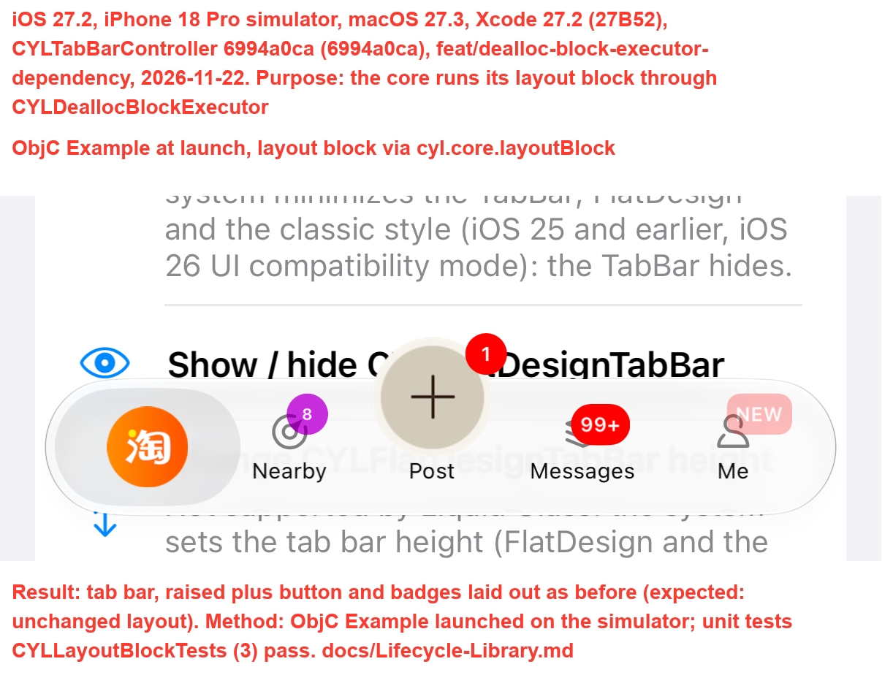

# [CN]生命周期库 CYLDeallocBlockExecutor
# [EN]The lifecycle library CYLDeallocBlockExecutor

<!-- bound-classes: CYLTabBarController -->
<!-- binding:start -->
<!-- Generated by scripts/update-docs-navigation.py; do not edit by hand. -->

| 中文 | English |
|:---|:---|
| 绑定的代码类 `CYLTabBarController`：[`CYLTabBarController/CYLTabBarController.h`](../CYLTabBarController/CYLTabBarController.h) | Bound to the class `CYLTabBarController`: [`CYLTabBarController/CYLTabBarController.h`](../CYLTabBarController/CYLTabBarController.h) |

<!-- binding:end -->

| 中文 | English |
|:---|:---|
| 本文记录把 [CYLDeallocBlockExecutor](https://github.com/ChenYilong/CYLDeallocBlockExecutor)（dealloc block 与 UIViewController 生命周期 block）接入 iOS 核心依赖的任务。 | This document tracks making [CYLDeallocBlockExecutor](https://github.com/ChenYilong/CYLDeallocBlockExecutor) (dealloc blocks and UIViewController lifecycle blocks) a dependency of the iOS core. |

## [CN]目录
## [EN]Contents

<!-- navigation:start -->
<!-- Generated by scripts/update-docs-navigation.py; do not edit by hand. -->

| 中文 | English |
|:---|:---|
| [任务记录](#cn任务记录) | [Task log](#entask-log) |
| &nbsp;&nbsp;&nbsp;&nbsp;↳ [TODO: CYLDeallocBlockExecutor as a core dependency (2026-11-22, branch `feat/dealloc-block-executor-dependency`)](#todo-cyldeallocblockexecutor-as-a-core-dependency-2026-11-22-branch-featdealloc-block-executor-dependency) | &nbsp;&nbsp;&nbsp;&nbsp;↳ [TODO: CYLDeallocBlockExecutor as a core dependency (2026-11-22, branch `feat/dealloc-block-executor-dependency`)](#todo-cyldeallocblockexecutor-as-a-core-dependency-2026-11-22-branch-featdealloc-block-executor-dependency) |
| &nbsp;&nbsp;&nbsp;&nbsp;↳ [TODO: all platforms, step 1 Android (2026-11-23, branch `feat/dealloc-block-executor-dependency`)](#todo-all-platforms-step-1-android-2026-11-23-branch-featdealloc-block-executor-dependency) | &nbsp;&nbsp;&nbsp;&nbsp;↳ [TODO: all platforms, step 1 Android (2026-11-23, branch `feat/dealloc-block-executor-dependency`)](#todo-all-platforms-step-1-android-2026-11-23-branch-featdealloc-block-executor-dependency) |
| &nbsp;&nbsp;&nbsp;&nbsp;↳ [TODO: all platforms, step 2 HarmonyOS (2026-11-23, branch `feat/dealloc-block-executor-dependency`)](#todo-all-platforms-step-2-harmonyos-2026-11-23-branch-featdealloc-block-executor-dependency) | &nbsp;&nbsp;&nbsp;&nbsp;↳ [TODO: all platforms, step 2 HarmonyOS (2026-11-23, branch `feat/dealloc-block-executor-dependency`)](#todo-all-platforms-step-2-harmonyos-2026-11-23-branch-featdealloc-block-executor-dependency) |
| &nbsp;&nbsp;&nbsp;&nbsp;↳ [TODO: all platforms, step 3 Mini program (2026-11-23, branch `feat/dealloc-block-executor-dependency`)](#todo-all-platforms-step-3-mini-program-2026-11-23-branch-featdealloc-block-executor-dependency) | &nbsp;&nbsp;&nbsp;&nbsp;↳ [TODO: all platforms, step 3 Mini program (2026-11-23, branch `feat/dealloc-block-executor-dependency`)](#todo-all-platforms-step-3-mini-program-2026-11-23-branch-featdealloc-block-executor-dependency) |
| &nbsp;&nbsp;&nbsp;&nbsp;↳ [TODO: all platforms, step 4 move to the library's pull request #12 line (2026-11-23, branch `feat/dealloc-block-executor-dependency`)](#todo-all-platforms-step-4-move-to-the-librarys-pull-request-12-line-2026-11-23-branch-featdealloc-block-executor-dependency) | &nbsp;&nbsp;&nbsp;&nbsp;↳ [TODO: all platforms, step 4 move to the library's pull request #12 line (2026-11-23, branch `feat/dealloc-block-executor-dependency`)](#todo-all-platforms-step-4-move-to-the-librarys-pull-request-12-line-2026-11-23-branch-featdealloc-block-executor-dependency) |

<!-- navigation:end -->

## [CN]任务记录
## [EN]Task log

### TODO: CYLDeallocBlockExecutor as a core dependency (2026-11-22, branch `feat/dealloc-block-executor-dependency`)

| 中文 | English |
|:---|:---|
| 背景：CYLDeallocBlockExecutor 的 PR #12（分支 `feat/lifecycle-callbacks`）新增了生命周期 block（事件、时机、只执行一次、key）。1.4.0 尚未发布，维护者选择方案 B：先用分支依赖开 draft PR，发布后改回版本依赖。 | Context: CYLDeallocBlockExecutor PR #12 (branch `feat/lifecycle-callbacks`) adds lifecycle blocks (event, timing, invoke once, key). 1.4.0 is not published; the maintainer chose option B: a draft pull request with branch dependencies now, versioned dependencies after the release. |
| 需求（英文翻译）：在本机找到 CYLTabBarController，新建 PR，把我们的库安装为核心依赖，然后推送。 | Requirement (English translation): find CYLTabBarController on this Mac, create a new pull request, install our library as a core dependency, and push. |
| 原始提示：见右列。 | Prompt (verbatim): "in this mac finder find CYLTabBarController , create new pr, install our librasy to core dependence, and push"; then "b" (option B: branch pins). |

| 中文 | English |
|:---|:---|
| 评分：100 = CocoaPods、Swift Package Manager、Carthage 三种方式都依赖该库，并有一个真实调用点（只执行一次的布局 block 使用 key `cyl.core.layoutBlock`），ObjC Example 与 Example-Swift 编译并在模拟器上运行，单元测试通过，CI 通过（发布 1.4.0 前 `pod lib lint` 除外）。60 = CocoaPods 与 SPM 依赖加真实调用点，主 Example 编译运行。 | Rubric: 100 = CocoaPods, Swift Package Manager and Carthage all depend on the library, with one real call site (the one-time layout block uses the key `cyl.core.layoutBlock`); the ObjC Example and Example-Swift build and run on a simulator; unit tests pass; CI passes (except `pod lib lint` before 1.4.0 is published). 60 = the CocoaPods and SPM dependencies plus the call site, with the main Example built and run. |

| 中文 | English |
|:---|:---|
| 进度（2026-11-22，提交 6994a0ca）：见右列。 | Progress (2026-11-22, commit 6994a0ca): CocoaPods (Core subspec `'CYLDeallocBlockExecutor', '~> 1.4'`, 17 Podfiles pin the branch), Swift Package Manager (`Package.swift` + `Package.resolved`, branch `feat/lifecycle-callbacks` at d6db301) and the Xcode framework target (SPM package reference, `SWIFT_INCLUDE_PATHS`, `internal import`, linked statically, so the Carthage XCFramework needs no extra framework) depend on the library. Call site: the one-time layout block is the keyed block `cyl.core.layoutBlock` with `.end` dispatched by the core. Local checks (macOS 27.3, Xcode 27.2, iPhone 18 Pro simulator iOS 27.2): `scripts/unit-tests.sh` 217 tests, 0 failures, 2 skipped, including the new `CYLLayoutBlockTests` (3); the ObjC Example and Example-Swift build; the ObjC Example launches with its tab bar, plus button and badges. |
| 截图：见右列。 | Screenshot:  |
| 得分：80 / 100。 | Score: 80 / 100. |
| TODO（-5）：见右列。 | TODO (-5) Carthage: the framework target links CYLDeallocBlockExecutor statically, so an app that also adds CYLDeallocBlockExecutor gets two copies (two UIViewController hook installs, duplicate class warnings). Fix: ship `CYLDeallocBlockExecutor.xcframework` next to `CYLAnimatedItem.xcframework` and link it dynamically. |
| TODO（-10）：见右列。 | TODO (-10) CI on this pull request: `pod lib lint` fails until 1.4.0 is on trunk; the other jobs are to be checked. |
| TODO（-5）：见右列。 | TODO (-5) After 1.4.0 is published: replace the branch pins with `~> 1.4` / `from: "1.4.0"`, remove `lint_external_podspecs` from `scripts/pod-lint.sh` (until then `pod lib lint` uses the branch podspec through `--external-podspecs`; Core subspec lint passed locally, 2026-11-22), take the pull request out of draft. |

### TODO: all platforms, step 1 Android (2026-11-23, branch `feat/dealloc-block-executor-dependency`)

| 中文 | English |
|:---|:---|
| 背景：iOS 已依赖 CYLDeallocBlockExecutor。现在把同样的回调注册表（Kotlin 版，库分支 `feat/lifecycle-callbacks-android`）接入 Android 核心 `Example-Android/cyltabbar`；Flutter 与 React Native 通过各自的原生核心获得；之后是 HarmonyOS 与小程序。 | Context: iOS already depends on CYLDeallocBlockExecutor. Now the same callback registry (Kotlin port, library branch `feat/lifecycle-callbacks-android`) becomes a dependency of the Android core `Example-Android/cyltabbar`. Flutter and React Native get it through their native cores; HarmonyOS and the Mini Program follow. |
| 需求（英文翻译）：为 Android、Flutter、React Native、小程序和 HarmonyOS 构建核心代码，逻辑与 iOS 相同，并安装为 CYLTabBarController 核心依赖。 | Requirement (English translation): build core code for Android, Flutter, React Native, the Mini Program and HarmonyOS, with the same logic as iOS, and install it as a CYLTabBarController core dependency. |
| 原始提示：见右列。 | Prompt (verbatim): "please  build core code for other platform like android flutter react native miniplatform and harmonyos. logic is same as what we done on ios, and install in the CYLTabBarController core dependence" |
| 评分：100 = Android 核心依赖该库（JitPack，固定提交），布局 block 使用键 `cyl.core.layoutBlock`，单元测试通过，Android 示例与 Flutter 示例的 Android 构建通过，文档完整。60 = 依赖加调用点，Android 单元测试通过。 | Rubric: 100 = the Android core depends on the library (JitPack, pinned commit), the layout block uses the key `cyl.core.layoutBlock`, unit tests pass, the Android example and the Flutter example's Android build pass, docs complete. 60 = the dependency plus the call site, Android unit tests pass. |
| 进度（2026-11-23）：见右列。 | Progress (2026-11-23, library commit `03814d4`): the Kotlin port is in CYLDeallocBlockExecutor PR #13 (module `cyldeallocblockexecutor`, 23 JVM tests, parity table and iOS to Android mapping in its `docs/Lifecycle-Callbacks.md`); JitPack builds it (`com.github.ChenYilong:CYLDeallocBlockExecutor:<commit>`). The Android core `Example-Android/cyltabbar` depends on it (pinned to the commit in `gradle/libs.versions.toml`, JitPack repository limited to `com.github.ChenYilong`, `gradle.lockfile` of every module rewritten) and keeps the layout block as the keyed callback `cyl.core.layoutBlock` on `LAYOUT`. The Flutter plugin (`flutter_cyltabbar/android`) and the React Native library (`react-native-cyltabbar/android`) compile the same sources, so they declare the same dependency; their six example apps add the JitPack repository. |
| iOS 到 Android 对照：见右列。 | iOS to Android: `viewDidLayoutSubviews` is `LAYOUT` (dispatched by `setViewControllers`, the Android core's layout point); `cylRearmViewDidLayoutSubviewsBlockInvokeOnce` is `rearm("cyl.core.layoutBlock")`; iOS re-arms the one-time block in `setViewDidLayoutSubViewsBlockInvokeOnce`, on every theme switch (`CYLTheme`) and whenever the tabs are set up again (`cylResetTabBarItemContent`); on Android all of these are `setViewControllers` (a theme switch and a reload go through it), which now re-arms and dispatches. |
| Android 行为变化：见右列。 | Behavior change on Android: before, the one-time layout block cleared `viewDidLayoutSubviewsBlock` after its first run and never ran again. Now the property keeps the block (as on iOS) and each new set of tabs (theme switch, reload, `setViewControllers`) re-arms it, so it runs once per set of tabs. The public Kotlin API is unchanged. The block is dispatched at `setViewControllers` only (no per-layout-pass dispatch, as before). |
| Android 测试：见右列。 | Verified later (2026-11-23): the Flutter example's Android build passes (`flutter build apk --debug` in `CrossPlatform/flutter_cyltabbar/example`, exit 0, `app-debug.apk` produced, built against library commit `03814d4`, before the last merge that removed Kotlin from the library dependency list). Not verified: the React Native Android build did not run (no `node_modules`), and the `gradle.lockfile` of the Flutter and React Native examples was not rewritten (they use LENIENT locking). Android tests: `CYLLayoutBlockTest` (5: one-time, every time, theme-switch re-arm, property read at run time, replacement by key); the whole Example-Android unit test suite (252 tests, 0 failures) and `assembleDebug` pass on macOS 27.3 with JDK 17.0.21 and Gradle 9.3.1. Android score about 95 / 100 (React Native Android build open). |
| 得分：见右列。 | Score (Android step): see the final report; HarmonyOS and the Mini Program are the next steps. |

### TODO: all platforms, step 2 HarmonyOS (2026-11-23, branch `feat/dealloc-block-executor-dependency`)

| 中文 | English |
|:---|:---|
| 背景：第 1 步（Android）已完成。第 2 步：把同样的回调注册表（库分支 `feat/lifecycle-callbacks-android`，PR #13）移植到HarmonyOS（ArkTS）并作为核心依赖接入。 | Context: step 1 (Android) is done. Step 2: the same callback registry (library branch `feat/lifecycle-callbacks-android`, PR #13) is ported to HarmonyOS (ArkTS) and becomes a core dependency. |
| 需求（英文翻译）：为 Android、Flutter、React Native、小程序和 HarmonyOS 构建核心代码，逻辑与 iOS 相同，并安装为 CYLTabBarController 核心依赖。 | Requirement (English translation): build core code for Android, Flutter, React Native, the Mini Program and HarmonyOS, with the same logic as iOS, and install it as a CYLTabBarController core dependency. |
| 原始提示：见右列。 | Prompt (verbatim): "please  build core code for other platform like android flutter react native miniplatform and harmonyos. logic is same as what we done on ios, and install in the CYLTabBarController core dependence" |
| 评分：100 = 库与测试 40、对照表 15、CYLTabBarController 集成 30、文档与 CI 15。60 = 库、测试、对照表和已声明的依赖。 | Rubric: 100 = library and tests 40, parity table 15, integration in CYLTabBarController 30, docs and CI 15. 60 = library, tests, parity column and the declared dependency. |
| 计划：见右列。 | Plan: HAR module in the library, vendored into `CrossPlatform/harmonyos-cyltabbar/cyldeallocblockexecutor` (`scripts/sync-cyldeallocblockexecutor.sh`, `VENDORED.md`), used by `CYLTabBarController.ets` for the keyboard listener (`cyl.core.keyboardListener`); the layout block stays N/A on HarmonyOS. |
| 进度（2026-11-23，库提交 `0394b46`）：见右列。 | Progress (2026-11-23, library commit `0394b46`): the HAR module `cyldeallocblockexecutor` (ArkTS; registry in plain TypeScript, 21 Node tests, `assembleHar` passes) is in CYLDeallocBlockExecutor PR #13 with a parity column and a mapping table (events: `ABOUT_TO_APPEAR`, `PAGE_SHOW`, `PAGE_HIDE`, `BACK_PRESS`, `ABOUT_TO_DISAPPEAR`, `LAYOUT`; dispatch is manual). It is vendored into `CrossPlatform/harmonyos-cyltabbar/cyldeallocblockexecutor` (`VENDORED.md`, `scripts/sync-cyldeallocblockexecutor.sh [--check]`) and `cyltabbar` depends on it (`file:../cyldeallocblockexecutor`). New use of the library on HarmonyOS (on iOS the core uses it for the layout block only; the layout block stays N/A on HarmonyOS): `CYLTabBarController.ets` registers the keyboard listener removal as the keyed willDealloc callback `cyl.core.keyboardListener` and `aboutToDisappear` runs `dealloc()`; behavior is the same, except that a keyboard window that arrives after the component disappeared is released at once instead of staying registered. The controller adds no theme listener, so there is no `cyl.core.themeListener`. Built here (DevEco Studio 6.0, hvigor, `--no-daemon`): `assembleHar` for `cyldeallocblockexecutor` and `cyltabbar`, `assembleHap` for `entry`: BUILD SUCCESSFUL. Not run on an emulator (machine load; no emulator was started). |
| 得分：见右列。 | Score: about 91 / 100 (library and tests 38: Node tests, no hypium / `ohosTest`; parity 15; integration 26: builds pass, not run on an emulator; docs and CI 12: a Node CI job, no HarmonyOS CI job). TODO: run `entry` on the emulator and check the keyboard listener is removed; replace the vendored copy with the ohpm package after publishing. |

### TODO: all platforms, step 3 Mini program (2026-11-23, branch `feat/dealloc-block-executor-dependency`)

| 中文 | English |
|:---|:---|
| 背景：第 1 步（Android）已完成。第 3 步：把同样的回调注册表（库分支 `feat/lifecycle-callbacks-android`，PR #13）移植到微信小程序（JavaScript）并作为核心依赖接入。 | Context: step 1 (Android) is done. Step 3: the same callback registry (library branch `feat/lifecycle-callbacks-android`, PR #13) is ported to the WeChat Mini Program (JavaScript) and becomes a core dependency. |
| 需求（英文翻译）：为 Android、Flutter、React Native、小程序和 HarmonyOS 构建核心代码，逻辑与 iOS 相同，并安装为 CYLTabBarController 核心依赖。 | Requirement (English translation): build core code for Android, Flutter, React Native, the Mini Program and HarmonyOS, with the same logic as iOS, and install it as a CYLTabBarController core dependency. |
| 原始提示：见右列。 | Prompt (verbatim): "please  build core code for other platform like android flutter react native miniplatform and harmonyos. logic is same as what we done on ios, and install in the CYLTabBarController core dependence" |
| 评分：100 = 库与测试 40、对照表 15、CYLTabBarController 集成 30、文档与 CI 15。60 = 库、测试、对照表和已声明的依赖。 | Rubric: 100 = library and tests 40, parity table 15, integration in CYLTabBarController 30, docs and CI 15. 60 = library, tests, parity column and the declared dependency. |
| 计划：见右列。 | Plan: CommonJS module in the library, vendored into `CrossPlatform/wechat-miniprogram-cyltabbar/src/cyl-dealloc-block-executor/`, used by `cyl-tab-bar` for its detached cleanup. |
| 进度（2026-11-23，库提交 `0394b46`）：见右列。 | Progress (2026-11-23, library commit `0394b46`): `miniprogram/cyl-dealloc-block-executor.js` (CommonJS, ES2017, no dependencies; 23 `node --test` tests, including `cylLifecycleBehavior` with a mocked Behavior) is in CYLDeallocBlockExecutor PR #13 with a parity column, a mapping table and a Node CI job. It is vendored into `CrossPlatform/wechat-miniprogram-cyltabbar/src/cyl-dealloc-block-executor/` (same script, `VENDORED.md`). `cyl-tab-bar` creates a registry in `attached` and registers each cleanup where the resource is created: `cyl.core.themeListener`, `cyl.core.liveBar`, `cyl.core.animationTimer`; `detached` performs `DETACHED` and `dealloc()`. Behavior is unchanged. `npm test` of the package: 99 tests, 0 failures (3 new in `test/cyl_tab_bar_cleanup.test.js`). |
| 得分：见右列。 | Score: about 96 / 100 (library and tests 40, parity 15, integration 28: tests only, not run in WeChat DevTools, docs and CI 13: the package workflow runs `npm test`, nothing checks the vendored copy in CI). TODO: run the example in WeChat DevTools; replace the vendored copy with the npm package after publishing. |

### TODO: all platforms, step 4 move to the library's pull request #12 line (2026-11-23, branch `feat/dealloc-block-executor-dependency`)

| 中文 | English |
|:---|:---|
| 背景：库的 PR #13（旧的 Android / HarmonyOS / 小程序移植）已作为被 PR #12 取代而关闭。PR #12 的分支 `feat/lifecycle-callbacks` 现在包含五个平台（Android、Flutter、React Native、HarmonyOS、小程序）共用的同一套注册表设计。 | Context: the library's PR #13 (the older Android / HarmonyOS / Mini Program port) was closed as superseded by PR #12. Its branch `feat/lifecycle-callbacks` now holds one registry design for five platforms (Android, Flutter, React Native, HarmonyOS, Mini Program). |
| 需求（英文翻译）：用我们新增的 API 改造 CYLTabBarController 所有平台的生命周期，把本仓库最新提交加入核心代码。 | Requirement (English translation): use our new API for the lifecycle of every CYLTabBarController platform, bringing the library's latest commit into the core. |
| 原始提示：见右列。 | Prompt (verbatim): "实用我们新增api改造cyltabbar里面所有平台的生命周期。应用本仓库最新commit加入core核心代码以来"; scope chosen by the owner: migrate all platforms. |
| 评分：100 = 各平台调用点改用新 API，固定到库的最新提交，各平台测试通过并在设备或模拟器上验证。60 = 调用点已改、静态检查与 Node 测试通过。 | Rubric: 100 = every platform's call sites use the new API, pinned to the library's latest commit, tests pass and each platform is run on a device or emulator. 60 = call sites changed, static checks and Node tests pass. |
| 进度（库提交 `3aafe8ec`）：见右列。 | Progress (library commit `3aafe8ec`): iOS needed no change (the branch pin and the `cyl…` names already match). Android: `CYLTabBarController.kt` uses `LifecycleRegistry` (`cyl.core.layoutBlock` as a keyed `.end` block of `viewDidLayoutSubviews`, dispatched by hand with `invokeLifecycleCallbacks`, re-armed with `rearmLifecycleCallback`), and the core, Flutter and React Native Gradle files pin `com.github.ChenYilong.CYLDeallocBlockExecutor:cyl-dealloc-block-executor-core:3aafe8ec…` (JitPack). HarmonyOS: `CYLTabBarController.ets` uses `LifecycleController` (`aboutToAppear`, `aboutToDisappear`, keyed dealloc `cyl.core.keyboardListener`, `isDetached` replaces the illegal-identifier check). Mini Program: `cyl-tab-bar` uses `LifecycleController` (`onLoad`, `onUnload`, keyed dealloc blocks; its cleanup tests pass: `npm test` 99 / 99). `scripts/sync-cyldeallocblockexecutor.sh` now copies the library's `HarmonyOS/` and `MiniProgram/` (CommonJS) and `--check` matches. React Native and Flutter get the lifecycle through the native cores (their Android pins above); their TypeScript and Dart wrappers were not changed. |
| TODO：见右列。 | TODO (score 60 / 100): not run here: Gradle (`CYLLayoutBlockTest`, the JitPack artifact `cyl-dealloc-block-executor-core` has never been built by JitPack), DevEco / hvigor (the vendored module is plain TypeScript: ArkTS strict rules such as `any`, `in` and untyped object literals may reject it), WeChat DevTools, Flutter and React Native builds. The Android behavior is unchanged from step 1 (one-time block re-armed by each new set of tabs). |
| 审计（2026-11-23）：见右列。 | Audit (2026-11-23): the React Native and Flutter wrappers hold no lifecycle logic to move. Flutter `_CYLTabBarState` has one teardown (`dispose` clears the channel handler) and the React Native components have no effect, subscription or timer; both get lifecycle through the native hosts (the Android pins above). Wrapping that single `dispose` line in the library's Flutter package would add an unpublished path dependency for no gain, so it was left alone. Not migrated, as larger and untestable without Xcode, DevEco or an emulator: the iOS `viewWillAppear` / `viewDidAppear` forwarders and the theme and trait hooks of the v2 mapping (library `docs/Lifecycle-Callbacks.md`, "Design v2"), and their Android and HarmonyOS counterparts. |
| 进度（第 4 步，续）：见右列。 | Progress (step 4, continued): Android core: the activity's `ON_DESTROY` now runs the controller's teardown blocks (`runDealloc`, as `dealloc` on iOS), and the `ComponentCallbacks2` registered for memory warnings is unregistered by a keyed teardown block `cyl.core.memoryCallbacks` (before, it was never unregistered). New test `CYLLayoutBlockTest.destroyingTheActivityRunsTheControllersTeardownBlocksOnce`. Not run: Gradle (the example project's dependencies are not built here). HarmonyOS and the Mini Program have no further unpaired listeners in the core; their other `aboutToDisappear` / `detached` hooks belong to animation components, which the rules keep independent of the core. |
| 进度（第 5 步，布局接口）：见右列。 | Progress (step 5, the layout interfaces, iOS): `didLayoutSubViewsBlock` of `CYLTabBar` and `cyl_viewDidLayoutSubviewsBlock` of `UITabBarItem` now run through the library: each setter registers a keyed `.end` block of `viewDidLayoutSubviews` (`cyl.core.didLayoutSubViewsBlock`, `cyl.core.itemLayoutBlock`; a new block replaces it, nil removes it), `.end` is declared manual, and the places that called the property now call `cylInvokeLifecycleCallbacks`. The getters, the call points and the blocks' signatures are unchanged. The controller's `viewDidLayoutSubviewsBlock` and the invoke-once flag already used the library (step 1). `performWhenTabBarItemsReady` / `reloadBadgesWithBlock` keep their own queue on purpose: a block runs when the tab buttons are ready, not at a layout point, and the library has no "ready" event. Tests added (not run here: no Xcode): `CYLLayoutBlockTests` `testTabBarDidLayoutBlock…`, `testSettingTheTabBarBlockAgain…`, `testItemLayoutBlock…`. |
