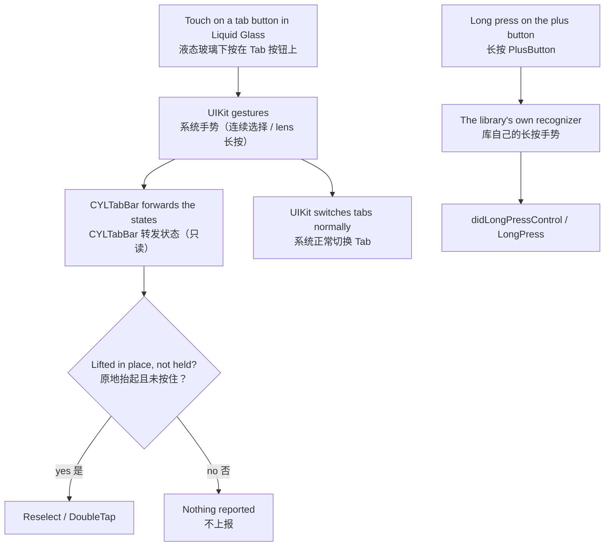

# 液态玻璃下的长按：修复切换 Tab 卡死 / Long Press in Liquid Glass: Fixing the Tab Switching Freeze

<!-- bound-classes: CYLTabBarController, CYLTabBar -->
<!-- binding:start -->
<!-- Generated by scripts/update-docs-navigation.py; do not edit by hand. -->

| 中文 | English |
|:---|:---|
| 绑定的代码类 `CYLTabBarController`：[`CYLTabBarController/CYLTabBarController.h`](../CYLTabBarController/CYLTabBarController.h) | Bound to the class `CYLTabBarController`: [`CYLTabBarController/CYLTabBarController.h`](../CYLTabBarController/CYLTabBarController.h) |
| 绑定的代码类 `CYLTabBar`：[`CYLTabBarController/CYLTabBar.h`](../CYLTabBarController/CYLTabBar.h) | Bound to the class `CYLTabBar`: [`CYLTabBarController/CYLTabBar.h`](../CYLTabBarController/CYLTabBar.h) |

<!-- binding:end -->

## [CN]目录
## [EN]Contents

<!-- navigation:start -->
<!-- Generated by scripts/update-docs-navigation.py; do not edit by hand. -->

| 中文 | English |
|:---|:---|
| [问题](#cn问题) | [The problem](#enthe-problem) |
| [原因](#cn原因) | [The cause](#enthe-cause) |
| [修复](#cn修复) | [The fix](#enthe-fix) |
| [用法](#cn用法) | [Usage](#enusage) |
| [限制与验证](#cn限制与验证) | [Limits and verification](#enlimits-and-verification) |

<!-- navigation:end -->

## [CN]问题
## [EN]The problem

| 中文 | English |
|:---|:---|
| 液态玻璃（iOS 26+）下，设置了长按回调（`cyl_didLongPressControlBlock`、`-tabBarController:didLongPressControl:` 或 `CYLTabBarItemGestureLongPress`）后，用系统手势（按住 Tab 拖动、点击）切换 Tab 先是非常卡顿，然后整个 TabBar 卡死，不再响应。Xcode 控制台持续输出类似 `cannot handle … to 0 from … - dropping` 的日志。 | In Liquid Glass (iOS 26+), with a long press callback set (`cyl_didLongPressControlBlock`, `-tabBarController:didLongPressControl:` or `CYLTabBarItemGestureLongPress`), switching tabs with the system gesture (holding and dragging across the tabs, or tapping) first stutters badly, then the whole tab bar freezes and stops responding. The Xcode console keeps logging lines like `cannot handle … to 0 from … - dropping`. |

## [CN]原因
## [EN]The cause

| 中文 | English |
|:---|:---|
| 液态玻璃下，Tab 按钮上的触摸由系统自己的手势接收（连续选择手势与抬起 lens 的长按手势），库另加的手势收不到。因此 Tab 按钮的长按是借这两个系统手势识别的：按住达到长按时长后上报长按；为了让“长按后抬起不选中 Tab”（#535 的文档），库随后把系统手势先 `enabled = NO` 再 `enabled = YES`，强行取消它。 | In Liquid Glass, touches on the tab buttons go to UIKit's own gestures (the continuous selection gesture and the long press that lifts the lens); a gesture the library adds gets none. So the tab buttons' long press was recognized from those two UIKit gestures: once the press was held long enough the long press was reported, and so that lifting the finger would not select the tab (as #535 documents), the library then cancelled UIKit's gesture by setting `enabled = NO` and then `enabled = YES`. |
| 这一取消发生在系统 lens 抬起动画与选择状态机运行的过程中。系统内部的状态机被强行打回初始状态（状态 0），后续的状态转换被丢弃（即日志中的 `dropping`），选择交互再也无法正常结束，于是卡顿直至卡死。这是 UIKit 私有实现的行为，库无法从外部安全地修正它。 | That cancel happens while UIKit's lens lift animation and selection state machine are running. The state machine is forced back to its initial state (state 0), later transitions are dropped (the `dropping` in the log), and the selection interaction can no longer finish, hence the stutter and then the freeze. This is UIKit's private implementation; the library cannot repair it safely from outside. |

## [CN]修复
## [EN]The fix

| 中文 | English |
|:---|:---|
| **液态玻璃下关闭 Tab 按钮的自定义长按**：库不再为 Tab 按钮计时长按，也不再改动系统手势的 `enabled`，系统手势完全按 UIKit 自己的方式运行。按住 Tab 时看到的是系统原生的 lens 抬起效果。 | **The tab buttons' custom long press is off in Liquid Glass**: the library no longer times a long press on the tab buttons, and never touches the `enabled` of UIKit's gestures, so they run exactly as UIKit designed them. Holding a tab shows UIKit's own lens lift. |
| **仍然可用**：PlusButton 的长按（由库自己的手势识别，不经过系统手势）、Reselect 与 DoubleTap（只读取系统手势的状态，不改动它）、按压动画，以及经典样式与扁平样式（FlatDesign）中的全部长按功能。 | **Still working**: the plus button's long press (the library's own recognizer, not UIKit's gestures), Reselect and DoubleTap (they only read UIKit's gesture states, never change them), the pressed animation, and every long press feature in the classic style and FlatDesign. |
| **按住不算点击**：设置了长按回调时，液态玻璃下按住达到 `cyl_tabButtonLongPressMinimumDuration` 后在原地抬起，不算一次点击（不回调 Reselect / DoubleTap），与其他样式中长按后不再算点击一致。 | **A hold is not a tap**: while a long press callback is set, a press in Liquid Glass held for `cyl_tabButtonLongPressMinimumDuration` and lifted in place is not a tap (no Reselect / DoubleTap), matching the other styles, where a long press is not a tap either. |
| **公开 API 不变**：没有删除或修改任何 API；回调仍可设置，只是液态玻璃下 Tab 按钮不再触发它们。 | **No public API change**: no API was removed or changed; the callbacks can still be set, they just no longer fire for tab buttons in Liquid Glass. |



## [CN]用法
## [EN]Usage

| 中文 | English |
|:---|:---|
| 无需修改代码。若需要在液态玻璃下为 Tab 提供菜单，可以用 PlusButton 的长按，或在页面内提供入口（例如导航栏按钮）。 | No code change is needed. To offer a menu for a tab in Liquid Glass, use the plus button's long press, or an entry inside the page (e.g. a navigation bar button). |

```objc
// [EN] Works in every style; in Liquid Glass it fires for the plus button only.
// [CN] 适用于所有样式；液态玻璃下只对 PlusButton 触发。
tabBarController.cyl_didLongPressControlBlock = ^(CYLTabBarController *tabBarController, UIControl *control) {
    NSLog(@"long press: %@", control.cyl_tabBarItemIdentifier);
};
```

## [CN]限制与验证
## [EN]Limits and verification

| 中文 | English |
|:---|:---|
| 液态玻璃下 Tab 按钮不再有长按回调。若今后能在不干预系统手势的前提下识别长按（例如系统提供公开的上下文菜单 API），再重新开启。 | Tab buttons have no long press callback in Liquid Glass. It can come back if a long press can be recognized without interfering with UIKit's gestures (e.g. a public context menu API from UIKit). |
| 本次修改在 Linux 环境中完成，无法运行 Xcode 和 iOS 模拟器，因此**没有截图**，也未编译验证。请在液态玻璃（iOS 26+）下验证：① 设置长按回调后，按住拖动与点击切换 Tab 流畅，不再卡死，控制台不再出现 `dropping`；② 长按 PlusButton 仍回调；③ 双击、再次点击 Tab 仍回调；④ 经典样式与扁平样式的长按不变。 | This change was made on Linux, where Xcode and the iOS simulator cannot run, so there are **no screenshots** and it has not been compiled. In Liquid Glass (iOS 26+), check: ① with a long press callback set, dragging and tapping to switch tabs is smooth, never freezes, and the console no longer logs `dropping`; ② a long press on the plus button is still reported; ③ double tap and reselect on tabs are still reported; ④ long press in the classic style and FlatDesign is unchanged. |
