# 液态玻璃的健壮性改进 / Liquid Glass Robustness

<!-- bound-classes: CYLTabBar, CYLTabBarController -->
<!-- binding:start -->
<!-- Generated by scripts/update-docs-navigation.py; do not edit by hand. -->

| 中文 | English |
|:---|:---|
| 绑定的代码类 `CYLTabBar`：[`CYLTabBarController/CYLTabBar.h`](../CYLTabBarController/CYLTabBar.h) | Bound to the class `CYLTabBar`: [`CYLTabBarController/CYLTabBar.h`](../CYLTabBarController/CYLTabBar.h) |
| 绑定的代码类 `CYLTabBarController`：[`CYLTabBarController/CYLTabBarController.h`](../CYLTabBarController/CYLTabBarController.h) | Bound to the class `CYLTabBarController`: [`CYLTabBarController/CYLTabBarController.h`](../CYLTabBarController/CYLTabBarController.h) |

<!-- binding:end -->

| 中文 | English |
|:---|:---|
| 本文记录液态玻璃（iOS 26+）实现中四项健壮性改进：越界读取不再依赖 `@try`，库插入 Tab 按钮的视图统一标记，PlusButton 在选中层的替身改为随布局安装，以及「More」编辑期间不留下残留视图。这些都是内部改进，默认行为不变；只新增了 `UIView` 上的标记接口。 | This page records four robustness improvements to the Liquid Glass (iOS 26+) implementation: out-of-range reads no longer rely on `@try`, the views the library inserts into tab buttons are marked in one way, the plus button's stand-in in the selected layer is installed with layout, and More editing leaves no views behind. They are internal; default behavior does not change. The only new API is the marking API on `UIView`. |

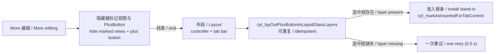

## 目录 / Contents

<!-- navigation:start -->
<!-- Generated by scripts/update-docs-navigation.py; do not edit by hand. -->

| 中文 | English |
|:---|:---|
| [越界读取：先检查下标](#越界读取先检查下标--out-of-range-reads-check-the-index-first) | [Out-of-range reads: check the index first](#越界读取先检查下标--out-of-range-reads-check-the-index-first) |
| [插入视图的统一标记](#插入视图的统一标记--one-mark-for-inserted-views) | [One mark for inserted views](#插入视图的统一标记--one-mark-for-inserted-views) |
| [PlusButton 替身随布局安装](#plusbutton-替身随布局安装--the-plus-buttons-stand-in-follows-layout) | [The plus button's stand-in follows layout](#plusbutton-替身随布局安装--the-plus-buttons-stand-in-follows-layout) |
| [「More」编辑](#more编辑--more-editing) | [More editing](#more编辑--more-editing) |
| [演示](#演示--demo) | [Demo](#演示--demo) |
| [限制与验证](#限制与验证--limits-and-verification) | [Limits and verification](#限制与验证--limits-and-verification) |
| [任务记录](#任务记录--task-log) | [Task log](#任务记录--task-log) |

<!-- navigation:end -->

## 越界读取：先检查下标 / Out-of-range reads: check the index first

| 中文 | English |
|:---|:---|
| 以前很多按下标读取数组的地方用 `@try` / `@catch` 接住越界异常。ARC 默认不处理异常安全，抛出时可能泄漏内存；而且一个 `@try` 包住多次读取时，第一次抛出就会跳过后面全部读取。`-[CYLTabBar cyl_selectedControl]` 就是这样：本意是依次尝试选中层按钮、普通层按钮、可见按钮，但选中层为空时直接进入 `@catch`，后面的备选从未执行，结果返回 nil。现在这些地方都先检查下标（文件内的 `CYLObjectAtIndex()`，越界返回 nil），备选会按顺序生效。KVC、KVO 与通知相关的 `@try` 用于接住系统可能抛出的异常，保持不变。 | Many places that read an array by index used `@try` / `@catch` to catch the out-of-range exception. ARC is not exception-safe by default, so a throw can leak; and when one `@try` wraps several reads, the first throw skips all the reads after it. `-[CYLTabBar cyl_selectedControl]` did exactly that: it meant to try the selected-layer button, then the normal-layer button, then the visible buttons, but with an empty selected layer it jumped to `@catch`, the fallbacks never ran, and it returned nil. These places now check the index first (the file-private `CYLObjectAtIndex()`, nil when out of range), so the fallbacks apply in order. The `@try` blocks around KVC, KVO and notifications, which catch exceptions the system may raise, are unchanged. |

## 插入视图的统一标记 / One mark for inserted views

| 中文 | English |
|:---|:---|
| 本库插入到 Tab 按钮中的视图（替换图标的视图、Lottie 视图、液态玻璃选中层中 PlusButton 的替身、布局跟踪视图）现在都用 `-[UIView cyl_markAsInsertedForTabControl:]` 标记，并弱引用所属的按钮。因此可以一次性找到、隐藏与恢复它们（`+[UIView cyl_insertedTabControlViews]`），也能识别仍留在旧按钮中的视图。没有使用 `tag`，以免覆盖开发者自己视图（例如 PlusButton 的 `selectedContentView`）的 `tag`。 | The views the library inserts into tab buttons (a view shown in place of the icon, a Lottie view, the plus button's stand-in in the Liquid Glass selected layer, a layout tracker) are now marked with `-[UIView cyl_markAsInsertedForTabControl:]`, which holds their button weakly. So they can be found, hidden and restored in one pass (`+[UIView cyl_insertedTabControlViews]`), and a view still in an old button is recognized. `tag` is not used, so the `tag` of the developer's own views (e.g. the plus button's `selectedContentView`) is never overwritten. |

| API | 中文 | English |
|:---|:---|:---|
| `-[UIView cyl_markAsInsertedForTabControl:]` | 标记为本库为某按钮插入的视图（弱引用按钮；传 nil 取消标记） | Marks a view as inserted by the library for a button (held weakly; nil unmarks) |
| `UIView.cyl_insertedForTabControl` | 所属按钮；未标记或已释放时为 nil | Its button; nil when unmarked or deallocated |
| `+[UIView cyl_insertedTabControlViews]` | 所有仍存活的被标记视图（仅主线程） | Every marked view still alive (main thread only) |

## PlusButton 替身随布局安装 / The plus button's stand-in follows layout

| 中文 | English |
|:---|:---|
| 液态玻璃的选中层比普通层渲染得晚。以前的做法是：在控制器布局时取到选中层按钮，固定延迟 0.5 秒后再放入 PlusButton 的替身。如果取的时候选中层还不存在，延迟后操作的是 nil，替身要等下一次控制器布局才会出现。现在 `-cyl_layOutPlusButtonInLiquidGlassLayers` 可重复调用，控制器与（拥有该 TabBar 的控制器的）TabBar 每次布局都会执行，每次都重新查找视图：选中层出现的那次布局就会放入替身；替身已在正确按钮中时立即返回，不做额外工作；选中层仍不存在时只安排一次 0.5 秒后的重试作为兜底。 | The Liquid Glass selected layer renders later than the normal one. Before, the controller looked up the selected-layer button during its layout and put the plus button's stand-in in after a fixed 0.5 s delay. When the layer did not exist yet, the delayed block acted on nil and the stand-in waited for the next controller layout. Now `-cyl_layOutPlusButtonInLiquidGlassLayers` is idempotent and runs on every layout pass of the controller and of the tab bar, looking the views up again each time: the stand-in goes in on the pass where the selected layer appears; once it is in the right button the method returns at once, doing no extra work; when the selected layer is still missing, a single retry after 0.5 s is the fallback. |
| UIKit 会重建 Tab 按钮（例如修改 item 图片后）。以前替身仍挂在旧按钮上时，`show:YES` 因为它已有父视图而什么都不做，新按钮里就没有替身。现在根据标记识别出它属于其他按钮，先移出再放入新按钮。 | UIKit rebuilds the tab buttons (e.g. after an item image changes). Before, while the stand-in still hung in the old button, `show:YES` did nothing because it already had a superview, so the new button had no stand-in. Now the mark shows it belongs to another button, so it is taken out first and put in the new one. |

## 「More」编辑 / More editing

| 中文 | English |
|:---|:---|
| 本库不支持「More」编辑本身（More 页面中的 "Edit"，可以把 item 拖到 TabBar 上）。编辑时 UIKit 会移动并重建 Tab 按钮，插入的视图可能留在过时的位置。现在 `CYLTabBar` 在 `-beginCustomizingItems:` 时一次性隐藏被标记的视图与 PlusButton，在 `-endCustomizingAnimated:` 后恢复它们原来的 `hidden` 值并重新布局；编辑期间（`-beginCustomizingItems:` 到 `-endCustomizingAnimated:` 之间）不安装 PlusButton 替身；结束后立即与下一个 runloop 各请求一次布局，因为 UIKit 结束编辑时可能重建按钮。 | The library does not support More editing as such ("Edit" on the More page, which lets items be dragged onto the tab bar). While editing, UIKit moves and rebuilds the tab buttons, and inserted views could be left at stale positions. Now `CYLTabBar` hides the marked views and the plus button in one pass in `-beginCustomizingItems:`, restores their previous `hidden` values after `-endCustomizingAnimated:` and lays out again; the plus button's stand-in is not installed while editing (between `-beginCustomizingItems:` and `-endCustomizingAnimated:`); a layout is requested right after and again on the next run loop turn, since UIKit can rebuild the buttons as editing ends. |

## 演示 / Demo

| 中文 | English |
|:---|:---|
| ObjC Demo：首页 → 「Open the tab bar gallery」→ 最后一组「Liquid Glass robustness」，每一项改进对应一行，点击即可演示。前五行 present 一个 TabBarController，最后一行把 8 个 Tab 的 TabBarController push 进图库的导航控制器。代码见 `Example/Classes/Gallery/CYLGalleryProvider.m` 的 `+liquidGlassRobustnessSection`。 | ObjC demo: Home → "Open the tab bar gallery" → the last section, "Liquid Glass robustness", has one row per improvement; tap a row to see it. The first five rows present a tab bar controller; the last one pushes an 8-tab tab bar controller onto the gallery's navigation controller. The code is `+liquidGlassRobustnessSection` in `Example/Classes/Gallery/CYLGalleryProvider.m`. |

| 行 / Row | 中文 | English |
|:---|:---|:---|
| Selected control with bounds checks | 导航栏显示 `cyl_selectedIndex` 与 `cyl_selectedControl` 的类名；点 "Read" 重新读取 | The navigation bar shows `cyl_selectedIndex` and the class of `cyl_selectedControl`; "Read" reads them again |
| Out-of-range reads return nil | 点 "Read 99"：按下标 99 读取的三个接口都返回 nil，不抛异常 | "Read 99": the three index readers return nil for index 99, no exception |
| Marked views in tab buttons | Home 的图标被星形视图替换（被标记）；导航栏显示被标记 / 隐藏的数量，"Hide / Show" 一次性切换 | A star replaces Home's icon (marked); the navigation bar shows how many views are marked / hidden, and "Hide / Show" toggles them in one pass |
| Plus stand-in after an item image changes | 选中拥有自己页面的 PlusButton，点 "Change image"：UIKit 重建按钮，替身移到新按钮中（液态玻璃） | With the plus button's own page selected, "Change image" makes UIKit rebuild the buttons, and the stand-in moves to the new one (Liquid Glass) |
| Plus stand-in on first display and rotation | 一打开就选中 PlusButton 的页面；旋转设备，替身随布局出现，没有固定延迟（液态玻璃） | The plus page is selected at once; rotate the device and the stand-in follows layout, with no fixed delay (Liquid Glass) |
| More editing with 8 tabs | push 进入；More → Edit → 拖动 → Done：编辑期间星形视图隐藏，结束后恢复 | Pushed; More → Edit → drag → Done: the star hides while editing and comes back after |

## 限制与验证 / Limits and verification

| 中文 | English |
|:---|:---|
| 已验证（2026-11-10，iOS 26.1，iPhone 17 Pro Max 模拟器，ObjC Demo 图库第 9 组，用 `-CYLDemoGalleryScene` 打开）。PlusButton 替身，从上到下：9.4 启动后选中 PlusButton 所在 Tab；再次确认；点击「Change image」后 Home 图标换成太阳，替身仍在 PlusButton 下方；9.5 首次显示时 PlusButton 所在 Tab 直接选中，替身就位。旋转（2026-11-12，用新的启动参数 `-CYLDemoOrientation landscape` 在场景打开 3 秒后转为横屏）：9.4 与 9.5 的替身仍在 PlusButton 下方，图标清晰（截图见下方）。选中 PlusButton 时的模糊重影已修复（遮罩在拖动放大镜时暂停，已用拖动测试验证），见 [SwiftUI-Integration](SwiftUI-Integration.md)。 | Verified (2026-11-10, iOS 26.1, iPhone 17 Pro Max simulator, ObjC demo gallery section 9, opened with `-CYLDemoGalleryScene`). The plus stand-in, top to bottom: 9.4 the plus tab selected at launch; checked again; after "Change image" Home's icon becomes a sun and the stand-in stays under the plus button; 9.5 on first display the plus tab is selected at once and the stand-in is in place. Rotation (2026-11-12, with the new launch argument `-CYLDemoOrientation landscape`, which turns the scene to landscape 3 s after it opens): in 9.4 and 9.5 the stand-in stays under the plus button and the icon is crisp (screenshot below). The blurred copy under a selected plus button is fixed (the mask pauses while the lens is dragged, verified by drag tests); see [SwiftUI-Integration](SwiftUI-Integration.md). |

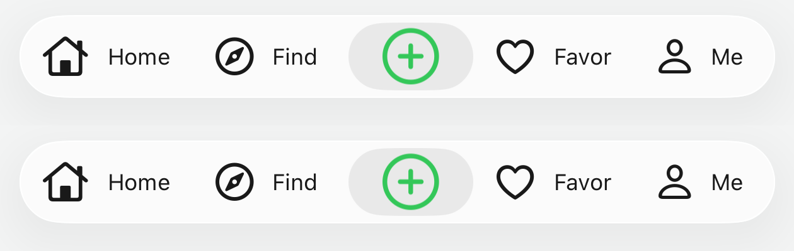

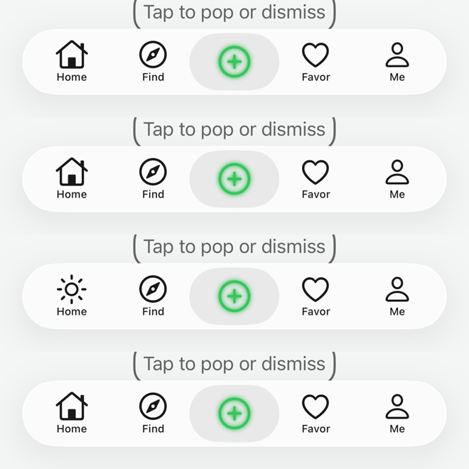

| 中文 | English |
|:---|:---|
| 已修复（2026-11-10）：9.6「More editing with 8 tabs」原先在液态玻璃下只显示 5 个 Tab、没有 More（上方对比图）。原因：经典样式与液态玻璃用 `-addChildViewController:` 安装 Tab，而 UIKit 只为尚未成为子控制器的视图控制器在 `-setViewControllers:` 中生成 More（用普通 `UITabBarController` 验证：先 `addChildViewController:` 再 `setViewControllers:` 同样没有 More）；`viewControllers` 是本类自己的数组，UIKit 读到相同的旧列表时也不重建。现在超过 5 个 Tab 时移除这些子控制器、让 UIKit 接收全部 Tab（`-cyl_handTabsToUIKitIfMoreThanFive`），并允许选中收在 More 中的 Tab（`-setSelectedViewController:`）。测试 `testMoreTabWithMoreThanFiveTabs`（8 个 Tab 有 More 且第 7 个可选中、5 个 Tab 不变、PlusButton + 8 个 Tab 不崩溃）。下图从左到右：出现 More；More 列表（Me、Message、Shop、Cardboard）；进入 Shop；Edit 编辑界面，Home 的星形标记在编辑时隐藏。修复（2026-11-11）：编辑界面的 Done 原先点不到：UIKit 把编辑视图 `UITabBarCustomizeView` 放在本 TabBar 旁边的 `_UITabBarContainerView` 中，而其父视图 `_UITabBarContainerWrapperView` 只有 TabBar 那么高，点击判定到达不了，点击落到下方 More 页面的 Edit 上（lldb 确认；系统 `UITabBarController` 把它放在全屏视图中）；现在编辑期间该容器在父视图范围外也响应点击（`-cyl_setContainerRespondsOutsideBoundsForCustomizing:`），Done 可以关闭编辑界面。修复（2026-11-11）：点击 Done 后 Home 没有图标（星形标记仍隐藏，Home 自己的图标被它替换而隐藏）。根因：UIKit 结束 More 编辑时不会调用 `-[UITabBar endCustomizingAnimated:]`（日志确认：`-beginCustomizingItems:` 被调用，结束方法从不被调用），因此库在编辑开始时隐藏的被标记视图（星形）一直没有恢复，容器的「范围之外也响应点击」也一直没有取消。之前尝试的两种恢复方式都写在永远不会执行的结束方法里，所以无效。现在编辑开始后每 0.1 秒询问一次 `isCustomizing`，发现结束时（或 `endCustomizingAnimated:` 被调用时）执行 `-cyl_didEndCustomizing`：取消容器的点击范围、恢复被隐藏的视图并重新布局。验证（iOS 26.1 模拟器）：编辑前 Home 为星形，编辑中隐藏，Done 后星形恢复，Done 按钮消失（图见下）。有 PlusButton 且超过 5 个 Tab 时 More 与 PlusButton 的排列未截图检查；`-beginCustomizingItems:` 在 iOS 18+ 是否被调用、编辑时切换深色模式后 Lottie 视图是否保持隐藏，仍需真机确认。 | Fixed (2026-11-10): 9.6 "More editing with 8 tabs" used to show only five tabs and no More on Liquid Glass (comparison above). Cause: the classic style and Liquid Glass install tabs with `-addChildViewController:`, and UIKit builds More in `-setViewControllers:` only for view controllers that are not children yet (checked with a plain `UITabBarController`: `addChildViewController:` then `setViewControllers:` gives no More either); `viewControllers` is this class's own list, so UIKit, reading the same old list, did not rebuild. With more than five tabs the children are now removed and UIKit takes all the tabs (`-cyl_handTabsToUIKitIfMoreThanFive`), and a tab under More can be selected (`-setSelectedViewController:`). Test `testMoreTabWithMoreThanFiveTabs` (eight tabs: More, and the seventh can be selected; five tabs unchanged; a plus button with eight tabs does not crash). Below, left to right: More appears; the More list (Me, Message, Shop, Cardboard); Shop opened; the Edit screen, where Home's star marked view hides while editing. Fixed (2026-11-11): the editing screen's Done could not be tapped: UIKit puts the editing view `UITabBarCustomizeView` next to this tab bar in `_UITabBarContainerView`, whose superview `_UITabBarContainerWrapperView` is only as tall as the bar, so hit testing never reached it and the tap went to the More page's Edit below (seen with lldb; the system `UITabBarController` puts it in its full-screen view); while editing that container now answers outside its superview's bounds (`-cyl_setContainerRespondsOutsideBoundsForCustomizing:`), and Done closes the editing screen. Fixed (2026-11-11): after Done, Home showed no icon (the star marked view stayed hidden, and Home's own icon is hidden behind it). Cause: UIKit does not call `-[UITabBar endCustomizingAnimated:]` when More editing ends (checked with a log: `-beginCustomizingItems:` is called, the end method never is), so the marked views the library hid when editing began (the star) were never restored, and the container's "answer outside its bounds" was never cancelled either. The two earlier restore attempts were in the end method that never runs, which is why they did nothing. Now, after editing began, `isCustomizing` is asked every 0.1 s, and when it ends (or `endCustomizingAnimated:` is called) `-cyl_didEndCustomizing` runs: it cancels the container's hit area, restores the hidden views and lays out again. Verified (iOS 26.1 simulator): Home shows the star before editing, it is hidden while editing, it is back after Done, and the Done button is gone (picture below). More next to a plus button with more than five tabs has no screenshot check; whether UIKit calls `-beginCustomizingItems:` on iOS 18+, and whether a Lottie view replaced by a Dark Mode switch during editing stays hidden, still need a device. |

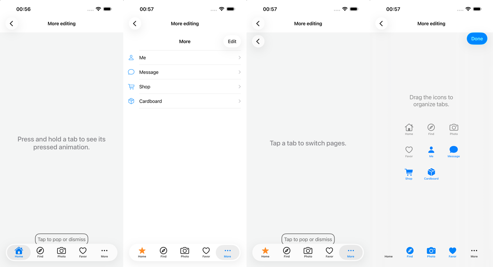

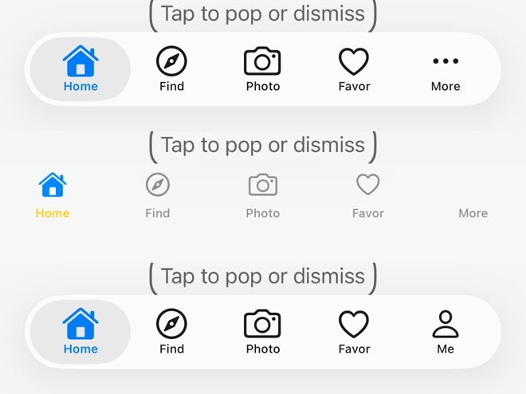

| 中文 | English |
|:---|:---|
| 已修复（2026-11-10）：扁平样式的「More」Tab 没有图标。原因不是缺少资源文件：`-[UIViewController cyl_tabBarItem]` 生成扁平样式 item 时从一个此时为 nil 的局部变量读取标题与图片，因此图片总是 1×1 透明占位图（标题因为还会回退到 `self.title` 而显示「More」）。现在从 UIKit 的 `self.tabBarItem` 读取；系统的「More」item（`UITabBarSystemItemMore`）没有 `image`（由 UIKit 绘制），因此使用 SF Symbol "ellipsis"，并按类名识别 `UIMoreNavigationController`，不触发懒加载的 `moreNavigationController`。测试：`testFlatDesignMoreTabHasAnIcon`。上：修复前；下：修复后（1.6）。 | Fixed (2026-11-10): the FlatDesign "More" tab had no icon. Not a missing resource: `-[UIViewController cyl_tabBarItem]` built the FlatDesign item from a local variable that is nil at that point, so the image was always the 1×1 transparent placeholder (the title still showed "More" because it falls back to `self.title`). It now reads UIKit's `self.tabBarItem`; the system "More" item (`UITabBarSystemItemMore`) has no `image` (UIKit draws it), so it gets the SF Symbol "ellipsis", and `UIMoreNavigationController` is recognized by class name so the lazy `moreNavigationController` is never triggered. Test: `testFlatDesignMoreTabHasAnIcon`. Top: before; bottom: after (1.6). |

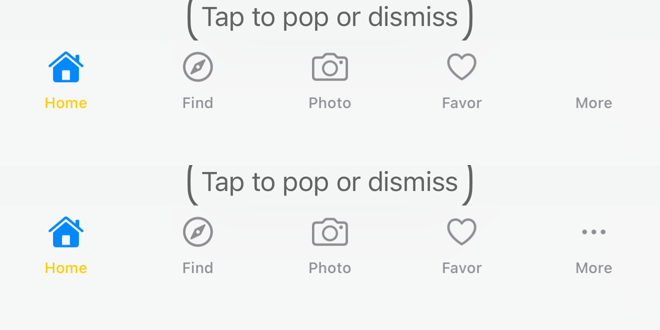

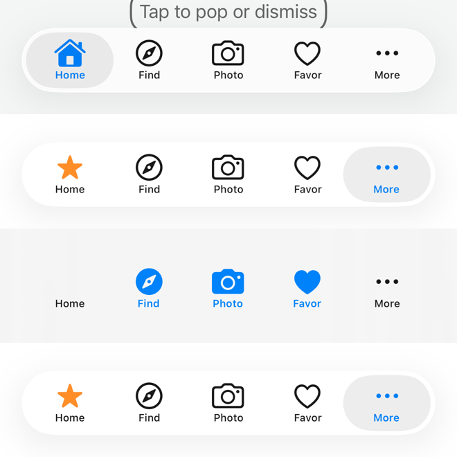

## 任务记录 / Task log

| 中文 | English |
|:---|:---|
| DONE（2026-11-12，PlusButton 首次显示时偏移、消失后才正常）：用户提示词：「请排查 截图中右上角的截图中 plusbutton为何会出现不显示，显示后又位置偏移，偏移后又恢复正常。预期效果是 位置不会偏移一开始就正常。修复。写入文档标注todo附带该截图」。上下文：截图为拖动测试录屏（ObjC 图库 9.4「首次显示时 PlusButton 所在 Tab 已选中」，iOS 26.1，iPhone 17 Pro 模拟器，液态玻璃）每秒 3 帧的拼图。右上角一帧（场景刚打开）中 PlusButton 位置偏下；下一帧 PlusButton 不显示；再下一帧才在正确位置。要求：找出原因并修复，PlusButton 从第一帧起就在正确位置，不偏移、不消失；修复后用录屏逐帧验证。原因（30 帧/秒录屏）：图库 9.4 先选中 Home，再用代码选中 PlusButton 所在 Tab，系统把放大镜从 Home 经过 Find 动画移到 PlusButton 的位置，而 PlusButton 的页面已经算作选中，放大镜遮罩（`-cyl_updateLiquidGlassMask`）在放大镜到达之前就遮住了 PlusButton：移动过程中 PlusButton 消失，放大镜进入时被切掉一半（即截图中的“不显示”与“偏移”）。第一帧中整条 TabBar 偏低是页面弹出动画，PlusButton 与 TabBar 一起移动。修复：只有当前显示的放大镜（presentation layer）停在 PlusButton 的位置上时才遮住，在此之前每 0.1 秒重新判断（`-cyl_lensIsOnTabButton:`）。验证：同一启动过程的 30 帧/秒录屏中 PlusButton 在放大镜移动期间一直完整；两个拖动 UI 测试仍然通过；134 个单元测试在 iOS 26.1 与 17.5 上通过。截图从上到下：修复前（消失、被切一半），修复后（同一时刻，完整）。iOS · iOS 26.1 模拟器，iPhone 17 Pro · Xcode 27.2（iOS SDK 27.2）· macOS 27.3 · 分支 `feat/cross-platform-components` · 2026-11-12 17:08 NZDT。 | DONE (2026-11-12, plus button offset, then gone, then right, on first display): user prompt: "请排查 截图中右上角的截图中 plusbutton为何会出现不显示，显示后又位置偏移，偏移后又恢复正常。预期效果是 位置不会偏移一开始就正常。修复。写入文档标注todo附带该截图". Context: the screenshot is a 3 fps contact sheet of the drag test's video (ObjC gallery 9.4, "plus tab selected on first display", iOS 26.1, iPhone 17 Pro simulator, Liquid Glass). In the top-right frame (the scene just opened) the plus button is too low; in the next frame it is not shown; only the frame after shows it in place. Requirement: find the cause and fix it, so the plus button is in place from the first frame, never offset or missing; verify frame by frame on a recording. Cause (30 fps recording): gallery 9.4 selects Home first, then the plus tab in code; UIKit animates the lens from Home over Find to the plus slot while the plus page already counts as selected, and the lens mask (`-cyl_updateLiquidGlassMask`) hid the plus button before the lens arrived: the plus button was gone during the travel and half cut as the lens came in (the "not shown" and "offset" of the screenshot). The whole bar being low in the first frame is the screen's presentation animation, the plus button moving with the bar. Fix: mask only once the lens as drawn now (its presentation layer) sits on the plus slot, checking again every 0.1 s until then (`-cyl_lensIsOnTabButton:`). Verified: on a 30 fps recording of the same launch the plus button stays whole while the lens moves; both drag UI tests still pass; 134 unit tests pass on iOS 26.1 and 17.5. Screenshots, top to bottom: before the fix (gone, half cut), with the fix (same moments, whole). iOS · iOS 26.1 simulator, iPhone 17 Pro · Xcode 27.2 (iOS SDK 27.2) · macOS 27.3 · branch `feat/cross-platform-components` · 2026-11-12 17:08 NZDT. |

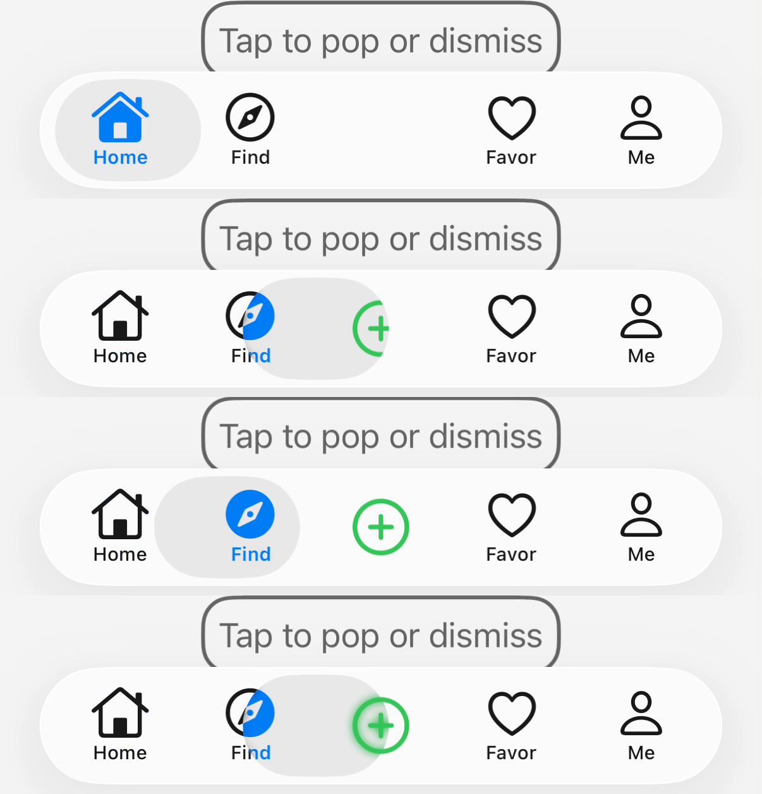

| 中文 | English |
|:---|:---|

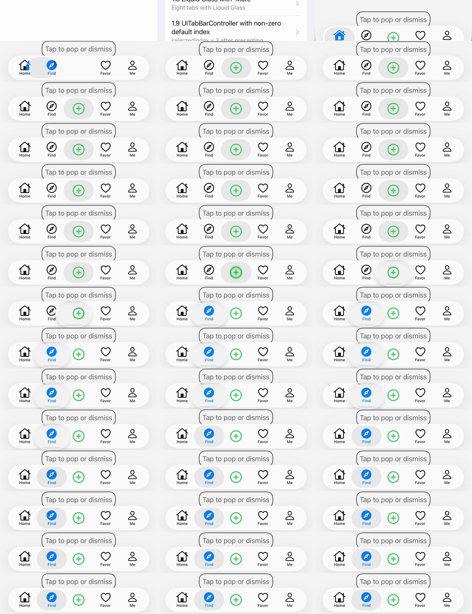

| 中文 | English |
|:---|:---|
| TODO（2026-11-12，第二次报告：PlusButton 不显示、偏移后才正常；先关闭遮罩排查）：用户提示词：「同样问题截图：请排查 截图中右上角的截图中 plusbutton为何会出现不显示，显示后又位置偏移，偏移后又恢复正常。预期效果是 位置不会偏移一开始就正常。修复。写入文档标注todo附带该截图。怀疑是为了对title 长度限制，将plus button不再默认做局中显示。而是根据玻璃遮罩位置来确定plus button位置。该修改造成的问题。正确逻辑应该是默认将plus button默认做局中显示。等确定 玻璃遮罩位置来确定plus button位置后再刷新位置。你缺少了默认操作，再刷新的两步逻辑，你错误地忽略了默认局中逻辑，而是等待确定 玻璃遮罩位置来确定plus button位置。这是问题的根源」，并要求：遇到 bug 先让 `-cyl_updateLiquidGlassMask` 第一行直接 return（关闭遮罩）排除它。上下文：截图第二行（放大镜在 Find 上、PlusButton 不见）来自拖动对照组录屏（当时特意关闭了拖动暂停）；其他行来自修复后。用户怀疑：PlusButton 随液态玻璃 slot 定位（`-cyl_liquidGlassPlusButtonSlotAtIndex:`，见 [PlusButton-Slot](PlusButton-Slot.md)）后，缺少「先默认居中、确定 slot 后再刷新位置」的两步逻辑。要求：遮罩关闭后录屏复测首次显示与拖动；如仍有不显示或偏移，加入默认居中再刷新；逐帧验证。结果（2026-11-12）：遮罩已关闭（`CYL_PLUS_BUTTON_LENS_MASK_ENABLED` 为 0，`-cyl_updateLiquidGlassMask` 第一行返回，`ea62f1b`）。关闭后 30 帧/秒录屏中，图库 9.4 打开期间 PlusButton 每一帧都完整、位置正确（下图从上到下：放大镜在 Home、移到 Find、移到 PlusButton、停在 PlusButton 上，最后一帧只有选中时的模糊光晕，即遮罩要解决的原问题）。因此不显示与偏移完全由遮罩引起。默认居中逻辑已存在：`CYLTabBar` 默认把 PlusButton 的水平中心设为 platter 中心，slot 布局完成后才改用 slot 中心，并在下一个 run loop 再校正一次（`CYLTabBar.m`，`-cyl_liquidGlassPlusButtonSlotAtIndex:` 返回 nil 时使用 platter 中心）。遮罩保持关闭，由维护者决定是否重新开启（开启前须通过拖动与首次显示测试）。iOS · iOS 26.1 模拟器，iPhone 17 Pro · Xcode 27.2（iOS SDK 27.2）· macOS 27.3 · 分支 `feat/cross-platform-components`（提交 `ea62f1b`）· 2026-11-12 17:22 NZDT。 | TODO (2026-11-12, second report: plus button missing, then offset, then right; mask switched off first): user prompt: "同样问题截图：请排查 截图中右上角的截图中 plusbutton为何会出现不显示，显示后又位置偏移，偏移后又恢复正常。预期效果是 位置不会偏移一开始就正常。修复。写入文档标注todo附带该截图。怀疑是为了对title 长度限制，将plus button不再默认做局中显示。而是根据玻璃遮罩位置来确定plus button位置。该修改造成的问题。正确逻辑应该是默认将plus button默认做局中显示。等确定 玻璃遮罩位置来确定plus button位置后再刷新位置。你缺少了默认操作，再刷新的两步逻辑，你错误地忽略了默认局中逻辑，而是等待确定 玻璃遮罩位置来确定plus button位置。这是问题的根源", plus: on a bug, first make `-cyl_updateLiquidGlassMask` return on its first line (mask off) to rule it out. Context: the screenshot's second row (lens on Find, plus button gone) comes from the drag control run (drag suspension deliberately off then); the other rows are with the fix. The maintainer suspects that since the plus button follows the Liquid Glass slot (`-cyl_liquidGlassPlusButtonSlotAtIndex:`, see [PlusButton-Slot](PlusButton-Slot.md)), the two-step logic is missing: center it by default first, then refresh once the slot is known. Requirement: with the mask off, record first display and the drag again; if the plus button is still missing or offset, add default centering then refresh; verify frame by frame. Result (2026-11-12): the mask is off (`CYL_PLUS_BUTTON_LENS_MASK_ENABLED` 0, `-cyl_updateLiquidGlassMask` returns on its first line, `ea62f1b`). With it off, a 30 fps recording of gallery 9.4 opening shows the plus button whole and in place in every frame (below, top to bottom: lens on Home, moving to Find, moving to the plus button, on the plus button; the last frame has only the selected-state blurred glow, the original problem the mask was for). So the missing and offset plus button came entirely from the mask. The default centering is already there: `CYLTabBar` sets the plus button's horizontal center to the platter's center by default, uses the slot's center only once the slot is laid out, and checks again on the next run loop (`CYLTabBar.m`: the platter's center when `-cyl_liquidGlassPlusButtonSlotAtIndex:` returns nil). The mask stays off; turning it back on is the maintainer's call, after the drag and first-display tests. iOS · iOS 26.1 simulator, iPhone 17 Pro · Xcode 27.2 (iOS SDK 27.2) · macOS 27.3 · branch `feat/cross-platform-components` (commit `ea62f1b`) · 2026-11-12 17:22 NZDT. |

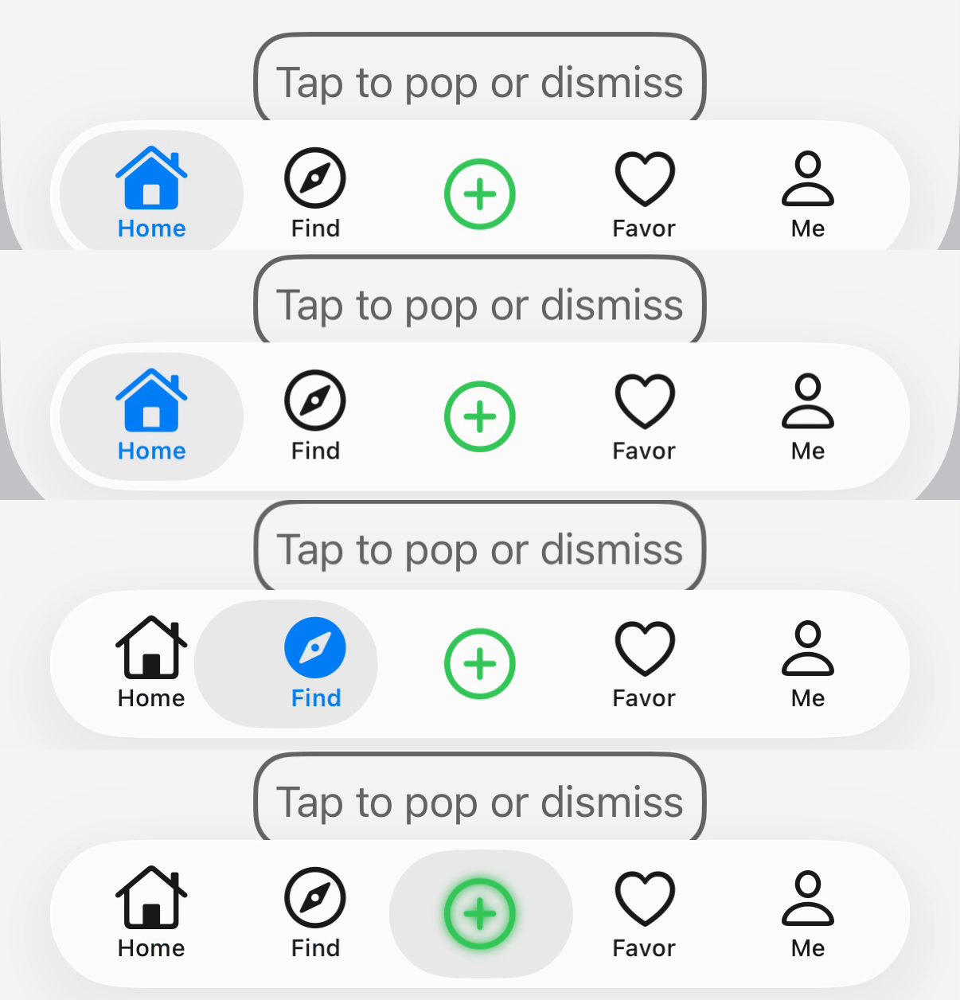

| 中文 | English |
|:---|:---|

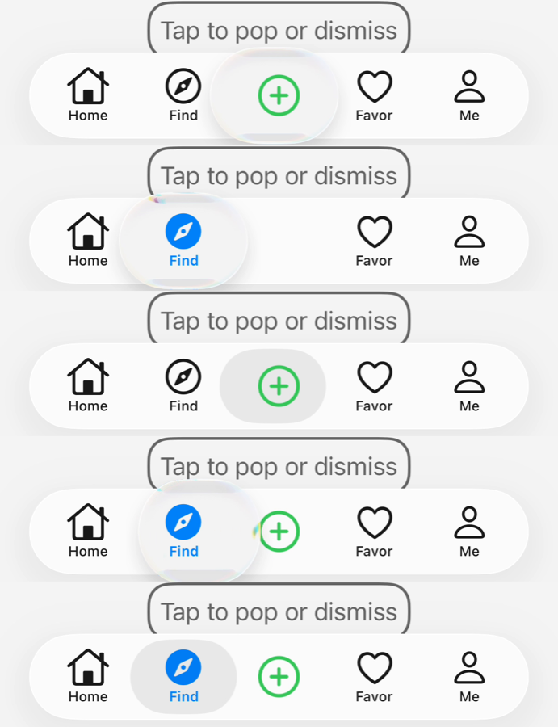

| 中文 | English |
|:---|:---|
| DONE（2026-11-12，遮罩只作用于标题）：用户提示词：「尝试将下面的方法保留方法名不变，只改变实现。的实现改为仅仅作用于 title。不作用于 icon，缩小影响范围尝试是否还存在bug，title指的是 当下面的底线场景不变的前提下，增加了一条，用户实现了plusbutton的代理方法，要求plusbutton的 title局中 对齐。再次强调优先处理bug：非常谨慎实现Implementing the mask in the existing empty hook cyl_updateLiquidGlassMask 请在合适文档中进行TODO中标注，并在代码注释中标注，该方法会导致选中plusButton后，在拖拽到其他item时，原plusbutton会被切割为两部分。之前的实现由于无法解决该问题，我才删掉了该方法的实现。除非经过完整测试，不会导致用户拖拽液态玻璃遮罩的时候导致plusButton被切割，才保留该实现。该bug复现步骤为：iOS26及以上系统，液态玻璃样式非扁平样式，存在plus button存在pluschildviewcontroller ，方法会导致选中plusButton后，在拖拽到其他item时，原plusbutton会被切割为两部分。」。要求：保留 `-cyl_updateLiquidGlassMask` 方法名，只改实现：只遮住标题、不遮图标，缩小影响范围；只在原有底线场景（iOS 26+、液态玻璃、非扁平样式、有 PlusButton 子控制器）之外再加一条——App 实现了 `+alignsTitleWithTabBarItemTitles` 并返回 YES（PlusButton 标题与 Tab 标题居中对齐）时才生效。仍需完整测试：拖动放大镜不切割 PlusButton（凸起与平的 PlusButton，录屏），首次显示与用代码选中时不消失、不偏移；否则保持关闭。结果：方法名不变，实现改为只遮住标题自身区域（每边宽 2pt），从不遮住图标，并且只在 `+alignsTitleWithTabBarItemTitles` 返回 YES 时生效；保留拖动期间暂停与放大镜到位才遮住两项保护；`CYL_PLUS_BUTTON_LENS_MASK_ENABLED` 改为 1。验证（录屏）：三个拖动 UI 测试通过——ObjC 示例主 TabBar（凸起、带标题、实现了该方法）、图库 9.4（平的、无标题）、Example-SwiftUI（凸起、未实现该方法）——拖动期间与之后 PlusButton 都完整；图库 9.4 首次显示 30 帧/秒录屏中每一帧都完整、位置正确；134 个单元测试在 iOS 26.1 与 17.5 上通过。注意：ObjC 示例中该方法会把「Post」标题移到 TabBarItem 由系统绘制，按钮本身没有标题，因此遮罩在现有示例中不起作用；Example-SwiftUI 未实现该方法，其选中时的标题模糊仍未解决（见 [SwiftUI-Integration](SwiftUI-Integration.md)）。截图从上到下：ObjC 示例选中 PlusButton（按下时放大镜的放大效果）、拖到 Nearby 时、拖动后。iOS · iOS 26.1 模拟器，iPhone 17 Pro · Xcode 27.2（iOS SDK 27.2）· macOS 27.3 · 分支 `feat/cross-platform-components` · 2026-11-12 18:12 NZDT。 | DONE (2026-11-12, mask on the title only): user prompt: "尝试将下面的方法保留方法名不变，只改变实现。的实现改为仅仅作用于 title。不作用于 icon，缩小影响范围尝试是否还存在bug，title指的是 当下面的底线场景不变的前提下，增加了一条，用户实现了plusbutton的代理方法，要求plusbutton的 title局中 对齐。再次强调优先处理bug：非常谨慎实现Implementing the mask in the existing empty hook cyl_updateLiquidGlassMask 请在合适文档中进行TODO中标注，并在代码注释中标注，该方法会导致选中plusButton后，在拖拽到其他item时，原plusbutton会被切割为两部分。之前的实现由于无法解决该问题，我才删掉了该方法的实现。除非经过完整测试，不会导致用户拖拽液态玻璃遮罩的时候导致plusButton被切割，才保留该实现。该bug复现步骤为：iOS26及以上系统，液态玻璃样式非扁平样式，存在plus button存在pluschildviewcontroller ，方法会导致选中plusButton后，在拖拽到其他item时，原plusbutton会被切割为两部分。". Requirement: keep the name `-cyl_updateLiquidGlassMask`, change only its implementation: mask only the title, never the icon, to narrow its effect; active only when, on top of the baseline case (iOS 26+, Liquid Glass, not FlatDesign, a plus child view controller), the app implements `+alignsTitleWithTabBarItemTitles` returning YES (the plus button's title aligned with the tab titles). Still needs full testing: dragging the lens never cuts the plus button (raised and flat plus buttons, recorded), no missing or offset plus button on first display or a selection in code; otherwise it stays off. Result: same method name, the implementation now masks only the title's own frame (2 pt wider on each side), never the icon, and only when `+alignsTitleWithTabBarItemTitles` returns YES; both safeguards stay (paused while the lens is dragged, masking only once the lens sits on the slot); `CYL_PLUS_BUTTON_LENS_MASK_ENABLED` is 1. Verified (recorded): three drag UI tests pass — the ObjC demo's main tab bar (raised, titled, implements the method), gallery 9.4 (flat, no title), Example-SwiftUI (raised, does not implement it) — the plus button stays whole during and after the drag; a 30 fps recording of gallery 9.4's first display shows it whole and in place in every frame; 134 unit tests pass on iOS 26.1 and 17.5. Note: in the ObjC demo that method moves the "Post" title into the tab item, drawn by UIKit, so the button has no title of its own and the mask has no effect in today's examples; Example-SwiftUI does not implement the method, so its blurred selected title is still open (see [SwiftUI-Integration](SwiftUI-Integration.md)). Screenshots, top to bottom: the ObjC demo with the plus button selected (the lens magnifying during the press), dragged to Nearby, after the drag. iOS · iOS 26.1 simulator, iPhone 17 Pro · Xcode 27.2 (iOS SDK 27.2) · macOS 27.3 · branch `feat/cross-platform-components` · 2026-11-12 18:12 NZDT. |

| 中文 | English |
|:---|:---|
| DONE（2026-11-12，遮罩与 PlusButton 标题颜色）：用户提示词：「cyl_updateLiquidGlassMask  实现导致plusbutton的 title 字体异常。字体颜色与其他item 字体颜色不同 见附件中第二张截图，禁用该实现查看差异。如无法保证不会引发异常，继续禁用该方法实现。continue」。现象：附图第二行（放大镜拖到 Nearby 时），PlusButton 的标题「Post」颜色与其他 item 标题不同。要求：关闭 `-cyl_updateLiquidGlassMask`（`CYL_PLUS_BUTTON_LENS_MASK_ENABLED` 设为 0），重新录制同一拖动测试并对比；无法保证不引发异常时，保持关闭。结果：遮罩已关闭（`CYL_PLUS_BUTTON_LENS_MASK_ENABLED` 0，按维护者规则保持关闭）。对比录屏（左：开启，右：关闭；从上到下：选中 PlusButton、拖到 Nearby、拖动后）：两边第二行「Post」都是红色而 Messages、Me 仍为黑色，第三行未选中标题都变为红色。因此标题颜色差异并非遮罩造成，而是另一个问题，见下一条 TODO。 | DONE (2026-11-12, mask and the plus button's title color): user prompt: "cyl_updateLiquidGlassMask  实现导致plusbutton的 title 字体异常。字体颜色与其他item 字体颜色不同 见附件中第二张截图，禁用该实现查看差异。如无法保证不会引发异常，继续禁用该方法实现。continue". Symptom: in the second row of the screenshot (the lens dragged to Nearby), the plus button's title "Post" has a different color from the other items' titles. Requirement: disable `-cyl_updateLiquidGlassMask` (`CYL_PLUS_BUTTON_LENS_MASK_ENABLED` 0), record the same drag test again and compare; keep it disabled unless it can be shown not to cause problems. Result: the mask is off (`CYL_PLUS_BUTTON_LENS_MASK_ENABLED` 0, kept off per the maintainer's rule). Comparison recordings (left: on, right: off; top to bottom: plus button selected, dragged to Nearby, after the drag): in both, the second row shows "Post" red while Messages and Me are still black, and in the third row every unselected title is red. So the title color difference does not come from the mask; it is a separate issue, next TODO. iOS · iOS 26.1 simulator, iPhone 17 Pro · Xcode 27.2 (iOS SDK 27.2) · macOS 27.3 · branch `feat/cross-platform-components` · 2026-11-12 19:19 NZDT. |

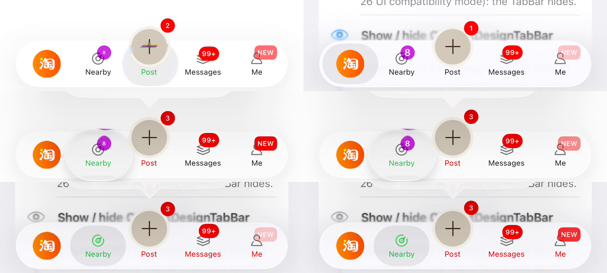

| 中文 | English |
|:---|:---|
| TODO（2026-11-12）：ObjC 示例中拖动放大镜选中 Nearby 时，PlusButton 标题「Post」先变红，其他 item 的标题稍后才变红（与遮罩无关，见上图）。待查：示例选中 Nearby 时把未选中标题改为红色的来源（主题或示例代码），以及 PlusButton 标题颜色与 TabBarItem 标题颜色更新不同步的原因；修复后两者应同时变化。 | TODO (2026-11-12): in the ObjC demo, when the lens selects Nearby, the plus button's title "Post" turns red first and the other items' titles only later (not the mask, see the picture above). To find: what turns the unselected titles red when Nearby is selected (a theme or the demo's code), and why the plus button's title color updates out of step with the tab items' titles; once fixed, both change together. |

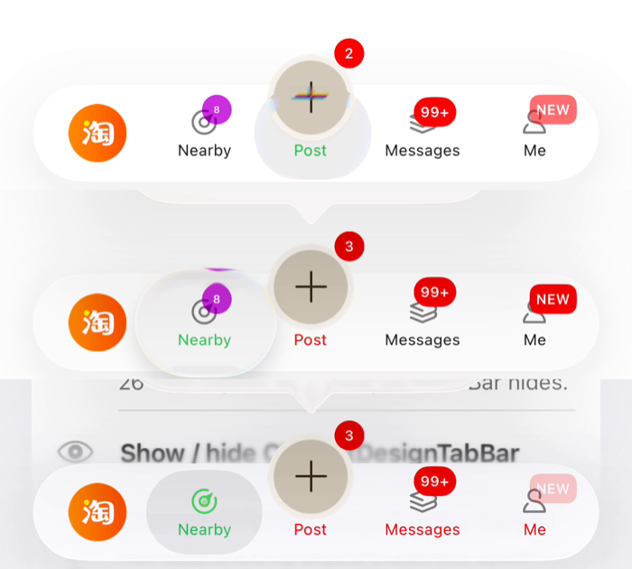

| 中文 | English |
|:---|:---|
| DONE（2026-11-13，Flutter：选中 PlusButton 自己的页面后标题消失）：用户提示词：「在跨端相关文件中记录 记录截图中的bug，标记TODO。CYLSearchViewController 的flutter example中，出现以下异常：flutter 的tabbar 实现iOS端异常。plus button title会在被选中后 液态玻璃遮罩消失，title异常消失。两个排查方向：第一个：plus button 问题，排查方向：cyl_updateLiquidGlassMask  实现导致plusbutton的 title 字体异常。	Switch: CYL_PLUS_BUTTON_LENS_MASK_ENABLED is now 1. Your rule still stands in AGENTS.md: on any plus button bug, set it to 0 first and retest. ，通过控制上面的key 禁用该实现查看差异。如无法保证不会引发异常，继续禁用cyl_updateLiquidGlassMask该方法实现。同时寻找CYLTabBarController ，，相关commit 里面有一个more按钮存在时 home button 相关icon消失的bug。搜索docs相关文档，查看上下文。continue  continue」。现象：CYLSearchViewController 的 Flutter 示例（`flutter_cyltabbar`，固定在 `74aa25e`，iOS 26 液态玻璃）中，选中 PlusButton 的页面后放大镜不出现，PlusButton 标题「Search bar」消失（下图第三张）。排查：`CYL_PLUS_BUTTON_LENS_MASK_ENABLED` 在 `74aa25e` 已为 0，遮罩不是原因；「More」编辑后 Home 图标消失的修复是 `d90802e`（见本文「More」编辑），同类问题：为替身而隐藏的视图没有人再显示。原因：选中 PlusButton 的页面时 `-updateSelectionStatusIfNeededForTabBarController:shouldSelectViewController:` 总是调用 `-setTabLabelHidden:YES`（标题交给放大镜中的替身显示），而 `CYLPlusButtonShowsSelection` 关闭（默认）且 PlusButton 不是居中布局时，`-tabBarController:shouldShowPlatterLiquidLensViewForControl:` 返回 NO，放大镜与替身都不显示，标题就没有了；ObjC 示例的代理返回 YES，所以没有出现。要求：在核心修复（放大镜隐藏时保留 PlusButton 自己的标题），在 Flutter 示例中验证并截图。 | DONE (2026-11-13, Flutter: the plus button's title disappears on its own page): user prompt: "在跨端相关文件中记录 记录截图中的bug，标记TODO。CYLSearchViewController 的flutter example中，出现以下异常：flutter 的tabbar 实现iOS端异常。plus button title会在被选中后 液态玻璃遮罩消失，title异常消失。两个排查方向：第一个：plus button 问题，排查方向：cyl_updateLiquidGlassMask  实现导致plusbutton的 title 字体异常。	Switch: CYL_PLUS_BUTTON_LENS_MASK_ENABLED is now 1. Your rule still stands in AGENTS.md: on any plus button bug, set it to 0 first and retest. ，通过控制上面的key 禁用该实现查看差异。如无法保证不会引发异常，继续禁用cyl_updateLiquidGlassMask该方法实现。同时寻找CYLTabBarController ，，相关commit 里面有一个more按钮存在时 home button 相关icon消失的bug。搜索docs相关文档，查看上下文。continue  continue". Symptom: in CYLSearchViewController's Flutter example (`flutter_cyltabbar` pinned at `74aa25e`, iOS 26 Liquid Glass), once the plus button's page is selected no lens appears and the plus button's title "Search bar" is gone (third picture below). Findings: `CYL_PLUS_BUTTON_LENS_MASK_ENABLED` is already 0 at `74aa25e`, so the mask is not the cause; the fix of Home's icon disappearing after More editing is `d90802e` (section "More editing" above), the same kind of bug: a view hidden for the stand-in that nobody shows again. Cause: selecting the plus button's page always calls `-setTabLabelHidden:YES` from `-updateSelectionStatusIfNeededForTabBarController:shouldSelectViewController:` (the title is left to the stand-in in the lens), but with `CYLPlusButtonShowsSelection` off (the default) and a plus button that is not layout-centered, `-tabBarController:shouldShowPlatterLiquidLensViewForControl:` returns NO, so neither the lens nor the stand-in shows and the title is gone; the ObjC example's delegate returns YES, so it never showed there. Requirement: fix it in the core (keep the plus button's own title while the lens is hidden), verify in the Flutter example with screenshots. |

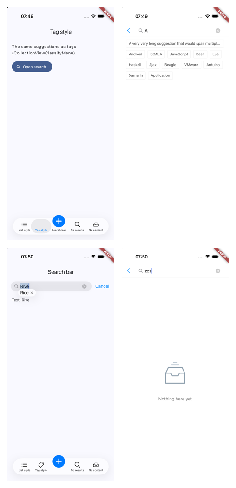
| 结果（2026-11-13，`8ae53a7`）：运行时日志确认：PlusButton 页面上放大镜被隐藏（`show=0`），PlusButton 没有 `cyl_tabLabel`；`CYLPlusButtonAlignsTitle` 默认开启时标题由其 TabBarItem 绘制，选中 Tab 的标题属于放大镜内容；配置 `CYLPlusButtonShowsSelection` 后标题出现。修复：`-cyl_plusButtonTitleIsDrawnByItsTabItem` 为 YES 时 `-tabBarController:shouldShowPlatterLiquidLensViewForControl:` 保留选中效果；第一次尝试（`8b397a8`，放大镜隐藏时显示 PlusButton 自己的标题）无效，已撤回。遮罩开关保持 0。验证：Flutter 示例默认配置下，两次选中 PlusButton 都显示放大镜与标题「Search bar」，切到其他 Tab 正常（下图从上到下：List style、PlusButton、Discover、再次 PlusButton）；单元测试 135 个，0 失败，2 个跳过（iPhone 17，iOS 26.3）。iOS · iPhone 17 模拟器 iOS 26.3 · Xcode 27.2（iOS SDK 27.2）· macOS 27.3 · Flutter 3.47.9 · 2026-11-13 14:2x NZDT。 | Result (2026-11-13, `8ae53a7`): a runtime log confirmed that on the plus page the lens is hidden (`show=0`) and the plus button has no `cyl_tabLabel`; with `CYLPlusButtonAlignsTitle` on (the default with a title) the title is drawn by its tab item, and the selected tab's title is part of the lens content; with `CYLPlusButtonShowsSelection` set, the title appears. Fix: `-tabBarController:shouldShowPlatterLiquidLensViewForControl:` keeps the selection when `-cyl_plusButtonTitleIsDrawnByItsTabItem` is YES; the first attempt (`8b397a8`, showing the plus button's own title when the lens is hidden) did not help and is reverted. The mask switch stays 0. Verified: with the Flutter example's default configuration, both selections of the plus button show the lens and the title "Search bar", and other tabs switch normally (below, top to bottom: List style, the plus button, Discover, the plus button again); unit tests 135, 0 failures, 2 skipped (iPhone 17, iOS 26.3). iOS · iPhone 17 simulator iOS 26.3 · Xcode 27.2 (iOS SDK 27.2) · macOS 27.3 · Flutter 3.47.9 · 2026-11-13 14:2x NZDT. |

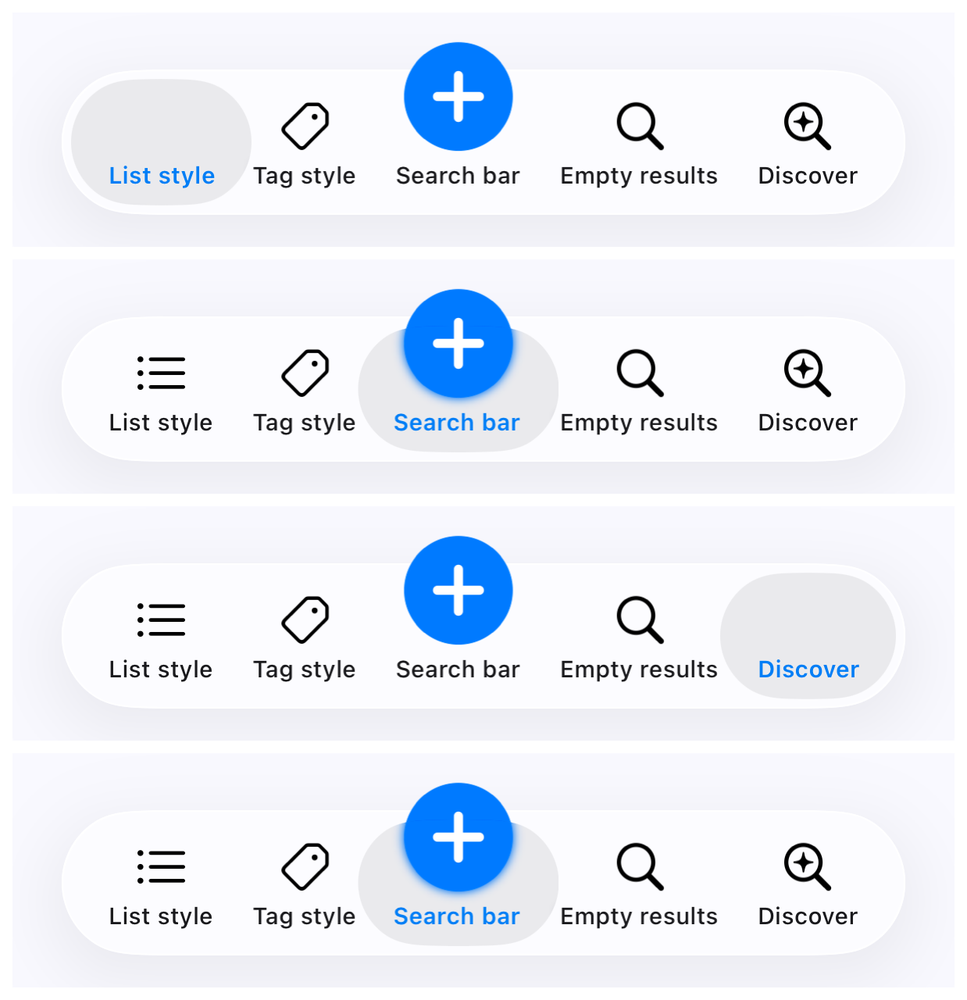

| 中文 | English |
|:---|:---|
| DONE（2026-11-14，React Native iOS 无法编译：C++ 看到同一个 C 函数的两份声明）：用户提示词：（来自 CYLSearchViewController 的 React Native 示例接入 react-native-cyltabbar）。原因：Swift 代码用 `@_cdecl` 导出的 15 个 C 函数（`CYLLocalizedString`、`CYLBadgeAccessibilityDescription`、`CYLTabBarItemsAttributesAddingLottieFiles` 等）在 Objective-C 头文件中又声明了一次，而公共头文件经 `CYLSwiftInterface.h` 导入生成的 `CYLTabBarController-Swift.h`；在 Objective-C++（每个 Fabric 视图）里两份声明冲突（`noexcept`、泛型）。修复：这些声明在 C++ 且生成头文件存在时不再可见（`#if !defined(__cplusplus) \|\| !__has_include(<CYLTabBarController/CYLTabBarController-Swift.h>)`），C++ 使用生成头文件的那一份，C 与 Objective-C 不变。验证：CYLSearchViewController 的 React Native 示例 iOS Release 构建，所有原生代码编译通过。 | DONE (2026-11-14, React Native on iOS did not compile: C++ saw two declarations of the same C function): the user's prompt: (wiring react-native-cyltabbar into CYLSearchViewController's React Native example). Cause: 15 C functions that the Swift code exports with `@_cdecl` (`CYLLocalizedString`, `CYLBadgeAccessibilityDescription`, `CYLTabBarItemsAttributesAddingLottieFiles`, ...) are declared again in Objective-C headers, and the public headers import the generated `CYLTabBarController-Swift.h` through `CYLSwiftInterface.h`; in Objective-C++ (every Fabric view) the two declarations conflict (`noexcept`, generics). Fix: the Objective-C declarations are not visible to C++ when the generated header exists (`#if !defined(__cplusplus) \|\| !__has_include(<CYLTabBarController/CYLTabBarController-Swift.h>)`), so C++ uses the generated header's, and C and Objective-C are unchanged. Verified: the React Native example of CYLSearchViewController builds on iOS (Release), all native code compiles. |

| 中文 | English |
|:---|:---|
| DONE（2026-11-14，React Native Android 从源码构建失败：`Unresolved reference 'viewpager2'`）：`react-native-cyltabbar` 以本地源码方式编译 `CYLViewPager2Binding.kt`，但 Gradle 文件没有 `androidx.viewpager2:viewpager2`。已加入该依赖。 | DONE (2026-11-14, React Native on Android failed to build from source: `Unresolved reference 'viewpager2'`): `react-native-cyltabbar` compiles `CYLViewPager2Binding.kt` from the local sources, but its Gradle file had no `androidx.viewpager2:viewpager2`. The dependency is added. |
