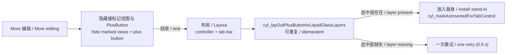

# 液态玻璃的健壮性改进 / Liquid Glass Robustness

<!-- bound-classes: CYLTabBar, CYLTabBarController -->
<!-- binding:start -->
<!-- Generated by scripts/update-docs-navigation.py; do not edit by hand. -->

| 中文 | English |
|:---|:---|
| 绑定的代码类 `CYLTabBar`：[`CYLTabBarController/CYLTabBar.h`](../CYLTabBarController/CYLTabBar.h) | Bound to the class `CYLTabBar`: [`CYLTabBarController/CYLTabBar.h`](../CYLTabBarController/CYLTabBar.h) |
| 绑定的代码类 `CYLTabBarController`：[`CYLTabBarController/CYLTabBarController.h`](../CYLTabBarController/CYLTabBarController.h) | Bound to the class `CYLTabBarController`: [`CYLTabBarController/CYLTabBarController.h`](../CYLTabBarController/CYLTabBarController.h) |

<!-- binding:end -->

| 中文 | English |
|:---|:---|
| 本文记录液态玻璃（iOS 26+）实现中四项健壮性改进：越界读取不再依赖 `@try`，库插入 Tab 按钮的视图统一标记，PlusButton 在选中层的替身改为随布局安装，以及「More」编辑期间不留下残留视图。这些都是内部改进，默认行为不变；只新增了 `UIView` 上的标记接口。 | This page records four robustness improvements to the Liquid Glass (iOS 26+) implementation: out-of-range reads no longer rely on `@try`, the views the library inserts into tab buttons are marked in one way, the plus button's stand-in in the selected layer is installed with layout, and More editing leaves no views behind. They are internal; default behavior does not change. The only new API is the marking API on `UIView`. |

## 目录 / Contents

<!-- navigation:start -->
<!-- Generated by scripts/update-docs-navigation.py; do not edit by hand. -->

| 中文 | English |
|:---|:---|
| [越界读取：先检查下标](#越界读取先检查下标--out-of-range-reads-check-the-index-first) | [Out-of-range reads: check the index first](#越界读取先检查下标--out-of-range-reads-check-the-index-first) |
| [插入视图的统一标记](#插入视图的统一标记--one-mark-for-inserted-views) | [One mark for inserted views](#插入视图的统一标记--one-mark-for-inserted-views) |
| [PlusButton 替身随布局安装](#plusbutton-替身随布局安装--the-plus-buttons-stand-in-follows-layout) | [The plus button's stand-in follows layout](#plusbutton-替身随布局安装--the-plus-buttons-stand-in-follows-layout) |
| [「More」编辑](#more编辑--more-editing) | [More editing](#more编辑--more-editing) |
| [演示](#演示--demo) | [Demo](#演示--demo) |
| [限制与验证](#限制与验证--limits-and-verification) | [Limits and verification](#限制与验证--limits-and-verification) |

<!-- navigation:end -->

## 越界读取：先检查下标 / Out-of-range reads: check the index first

| 中文 | English |
|:---|:---|
| 以前很多按下标读取数组的地方用 `@try` / `@catch` 接住越界异常。ARC 默认不处理异常安全，抛出时可能泄漏内存；而且一个 `@try` 包住多次读取时，第一次抛出就会跳过后面全部读取。`-[CYLTabBar cyl_selectedControl]` 就是这样：本意是依次尝试选中层按钮、普通层按钮、可见按钮，但选中层为空时直接进入 `@catch`，后面的备选从未执行，结果返回 nil。现在这些地方都先检查下标（文件内的 `CYLObjectAtIndex()`，越界返回 nil），备选会按顺序生效。KVC、KVO 与通知相关的 `@try` 用于接住系统可能抛出的异常，保持不变。 | Many places that read an array by index used `@try` / `@catch` to catch the out-of-range exception. ARC is not exception-safe by default, so a throw can leak; and when one `@try` wraps several reads, the first throw skips all the reads after it. `-[CYLTabBar cyl_selectedControl]` did exactly that: it meant to try the selected-layer button, then the normal-layer button, then the visible buttons, but with an empty selected layer it jumped to `@catch`, the fallbacks never ran, and it returned nil. These places now check the index first (the file-private `CYLObjectAtIndex()`, nil when out of range), so the fallbacks apply in order. The `@try` blocks around KVC, KVO and notifications, which catch exceptions the system may raise, are unchanged. |

## 插入视图的统一标记 / One mark for inserted views

| 中文 | English |
|:---|:---|
| 本库插入到 Tab 按钮中的视图（替换图标的视图、Lottie 视图、液态玻璃选中层中 PlusButton 的替身、布局跟踪视图）现在都用 `-[UIView cyl_markAsInsertedForTabControl:]` 标记，并弱引用所属的按钮。因此可以一次性找到、隐藏与恢复它们（`+[UIView cyl_insertedTabControlViews]`），也能识别仍留在旧按钮中的视图。没有使用 `tag`，以免覆盖开发者自己视图（例如 PlusButton 的 `selectedContentView`）的 `tag`。 | The views the library inserts into tab buttons (a view shown in place of the icon, a Lottie view, the plus button's stand-in in the Liquid Glass selected layer, a layout tracker) are now marked with `-[UIView cyl_markAsInsertedForTabControl:]`, which holds their button weakly. So they can be found, hidden and restored in one pass (`+[UIView cyl_insertedTabControlViews]`), and a view still in an old button is recognized. `tag` is not used, so the `tag` of the developer's own views (e.g. the plus button's `selectedContentView`) is never overwritten. |

| API | 中文 | English |
|:---|:---|:---|
| `-[UIView cyl_markAsInsertedForTabControl:]` | 标记为本库为某按钮插入的视图（弱引用按钮；传 nil 取消标记） | Marks a view as inserted by the library for a button (held weakly; nil unmarks) |
| `UIView.cyl_insertedForTabControl` | 所属按钮；未标记或已释放时为 nil | Its button; nil when unmarked or deallocated |
| `+[UIView cyl_insertedTabControlViews]` | 所有仍存活的被标记视图（仅主线程） | Every marked view still alive (main thread only) |

## PlusButton 替身随布局安装 / The plus button's stand-in follows layout

| 中文 | English |
|:---|:---|
| 液态玻璃的选中层比普通层渲染得晚。以前的做法是：在控制器布局时取到选中层按钮，固定延迟 0.5 秒后再放入 PlusButton 的替身。如果取的时候选中层还不存在，延迟后操作的是 nil，替身要等下一次控制器布局才会出现。现在 `-cyl_layOutPlusButtonInLiquidGlassLayers` 可重复调用，控制器与（拥有该 TabBar 的控制器的）TabBar 每次布局都会执行，每次都重新查找视图：选中层出现的那次布局就会放入替身；替身已在正确按钮中时立即返回，不做额外工作；选中层仍不存在时只安排一次 0.5 秒后的重试作为兜底。 | The Liquid Glass selected layer renders later than the normal one. Before, the controller looked up the selected-layer button during its layout and put the plus button's stand-in in after a fixed 0.5 s delay. When the layer did not exist yet, the delayed block acted on nil and the stand-in waited for the next controller layout. Now `-cyl_layOutPlusButtonInLiquidGlassLayers` is idempotent and runs on every layout pass of the controller and of the tab bar, looking the views up again each time: the stand-in goes in on the pass where the selected layer appears; once it is in the right button the method returns at once, doing no extra work; when the selected layer is still missing, a single retry after 0.5 s is the fallback. |
| UIKit 会重建 Tab 按钮（例如修改 item 图片后）。以前替身仍挂在旧按钮上时，`show:YES` 因为它已有父视图而什么都不做，新按钮里就没有替身。现在根据标记识别出它属于其他按钮，先移出再放入新按钮。 | UIKit rebuilds the tab buttons (e.g. after an item image changes). Before, while the stand-in still hung in the old button, `show:YES` did nothing because it already had a superview, so the new button had no stand-in. Now the mark shows it belongs to another button, so it is taken out first and put in the new one. |

## 「More」编辑 / More editing

| 中文 | English |
|:---|:---|
| 本库不支持「More」编辑本身（More 页面中的 "Edit"，可以把 item 拖到 TabBar 上）。编辑时 UIKit 会移动并重建 Tab 按钮，插入的视图可能留在过时的位置。现在 `CYLTabBar` 在 `-beginCustomizingItems:` 时一次性隐藏被标记的视图与 PlusButton，在 `-endCustomizingAnimated:` 后恢复它们原来的 `hidden` 值并重新布局；编辑期间（`-beginCustomizingItems:` 到 `-endCustomizingAnimated:` 之间）不安装 PlusButton 替身；结束后立即与下一个 runloop 各请求一次布局，因为 UIKit 结束编辑时可能重建按钮。 | The library does not support More editing as such ("Edit" on the More page, which lets items be dragged onto the tab bar). While editing, UIKit moves and rebuilds the tab buttons, and inserted views could be left at stale positions. Now `CYLTabBar` hides the marked views and the plus button in one pass in `-beginCustomizingItems:`, restores their previous `hidden` values after `-endCustomizingAnimated:` and lays out again; the plus button's stand-in is not installed while editing (between `-beginCustomizingItems:` and `-endCustomizingAnimated:`); a layout is requested right after and again on the next run loop turn, since UIKit can rebuild the buttons as editing ends. |

## 演示 / Demo

| 中文 | English |
|:---|:---|
| ObjC Demo：首页 → 「Open the tab bar gallery」→ 最后一组「Liquid Glass robustness」，每一项改进对应一行，点击即可演示。前五行 present 一个 TabBarController，最后一行把 8 个 Tab 的 TabBarController push 进图库的导航控制器。代码见 `Example/Classes/Gallery/CYLGalleryProvider.m` 的 `+liquidGlassRobustnessSection`。 | ObjC demo: Home → "Open the tab bar gallery" → the last section, "Liquid Glass robustness", has one row per improvement; tap a row to see it. The first five rows present a tab bar controller; the last one pushes an 8-tab tab bar controller onto the gallery's navigation controller. The code is `+liquidGlassRobustnessSection` in `Example/Classes/Gallery/CYLGalleryProvider.m`. |

| 行 / Row | 中文 | English |
|:---|:---|:---|
| Selected control with bounds checks | 导航栏显示 `cyl_selectedIndex` 与 `cyl_selectedControl` 的类名；点 "Read" 重新读取 | The navigation bar shows `cyl_selectedIndex` and the class of `cyl_selectedControl`; "Read" reads them again |
| Out-of-range reads return nil | 点 "Read 99"：按下标 99 读取的三个接口都返回 nil，不抛异常 | "Read 99": the three index readers return nil for index 99, no exception |
| Marked views in tab buttons | Home 的图标被星形视图替换（被标记）；导航栏显示被标记 / 隐藏的数量，"Hide / Show" 一次性切换 | A star replaces Home's icon (marked); the navigation bar shows how many views are marked / hidden, and "Hide / Show" toggles them in one pass |
| Plus stand-in after an item image changes | 选中拥有自己页面的 PlusButton，点 "Change image"：UIKit 重建按钮，替身移到新按钮中（液态玻璃） | With the plus button's own page selected, "Change image" makes UIKit rebuild the buttons, and the stand-in moves to the new one (Liquid Glass) |
| Plus stand-in on first display and rotation | 一打开就选中 PlusButton 的页面；旋转设备，替身随布局出现，没有固定延迟（液态玻璃） | The plus page is selected at once; rotate the device and the stand-in follows layout, with no fixed delay (Liquid Glass) |
| More editing with 8 tabs | push 进入；More → Edit → 拖动 → Done：编辑期间星形视图隐藏，结束后恢复 | Pushed; More → Edit → drag → Done: the star hides while editing and comes back after |

## 限制与验证 / Limits and verification

| 中文 | English |
|:---|:---|
| 已验证（2026-11-10，iOS 26.1，iPhone 17 Pro Max 模拟器，ObjC Demo 图库第 9 组，用 `-CYLDemoGalleryScene` 打开）。PlusButton 替身，从上到下：9.4 启动后选中 PlusButton 所在 Tab；再次确认；点击「Change image」后 Home 图标换成太阳，替身仍在 PlusButton 下方；9.5 首次显示时 PlusButton 所在 Tab 直接选中，替身就位。TODO：旋转后替身是否跟随（`simctl` 无法旋转模拟器，需在模拟器窗口或真机上检查）；选中 PlusButton 时其图标 / 标题有一层模糊的重影（见 [SwiftUI-Integration](SwiftUI-Integration.md) 的 TODO）。 | Verified (2026-11-10, iOS 26.1, iPhone 17 Pro Max simulator, ObjC demo gallery section 9, opened with `-CYLDemoGalleryScene`). The plus stand-in, top to bottom: 9.4 the plus tab selected at launch; checked again; after "Change image" Home's icon becomes a sun and the stand-in stays under the plus button; 9.5 on first display the plus tab is selected at once and the stand-in is in place. TODO: whether the stand-in follows a rotation (`simctl` cannot rotate the simulator: check in the Simulator window or on a device); the selected plus button's icon / title has a blurred copy under it (see the TODO in [SwiftUI-Integration](SwiftUI-Integration.md)). |

| 中文 | English |
|:---|:---|
| TODO（More 编辑无法验证，2026-11-10 发现）：从上到下：1.5 系统 `UITabBarController` 8 个 Tab，显示「More」；1.6 `CYLTabBarController`「with 'More'」（iOS 26 上为扁平样式）显示「More」文字但没有图标（已修复，见下）；9.6「More editing with 8 tabs」（液态玻璃）只显示 5 个 Tab，第 5 个是「Me」，没有「More」，因此「More → Edit → 拖动 → Done」无法操作，Home 上的星形标记视图也不可见。待做：查明液态玻璃下 8 个 Tab 为何没有 More（系统行为还是库的处理，参考 issue #472 的实现），修正 9.6 场景或其说明。`-beginCustomizingItems:` 在 iOS 18+ 是否被调用、编辑时切换深色模式后 Lottie 视图是否保持隐藏，仍需在真机确认。 | TODO (More editing cannot be verified, found 2026-11-10): top to bottom: 1.5 the system `UITabBarController` with 8 tabs shows "More"; 1.6 `CYLTabBarController` "with 'More'" (FlatDesign on iOS 26) shows the "More" title but no icon (fixed, see below); 9.6 "More editing with 8 tabs" (Liquid Glass) shows only 5 tabs, the fifth being "Me", and no "More", so "More → Edit → drag → Done" cannot be done, and the star marked view on Home is not visible. To do: find out why 8 tabs on Liquid Glass give no More (the system or the library; see how issue #472 is implemented) and fix scene 9.6 or its description. Whether UIKit calls `-beginCustomizingItems:` on iOS 18+, and whether a Lottie view replaced by a Dark Mode switch during editing stays hidden, still need a device. |

| 中文 | English |
|:---|:---|
| 已修复（2026-11-10）：扁平样式的「More」Tab 没有图标。原因不是缺少资源文件：`-[UIViewController cyl_tabBarItem]` 生成扁平样式 item 时从一个此时为 nil 的局部变量读取标题与图片，因此图片总是 1×1 透明占位图（标题因为还会回退到 `self.title` 而显示「More」）。现在从 UIKit 的 `self.tabBarItem` 读取；系统的「More」item（`UITabBarSystemItemMore`）没有 `image`（由 UIKit 绘制），因此使用 SF Symbol "ellipsis"，并按类名识别 `UIMoreNavigationController`，不触发懒加载的 `moreNavigationController`。测试：`testFlatDesignMoreTabHasAnIcon`。上：修复前；下：修复后（1.6）。 | Fixed (2026-11-10): the FlatDesign "More" tab had no icon. Not a missing resource: `-[UIViewController cyl_tabBarItem]` built the FlatDesign item from a local variable that is nil at that point, so the image was always the 1×1 transparent placeholder (the title still showed "More" because it falls back to `self.title`). It now reads UIKit's `self.tabBarItem`; the system "More" item (`UITabBarSystemItemMore`) has no `image` (UIKit draws it), so it gets the SF Symbol "ellipsis", and `UIMoreNavigationController` is recognized by class name so the lazy `moreNavigationController` is never triggered. Test: `testFlatDesignMoreTabHasAnIcon`. Top: before; bottom: after (1.6). |

