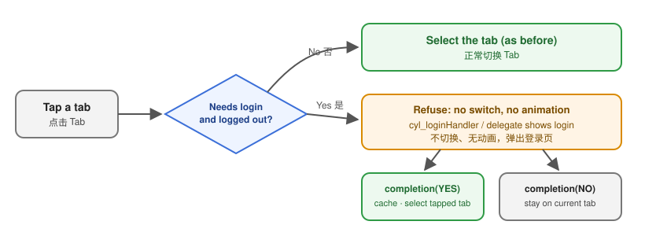
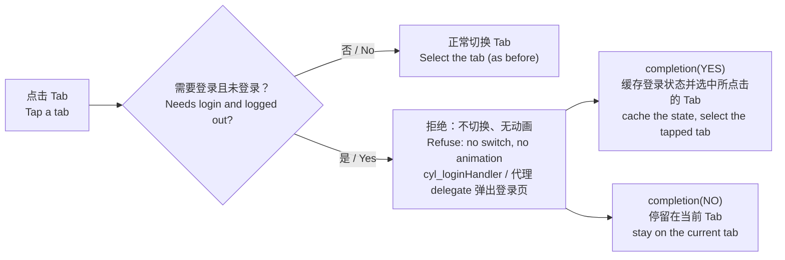
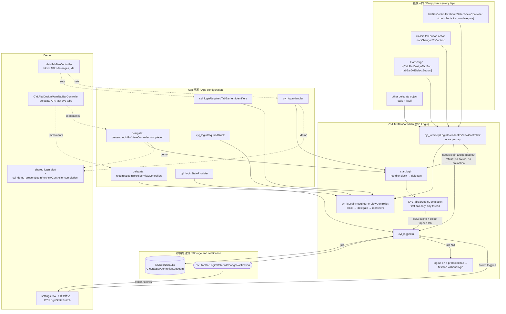
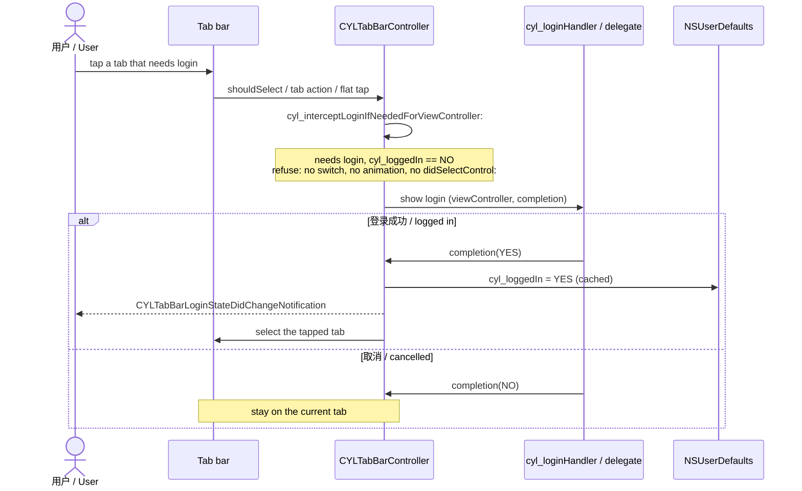
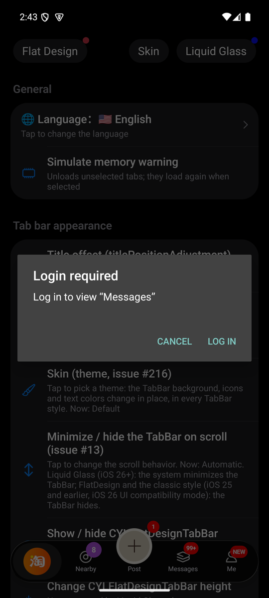
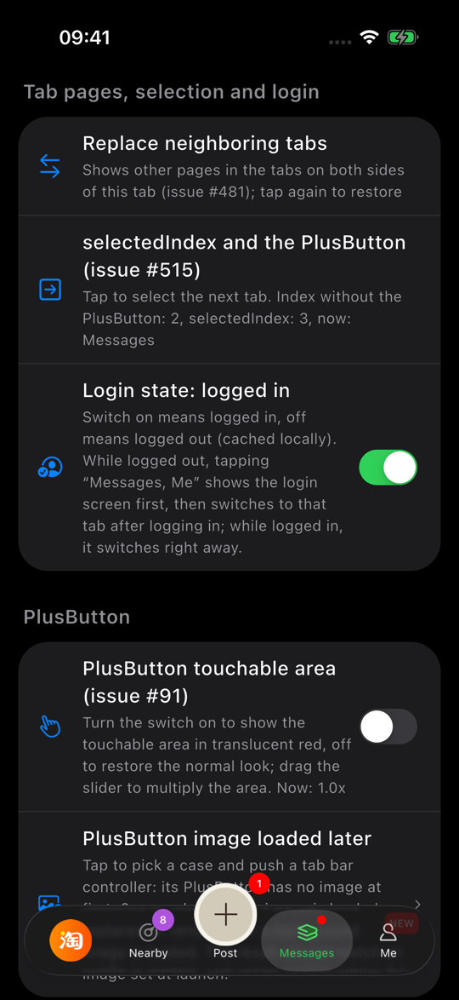

# 需要登录的 Tab / Tabs That Need Login

<!-- bound-classes: CYLTabBarController -->
<!-- binding:start -->
<!-- Generated by scripts/update-docs-navigation.py; do not edit by hand. -->

| 中文 | English |
|:---|:---|
| 绑定的代码类 `CYLTabBarController`：[`CYLTabBarController/CYLTabBarController.h`](../CYLTabBarController/CYLTabBarController.h) | Bound to the class `CYLTabBarController`: [`CYLTabBarController/CYLTabBarController.h`](../CYLTabBarController/CYLTabBarController.h) |

<!-- binding:end -->

| 中文 | English |
|:---|:---|
| [#19](https://github.com/ChenYilong/CYLTabBarController/issues/19)：未登录时点击某些 Tab，不切换、不播放动画，而是弹出登录页；登录成功后自动切换到刚才点击的 Tab。登录状态缓存在本地，App 重启后仍然有效。经典样式、液态玻璃与扁平样式都支持。 | [#19](https://github.com/ChenYilong/CYLTabBarController/issues/19): while logged out, tapping certain tabs does not switch or animate; it shows the login screen instead, and after a successful login the tapped tab is selected. The login state is cached locally and survives a relaunch. Works in the classic style, Liquid Glass and FlatDesign. |





## 目录 / Contents

<!-- navigation:start -->
<!-- Generated by scripts/update-docs-navigation.py; do not edit by hand. -->

| 中文 | English |
|:---|:---|
| [用法](#用法--usage) | [Usage](#用法--usage) |
| &nbsp;&nbsp;&nbsp;&nbsp;↳ [Block](#block) | &nbsp;&nbsp;&nbsp;&nbsp;↳ [Block](#block) |
| &nbsp;&nbsp;&nbsp;&nbsp;↳ [Delegate](#delegate) | &nbsp;&nbsp;&nbsp;&nbsp;↳ [Delegate](#delegate) |
| &nbsp;&nbsp;&nbsp;&nbsp;↳ [Swift](#swift) | &nbsp;&nbsp;&nbsp;&nbsp;↳ [Swift](#swift) |
| [API](#api) | [API](#api) |
| [关系图](#关系图--relationship-map) | [Relationship map](#关系图--relationship-map) |
| [配置文件、Android 与跨平台](#配置文件android-与跨平台--configuration-file-android-and-cross-platform) | [Configuration file, Android and cross-platform](#配置文件android-与跨平台--configuration-file-android-and-cross-platform) |
| [Demo](#demo) | [Demo](#demo) |
| [截图](#截图--screenshots) | [Screenshots](#截图--screenshots) |

<!-- navigation:end -->

## 用法 / Usage

| 中文 | English |
|:---|:---|
| 三步：指定需要登录的 Tab、提供登录页、在登录或退出时更新登录状态。每一步都可以用 block，也可以用代理；同时设置时 block 优先。 | Three steps: say which tabs need login, show the login screen, and update the login state on login or logout. Each step works with a block or a delegate method; when both are set, the block wins. |

### Block

```objc
// 1. 需要登录的 Tab（CYLTabBarItemIdentifier；未设置标识时为类名）。
//    Tabs that need login (CYLTabBarItemIdentifier; the class name when none is set).
tabBarController.cyl_loginRequiredTabBarItemIdentifiers = @[ @"message", @"CYLMineViewController" ];
// 或 / or:
tabBarController.cyl_loginRequiredBlock = ^BOOL(CYLTabBarController *tabBarController, UIViewController *viewController) {
    return [viewController.cyl_tabBarItemIdentifier isEqualToString:@"message"];
};

// 2. 展示登录页，并用结果调用 completion。Show the login screen and call completion with the result.
tabBarController.cyl_loginHandler = ^(CYLTabBarController *tabBarController, UIViewController *viewController,
                                      CYLTabBarLoginCompletion completion) {
    [LoginViewController presentFrom:tabBarController completion:^(BOOL success) {
        completion(success); // YES: 缓存登录状态并选中所点击的 Tab。YES: caches the state and selects the tapped tab.
    }];
};

// 3. 退出登录。Log out.
tabBarController.cyl_loggedIn = NO;
```

### Delegate

```objc
- (BOOL)tabBarController:(CYLTabBarController *)tabBarController requiresLoginToSelectViewController:(UIViewController *)viewController {
    return [viewController isKindOfClass:[MineViewController class]];
}

- (void)tabBarController:(CYLTabBarController *)tabBarController
presentLoginForViewController:(UIViewController *)viewController
              completion:(CYLTabBarLoginCompletion)completion {
    [LoginViewController presentFrom:tabBarController completion:completion];
}
```

### Swift

```swift
tabBarController.cyl_loginRequiredTabBarItemIdentifiers = ["message", "MineViewController"]
tabBarController.cyl_loginHandler = { tabBarController, viewController, completion in
    LoginViewController.present(from: tabBarController, completion: completion)
}
tabBarController.cyl_loggedIn = false // 退出登录 / log out
```

## API

| API | 中文 | English |
|:---|:---|:---|
| `cyl_loggedIn` | 是否已登录。设置时保存到 NSUserDefaults（所有 TabBarController 共享，重启后有效），并发送 `CYLTabBarLoginStateDidChangeNotification`。在需要登录的 Tab 上设为 NO 时，自动切换到第一个不需要登录的 Tab。 | Whether the user is logged in. Setting it saves it in NSUserDefaults (shared by every tab bar controller, survives a relaunch) and posts `CYLTabBarLoginStateDidChangeNotification`. Setting NO on a tab that needs login switches to the first tab that does not. |
| `cyl_loginStateProvider` | 可选：App 自己的登录状态，设置后 `cyl_loggedIn` 返回它。 | Optional: your app's own login state; `cyl_loggedIn` returns it when set. |
| `cyl_loginRequiredTabBarItemIdentifiers` | 需要登录的 Tab 的标识。 | Identifiers of the tabs that need login. |
| `cyl_loginRequiredBlock` / `-tabBarController:requiresLoginToSelectViewController:` | 自定义判断，优先级：block → 代理 → 标识列表。 | Custom check; order: block → delegate → identifiers. |
| `cyl_loginHandler` / `-tabBarController:presentLoginForViewController:completion:` | 展示登录页；block 优先。都没有时只拒绝这次点击。 | Shows the login screen; the block wins. Without either, the tap is only refused. |
| `-cyl_isLoginRequiredForViewController:` | 是否需要登录（与当前登录状态无关）。 | Whether login is needed, whatever the current state. |
| `-cyl_interceptLoginIfNeededForViewController:` | 需要拦截时发起登录并返回 YES。代理不是 TabBarController 自身，或重写 `-tabBarController:shouldSelectViewController:` 时没有调用 super，请在该方法开头调用。 | Starts the login and returns YES when the tap must be refused. Call it first in `-tabBarController:shouldSelectViewController:` when the delegate is another object, or when an override of that method does not call super. |

| 中文 | English |
|:---|:---|
| 被拦截的点击不会切换 Tab、不会播放 Lottie 或选中动画，也不会回调 `tabBarController:didSelectControl:`（修复 #19 评论中“拦截了但动画仍然执行”的问题）。 | An intercepted tap does not switch tabs, play Lottie or selection animations, or call `tabBarController:didSelectControl:` (fixes "intercepted, but the animation still runs" from the #19 comments). |
| 一次点击只发起一次登录。`completion` 只有第一次调用有效，可以在任意线程调用。 | One tap starts one login. Only the first call of `completion` counts; it can be called on any thread. |

## 关系图 / Relationship map

| 中文 | English |
|:---|:---|
| 下图列出本功能涉及的所有 API、入口、存储与 Demo，以及它们之间的关系。 | The map below shows every API, entry point, storage and demo piece of this feature, and how they relate. |



| 中文 | English |
|:---|:---|
| 一次未登录点击的时序： | The sequence of one tap while logged out: |



## 配置文件、Android 与跨平台 / Configuration file, Android and cross-platform

| 中文 | English |
|:---|:---|
| 配置文件用 `CYLTabBarControllerLoginRequiredTabBarItemIdentifiers` 列出需要登录的 Tab（字符串数组，或用逗号分隔的字符串），见[配置文件](Configuration-File.md)。 | A configuration file lists the tabs that need login with `CYLTabBarControllerLoginRequiredTabBarItemIdentifiers` (a list of strings, or one comma-separated string); see [Configuration file](Configuration-File.md). |
| Android 库与 iOS 相同：`cyl_loggedIn` 保存在 App 的 SharedPreferences 中（文件 `CYLTabBarController`，键 `CYLTabBarControllerLoggedIn`，与 iOS 的 NSUserDefaults 键相同），重启后保留。 | The Android library works as iOS: `cyl_loggedIn` is kept in the app's SharedPreferences (file `CYLTabBarController`, key `CYLTabBarControllerLoggedIn`, the iOS NSUserDefaults key), across launches. |
| `CYLTabBarHostView`（iOS 与 Android，React Native 与 Flutter 组件都基于它）：`loggedIn` 设置登录状态；未登录时点击需要登录的 Tab 不会选中它，而是调用 `didRequestLogin`（下标、标识、标题），由 App 展示登录界面。登录后设置 `loggedIn`，之前设置的 `selectedIndex` 随即生效（两者的设置顺序不影响结果）。在需要登录的 Tab 上退出登录，会选中第一个不需要登录的 Tab，并通过 `didSelectTab` 报告。 | `CYLTabBarHostView` (iOS and Android; the React Native and Flutter components are built on it): `loggedIn` sets the login state. While logged out, tapping a tab that needs login does not select it but calls `didRequestLogin` (index, identifier, title), and the app shows its login screen. After login, set `loggedIn`: the `selectedIndex` set before then applies (the order of the two does not matter). Logging out on such a tab selects the first tab that does not need login, reported by `didSelectTab`. |
| App 未设置 `loggedIn` 时，宿主使用库缓存的状态，并在 TabBar 创建后通过 `loginStateDidChange` 报告；`resetLoggedIn` 让之后创建的 TabBar 重新使用缓存的状态。 | Until the app sets `loggedIn`, the host uses the state the library cached and reports it with `loginStateDidChange` once the tab bar is built; `resetLoggedIn` makes the next tab bar use the cached state again. |
| React Native：`loggedIn`、`onLoginRequest(index, identifier, title)`、`onLoginStateChange(loggedIn)`。Flutter：`loggedIn`（`bool?`）、`onLoginRequest`、`onLoginStateChange`。`loggedIn` 留空（`undefined` / `null`）时使用缓存的状态，因此示例从 `onLoginStateChange` 开始，重启后登录状态保留，与 Objective-C 示例相同。 | React Native: `loggedIn`, `onLoginRequest(index, identifier, title)`, `onLoginStateChange(loggedIn)`. Flutter: `loggedIn` (`bool?`), `onLoginRequest`, `onLoginStateChange`. Left empty (`undefined` / `null`), `loggedIn` uses the cached state, so the examples start from `onLoginStateChange` and keep the login across launches, as the Objective-C example. |

## Demo

| 中文 | English |
|:---|:---|
| 列表顶部设置分组新增「登录状态」行，右侧是一个开关：打开表示已登录，关闭表示未登录，切换后缓存到本地（点击该行同样会拨动开关）。通过登录弹窗登录后，开关会自动打开。说明文字会列出需要登录的 Tab：未登录时点击这些 Tab 会弹出登录弹窗，点「登录」后自动切换到该 Tab，点「取消」则停留在当前 Tab；已登录时直接切换。 | The settings section at the top of the lists has a new "Login state" row with a switch: on means logged in, off means logged out, and the state is cached locally (tapping the row flips the switch too). After logging in from the login alert, the switch turns on by itself. Its text names the tabs that need login: while logged out, tapping them shows a login alert; "Log in" then switches to that tab, "Cancel" stays on the current one. While logged in they switch right away. |
| 液态玻璃 / 经典样式（`MainTabBarController`）用 block 方式：「消息」「我的」需要登录。扁平样式（`CYLFlatDesignMainTabBarController`）用代理方式：最后两个 Tab 需要登录。 | Liquid Glass / classic (`MainTabBarController`) uses the block API: "Messages" and "Me" need login. FlatDesign (`CYLFlatDesignMainTabBarController`) uses the delegate API: the last two tabs need login. |

## 截图 / Screenshots

| 中文 | English |
|:---|:---|
| 未登录时点击「Messages」：弹出登录弹窗，不切换 Tab（React Native，Android）。 | Tapping "Messages" while logged out: a login alert, the tab does not switch (React Native, Android). |
|  |  |
| 点「Log in」后选中「Messages」，「Login state」行显示已登录（Flutter，iOS）。 | After "Log in", "Messages" is selected and the "Login state" row shows logged in (Flutter, iOS). |
|  |  |
