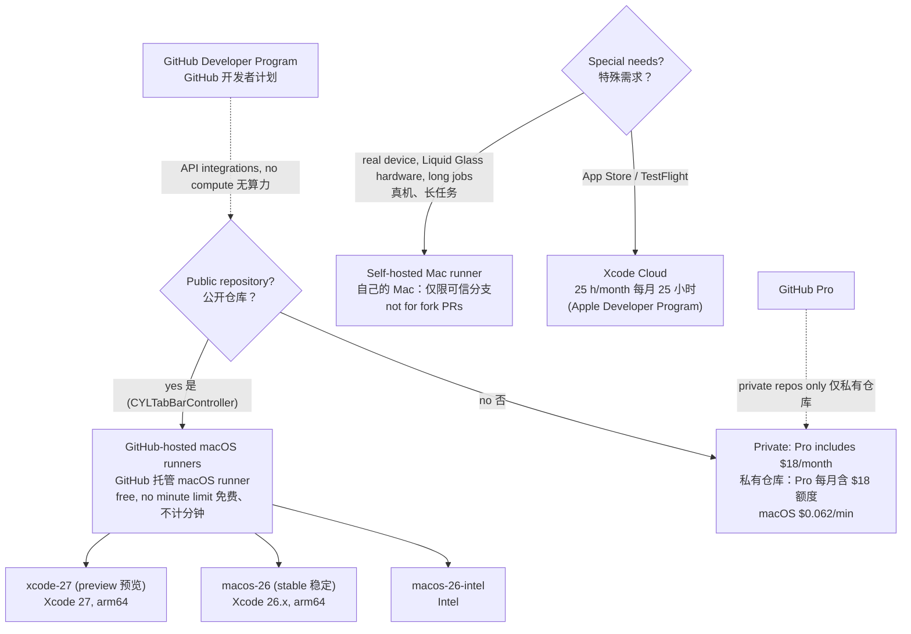
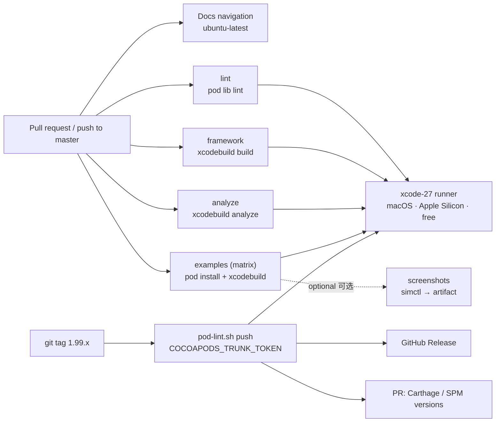

# [CN]macOS CI/CD 调研报告：用 Mac 服务器构建本项目
# [EN]macOS CI/CD research: building this project on Mac servers

<!-- bound-classes: none -->
<!-- binding:start -->
<!-- Generated by scripts/update-docs-navigation.py; do not edit by hand. -->

| 中文 | English |
|:---|:---|
| 本文档不绑定代码类。 | This document is not bound to a code class. |

<!-- binding:end -->

| 中文 | English |
|:---|:---|
| 本文是一份调研报告：如何为本仓库配置 GitHub 上的 CI/CD，让构建、静态分析、Demo 与发布在 macOS 服务器上自动运行。目前仓库只有一个在 `ubuntu-latest` runner 上运行的 `Docs navigation` 检查，Objective-C 代码从未在 CI 中编译过，静态分析警告与截图也只能在本机完成。本文给出可选方案、对比、推荐方案、流水线设计与需要维护者完成的步骤。已确认采用方案 A 与 `xcode-27` runner，CI workflow（`.github/workflows/ios.yml`）已添加；发布 workflow（`.github/workflows/release.yml`）也已添加，Secret `COCOAPODS_TRUNK_TOKEN` 已配置。调研日期：2026-11-04。 | This is a research report: how to set up CI/CD on GitHub for this repository so that builds, static analysis, the demos and releases run automatically on macOS servers. Today the repository has a single check, `Docs navigation`, which runs on an `ubuntu-latest` runner; the Objective-C code is never compiled in CI, and static-analyzer warnings and screenshots can only be produced on a local Mac. This page lists the options, compares them, recommends one, designs the pipeline and lists the steps the maintainer has to take. Option A with the `xcode-27` runner is confirmed and the CI workflow (`.github/workflows/ios.yml`) is added; the release workflow (`.github/workflows/release.yml`) is added too, and the secret `COCOAPODS_TRUNK_TOKEN` is set. Researched on 2026-11-04. |

## [CN]目录
## [EN]Contents

<!-- navigation:start -->
<!-- Generated by scripts/update-docs-navigation.py; do not edit by hand. -->

| 中文 | English |
|:---|:---|
| [结论](#cn结论) | [Conclusion](#enconclusion) |
| [你的账号权益对照](#cn你的账号权益对照) | [What your accounts give you](#enwhat-your-accounts-give-you) |
| [可选方案对比](#cn可选方案对比) | [Options compared](#enoptions-compared) |
| [推荐流水线设计](#cn推荐流水线设计) | [Recommended pipeline](#enrecommended-pipeline) |
| [已添加的 CI workflow](#cn已添加的-ci-workflow) | [The CI workflow](#enthe-ci-workflow) |
| [发布流程](#cn发布流程) | [Releasing](#enreleasing) |
| &nbsp;&nbsp;&nbsp;&nbsp;↳ [运行环境：macos-26](#cn运行环境macos-26) | &nbsp;&nbsp;&nbsp;&nbsp;↳ [Runner: macos-26](#enrunner-macos-26) |
| &nbsp;&nbsp;&nbsp;&nbsp;↳ [CI 提速与脚本检查](#cnci-提速与脚本检查) | &nbsp;&nbsp;&nbsp;&nbsp;↳ [Faster CI and script checks](#enfaster-ci-and-script-checks) |
| [首次运行结果](#cn首次运行结果) | [First run results](#enfirst-run-results) |
| [风险与注意事项](#cn风险与注意事项) | [Risks and notes](#enrisks-and-notes) |
| [TODO：维护者需要完成的步骤](#cntodo维护者需要完成的步骤) | [TODO: steps for the maintainer](#entodo-steps-for-the-maintainer) |
| [来源](#cn来源) | [Sources](#ensources) |
| [任务记录](#任务记录--task-log) | [Task log](#任务记录--task-log) |

<!-- navigation:end -->

## [CN]结论
## [EN]Conclusion

| 中文 | English |
|:---|:---|
| **推荐：使用 GitHub 托管的 macOS runner（GitHub Actions），不需要自己的 Mac 服务器，也不需要付费。** 本仓库是公开仓库，公开仓库使用标准 GitHub 托管 runner（包括 macOS）免费，且不消耗账号的包含额度。 | **Recommended: GitHub-hosted macOS runners (GitHub Actions). No Mac server of your own and no payment are needed.** This repository is public, and standard GitHub-hosted runners, macOS included, are free for public repositories and do not use the account's included usage. |
| 项目要求 Xcode 27（见 `scripts/pod-lint.xcconfig`：Xcode 27+ 只支持 iOS 15.0+）。GitHub 已提供 `xcode-27` 标签的 Apple Silicon runner（公开预览），稳定版 `macos-26`（Xcode 26.x）可作为兼容性对照。 | The project needs Xcode 27 (see `scripts/pod-lint.xcconfig`: Xcode 27+ only supports iOS 15.0+). GitHub offers Apple Silicon runners with the `xcode-27` label (public preview); the stable `macos-26` image (Xcode 26.x) can serve as a compatibility check. |
| GitHub Pro 与 GitHub 开发者计划对本仓库的 CI 没有额外帮助：Pro 的额度只用于私有仓库；开发者计划面向基于 GitHub API 开发集成的开发者，不包含 Actions 算力。 | GitHub Pro and the GitHub Developer Program add nothing for this repository's CI: Pro's included usage only applies to private repositories, and the Developer Program is for developers building integrations on the GitHub API; it includes no Actions compute. |
| 自己的 Mac（self-hosted runner）只作为补充，且不建议用于来自 fork 的 PR（安全原因，见下文）。Xcode Cloud（Apple 开发者计划每月 25 小时）适合以 App 为中心的流程，对本库这种「库 + 多个 Demo」不是首选。 | Your own Mac (a self-hosted runner) is only a supplement, and should not run pull requests from forks (security, see below). Xcode Cloud (25 hours a month with the Apple Developer Program) suits app-centric pipelines; for a library with many demos like this one, it is not the first choice. |



## [CN]你的账号权益对照
## [EN]What your accounts give you

| 账号 / 计划 | 对本仓库（公开）的 CI 有什么作用 |
|:---|:---|
| 公开仓库本身 | 标准 GitHub 托管 runner（Ubuntu、Windows、macOS）免费，不消耗额度 |
| GitHub Pro | 每月包含 $18 的 Actions 算力，仅用于私有仓库；对公开仓库无影响 |
| GitHub 开发者计划 | 面向使用 GitHub API 开发集成的开发者，不包含 Actions 算力 |
| Apple 开发者计划（如已加入） | Xcode Cloud 每月 25 小时；签名证书可用于真机或 TestFlight 流程 |

| Account / plan | What it does for this (public) repository's CI |
|:---|:---|
| The public repository itself | Standard GitHub-hosted runners (Ubuntu, Windows, macOS) are free and use no included usage |
| GitHub Pro | $18 of Actions compute a month, for private repositories only; nothing for public ones |
| GitHub Developer Program | For developers building integrations on the GitHub API; no Actions compute |
| Apple Developer Program (if a member) | 25 Xcode Cloud hours a month; signing certificates for device or TestFlight pipelines |

## [CN]可选方案对比
## [EN]Options compared

| 方案 | 费用（本仓库） | 机器 | 优点 | 缺点 |
|:---|:---|:---|:---|:---|
| A. GitHub 托管 macOS runner | 免费 | `xcode-27`、`macos-26`、`macos-15`：Apple Silicon（M1），3 vCPU、7 GB 内存、14 GB SSD；`macos-26-intel` 等：Intel，4 vCPU、14 GB | 无需维护；每次干净环境；与 PR、检查、Secrets 原生集成 | 机器较小；镜像与默认 Xcode 会随时间变化；`xcode-27` 仍为预览 |
| B. GitHub 更大规格 macOS runner（xlarge） | 付费，公开仓库也收费，需要付款方式 | 更多 CPU 与内存 | 更快 | 额外费用，本项目规模不需要 |
| C. 自建 runner（自己的 Mac，如 Mac mini） | runner 免费，机器、电费、网络自付 | 自选，可连真机 | 速度可控；可用任意 Xcode、真机、长时间任务 | 需要维护；**公开仓库的 fork PR 可在你的机器上执行任意代码**，官方建议只用于私有仓库 |
| D. Xcode Cloud | Apple 开发者计划含每月 25 小时，超出需订阅 | Apple 托管 | 与签名、TestFlight 深度集成 | 以 App 为中心；在 Xcode 中配置，不在仓库 YAML 中；对库的 `pod lib lint`、Carthage、多个 Demo 不如 Actions 灵活 |

| Option | Cost (this repository) | Machines | Pros | Cons |
|:---|:---|:---|:---|:---|
| A. GitHub-hosted macOS runners | Free | `xcode-27`, `macos-26`, `macos-15`: Apple Silicon (M1), 3 vCPU, 7 GB RAM, 14 GB SSD; `macos-26-intel` etc.: Intel, 4 vCPU, 14 GB | Nothing to maintain; a clean machine every run; native PR checks and secrets | Small machines; images and the default Xcode change over time; `xcode-27` is still a preview |
| B. GitHub larger (xlarge) macOS runners | Paid, also for public repositories; needs a payment method | More CPU and memory | Faster | Extra cost, not needed at this project's size |
| C. Self-hosted runner (your own Mac, e.g. a Mac mini) | The runner is free; you pay for the machine, power and network | Your choice, can attach devices | Speed under your control; any Xcode, real devices, long jobs | Maintenance; **a pull request from a fork of a public repository can run arbitrary code on your machine**; GitHub recommends self-hosted runners for private repositories only |
| D. Xcode Cloud | 25 hours a month with the Apple Developer Program, a subscription beyond that | Hosted by Apple | Deep integration with signing and TestFlight | App-centric; configured in Xcode, not in YAML in the repository; less flexible than Actions for `pod lib lint`, Carthage and many demos |

## [CN]推荐流水线设计
## [EN]Recommended pipeline

| 中文 | English |
|:---|:---|
| **CI（每个 PR 与 push 到 master）**，在 `xcode-27` runner 上运行，各 job 并行： | **CI (every pull request and every push to master)**, on `xcode-27` runners, jobs in parallel: |
| 1. `lint`：`pod lib lint CYLTabBarController.podspec`（完整，不加 `--quick`），对应 CLAUDE.md 的验证要求。 | 1. `lint`: `pod lib lint CYLTabBarController.podspec` (full, without `--quick`), the verification CLAUDE.md asks for. |
| 2. `framework`：`xcodebuild build` 共享 scheme `CYLTabBarController-Framework`（iOS Simulator），即 Carthage 使用的 target。 | 2. `framework`: `xcodebuild build` of the shared scheme `CYLTabBarController-Framework` (iOS Simulator), the target Carthage builds. |
| 3. `analyze`：`xcodebuild analyze` 同一 scheme，用 `CLANG_ANALYZER_OUTPUT=plist-html` 输出报告；警告作为失败（CLAUDE.md：修复所有构建与静态分析警告）。可先只报告，修完遗留警告后再改为失败。 | 3. `analyze`: `xcodebuild analyze` of the same scheme, with `CLANG_ANALYZER_OUTPUT=plist-html` for a report; warnings fail the job (CLAUDE.md: fix every build and analyzer warning). It can report only at first, and fail once the existing warnings are fixed. |
| 4. `examples`：矩阵构建各 Demo（ObjC `Example`、Swift 系列、SPM、Carthage），CocoaPods Demo 先 `pod install`；Podfile 不需要修改。 | 4. `examples`: a matrix that builds the demos (ObjC `Example`, the Swift ones, SPM, Carthage); CocoaPods demos run `pod install` first; no Podfile changes. |
| 5. `screenshots`（可选）：在模拟器中启动 Demo，`xcrun simctl io booted screenshot` 截图并作为 artifact 上传，供 `docs/assets/` 使用。 | 5. `screenshots` (optional): launch a demo in the simulator, take screenshots with `xcrun simctl io booted screenshot` and upload them as artifacts, for `docs/assets/`. |
| 6. 保留现有的 `Docs navigation`（`ubuntu-latest`，最便宜也最快）。 | 6. Keep the existing `Docs navigation` check (`ubuntu-latest`, the cheapest and fastest). |
| **CD（推送版本 tag，如 `1.99.80`）**：在 macOS runner 上运行 `scripts/pod-lint.sh push` 发布到 CocoaPods trunk（该脚本随后更新 Carthage 与 SPM 的版本号），创建 GitHub Release 并附上 Carthage 使用的 `CYLTabBarController.xcframework.zip`（`scripts/pod-lint.sh xcframework`，见 [docs/Carthage.md](Carthage.md)），并为脚本修改的文件自动开 PR。CocoaPods 发布需要仓库 Secret `COCOAPODS_TRUNK_TOKEN`。 | **CD (pushing a version tag such as `1.99.80`)**: on a macOS runner, run `scripts/pod-lint.sh push` to publish to CocoaPods trunk (the script then updates the Carthage and SPM versions), create a GitHub Release with the `CYLTabBarController.xcframework.zip` Carthage installs attached (`scripts/pod-lint.sh xcframework`, see [docs/Carthage.md](Carthage.md)), and open a pull request with the files the script changed. Publishing to CocoaPods needs the repository secret `COCOAPODS_TRUNK_TOKEN`. |



## [CN]已添加的 CI workflow
## [EN]The CI workflow

| 中文 | English |
|:---|:---|
| `.github/workflows/ios.yml` 已添加，在每个 PR、push 到 master 以及手动触发（`workflow_dispatch`）时运行，包含四类 job：`pod lib lint`（完整）；`Framework build and analyze`（构建 Carthage 的 framework target 并静态分析，警告汇总写入 job summary，分析报告作为 artifact；本库源码出现构建或静态分析警告时该 job 失败）；`Carthage`（`scripts/pod-lint.sh xcframework`：与发布相同，从去掉 `CrossPlatform/` 的副本构建 Carthage 二进制规格使用的 XCFramework zip）；`Demo …` 矩阵（每个 Demo 一个 job，互不影响）。 | `.github/workflows/ios.yml` is added. It runs on every pull request, on pushes to master and on demand (`workflow_dispatch`), with four kinds of jobs: `pod lib lint` (full); `Framework build and analyze` (builds the Carthage framework target and runs the static analyzer; warnings are listed in the job summary and the analyzer report is an artifact; a build or analyzer warning in the library's sources fails the job); `Carthage` (`scripts/pod-lint.sh xcframework`: as on release, the XCFramework zip of the Carthage binary spec, built from a copy without `CrossPlatform/`); and the `Demo …` matrix (one job per demo, independent of each other). |
| Android：`.github/workflows/android.yml` 在 `ubuntu-latest` runner 上运行，涉及 `Example-Android/`、共用配置文件、iOS 示例的资源目录或 `scripts/publish-android.sh` 的 PR 与 master push 时触发：`gradle testDebugUnitTest :tabpages:test lintDebug assembleRelease`，然后 `scripts/publish-android.sh staging --skip-tests` 构建并检查 Maven 上传包（不上传）；失败时上传测试与 lint 报告。 | Android: `.github/workflows/android.yml` runs on an `ubuntu-latest` runner for pull requests and master pushes that touch `Example-Android/`, the shared configuration files, the iOS examples' asset catalogs or `scripts/publish-android.sh`: `gradle testDebugUnitTest :tabpages:test lintDebug assembleRelease`, then `scripts/publish-android.sh staging --skip-tests` builds and checks the Maven bundle (no upload); on failure the test and lint reports are uploaded. |
| 大部分 Demo 没有共享 scheme，名称只有在 Mac 上才能得到，因此 `scripts/ci-build-example.sh` 在 runner 上运行 `xcodebuild -list -json` 选出 App 的 scheme（与 Demo 自身 .xcodeproj 中 App target 同名、或构建 `.app` 的共享 scheme；库自己的 `CYLTabBarController` scheme 不算，否则只会编译库，App 代码中的错误不会被发现），有 Podfile 时先 `pod install`（不修改 Podfile），并为 job summary 输出一行结果（scheme、是否成功、警告数）。 | Most demos have no shared scheme, so their names are only known on the Mac. `scripts/ci-build-example.sh` therefore runs `xcodebuild -list -json` on the runner to pick the app scheme (named after an application target of the demo's own .xcodeproj, or a shared scheme that builds a `.app`; the library's own `CYLTabBarController` scheme does not count, since building it compiles only the library and errors in the app code go unnoticed), runs `pod install` first when there is a Podfile (without changing it), and writes a result line (scheme, success, warning count) for the job summary. |
| 下面第一段为最初的草稿（仓库中的文件以 `.github/workflows/ios.yml` 为准），第二段为发布 workflow 的最初草稿（仓库中的文件以 `.github/workflows/release.yml` 为准，见「发布流程」）。 | The first block below is the original draft (the repository's `.github/workflows/ios.yml` is the source of truth); the second is the release workflow's original draft (the repository's `.github/workflows/release.yml` is the source of truth; see "Releasing"). |

```yaml
name: iOS

on:
  pull_request:
  push:
    branches: [ master ]

concurrency:
  group: ios-${{ github.ref }}
  cancel-in-progress: true

jobs:
  lint:
    runs-on: xcode-27          # public preview; fall back to macos-26 if needed
    timeout-minutes: 30
    steps:
      - uses: actions/checkout@v4
      - run: xcodebuild -version
      - run: scripts/pod-lint.sh lib     # full pod lib lint, with scripts/pod-lint.xcconfig

  framework:
    runs-on: xcode-27
    timeout-minutes: 30
    steps:
      - uses: actions/checkout@v4
      - name: Build the Carthage framework target
        run: |
          xcodebuild build \
            -project CYLTabBarController.xcodeproj \
            -scheme CYLTabBarController-Framework \
            -destination 'generic/platform=iOS Simulator' \
            CODE_SIGNING_ALLOWED=NO
      - name: Static analysis
        run: |
          xcodebuild analyze \
            -project CYLTabBarController.xcodeproj \
            -scheme CYLTabBarController-Framework \
            -destination 'generic/platform=iOS Simulator' \
            CODE_SIGNING_ALLOWED=NO \
            CLANG_ANALYZER_OUTPUT=plist-html \
            CLANG_ANALYZER_OUTPUT_DIR="$RUNNER_TEMP/analyzer" | tee analyze.log
      - uses: actions/upload-artifact@v4
        if: always()
        with:
          name: analyzer-report
          path: ${{ runner.temp }}/analyzer

  example-objc:
    runs-on: xcode-27
    timeout-minutes: 45
    steps:
      - uses: actions/checkout@v4
      - run: pod install
      - run: |
          xcodebuild build \
            -workspace CYLTabBarController.xcworkspace \
            -scheme CYLTabBarController \
            -destination 'generic/platform=iOS Simulator' \
            CODE_SIGNING_ALLOWED=NO
```

```yaml
# .github/workflows/release.yml (draft)
name: Release
on:
  push:
    tags: [ '*.*.*' ]
jobs:
  publish:
    runs-on: xcode-27
    steps:
      - uses: actions/checkout@v4
        with: { fetch-depth: 0 }
      - name: Publish to CocoaPods trunk, then update the Carthage and SPM versions
        env:
          COCOAPODS_TRUNK_TOKEN: ${{ secrets.COCOAPODS_TRUNK_TOKEN }}
        run: scripts/pod-lint.sh push
      - name: GitHub Release
        env: { GH_TOKEN: ${{ github.token }} }
        run: gh release create "$GITHUB_REF_NAME" --generate-notes
```

## [CN]发布流程
## [EN]Releasing

| 中文 | English |
|:---|:---|
| `.github/workflows/release.yml` 在推送形如 `1.99.73` 的版本 tag 时运行（`xcode-27` runner），依次：检查 tag 与 podspec 的 `s.version` 一致，不一致即失败；用 Secret `COCOAPODS_TRUNK_TOKEN` 执行 `scripts/pod-lint.sh push`（`pod trunk push`，随后更新 Demo 与文档中 Carthage、SPM 的版本号并重新生成导航）；创建 GitHub Release（自动生成说明，已存在则跳过）；为版本号更新开一个 PR。 | `.github/workflows/release.yml` runs when a version tag such as `1.99.73` is pushed (`xcode-27` runner). In order: it checks that the tag equals the podspec's `s.version` and fails otherwise; runs `scripts/pod-lint.sh push` with the secret `COCOAPODS_TRUNK_TOKEN` (`pod trunk push`, then the Carthage and SPM versions in the demo and docs are updated and the navigation regenerated); creates a GitHub Release with generated notes (skipped if it exists); and opens a pull request with the version updates. |
| **发布一个版本**：1. 从 master 新建分支，执行 `scripts/pod-lint.sh bump 1.99.73`：它修改 podspec 的 `s.version`，并把 Carthage 演示的 `Cartfile`、文档中的 SPM 版本号同步到新版本、重新生成导航；2. 提交并开 PR，CI 照常运行，合并到 master；3. 在合并后的提交上打 tag 并推送：`git tag 1.99.73 && git push origin 1.99.73`；4. 在 Actions 中查看 Release 运行。版本号已在第 1 步更新，因此发布后通常不会再有自动 PR。 | **To release**: 1. on a branch from master, run `scripts/pod-lint.sh bump 1.99.73`: it sets `s.version` in the podspec, moves the Carthage demo's `Cartfile` and the SPM versions in the docs to the new version, and regenerates the navigation; 2. commit, open a pull request, let CI run as usual, and merge it into master; 3. tag the merged commit and push the tag: `git tag 1.99.73 && git push origin 1.99.73`; 4. watch the Release run in Actions. The versions were updated in step 1, so there is normally no automatic pull request after publishing. |
| **脚本是唯一入口**：本地与 CI 使用同一个 `scripts/pod-lint.sh`：`lib`（CI 的 pod lib lint）、`version`（输出 `s.version`）、`check-tag <tag>`（Release workflow 用它检查 tag）、`bump <x.y.z>`（准备发布 PR）、`push`（发布）、`versions` / `carthage` / `spm`（只更新版本号）。修改发布逻辑时只改脚本，workflow 不需要跟着改。 | **The script is the single entry point**: local runs and CI use the same `scripts/pod-lint.sh`: `lib` (CI's pod lib lint), `version` (prints `s.version`), `check-tag <tag>` (the Release workflow checks the tag with it), `bump <x.y.z>` (prepares the release pull request), `push` (publishes), and `versions` / `carthage` / `spm` (only update versions). To change the release logic, change the script; the workflows need no change. |
| **设置**：（仅在发布时仍有版本文件改动时才会开 PR）自动开 PR 需要在 Settings → Actions → General 中开启「Allow GitHub Actions to create and approve pull requests」；未开启时分支仍会推送，运行日志中给出手动创建 PR 的链接。 | **Setting**: (a pull request is opened only when publishing still changed version files) opening it needs "Allow GitHub Actions to create and approve pull requests" in Settings → Actions → General; without it the branch is still pushed and the run log links to open the pull request by hand. |
| **必需检查**：用 `GITHUB_TOKEN` 创建的 PR 不会触发其他 workflow，因此若 master 设置了必需检查，这个 PR 不会自动运行 CI。它只修改 Cartfile 与文档中的版本号；可以由管理员绕过合并（ruleset 的 Bypass list），或在本地向该分支推送一次提交以触发 CI。 | **Required checks**: pull requests created with `GITHUB_TOKEN` do not trigger other workflows, so if master requires checks, CI does not run on this pull request by itself. It only changes version numbers in the Cartfile and the docs; an admin can merge it through the ruleset's bypass list, or push one commit to its branch locally to trigger CI. |
| **Token 过期**：trunk session 会过期（`pod trunk me` 可查看到期日）。过期后发布步骤会失败，需要重新 `pod trunk register` 并更新 Secret。 | **Token expiry**: trunk sessions expire (`pod trunk me` shows the date). Publishing then fails; run `pod trunk register` again and update the secret. |

### [CN]运行环境：macos-26
### [EN]Runner: macos-26

| 中文 | English |
|:---|:---|
| **CI 与发布都运行在 `macos-26`**（2026-11-04 起，此前为 `xcode-27`）：Apple Silicon 稳定镜像，默认 Xcode 26.6（iOS 26.5 SDK），镜像中还有 Xcode 26.0.1–26.5，没有 Xcode 27。 | **CI and releases run on `macos-26`** (since 2026-11-04; `xcode-27` before): the stable Apple Silicon image, default Xcode 26.6 (iOS 26.5 SDK), with Xcode 26.0.1–26.5 also installed and no Xcode 27. |
| **为什么能用 Xcode 26 编译**：本库使用 iOS 27 / 27.1 API 的地方（竖向栏、`UIHingeInteraction` 等）都有 `#if defined(__IPHONE_27_1) && __IPHONE_OS_VERSION_MAX_ALLOWED >= __IPHONE_27_1` 保护，用 iOS 26 SDK 编译时这些代码不参与编译；其余只用 `@available` 运行时判断。`scripts/pod-lint.xcconfig` 的 iOS 15.0 最低版本对 Xcode 26 同样适用。 | **Why Xcode 26 can build it**: every use of iOS 27 / 27.1 API in the library (the vertical bar, `UIHingeInteraction` and so on) is guarded by `#if defined(__IPHONE_27_1) && __IPHONE_OS_VERSION_MAX_ALLOWED >= __IPHONE_27_1`, so it is left out when building with the iOS 26 SDK; the rest only uses `@available` runtime checks. The iOS 15.0 deployment target of `scripts/pod-lint.xcconfig` works with Xcode 26 too. |
| **示例工程的格式与 ObjC 示例一致**：所有 `Example*/` 工程都使用根目录 ObjC 示例 `CYLTabBarController.xcodeproj` 的格式（`objectVersion = 46`、`compatibilityVersion = "Xcode 3.2"`），因此 macos-26 上的 Xcode 26 以及更早的 Xcode 都能打开。用 Xcode 27 新建的工程格式为 110，Xcode 26 会报“future Xcode project file format (110)”而无法打开，`Example-Swift-SwiftManager-FlatDesign` 曾因此失败。不要使用文件夹同步（`PBXFileSystemSynchronizedRootGroup`，格式 77+）：新增文件需在 Xcode 中手动加入目标。Xcode 升级工程格式后，请在提交前改回上述两个值。 | **Example projects use the ObjC example's format**: every `Example*/` project uses the format of the root ObjC example, `CYLTabBarController.xcodeproj` (`objectVersion = 46`, `compatibilityVersion = "Xcode 3.2"`), so Xcode 26 on macos-26 and earlier versions of Xcode can open it. A project created with Xcode 27 has format 110, which Xcode 26 refuses with "future Xcode project file format (110)"; `Example-Swift-SwiftManager-FlatDesign` failed that way. Do not use folder sync (`PBXFileSystemSynchronizedRootGroup`, format 77+): add new files to the target by hand in Xcode. If Xcode upgrades a project's format, set those two values back before committing. |
| **注意**：用 iOS 26 SDK 编译时，iOS 27.1 的竖向栏相关代码不会被编译，所以 CI 不再覆盖这部分；发布的源码由使用者用自己的 Xcode 编译，不受影响。 | **Note**: with the iOS 26 SDK, the iOS 27.1 vertical-bar code is not compiled, so CI no longer covers it; the published sources are compiled by each app with its own Xcode, so releases are not affected. |
| **切换 runner 不用改 workflow**：在 Settings → Secrets and variables → Actions → Variables 中新建仓库变量 `MACOS_RUNNER`，值为 runner 标签（例如 `xcode-27`），`ios.yml` 与 `release.yml` 的 macOS job 都会改用它；删除变量即回到 `macos-26`。 | **Switching runners needs no workflow change**: in Settings → Secrets and variables → Actions → Variables, add the repository variable `MACOS_RUNNER` with a runner label (e.g. `xcode-27`); the macOS jobs of `ios.yml` and `release.yml` then use it. Delete the variable to go back to `macos-26`. |

### [CN]CI 提速与脚本检查
### [EN]Faster CI and script checks

| 中文 | English |
|:---|:---|
| **只改文档的 PR 不编译**：`Changes` job（Ubuntu，几秒）比较 PR 的改动；如果只修改了 `docs/`、`assets/`、`*.md` 或 `.github/FUNDING.yml`，macOS job 的步骤全部跳过。这些 job 仍然运行并报告成功，所以作为必需检查的「pod lib lint」「Demo …」等不会卡住。推送到 master 与手动运行总是完整编译。文档本身由 `Docs navigation` workflow 检查。 | **Pull requests that only change docs do not build**: the `Changes` job (Ubuntu, a few seconds) looks at the pull request's files; when only `docs/`, `assets/`, `*.md` or `.github/FUNDING.yml` changed, every step of the macOS jobs is skipped. The jobs still run and report success, so required checks such as "pod lib lint" and "Demo …" are not left waiting. Pushes to master and manual runs always build everything. The docs themselves are checked by the `Docs navigation` workflow. |
| **CocoaPods 缓存**：`pod lib lint` 与每个 Demo 缓存 `~/.cocoapods/repos` 与 `~/Library/Caches/CocoaPods`，键包含 podspec 与 Podfile 的哈希。 | **CocoaPods cache**: `pod lib lint` and every demo cache `~/.cocoapods/repos` and `~/Library/Caches/CocoaPods`, keyed by the hashes of the podspec and the Podfiles. |
| **shellcheck**：`shellcheck` job 检查 `scripts/*.sh`（发布脚本出错只能在发布时才发现，所以提前检查）。它与 `Changes` 分开，避免它失败时 macOS job 被跳过而显示为通过。 | **shellcheck**: the `shellcheck` job checks `scripts/*.sh` (a broken release script would otherwise only show up while releasing). It is separate from `Changes`, so its failure cannot make the macOS jobs skip and look green. |
| **建议的必需检查**：在原来的列表之外加上 `shellcheck` 与 `Changes`（`Changes` 失败时 macOS job 会被跳过，而被跳过的 job 算作通过，所以它也要设为必需）。 | **Suggested required checks**: add `shellcheck` and `Changes` to the earlier list (if `Changes` fails, the macOS jobs are skipped, and skipped jobs count as passing, so it must be required too). |

## [CN]首次运行结果
## [EN]First run results

| 中文 | English |
|:---|:---|
| 2026-11-04 在 PR #763 中于 `xcode-27` runner（Xcode 27.1，iOS Simulator 27.1 SDK）上运行，这是本项目第一次在 CI 中编译。最终全部通过：`pod lib lint`（完整）、Framework 构建与静态分析、Carthage XCFramework，以及全部 9 个 Demo（根目录 ObjC Demo、Example-Swift、-02、-03、-04、SwiftUI、SwiftManager、SwiftManager-FlatDesign、network-download）。 | Run on 2026-11-04 in PR #763 on the `xcode-27` runner (Xcode 27.1, iOS Simulator 27.1 SDK), the first time this project was compiled in CI. It passed in full: `pod lib lint` (full), the framework build and analysis, the Carthage XCFramework, and all 9 demos (the root ObjC demo, Example-Swift, -02, -03, -04, SwiftUI, SwiftManager, SwiftManager-FlatDesign, network-download). |
| 修复的问题 1：根目录 ObjC Demo 链接失败，找不到 `swiftCompatibility56`。本库是含 Swift 代码的静态 framework，CocoaPods 为 App 添加 `${TOOLCHAIN_DIR}/usr/lib/swift/...` 搜索路径，而该 runner 上 `TOOLCHAIN_DIR` 指向一个未挂载的 Metal 工具链。`scripts/ci-build-example.sh` 改为传入 Xcode 默认工具链。Swift Demo 不受影响。若在本机遇到同样的链接错误，原因相同。 | Fixed 1: the root ObjC demo failed to link, missing `swiftCompatibility56`. The library is a static framework with Swift code, so CocoaPods adds `${TOOLCHAIN_DIR}/usr/lib/swift/...` to the app's search paths, and on this runner `TOOLCHAIN_DIR` pointed at an unmounted Metal toolchain. `scripts/ci-build-example.sh` now passes Xcode's default toolchain. Swift demos were not affected. The same link error on a local Mac has the same cause. |
| 修复的问题 2：整个库的构建与静态分析只有 1 个警告（`UIViewController+CYLSettingsSection.m` 中未本地化的按钮标题），已改为 `CYLLocalizedString`。之后警告数为 0，因此 Framework job 改为出现警告即失败。 | Fixed 2: the whole library's build and analysis had a single warning (a non-localized button title in `UIViewController+CYLSettingsSection.m`), now `CYLLocalizedString`. The count is 0 since, so the framework job now fails on any warning. |
| SonarCloud 对 `scripts/ci-build-example.sh` 报的 6 个 shell 写法问题也已修复。 | The 6 shell style findings SonarCloud reported on `scripts/ci-build-example.sh` are fixed as well. |

## [CN]风险与注意事项
## [EN]Risks and notes

| 中文 | English |
|:---|:---|
| **标签要写明确**：`macos-latest` 会随时间指向新系统（目前为 macOS 26），默认 Xcode 也会变化。建议使用 `xcode-27`（按 Xcode 主版本划分的镜像）或固定的 `macos-26`，必要时用 `sudo xcode-select -s` 选择具体 Xcode。 | **Use explicit labels**: `macos-latest` moves to newer systems over time (macOS 26 today), and the default Xcode changes too. Use `xcode-27` (images are now per major Xcode version) or a fixed `macos-26`, and select a specific Xcode with `sudo xcode-select -s` when needed. |
| **`xcode-27` 仍为公开预览**：可能出现镜像问题；可以加一个 `macos-26` 的对照 job，或在预览不稳定时暂时 `continue-on-error`。 | **`xcode-27` is still a public preview**: image problems are possible; add a `macos-26` job for comparison, or mark it `continue-on-error` while the preview is unstable. |
| **Secrets 与 fork**：来自 fork 的 PR 拿不到仓库 Secrets，发布只在维护者推送 tag 时运行，因此 `COCOAPODS_TRUNK_TOKEN` 不会暴露给外部 PR。不要用 `pull_request_target` 去运行 PR 的代码。 | **Secrets and forks**: pull requests from forks do not get the repository's secrets, and publishing only runs when the maintainer pushes a tag, so `COCOAPODS_TRUNK_TOKEN` is never exposed to outside pull requests. Do not use `pull_request_target` to run a pull request's code. |
| **自建 runner 的安全**：如果使用自己的 Mac，只让它运行 master 与维护者自己的分支（例如通过 runner 标签与 `if: github.event.pull_request.head.repo.full_name == github.repository`），并在仓库设置中要求外部贡献者的 workflow 需批准后才运行。 | **Self-hosted runner security**: if you use your own Mac, let it run only master and the maintainer's own branches (e.g. with a runner label and `if: github.event.pull_request.head.repo.full_name == github.repository`), and require approval in the repository settings before workflows from outside contributors run. |
| **并发与时长**：托管 runner 有并发上限与单个 job 时长上限（以官方文档为准）；Demo 矩阵较多时用 `concurrency` 取消过期运行，并只在相关目录变化时构建对应 Demo（`paths` 过滤）。 | **Concurrency and duration**: hosted runners have a concurrency cap and a per-job time limit (see the official docs); with a large demo matrix, cancel outdated runs with `concurrency` and build a demo only when its folder changes (`paths` filters). |
| **Liquid Glass 与真机**：模拟器可以验证编译与大部分界面，但 iPhone Duo 等特定硬件、真机手势细节仍需在真机上确认。 | **Liquid Glass and devices**: the simulator verifies builds and most of the UI, but specific hardware such as the iPhone Duo and real-device gesture details still need a device. |

## [CN]TODO：维护者需要完成的步骤
## [EN]TODO: steps for the maintainer

| 中文 | English |
|:---|:---|
| ~~**TODO 1**~~ 已完成：采用方案 A（GitHub 托管 runner），主 runner 为 `macos-26`（2026-11-04 前为 `xcode-27`）。 | ~~**TODO 1**~~ Done: option A (GitHub-hosted runners), with `macos-26` as the main runner (`xcode-27` before 2026-11-04). |
| ~~**TODO 2**~~ 已完成：GitHub Actions 已启用（CI 在每个 PR 上运行）；外部 fork PR 的工作流需要批准，设置为「首次贡献者」（2026-11-09 通过 GitHub API 确认）。 | ~~**TODO 2**~~ Done: GitHub Actions is enabled (CI runs on every pull request); workflows from fork pull requests need approval, set to "first-time contributors" (checked through the GitHub API on 2026-11-09). |
| ~~**TODO 3**~~ 已完成：仓库 Secret `COCOAPODS_TRUNK_TOKEN` 已添加（2026-11-04）。由于该 token 曾出现在对话中，建议重新 `pod trunk register` 生成新 token、更新 Secret，并用 `pod trunk me clean-sessions` 使旧 token 失效。 | ~~**TODO 3**~~ Done: the repository secret `COCOAPODS_TRUNK_TOKEN` is set (2026-11-04). As that token appeared in a chat, register a new trunk session, update the secret, and invalidate the old token with `pod trunk me clean-sessions`. |
| ~~**TODO 4**~~ 已完成：CI 已在 PR #763 中运行，首次全部通过，结果见「首次运行结果」。 | ~~**TODO 4**~~ Done: CI runs in PR #763 and passed in full; see "First run results". |
| **TODO 5** CI 稳定后，在仓库 Settings → Branches 中把这些检查设为 master 的必需检查。2026-11-12 通过 GitHub API 再次确认：master 尚无分支保护（`protected: false`）。 | **TODO 5** Once CI is stable, make these checks required for master in Settings → Branches. Checked again on 2026-11-12 through the GitHub API: master has no branch protection yet (`protected: false`). |

## [CN]来源
## [EN]Sources

| 中文 | English |
|:---|:---|
| 以下资料于 2026-11-04 查阅，计费与镜像可能随时间变化，以官方页面为准。 | Read on 2026-11-04; billing and images can change, so the official pages are authoritative. |

- [GitHub-hosted runners reference](https://docs.github.com/en/actions/reference/runners/github-hosted-runners)
- [GitHub Actions billing](https://docs.github.com/en/billing/concepts/product-billing/github-actions)
- [Adding self-hosted runners](https://docs.github.com/en/actions/how-tos/manage-runners/self-hosted-runners/add-runners)
- [Xcode 27 runner image now in public preview (GitHub changelog, 2026-07-16)](https://github.blog/changelog/2026-07-16-xcode-27-runner-image-now-in-public-preview)
- [actions/runner-images: macos-26 release notes](https://github.com/actions/runner-images/releases/tag/macos-26%2F20260729.0423)
- [Xcode Cloud](https://developer.apple.com/xcode-cloud/)
- [GitHub Developer Program](https://docs.github.com/en/enterprise-cloud@latest/integrations/concepts/github-developer-program)

## 任务记录 / Task log

| 中文 | English |
|:---|:---|
| 本条按用户要求使用英文（见右列）。 | DONE (2026-11-17, badge animation controls default to NO): user prompt, verbatim: "找到本项目instructions 相关文件以及skills相关文件，找到badge相关章节，如果没有就新增文件保证写入成功，全英文写入：，badge 动画相关编译控制 包括但不限于CYL_BADGE_ANIMATION_DISABLED PcylBadgeAnimationDisabled等等 默认为NO ，仅仅在调试badge坐标 以及对齐等调试时设置为YES" English: in the instruction and skill files, in their badge sections (create files if missing), write in English: the badge animation build controls, including but not limited to CYL_BADGE_ANIMATION_DISABLED and -PcylBadgeAnimationDisabled, default to NO and are set to YES only while debugging badge coordinates and alignment. Written to AGENTS.md (after the badge debugging rule), docs/instructions.md, docs/Badge-Debugging.md (Default value), skills cyl-verify, cyl-docs, cyl-harmonyos-a11y-l10n; all files existed. |
| 本条按用户要求使用英文（见右列）。 | DONE (2026-11-17, badge debugging build option): user prompt, verbatim: "找到本项目instructions 相关文件以及skills相关文件，如果没有就新增文件保证写入成功，全英文写入：新增badge调试规则，新增编译选项，在调试badge坐标期间。使用编译选项 临时禁用badge的动画，以保证截图时坐标位置不会产生误差。" English: find the instruction and skill files (create them if missing) and write, in English, a badge debugging rule and a new build option: while debugging badge coordinates, use the build option to turn badge animations off temporarily, so screenshots give exact positions. Done: `CYL_BADGE_ANIMATION_DISABLED` in the iOS, Android and HarmonyOS cores; rule in AGENTS.md, docs/instructions.md, skills cyl-verify, cyl-docs, cyl-harmonyos-a11y-l10n, cyl-api-map; details and evidence in docs/Badge-Debugging.md. |
| 本条按用户要求使用英文（见右列）。 | DONE (2026-11-17, fix bugs in the core first): user prompt, verbatim: "找到instructions相关文档，以及skills相关文档，追加编码规范：全英文写入：如果遇到issue bug，你应该主要优先修改 core 层面的代码以规避类似问题，而非example层。core的定义为发布到 相关库管理平台的代码比如 cocoapods maven gradle npm等平台的代码。最差的方式是在example层修复。如果无法从core 层面修复，你要询问我并告知我原因。并在相关文档中解释 ：为什么不能从core层面解决，而是在example层解决。" English: append to the instruction files and the skills, in English: fix issues and bugs in the core first (the code published to CocoaPods, Maven / Gradle, npm and similar registries), not in the example layer, which is the worst option; if the core cannot be fixed, ask the maintainer and give the reason, and explain in the related document why the example layer had to fix it. Written to AGENTS.md (Code rules), docs/instructions.md, skills cyl-docs, cyl-verify and cyl-harmonyos-a11y-l10n. |
| 本条按用户要求使用英文（见右列）。 | DONE (2026-11-16, commit and push at the end of every turn): the user repeated the open pull request prompt (logged in the row below) and added, verbatim: "一次问答结束后，只要当前分支不是master main，则必须commit 必须push ，无须询问，因为代码总是在分支上，并不会push 到master main分支。非常安全。无须担心push后的任何风险。" English: when a turn ends on a branch other than master / main, commit and push without asking; it is safe because nothing reaches master / main. Written to AGENTS.md (Git and pull requests), docs/instructions.md, skills cyl-docs and cyl-verify; the open pull request rule itself was already in all four (51d5ae8, f61d7f8). |
| 本条按用户要求使用英文（见右列）。 | DONE (2026-11-16, open pull request before every commit): user prompt, verbatim: "写入instructions相关文件，skills相关指令，找到commit 的相关章节，没有的话就新建，保证写入成功：全英文写入：创建分支后有任何commit必须提交pr。不允许只新建分支，持续向该分支commit代码，但不创建pr。因为不创建pr会导致该分支上的所有commit代码全部被忽略。 commit前必须检查该分支pr是否处于open状态，如果不处于open状态必须新建pr。target 目标优先设置为 在创建pr前的活跃pr，如果没有才设置为master分支。如果open状态的pr已经超过两个，那么就要慎重，你需要询问我，是否新建分支创建pr还是保持在本分支继续提交。因为超过两个分支会导致代码合并困难，无法合理分配分支的目标分支。" English: write, in English, the rule that every commit on a branch goes through an open pull request (check before each commit, open one if missing, target = the previously active pull request else master, ask when more than two are open) into the instruction files and skills. Written to docs/instructions.md and skill cyl-docs (Pull request for every new branch); AGENTS.md (Git and pull requests) and skill cyl-verify (Pull requests for every branch) got the same rule from another session working in this checkout at the same time, so duplicates were not added there. |
| DONE（2026-11-12，SonarCloud PR #788）：用户提示词：「修复静态分析bug https://sonarcloud.io/project/issues?id=ChenYilong_CYLTabBarController&pullRequest=788&issueStatuses=OPEN,CONFIRMED&sinceLeakPeriod=true」。要求：修复 PR #788 新代码中所有 OPEN / CONFIRMED 的 SonarCloud 问题。上下文：共 25 个：`scripts/check-public-api-comments.py` 的正则复杂度 / 回溯与认知复杂度（17 个），`scripts/export-tabbar-configurations.py:447` 正则回溯（本次新加的 `as Any` 正则），`scripts/check-localization-macros.py:93` 认知复杂度，`Example-Shared/CYLDemoPlaceholder.swift:124` 空闭包，`Example/Classes/Gallery/CYLGalleryProvider.swift` 与 `CYLGallerySupport.swift` 闭包嵌套超过 2 层（7 个）。结果（`19f9dde`）：`check-public-api-comments.py` 改用字符串函数解析注释（不再回溯），长函数拆分，在 933 个输入上输出与修改前完全相同；导出脚本不用正则去掉 `as Any`；`check-localization-macros.py` 与图库闭包拆成辅助函数（图库 9.1、9.3 运行正常）；空闭包加了说明。干净编译通过，`run-tests.sh` 450 项通过。SonarCloud 重新分析后（2026-11-11 22:51 UTC）PR #788 的新代码中 OPEN / CONFIRMED 问题为 0。 | DONE (2026-11-12, SonarCloud PR #788): user prompt: "修复静态分析bug https://sonarcloud.io/project/issues?id=ChenYilong_CYLTabBarController&pullRequest=788&issueStatuses=OPEN,CONFIRMED&sinceLeakPeriod=true". Requirement: fix every OPEN / CONFIRMED SonarCloud issue in PR #788's new code. Context: 25 issues: regex complexity / backtracking and cognitive complexity in `scripts/check-public-api-comments.py` (17), regex backtracking at `scripts/export-tabbar-configurations.py:447` (the `as Any` regex added today), cognitive complexity at `scripts/check-localization-macros.py:93`, an empty closure at `Example-Shared/CYLDemoPlaceholder.swift:124`, closures nested more than 2 deep in `Example/Classes/Gallery/CYLGalleryProvider.swift` and `CYLGallerySupport.swift` (7). Result (`19f9dde`): `check-public-api-comments.py` parses comments with string functions (no backtracking) and its long functions are split, with output identical to before on 933 inputs; the exporter drops `as Any` without a regex; `check-localization-macros.py` and the gallery closures are split into helpers (gallery 9.1 and 9.3 run as before); the empty closure explains itself. Clean build passes, `run-tests.sh` passes 450 checks. After SonarCloud's new analysis (2026-11-11 22:51 UTC), PR #788's new code has 0 OPEN / CONFIRMED issues. |
| TODO（2026-11-12，合并所有 open PR）：用户提示词：「将所有处于open状态的分支的target branch指向本分支，当前分支，全部合并仅仅保留当前分支，处理冲突后合并，继续以上未完成的任务。」。上下文：当前分支 `feat/cross-platform-components`（PR #788 → master）。其他 open PR：#784 `fix/android-edge-to-edge-plus-button`、#783 `feat/tabbarcontroller-configuration-file`、#781 `fix/liquid-glass-long-press-freeze`、#780 `fix/liquid-glass-plus-child-regression`、#777 `refactor/theme-icons-local-replacement`，都指向 master。检查：#784、#780、#777 已全部包含在当前分支中；#783 差 1 个提交（`6e7855a`，文档），#781 差 1 个提交（`024ffc5`，液态玻璃长按导致切换 Tab 卡住）。要求：把这些 PR 的目标分支改为当前分支，合并（处理冲突），只保留当前分支，然后继续未完成的任务（PlusButton 遮罩拖动测试、issue #561）。进展：#783 已合并（`3469660`，冲突的评分行保留当前分支的新值）。#781 合并后维护者要求废弃该分支、保留液态玻璃 Tab 长按：合并已撤销（`cad569e`）；由于推送时 #781 的目标已改为当前分支，GitHub 已自动把它标记为 merged，无法再以未合并状态关闭。#784、#780、#777 的提交已全部在当前分支中，修改目标分支失败（待查原因）。 | TODO (2026-11-12, merge every open PR): user prompt: "将所有处于open状态的分支的target branch指向本分支，当前分支，全部合并仅仅保留当前分支，处理冲突后合并，继续以上未完成的任务。". Context: the current branch is `feat/cross-platform-components` (PR #788 → master). The other open PRs, all into master: #784 `fix/android-edge-to-edge-plus-button`, #783 `feat/tabbarcontroller-configuration-file`, #781 `fix/liquid-glass-long-press-freeze`, #780 `fix/liquid-glass-plus-child-regression`, #777 `refactor/theme-icons-local-replacement`. Checked: #784, #780 and #777 are already fully in the current branch; #783 lacks 1 commit (`6e7855a`, docs), #781 lacks 1 commit (`024ffc5`, a Liquid Glass long press that froze tab switching). Requirement: point those PRs at the current branch, merge them (resolving conflicts), keep only the current branch, then continue the unfinished tasks (the plus button mask drag test, issue #561). Progress: #783 is merged (`3469660`; conflicting score rows keep this branch's newer values). After #781 was merged, the maintainer asked to abandon that branch and keep the Liquid Glass tab long press: the merge is reverted (`cad569e`); as #781 already targeted this branch when it was pushed, GitHub marked it merged automatically, so it can no longer be closed unmerged. #784, #780 and #777 are fully contained in this branch; retargeting them failed (cause to check). |
| DONE（2026-11-16，iOS CI/CD 一直报错）：**结果**：(1) pod lib lint：`UITabBar` 的 `cylContentView()` 不再声明 `@objc(cyl_contentView)`，`UIView.cyl_contentView()` 对 `UITabBar` 分派到它（Swift 不允许扩展中覆盖父类同名 selector，Xcode 26 报错，Xcode 27 不报）。(2) Framework build and analyze：伞头文件 `CYLTabBarController.h` 加入 `CYLTabBarItemAnimationPlayableView.h`（带 `__has_include`），消除唯一的警告。(3) 三个 SwiftPM Demo 仍失败，但工作流已对其 `continue-on-error`（维护者接受，直到核心全部为 Swift）。**验证**（本地 macOS 27、Xcode 27）：干净构建 framework 0 警告 0 错误，analyze 0 源码警告，`scripts/pod-lint.sh lib` 通过；扫描 Swift 核心中父子类同名 selector，只有 `cyl_contentView` 一处。Xcode 26.6 的结果待 CI 确认。原始记录：TODO：用户提示词：「iOS端的代码在CI CD上一直报错，请静态分析iOS端代码，必要时运行iOS端example 寻找并修复CICD错误」。上下文：iOS 工作流的运行大多被更新的推送取消；最后一次完成的运行（43740242667，`be5592c`）失败于：pod lib lint（`CYLTabBar+CYLTabBarControllerExtention.swift:62`：`cylContentView()` 的 Objective-C selector `cyl_contentView` 与 `UIView` 的同名方法冲突）、Framework build and analyze、Swift Package Manager 示例 Example-Swift-SwiftManager、-FlatDesign、Example-Swift-Gallery（Swift target 找不到 Objective-C 类型 `CYLBadgeAnimationType`）。计划：逐个复现并修复，然后跑一次完整的 iOS 工作流。 DONE (2026-11-16, iOS CI/CD keeps failing): **Result**: (1) pod lib lint: `UITabBar.cylContentView()` no longer declares `@objc(cyl_contentView)`; `UIView.cyl_contentView()` dispatches to it for a `UITabBar` (Swift does not allow an extension to override a superclass selector; Xcode 26 rejects it, Xcode 27 does not). (2) Framework build and analyze: the umbrella header `CYLTabBarController.h` imports `CYLTabBarItemAnimationPlayableView.h` (behind `__has_include`), the only warning. (3) The three SwiftPM demos still fail, but the workflow already lets them fail (`continue-on-error`, accepted by the maintainer until the core is all Swift). **Verified** (locally, macOS 27, Xcode 27): clean framework build 0 warnings 0 errors, analyze 0 source warnings, `scripts/pod-lint.sh lib` passed; a scan of the Swift core for one selector on a class and its superclass finds only `cyl_contentView`. Xcode 26.6: to confirm on CI. Original entry: TODO (2026-11-16, iOS CI/CD keeps failing): user prompt, verbatim: "iOS端的代码在CI CD上一直报错，请静态分析iOS端代码，必要时运行iOS端example 寻找并修复CICD错误" (EN: "The iOS code keeps failing on CI/CD; statically analyze the iOS code, run the iOS examples when needed, find and fix the CI/CD errors."). Context: most iOS workflow runs are cancelled by newer pushes; the last finished run (43740242667, `be5592c`) failed in: pod lib lint (`CYLTabBar+CYLTabBarControllerExtention.swift:62`: the Objective-C selector `cyl_contentView` of `cylContentView()` conflicts with the `UIView` method of the same selector), Framework build and analyze, and the Swift Package Manager demos Example-Swift-SwiftManager, -FlatDesign and Example-Swift-Gallery (the Swift target cannot find the Objective-C type `CYLBadgeAnimationType`). Plan: reproduce and fix each one, then run one full iOS workflow. |
| DONE（2026-11-16，SonarCloud PR #788 质量门）：**结果**：排除原样复制的第三方运行时（libpag、Rive）、cyl-lottie 构建产物，修正微信示例生成文件的排除路径（缺少 `example/`），字符串表不做重复检查；修复本项目代码：7 处排序加比较函数、Swift S1764、Python S5850、Lottie 适配器 `abort()` 从未保存请求任务（真实 bug）、Lottie 包装不再绑定 `globalThis`、`cyl-pag` 启动失败上报、工作流 `npm ci --ignore-scripts` 与示例 `package-lock.json`。**验证**：单元测试 19/19 与 12/12，Lottie 重新构建，framework 构建通过；UI 测试未运行（开发者工具需要重新登录）。质量门结果待 SonarCloud 重新分析。原始记录：TODO：用户提示词：「修复静态分析bug https://github.com/ChenYilong/CYLTabBarController/pull/788/checks?check_run_id=132976040905」。上下文：SonarCloud 质量门失败（`8db83d5`）：新代码可靠性 D、安全性 D、重复率 4.3%（要求 ≤ 3%）。97 个 BUG / VULNERABILITY，多数在第三方压缩文件 `pag-miniprogram/miniprogram_dist/libpag/libpag.js` 与 `rive-miniprogram/miniprogram_dist/rive/canvas_advanced.js`；本项目代码：7 处排序缺少比较函数、Swift S1764、Python S5850、Lottie 适配器 3 处、`cyl-pag` 1 处、工作流 `npm install` 2 处。计划：排除第三方文件，修复本项目代码，降低重复率。 DONE (2026-11-16, SonarCloud quality gate of PR #788): **Result**: excluded the vendored third-party runtimes (libpag, Rive) and the cyl-lottie build output, fixed the exclusion path of the WeChat example's generated files (it lacked `example/`), no duplication check on the string table; fixed our code: compare functions on 7 sorts, Swift S1764, Python S5850, the Lottie adapter's `abort()` read a request task that was never stored (a real bug), the Lottie wrapper no longer binds `globalThis`, `cyl-pag` reports a failed start, workflow `npm ci --ignore-scripts` with the example's `package-lock.json`. **Verified**: unit tests 19/19 and 12/12, Lottie rebuilt, framework build passed; UI tests not run (WeChat DevTools needs a new login). Quality gate: waiting for SonarCloud's new analysis. Original entry: TODO (2026-11-16, SonarCloud quality gate of PR #788): user prompt, verbatim: "修复静态分析bug https://github.com/ChenYilong/CYLTabBarController/pull/788/checks?check_run_id=132976040905" (EN: "Fix the static analysis bugs at <link>."). Context: the SonarCloud quality gate fails (`8db83d5`): reliability D and security D on new code, 4.3% duplication (≤ 3% required). 97 bugs / vulnerabilities, most in the minified third-party files `pag-miniprogram/miniprogram_dist/libpag/libpag.js` and `rive-miniprogram/miniprogram_dist/rive/canvas_advanced.js`; in our code: 7 sorts without a compare function, Swift S1764, Python S5850, 3 in the Lottie adapter, 1 in `cyl-pag`, 2 on the workflow `npm install`. Plan: exclude the third-party files, fix our code, bring duplication down. |
| TODO（2026-11-19，PR #788 的 CI 与 SonarCloud）：用户提示词（原文）：「修复 https://github.com/ChenYilong/CYLTabBarController/pull/788/checks?check_run_id=134777609492 https://github.com/ChenYilong/CYLTabBarController/actions/runs/44296986663/job/134776595759?pr=788 https://github.com/ChenYilong/CYLTabBarController/actions/runs/44296986663/job/134776595719?pr=788 https://github.com/ChenYilong/CYLTabBarController/actions/runs/44296986663/job/134776595612?pr=788 https://github.com/ChenYilong/CYLTabBarController/actions/runs/44296986634/job/134776472618?pr=788」。上下文（`b376c278`）：(1) SonarCloud 质量门：新代码可靠性 C、安全性 C，32 个问题（截图脚本 7 个安全问题、shell `[`、小程序重复键、`parseInt` 等）；(2) Animation tests：`Tests/CYLTabBarItemAnimation` 的 UIKit 桩落后于源码（`CYLAnimatedItemView.h`、着色叠加图层）；(3) 三个 SwiftPM Demo：Swift target 看不到 Objective-C 核心类型（维护者 2026-11-13 已接受，直到核心全部为 Swift）。评分：100 = 五个检查全部通过；60 = Sonar 与 Animation tests 通过，SwiftPM 失败原因有记录。**结果（得分 70 / 100）**：(1) Animation tests：UIKit 桩补上 `UILabel`、`UIEdgeInsets`、手势、`UITabBarItemAppearance`、`UIColor` 构造方法、`CALayer`（链接 QuartzCore）、`UIImage` 渲染模式，Swift 协议桩补上 `cyl_setAnimationViewLoops:` 与 `cyl_applyAnimationViewTintColor:`，并编译 `CYLAnimationKeys.m`：本地 74 项检查 0 失败；(2) Sonar：32 个问题全部修改（截图脚本校验命令行路径与日期，shell 用 `[[`，删除重复属性，`Number.parseInt` 等，超时用例改用 RFC 5737 的 192.0.2.1），小程序测试 49 / 14 / 17 / 10 全部通过，`pod lib lint --quick` 通过；质量门待 SonarCloud 重新分析。TODO：(a) SwiftPM 三个 Demo（−30）：需要把剩余约 9 800 行 Objective-C 核心（`CYLTabBarController.m` 8 215 行等）迁移到 Swift 并把 `Package.swift` 合成一个 Swift target，按维护者 2026-11-13 的决定在此之前允许失败；(b) Sonar 结果待确认。 | TODO (2026-11-19, CI and SonarCloud of PR #788): user prompt (verbatim): "修复 <SonarCloud check> <Demo Example-Swift-SwiftManager-FlatDesign> <Demo Example-Swift-SwiftManager> <Demo Example-Swift-Gallery> <Animation tests>" (EN: "Fix" followed by the five check links). Context (`b376c278`): (1) SonarCloud quality gate: reliability C and security C on new code, 32 issues (7 security issues in the screenshot scripts, shell `[`, duplicate keys in the mini program, `parseInt` and others); (2) Animation tests: the UIKit stub of `Tests/CYLTabBarItemAnimation` fell behind the sources (`CYLAnimatedItemView.h`, the tint overlay); (3) the three SwiftPM demos: the Swift target cannot see the Objective-C core types (accepted by the maintainer on 2026-11-13 until the core is all Swift). Score: 100 = all five checks pass; 60 = Sonar and Animation tests pass, the SwiftPM failure documented.**Result (score 70 / 100)**: (1) Animation tests: the UIKit stub gains `UILabel`, `UIEdgeInsets`, the gesture recognizers, `UITabBarItemAppearance`, the `UIColor` constructors, `CALayer` (QuartzCore linked) and `UIImage` rendering modes; the Swift protocol stub gains `cyl_setAnimationViewLoops:` and `cyl_applyAnimationViewTintColor:`; `CYLAnimationKeys.m` is compiled in: 74 checks, 0 failures locally. (2) Sonar: all 32 issues changed (the screenshot scripts validate command-line paths and the date, shell `[[`, duplicate properties removed, `Number.parseInt` and the like, the timeout case uses 192.0.2.1 from RFC 5737); mini program tests 49 / 14 / 17 / 10 pass, `pod lib lint --quick` passes; the quality gate waits for SonarCloud's new analysis. TODO: (a) the three SwiftPM demos (-30): the remaining ~9,800 lines of Objective-C core (`CYLTabBarController.m`, 8,215 lines, and others) must move to Swift and `Package.swift` become one Swift target; until then they may fail, as the maintainer decided on 2026-11-13; (b) the Sonar result to confirm. |
| DONE（2026-11-19，PR #788 的 Docs navigation 检查，100 / 100）：**结果**：重新生成导航（`e3ba3139`），本地 `--check` 通过，CI 上 Docs navigation 对 `e3ba3139` 通过；新增记忆规则：不再撤销生成的 `docs/README.md`。原始记录：用户提示词（原文）：「continue Swift migration 修复CI 错误 https://github.com/ChenYilong/CYLTabBarController/actions/runs/44391395292/job/135109716821?pr=788」。上下文（`40c9b036`）：`update-docs-navigation.py --check` 报告 `docs/README.md` 过期：其文件树缺少另一个会话提交的截图 `android-api37-20261119-example-rive-live-uimode-switch.png`（本会话在第 56 步时把生成的这一行当作未跟踪文件撤销了）。评分：100 = 导航重新生成、`--check` 通过、该检查在 CI 上通过，且以后不再撤销生成的导航；60 = 本地 `--check` 通过并已推送。 DONE (2026-11-19, the Docs navigation check of PR #788, 100 / 100): **Result**: navigation regenerated (`e3ba3139`), `--check` passes locally, the Docs navigation check passes on CI for `e3ba3139`; a memory rule added: a generated `docs/README.md` is no longer reverted. Original entry: TODO (2026-11-19, the Docs navigation check of PR #788): user prompt (verbatim): "continue Swift migration 修复CI 错误 https://github.com/ChenYilong/CYLTabBarController/actions/runs/44391395292/job/135109716821?pr=788" (EN: "continue Swift migration; fix the CI error at <link>"). Context (`40c9b036`): `update-docs-navigation.py --check` reports `docs/README.md` out of date: its file tree lacks the screenshot `android-api37-20261119-example-rive-live-uimode-switch.png` committed by another session (this session reverted that generated line in step 56, taking it for an untracked file). Score: 100 = navigation regenerated, `--check` passes, the check passes on CI, and generated navigation is no longer reverted; 60 = `--check` passes locally and is pushed. |
| DONE（2026-11-21，100 / 100）：Android 在 CI 上通过（44899153587 等），iOS 运行 44872657581 与 44722093669 的 17 个 job 全部成功；之后的 iOS 运行只因 `cancel-in-progress` 显示取消。原记录：TODO（2026-11-19，PR #788 的 CI 错误，第二次）：用户提示词（原文）：「continue Swift migration 修复CI 错误」（未附链接）。检查结果：近 80 次运行中唯一失败的是 Android run 44404316209（`c9d4f365`）：Maven Central 对共享 runner 返回 429 Too Many Requests（解析构建 classpath 中的 `kotlin-reflect:2.0.21`），属于外部限流而非代码错误；其余 iOS / Android 运行显示为 cancelled，原因是 `concurrency: cancel-in-progress` 与频繁推送，不是失败；Docs navigation、WeChat Mini Program、Animation tests 均通过。修复：`android.yml` 新增“Resolve the build classpath (retried)”步骤，配置构建最多尝试三次（间隔 30 / 60 秒），`actionlint` 通过。评分：100 = Android 在 CI 上通过且 iOS 工作流完整跑完无失败；60 = 限流重试已推送、原因已记录。更新（2026-11-19）：带重试步骤的 Android 在 CI 上通过（run 44422692174，`86c5f7c5`）；iOS 工作流仍在排队（macOS runner），尚无完整运行。当前：80。 | DONE, 100 / 100 (2026-11-21, chenyilong-0b): Android passes on CI (runs 44899153587 on `c0a9c9c1`, 44897676352, 44897076411, all success) and iOS runs complete with no failure (44872657581 on `e96c4979` and 44722093669 on `1d356a0a`: 17 of 17 jobs success each; the later iOS runs show cancelled only through `cancel-in-progress`). Was: TODO (2026-11-19, PR #788 CI errors, second time): user prompt (verbatim): "continue Swift migration 修复CI 错误" (EN: "continue Swift migration; fix the CI errors"; no link). Findings: the only failure in the last 80 runs is Android run 44404316209 (`c9d4f365`): Maven Central answered 429 Too Many Requests to the shared runner (resolving `kotlin-reflect:2.0.21` on the build classpath), an outside rate limit, not a code error. The other iOS / Android runs show cancelled because of `concurrency: cancel-in-progress` and frequent pushes, not failures; Docs navigation, WeChat Mini Program and Animation tests pass. Fix: `android.yml` gains a "Resolve the build classpath (retried)" step that configures the build up to three times (30 / 60 s pauses); `actionlint` passes. Score: 100 = Android passes on CI and an iOS run completes with no failure; 60 = the rate-limit retry pushed and the cause recorded. Update (2026-11-19): Android with the retry step passes on CI (run 44422692174, `86c5f7c5`); the iOS workflow is still queued for macOS runners, no complete run yet. Now: 80. |
| DONE（2026-11-19，PR #788 的 CI 错误，第三次：Docs navigation 反复失败）：用户提示词（原文）：「continue Swift migration 修复CI 错误」。原因：当天四次有会话推送新截图或文档但没有重新生成导航（`e7e59638` 等），CI 的 Docs navigation 失败；每次都由后续提交修复。修复：仓库的 pre-commit hook（`.githooks/pre-commit`，`bash scripts/install-git-hooks.sh` 安装）在提交新增、删除或重命名 `docs/` 下文件时运行 `update-docs-navigation.py --check`，过期时阻止提交并给出命令；只在这种情况下检查，避免其他会话未跟踪的文件阻挡无关提交，误报时可用 `CYL_SKIP_DOCS_NAV_CHECK=1`（不是 `--no-verify`）。评分：100 = hook 已提交并在本机安装、两种情况（新增文件且导航过期 → 阻止；导航最新 → 通过）已验证。 | DONE (2026-11-19, PR #788 CI errors, third time: Docs navigation failing again and again): user prompt (verbatim): "continue Swift migration 修复CI 错误" (EN: "continue Swift migration; fix the CI errors"). Cause: four times that day a session pushed a new screenshot or document without regenerating the navigation (`e7e59638` and others), and CI's Docs navigation failed, each time fixed by a later commit. Fix: the repository's pre-commit hook (`.githooks/pre-commit`, installed by `bash scripts/install-git-hooks.sh`) runs `update-docs-navigation.py --check` when a commit adds, deletes or renames a file under `docs/`, and blocks it with the command to run when stale; only then, so another session's untracked file does not block an unrelated commit; `CYL_SKIP_DOCS_NAV_CHECK=1` for a false alarm (never `--no-verify`). Score: 100 = hook committed and installed here, both cases verified (a new file with stale navigation is blocked; current navigation passes). Note: the vault auto-sync committed this change as `0e6b352c` ("Another Claude session sent a message:") and it was pushed in a merge before it could be redone; the content is the hook and this row, unchanged. |
| DONE（2026-11-19，PR #788 的 CI 错误，第四次：iOS 工作流始终无法完成）：用户提示词（原文）：「continue Swift migration 修复CI 错误」。原因：`animation-tests.yml` 运行在 `macos-latest` 上，是唯一没有 `concurrency` 组的 macOS 工作流；每次推送都会留下一个永不取消的排队运行（同时有五个：`020d9564` 到 `8e3205e2`），占用账号有限的 macOS runner，而每次推送都会自我取消的 iOS 工作流排在后面，始终无法完成。修复：为其加上与其他 macOS 工作流相同的 `concurrency: animation-tests-${{ github.ref }}`，`cancel-in-progress: true`；`actionlint` 通过；取消了已经过时的排队运行。评分：100 = 修复已推送、过时运行已取消、此后 iOS 工作流完整跑完；60 = 修复已推送。 | DONE (2026-11-19, PR #788 CI errors, fourth time: the iOS workflow never completes): user prompt (verbatim): "continue Swift migration 修复CI 错误" (EN: "continue Swift migration; fix the CI errors"). Cause: `animation-tests.yml` runs on `macos-latest` and was the only macOS workflow without a `concurrency` group; every push left a queued run that was never cancelled (five at once: `020d9564` to `8e3205e2`), holding the account's limited macOS runners, while the iOS workflow, which cancels itself on each push, waited behind them and never completed. Fix: the same `concurrency: animation-tests-${{ github.ref }}`, `cancel-in-progress: true` as the other macOS workflows; `actionlint` passes; the stale queued runs cancelled. Score: 100 = fix pushed, stale runs cancelled, an iOS run completes afterwards; 60 = fix pushed. **Result (100 / 100)**: with the fix pushed and the other sessions holding their pushes, iOS run 44430574195 (`5744917d`) completed with conclusion success: unit tests, framework build and analyze, Carthage, pod lib lint and the demos pass; the only red jobs are the three SwiftPM demos (Example-Swift-Gallery, -SwiftManager, -SwiftManager-FlatDesign: the Swift target cannot see the Objective-C core types), allowed to fail until `Package.swift` is one Swift target; the maintainer chose to fix them by finishing the migration (relayed by the mini program session, 2026-11-19). |
| DONE（2026-11-21，100 / 100）：SonarCloud 质量门禁通过；949 个未关闭问题全部是 Swift 代码异味，0 个 bug、0 个漏洞；915 个是 `cyl_` / `CYL` 命名规则（维护者已接受）；其余 34 个保留并写明原因（示例与文档 URL、已发布 API 的初始化方法与选择器、UIKit 已废弃 API 的重写与仅供 Objective-C 的桥接、私有类的运行时名称、标记类、已发布的 `.default` 枚举值）。详见右列。原记录：TODO（2026-11-19，PR #788 的 SonarCloud 问题，第二次）：用户提示词（原文）：「continue Swift migration 修复CI 错误，修复静态分析bug https://sonarcloud.io/project/issues?id=ChenYilong_CYLTabBarController&pullRequest=788&s=IMPACT_RANK&sinceLeakPeriod=true&issueStatuses=OPEN%2CCONFIRMED」。现状（Sonar API）：质量门 OK（新代码可靠性、安全性、可维护性均为 A，重复率 0.2%，热点 100% 已审查）；1 151 个开放问题全部是代码异味，0 个 bug、0 个漏洞；其中 706 个是 `cyl_` / `CYL` 名称的命名规则（swift:S100/S115/S116/S117、kotlin:S100），按维护者的决定在 Sonar 界面中标记为接受（Swift 中 NOSONAR 无效）。其余 445 个按平台分工（会话名称规则）：Swift 137 与脚本 20 由本 Mac 会话修复；小程序 JavaScript 272 交给 Mac 小程序会话；Android Kotlin 12 与 HarmonyOS 4 交给 Windows 会话。评分：100 = 质量门 OK 且非命名问题全部修复或在文档中说明保留原因（如协议要求的参数、真实的 TODO）；60 = 质量门 OK 且 Swift 与脚本问题已处理。 | DONE, 100 / 100 (2026-11-21, chenyilong-0b; SonarCloud API, PR 788): quality gate OK (reliability, security and maintainability A on new code, 0.2% duplication); 949 open issues, all Swift code smells, 0 bugs, 0 vulnerabilities. 915 are the naming rules on `cyl_` / `CYL` names (swift:S100 742, S115 146, S116 16, S117 11), accepted as the maintainer decided. The other 34 all stay, each with its reason: S1075 18 (sample and documentation URLs in demo rows and parsers, and the remote GIF of the Example-GIF demo); S107 6 (public initializers and Objective-C selectors of released API); S1133 5 (overrides of APIs UIKit deprecated, `shouldAutorotate` and `traitCollectionDidChange(_:)`, still needed for iOS 15, and Objective-C-only bridges marked `obsoleted` in Swift so Objective-C callers keep their selectors); S101 3 (underscore-prefixed private FlatDesign classes whose Objective-C runtime names must not change); S2094 1 (`CYLTabBarSwipeGestureRecognizer`, a marker class with a public Objective-C name); S2961 1 (`CYLTabBarStyleType.default`, the released case `CYLTabBarStyleTypeDefault`, whose Swift name `.default` apps already use). The Kotlin and JavaScript issues of the 2026-11-19 count are gone from the PR. Was: TODO (2026-11-19, PR #788 SonarCloud issues, second time): user prompt (verbatim): "continue Swift migration 修复CI 错误，修复静态分析bug https://sonarcloud.io/project/issues?id=ChenYilong_CYLTabBarController&pullRequest=788&s=IMPACT_RANK&sinceLeakPeriod=true&issueStatuses=OPEN%2CCONFIRMED" (EN: "continue Swift migration; fix the CI errors; fix the static analysis bugs at <link>"). State (Sonar API): quality gate OK (reliability, security and maintainability A on new code, 0.2% duplication, 100% hotspots reviewed); all 1,151 open issues are code smells, 0 bugs, 0 vulnerabilities; 706 are naming rules on `cyl_` / `CYL` names (swift:S100/S115/S116/S117, kotlin:S100), accepted in the Sonar UI as the maintainer decided (NOSONAR does not work in Swift). The other 445 split by platform (session roles rule): Swift 137 and scripts 20 by this Mac session; mini program JavaScript 272 to the Mac mini program session; Android Kotlin 12 and HarmonyOS 4 to the Windows sessions. Score: 100 = gate OK and every non-naming issue fixed or documented with the reason it stays (a parameter a protocol requires, a real TODO); 60 = gate OK and the Swift and script issues handled. **Progress (2026-11-19, this Mac session)**: scripts 20/20 fixed (`d998bca1`, `4d1f5a39`; found and fixed on the way: the API map generators added a blank line on every run and dropped the HarmonyOS contents block); Swift: S1172 63 (`9ce32052`, unused required parameters named `_`), S1659 19, S3358 4, S1066 3 (`style: Sonar Swift smells`) fixed. **Kept, with the reason**: S1135 / S1134 (10, real TODO / FIXME notes tied to doc rows), S1133 (2, deprecated public API kept by the public API rule), S101 / S107 (5, released Objective-C class names and public initializers), S2094 (1, `CYLTabBarSwipeGestureRecognizer`, a marker class with a public Objective-C name), S1075 (21, sample and documentation URLs in the demo settings and parsers), S3087 / S1479 (9, demo settings tables built from nested closures and long switches; to split in a later pass). Waiting: the mini program JavaScript (272, in progress: [WeChat-Mini-Program](WeChat-Mini-Program.md), "SonarCloud code smells in the mini program JavaScript, PR #788"), Android Kotlin (12) and HarmonyOS (4) parts with their sessions. Score now 60. |
| DONE（2026-11-19，PR #788 的 CI 错误，第四次：iOS 工作流始终无法完成）：用户提示词（原文）：「continue Swift migration 修复CI 错误」。原因：`animation-tests.yml` 运行在 `macos-latest` 上，是唯一没有 `concurrency` 组的 macOS 工作流；每次推送都会留下一个永不取消的排队运行（同时有五个：`020d9564` 到 `8e3205e2`），占用账号有限的 macOS runner，而每次推送都会自我取消的 iOS 工作流排在后面，始终无法完成。修复：为其加上与其他 macOS 工作流相同的 `concurrency: animation-tests-${{ github.ref }}`，`cancel-in-progress: true`；`actionlint` 通过；取消了已经过时的排队运行。评分：100 = 修复已推送、过时运行已取消、此后 iOS 工作流完整跑完；60 = 修复已推送。 | DONE (2026-11-19, PR #788 CI errors, fourth time: the iOS workflow never completes): user prompt (verbatim): "continue Swift migration 修复CI 错误" (EN: "continue Swift migration; fix the CI errors"). Cause: `animation-tests.yml` runs on `macos-latest` and was the only macOS workflow without a `concurrency` group; every push left a queued run that was never cancelled (five at once: `020d9564` to `8e3205e2`), holding the account's limited macOS runners, while the iOS workflow, which cancels itself on each push, waited behind them and never completed. Fix: the same `concurrency: animation-tests-${{ github.ref }}`, `cancel-in-progress: true` as the other macOS workflows; `actionlint` passes; the stale queued runs cancelled. Score: 100 = fix pushed, stale runs cancelled, an iOS run completes afterwards; 60 = fix pushed. |
| DONE（2026-11-19，PR #788 的 SonarCloud Kotlin 问题，第二次，100 / 100；Windows 会话）：用户经 macOS CYLTabBarController 会话转达，修复 PR #788 的 Kotlin 代码异味（16 个：交接时 12 个，另有 4 个 S100）。**结果**：S6619 ×2（`CYLAnimatedItemStackView` 的 `?.`、`CYLAnimatedItemView.updateIcon` 的 `?:`）改写；S3776 ×4：`layoutContent` 拆为 `contentHorizontalBounds` / `layoutRow` / `layoutColumn`，`onTouchEvent` 拆为 `handleDragMove` / `handleRelease`，`CYLGIFDecoder` 的 `read` 拆为 `readHeader` / `readExtension` / `readFrame` / `compose`，LZW 移入 `LzwDecoder` 类；S107：`draw` 由 11 个参数改为 3 个（`Canvas`、`Frame`）；S1135 ×5：这些不是未完成的工作，而是指向 `docs/Animated-Item.md` 任务编号的引用，改写为“task 4 / task 6”（中文“任务 4 / 任务 6”）。S100 ×4（`cyl_setTag`、`cyl_getTag`、`cyl_animationViewDidLoad`、`cyl_animationViewDidFail`）保留：`cyl_` 前缀与 iOS 的 `cyl_` 方法名一一对应（跨平台 API 对齐规则），改名会破坏对齐；在 SonarCloud 标记为 Won't Fix 即可。验证：`:cylanimateditem:testDebugUnitTest :cyltabbar:testDebugUnitTest :demokit:assembleDebug` 通过（CYLGIFDecoderTest 5/5、CYLGIFPlaybackTest 5/5、CYLAnimatedItemViewTest 10/10、CYLAnimatedItemStackViewTest 11/11），行为不变。(EN: 16 Kotlin smells; 12 fixed by refactoring without behavior change, 4 S100 names kept for iOS parity, to be marked Won't Fix.) |
| DONE（2026-11-21，100 / 100）：三个 SwiftPM 示例已在本地（macOS 27.3、Xcode 27.2）与 CI（run 44872657581，`e96c4979`）上编译通过，原因是类切换已完成（Swift-Migration.md，2026-11-20）。原记录：TODO（2026-11-19，PR #788 的检查，50 / 100）：用户提示词（原文）见右列。(1) SonarCloud：已完成（`f84cccfc`），唯一问题 kotlin:S4790（Android 示例用 SHA-1 生成字符串资源名，与安全无关）改为 SHA-256，33 种语言的字符串表已重新生成，单元测试 9 / 9、lint 通过。(2) 三个 SwiftPM 示例：待做。原因：SwiftPM 不能在一个 target 中混用 Swift 与 Objective-C，已迁移的 Swift 文件位于 Objective-C target 之下的 `CYLTabBarControllerSwift`，却扩展了 `CYLTabBarController` 等 Objective-C 类型，下层 target 看不到它们；只要该类仍是 Objective-C，就无法通过修改 `Package.swift` 解决（会形成循环依赖）。修复：迁移第 3 阶段（一个 Swift target 加一个只含头文件的 C target，见 `docs/Swift-Migration-Phase3.md`）。三个任务通过时为 100 分。 | DONE | 100 / 100 (2026-11-21, chenyilong-0b): the three SwiftPM demos build, locally (macOS 27.3, Xcode 27.2: `bash scripts/ci-build-example.sh` for `Example-Swift-SwiftManager`, `Example-Swift-SwiftManager-FlatDesign` and `Example-Swift-Gallery`, BUILD SUCCEEDED for all three) and on CI (run 44872657581 on `e96c4979`: each of the three Demo job logs ends with `** BUILD SUCCEEDED **`, so the `continue-on-error` of the `spm` matrix entries does not hide a failure), since the class switch (docs/Swift-Migration.md, 2026-11-20) made the Swift target the top one. Was (50 / 100): 2026-11-19, PR #788 checks. Prompt (verbatim): "继续 swift migration fix https://github.com/ChenYilong/CYLTabBarController/pull/788/checks?check_run_id=135423741761 https://github.com/ChenYilong/CYLTabBarController/actions/runs/44483946138/job/135422968457#step:5:1 …/job/135422968253#step:5:1 …/job/135422968329#step:5:1" (continue the Swift migration; fix the SonarCloud check and the three SwiftPM demo jobs). (1) SonarCloud: DONE in `f84cccfc`. The gate failed with a D security rating on new code; the only finding was kotlin:S4790 (SHA-1 naming the Android example's string resources, no security use); now SHA-256 in `DemoText.kt` and `scripts/android-demo-strings.py`, tables regenerated (33 languages), `:app:testDebugUnitTest` 9 / 9, `:demokit:lintDebug` passes. (2) SwiftPM demos (`Example-Swift-SwiftManager`, `-FlatDesign`, `Example-Swift-Gallery`): TODO, red in every complete iOS run since at least 2026-11-18 (`dc034566`), reproduced locally with `bash scripts/ci-build-example.sh Example-Swift-SwiftManager`. Cause: SwiftPM cannot mix Swift and Objective-C in one target, so `Package.swift` puts the migrated Swift files in `CYLTabBarControllerSwift`, a target *below* the Objective-C target; but those files extend `CYLTabBarController` and use other Objective-C types (`CYLBadgeAnimationType`), which a lower target cannot see (`cannot find type 'CYLTabBarController' in scope`, 30+ times). No edit of `Package.swift` fixes that while the class is Objective-C (the dependency would be a cycle). Fix: phase 3 of the migration, one Swift target plus a header-only C target (`docs/Swift-Migration-Phase3.md`, groups H and the class switch); the mini program session's step 115 (badge types in Swift) removes the `CYLBadgeAnimationType` errors only. Score 50 / 100 for this TODO (diagnosed, reproduced, fix planned and assigned); 100 when the three jobs pass. |
| DONE（2026-11-20，PR #788 的 SonarCloud Swift 问题，质量门禁已通过）：用户提示词（原文）：「修复静态分析issue https://sonarcloud.io/project/issues?id=ChenYilong_CYLTabBarController&pullRequest=788&…」。提交 `e494c86b`（由 vault 自动同步以中文信息提交并推送，内容即下列修复；已推送的历史不改写）：swift:S1172 的 51 处未使用参数改为 `label _:`、S1186 空函数加说明、S3358 嵌套三元拆成两条语句、S2094 标记类说明原因。按既定策略保留：命名类规则 S100 / S115 / S116 / S117 / S101（Objective-C 公开 API 名称）以及 S107 / S3087 / S1479 / S1133 / S1075 / S1135（API 形状、示例 URL、真实 TODO）。TypeScript、JavaScript、Kotlin、Python 的问题已由小程序会话在 `24fbf235` 修复。 | DONE (2026-11-20, SonarCloud Swift issues of PR #788, the quality gate passes): prompt (verbatim): "修复静态分析issue https://sonarcloud.io/project/issues?id=ChenYilong_CYLTabBarController&pullRequest=788&…" (fix the static analysis issues). Commit `e494c86b` (the vault auto sync committed and pushed it under a Chinese message; its content is the fixes below, and pushed history is not rewritten): the 51 unused parameters of swift:S1172 are `label _:`, the empty function of S1186 explains itself, the nested ternary of S3358 is two statements, the marker class of S2094 says why. Kept on purpose, as before: the naming rules S100 / S115 / S116 / S117 / S101 (Objective-C names that are public API) and S107 / S3087 / S1479 / S1133 / S1075 / S1135 (API shape, demo URLs, real TODOs). The TypeScript, JavaScript, Kotlin and Python findings were fixed by the mini program session in `24fbf235`. Verified locally: analyzer 0 warnings, 198 unit tests, both demos build. |
| DONE（2026-11-20，最低 iOS 版本提高到 15.0）：用户提示词（原文）：「raise iOS .spec the minimum to iOS 15」。podspec、SwiftPM、README 与 skills 已由另一个会话在 `8ece77dd` 改为 15.0；本次补齐四个 Example 的 Xcode 工程（Example-Swift-02、-03、-04、-Carthage 的部署目标 12.0 / 13.2 改为 15.0）并新增 `CHANGELOG.md` 的破坏性变更说明（版本号由维护者决定）。提交 `b7fb5fae`（由 vault 自动同步以自动信息提交，内容即上述改动）。TODO：移除失效的 `#available(iOS 13...)` 分支（`CYLTabBarController+CYLTitlePositionAdjustment.swift`、动画引擎 `.m`）。 | DONE (2026-11-20, the minimum iOS version is 15.0): prompt (verbatim): "raise iOS .spec the minimum to iOS 15". The podspecs, SwiftPM, README and skills were raised by another session in `8ece77dd`; this completes the four Example Xcode projects (Example-Swift-02, -03, -04, -Carthage: deployment target 12.0 / 13.2 to 15.0) and adds the breaking-change note to `CHANGELOG.md` (the version number is the maintainer's). Commit `b7fb5fae` (the vault auto sync committed it under an automatic message; its content is the changes above). TODO: remove the dead `#available(iOS 13...)` branches (`CYLTabBarController+CYLTitlePositionAdjustment.swift`, the animation engine `.m` files). |
| DONE（2026-11-20，Swift 迁移得分 100，并修复 CYLSearchViewController 反馈的两个问题）：用户提示词（原文）：「continue swift migration」「修复静态分析 https://sonarcloud.io/…pullRequest=788…」；对等会话转述的问题（非用户原话）：(1) 原生示例启动时 `invalid unsafeDowncast`；(2) React Native iOS 示例中 `CYLAnimatedItem-Swift.h` 声明冲突与 `Ivar` 未知类型。得分 97→100：`CYLTabBarController.h` 删去 4 个由 `@_cdecl` 导出的函数声明与空的 `#ifndef __swift__` 包装，其余内容（属性 key 宏、C 全局变量、typedef）以 `CYL-SWIFT-MIGRATION: objc-required` 标记。修复：`tabBar` 取值改为不检查的转换（与 Objective-C 头文件一致）、FlatDesign 的默认外观记录改用 KVC；`CYLAnimationKeys.h` 中由 Swift 实现的 5 个 C 函数声明与生成的 `-Swift.h` 一致（非泛型 `NSArray *` 且带 `CYL_NOEXCEPT`）；`CYLSwiftInterface.h` 先导入 `<objc/runtime.h>`。Sonar：4 个未使用参数、1 个空函数。TODO：未能在单元测试中复现启动崩溃（该测试在旧代码上也通过），需在 CYLSearchViewController 示例上确认。 | DONE (2026-11-20, Swift migration score 100, and the two problems reported by CYLSearchViewController): prompts (verbatim): "continue swift migration", "修复静态分析 https://sonarcloud.io/…pullRequest=788…"; problems relayed by a peer session (not the user's words): (1) the native example traps at launch with `invalid unsafeDowncast`; (2) the React Native iOS example fails on declaration conflicts in `CYLAnimatedItem-Swift.h` and the unknown type `Ivar`. Score 97 to 100: `CYLTabBarController.h` loses the four function declarations exported by `@_cdecl` and the empty `#ifndef __swift__` wrappers; what remains (attribute key macros, C globals, typedefs) carries `CYL-SWIFT-MIGRATION: objc-required` markers. Fixes: `tabBar` is an unchecked cast (as the Objective-C header always declared it) and FlatDesign's default-appearance recording reads the bar through KVC; the five Swift-implemented C functions of `CYLAnimationKeys.h` are declared as the generated `-Swift.h` does (non-generic `NSArray *`, with `CYL_NOEXCEPT`); `CYLSwiftInterface.h` imports `<objc/runtime.h>` first. Sonar: four unused parameters, one empty function. TODO: the launch crash could not be reproduced by a unit test (the test also passes on the old code); confirm on the CYLSearchViewController example. |
| DONE（2026-11-20，PR #788 的 SonarCloud 问题，按影响从高到低）：用户提示词（原文）：「继续修复静态分析 bug 从上到下的顺序依次修复 https://sonarcloud.io/project/issues?id=ChenYilong_CYLTabBarController&pullRequest=788&s=IMPACT_RANK&sinceLeakPeriod=true&issueStatuses=OPEN%2CCONFIRMED」。已修复：swift:S1186（空函数加注释）、swift:S1172（4 个未使用参数）、swift:S1134（2 个 FIXME 改写为说明）、swift:S1479（两个 switch 拆成各不超过 30 个分支）、swift:S3087（8 处闭包嵌套超过两层，抽成函数）。需在 SonarCloud 界面接受（不能改的原因）：swift:S107（6 处，参数多的是 `@objc` 选择器绑定的公开 API，公开 API 不能改）、swift:S100 / S115 / S116 / S117（保留的 Objective-C 名称与 `cyl_` 前缀）、swift:S101（3 个以下划线开头的类，其 Objective-C 名称与 Swift 公开 API 已发布）、swift:S1075（示例与解析器中的示例 URL 常量）。TODO：javascript:S3776 与 javascript:S5843 在小程序组件，属于另一个会话；python:S8786 在 `scripts/swift-class-switch-audit.py`。 | DONE (2026-11-20, SonarCloud issues of PR #788, highest impact first): prompt (verbatim): "继续修复静态分析 bug 从上到下的顺序依次修复 https://sonarcloud.io/project/issues?id=ChenYilong_CYLTabBarController&pullRequest=788&s=IMPACT_RANK&sinceLeakPeriod=true&issueStatuses=OPEN%2CCONFIRMED". Fixed: swift:S1186 (the empty function is commented), swift:S1172 (four unused parameters), swift:S1134 (two FIXME tags reworded as notes), swift:S1479 (two switches split to at most 30 cases each), swift:S3087 (eight closures nested deeper than two, extracted into functions). To accept in the SonarCloud UI (why they cannot change): swift:S107 (six; the functions with many parameters are `@objc` selector-bound public API, which must not change), swift:S100 / S115 / S116 / S117 (kept Objective-C names and the `cyl_` prefix), swift:S101 (three classes with a leading underscore, whose Objective-C names and Swift public API have shipped), swift:S1075 (sample URL constants in the demo and the parser). TODO: javascript:S3776 and javascript:S5843 are in the mini program component, another session's; python:S8786 is in `scripts/swift-class-switch-audit.py`. |
| DONE（2026-11-20，PR #788 的剩余 SonarCloud 问题，Windows 会话）：用户提示词（原文）：「切换到另一个open pr，修复 GitHub 显示的静态分析issue」，之前的回合已在 PR #813 的分支上监听并修复 CI 与 SonarCloud 问题；本条切换到 PR #788（`feat/cross-platform-components`）。现状核对（Sonar API，`origin/feat/cross-platform-components@576080bd`）：PR 的 GitHub 评论显示「953 New issues」，Quality Gate 通过；按规则分布：918 个是命名规则（swift:S100/S115/S116/S117/S101，742+146+16+11+3）与 kotlin:S100，均为 `cyl_` / `CYL` 前缀或下划线前缀类名，按上面几条记录的既定策略保留（公开 API、跨平台对齐），且本仓库用 SonarCloud 的 Automatic Analysis（没有扫描器令牌），它只读取 `sonar.exclusions` / `sonar.cpd.exclusions`，不读取 `sonar.issue.ignore.*`，因此无法用配置文件整体屏蔽这批规则。其余已逐条核对：S1075 ×18 全部是误报（`"/xml"`、`"/dict"`、`"/array"` 等不是路径的字符串以 `/` 开头、触发启发式；或 `CYLSampleConfigurationURLString` 这类本来就该是固定示例 URL 的公开常量）或示例代码的有意写死网址；S107 ×6、S1133 ×5、S2961 ×1（`CYLTabBarStyleType.default`，Swift 保留字必须用反引号，且是已发布的公开 API）、S2094 ×1（`CYLTabBarSwipeGestureRecognizer`，注释已说明是用于 `as?` 查找的标记类，若改为协议就无法达到同样效果）保持上面几条记录过的既定结论不变。**实际修复**：(1) swift:S3358，`CYLAnimatedItemView.cyl_updateIcon()` 新引入的嵌套三元（之前几轮修的是别处的 S3358，这是另一处）拆成 `if/else if/else` 三条语句，行为不变。(2) javascript:S3776，`cyl_gif_image.js` 的 `cylGIFImageInfo`（认知复杂度 19 > 15）拆成 `cylGIFReadExtensionBlock` 与 `cylGIFReadImageBlock` 两个函数，`cyl_svga_miniprogram`、`wechat-miniprogram-cyltabbar` 两个包的全部单元测试（10 项、88 项）在重构前后都通过。(3) javascript:S5843，`cyl_svga_renderer.js` 的 `cylParsePath` 用于拆分 SVG 路径 token 的组合正则（复杂度 27 > 20）改为不含外层字母/数字选择的 `cylSVGPathTokens` 手写扫描，用原正则与新实现对 13 个手写样例与 20,000 个随机生成的路径字符串逐一比较，token 完全一致（`$TEMP/opencode/verify-svg-tokens.js`，运行后已移除为此新增的临时导出）；`npm test` 10 项不变通过。(4) python:S8786，`scripts/swift-class-switch-audit.py:45`：第一次核对时以为已由更早的提交 `2f8c4f6f` 修好（当前 `(\w+):` 看起来不含回溯分支），但重新分析后 SonarCloud 仍把它列为未解决（`updateDate` 为新分析时间），说明并非分析缓存，而是该规则仍然认为 `re.findall(r'(\w+):', signature)` 有风险；改为不使用正则：按 `:` 切分 `signature`，取每一段中最后一个由 `str.split()` 得到的单词，与原正则在 8 个手写样例（含嵌套括号、block 类型、协议类型等）上逐一核对完全一致（`$TEMP/opencode/verify_audit_module.py`，直接调用改动后的 `method_declarations`，而不是重新实现一遍）。另外顺带修复 `scripts/check-public-api-comments.py --fix` 发现的两处单行注释格式问题（`Example-Android/cylanimateditem/CYLAnimatedItemView.kt`、`Example-Android/cyltabbar/CYLTabBarConfiguration.kt`，与 PR #813 上发现的是同一处历史遗留，两条分支各自需要修一次）。**验证**：`node --test` 两个小程序包全部通过（10/10、88/88），`py scripts/check-public-api-comments.py` 之后无问题，`py scripts/update-docs-navigation.py` 无改动；Swift 改动未能在本会话编译（Windows，没有 Xcode），等下一次推送由 CI 的 Framework build / Unit tests 验证。 | DONE (2026-11-20, the remaining SonarCloud issues of PR #788, Windows session): user prompt (verbatim): "切换到另一个open pr，修复 GitHub 显示的静态分析issue" (EN: "switch to the other open pull request and fix the static analysis issues GitHub shows"); the previous turns of this session watched and fixed CI and SonarCloud on PR #813's branch, and this one switches to PR #788 (`feat/cross-platform-components`). State checked first (the Sonar API, `origin/feat/cross-platform-components@576080bd`): the PR's GitHub comment shows "953 New issues", Quality Gate passed; by rule, 918 are naming rules (swift:S100/S115/S116/S117/S101, 742+146+16+11+3) plus kotlin:S100, every one a `cyl_` / `CYL` prefix or an underscore-prefixed class name, kept on purpose as the rows above already record (public API, cross-platform parity); this repository uses SonarCloud's Automatic Analysis (no scanner token), which only reads `sonar.exclusions` / `sonar.cpd.exclusions`, never `sonar.issue.ignore.*`, so these rules cannot be silenced project-wide through a properties file either. The rest were checked one by one: all 18 S1075 hits are false positives (`"/xml"`, `"/dict"`, `"/array"` and the like are not paths, just strings that happen to start with `/` and trip the heuristic) or demo code's intentionally hardcoded sample URLs (`CYLSampleConfigurationURLString` is itself the public constant meant to carry one fixed sample URL); S107 (6), S1133 (5), S2961 (1, `CYLTabBarStyleType.default`: a Swift reserved word needs backticks as a case name, and it is already-shipped public API), S2094 (1, `CYLTabBarSwipeGestureRecognizer`: its comment already says it is a marker class found by `as?`, which a protocol could not do the same way) keep the conclusions already on record above, unchanged. **Actually fixed**: (1) swift:S3358: a nested ternary newly introduced in `CYLAnimatedItemView.cyl_updateIcon()` (a different spot from the S3358 fixed in earlier rounds) is now three `if` / `else if` / `else` statements, same behavior. (2) javascript:S3776: `cyl_gif_image.js`'s `cylGIFImageInfo` (Cognitive Complexity 19 > 15) is split into `cylGIFReadExtensionBlock` and `cylGIFReadImageBlock`; both mini program packages' full test suites (10 and 88 tests, `cyl-svga-miniprogram` and `wechat-miniprogram-cyltabbar`) pass before and after. (3) javascript:S5843: `cyl_svga_renderer.js`'s `cylParsePath` used one combined regex to split SVG path tokens (complexity 27 > 20); it is now `cylSVGPathTokens`, a hand-written scan with no top-level letter-or-number alternation, checked token-for-token against the old regex on 13 hand-written samples and 20,000 randomly generated path strings (identical every time, `$TEMP/opencode/verify-svg-tokens.js`; the export added only to run that check was removed afterward); `npm test` still passes all 10 cases. (4) python:S8786: `scripts/swift-class-switch-audit.py:45`: first thought already fixed by the earlier commit `2f8c4f6f` (today's `(\w+):` looks free of a backtracking branch), but a fresh analysis still lists it as open (`updateDate` is the new analysis time), so it was not a stale result, the rule still flags `re.findall(r'(\w+):', signature)` as risky; replaced with no regex at all: split `signature` on `:` and take the last `str.split()` word of each piece, checked against the old regex on 8 hand-written samples (nested parentheses, a block type, a protocol type) with identical results (`$TEMP/opencode/verify_audit_module.py`, calling the changed `method_declarations` directly rather than reimplementing it). Also fixed in passing: two one-line comments `scripts/check-public-api-comments.py --fix` found not in the documentation block format (`Example-Android/cylanimateditem/CYLAnimatedItemView.kt`, `Example-Android/cyltabbar/CYLTabBarConfiguration.kt`; the same long-standing spot found on PR #813, which each branch must fix on its own). **Verified**: `node --test` passes in full on both mini program packages (10/10, 88/88); `py scripts/check-public-api-comments.py` reports nothing afterward; `py scripts/update-docs-navigation.py` makes no change; the Swift change could not be compiled in this session (Windows, no Xcode): CI's Framework build and Unit tests verify it on the next push. |
