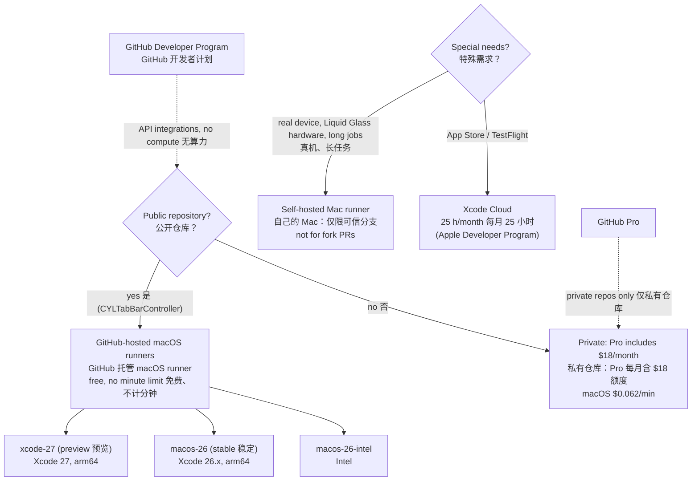
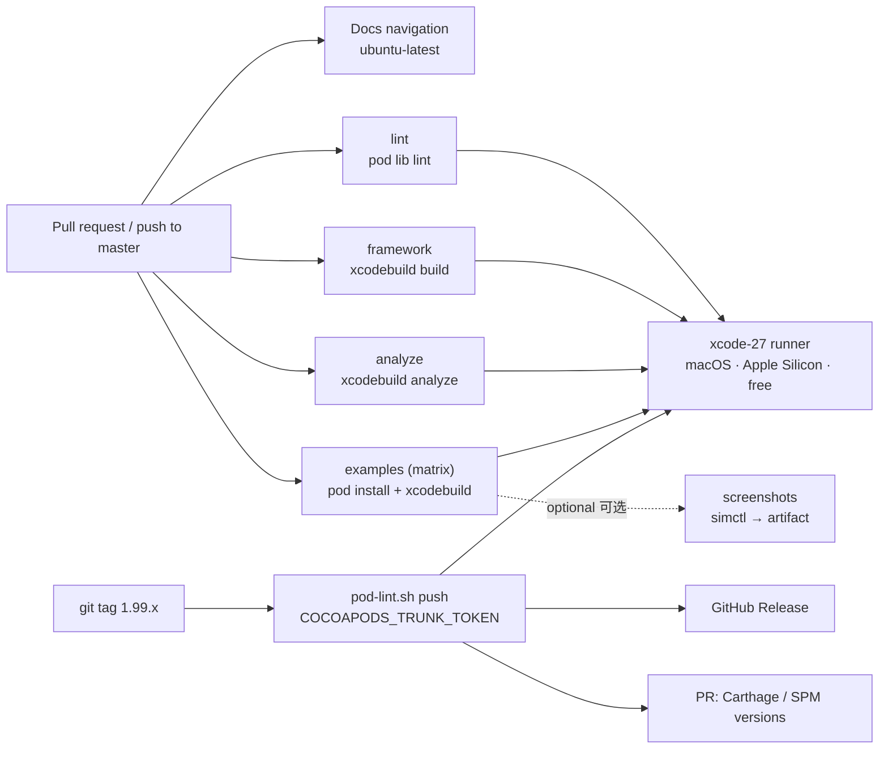

# [CN]macOS CI/CD 调研报告：用 Mac 服务器构建本项目
# [EN]macOS CI/CD research: building this project on Mac servers

<!-- bound-classes: none -->
<!-- binding:start -->
<!-- Generated by scripts/update-docs-navigation.py; do not edit by hand. -->

| 中文 | English |
|:---|:---|
| 本文档不绑定代码类。 | This document is not bound to a code class. |

<!-- binding:end -->

| 中文 | English |
|:---|:---|
| 本文是一份调研报告：如何为本仓库配置 GitHub 上的 CI/CD，让构建、静态分析、Demo 与发布在 macOS 服务器上自动运行。目前仓库只有一个在 `ubuntu-latest` runner 上运行的 `Docs navigation` 检查，Objective-C 代码从未在 CI 中编译过，静态分析警告与截图也只能在本机完成。本文给出可选方案、对比、推荐方案、流水线设计与需要维护者完成的步骤。已确认采用方案 A 与 `xcode-27` runner，CI workflow（`.github/workflows/ios.yml`）已添加；发布 workflow（`.github/workflows/release.yml`）也已添加，Secret `COCOAPODS_TRUNK_TOKEN` 已配置。调研日期：2026-11-04。 | This is a research report: how to set up CI/CD on GitHub for this repository so that builds, static analysis, the demos and releases run automatically on macOS servers. Today the repository has a single check, `Docs navigation`, which runs on an `ubuntu-latest` runner; the Objective-C code is never compiled in CI, and static-analyzer warnings and screenshots can only be produced on a local Mac. This page lists the options, compares them, recommends one, designs the pipeline and lists the steps the maintainer has to take. Option A with the `xcode-27` runner is confirmed and the CI workflow (`.github/workflows/ios.yml`) is added; the release workflow (`.github/workflows/release.yml`) is added too, and the secret `COCOAPODS_TRUNK_TOKEN` is set. Researched on 2026-11-04. |

## [CN]目录
## [EN]Contents

<!-- navigation:start -->
<!-- Generated by scripts/update-docs-navigation.py; do not edit by hand. -->

| 中文 | English |
|:---|:---|
| [结论](#cn结论) | [Conclusion](#enconclusion) |
| [你的账号权益对照](#cn你的账号权益对照) | [What your accounts give you](#enwhat-your-accounts-give-you) |
| [可选方案对比](#cn可选方案对比) | [Options compared](#enoptions-compared) |
| [推荐流水线设计](#cn推荐流水线设计) | [Recommended pipeline](#enrecommended-pipeline) |
| [已添加的 CI workflow](#cn已添加的-ci-workflow) | [The CI workflow](#enthe-ci-workflow) |
| [发布流程](#cn发布流程) | [Releasing](#enreleasing) |
| &nbsp;&nbsp;&nbsp;&nbsp;↳ [运行环境：macos-26](#cn运行环境macos-26) | &nbsp;&nbsp;&nbsp;&nbsp;↳ [Runner: macos-26](#enrunner-macos-26) |
| &nbsp;&nbsp;&nbsp;&nbsp;↳ [CI 提速与脚本检查](#cnci-提速与脚本检查) | &nbsp;&nbsp;&nbsp;&nbsp;↳ [Faster CI and script checks](#enfaster-ci-and-script-checks) |
| [首次运行结果](#cn首次运行结果) | [First run results](#enfirst-run-results) |
| [风险与注意事项](#cn风险与注意事项) | [Risks and notes](#enrisks-and-notes) |
| [TODO：维护者需要完成的步骤](#cntodo维护者需要完成的步骤) | [TODO: steps for the maintainer](#entodo-steps-for-the-maintainer) |
| [来源](#cn来源) | [Sources](#ensources) |
| [任务记录](#任务记录--task-log) | [Task log](#任务记录--task-log) |

<!-- navigation:end -->

## [CN]结论
## [EN]Conclusion

| 中文 | English |
|:---|:---|
| **推荐：使用 GitHub 托管的 macOS runner（GitHub Actions），不需要自己的 Mac 服务器，也不需要付费。** 本仓库是公开仓库，公开仓库使用标准 GitHub 托管 runner（包括 macOS）免费，且不消耗账号的包含额度。 | **Recommended: GitHub-hosted macOS runners (GitHub Actions). No Mac server of your own and no payment are needed.** This repository is public, and standard GitHub-hosted runners, macOS included, are free for public repositories and do not use the account's included usage. |
| 项目要求 Xcode 27（见 `scripts/pod-lint.xcconfig`：Xcode 27+ 只支持 iOS 15.0+）。GitHub 已提供 `xcode-27` 标签的 Apple Silicon runner（公开预览），稳定版 `macos-26`（Xcode 26.x）可作为兼容性对照。 | The project needs Xcode 27 (see `scripts/pod-lint.xcconfig`: Xcode 27+ only supports iOS 15.0+). GitHub offers Apple Silicon runners with the `xcode-27` label (public preview); the stable `macos-26` image (Xcode 26.x) can serve as a compatibility check. |
| GitHub Pro 与 GitHub 开发者计划对本仓库的 CI 没有额外帮助：Pro 的额度只用于私有仓库；开发者计划面向基于 GitHub API 开发集成的开发者，不包含 Actions 算力。 | GitHub Pro and the GitHub Developer Program add nothing for this repository's CI: Pro's included usage only applies to private repositories, and the Developer Program is for developers building integrations on the GitHub API; it includes no Actions compute. |
| 自己的 Mac（self-hosted runner）只作为补充，且不建议用于来自 fork 的 PR（安全原因，见下文）。Xcode Cloud（Apple 开发者计划每月 25 小时）适合以 App 为中心的流程，对本库这种「库 + 多个 Demo」不是首选。 | Your own Mac (a self-hosted runner) is only a supplement, and should not run pull requests from forks (security, see below). Xcode Cloud (25 hours a month with the Apple Developer Program) suits app-centric pipelines; for a library with many demos like this one, it is not the first choice. |



## [CN]你的账号权益对照
## [EN]What your accounts give you

| 账号 / 计划 | 对本仓库（公开）的 CI 有什么作用 |
|:---|:---|
| 公开仓库本身 | 标准 GitHub 托管 runner（Ubuntu、Windows、macOS）免费，不消耗额度 |
| GitHub Pro | 每月包含 $18 的 Actions 算力，仅用于私有仓库；对公开仓库无影响 |
| GitHub 开发者计划 | 面向使用 GitHub API 开发集成的开发者，不包含 Actions 算力 |
| Apple 开发者计划（如已加入） | Xcode Cloud 每月 25 小时；签名证书可用于真机或 TestFlight 流程 |

| Account / plan | What it does for this (public) repository's CI |
|:---|:---|
| The public repository itself | Standard GitHub-hosted runners (Ubuntu, Windows, macOS) are free and use no included usage |
| GitHub Pro | $18 of Actions compute a month, for private repositories only; nothing for public ones |
| GitHub Developer Program | For developers building integrations on the GitHub API; no Actions compute |
| Apple Developer Program (if a member) | 25 Xcode Cloud hours a month; signing certificates for device or TestFlight pipelines |

## [CN]可选方案对比
## [EN]Options compared

| 方案 | 费用（本仓库） | 机器 | 优点 | 缺点 |
|:---|:---|:---|:---|:---|
| A. GitHub 托管 macOS runner | 免费 | `xcode-27`、`macos-26`、`macos-15`：Apple Silicon（M1），3 vCPU、7 GB 内存、14 GB SSD；`macos-26-intel` 等：Intel，4 vCPU、14 GB | 无需维护；每次干净环境；与 PR、检查、Secrets 原生集成 | 机器较小；镜像与默认 Xcode 会随时间变化；`xcode-27` 仍为预览 |
| B. GitHub 更大规格 macOS runner（xlarge） | 付费，公开仓库也收费，需要付款方式 | 更多 CPU 与内存 | 更快 | 额外费用，本项目规模不需要 |
| C. 自建 runner（自己的 Mac，如 Mac mini） | runner 免费，机器、电费、网络自付 | 自选，可连真机 | 速度可控；可用任意 Xcode、真机、长时间任务 | 需要维护；**公开仓库的 fork PR 可在你的机器上执行任意代码**，官方建议只用于私有仓库 |
| D. Xcode Cloud | Apple 开发者计划含每月 25 小时，超出需订阅 | Apple 托管 | 与签名、TestFlight 深度集成 | 以 App 为中心；在 Xcode 中配置，不在仓库 YAML 中；对库的 `pod lib lint`、Carthage、多个 Demo 不如 Actions 灵活 |

| Option | Cost (this repository) | Machines | Pros | Cons |
|:---|:---|:---|:---|:---|
| A. GitHub-hosted macOS runners | Free | `xcode-27`, `macos-26`, `macos-15`: Apple Silicon (M1), 3 vCPU, 7 GB RAM, 14 GB SSD; `macos-26-intel` etc.: Intel, 4 vCPU, 14 GB | Nothing to maintain; a clean machine every run; native PR checks and secrets | Small machines; images and the default Xcode change over time; `xcode-27` is still a preview |
| B. GitHub larger (xlarge) macOS runners | Paid, also for public repositories; needs a payment method | More CPU and memory | Faster | Extra cost, not needed at this project's size |
| C. Self-hosted runner (your own Mac, e.g. a Mac mini) | The runner is free; you pay for the machine, power and network | Your choice, can attach devices | Speed under your control; any Xcode, real devices, long jobs | Maintenance; **a pull request from a fork of a public repository can run arbitrary code on your machine**; GitHub recommends self-hosted runners for private repositories only |
| D. Xcode Cloud | 25 hours a month with the Apple Developer Program, a subscription beyond that | Hosted by Apple | Deep integration with signing and TestFlight | App-centric; configured in Xcode, not in YAML in the repository; less flexible than Actions for `pod lib lint`, Carthage and many demos |

## [CN]推荐流水线设计
## [EN]Recommended pipeline

| 中文 | English |
|:---|:---|
| **CI（每个 PR 与 push 到 master）**，在 `xcode-27` runner 上运行，各 job 并行： | **CI (every pull request and every push to master)**, on `xcode-27` runners, jobs in parallel: |
| 1. `lint`：`pod lib lint CYLTabBarController.podspec`（完整，不加 `--quick`），对应 CLAUDE.md 的验证要求。 | 1. `lint`: `pod lib lint CYLTabBarController.podspec` (full, without `--quick`), the verification CLAUDE.md asks for. |
| 2. `framework`：`xcodebuild build` 共享 scheme `CYLTabBarController-Framework`（iOS Simulator），即 Carthage 使用的 target。 | 2. `framework`: `xcodebuild build` of the shared scheme `CYLTabBarController-Framework` (iOS Simulator), the target Carthage builds. |
| 3. `analyze`：`xcodebuild analyze` 同一 scheme，用 `CLANG_ANALYZER_OUTPUT=plist-html` 输出报告；警告作为失败（CLAUDE.md：修复所有构建与静态分析警告）。可先只报告，修完遗留警告后再改为失败。 | 3. `analyze`: `xcodebuild analyze` of the same scheme, with `CLANG_ANALYZER_OUTPUT=plist-html` for a report; warnings fail the job (CLAUDE.md: fix every build and analyzer warning). It can report only at first, and fail once the existing warnings are fixed. |
| 4. `examples`：矩阵构建各 Demo（ObjC `Example`、Swift 系列、SPM、Carthage），CocoaPods Demo 先 `pod install`；Podfile 不需要修改。 | 4. `examples`: a matrix that builds the demos (ObjC `Example`, the Swift ones, SPM, Carthage); CocoaPods demos run `pod install` first; no Podfile changes. |
| 5. `screenshots`（可选）：在模拟器中启动 Demo，`xcrun simctl io booted screenshot` 截图并作为 artifact 上传，供 `docs/assets/` 使用。 | 5. `screenshots` (optional): launch a demo in the simulator, take screenshots with `xcrun simctl io booted screenshot` and upload them as artifacts, for `docs/assets/`. |
| 6. 保留现有的 `Docs navigation`（`ubuntu-latest`，最便宜也最快）。 | 6. Keep the existing `Docs navigation` check (`ubuntu-latest`, the cheapest and fastest). |
| **CD（推送版本 tag，如 `1.99.80`）**：在 macOS runner 上运行 `scripts/pod-lint.sh push` 发布到 CocoaPods trunk（该脚本随后更新 Carthage 与 SPM 的版本号），创建 GitHub Release 并附上 Carthage 使用的 `CYLTabBarController.xcframework.zip`（`scripts/pod-lint.sh xcframework`，见 [docs/Carthage.md](Carthage.md)），并为脚本修改的文件自动开 PR。CocoaPods 发布需要仓库 Secret `COCOAPODS_TRUNK_TOKEN`。 | **CD (pushing a version tag such as `1.99.80`)**: on a macOS runner, run `scripts/pod-lint.sh push` to publish to CocoaPods trunk (the script then updates the Carthage and SPM versions), create a GitHub Release with the `CYLTabBarController.xcframework.zip` Carthage installs attached (`scripts/pod-lint.sh xcframework`, see [docs/Carthage.md](Carthage.md)), and open a pull request with the files the script changed. Publishing to CocoaPods needs the repository secret `COCOAPODS_TRUNK_TOKEN`. |



## [CN]已添加的 CI workflow
## [EN]The CI workflow

| 中文 | English |
|:---|:---|
| `.github/workflows/ios.yml` 已添加，在每个 PR、push 到 master 以及手动触发（`workflow_dispatch`）时运行，包含四类 job：`pod lib lint`（完整）；`Framework build and analyze`（构建 Carthage 的 framework target 并静态分析，警告汇总写入 job summary，分析报告作为 artifact；本库源码出现构建或静态分析警告时该 job 失败）；`Carthage`（`scripts/pod-lint.sh xcframework`：与发布相同，从去掉 `CrossPlatform/` 的副本构建 Carthage 二进制规格使用的 XCFramework zip）；`Demo …` 矩阵（每个 Demo 一个 job，互不影响）。 | `.github/workflows/ios.yml` is added. It runs on every pull request, on pushes to master and on demand (`workflow_dispatch`), with four kinds of jobs: `pod lib lint` (full); `Framework build and analyze` (builds the Carthage framework target and runs the static analyzer; warnings are listed in the job summary and the analyzer report is an artifact; a build or analyzer warning in the library's sources fails the job); `Carthage` (`scripts/pod-lint.sh xcframework`: as on release, the XCFramework zip of the Carthage binary spec, built from a copy without `CrossPlatform/`); and the `Demo …` matrix (one job per demo, independent of each other). |
| Android：`.github/workflows/android.yml` 在 `ubuntu-latest` runner 上运行，涉及 `Example-Android/`、共用配置文件、iOS 示例的资源目录或 `scripts/publish-android.sh` 的 PR 与 master push 时触发：`gradle testDebugUnitTest :tabpages:test lintDebug assembleRelease`，然后 `scripts/publish-android.sh staging --skip-tests` 构建并检查 Maven 上传包（不上传）；失败时上传测试与 lint 报告。 | Android: `.github/workflows/android.yml` runs on an `ubuntu-latest` runner for pull requests and master pushes that touch `Example-Android/`, the shared configuration files, the iOS examples' asset catalogs or `scripts/publish-android.sh`: `gradle testDebugUnitTest :tabpages:test lintDebug assembleRelease`, then `scripts/publish-android.sh staging --skip-tests` builds and checks the Maven bundle (no upload); on failure the test and lint reports are uploaded. |
| 大部分 Demo 没有共享 scheme，名称只有在 Mac 上才能得到，因此 `scripts/ci-build-example.sh` 在 runner 上运行 `xcodebuild -list -json` 选出 App 的 scheme（与 Demo 自身 .xcodeproj 中 App target 同名、或构建 `.app` 的共享 scheme；库自己的 `CYLTabBarController` scheme 不算，否则只会编译库，App 代码中的错误不会被发现），有 Podfile 时先 `pod install`（不修改 Podfile），并为 job summary 输出一行结果（scheme、是否成功、警告数）。 | Most demos have no shared scheme, so their names are only known on the Mac. `scripts/ci-build-example.sh` therefore runs `xcodebuild -list -json` on the runner to pick the app scheme (named after an application target of the demo's own .xcodeproj, or a shared scheme that builds a `.app`; the library's own `CYLTabBarController` scheme does not count, since building it compiles only the library and errors in the app code go unnoticed), runs `pod install` first when there is a Podfile (without changing it), and writes a result line (scheme, success, warning count) for the job summary. |
| 下面第一段为最初的草稿（仓库中的文件以 `.github/workflows/ios.yml` 为准），第二段为发布 workflow 的最初草稿（仓库中的文件以 `.github/workflows/release.yml` 为准，见「发布流程」）。 | The first block below is the original draft (the repository's `.github/workflows/ios.yml` is the source of truth); the second is the release workflow's original draft (the repository's `.github/workflows/release.yml` is the source of truth; see "Releasing"). |

```yaml
name: iOS

on:
  pull_request:
  push:
    branches: [ master ]

concurrency:
  group: ios-${{ github.ref }}
  cancel-in-progress: true

jobs:
  lint:
    runs-on: xcode-27          # public preview; fall back to macos-26 if needed
    timeout-minutes: 30
    steps:
      - uses: actions/checkout@v4
      - run: xcodebuild -version
      - run: scripts/pod-lint.sh lib     # full pod lib lint, with scripts/pod-lint.xcconfig

  framework:
    runs-on: xcode-27
    timeout-minutes: 30
    steps:
      - uses: actions/checkout@v4
      - name: Build the Carthage framework target
        run: |
          xcodebuild build \
            -project CYLTabBarController.xcodeproj \
            -scheme CYLTabBarController-Framework \
            -destination 'generic/platform=iOS Simulator' \
            CODE_SIGNING_ALLOWED=NO
      - name: Static analysis
        run: |
          xcodebuild analyze \
            -project CYLTabBarController.xcodeproj \
            -scheme CYLTabBarController-Framework \
            -destination 'generic/platform=iOS Simulator' \
            CODE_SIGNING_ALLOWED=NO \
            CLANG_ANALYZER_OUTPUT=plist-html \
            CLANG_ANALYZER_OUTPUT_DIR="$RUNNER_TEMP/analyzer" | tee analyze.log
      - uses: actions/upload-artifact@v4
        if: always()
        with:
          name: analyzer-report
          path: ${{ runner.temp }}/analyzer

  example-objc:
    runs-on: xcode-27
    timeout-minutes: 45
    steps:
      - uses: actions/checkout@v4
      - run: pod install
      - run: |
          xcodebuild build \
            -workspace CYLTabBarController.xcworkspace \
            -scheme CYLTabBarController \
            -destination 'generic/platform=iOS Simulator' \
            CODE_SIGNING_ALLOWED=NO
```

```yaml
# .github/workflows/release.yml (draft)
name: Release
on:
  push:
    tags: [ '*.*.*' ]
jobs:
  publish:
    runs-on: xcode-27
    steps:
      - uses: actions/checkout@v4
        with: { fetch-depth: 0 }
      - name: Publish to CocoaPods trunk, then update the Carthage and SPM versions
        env:
          COCOAPODS_TRUNK_TOKEN: ${{ secrets.COCOAPODS_TRUNK_TOKEN }}
        run: scripts/pod-lint.sh push
      - name: GitHub Release
        env: { GH_TOKEN: ${{ github.token }} }
        run: gh release create "$GITHUB_REF_NAME" --generate-notes
```

## [CN]发布流程
## [EN]Releasing

| 中文 | English |
|:---|:---|
| `.github/workflows/release.yml` 在推送形如 `1.99.73` 的版本 tag 时运行（`xcode-27` runner），依次：检查 tag 与 podspec 的 `s.version` 一致，不一致即失败；用 Secret `COCOAPODS_TRUNK_TOKEN` 执行 `scripts/pod-lint.sh push`（`pod trunk push`，随后更新 Demo 与文档中 Carthage、SPM 的版本号并重新生成导航）；创建 GitHub Release（自动生成说明，已存在则跳过）；为版本号更新开一个 PR。 | `.github/workflows/release.yml` runs when a version tag such as `1.99.73` is pushed (`xcode-27` runner). In order: it checks that the tag equals the podspec's `s.version` and fails otherwise; runs `scripts/pod-lint.sh push` with the secret `COCOAPODS_TRUNK_TOKEN` (`pod trunk push`, then the Carthage and SPM versions in the demo and docs are updated and the navigation regenerated); creates a GitHub Release with generated notes (skipped if it exists); and opens a pull request with the version updates. |
| **发布一个版本**：1. 从 master 新建分支，执行 `scripts/pod-lint.sh bump 1.99.73`：它修改 podspec 的 `s.version`，并把 Carthage 演示的 `Cartfile`、文档中的 SPM 版本号同步到新版本、重新生成导航；2. 提交并开 PR，CI 照常运行，合并到 master；3. 在合并后的提交上打 tag 并推送：`git tag 1.99.73 && git push origin 1.99.73`；4. 在 Actions 中查看 Release 运行。版本号已在第 1 步更新，因此发布后通常不会再有自动 PR。 | **To release**: 1. on a branch from master, run `scripts/pod-lint.sh bump 1.99.73`: it sets `s.version` in the podspec, moves the Carthage demo's `Cartfile` and the SPM versions in the docs to the new version, and regenerates the navigation; 2. commit, open a pull request, let CI run as usual, and merge it into master; 3. tag the merged commit and push the tag: `git tag 1.99.73 && git push origin 1.99.73`; 4. watch the Release run in Actions. The versions were updated in step 1, so there is normally no automatic pull request after publishing. |
| **脚本是唯一入口**：本地与 CI 使用同一个 `scripts/pod-lint.sh`：`lib`（CI 的 pod lib lint）、`version`（输出 `s.version`）、`check-tag <tag>`（Release workflow 用它检查 tag）、`bump <x.y.z>`（准备发布 PR）、`push`（发布）、`versions` / `carthage` / `spm`（只更新版本号）。修改发布逻辑时只改脚本，workflow 不需要跟着改。 | **The script is the single entry point**: local runs and CI use the same `scripts/pod-lint.sh`: `lib` (CI's pod lib lint), `version` (prints `s.version`), `check-tag <tag>` (the Release workflow checks the tag with it), `bump <x.y.z>` (prepares the release pull request), `push` (publishes), and `versions` / `carthage` / `spm` (only update versions). To change the release logic, change the script; the workflows need no change. |
| **设置**：（仅在发布时仍有版本文件改动时才会开 PR）自动开 PR 需要在 Settings → Actions → General 中开启「Allow GitHub Actions to create and approve pull requests」；未开启时分支仍会推送，运行日志中给出手动创建 PR 的链接。 | **Setting**: (a pull request is opened only when publishing still changed version files) opening it needs "Allow GitHub Actions to create and approve pull requests" in Settings → Actions → General; without it the branch is still pushed and the run log links to open the pull request by hand. |
| **必需检查**：用 `GITHUB_TOKEN` 创建的 PR 不会触发其他 workflow，因此若 master 设置了必需检查，这个 PR 不会自动运行 CI。它只修改 Cartfile 与文档中的版本号；可以由管理员绕过合并（ruleset 的 Bypass list），或在本地向该分支推送一次提交以触发 CI。 | **Required checks**: pull requests created with `GITHUB_TOKEN` do not trigger other workflows, so if master requires checks, CI does not run on this pull request by itself. It only changes version numbers in the Cartfile and the docs; an admin can merge it through the ruleset's bypass list, or push one commit to its branch locally to trigger CI. |
| **Token 过期**：trunk session 会过期（`pod trunk me` 可查看到期日）。过期后发布步骤会失败，需要重新 `pod trunk register` 并更新 Secret。 | **Token expiry**: trunk sessions expire (`pod trunk me` shows the date). Publishing then fails; run `pod trunk register` again and update the secret. |

### [CN]运行环境：macos-26
### [EN]Runner: macos-26

| 中文 | English |
|:---|:---|
| **CI 与发布都运行在 `macos-26`**（2026-11-04 起，此前为 `xcode-27`）：Apple Silicon 稳定镜像，默认 Xcode 26.6（iOS 26.5 SDK），镜像中还有 Xcode 26.0.1–26.5，没有 Xcode 27。 | **CI and releases run on `macos-26`** (since 2026-11-04; `xcode-27` before): the stable Apple Silicon image, default Xcode 26.6 (iOS 26.5 SDK), with Xcode 26.0.1–26.5 also installed and no Xcode 27. |
| **为什么能用 Xcode 26 编译**：本库使用 iOS 27 / 27.1 API 的地方（竖向栏、`UIHingeInteraction` 等）都有 `#if defined(__IPHONE_27_1) && __IPHONE_OS_VERSION_MAX_ALLOWED >= __IPHONE_27_1` 保护，用 iOS 26 SDK 编译时这些代码不参与编译；其余只用 `@available` 运行时判断。`scripts/pod-lint.xcconfig` 的 iOS 15.0 最低版本对 Xcode 26 同样适用。 | **Why Xcode 26 can build it**: every use of iOS 27 / 27.1 API in the library (the vertical bar, `UIHingeInteraction` and so on) is guarded by `#if defined(__IPHONE_27_1) && __IPHONE_OS_VERSION_MAX_ALLOWED >= __IPHONE_27_1`, so it is left out when building with the iOS 26 SDK; the rest only uses `@available` runtime checks. The iOS 15.0 deployment target of `scripts/pod-lint.xcconfig` works with Xcode 26 too. |
| **示例工程的格式与 ObjC 示例一致**：所有 `Example*/` 工程都使用根目录 ObjC 示例 `CYLTabBarController.xcodeproj` 的格式（`objectVersion = 46`、`compatibilityVersion = "Xcode 3.2"`），因此 macos-26 上的 Xcode 26 以及更早的 Xcode 都能打开。用 Xcode 27 新建的工程格式为 110，Xcode 26 会报“future Xcode project file format (110)”而无法打开，`Example-Swift-SwiftManager-FlatDesign` 曾因此失败。不要使用文件夹同步（`PBXFileSystemSynchronizedRootGroup`，格式 77+）：新增文件需在 Xcode 中手动加入目标。Xcode 升级工程格式后，请在提交前改回上述两个值。 | **Example projects use the ObjC example's format**: every `Example*/` project uses the format of the root ObjC example, `CYLTabBarController.xcodeproj` (`objectVersion = 46`, `compatibilityVersion = "Xcode 3.2"`), so Xcode 26 on macos-26 and earlier versions of Xcode can open it. A project created with Xcode 27 has format 110, which Xcode 26 refuses with "future Xcode project file format (110)"; `Example-Swift-SwiftManager-FlatDesign` failed that way. Do not use folder sync (`PBXFileSystemSynchronizedRootGroup`, format 77+): add new files to the target by hand in Xcode. If Xcode upgrades a project's format, set those two values back before committing. |
| **注意**：用 iOS 26 SDK 编译时，iOS 27.1 的竖向栏相关代码不会被编译，所以 CI 不再覆盖这部分；发布的源码由使用者用自己的 Xcode 编译，不受影响。 | **Note**: with the iOS 26 SDK, the iOS 27.1 vertical-bar code is not compiled, so CI no longer covers it; the published sources are compiled by each app with its own Xcode, so releases are not affected. |
| **切换 runner 不用改 workflow**：在 Settings → Secrets and variables → Actions → Variables 中新建仓库变量 `MACOS_RUNNER`，值为 runner 标签（例如 `xcode-27`），`ios.yml` 与 `release.yml` 的 macOS job 都会改用它；删除变量即回到 `macos-26`。 | **Switching runners needs no workflow change**: in Settings → Secrets and variables → Actions → Variables, add the repository variable `MACOS_RUNNER` with a runner label (e.g. `xcode-27`); the macOS jobs of `ios.yml` and `release.yml` then use it. Delete the variable to go back to `macos-26`. |

### [CN]CI 提速与脚本检查
### [EN]Faster CI and script checks

| 中文 | English |
|:---|:---|
| **只改文档的 PR 不编译**：`Changes` job（Ubuntu，几秒）比较 PR 的改动；如果只修改了 `docs/`、`assets/`、`*.md` 或 `.github/FUNDING.yml`，macOS job 的步骤全部跳过。这些 job 仍然运行并报告成功，所以作为必需检查的「pod lib lint」「Demo …」等不会卡住。推送到 master 与手动运行总是完整编译。文档本身由 `Docs navigation` workflow 检查。 | **Pull requests that only change docs do not build**: the `Changes` job (Ubuntu, a few seconds) looks at the pull request's files; when only `docs/`, `assets/`, `*.md` or `.github/FUNDING.yml` changed, every step of the macOS jobs is skipped. The jobs still run and report success, so required checks such as "pod lib lint" and "Demo …" are not left waiting. Pushes to master and manual runs always build everything. The docs themselves are checked by the `Docs navigation` workflow. |
| **CocoaPods 缓存**：`pod lib lint` 与每个 Demo 缓存 `~/.cocoapods/repos` 与 `~/Library/Caches/CocoaPods`，键包含 podspec 与 Podfile 的哈希。 | **CocoaPods cache**: `pod lib lint` and every demo cache `~/.cocoapods/repos` and `~/Library/Caches/CocoaPods`, keyed by the hashes of the podspec and the Podfiles. |
| **shellcheck**：`shellcheck` job 检查 `scripts/*.sh`（发布脚本出错只能在发布时才发现，所以提前检查）。它与 `Changes` 分开，避免它失败时 macOS job 被跳过而显示为通过。 | **shellcheck**: the `shellcheck` job checks `scripts/*.sh` (a broken release script would otherwise only show up while releasing). It is separate from `Changes`, so its failure cannot make the macOS jobs skip and look green. |
| **建议的必需检查**：在原来的列表之外加上 `shellcheck` 与 `Changes`（`Changes` 失败时 macOS job 会被跳过，而被跳过的 job 算作通过，所以它也要设为必需）。 | **Suggested required checks**: add `shellcheck` and `Changes` to the earlier list (if `Changes` fails, the macOS jobs are skipped, and skipped jobs count as passing, so it must be required too). |

## [CN]首次运行结果
## [EN]First run results

| 中文 | English |
|:---|:---|
| 2026-11-04 在 PR #763 中于 `xcode-27` runner（Xcode 27.1，iOS Simulator 27.1 SDK）上运行，这是本项目第一次在 CI 中编译。最终全部通过：`pod lib lint`（完整）、Framework 构建与静态分析、Carthage XCFramework，以及全部 9 个 Demo（根目录 ObjC Demo、Example-Swift、-02、-03、-04、SwiftUI、SwiftManager、SwiftManager-FlatDesign、network-download）。 | Run on 2026-11-04 in PR #763 on the `xcode-27` runner (Xcode 27.1, iOS Simulator 27.1 SDK), the first time this project was compiled in CI. It passed in full: `pod lib lint` (full), the framework build and analysis, the Carthage XCFramework, and all 9 demos (the root ObjC demo, Example-Swift, -02, -03, -04, SwiftUI, SwiftManager, SwiftManager-FlatDesign, network-download). |
| 修复的问题 1：根目录 ObjC Demo 链接失败，找不到 `swiftCompatibility56`。本库是含 Swift 代码的静态 framework，CocoaPods 为 App 添加 `${TOOLCHAIN_DIR}/usr/lib/swift/...` 搜索路径，而该 runner 上 `TOOLCHAIN_DIR` 指向一个未挂载的 Metal 工具链。`scripts/ci-build-example.sh` 改为传入 Xcode 默认工具链。Swift Demo 不受影响。若在本机遇到同样的链接错误，原因相同。 | Fixed 1: the root ObjC demo failed to link, missing `swiftCompatibility56`. The library is a static framework with Swift code, so CocoaPods adds `${TOOLCHAIN_DIR}/usr/lib/swift/...` to the app's search paths, and on this runner `TOOLCHAIN_DIR` pointed at an unmounted Metal toolchain. `scripts/ci-build-example.sh` now passes Xcode's default toolchain. Swift demos were not affected. The same link error on a local Mac has the same cause. |
| 修复的问题 2：整个库的构建与静态分析只有 1 个警告（`UIViewController+CYLSettingsSection.m` 中未本地化的按钮标题），已改为 `CYLLocalizedString`。之后警告数为 0，因此 Framework job 改为出现警告即失败。 | Fixed 2: the whole library's build and analysis had a single warning (a non-localized button title in `UIViewController+CYLSettingsSection.m`), now `CYLLocalizedString`. The count is 0 since, so the framework job now fails on any warning. |
| SonarCloud 对 `scripts/ci-build-example.sh` 报的 6 个 shell 写法问题也已修复。 | The 6 shell style findings SonarCloud reported on `scripts/ci-build-example.sh` are fixed as well. |

## [CN]风险与注意事项
## [EN]Risks and notes

| 中文 | English |
|:---|:---|
| **标签要写明确**：`macos-latest` 会随时间指向新系统（目前为 macOS 26），默认 Xcode 也会变化。建议使用 `xcode-27`（按 Xcode 主版本划分的镜像）或固定的 `macos-26`，必要时用 `sudo xcode-select -s` 选择具体 Xcode。 | **Use explicit labels**: `macos-latest` moves to newer systems over time (macOS 26 today), and the default Xcode changes too. Use `xcode-27` (images are now per major Xcode version) or a fixed `macos-26`, and select a specific Xcode with `sudo xcode-select -s` when needed. |
| **`xcode-27` 仍为公开预览**：可能出现镜像问题；可以加一个 `macos-26` 的对照 job，或在预览不稳定时暂时 `continue-on-error`。 | **`xcode-27` is still a public preview**: image problems are possible; add a `macos-26` job for comparison, or mark it `continue-on-error` while the preview is unstable. |
| **Secrets 与 fork**：来自 fork 的 PR 拿不到仓库 Secrets，发布只在维护者推送 tag 时运行，因此 `COCOAPODS_TRUNK_TOKEN` 不会暴露给外部 PR。不要用 `pull_request_target` 去运行 PR 的代码。 | **Secrets and forks**: pull requests from forks do not get the repository's secrets, and publishing only runs when the maintainer pushes a tag, so `COCOAPODS_TRUNK_TOKEN` is never exposed to outside pull requests. Do not use `pull_request_target` to run a pull request's code. |
| **自建 runner 的安全**：如果使用自己的 Mac，只让它运行 master 与维护者自己的分支（例如通过 runner 标签与 `if: github.event.pull_request.head.repo.full_name == github.repository`），并在仓库设置中要求外部贡献者的 workflow 需批准后才运行。 | **Self-hosted runner security**: if you use your own Mac, let it run only master and the maintainer's own branches (e.g. with a runner label and `if: github.event.pull_request.head.repo.full_name == github.repository`), and require approval in the repository settings before workflows from outside contributors run. |
| **并发与时长**：托管 runner 有并发上限与单个 job 时长上限（以官方文档为准）；Demo 矩阵较多时用 `concurrency` 取消过期运行，并只在相关目录变化时构建对应 Demo（`paths` 过滤）。 | **Concurrency and duration**: hosted runners have a concurrency cap and a per-job time limit (see the official docs); with a large demo matrix, cancel outdated runs with `concurrency` and build a demo only when its folder changes (`paths` filters). |
| **Liquid Glass 与真机**：模拟器可以验证编译与大部分界面，但 iPhone Duo 等特定硬件、真机手势细节仍需在真机上确认。 | **Liquid Glass and devices**: the simulator verifies builds and most of the UI, but specific hardware such as the iPhone Duo and real-device gesture details still need a device. |

## [CN]TODO：维护者需要完成的步骤
## [EN]TODO: steps for the maintainer

| 中文 | English |
|:---|:---|
| ~~**TODO 1**~~ 已完成：采用方案 A（GitHub 托管 runner），主 runner 为 `macos-26`（2026-11-04 前为 `xcode-27`）。 | ~~**TODO 1**~~ Done: option A (GitHub-hosted runners), with `macos-26` as the main runner (`xcode-27` before 2026-11-04). |
| ~~**TODO 2**~~ 已完成：GitHub Actions 已启用（CI 在每个 PR 上运行）；外部 fork PR 的工作流需要批准，设置为「首次贡献者」（2026-11-09 通过 GitHub API 确认）。 | ~~**TODO 2**~~ Done: GitHub Actions is enabled (CI runs on every pull request); workflows from fork pull requests need approval, set to "first-time contributors" (checked through the GitHub API on 2026-11-09). |
| ~~**TODO 3**~~ 已完成：仓库 Secret `COCOAPODS_TRUNK_TOKEN` 已添加（2026-11-04）。由于该 token 曾出现在对话中，建议重新 `pod trunk register` 生成新 token、更新 Secret，并用 `pod trunk me clean-sessions` 使旧 token 失效。 | ~~**TODO 3**~~ Done: the repository secret `COCOAPODS_TRUNK_TOKEN` is set (2026-11-04). As that token appeared in a chat, register a new trunk session, update the secret, and invalidate the old token with `pod trunk me clean-sessions`. |
| ~~**TODO 4**~~ 已完成：CI 已在 PR #763 中运行，首次全部通过，结果见「首次运行结果」。 | ~~**TODO 4**~~ Done: CI runs in PR #763 and passed in full; see "First run results". |
| **TODO 5** CI 稳定后，在仓库 Settings → Branches 中把这些检查设为 master 的必需检查。2026-11-12 通过 GitHub API 再次确认：master 尚无分支保护（`protected: false`）。 | **TODO 5** Once CI is stable, make these checks required for master in Settings → Branches. Checked again on 2026-11-12 through the GitHub API: master has no branch protection yet (`protected: false`). |

## [CN]来源
## [EN]Sources

| 中文 | English |
|:---|:---|
| 以下资料于 2026-11-04 查阅，计费与镜像可能随时间变化，以官方页面为准。 | Read on 2026-11-04; billing and images can change, so the official pages are authoritative. |

- [GitHub-hosted runners reference](https://docs.github.com/en/actions/reference/runners/github-hosted-runners)
- [GitHub Actions billing](https://docs.github.com/en/billing/concepts/product-billing/github-actions)
- [Adding self-hosted runners](https://docs.github.com/en/actions/how-tos/manage-runners/self-hosted-runners/add-runners)
- [Xcode 27 runner image now in public preview (GitHub changelog, 2026-07-16)](https://github.blog/changelog/2026-07-16-xcode-27-runner-image-now-in-public-preview)
- [actions/runner-images: macos-26 release notes](https://github.com/actions/runner-images/releases/tag/macos-26%2F20260729.0423)
- [Xcode Cloud](https://developer.apple.com/xcode-cloud/)
- [GitHub Developer Program](https://docs.github.com/en/enterprise-cloud@latest/integrations/concepts/github-developer-program)

## 任务记录 / Task log

| 中文 | English |
|:---|:---|
| DONE（2026-11-12，SonarCloud PR #788）：用户提示词：「修复静态分析bug https://sonarcloud.io/project/issues?id=ChenYilong_CYLTabBarController&pullRequest=788&issueStatuses=OPEN,CONFIRMED&sinceLeakPeriod=true」。要求：修复 PR #788 新代码中所有 OPEN / CONFIRMED 的 SonarCloud 问题。上下文：共 25 个：`scripts/check-public-api-comments.py` 的正则复杂度 / 回溯与认知复杂度（17 个），`scripts/export-tabbar-configurations.py:447` 正则回溯（本次新加的 `as Any` 正则），`scripts/check-localization-macros.py:93` 认知复杂度，`Example-Shared/CYLDemoPlaceholder.swift:124` 空闭包，`Example/Classes/Gallery/CYLGalleryProvider.swift` 与 `CYLGallerySupport.swift` 闭包嵌套超过 2 层（7 个）。结果（`19f9dde`）：`check-public-api-comments.py` 改用字符串函数解析注释（不再回溯），长函数拆分，在 933 个输入上输出与修改前完全相同；导出脚本不用正则去掉 `as Any`；`check-localization-macros.py` 与图库闭包拆成辅助函数（图库 9.1、9.3 运行正常）；空闭包加了说明。干净编译通过，`run-tests.sh` 450 项通过。SonarCloud 重新分析后（2026-11-11 22:51 UTC）PR #788 的新代码中 OPEN / CONFIRMED 问题为 0。 | DONE (2026-11-12, SonarCloud PR #788): user prompt: "修复静态分析bug https://sonarcloud.io/project/issues?id=ChenYilong_CYLTabBarController&pullRequest=788&issueStatuses=OPEN,CONFIRMED&sinceLeakPeriod=true". Requirement: fix every OPEN / CONFIRMED SonarCloud issue in PR #788's new code. Context: 25 issues: regex complexity / backtracking and cognitive complexity in `scripts/check-public-api-comments.py` (17), regex backtracking at `scripts/export-tabbar-configurations.py:447` (the `as Any` regex added today), cognitive complexity at `scripts/check-localization-macros.py:93`, an empty closure at `Example-Shared/CYLDemoPlaceholder.swift:124`, closures nested more than 2 deep in `Example/Classes/Gallery/CYLGalleryProvider.swift` and `CYLGallerySupport.swift` (7). Result (`19f9dde`): `check-public-api-comments.py` parses comments with string functions (no backtracking) and its long functions are split, with output identical to before on 933 inputs; the exporter drops `as Any` without a regex; `check-localization-macros.py` and the gallery closures are split into helpers (gallery 9.1 and 9.3 run as before); the empty closure explains itself. Clean build passes, `run-tests.sh` passes 450 checks. After SonarCloud's new analysis (2026-11-11 22:51 UTC), PR #788's new code has 0 OPEN / CONFIRMED issues. |
| TODO（2026-11-12，合并所有 open PR）：用户提示词：「将所有处于open状态的分支的target branch指向本分支，当前分支，全部合并仅仅保留当前分支，处理冲突后合并，继续以上未完成的任务。」。上下文：当前分支 `feat/cross-platform-components`（PR #788 → master）。其他 open PR：#784 `fix/android-edge-to-edge-plus-button`、#783 `feat/tabbarcontroller-configuration-file`、#781 `fix/liquid-glass-long-press-freeze`、#780 `fix/liquid-glass-plus-child-regression`、#777 `refactor/theme-icons-local-replacement`，都指向 master。检查：#784、#780、#777 已全部包含在当前分支中；#783 差 1 个提交（`6e7855a`，文档），#781 差 1 个提交（`024ffc5`，液态玻璃长按导致切换 Tab 卡住）。要求：把这些 PR 的目标分支改为当前分支，合并（处理冲突），只保留当前分支，然后继续未完成的任务（PlusButton 遮罩拖动测试、issue #561）。 | TODO (2026-11-12, merge every open PR): user prompt: "将所有处于open状态的分支的target branch指向本分支，当前分支，全部合并仅仅保留当前分支，处理冲突后合并，继续以上未完成的任务。". Context: the current branch is `feat/cross-platform-components` (PR #788 → master). The other open PRs, all into master: #784 `fix/android-edge-to-edge-plus-button`, #783 `feat/tabbarcontroller-configuration-file`, #781 `fix/liquid-glass-long-press-freeze`, #780 `fix/liquid-glass-plus-child-regression`, #777 `refactor/theme-icons-local-replacement`. Checked: #784, #780 and #777 are already fully in the current branch; #783 lacks 1 commit (`6e7855a`, docs), #781 lacks 1 commit (`024ffc5`, a Liquid Glass long press that froze tab switching). Requirement: point those PRs at the current branch, merge them (resolving conflicts), keep only the current branch, then continue the unfinished tasks (the plus button mask drag test, issue #561). |
