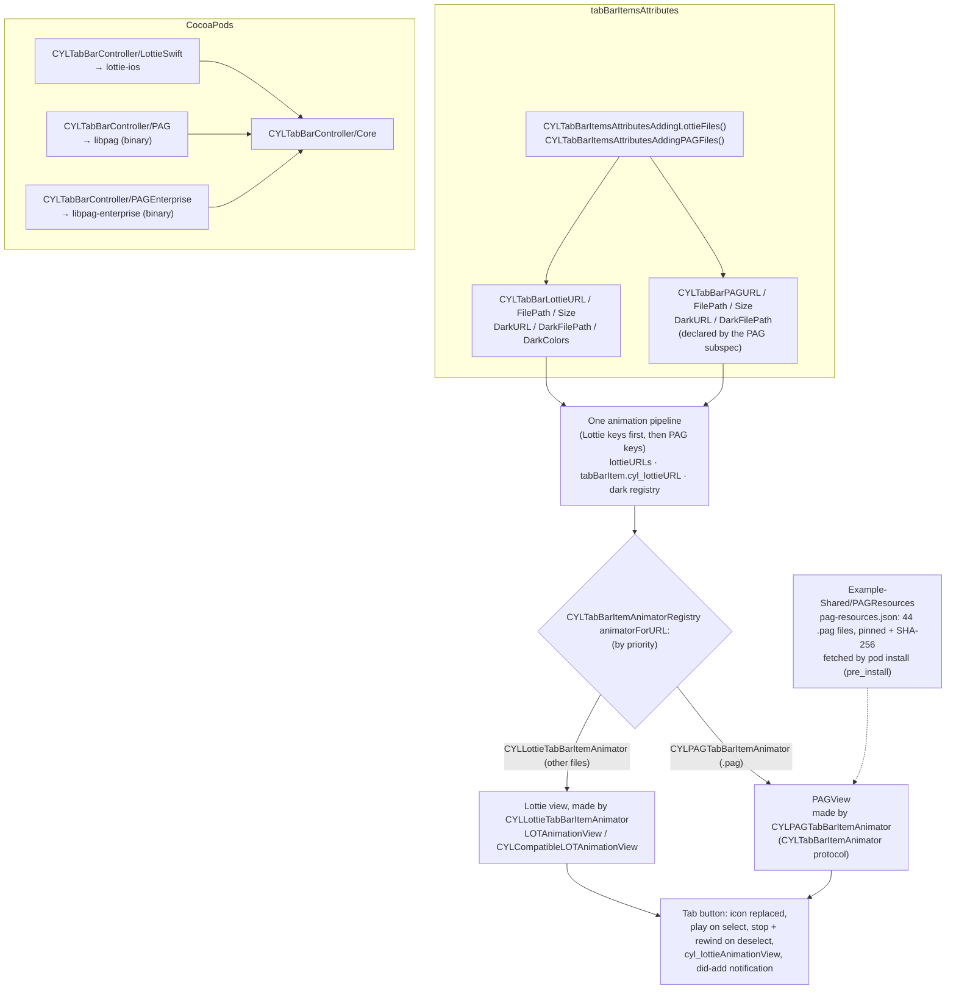
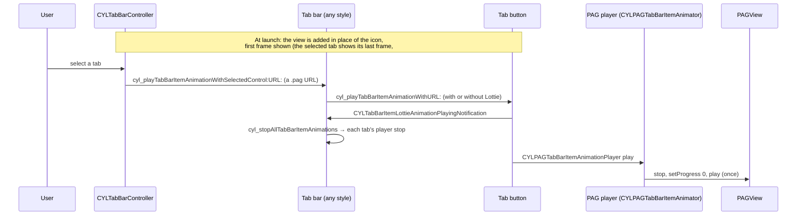

# [CN]PAG 动画 Tab 图标（与 Lottie 用法相同）
# [EN]PAG animated tab icons (used like Lottie)

<!-- bound-classes: CYLTabBarController, CYLPAGTabBarItemAnimator -->
<!-- binding:start -->
<!-- Generated by scripts/update-docs-navigation.py; do not edit by hand. -->

| 中文 | English |
|:---|:---|
| 绑定的代码类 `CYLTabBarController`：[`CYLTabBarController/CYLTabBarController.h`](../CYLTabBarController/CYLTabBarController.h) | Bound to the class `CYLTabBarController`: [`CYLTabBarController/CYLTabBarController.h`](../CYLTabBarController/CYLTabBarController.h) |
| 绑定的代码类 `CYLPAGTabBarItemAnimator`：[`CYLTabBarController/CYLTabBarItemAnimation/PAG/CYLPAGTabBarItemAnimator.h`](../CYLTabBarController/CYLTabBarItemAnimation/PAG/CYLPAGTabBarItemAnimator.h) | Bound to the class `CYLPAGTabBarItemAnimator`: [`CYLTabBarController/CYLTabBarItemAnimation/PAG/CYLPAGTabBarItemAnimator.h`](../CYLTabBarController/CYLTabBarItemAnimation/PAG/CYLPAGTabBarItemAnimator.h) |

<!-- binding:end -->

| 中文 | English |
|:---|:---|
| 解决 [#604](https://github.com/ChenYilong/CYLTabBarController/issues/604)：支持腾讯 [PAG](https://pag.io)（libpag）动画作为 Tab 图标，它比 Lottie 支持更多效果。PAG 完全按照项目中 Lottie 的方式实现：同样的 key 命名、同样的 CocoaPods 子库引入方式、同样的显示与播放流程，适用于经典系统 TabBar、液态玻璃（Liquid Glass）与扁平样式（FlatDesign）。 | Solves [#604](https://github.com/ChenYilong/CYLTabBarController/issues/604): Tencent [PAG](https://pag.io) (libpag) animations as tab icons, with more effects than Lottie. PAG is implemented exactly the way Lottie is in this project: the same key naming, the same CocoaPods subspec setup, and the same display and playback pipeline, in the classic system tab bar, Liquid Glass and FlatDesign. |

## [CN]目录
## [EN]Contents

<!-- navigation:start -->
<!-- Generated by scripts/update-docs-navigation.py; do not edit by hand. -->

| 中文 | English |
|:---|:---|
| [安装](#cn安装) | [Installation](#eninstallation) |
| [Key 对照](#cnkey-对照) | [Keys, side by side with Lottie](#enkeys-side-by-side-with-lottie) |
| [各项关系](#cn各项关系) | [How the pieces relate](#enhow-the-pieces-relate) |
| [实现结构：CYLTabBarItemAnimator 协议](#cn实现结构cyltabbaritemanimator-协议) | [Implementation: the CYLTabBarItemAnimator protocol](#enimplementation-the-cyltabbaritemanimator-protocol) |
| [选中时的播放流程](#cn选中时的播放流程) | [What happens when a tab is selected](#enwhat-happens-when-a-tab-is-selected) |
| [代码演示](#cn代码演示) | [Code](#encode) |
| [Demo](#cndemo) | [Demo](#endemo) |
| [动效资源](#cn动效资源) | [Animation files](#enanimation-files) |
| [其他平台的参考](#cn其他平台的参考) | [What the other platforms do](#enwhat-the-other-platforms-do) |
| [与 Lottie 的差异](#cn与-lottie-的差异) | [Differences from Lottie](#endifferences-from-lottie) |
| [测试与截图](#cn测试与截图) | [Testing and screenshots](#entesting-and-screenshots) |

<!-- navigation:end -->

## [CN]安装
## [EN]Installation

| 中文 | English |
|:---|:---|
| 与 `CYLTabBarController/LottieSwift` 依赖 `lottie-ios` 一样，新增的 `CYLTabBarController/PAG` 子库依赖 CocoaPods 上的 `libpag`（腾讯发布的二进制 `libpag.xcframework`），因此不需要把 PAG 源码复制进本项目。 | Just as `CYLTabBarController/LottieSwift` depends on `lottie-ios`, the new `CYLTabBarController/PAG` subspec depends on the `libpag` pod (Tencent's binary `libpag.xcframework`), so no PAG source is copied into this project. |

```ruby
pod 'CYLTabBarController/PAG'              # libpag
# or / 或
pod 'CYLTabBarController/PAGEnterprise'    # libpag-enterprise: audio, 3D, movie layers…
# Compare / 对照: pod 'CYLTabBarController/LottieObjectiveC' or 'CYLTabBarController/LottieSwift'
```

| 中文 | English |
|:---|:---|
| 与 Lottie 提供 `LottieObjectiveC` 与 `LottieSwift` 两个版本一样，PAG 也提供两个子库：`PAG`（[libpag/pag-ios](https://github.com/libpag/pag-ios)，pod `libpag`）与 `PAGEnterprise`（[libpag/pag-enterprise-ios](https://github.com/libpag/pag-enterprise-ios)，pod `libpag-enterprise`，支持音频、3D、视频等企业版图层）。两者都包含同样的 `libpag.xcframework`，头文件同为 `<libpag/PAGView.h>`，因此本库代码完全相同；**二选一，不要同时引入**。企业版的使用授权请参阅腾讯 PAG 官网。 | Just as Lottie comes as `LottieObjectiveC` and `LottieSwift`, PAG comes as two subspecs: `PAG` ([libpag/pag-ios](https://github.com/libpag/pag-ios), pod `libpag`) and `PAGEnterprise` ([libpag/pag-enterprise-ios](https://github.com/libpag/pag-enterprise-ios), pod `libpag-enterprise`, with Enterprise layers such as audio, 3D and movie). Both ship the same `libpag.xcframework` with `<libpag/PAGView.h>`, so this library's code is the same for both; **use one of them, not both**. See Tencent's PAG website for the Enterprise license terms. |

| 中文 | English |
|:---|:---|
| PAG 的 key（`CYLTabBarPAGURL`…）与 `CYLTabBarItemsAttributesAddingPAGFiles()` 声明在 PAG 子库自己的公开头文件 `CYLPAGTabBarItemAnimator.h` 中，Core 不包含任何动画库的 key；引入 PAG 子库后即可使用（`#import <CYLTabBarController/CYLTabBarController.h>` 已包含）。是否有动画在运行时由注册表决定，没有编译期开关。Swift Package Manager 与 Carthage 暂不提供 PAG。 | The PAG keys (`CYLTabBarPAGURL`…) and `CYLTabBarItemsAttributesAddingPAGFiles()` are declared in the PAG subspec's own public header, `CYLPAGTabBarItemAnimator.h`; Core declares no library's keys. They are available with the PAG subspec (`#import <CYLTabBarController/CYLTabBarController.h>` includes them). Whether tabs animate is decided at runtime by the registry; there is no compile-time switch. Swift Package Manager and Carthage do not offer PAG yet. |

## [CN]Key 对照
## [EN]Keys, side by side with Lottie

| Lottie | PAG | 中文 | English |
|:---|:---|:---|:---|
| `CYLTabBarLottieURL` | `CYLTabBarPAGURL` | 动画文件的 NSURL，优先于文件路径 | The file's NSURL; wins over the path |
| `CYLTabBarLottieFilePath` | `CYLTabBarPAGFilePath` | 动画文件路径（NSString） | The file's path (NSString) |
| `CYLTabBarLottieSize` | `CYLTabBarPAGSize` | 视图尺寸，CGSize 的 NSValue | The view size, an NSValue of CGSize |
| `CYLTabBarLottieDarkURL` / `CYLTabBarLottieDarkFilePath` | `CYLTabBarPAGDarkURL` / `CYLTabBarPAGDarkFilePath` | 深色模式版本 | The Dark Mode version |
| `CYLTabBarLottieDarkColors` | — | 仅 Lottie 4.x：用一份文件按 keypath 替换颜色 | Lottie 4.x only: one file, colors replaced by keypath |
| `CYLTabBarItemsAttributesAddingLottieFiles()` | `CYLTabBarItemsAttributesAddingPAGFiles()` | 按名称为每个 Tab 添加 `<名称>.json` / `<名称>.pag`，以及 `<名称>_dark.*` | Adds `<name>.json` / `<name>.pag` (and `<name>_dark.*`) to each tab by name |
| `pod '…/LottieSwift'` | `pod '…/PAG'` | 引入方式 | How to install |

| 中文 | English |
|:---|:---|
| 同一个 Tab 请使用 Lottie key 或 PAG key 之一；两者都设置时以 Lottie 为准。不同的 Tab 可以分别使用 Lottie 和 PAG（需同时引入两个子库）。 | Use either the Lottie keys or the PAG keys for a tab; with both, Lottie wins. Different tabs can use Lottie and PAG (with both subspecs installed). |

## [CN]各项关系
## [EN]How the pieces relate



## [CN]实现结构：CYLTabBarItemAnimator 协议
## [EN]Implementation: the CYLTabBarItemAnimator protocol

| 中文 | English |
|:---|:---|
| PAG 与 Lottie 共用独立的 `CYLTabBarItemAnimation` 子库，它只在引入某个动画库的子库时才会被引入（Core 不依赖它），详见 [Tab-Bar-Item-Animation.md](Tab-Bar-Item-Animation.md)。库中所有 PAG 代码都在 `CYLPAGTabBarItemAnimator`（`CYLTabBarItemAnimation/PAG/`，属于 `PAG` / `PAGEnterprise` 子库）中：它遵守公开协议 `CYLTabBarItemAnimator`，仅在引入 libpag 时编译，并在 `+load` 中向 `CYLTabBarItemAnimatorRegistry` 注册自己；Lottie 的代码同样都在 `CYLLottieTabBarItemAnimator`（`CYLTabBarItemAnimation/Lottie/`）中。引擎与 Core 都不认识 PAG，以后新增其他动画库时也不需要修改它们。 | PAG and Lottie share the separate `CYLTabBarItemAnimation` subspec, which is pulled in only by an animation library's subspec (Core does not depend on it); see [Tab-Bar-Item-Animation.md](Tab-Bar-Item-Animation.md). All PAG code is in `CYLPAGTabBarItemAnimator` (`CYLTabBarItemAnimation/PAG/`, in the `PAG` / `PAGEnterprise` subspecs): it adopts the public `CYLTabBarItemAnimator` protocol, is compiled only with libpag, and registers itself with `CYLTabBarItemAnimatorRegistry` in `+load`; all Lottie code is likewise in `CYLLottieTabBarItemAnimator` (`CYLTabBarItemAnimation/Lottie/`). Neither the engine nor Core knows PAG, and neither changes when another library is added. |
| PAG 的 key（`CYLTabBarPAGURL`…）由 `CYLPAGTabBarItemAnimator` 的 `attributeKeys` 声明为通用 key（`CYLTabBarAnimationURL`…）的别名；两种 key 都可以使用。 | The PAG keys (`CYLTabBarPAGURL`…) are declared as aliases of the generic keys (`CYLTabBarAnimationURL`…) by `CYLPAGTabBarItemAnimator`'s `attributeKeys`; either works. |
| TabBar 的添加、播放、停止与深色模式替换只有一套与动画库无关的代码（`cyl_addTabBarItemAnimationWithURL:…`、`cyl_playTabBarItemAnimationWithURL:…`、`cyl_stopTabBarItemAnimation`…），只调用协议，**不经过任何带 "Lottie" 名称的方法**。因此只引入 PAG、不引入 Lottie 时，PAG 动画同样完整可用；公开的 Lottie 命名方法只是调用这些方法，为兼容而保留。 | The tab bar has one library-neutral flow to add, play, stop and swap for Dark Mode (`cyl_addTabBarItemAnimationWithURL:…`, `cyl_playTabBarItemAnimationWithURL:…`, `cyl_stopTabBarItemAnimation`…), which only calls the protocol and **goes through no "Lottie"-named method**. PAG alone, without Lottie, is therefore fully supported; the public Lottie-named methods only call these and stay for compatibility. |

## [CN]选中时的播放流程
## [EN]What happens when a tab is selected



## [CN]代码演示
## [EN]Code

```objc
// Objective-C — by name: "tab_home.pag", "tab_message.pag"… in the main bundle ("tab_home_dark.pag" for Dark Mode).
// 按名称：main bundle 中的 "tab_home.pag"、"tab_message.pag"……（深色模式为 "tab_home_dark.pag"）。
NSArray *attributes = CYLTabBarItemsAttributesAddingPAGFiles(baseAttributes,
                                                             @[@"tab_home", @"tab_message", @"tab_mine"], nil);

// Or by hand, like the Lottie keys. 或手动设置，与 Lottie key 相同。
NSDictionary *home = @{
    CYLTabBarItemTitle    : @"首页",
    CYLTabBarItemImage    : @"home_normal",            // shown without the PAG subspec 未引入 PAG 子库时显示
    CYLTabBarPAGURL       : [[NSBundle mainBundle] URLForResource:@"tab_home" withExtension:@"pag"],
    CYLTabBarPAGSize      : [NSValue valueWithCGSize:CGSizeMake(33, 33)],
    CYLTabBarPAGDarkURL   : [[NSBundle mainBundle] URLForResource:@"tab_home_dark" withExtension:@"pag"],
};
CYLTabBarController *tabBarController = [[CYLTabBarController alloc] initWithViewControllers:viewControllers
                                                                       tabBarItemsAttributes:@[home, ...]];
```

```swift
// Swift — from Example-PAG/HealthyHome/Tool/TabBarCommon.swift
let pagAttributes = CYLTabBarItemsAttributesAddingPAGFiles(tabBarItemsAttributes, ["like", "PAG_LOGO", "test2", "replacement"], nil)
return pagAttributes.map { item in
    var item = item
    item[CYLTabBarPAGSize] = NSValue(cgSize: CGSize(width: 33, height: 33))
    return item
}
```

| 中文 | English |
|:---|:---|
| 与 Lottie 一样：`-[UIControl cyl_lottieAnimationView]` 返回 Tab 按钮上的 `PAGView`；`CYLTabBarItemLottieAnimationViewDidAddNotification` 在 PAG 视图添加后同样发送；`-lottieAnimationViewContentMode` 映射为 PAG 的缩放模式（AspectFit → LetterBox，AspectFill → Zoom，ScaleToFill → Stretch）。 | As with Lottie: `-[UIControl cyl_lottieAnimationView]` returns the tab button's `PAGView`; `CYLTabBarItemLottieAnimationViewDidAddNotification` is posted once a PAG view is added; `-lottieAnimationViewContentMode` maps to PAG's scale mode (AspectFit → LetterBox, AspectFill → Zoom, ScaleToFill → Stretch). |

## [CN]Demo
## [EN]Demo

| 中文 | English |
|:---|:---|
| `Example-PAG`：由 `Example-Swift-03` 复制而来，Podfile 改为 `pod 'CYLTabBarController/PAG', :path => '../'`，4 个 Tab 使用 `Example-Shared/PAGResources/pag-ios` 中的 `1`、`2`、`22`、`test2`（Apache License 2.0），这些文件由 `pod install` 自动下载。在该目录执行 `pod install`，打开 `HealthyHome.xcworkspace` 运行。 | `Example-PAG`: copied from `Example-Swift-03`, with the Podfile set to `pod 'CYLTabBarController/PAG', :path => '../'`; its 4 tabs use `1`, `2`, `22` and `test2` from `Example-Shared/PAGResources/pag-ios` (Apache License 2.0), which `pod install` downloads. Run `pod install` in that folder and open `HealthyHome.xcworkspace`. |

## [CN]动效资源
## [EN]Animation files

| 中文 | English |
|:---|:---|
| **按 pod 的方式获取，不直接复制进仓库**：动效文件与 libpag 一样在安装时下载。[`Example-Shared/PAGResources/pag-resources.json`](../Example-Shared/PAGResources/pag-resources.json) 列出 libpag 6 个官方仓库（pag-ios、pag-enterprise-ios、pag-android、pag-flutter、pag-enterprise-android、pag-web）中的 44 个不重复 `.pag` 文件（约 20 MB）与各仓库的 LICENSE，每个都固定到某个 commit 并记录 SHA-256。在 `Example-PAG` 中执行 `pod install` 时，Podfile 的 `pre_install` 会运行 [`scripts/fetch-animation-resources.py`](../scripts/fetch-animation-resources.py) 下载并校验；也可以直接运行该脚本（`--check` 只校验）。下载的文件已加入 `.gitignore`。 | **Fetched like a pod, not copied into the repository**: the animation files are downloaded on install, like libpag itself. [`Example-Shared/PAGResources/pag-resources.json`](../Example-Shared/PAGResources/pag-resources.json) lists the 44 unique `.pag` files (about 20 MB) of libpag's 6 official repositories (pag-ios, pag-enterprise-ios, pag-android, pag-flutter, pag-enterprise-android, pag-web) and their licenses, each pinned to a commit with its SHA-256. `pod install` in `Example-PAG` runs [`scripts/fetch-animation-resources.py`](../scripts/fetch-animation-resources.py) from the Podfile's `pre_install` to download and verify them; you can also run the script yourself (`--check` only verifies). The downloaded files are in `.gitignore`. |
| **许可**：pag-ios、pag-enterprise-ios、pag-flutter 为 Apache License 2.0，pag-android 为 MIT；pag-enterprise-android 需要商业授权，pag-web 没有许可文件。这些文件只从原仓库下载到你的电脑上，本仓库不分发它们；在 App 中发布任何文件之前，请自行确认其使用条款。详见 [PAGResources/README.md](../Example-Shared/PAGResources/README.md)。 | **Licenses**: Apache License 2.0 for pag-ios, pag-enterprise-ios and pag-flutter, MIT for pag-android; pag-enterprise-android requires a commercial license and pag-web has no license file. The files are only downloaded to your machine from their original repositories; this repository does not distribute them. Check the terms before you ship any of them in an app. See [PAGResources/README.md](../Example-Shared/PAGResources/README.md). |

## [CN]其他平台的参考
## [EN]What the other platforms do

| 中文 | English |
|:---|:---|
| 参考了 [pag-android](https://github.com/libpag/pag-android)、[pag-enterprise-android](https://github.com/libpag/pag-enterprise-android)、[pag-flutter](https://github.com/libpag/pag-flutter)、[pag-web](https://github.com/libpag/pag-web) 与 iOS 官方示例。各平台的使用方式一致：从文件加载 `PAGFile`，交给 `PAGView`（`setComposition` / Flutter 的 `PAGView` 组件 / Web 的 `PAGView.init`），设置重复次数后 `play` / `stop`，用 `progress` 控制位置。本库在 iOS 上采用同样的方式：`[PAGFile Load:]` + `-setComposition:`，`repeatCount` 为 1（播放一次，与 Lottie 图标一致），选中时 `play`，取消选中时 `stop` 并回到第 0 帧。 | Looked at [pag-android](https://github.com/libpag/pag-android), [pag-enterprise-android](https://github.com/libpag/pag-enterprise-android), [pag-flutter](https://github.com/libpag/pag-flutter), [pag-web](https://github.com/libpag/pag-web) and the official iOS samples. Every platform works the same way: load a `PAGFile`, hand it to a `PAGView` (`setComposition`, Flutter's `PAGView` widget, Web's `PAGView.init`), set a repeat count, then `play` / `stop`, with `progress` for the position. This library does the same on iOS: `[PAGFile Load:]` plus `-setComposition:`, `repeatCount` 1 (plays once, like a Lottie icon), `play` on selection, and `stop` plus a rewind to frame 0 on deselection. |

## [CN]与 Lottie 的差异
## [EN]Differences from Lottie

| 中文 | English |
|:---|:---|
| **播放速度**：PAG 没有播放速度属性，`lottieAnimationSpeed` 与 `-[UIControl cyl_setLottieAnimationSpeed:]` 对 PAG 无效，请在 PAG 文件中调整时长。 | **Playback speed**: PAG has no speed property, so `lottieAnimationSpeed` and `-[UIControl cyl_setLottieAnimationSpeed:]` do not apply to PAG; set the duration in the PAG file. |
| **深色颜色**：`CYLTabBarLottieDarkColors`（按 keypath 替换颜色）仅支持 Lottie 4.x；PAG 请使用深色文件 `CYLTabBarPAGDarkURL` / `CYLTabBarPAGDarkFilePath`。 | **Dark colors**: `CYLTabBarLottieDarkColors` (colors by keypath) is Lottie 4.x only; for PAG use a dark file, `CYLTabBarPAGDarkURL` / `CYLTabBarPAGDarkFilePath`. |
| **安装方式**：仅 CocoaPods；SPM 与 Carthage 暂不提供 PAG。 | **Installation**: CocoaPods only; SPM and Carthage do not offer PAG yet. |
| **命名**：为了与 Lottie 共用同一套流程，部分公开 API 仍沿用 "Lottie" 命名（如 `cyl_lottieAnimationView`、`lottieAnimationViewContentMode`、相关通知），它们对 PAG 同样生效；库内部的 PAG 代码则通过 `CYLTabBarItemAnimator` 协议与上面的中性方法实现，见[实现结构](#cn实现结构cyltabbaritemanimator-协议)。 | **Naming**: to share one pipeline with Lottie, some public APIs keep their "Lottie" names (`cyl_lottieAnimationView`, `lottieAnimationViewContentMode`, the notifications); they apply to PAG too. Inside the library, the PAG code goes through the `CYLTabBarItemAnimator` protocol and the neutral methods above, see [Implementation](#enimplementation-the-cyltabbaritemanimator-protocol). |

## [CN]测试与截图
## [EN]Testing and screenshots

| 中文 | English |
|:---|:---|
| 本次修改在 Linux 环境中完成，无法运行 Xcode、CocoaPods 与 iOS 模拟器，因此**没有截图**，也未编译验证（PAG 的 API 按 libpag 公开头文件 `PAGView.h` 编写）。请在三种样式下运行 `Example-PAG`：确认 Tab 显示 PAG 动画、选中时播放一次、切换后上一个 Tab 回到第一帧、启动时选中的 Tab 显示最后一帧、切换深色模式（提供 `_dark.pag` 时）正常。验证后的截图请放在 `docs/assets/` 中，并用 `` 引用。 | This change was made on Linux, where Xcode, CocoaPods and the iOS simulator cannot run, so there are **no screenshots** and it has not been compiled (the PAG calls follow libpag's public header `PAGView.h`). Run `Example-PAG` in all three styles and check: the tabs show PAG animations, a selected tab plays once, the previous tab goes back to its first frame, the tab selected at launch shows its last frame, and Dark Mode works (with `_dark.pag` files). Put screenshots from these checks in `docs/assets/` and reference them as ``. |
