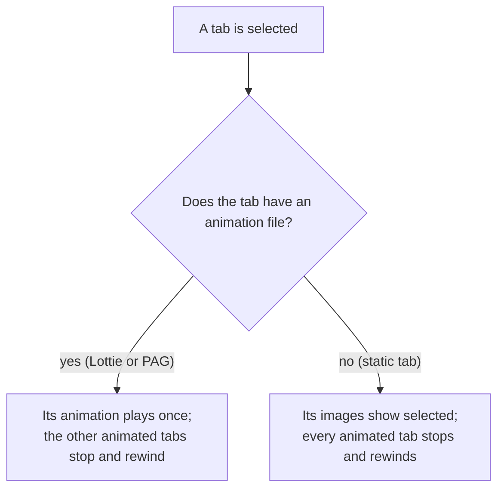

# [CN]只有部分 Tab 有动画（Lottie 或 PAG）
# [EN]Only some tabs animated (Lottie or PAG)

<!-- bound-classes: CYLTabBarController -->
<!-- binding:start -->
<!-- Generated by scripts/update-docs-navigation.py; do not edit by hand. -->

| 中文 | English |
|:---|:---|
| 绑定的代码类 `CYLTabBarController`：[`CYLTabBarController/CYLTabBarController.h`](../CYLTabBarController/CYLTabBarController.h) | Bound to the class `CYLTabBarController`: [`CYLTabBarController/CYLTabBarController.h`](../CYLTabBarController/CYLTabBarController.h) |

<!-- binding:end -->

| 中文 | English |
|:---|:---|
| [#477](https://github.com/ChenYilong/CYLTabBarController/issues/477) 希望支持“只有某个 Tab 有 Lottie 动画”。现在同一个 TabBar 中可以混用有动画与无动画的 Tab，也可以混用 Lottie 与 PAG 的 Tab；经典 TabBar、液态玻璃（Liquid Glass）与扁平样式（FlatDesign）都支持。 | [#477](https://github.com/ChenYilong/CYLTabBarController/issues/477) asks for "only one tab with a Lottie animation". One tab bar can now mix animated and static tabs, and Lottie and PAG tabs, in the classic tab bar, Liquid Glass and FlatDesign. |

## [CN]目录
## [EN]Contents

<!-- navigation:start -->
<!-- Generated by scripts/update-docs-navigation.py; do not edit by hand. -->

| 中文 | English |
|:---|:---|
| [用法](#cn用法) | [Usage](#enusage) |
| [行为](#cn行为) | [Behavior](#enbehavior) |
| [API](#cnapi) | [API](#enapi) |
| [Demo 与测试](#cndemo-与测试) | [Demo and testing](#endemo-and-testing) |

<!-- navigation:end -->

## [CN]用法
## [EN]Usage

| 中文 | English |
|:---|:---|
| 只给需要动画的 Tab 设置动画 key（`CYLTabBarLottieURL` / `CYLTabBarLottieFilePath`，或 PAG 的 `CYLTabBarPAGURL` / `CYLTabBarPAGFilePath`），其他 Tab 只设置图片即可。新增的 `CYLTabBarItemAttributesAddingAnimationFile()` 为单个 Tab 添加动画，并按文件选择 Lottie 或 PAG： | Set the animation keys (`CYLTabBarLottieURL` / `CYLTabBarLottieFilePath`, or PAG's `CYLTabBarPAGURL` / `CYLTabBarPAGFilePath`) only on the tabs that animate; the others only need their images. The new `CYLTabBarItemAttributesAddingAnimationFile()` adds an animation to one tab and picks Lottie or PAG by the file: |

```objc
// Objective-C
NSArray *tabBarItemsAttributes = @[
    homeAttributes,                                                                      // images only / 只有图片
    CYLTabBarItemAttributesAddingAnimationFile(messageAttributes, @"tab_message.json", nil), // Lottie
    CYLTabBarItemAttributesAddingAnimationFile(mineAttributes, @"tab_mine.pag", nil),        // PAG
];
```

```swift
// Swift (Example-PAG)
let animationFiles = ["1.pag", "", "22.pag", "test2.pag"]   // "" : static tab / 静态 Tab
let attributes = zip(tabBarItemsAttributes, animationFiles).map { attributes, fileName in
    CYLTabBarItemAttributesAddingAnimationFile(attributes, fileName, nil)
}
```

| 中文 | English |
|:---|:---|
| `fileName` 为「名称.扩展名」时使用该文件（".json" 为 Lottie，".pag" 为 PAG，或以后新增动画库的文件类型）；只写「名称」时，按查找顺序使用构建中各动画库的扩展名（PAG ".pag"，然后 Lottie ".json" / ".lottie"），取 `bundle`（nil 表示 main bundle）中第一个存在的文件。设置的是通用 key `CYLTabBarAnimationFilePath`；存在「名称_dark.扩展名」时同时设置 `CYLTabBarAnimationDarkFilePath`。文件不存在时，该 Tab 保持图片。批量版本为 `CYLTabBarItemsAttributesAddingAnimationFiles()`。 | `fileName` "<name>.<ext>" uses that file (".json" Lottie, ".pag" PAG, or the file type of a library added later); a bare "<name>" takes the first file found in `bundle` (nil: the main bundle) with the extensions of the libraries in the build, in lookup order (PAG ".pag", then Lottie ".json" / ".lottie"). It sets the generic key `CYLTabBarAnimationFilePath`, and `CYLTabBarAnimationDarkFilePath` when "<name>_dark.<ext>" exists. A missing file leaves the tab with its images. The batch version is `CYLTabBarItemsAttributesAddingAnimationFiles()`. |
| 批量设置时，`CYLTabBarItemsAttributesAddingLottieFiles()` / `CYLTabBarItemsAttributesAddingPAGFiles()` 中名称为空字符串或 `NSNull` 的 Tab 不添加动画（以前 `NSNull` 会导致崩溃）。 | In batches, `CYLTabBarItemsAttributesAddingLottieFiles()` / `CYLTabBarItemsAttributesAddingPAGFiles()` leave a tab whose name is an empty string or `NSNull` static (`NSNull` used to crash). |
| 动画需要 Lottie 或 PAG 子库（它们会引入 `CYLTabBarItemAnimation`，见 [Tab-Bar-Item-Animation.md](Tab-Bar-Item-Animation.md)）。 | Animations need a Lottie or a PAG subspec (they bring `CYLTabBarItemAnimation`, see [Tab-Bar-Item-Animation.md](Tab-Bar-Item-Animation.md)). |

## [CN]行为
## [EN]Behavior



| 中文 | English |
|:---|:---|
| **每个 Tab 只用自己的文件**：以前经典 TabBar 要求每个 Tab 按钮都有一个动画文件，数量不一致时关闭所有动画。现在每个 Tab 按其 tabBarItem 取自己的文件；只有在**每个** Tab 都有文件时，才会在取不到时按位置兜底，因此静态 Tab 不会取到其他 Tab 的文件。 | **Each tab uses its own file**: the classic tab bar used to need one animation file per tab button and turned every animation off otherwise. Each tab now takes its own file from its tab bar item; only when **every** tab has a file does a tab fall back to its position, so a static tab never takes another tab's file. |
| **选中静态 Tab 时停止动画**：选中没有动画的 Tab 时，有动画的 Tab 会停止并回到第一帧，与选中另一个动画 Tab 时一致；否则上一个动画 Tab 会停在最后一帧，看起来仍是选中状态。三种样式都相同。 | **Selecting a static tab stops the animations**: when a tab without an animation is selected, the animated tabs stop and go back to their first frame, as when another animated tab is selected; otherwise the previous animated tab kept its last frame, which looks selected. The same in all three styles. |
| **是否启用动画**：只要任意一个 Tab 设置了动画文件即启用（以前只检查第一个 Tab 的属性）。 | **When animations are on**: as soon as any tab has an animation file (only the first tab's attributes were checked before). |

## [CN]API
## [EN]API

| 中文 | English |
|:---|:---|
| `CYLTabBarItemAttributesAddingAnimationFile(attributes, fileName, bundle)`（新增）：返回添加了动画文件的单个 Tab 属性。 | `CYLTabBarItemAttributesAddingAnimationFile(attributes, fileName, bundle)` (new): returns one tab's attributes with an animation file added. |
| `CYLTabBarItemsAttributesAddingAnimationFiles(attributes, fileNames, bundle)`（新增）：按位置为每个 Tab 执行上面的操作。 | `CYLTabBarItemsAttributesAddingAnimationFiles(attributes, fileNames, bundle)` (new): the same for every tab, by position. |
| 通用 key `CYLTabBarAnimationURL` / `FilePath` / `Size` / `DarkURL` / `DarkFilePath` / `DarkColors`（新增）：适用于任意动画库。 | The generic keys `CYLTabBarAnimationURL` / `FilePath` / `Size` / `DarkURL` / `DarkFilePath` / `DarkColors` (new): for any animation library. |
| `CYLTabBarItemsAttributesAddingLottieFiles()` / `CYLTabBarItemsAttributesAddingPAGFiles()`（已有）：名称为空或 `NSNull` 的 Tab 保持静态。 | `CYLTabBarItemsAttributesAddingLottieFiles()` / `CYLTabBarItemsAttributesAddingPAGFiles()` (existing): a tab with an empty or `NSNull` name stays static. |
| Lottie key 与 PAG key（已有）：只设置在需要动画的 Tab 上即可。 | The Lottie and PAG keys (existing): set them only on the tabs that animate. |

## [CN]Demo 与测试
## [EN]Demo and testing

| 中文 | English |
|:---|:---|
| `Example-PAG` 的第二个 Tab（「健康」）没有动画，其他三个 Tab 使用 PAG 动画。 | In `Example-PAG`, the second tab ("健康", Healthy) has no animation and the other three use PAG animations. |
| 本次修改在 Linux 环境中完成，无法运行 Xcode 与模拟器，因此**没有截图**，也没有真正编译；只用桩头文件对新增函数做了 `clang -fsyntax-only -Wall -Wextra` 检查。请在三种样式下验证：静态 Tab 显示图片；选中动画 Tab 时播放一次；随后选中静态 Tab 时，上一个动画 Tab 回到第一帧；启动时选中的 Tab 无论是否有动画都显示正常。截图请放在 `docs/assets/` 中。 | This change was made on Linux, where Xcode and the simulator cannot run, so there are **no screenshots** and it was not really compiled; only the new functions were checked with `clang -fsyntax-only -Wall -Wextra` against stub headers. Please check in all three styles: the static tab shows its images; an animated tab plays once when selected; selecting the static tab then rewinds the previous animated tab to its first frame; and the tab selected at launch looks right, animated or not. Put screenshots in `docs/assets/`. |
