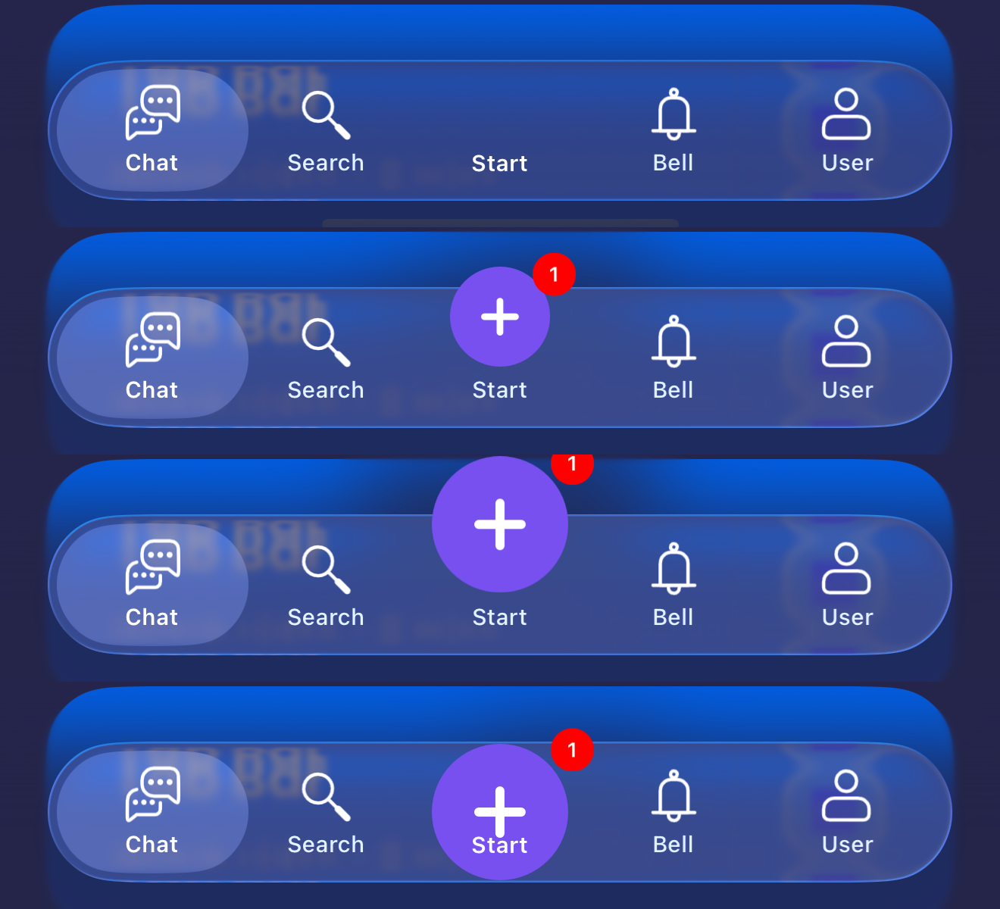
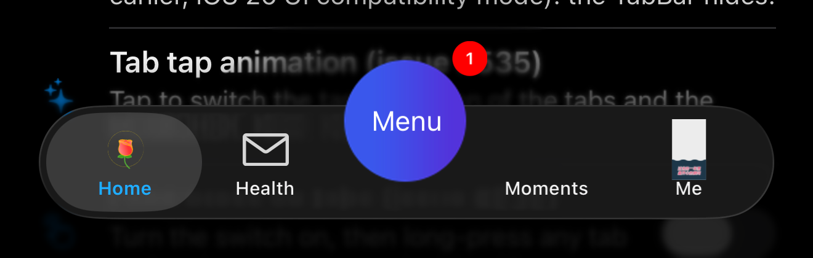
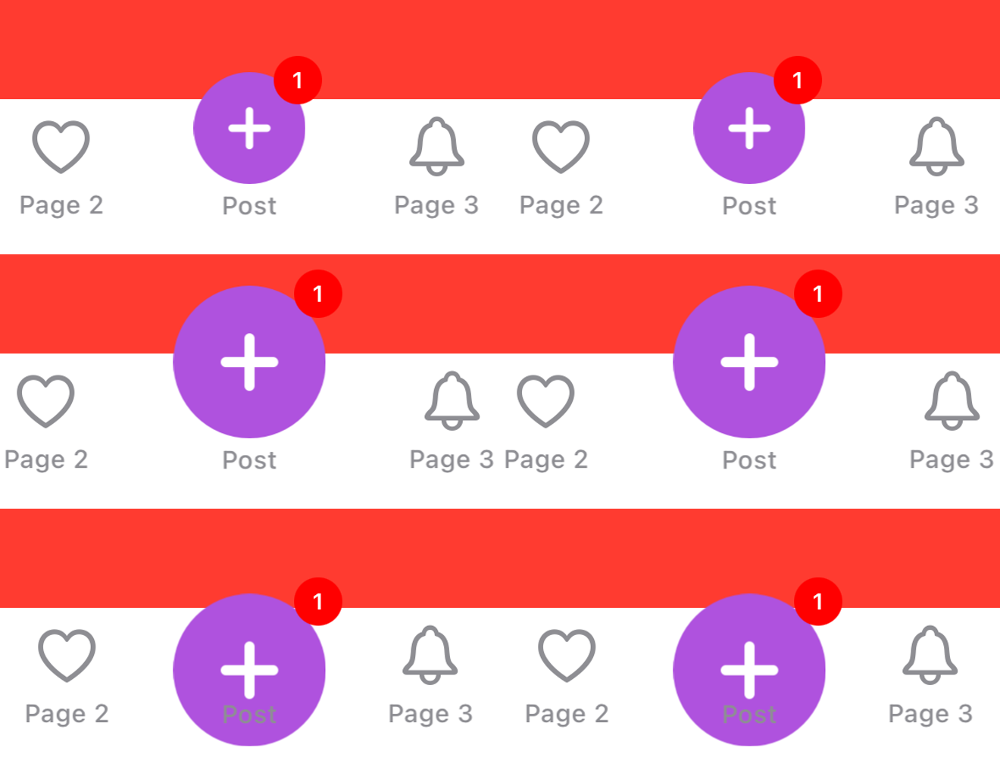
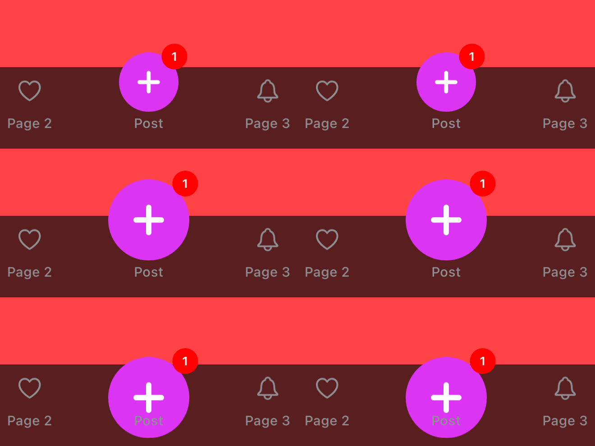
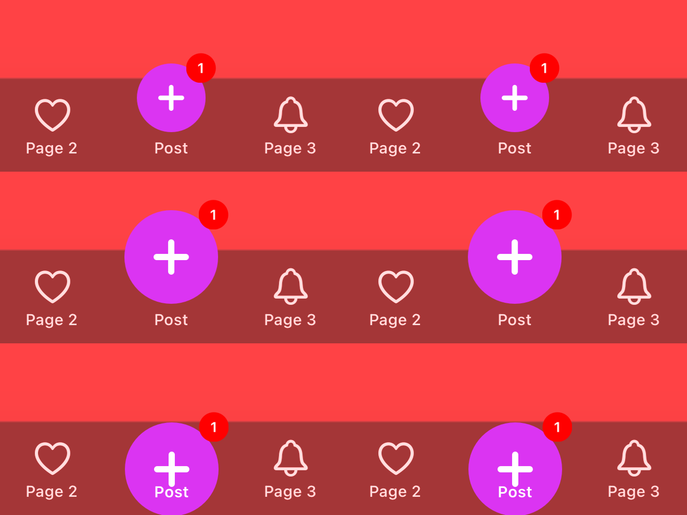
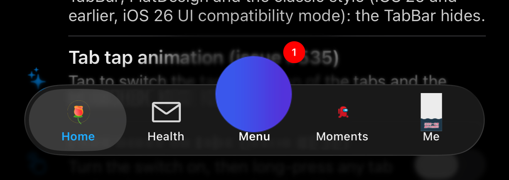
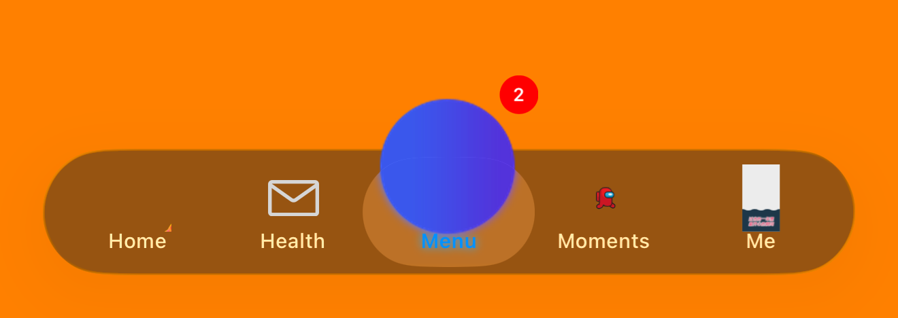
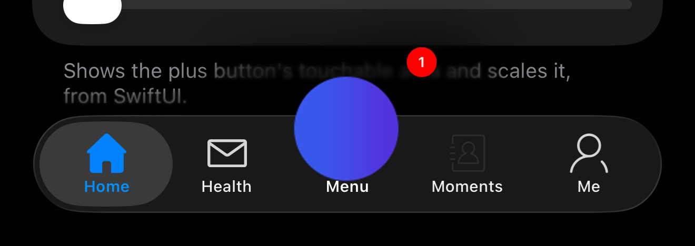

# [CN]液态玻璃：标题画在背景图上的 PlusButton
# [EN]Liquid Glass: a PlusButton with its title on a background image

<!-- bound-classes: CYLPlusButton -->
<!-- binding:start -->
<!-- Generated by scripts/update-docs-navigation.py; do not edit by hand. -->

| 中文 | English |
|:---|:---|
| 绑定的代码类 `CYLPlusButton`：[`CYLTabBarController/CYLPlusButton.h`](../CYLTabBarController/CYLPlusButton.h) | Bound to the class `CYLPlusButton`: [`CYLTabBarController/CYLPlusButton.h`](../CYLTabBarController/CYLPlusButton.h) |

<!-- binding:end -->

| 中文 | English |
|:---|:---|
| 液态玻璃（iOS 26+）中，用 `setBackgroundImage(_:for:)` 绘制（没有 `setImage`）、标题画在背景图上的 PlusButton（例如 Example-PAG 与 Example-SwiftUI 中的圆形「菜单」按钮）位置异常：圆形向右偏移，向下超出 TabBar，选中后放大镜中的副本也与按钮错位。本文说明原因、修复和测试结果。 | On Liquid Glass (iOS 26+), a plus button drawn with `setBackgroundImage(_:for:)` (no `setImage`) and its title on that background, such as the round "Menu" button of Example-PAG and Example-SwiftUI, was placed wrongly: the circle moved right and down below the tab bar, and once selected, the copy seen through the lens did not line up with it. This page explains the cause, the fix and the test results. |

## [CN]目录
## [EN]Contents

<!-- navigation:start -->
<!-- Generated by scripts/update-docs-navigation.py; do not edit by hand. -->

| 中文 | English |
|:---|:---|
| [原因](#cn原因) | [Cause](#encause) |
| [修复](#cn修复) | [Fix](#enfix) |
| [用法](#cn用法) | [Usage](#enusage) |
| [Swift 中获取 PlusButton](#cnswift-中获取-plusbutton) | [Getting the PlusButton in Swift](#engetting-the-plusbutton-in-swift) |
| [PlusButton 的图片一律按原图绘制](#cnplusbutton-的图片一律按原图绘制) | [Every PlusButton image is drawn as is](#enevery-plusbutton-image-is-drawn-as-is) |
| [之后才加载的图片](#cn之后才加载的图片) | [Images loaded later](#enimages-loaded-later) |
| [背景图片按钮：Y 轴代理方法与标题对齐](#cn背景图片按钮y-轴代理方法与标题对齐) | [Background-image buttons: the Y-axis methods and title alignment](#enbackground-image-buttons-the-y-axis-methods-and-title-alignment) |
| [图标与标题重叠](#cn图标与标题重叠) | [When the icon and the title overlap](#enwhen-the-icon-and-the-title-overlap) |
| [同时修复](#cn同时修复) | [Also fixed](#enalso-fixed) |
| [测试与截图](#cn测试与截图) | [Testing and screenshots](#entesting-and-screenshots) |

<!-- navigation:end -->

## [CN]原因
## [EN]Cause

| 中文 | English |
|:---|:---|
| 实现 `+alignsTitleWithTabBarItemTitles` 并返回 YES 时，液态玻璃会把 PlusButton 的标题移到它下方的 TabBarItem 中（#636），再按 `imageView` 定位按钮：图片位于 Tab 标题上方。 | When `+alignsTitleWithTabBarItemTitles` returns YES, Liquid Glass moves the plus button's title into the tab item under it (#636), then places the button by its `imageView`, so the image sits above the tab title. |
| 只有背景图的按钮，`imageView` 是空的，位于标题左边缘，且与标题同高：按钮向右偏移了标题宽度的一半（约 20 pt），圆心落在 Tab 标题所在的线上，超出 TabBar 底部。 | A button with only a background image has an empty `imageView`, at the title's leading edge and at the title's height. The button moved right by half the title's width (about 20 pt), and the circle's center landed on the tab titles' line, below the tab bar. |
| 选中时，放大镜中的替身（`-selectedContentView`）由 Tab 按钮布局跟踪重新居中到 Tab 图标上，因为把它放回 PlusButton 位置的逻辑只用于 #636 的两种布局。 | When selected, the stand-in in the lens (`-selectedContentView`) was re-centered on the tab icon by the tab button layout tracker: the code that keeps it on the plus button only covered the two layouts of #636. |
| 这与 SwiftUI 无关：UIKit 的 Example-PAG 与 SwiftUI 的 Example-SwiftUI 使用同一个 PlusButton，表现相同。 | SwiftUI is not involved: Example-PAG (UIKit) and Example-SwiftUI share the same plus button and showed the same problem. |

## [CN]修复
## [EN]Fix

| 中文 | English |
|:---|:---|
| **1. 标题画在背景图上的按钮保留自己的标题。** 新增私有方法 `-cyl_drawsTitleOverBackgroundImage`：有背景图、没有图片（也没有 `configuration.image`）时返回 YES。此时 `-cyl_showsTitleInTabBarItem` 返回 NO，按钮与其他样式一样，按 `+multiplierOfTabBarHeight:` 与 `+constantOfPlusButtonCenterYOffsetForTabBarHeight:` 定位，水平居中于它的 Tab。 | **1. A button whose title is drawn on its background image keeps its title.** The new private `-cyl_drawsTitleOverBackgroundImage` returns YES for a button with a background image and no image (and no `configuration.image`). `-cyl_showsTitleInTabBarItem` then returns NO, and the button is placed as in the other styles, by `+multiplierOfTabBarHeight:` and `+constantOfPlusButtonCenterYOffsetForTabBarHeight:`, centered on its tab. |
| **2. 放大镜中的替身跟随 PlusButton。** 新增私有方法 `-cyl_standInFollowsPlusButton`，把替身保持在 PlusButton 位置的布局集中到一处：标题由 TabBarItem 显示、没有标题，或标题画在背景图上。 | **2. The stand-in in the lens follows the plus button.** The new private `-cyl_standInFollowsPlusButton` lists, in one place, the layouts whose stand-in stays on the plus button: the title in the tab item, no title, or a title drawn on the background image. |
| **3. VoiceOver。** PlusButton 有子控制器且其 TabBarItem 没有标题时，该 TabBarItem 使用 PlusButton 的 `accessibilityLabel`，不再读成空 Tab（与占位控制器相同）。 | **3. VoiceOver.** With a plus child view controller whose tab item has no title, that tab item takes the plus button's `accessibilityLabel`, so it is no longer read as an empty tab (as the placeholder already did). |
| 只影响液态玻璃；扁平样式与经典样式不变。使用 `setImage` 的 PlusButton 不受影响。没有新增公开 API。 | Liquid Glass only; FlatDesign and the classic style are unchanged, and plus buttons that use `setImage` are not affected. No public API was added. |

## [CN]用法
## [EN]Usage

| 中文 | English |
|:---|:---|
| 无需修改代码。标题画在背景图上的按钮，用 `+multiplierOfTabBarHeight:` 与 `+constantOfPlusButtonCenterYOffsetForTabBarHeight:` 调整高度，与扁平样式相同。希望标题由 TabBarItem 显示时，请用 `setImage(_:for:)` 设置图片。 | No code change is needed. For a button with its title on the background image, adjust its height with `+multiplierOfTabBarHeight:` and `+constantOfPlusButtonCenterYOffsetForTabBarHeight:`, as in FlatDesign. To have the tab item show the title, set the picture with `setImage(_:for:)` instead. |

```swift
static func plusButton() -> Any {
    let button = CYLPlusButtonSubclass()
    // [EN] A background image: the title stays on it. [CN] 背景图：标题保留在图上。
    button.setBackgroundImage(UIImage(named: "tabbar_database"), for: .normal)
    button.setTitle(CYLLocalizedString("菜单"), for: .normal)
    button.sizeToFit()
    return button
}

static func multiplier(ofTabBarHeight _: CGFloat) -> CGFloat { 0.3 }
static func constantOfPlusButtonCenterYOffset(forTabBarHeight _: CGFloat) -> CGFloat { -10 }
```

## [CN]Swift 中获取 PlusButton
## [EN]Getting the PlusButton in Swift

| 中文 | English |
|:---|:---|
| `+plusButtonForOwner:` 在 Swift 中导入为构造方法 `CYLPlusButton(forOwner:)`。Example-SwiftUI 与 docs 中写成了 `CYLPlusButton.plusButton(forOwner:)`，无法编译，现已更正。`+plusChildViewControllerForOwner:` 仍是 `CYLPlusButton.plusChildViewController(forOwner:)`。 | `+plusButtonForOwner:` is imported into Swift as the initializer `CYLPlusButton(forOwner:)`. Example-SwiftUI and the docs used `CYLPlusButton.plusButton(forOwner:)`, which does not compile; they are corrected. `+plusChildViewControllerForOwner:` stays `CYLPlusButton.plusChildViewController(forOwner:)`. |

```swift
if tabBarController.hasPlusButton(), let plusButton = CYLPlusButton(forOwner: tabBarController) {
    plusButton.showsTouchableArea = true
}
```

## [CN]PlusButton 的图片一律按原图绘制
## [EN]Every PlusButton image is drawn as is

| 中文 | English |
|:---|:---|
| 加载给 PlusButton 的所有图片，在所有样式下都由 `CYLPlusButton` 自动按原图绘制（`UIImageRenderingModeAlwaysOriginal`），无需任何代码：不会被 TabBar 的 tint、液态玻璃的选中图层或按钮 configuration 染色，也不会被系统画暗或变淡：未主动设置的高亮、禁用状态使用普通图片的原图，选中且高亮状态使用选中图片的原图。 | Every image given to a plus button is drawn as is (`UIImageRenderingModeAlwaysOriginal`) by `CYLPlusButton` itself, in every style, with no code needed: never tinted by the tab bar's tint, Liquid Glass's selected layer or a button configuration, and never darkened or faded by UIKit: the highlighted and disabled states not set on purpose show the plain normal image, and selected and highlighted shows the plain selected one. |
| 适用于：`setImage(_:for:)`、`setBackgroundImage(_:for:)`、`UIButtonConfiguration` 的 `image` 与 `background.image`、放大镜中的替身（`selectedContentView`，包括 `+selectedContentView` 返回的普通 `UIButton`）以及 `cyl_updateTitle(_:image:selectedImage:)`。以前只有液态玻璃下标题由 TabBarItem 显示的布局（#636）这样处理。 | It covers `setImage(_:for:)`, `setBackgroundImage(_:for:)`, a `UIButtonConfiguration`'s `image` and `background.image`, the stand-in in the lens (`selectedContentView`, including a plain `UIButton` returned by `+selectedContentView`) and `cyl_updateTitle(_:image:selectedImage:)`. Before, only the Liquid Glass layout with the title in the tab item (#636) did this. |
| 想要单色图标随 TabBar 变色时，请自己绘制对应颜色的图片。 | For a one-color icon that follows the tab bar's color, draw the image in that color yourself. |

## [CN]之后才加载的图片
## [EN]Images loaded later

| 中文 | English |
|:---|:---|
| PlusButton 创建时图片可能为空，之后才设置（例如从网络加载）。以前这会让它偏离位置：液态玻璃下，它在没有图片时就把标题移到 TabBarItem 中，并用空的 `imageView` 测量图片到标题的距离且一直使用；按钮的尺寸也按空图片计算，之后的图片被压扁。现在由 `CYLPlusButton` 自动处理，无需任何代码： | A plus button can be created without an image and get one later (e.g. from the network). That used to put it off its place: on Liquid Glass it moved its title into the tab item before it had an image, measured the image-to-title distance on the empty `imageView` and kept it, and its size was computed for the empty image, so the later image was squashed. `CYLPlusButton` now handles it, with no code needed: |
| ① 只有在有可见图片时，标题才移到 TabBarItem 中；在此之前按钮保留自己的标题。 | ① The title moves into the tab item only once there is a visible image; until then the button keeps its own title. |
| ② 距离从图片底边测量，而不是中心，因此之后设置或替换为不同尺寸的图片时位置仍然正确。 | ② The distance is measured from the image's bottom edge, not its center, so a later image, or one of another size, stays in place. |
| ③ 普通状态的图片或背景图片、按钮 configuration 或标题字体变化后，内容放不下时按钮以中心为基准变大（不会小于 App 设置的尺寸），TabBar 重新放置它。 | ③ After the normal image or background image, the button configuration or the title's font changes, the button grows around its center when the content no longer fits (never below a size the app set), and the tab bar places it again. |
| ④ 图片被移除后，标题回到按钮上。 | ④ When the image is removed, the title comes back to the button. |
| ⑤ 角标：没有图片的图片视图不再作为角标的参照，角标对齐整个控件（例如由背景图绘制的按钮）。 | ⑤ Badges: an image view without an image is no longer the badge's reference; the badge follows the whole control (e.g. a button drawn by its background image). |
| 下图（Example-Rive，临时修改为 2 秒后加载图片）：从上到下依次为加载前、加载 44 pt 图片后、替换为 60 pt 图片后、之后才设置背景图片（标题画在背景上）。 | Below (Example-Rive, changed for this test to load the image after 2 seconds), top to bottom: before the image, after a 44 pt image, after it is replaced by a 60 pt one, and with a background image set later (title on the background). |



## [CN]背景图片按钮：Y 轴代理方法与标题对齐
## [EN]Background-image buttons: the Y-axis methods and title alignment

| 中文 | English |
|:---|:---|
| **Y 轴代理方法：遵循，所有样式。** 只用 `setBackgroundImage` 绘制的 PlusButton 按 `+multiplierOfTabBarHeight:` 与 `+constantOfPlusButtonCenterYOffsetForTabBarHeight:` 放置：`PlusButtonCenterY = multiplierOfTabBarHeight × tabBarHeight + constantOfPlusButtonCenterYOffset`。扁平样式与经典 TabBar 使用 TabBar 的高度；液态玻璃使用 TabBar 本身（玻璃区域）的高度，并且标题由 TabBarItem 显示的调整（#636）不适用于这种按钮。只有完全没有标题的 PlusButton 在液态玻璃下例外：它居中于玻璃，见 `cyl_appliesCenterYOffsetWithoutTitle`。 | **The Y-axis methods: followed, in every style.** A plus button drawn only with `setBackgroundImage` is placed by `+multiplierOfTabBarHeight:` and `+constantOfPlusButtonCenterYOffsetForTabBarHeight:`: `PlusButtonCenterY = multiplierOfTabBarHeight × tabBarHeight + constantOfPlusButtonCenterYOffset`. FlatDesign and the classic tab bar use the tab bar's height; Liquid Glass uses the height of the tab bar itself (the glass), and the title-in-tab-item adjustment (#636) does not apply to this kind of button. The only exception is a plus button with no title at all on Liquid Glass: it is centered on the glass, see `cyl_appliesCenterYOffsetWithoutTitle`. |
| 实测：Example-PAG（`multiplier = 0.3`，`constant = -10`），iOS 26.5 液态玻璃，TabBar 位于 y = 873，玻璃高 62 pt：按钮中心 y = 881.6 = 873 + 0.3 × 62 − 10。 | Measured: Example-PAG (`multiplier = 0.3`, `constant = -10`), Liquid Glass on iOS 26.5, the tab bar at y = 873, the glass 62 pt high: the button's center is at y = 881.6 = 873 + 0.3 × 62 − 10. |
| **`+alignsTitleWithTabBarItemTitles`：建议不要实现。** 这种按钮的标题画在背景图上，是图片的一部分，由 UIButton 居中绘制在背景图上。实现并返回 YES 时，库会把标题移到 Tab 标题的中心线上，并使用 Tab 标题的字体和颜色：标题离开图片的中心，落在圆形的下边缘附近（见下文「图标与标题重叠」截图的最后一行），颜色也可能与背景对比不足。不实现（或返回 NO）时，标题保持在背景图的中心。 | **`+alignsTitleWithTabBarItemTitles`: better not implemented.** This kind of button draws its title on the background image, as part of the picture, centered on it by UIButton. Implemented and returning YES, the library moves the title onto the tab titles' center line and gives it their font and colors: the title leaves the middle of the picture for its lower edge (see the last row of the screenshots in "When the icon and the title overlap"), and its color may not contrast with the background. Not implemented (or NO), the title stays in the middle of the background image. |
| 希望标题与 Tab 标题对齐、位于图片下方时，请用 `setImage(_:for:)`（或 `+cyl_plusButtonWithImage:…`）设置图片，而不是背景图，并实现 `+alignsTitleWithTabBarItemTitles`。Example-PAG 的圆形按钮按此建议没有实现该方法，「菜单」位于圆形中心（下图，液态玻璃，iOS 26.5）。 | To have the title aligned with the tab titles, below the picture, set the picture with `setImage(_:for:)` (or `+cyl_plusButtonWithImage:…`) instead of a background image, and implement `+alignsTitleWithTabBarItemTitles`. Example-PAG's round button follows this and does not implement it: "Menu" sits in the middle of the circle (below, Liquid Glass, iOS 26.5). |



```swift
// 背景图按钮：标题画在图上，按 Y 轴代理方法放置，不实现 alignsTitleWithTabBarItemTitles。
// A background-image button: the title drawn on the picture, placed by the Y-axis methods, no alignsTitleWithTabBarItemTitles.
class BackgroundPlusButton: CYLPlusButton, CYLPlusButtonSubclassing {
    static func plusButton() -> Any {
        let button = BackgroundPlusButton()
        button.setBackgroundImage(UIImage(named: "plus_circle"), for: .normal)
        button.setTitle(CYLLocalizedString("菜单"), for: .normal)
        button.sizeToFit()
        return button
    }
    static func multiplier(ofTabBarHeight _: CGFloat) -> CGFloat { 0.3 }
    static func constantOfPlusButtonCenterYOffset(forTabBarHeight _: CGFloat) -> CGFloat { -10 }
}
```

## [CN]图标与标题重叠
## [EN]When the icon and the title overlap

| 中文 | English |
|:---|:---|
| PlusButton 的图标与标题是否重叠，取决于图片是怎么设置的，以及是否实现了 `+alignsTitleWithTabBarItemTitles`（标题与 Tab 标题对齐）。下表列出各种情况，以及是正常现象还是异常。 | Whether a plus button's icon and title overlap depends on how its picture is set and on `+alignsTitleWithTabBarItemTitles` (the title aligned with the tab titles). The table lists each case and whether it is expected or a bug. |

| 设置方式 / How the plus button is set | 是否重叠 / Overlap | 说明 / Notes |
|:---|:---|:---|
| `+cyl_plusButtonWithImage:…`（图片 + 标题）<br>`+cyl_plusButtonWithImage:…` (image + title) | 不重叠，所有样式 / No, in every style | 标题位于 Tab 标题的中心线上，图片紧挨在标题上方（间距 2 pt），与 Tab 图标一致。液态玻璃下标题由 TabBarItem 显示（#636）；扁平样式与经典 TabBar 下标题留在按钮中。以前在扁平样式与经典 TabBar 下，标题移到 Tab 标题线上而图片仍居中于按钮，二者重叠（60 pt 图片几乎盖住标题），属于**异常**，已在库中修复。<br>The title is on the tab titles' center line and the image right above it (2 pt apart), like a tab icon. On Liquid Glass the tab item shows the title (#636); in FlatDesign and the classic tab bar the title stays in the button. Before, in FlatDesign and the classic tab bar, the title moved onto the tab titles' line while the image stayed centered on the button, so they overlapped (a 60 pt image nearly hid the title): a **bug**, fixed in the library. |
| 只有背景图片（`setBackgroundImage`，没有 `setImage`），标题画在背景上，例如 Example-PAG 的圆形按钮<br>Background image only (`setBackgroundImage`, no `setImage`), the title drawn on it, e.g. Example-PAG's round button | 标题在圆形上 / The title is on the circle | **正常**：这种按钮的标题是图片的一部分，UIButton 总是把标题画在背景图之上。按钮按 `+multiplierOfTabBarHeight:` 与 `+constantOfPlusButtonCenterYOffsetForTabBarHeight:` 定位；建议不实现 `+alignsTitleWithTabBarItemTitles`（见「背景图片按钮：Y 轴代理方法与标题对齐」）。希望标题位于图片下方时，请改用 `setImage(_:for:)`。<br>**Expected**: the title is part of the picture, and UIButton always draws it on top of the background image. The button is placed by `+multiplierOfTabBarHeight:` and `+constantOfPlusButtonCenterYOffsetForTabBarHeight:`; better not implement `+alignsTitleWithTabBarItemTitles` (see "Background-image buttons: the Y-axis methods and title alignment"). For the title below the picture, use `setImage(_:for:)` instead. |
| 自定义按钮，未使用 `+cyl_plusButtonWithImage:…`，实现了 `+alignsTitleWithTabBarItemTitles`，扁平样式或经典 TabBar<br>A custom button not made with `+cyl_plusButtonWithImage:…`, with `+alignsTitleWithTabBarItemTitles`, in FlatDesign or the classic tab bar | 可能重叠 / Can overlap | 库只把标题移到 Tab 标题线上，图片保留 UIButton 自己的位置；图片较大时可能与标题重叠。使用 `UIButtonConfiguration` 且 `imagePlacement` 为 `.top` 的按钮不会重叠（例如 ObjC Demo 的 PlusButton）。要避免重叠，请使用 `+cyl_plusButtonWithImage:…`，或使用 `imagePlacement = .top` 的 configuration。<br>The library moves only the title onto the tab titles' line and leaves the image where UIButton put it; a large image can overlap the title. A button with a `UIButtonConfiguration` whose `imagePlacement` is `.top` does not (e.g. the ObjC demo's plus button). To avoid it, use `+cyl_plusButtonWithImage:…`, or a configuration with `imagePlacement = .top`. |
| App 自己设置了 `imageEdgeInsets` / `titleEdgeInsets` 或自定义 `layoutSubviews`<br>The app sets `imageEdgeInsets` / `titleEdgeInsets` or its own `layoutSubviews` | 由 App 决定 / Up to the app | 库不会覆盖 App 自己的布局。<br>The library does not override the app's own layout. |
| 图片之后才加载（创建时为空）<br>The image is set later (empty at first) | 与启动时就有图片相同 / Same as with the image at launch | 在加载之前按钮只显示标题；加载之后的位置、尺寸与角标与启动时就设置同一图片完全相同（见下图与「之后才加载的图片」）。<br>Until it loads the button shows its title only; afterwards its position, size and badge are exactly those of the same image set at launch (see below and "Images loaded later"). |

| 中文 | English |
|:---|:---|
| 测试：Demo 测试列表 PlusButton 分组中的「PlusButton 图片之后才加载」行，每张图左侧为启动时即有图片（对照），右侧为之后才加载；从上到下依次为 44 pt 图片、60 pt 图片、60 pt 背景图片。iOS 17.5 经典 TabBar 与 iOS 26.5 扁平样式、液态玻璃，三种样式中图片位置、尺寸与角标坐标两两完全相同（lldb 读取 frame，截图像素一致）。 | Tested with the "PlusButton image loaded later" row of the demo test list (PlusButton group). In each picture the left column is the image set at launch (to compare), the right column the image set later; top to bottom: a 44 pt image, a 60 pt image, a 60 pt background image. In the classic tab bar (iOS 17.5), FlatDesign and Liquid Glass (iOS 26.5), the image position, size and badge coordinates are identical in every pair (frames read with lldb, screenshot pixels agree). |

经典 TabBar / Classic tab bar (iOS 17.5):



扁平样式 / FlatDesign (iOS 26.5):



液态玻璃 / Liquid Glass (iOS 26.5):



## [CN]同时修复
## [EN]Also fixed

| 中文 | English |
|:---|:---|
| **启动时栈溢出**：PlusButton 在布局中第一次读取 `imageView` 时，系统创建它并再次布局按钮，又进入本类的布局（`+cyl_plusButtonWithImage:…` 的图片与标题布局、标题对齐），无限递归。见于 Example-Rive 新增的 PlusButton（使用 `+cyl_plusButtonWithImage:…` 并对齐标题）。现在本类的布局不会重入（`-cyl_layOutContentOnce:`）。 | **A stack overflow at launch**: the plus button's first read of `imageView` during layout made UIKit create it and lay the button out again, which ran this class's layout again (the image and title layout of `+cyl_plusButtonWithImage:…`, the title alignment), endlessly. Seen with Example-Rive's new plus button (made with `+cyl_plusButtonWithImage:…`, with aligned titles). This class's layout no longer re-enters (`-cyl_layOutContentOnce:`). |
| **选中后 PlusButton 变暗**：`+selectedContentView` 创建放大镜中的替身时，也把已注册的 PlusButton 设为高亮，并一直保持；没有「选中且高亮」图片时，系统把它的图片画暗（Example-PAG 选中「菜单」后，玻璃上方的半个圆形变成深蓝色）。现在只有替身是高亮的。 | **The plus button turned dark once selected**: `+selectedContentView`, which makes the stand-in in the lens, also set the registered plus button highlighted, for good; without a selected-and-highlighted image UIKit drew its image darkened (Example-PAG: after "Menu" was selected, the half of the circle above the glass turned navy). Only the stand-in is highlighted now. |
| **角标离开可见内容**：非 Tab 按钮控件的角标位于图标（或整个控件）的右上角。图片带透明边距时（Example-PAG 的 PlusButton：90 pt 图片中是 66 pt 的圆形），角标落在边距的角上，离圆形较远。现在角标对齐到图片中不透明的部分（每张图片只测量一次，结果缓存在图片上）。 | **A badge away from what is seen**: the badge of a control that is not a tab button sits at the top-right of its icon (or of the whole control). With transparent padding in the picture (Example-PAG's plus button: a 66 pt circle in a 90 pt image) it landed at the padding's corner, away from the circle. It is now aligned to the part of the picture that is not transparent (measured once per image and cached on it). |
| **布局中读取角标导致无限布局**：对齐标题时查找 Tab 标题的代码会读取控件的 `cyl_badge`，而该读取会创建并约束角标锚点；在 PlusButton 布局期间这样做，配合图片视图位置每次布局都会变化，使按钮无限布局（App 卡死，CPU 100%）。现在不再询问控件自身的标签。 | **Reading the badge during layout laid the button out forever**: finding the tab titles to align with read controls' `cyl_badge`, which creates and pins the badge's anchor; doing so during the plus button's layout, with an image view moved on every pass, laid the button out forever (a frozen app at 100% CPU). A control's own labels are no longer asked. |
| **#618 误报**：液态玻璃与扁平样式下有 PlusButton 时，本库会在 `tabBarItemsAttributes` 中为 PlusButton 位置插入一个占位项，DEBUG 检查把它算作 Tab，打印「6 entries for 5 tab view controllers」。现在两种数量都视为正确。 | **A false #618 warning**: with a plus button on Liquid Glass and FlatDesign, the library inserts a placeholder entry for the plus slot into `tabBarItemsAttributes`, and the DEBUG check counted it as a tab, logging "6 entries for 5 tab view controllers". Both counts are now accepted. |

## [CN]测试与截图
## [EN]Testing and screenshots

| 中文 | English |
|:---|:---|
| iPhone 17 Pro Max 模拟器，iOS 26.5，液态玻璃，深色模式。PlusButton 居中于「菜单」Tab，高出 TabBar，标题在圆形上，与其他 Tab 标题同一条线（Example-PAG）： | iPhone 17 Pro Max simulator, iOS 26.5, Liquid Glass, Dark Mode. The plus button is centered on the "Menu" tab, raised above the bar, its title on the circle, on the same line as the other tab titles (Example-PAG): |



| 中文 | English |
|:---|:---|
| 选中「菜单」：放大镜中的副本与按钮对齐，圆形保持原色（以前玻璃上方的部分会变暗，见「同时修复」）；角标位于圆形右上方，而不是 90 pt 图片的透明边角上。 | "Menu" selected: the copy in the lens lines up with the button and the circle keeps its colors (the part above the glass used to turn dark, see "Also fixed"); the badge sits at the circle's top-right, not at the corner of the 90 pt image's transparent padding. |



| 中文 | English |
|:---|:---|
| Example-SwiftUI（SwiftUI `App` 生命周期，同一个 PlusButton）： | Example-SwiftUI (SwiftUI `App` life cycle, the same plus button): |



| 中文 | English |
|:---|:---|
| 无障碍检查：PlusButton 为 `Button 'Menu'`（90×90，中心 x = 220，与 Tab 中心一致），其下方的 Tab 为 `RadioButton 'Menu'`（修改前为空）。没有在真机上验证。 | Accessibility check: the plus button is `Button 'Menu'` (90×90, center x = 220, the tab's center), and the tab under it is `RadioButton 'Menu'` (empty before). Not verified on a device. |
