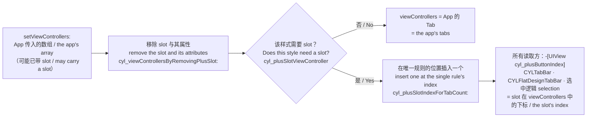
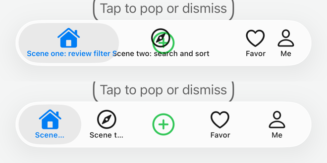
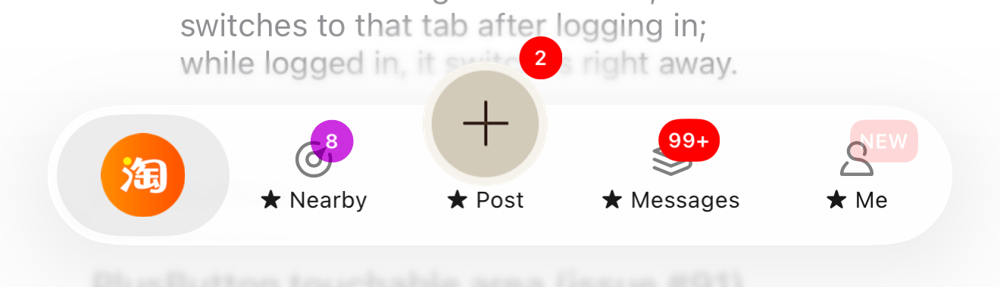
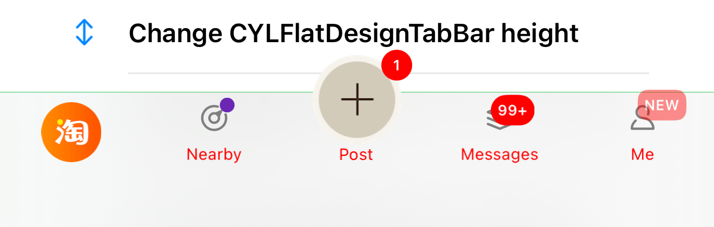

# PlusButton 的 slot：占位与数量一致 / The PlusButton Slot: Placeholders and Matching Counts

<!-- bound-classes: CYLTabBarController, CYLTabBar, CYLFlatDesignTabBar, CYLPlusButton -->
<!-- binding:start -->
<!-- Generated by scripts/update-docs-navigation.py; do not edit by hand. -->

| 中文 | English |
|:---|:---|
| 绑定的代码类 `CYLTabBarController`：[`CYLTabBarController/CYLTabBarController.h`](../CYLTabBarController/CYLTabBarController.h) | Bound to the class `CYLTabBarController`: [`CYLTabBarController/CYLTabBarController.h`](../CYLTabBarController/CYLTabBarController.h) |
| 绑定的代码类 `CYLTabBar`：[`CYLTabBarController/CYLTabBar.h`](../CYLTabBarController/CYLTabBar.h) | Bound to the class `CYLTabBar`: [`CYLTabBarController/CYLTabBar.h`](../CYLTabBarController/CYLTabBar.h) |
| 绑定的代码类 `CYLFlatDesignTabBar`：[`CYLTabBarController/CYLFlatDesignTabBar/CYLFlatDesignTabBar-ObjectiveC/CYLFlatDesignTabBar/CYLFlatDesignTabBar.h`](../CYLTabBarController/CYLFlatDesignTabBar/CYLFlatDesignTabBar-ObjectiveC/CYLFlatDesignTabBar/CYLFlatDesignTabBar.h) | Bound to the class `CYLFlatDesignTabBar`: [`CYLTabBarController/CYLFlatDesignTabBar/CYLFlatDesignTabBar-ObjectiveC/CYLFlatDesignTabBar/CYLFlatDesignTabBar.h`](../CYLTabBarController/CYLFlatDesignTabBar/CYLFlatDesignTabBar-ObjectiveC/CYLFlatDesignTabBar/CYLFlatDesignTabBar.h) |
| 绑定的代码类 `CYLPlusButton`：[`CYLTabBarController/CYLPlusButton.h`](../CYLTabBarController/CYLPlusButton.h) | Bound to the class `CYLPlusButton`: [`CYLTabBarController/CYLPlusButton.h`](../CYLTabBarController/CYLPlusButton.h) |

<!-- binding:end -->

| 中文 | English |
|:---|:---|
| PlusButton 在 `viewControllers` 中可能占一个位置，本文称之为 **slot**：有 PlusButton 子控制器时是该子控制器，没有时（液态玻璃、扁平样式）是一个占位控制器（`cyl_isPlaceholder`），PlusButton 覆盖在它的 Tab 上。以前 slot 由三个方法按不同的条件和下标插入，插入前也不移除旧的，导致 Tab 数量、按钮数量、`tabBarItemsAttributes` 数量与 PlusButton 下标互相不匹配，严重时数组越界崩溃。现在 slot 是**派生状态**：只在一个地方按一条规则插入，其他地方都从 `viewControllers` 中读取它的位置。 | The PlusButton can take a place in `viewControllers`, called the **slot** here: the plus child view controller when there is one, otherwise (Liquid Glass, FlatDesign) a placeholder view controller (`cyl_isPlaceholder`) whose tab the PlusButton covers. The slot used to be inserted by three methods with different conditions and indexes, and an old slot was not removed first, so the number of tabs, of tab buttons and of `tabBarItemsAttributes` and the PlusButton's index could disagree, up to an out-of-range crash. The slot is now **derived state**: it is inserted in one place by one rule, and every other place reads its position from `viewControllers`. |



## 目录 / Contents

<!-- navigation:start -->
<!-- Generated by scripts/update-docs-navigation.py; do not edit by hand. -->

| 中文 | English |
|:---|:---|
| [问题](#问题--the-problems) | [The problems](#问题--the-problems) |
| [方案](#方案--the-solution) | [The solution](#方案--the-solution) |
| [静态排查：guard 与下标](#静态排查guard-与下标--static-audit-guards-and-indexes) | [Static audit: guards and indexes](#静态排查guard-与下标--static-audit-guards-and-indexes) |
| [各样式](#各样式--by-style) | [By style](#各样式--by-style) |
| [用法](#用法--usage) | [Usage](#用法--usage) |
| [长标题](#长标题--long-titles) | [Long titles](#长标题--long-titles) |
| [限制](#限制--limits) | [Limits](#限制--limits) |

<!-- navigation:end -->

## 问题 / The problems

| 中文 | English |
|:---|:---|
| 1. **重新赋值 `viewControllers`**（登录后换一组 Tab、`-reloadTabBarItemsWithAttributes:`、`vc.viewControllers = vc.viewControllers`）：经典样式的 PlusButton 子控制器被 `cyl_plusViewControllerEverAdded` 拦住而丢失；液态玻璃的占位控制器与扁平样式会插入第二个 slot；`tabBarItemsAttributes` 中为 slot 插入的项没有移除，之后的 Tab 错位一个。 | 1. **Re-assigning `viewControllers`** (a new set of tabs after login, `-reloadTabBarItemsWithAttributes:`, `vc.viewControllers = vc.viewControllers`): the classic style lost the plus child view controller (stopped by `cyl_plusViewControllerEverAdded`); the Liquid Glass placeholder and FlatDesign inserted a second slot; the `tabBarItemsAttributes` entry inserted for the slot stayed, and every later tab was one off. |
| 2. **扁平样式**：PlusButton 在最后一个 Tab 之后（判断用了 `>` 而不是 `>=`）或 Tab 数为奇数且未实现 `+indexOfPlusButtonInTabBar` 时不插入 slot，而 `CYLFlatDesignTabBar` 仍用该下标访问 `_buttons`：`index 2 beyond bounds [0 .. 1]`。 | 2. **FlatDesign**: no slot was inserted with the PlusButton after the last tab (`>` instead of `>=`), or with an odd tab count and no `+indexOfPlusButtonInTabBar`, while `CYLFlatDesignTabBar` still indexed `_buttons` with that index: `index 2 beyond bounds [0 .. 1]`. |
| 3. **独立的扁平 TabBar**（App 自己加在页面上的 `CYLFlatDesignTabBar`，如扁平风格演示页）向上找到页面所在的 TabBarController，拿到了它的 PlusButton 与下标。 | 3. **A standalone flat tab bar** (a `CYLFlatDesignTabBar` the app adds to a page itself, e.g. the FlatDesign demo page) found the tab bar controller the page is in, and took its PlusButton and index. |
| 4. **`cyl_tabbarItemsCount`** 使用传入数组的数量，数组自带 slot 时多算一个，`+indexForTabbarItemsCount:` 得到错误的数量（奇数时还会断言）。 | 4. **`cyl_tabbarItemsCount`** used the count of the array passed in, one too many when it carried a slot, so `+indexForTabbarItemsCount:` got the wrong count (and asserted when it became odd). |
| 5. **液态玻璃**把 slot 放在中间，而 `-[UIView cyl_plusButtonIndex]` 返回自定义下标，`checkTabBarChildControllerValidityAtIndex:` 与选中 PlusButton 子控制器时用的是错误的下标。 | 5. **Liquid Glass** puts the slot in the middle, while `-[UIView cyl_plusButtonIndex]` returned the custom index, so `checkTabBarChildControllerValidityAtIndex:` and selecting the plus child view controller used the wrong index. |
| 6. **按文字找 slot 的标题**（[#775](https://github.com/ChenYilong/CYLTabBarController/pull/775)、#601、#636）：液态玻璃下 PlusButton 的标题由 slot 的 TabBarItem 显示，PlusButton 按标题文字在整个 TabBar 中查找“自己的”标签来对齐。标题在普通图层与选中图层（放大镜）中各有一份，选中 PlusButton 子控制器时普通图层的那份可能隐藏，于是取到了其他图层的副本：「批量下载网络图标」后点击 PlusButton，PlusButton 移到 x = 0。同名的其他 Tab 也会被误认。 | 6. **Finding the slot's title by its text** ([#775](https://github.com/ChenYilong/CYLTabBarController/pull/775), #601, #636): with Liquid Glass the PlusButton's title is shown by the slot's tab item, and the PlusButton searched the whole tab bar for a label with that text to align with. Each title exists in the normal layer and in the selected layer (the lens), and the normal one can be hidden while the plus child view controller is selected, so a copy of another layer was taken: after "Change all network icons", a tap on the PlusButton moved it to x = 0. Another tab with the same title could be taken too. |
| 7. **`cyl_isPlaceholder` 被可见性污染**：`-[UIView cyl_setHidden:]` 在显示视图时把它标为占位（方向还与文档相反）。`-cyl_showTabbar` 之后 TabBar 和所有 Tab 按钮都成了“占位”：`-[CYLTabBar hitTest:]` 提前交给 super，PlusButton 凸出 TabBar 的部分无法点击；Tab 按钮被当成 slot，从标题、交互等查找中排除。 | 7. **`cyl_isPlaceholder` polluted by visibility**: `-[UIView cyl_setHidden:]` marked a view as a placeholder when showing it (the opposite of its documentation). After `-cyl_showTabbar`, the tab bar and every tab button were "placeholders": `-[CYLTabBar hitTest:]` handed over to super early, so the part of the PlusButton above the bar stopped responding, and the tab buttons were taken for the slot and left out of the title and interaction lookups. |

## 方案 / The solution

| 中文 | English |
|:---|:---|
| **先移除，再插入一次。** `-setViewControllers:` 先去掉传入数组中所有的 slot（占位控制器、PlusButton 子控制器及包裹它的导航控制器）以及 `tabBarItemsAttributes` 中为 slot 插入的项（带私有标记），再插入且只插入一个 slot。无论数组是否已带 slot、赋值多少次，结果都相同。 | **Remove first, then insert once.** `-setViewControllers:` first removes every slot from the array passed in (placeholders, the plus child view controller and a navigation controller around it) and the `tabBarItemsAttributes` entries inserted for the slot (they carry a private marker), then inserts exactly one slot. Whether the array carries a slot or not, and however often it is assigned, the result is the same. |
| **一条位置规则**（`-cyl_plusSlotIndexForTabCount:`，按 App 自己的 Tab 数）：液态玻璃放在中间（暂不支持自定义位置，与以前相同）；经典样式与扁平样式使用 `+indexForTabbarItemsCount:`，可以放在最后一个 Tab 之后，Tab 数为奇数且没有自定义下标时放在中间。 | **One position rule** (`-cyl_plusSlotIndexForTabCount:`, for the app's own tab count): Liquid Glass puts it in the middle (custom positions are not supported there yet, as before); the classic style and FlatDesign use `+indexForTabbarItemsCount:`, which may be after the last tab, and the middle for an odd tab count without a custom index. |
| **一个读取入口**：`-[UIView cyl_plusButtonIndex]` 有 slot 时返回 slot 在所属 TabBarController 的 `viewControllers` 中的真实下标；没有 slot 时（经典样式且无 PlusButton 子控制器，PlusButton 位于 Tab 之间）与以前一样使用 `+indexForTabbarItemsCount:`。`CYLTabBar`（经典与液态玻璃）、`CYLFlatDesignTabBar` 和选中逻辑都通过它或同样的查找得到下标。 | **One reading point**: `-[UIView cyl_plusButtonIndex]` returns, with a slot, the slot's real index in the `viewControllers` of the tab bar controller the view belongs to; without a slot (classic style, no plus child view controller, the PlusButton sits between the tabs) it uses `+indexForTabbarItemsCount:` as before. `CYLTabBar` (classic and Liquid Glass), `CYLFlatDesignTabBar` and the selection code all get the index from it or the same lookup. |
| **数量的含义固定**：`cyl_tabbarItemsCount` 始终是 App 自己的 Tab 数（不含 slot）；有 slot 时 `viewControllers.count` 与 TabBar 按钮数为它加一；液态玻璃与扁平样式的 `tabBarItemsAttributes` 与 `viewControllers` 一一对应，经典样式跳过 slot（`-cyl_tabBarItemsAttributesIndexOfViewControllerAtIndex:`）。 | **Fixed meanings for the counts**: `cyl_tabbarItemsCount` is always the app's own tab count (no slot); with a slot, `viewControllers.count` and the number of tab buttons are one more; on Liquid Glass and FlatDesign, `tabBarItemsAttributes` matches `viewControllers` one to one, while the classic style skips the slot (`-cyl_tabBarItemsAttributesIndexOfViewControllerAtIndex:`). |
| **独立的扁平 TabBar 没有 PlusButton**：`delegate` 不是 CYLTabBarController、却位于某个 TabBarController 中的 `CYLFlatDesignTabBar`，`hasPlusButton` / `hasPlusChildViewController` 返回 NO；布局时的下标也先检查范围。 | **A standalone flat tab bar has no PlusButton**: a `CYLFlatDesignTabBar` whose `delegate` is not a CYLTabBarController but that sits inside one answers NO to `hasPlusButton` / `hasPlusChildViewController`; the index is also range-checked during layout. |
| **按 slot 找按钮，而不是按文字**：PlusButton 对齐自己的标题时，先取 slot 控制器的 `tabBarItem.cyl_tabButton`（该 Tab 在普通图层中的按钮），只在其中找标题标签；按文字在整个 TabBar 中查找（#775 的普通图层过滤）只作为该按钮尚不可知时的备选。 | **Find the slot's button, not its text**: to align with its own title, the PlusButton first takes the slot view controller's `tabBarItem.cyl_tabButton` (that tab's button in the normal layer) and looks for the title label only inside it; searching the whole tab bar by text (with #775's normal-layer filter) is only the fallback while that button is not known yet. |
| **`cyl_isPlaceholder` 只表示 slot**：`-cyl_setHidden:` 只改变可见性，不再修改该标记。 | **`cyl_isPlaceholder` only means the slot**: `-cyl_setHidden:` only changes visibility and no longer touches the flag. |

## 静态排查：guard 与下标 / Static audit: guards and indexes

| 中文 | English |
|:---|:---|
| 全局搜索 `index`、`items`、`viewControllers`、`hasPlusButton`、`hasPlusChildViewController`、`placeholder`（忽略大小写）后逐个核对。原则：**`hasPlusButton` / `hasPlusChildViewController` 只用来决定行为（如是否选中 PlusButton 子控制器），不用来推断数量或下标**；数量与下标只经过下面的 slot guard。 | Every hit of `index`, `items`, `viewControllers`, `hasPlusButton`, `hasPlusChildViewController` and `placeholder` (any case) was checked. The rule: **`hasPlusButton` / `hasPlusChildViewController` decide behavior only (e.g. whether the plus child view controller is being selected), never a count or an index**; counts and indexes go through the slot guards below only. |

| Guard | 含义 / Meaning |
|:---|:---|
| `-cyl_isPlusSlotViewController:` | 是否为 slot（占位控制器、PlusButton 子控制器，含导航控制器包裹的） / whether a view controller is the slot (placeholder, plus child view controller, also inside a navigation controller) |
| `-cyl_plusSlotIndexInViewControllers` | slot 在 `viewControllers` 中的下标 / the slot's index in `viewControllers` |
| `-cyl_tabBarItemsAttributesIncludePlusSlot` | `tabBarItemsAttributes` 是否有 slot 项（按带标记的数据判断，不按样式猜） / whether `tabBarItemsAttributes` has a slot entry (read from the marked entry, not guessed from the style) |
| `-[UIView cyl_plusButtonIndex]`、`-[CYLTabBar cyl_plusButtonViewControllerIndexWithFallback:]` | TabBar 一侧读取 slot 的下标 / the slot's index, read on the tab bar side |

| 中文 | English |
|:---|:---|
| 8. **`-[CYLTabBar cyl_selectedIndex]` 多 1**：CYLTabBar 布局循环用 `cyl_hasPlusChildViewController` 判断 slot 是否在 Tab 按钮中；液态玻璃下没有子控制器时同样有占位 slot，slot 之后每个按钮的 `cyl_tabBarItemVisibleIndex` 都多 1。现在从 `viewControllers` 读取 slot 是否存在。 | 8. **`-[CYLTabBar cyl_selectedIndex]` one too high**: the CYLTabBar layout loop used `cyl_hasPlusChildViewController` to tell whether the slot is among the tab buttons; on Liquid Glass a plus button without a child view controller has a placeholder slot too, so every button after it got `cyl_tabBarItemVisibleIndex` + 1. Whether the slot exists is now read from `viewControllers`. |
| 9. **`tabBarItemsAttributes` 的映射按样式猜测**：`-cyl_tabBarItemsAttributesIndexOfViewControllerAtIndex:` 与设置 Tab 的两个循环用 `isLiquidGlassActive && hasPlusButton` 判断属性中是否有 slot 项；在 `viewControllers` 之后才赋值 `tabBarItemsAttributes`（没有 slot 项）时，slot 之后的 Tab 取到下一个 Tab 的标题与图片，占位控制器也会读取别人的属性。现在按数据判断，占位控制器没有自己的项时跳过（保留占位图）。 | 9. **The `tabBarItemsAttributes` mapping guessed from the style**: `-cyl_tabBarItemsAttributesIndexOfViewControllerAtIndex:` and the two tab setup loops used `isLiquidGlassActive && hasPlusButton` to tell whether the attributes have a slot entry; with `tabBarItemsAttributes` assigned after `viewControllers` (no slot entry), tabs after the slot took the next tab's title and image, and the placeholder read another tab's entry. It is now read from the data, and a placeholder without its own entry is skipped (keeping its placeholder image). |
| 10. **扁平样式按下标访问系统列表**：系统 TabBar 中没有占位 slot 的 item，PlusButton 子控制器的 item 被追加在末尾。`-[CYLFlatDesignTabBar _tabBarDidSelectButton:]` 用 `tabBar.items[selectedIndex]`，`-setSelectedIndex:` 用 `[super setSelectedIndex:selectedIndex]`：slot 之后选错，最后一个越界。现在都按控制器对象换算。 | 10. **FlatDesign indexed the system list**: the system tab bar has no item for a placeholder slot, and a plus child view controller's item is appended at its end. `-[CYLFlatDesignTabBar _tabBarDidSelectButton:]` used `tabBar.items[selectedIndex]` and `-setSelectedIndex:` used `[super setSelectedIndex:selectedIndex]`: wrong after the slot, out of range for the last tab. Both now map through the view controller. |
| 11. **对齐后的列表被覆盖**：经典分支在 TabBar 不是 CYLTabBar 时执行 `_viewControllers = viewControllers`，丢掉刚插入的 slot。 | 11. **The aligned list was overwritten**: the classic branch ran `_viewControllers = viewControllers` when the tab bar is not a CYLTabBar, dropping the slot just inserted. |
| 12. **液态玻璃 Lottie 回退的下标**：按钮下标包含 slot，`lottieURLs` 只有 App 的 Tab；slot 之后取到下一个 Tab 的动画。（主路径按 TabBarItem 取，不受影响。） | 12. **The Liquid Glass Lottie fallback index**: button indexes include the slot, `lottieURLs` has the app's tabs only; tabs after the slot took the next tab's animation. (The main path reads it from the tab item and was not affected.) |
| 13. **`cyl_isPlusButtonViewController:` 与 slot 判断不一致**：认不出导航控制器包裹的 PlusButton 子控制器，`cyl_selectedIndexIgnoringPlusButton` 会多算一个。现在使用同一个 guard。 | 13. **`cyl_isPlusButtonViewController:` disagreed with the slot test**: it missed a plus child view controller inside a navigation controller, so `cyl_selectedIndexIgnoringPlusButton` counted one too many. It now uses the same guard. |
| 14. **调试日志误报**：#618 的属性数量检查把 slot 项算作 Tab 属性，液态玻璃与扁平样式下总是报不匹配。 | 14. **A false debug report**: the #618 attributes count check counted the slot entry as a tab's, and always reported a mismatch on Liquid Glass and FlatDesign. |
| 15. **`-[CYLTabBar cyl_tabBarButtonWithTabIndex:]` 错位**：有 PlusButton 子控制器时用 `viewControllers` 的下标取 `cyl_visibleControls`，而该数组会主动加入 PlusButton 视图（与 slot 按钮 x 相同），slot 之后错一位。现在先取该控制器自己的 Tab 按钮，否则取去掉 PlusButton 视图后的 Tab 按钮（所有样式下与 `viewControllers` 一一对应）。 | 15. **`-[CYLTabBar cyl_tabBarButtonWithTabIndex:]` one off**: with a plus child view controller it indexed `cyl_visibleControls` with a `viewControllers` index, and that list adds the plus button view (at the slot button's x): one off after the slot. It now takes that view controller's own tab button first, else the tab buttons without the plus button view (one to one with `viewControllers` in every style). |
| 16. **经典样式 `cyl_subTabBarButtons` 多一个**：注释说它与控制器一一对应，但有 PlusButton 子控制器时没有去掉 PlusButton 视图。现在始终去掉 PlusButton 视图，保留 slot 的 Tab 按钮。 | 16. **Classic `cyl_subTabBarButtons` one too many**: documented as matching the view controllers, but with a plus child view controller it kept the plus button view. The plus button view is now always left out, and the slot's tab button kept. |
| 17. **换肤后一个 Tab 的图标和标题消失**（液态玻璃，有 PlusButton 子控制器）：换肤时备份的是 `tabBarItemsAttributes`，液态玻璃与扁平样式下其中有 slot 的一项；恢复时 `-updateTabBarItemsWithAttributes:` 按每个 Tab 一项分配，slot 的空标题与占位图被分给 slot 之后的 Tab，之后每个 Tab 都显示前一个 Tab 的内容。合并时还会把 slot 标记带进这个 Tab 的属性，下一次 `-setViewControllers:` 会把它当成 slot 项移除。现在 `-updateTabBarItemsWithAttributes:` 先去掉 slot 项，`-updateTabBarItemAtIndex:attributes:` 不再合并 slot 标记；示例主题按 `cyl_viewControllersIgnoringPlusButton` 的数量生成图标。 | 17. **A tab lost its icon and title after a skin change** (Liquid Glass, with a plus child view controller): the skin backed up `tabBarItemsAttributes`, which has the slot's entry on Liquid Glass and FlatDesign; restoring it, `-updateTabBarItemsWithAttributes:` handed out one entry per tab, so the slot's empty title and placeholder image went to the tab after the slot, and each later tab showed the one before it. The merge also carried the slot's marker into that tab's entry, which the next `-setViewControllers:` would remove as the slot's. `-updateTabBarItemsWithAttributes:` now drops the slot's entry first, `-updateTabBarItemAtIndex:attributes:` never merges the marker, and the demo theme makes one icon per tab of `cyl_viewControllersIgnoringPlusButton`. |
| 18. **Lottie 检测读到 slot 项**：是否启用 Lottie 只看 `tabBarItemsAttributes` 的第一项，PlusButton 为第一个 Tab 时那是 slot 的属性项。现在去掉 slot 项后再判断。 | 18. **The Lottie check read the slot's entry**: whether Lottie is on looks at the first entry of `tabBarItemsAttributes` only, which is the slot's when the plus button is the first tab. It now looks after dropping the slot's entry. |
| 核对后未改动：`hasPlusButton` / `hasPlusChildViewController` 的其余调用都是行为判断（选中、上报、手势、无障碍），不涉及下标；按 `viewControllers` 遍历并用 `tabBarItemAttributesAtIndex:` 取属性的循环随第 9 条一起正确；扁平样式的 `items` 与 `viewControllers` 一一对应（「More」除外）。仍需真机确认：`-[CYLTabBar cyl_tabBarButtonWithTabIndex:]` 在有子控制器时使用 `cyl_visibleControls`，其中是否包含 PlusButton 视图无法静态确定。 | Checked and left as is: the other `hasPlusButton` / `hasPlusChildViewController` calls decide behavior (selection, reporting, gestures, accessibility), not indexes; loops over `viewControllers` that read attributes through `tabBarItemAttributesAtIndex:` are right with item 9; FlatDesign's `items` match `viewControllers` one to one (except "More"). |

## 各样式 / By style

| 样式 Style | 需要 slot 吗 Needs a slot | slot 的位置 Slot index | `tabBarItemsAttributes` |
|:---|:---|:---|:---|
| 经典 Classic | 仅有 PlusButton 子控制器时 / only with a plus child view controller | `+indexForTabbarItemsCount:`，否则中间 / else the middle | 跳过 slot / skips the slot |
| 液态玻璃 Liquid Glass（CYLTabBar） | 有 PlusButton 就需要（子控制器或占位） / whenever there is a PlusButton (child or placeholder) | 中间 / the middle | 含 slot 一项 / includes an entry for the slot |
| 扁平 FlatDesign | 有 PlusButton 就需要（子控制器或占位） / whenever there is a PlusButton (child or placeholder) | `+indexForTabbarItemsCount:`（可在末尾），否则中间 / (may be at the end), else the middle | 含 slot 一项 / includes an entry for the slot |
| 独立的扁平 TabBar Standalone flat tab bar | 无 PlusButton / no PlusButton | — | — |

## 用法 / Usage

| 中文 | English |
|:---|:---|
| 无需修改代码。传给 `viewControllers` 的数组只需包含你自己的 Tab；也可以直接传回 `tabBarController.viewControllers`（含 slot），结果相同。要按不含 PlusButton 的下标选中 Tab，使用 `cyl_selectedIndexIgnoringPlusButton`（见 [SelectedIndex-PlusButton.md](SelectedIndex-PlusButton.md)）。 | No code changes are needed. The array passed to `viewControllers` only needs your own tabs; passing `tabBarController.viewControllers` back (with its slot) gives the same result. To select a tab by its index without the PlusButton, use `cyl_selectedIndexIgnoringPlusButton` (see [SelectedIndex-PlusButton.md](SelectedIndex-PlusButton.md)). |

```objc
// [EN] Both give the same tabs: one slot, at the same index.
// [CN] 两种写法结果相同：只有一个 slot，位置也相同。
tabBarController.viewControllers = @[home, nearby, messages, me];
tabBarController.viewControllers = tabBarController.viewControllers;
```

## 长标题 / Long titles

| 中文 | English |
|:---|:---|
| **问题**：PlusButton 左侧两个 Tab 的标题都很长时，PlusButton 与它的 slot 错开，标题还盖住了 PlusButton（下图上半部分）。液态玻璃下 UIKit 把 Tab 按钮的宽度设为内容宽度加按钮内边距（iOS 26.1 实测每侧约 16 pt），只有所有按钮都放得下时才等宽；长标题的按钮变宽，其后的每个 slot 都右移，而 PlusButton 居中于 platter（`-[CYLTabBar plusButtonIndex]`），不再覆盖它的 slot。 | **Problem**: with long titles on both tabs left of the PlusButton, the PlusButton and its slot no longer lined up, and the titles ran over the PlusButton (top of the picture below). On Liquid Glass UIKit makes a tab button as wide as its content plus the button's padding (about 16 pt on each side, measured on iOS 26.1), and only when every button fits are they all equally wide; a button with a long title gets wider, every slot after it moves right, and the PlusButton, centered on the platter (`-[CYLTabBar plusButtonIndex]`), no longer covers its slot. |
| **方案**（`-[CYLTabBar cyl_limitTabTitleWidthsForPlusButton]`，每次布局时执行，仅在有 PlusButton 时）：每个标题限制为一个 slot 的宽度，计算方式与 PlusButton 中心点相同。液态玻璃：platter 宽度 ÷ slot 数（含 PlusButton 的 slot）− 两侧按钮内边距；经典布局：`cyl_tabBarItemWidth` − 两侧各 4 pt。更长的标题按完整字符截断并以「…」结尾；测量使用各标签字体中最宽的一个，截断结果不随选中变化。完整标题作为 item 的 `accessibilityLabel`（VoiceOver 读完整标题）；有足够空间时（如旋转）恢复完整标题；App 之后设置的新标题作为新的完整标题。 | **Solution** (`-[CYLTabBar cyl_limitTabTitleWidthsForPlusButton]`, on every layout pass, only with a PlusButton): each title is limited to the width of one slot, found as the PlusButton's center is. Liquid Glass: platter width ÷ number of slots (the PlusButton's slot included) − the button padding on both sides; classic layout: `cyl_tabBarItemWidth` − 4 pt on each side. A longer title is cut at whole characters and ends with "…"; it is measured with the widest of the labels' fonts, so the cut does not change with the selection. The full title becomes the item's `accessibilityLabel` (VoiceOver reads it); it comes back when there is room again (e.g. rotation); a title the app sets later becomes the new full title. |
| **演示**：Gallery →「Liquid Glass robustness」→「Long titles left of the plus button」（启动参数 `-CYLDemoGalleryScene 9.7`）。**验证**（iOS 26.1 模拟器，iPhone 17 Pro Max）：修复前两个长标题重叠、PlusButton 偏离 slot；修复后显示「Scene…」「Scene t…」，五个按钮等宽，PlusButton 位于中间，依次选中 Home、Find、Favor 时截断结果不变（下图下半部分）。单元测试 `testLongTitlesNextToThePlusButtonAreCut`。 | **Demo**: Gallery → "Liquid Glass robustness" → "Long titles left of the plus button" (launch argument `-CYLDemoGalleryScene 9.7`). **Verified** (iOS 26.1 simulator, iPhone 17 Pro Max): before the fix the two long titles overlapped and the PlusButton was off its slot; after it they show "Scene…" and "Scene t…", the five buttons are equally wide, the PlusButton is in the middle, and the cut stays the same while selecting Home, Find and Favor (bottom of the picture). Unit test `testLongTitlesNextToThePlusButtonAreCut`. |
| TODO：经典布局（iOS 18 及更早、或关闭液态玻璃）中的截断未在模拟器上截图验证（当前模拟器为 iOS 26.1）；按钮内边距 16 pt 为 iOS 26.1 实测值，系统改变内边距时需更新 `CYLLiquidGlassTabButtonTitlePadding`。 | TODO: the cut in the classic layout (iOS 18 and earlier, or Liquid Glass off) is not verified with a screenshot (the simulator here runs iOS 26.1); the 16 pt button padding was measured on iOS 26.1, and `CYLLiquidGlassTabButtonTitlePadding` needs updating if the system changes it. |



## 限制 / Limits

| 中文 | English |
|:---|:---|
| 2026-11-09 在 iPhone 17 Pro Max 模拟器（iOS 26.1，Xcode 27.2）上运行 ObjC 示例 `Example` 验证：① 液态玻璃下用「批量更换标题」重新设置 Tab（`-updateTabBarItemsWithAttributes:`）并恢复，TabBar 始终是 4 个 Tab 加一个 PlusButton，PlusButton 位于中间的 slot，点击后打开 PlusButton 页面；② 切换到扁平样式，PlusButton 位于 slot 中、没有崩溃；③ 扁平样式下两次「Show / hide CYLFlatDesignTabBar」（隐藏再显示）后，点击 PlusButton 高出 TabBar 的部分仍打开其页面（问题 7）。测试中修复：示例的 PlusButton 子控制器标题使用 `NSLocalizedString(@"发布", nil)`，扁平样式下该 slot 的 Tab 在所有语言中都显示「发布」，现改为 `CYLLocalizedString`。经典样式与超过 5 个 Tab 的情况尚未验证。 | Verified on 2026-11-09 with the ObjC `Example` on an iPhone 17 Pro Max simulator (iOS 26.1, Xcode 27.2): ① on Liquid Glass, "Change all titles" re-sets the tabs (`-updateTabBarItemsWithAttributes:`) and restores them, and the tab bar stays at four tabs and one plus button, in the middle slot, which opens the plus button's page; ② switched to FlatDesign, the plus button sits in its slot, with no crash; ③ on FlatDesign, after hiding and showing the bar ("Show / hide CYLFlatDesignTabBar"), a tap on the part of the plus button above the bar still opens its page (problem 7). Fixed while testing: the example titled the plus child view controller with `NSLocalizedString(@"发布", nil)`, so on FlatDesign that slot's tab read "发布" in every language; it now uses `CYLLocalizedString`. The classic style and more than five tabs are not verified yet. |
| 液态玻璃，「批量更换标题」之后（每个 Tab 都加上 ★，PlusButton 仍在中间的 slot）： | Liquid Glass after "Change all titles" (every tab gets a ★, the plus button stays in the middle slot): |
|  |  |
| 扁平样式（PlusButton 位于 slot 中）： | FlatDesign (the plus button in its slot): |
|  |  |
| 液态玻璃仍把 slot 放在中间，不支持自定义 PlusButton 位置（与以前相同）。 | Liquid Glass still puts the slot in the middle and does not support a custom PlusButton position (as before). |
| 扁平样式超过 5 个 Tab 时显示「More」：slot 落在「More」之后时不显示 PlusButton（不再崩溃）。 | FlatDesign shows "More" with more than 5 tabs: a slot after "More" shows no PlusButton (no longer a crash). |
