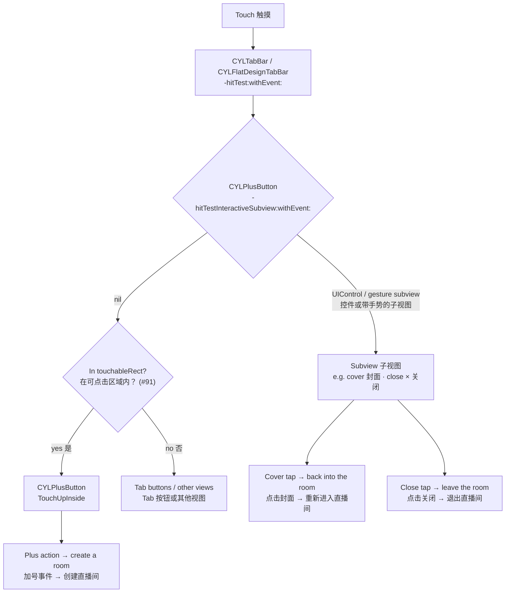
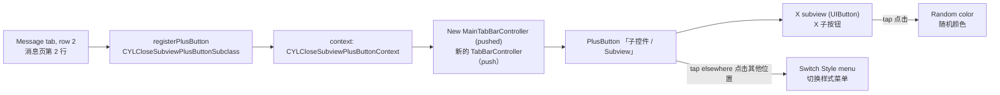

# [CN]PlusButton 子控件响应各自的点击事件
# [EN]Subviews of the PlusButton receive their own touches

<!-- bound-classes: CYLPlusButton, CYLTabBar, CYLFlatDesignTabBar -->
<!-- binding:start -->
<!-- Generated by scripts/update-docs-navigation.py; do not edit by hand. -->

| 中文 | English |
|:---|:---|
| 绑定的代码类 `CYLPlusButton`：[`CYLTabBarController/CYLPlusButton.h`](../CYLTabBarController/CYLPlusButton.h) | Bound to the class `CYLPlusButton`: [`CYLTabBarController/CYLPlusButton.h`](../CYLTabBarController/CYLPlusButton.h) |
| 绑定的代码类 `CYLTabBar`：[`CYLTabBarController/CYLTabBar.h`](../CYLTabBarController/CYLTabBar.h) | Bound to the class `CYLTabBar`: [`CYLTabBarController/CYLTabBar.h`](../CYLTabBarController/CYLTabBar.h) |
| 绑定的代码类 `CYLFlatDesignTabBar`：[`CYLTabBarController/CYLFlatDesignTabBar/CYLFlatDesignTabBar-ObjectiveC/CYLFlatDesignTabBar/CYLFlatDesignTabBar.h`](../CYLTabBarController/CYLFlatDesignTabBar/CYLFlatDesignTabBar-ObjectiveC/CYLFlatDesignTabBar/CYLFlatDesignTabBar.h) | Bound to the class `CYLFlatDesignTabBar`: [`CYLTabBarController/CYLFlatDesignTabBar/CYLFlatDesignTabBar-ObjectiveC/CYLFlatDesignTabBar/CYLFlatDesignTabBar.h`](../CYLTabBarController/CYLFlatDesignTabBar/CYLFlatDesignTabBar-ObjectiveC/CYLFlatDesignTabBar/CYLFlatDesignTabBar.h) |

<!-- binding:end -->

| 中文 | English |
|:---|:---|
| 解决 [#202](https://github.com/ChenYilong/CYLTabBarController/issues/202)：在继承 `CYLPlusButton` 的加号按钮上添加的子控件（按钮、带手势的 imageView 等）收不到点击，因为 TabBar 重写的 `-hitTest:withEvent:` 把可点击区域内的所有触摸都交给了加号按钮。现在这类子控件可以响应各自的事件，加号按钮的其他位置保持原样。适用于经典系统 TabBar、液态玻璃（Liquid Glass）和扁平样式（FlatDesign）。 | Solves [#202](https://github.com/ChenYilong/CYLTabBarController/issues/202): subviews added to a `CYLPlusButton` subclass (buttons, image views with gesture recognizers, …) never got a touch, because the tab bar's `-hitTest:withEvent:` handed every touch in the touchable area to the plus button. Such subviews now receive their own touches; the rest of the plus button works as before. Works in the classic system tab bar, Liquid Glass and FlatDesign. |

## [CN]目录
## [EN]Contents

<!-- navigation:start -->
<!-- Generated by scripts/update-docs-navigation.py; do not edit by hand. -->

| 中文 | English |
|:---|:---|
| [场景](#cn场景) | [Use case](#enuse-case) |
| [规则](#cn规则) | [Rules](#enrules) |
| [新 API](#cn新-api) | [New API](#ennew-api) |
| [各项关系图](#cn各项关系图) | [How the pieces relate](#enhow-the-pieces-relate) |
| [代码演示](#cn代码演示) | [Code](#encode) |
| [演示：带 X 子按钮的 PlusButton](#cn演示带-x-子按钮的-plusbutton) | [Demo: a PlusButton with an X subview](#endemo-a-plusbutton-with-an-x-subview) |
| [测试与截图](#cn测试与截图) | [Testing and screenshots](#entesting-and-screenshots) |

<!-- navigation:end -->

## [CN]场景
## [EN]Use case

| 中文 | English |
|:---|:---|
| Issue 中的直播类应用：点击加号创建直播间；最小化直播间后，加号按钮上显示直播间封面与关闭按钮。点击封面重新进入直播间，点击关闭（×）退出直播间。下图是 issue 提交者提供的截图（不是本次修改的测试截图）： | The live-streaming app in the issue: the plus button creates a room; after the room is minimized, the plus button shows the room's cover and a close button. A tap on the cover goes back into the room, a tap on the close button (×) leaves it. The screenshot below is from the issue's reporter (not a test screenshot of this change): |


## [CN]规则
## [EN]Rules

| 中文 | English |
|:---|:---|
| 子视图本身，或它在 PlusButton 之下的某个父视图，是可用（`enabled`）的 `UIControl`，或带有可用的手势时，该子视图接收触摸。 | A subview receives the touch when it, or one of its superviews below the plus button, is an enabled `UIControl` or has an enabled gesture recognizer. |
| 子视图需可见（非 `hidden`，`alpha` ≥ 0.01）且 `userInteractionEnabled` 为 YES。注意 `UIImageView` 默认 `userInteractionEnabled = NO`，添加手势时需要设为 YES。 | The subview must be visible (not `hidden`, `alpha` ≥ 0.01) with `userInteractionEnabled`. `UIImageView` defaults to `userInteractionEnabled = NO`: set it to YES when you add a gesture recognizer. |
| 超出 PlusButton 范围的子视图（如右上角凸出的关闭按钮）同样可以点击，只要触摸点在该子视图范围内。 | A subview that sticks out of the plus button (e.g. a close button over its top-right corner) is tappable too, as long as the touch is inside that subview. |
| 其他位置（加号按钮自身的图片、标题、扩大的可点击区域）仍然交给 PlusButton，触发它的 `TouchUpInside` 事件，行为不变。 | Every other point (the plus button's own image and title, its enlarged touchable area) still goes to the plus button and its `TouchUpInside` actions, as before. |
| 需要保持旧行为（所有触摸都交给 PlusButton）时，在子类中重写 `-hitTestInteractiveSubview:withEvent:` 并返回 nil。 | To keep the old behavior (every touch goes to the plus button), override `-hitTestInteractiveSubview:withEvent:` in your subclass and return nil. |

## [CN]新 API
## [EN]New API

| 中文 | English |
|:---|:---|
| `CYLPlusButton` 新增 `- (nullable UIView *)hitTestInteractiveSubview:(CGPoint)point withEvent:(nullable UIEvent *)event;`：`point` 为 PlusButton 自身坐标系，返回应接收触摸的子视图，没有时返回 nil。`CYLTabBar` 与 `CYLFlatDesignTabBar` 的 `-hitTest:withEvent:` 会先调用它。现有 API 不变。 | `CYLPlusButton` gains `- (nullable UIView *)hitTestInteractiveSubview:(CGPoint)point withEvent:(nullable UIEvent *)event;`: `point` is in the plus button's coordinates; it returns the subview that should take the touch, or nil. `-hitTest:withEvent:` of `CYLTabBar` and `CYLFlatDesignTabBar` asks it first. No existing API changes. |

## [CN]各项关系图
## [EN]How the pieces relate



## [CN]代码演示
## [EN]Code

```objc
// MyPlusButton.m — a CYLPlusButton subclass. 继承 CYLPlusButton 的子类。
- (void)showMinimizedRoomWithCover:(UIImage *)cover {
    UIImageView *coverView = [[UIImageView alloc] initWithImage:cover];
    coverView.frame = self.bounds;
    coverView.userInteractionEnabled = YES; // [EN] Required for the gesture. [CN] 添加手势时必须设为 YES。
    [coverView addGestureRecognizer:[[UITapGestureRecognizer alloc] initWithTarget:self action:@selector(enterRoom)]];
    [self addSubview:coverView];

    UIButton *closeButton = [UIButton buttonWithType:UIButtonTypeClose];
    closeButton.frame = CGRectMake(CGRectGetWidth(self.bounds) - 18, -6, 24, 24); // [EN] May stick out. [CN] 可以超出按钮范围。
    [closeButton addTarget:self action:@selector(leaveRoom) forControlEvents:UIControlEventTouchUpInside];
    [self addSubview:closeButton];
}
```

```swift
// Swift
let closeButton = UIButton(type: .close)
closeButton.addTarget(self, action: #selector(leaveRoom), for: .touchUpInside)
plusButton.addSubview(closeButton)
```

## [CN]演示：带 X 子按钮的 PlusButton
## [EN]Demo: a PlusButton with an X subview

| 中文 | English |
|:---|:---|
| Demo（`Example`）新增 PlusButton 子类 `CYLCloseSubviewPlusButtonSubclass`（在 `Example/Classes/View/CYLPlusButtonSubclass.h/.m` 中），继承自 `CYLPlusButtonSubclass`，使用自己的 context `CYLCloseSubviewPlusButtonContext`，标题为「子控件」。 | The demo (`Example`) adds the plus button subclass `CYLCloseSubviewPlusButtonSubclass` (in `Example/Classes/View/CYLPlusButtonSubclass.h/.m`). It inherits from `CYLPlusButtonSubclass`, uses its own context `CYLCloseSubviewPlusButtonContext`, and is titled "Subview". |
| 它的右上角有一个 X 按钮（`UIButton`，SF Symbol `xmark.circle.fill`），是 PlusButton 的子视图。点击 X：X 随机改变颜色，PlusButton 不响应。点击 PlusButton 其他位置：与原来一样弹出“切换样式”菜单。 | It has an X button at its top right (a `UIButton`, SF Symbol `xmark.circle.fill`), a subview of the plus button. Tap the X: the X changes to a random color and the plus button does not react. Tap anywhere else on the plus button: the "Switch Style" menu appears, as before. |
| 入口：“消息”页 tableView 的第 2 行「Push 新 context 的 TabBarController（PlusButton 带可点击的 X 子按钮，issue #202）」。它注册该 PlusButton，用它的 context 创建一个新的 TabBarController 并 push；原来的 TabBarController 保留自己的 PlusButton。 | Entry: row 2 of the "Message" tab's table view, "Push a TabBarController with a new context (PlusButton with a tappable X subview, issue #202)". It registers the plus button, creates a new tab bar controller with its context and pushes it; the tab bar controller you came from keeps its own plus button. |
| 液态玻璃的选中图层显示的是另一个 PlusButton 实例（`selectedContentView`），X 的颜色会同步到它。 | The Liquid Glass selected layer shows another plus button instance (`selectedContentView`); the X's color is kept in step with it. |



```objc
// Example/Classes/View/CYLPlusButtonSubclass.m (excerpt 节选)
+ (id)plusButton {
    CYLCloseSubviewPlusButtonSubclass *button = [super plusButton];
    UIButton *closeButton = [UIButton buttonWithType:UIButtonTypeCustom];
    [closeButton setImage:[[self closeImage] imageWithRenderingMode:UIImageRenderingModeAlwaysTemplate] forState:UIControlStateNormal];
    [closeButton addTarget:button action:@selector(closeButtonTapped:) forControlEvents:UIControlEventTouchUpInside];
    [button addSubview:closeButton];
    return button;
}

- (void)closeButtonTapped:(UIButton *)sender {
    sender.tintColor = [UIColor colorWithHue:(CGFloat)arc4random_uniform(360) / 360.0 saturation:0.85 brightness:0.9 alpha:1.0];
}
```

## [CN]测试与截图
## [EN]Testing and screenshots

| 中文 | English |
|:---|:---|
| 本次修改（包括上面的 Demo）在没有 Xcode 与 iOS 模拟器的环境（Linux）中完成，无法编译运行，因此暂无测试截图；上方图片是 issue 提交者的截图。已通过 `pod lib lint --quick` 与代码检查验证。在设备或模拟器上验证后，可将截图放入 `docs/assets/` 并在此引用。 | This change (the demo above included) was made in an environment without Xcode or an iOS simulator (Linux), so it could not be built or run, and there are no test screenshots; the image above is the issue reporter's. It was verified with `pod lib lint --quick` and by reviewing the code. After checking it on a device or simulator, put screenshots in `docs/assets/` and reference them here. |
