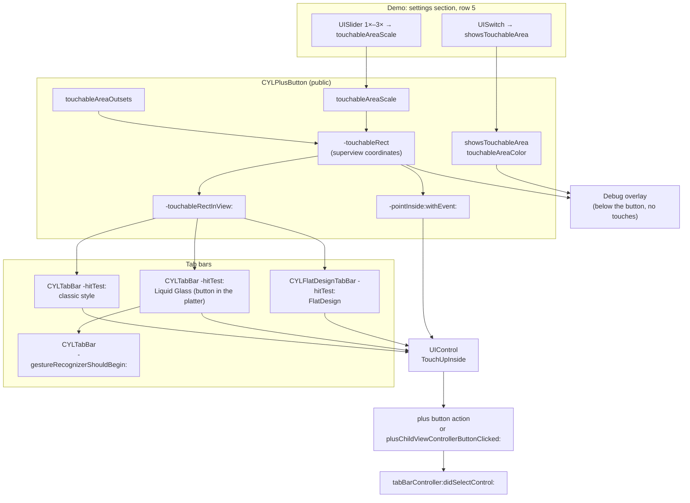
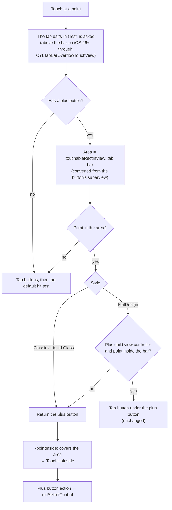
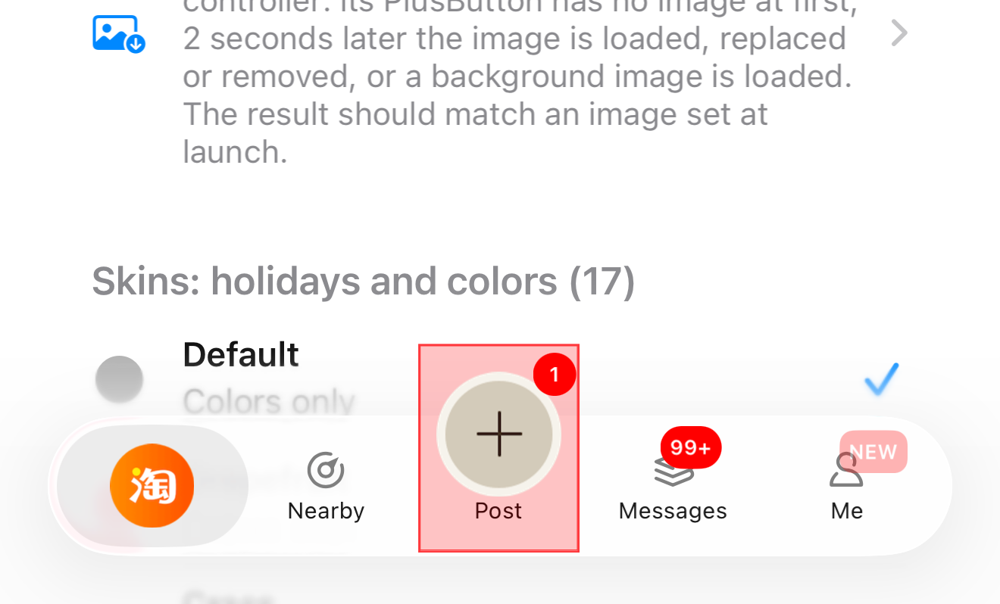
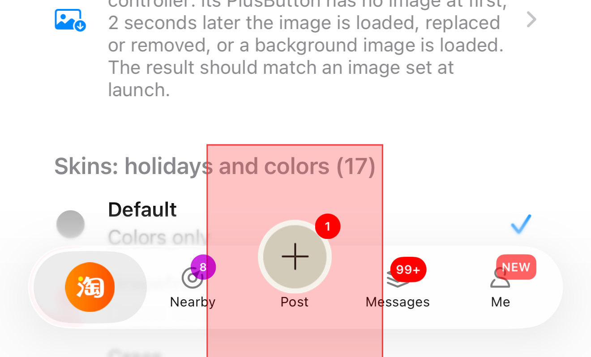

# [CN]PlusButton 点击范围：扩大、按倍数放大与调试显示
# [EN]PlusButton touchable area: grow it, scale it, and see it

<!-- bound-classes: CYLPlusButton, CYLTabBar, CYLFlatDesignTabBar -->
<!-- binding:start -->
<!-- Generated by scripts/update-docs-navigation.py; do not edit by hand. -->

| 中文 | English |
|:---|:---|
| 绑定的代码类 `CYLPlusButton`：[`CYLTabBarController/CYLPlusButton.h`](../CYLTabBarController/CYLPlusButton.h) | Bound to the class `CYLPlusButton`: [`CYLTabBarController/CYLPlusButton.h`](../CYLTabBarController/CYLPlusButton.h) |
| 绑定的代码类 `CYLTabBar`：[`CYLTabBarController/CYLTabBar.h`](../CYLTabBarController/CYLTabBar.h) | Bound to the class `CYLTabBar`: [`CYLTabBarController/CYLTabBar.h`](../CYLTabBarController/CYLTabBar.h) |
| 绑定的代码类 `CYLFlatDesignTabBar`：[`CYLTabBarController/CYLFlatDesignTabBar/CYLFlatDesignTabBar-ObjectiveC/CYLFlatDesignTabBar/CYLFlatDesignTabBar.h`](../CYLTabBarController/CYLFlatDesignTabBar/CYLFlatDesignTabBar-ObjectiveC/CYLFlatDesignTabBar/CYLFlatDesignTabBar.h) | Bound to the class `CYLFlatDesignTabBar`: [`CYLTabBarController/CYLFlatDesignTabBar/CYLFlatDesignTabBar-ObjectiveC/CYLFlatDesignTabBar/CYLFlatDesignTabBar.h`](../CYLTabBarController/CYLFlatDesignTabBar/CYLFlatDesignTabBar-ObjectiveC/CYLFlatDesignTabBar/CYLFlatDesignTabBar.h) |

<!-- binding:end -->

| 中文 | English |
|:---|:---|
| 解决 [#91](https://github.com/ChenYilong/CYLTabBarController/issues/91)：中间凸起的 PlusButton 与 TabBar 之间留有间隙时，点击间隙，事件会穿透到当前页面（如 tableView）。现在可以在**不改变 frame** 的情况下扩大 PlusButton 的点击范围，按倍数放大，并把可点击区域以半透明颜色显示出来方便调试。适用于经典系统 TabBar、液态玻璃（Liquid Glass）和扁平样式（FlatDesign）。 | Solves [#91](https://github.com/ChenYilong/CYLTabBarController/issues/91): with a gap between a raised plus button and the tab bar, a tap in the gap fell through to the page behind (e.g. a table view). You can now grow the plus button's touchable area **without changing its frame**, scale it by a factor, and show it as a translucent overlay for debugging. Works in the classic system tab bar, Liquid Glass and FlatDesign. |

## [CN]目录
## [EN]Contents

<!-- navigation:start -->
<!-- Generated by scripts/update-docs-navigation.py; do not edit by hand. -->

| 中文 | English |
|:---|:---|
| [新 API](#cn新-api) | [New API](#ennew-api) |
| [各项关系图](#cn各项关系图) | [How the pieces relate](#enhow-the-pieces-relate) |
| [点击判断流程（三种样式）](#cn点击判断流程三种样式) | [Hit testing, in every style](#enhit-testing-in-every-style) |
| [修复的问题](#cn修复的问题) | [What was fixed](#enwhat-was-fixed) |
| [代码演示](#cn代码演示) | [Code](#encode) |
| [演示行：在 tableView 中调试](#cn演示行在-tableview-中调试) | [Demo row: debug it from a table view](#endemo-row-debug-it-from-a-table-view) |
| [滑块成倍扩大的可行性评估](#cn滑块成倍扩大的可行性评估) | [Is a slider that multiplies the area feasible?](#enis-a-slider-that-multiplies-the-area-feasible) |
| [测试与截图](#cn测试与截图) | [Testing and screenshots](#entesting-and-screenshots) |

<!-- navigation:end -->

## [CN]新 API
## [EN]New API

| API (`CYLPlusButton`) | 中文 | English |
|:---|:---|:---|
| `touchableAreaOutsets` (`UIEdgeInsets`) | 向外扩展的距离（点），正值变大。默认 0。 | Extra area outward, in points; positive grows it. Default 0. |
| `touchableAreaScale` (`CGFloat`) | 以中心按倍数放大，先于 outsets 生效。1 为 frame 本身（默认），小于 1 按 1 处理。 | Scales the area around the center, before the outsets. 1 is the frame (default); below 1 counts as 1. |
| `showsTouchableArea` (`BOOL`) | 调试：以半透明覆盖层显示可点击区域，覆盖层不响应点击。设为 NO 恢复正常外观。 | Debugging: shows the area as a translucent overlay that takes no touches. NO restores the normal look. |
| `touchableAreaColor` (`UIColor`) | 覆盖层颜色，nil 为半透明红色。 | The overlay color; nil is translucent red. |
| `-touchableRect` | 可点击区域（父视图坐标系）。默认 = frame × scale + outsets；可重写为任意形状。 | The area, in the superview's coordinates. Default = frame × scale + outsets; override it for any shape. |
| `-touchableRectInView:` | 把可点击区域转换到指定视图的坐标系，TabBar 用它做点击判断。 | The area converted to another view's coordinates; the tab bars hit-test with it. |

```text
touchableRect = frame
              → grown around the center to frame × touchableAreaScale
              → grown outward by touchableAreaOutsets (top, left, bottom, right)
```

## [CN]各项关系图
## [EN]How the pieces relate



## [CN]点击判断流程（三种样式）
## [EN]Hit testing, in every style



## [CN]修复的问题
## [EN]What was fixed

| 问题 / Problem | 中文 | English |
|:---|:---|:---|
| #91 穿透 / fall-through | 可点击区域只能通过重写 `-touchableRect` 修改，且下面两个问题让它不能正确生效。 | The area could only be changed by overriding `-touchableRect`, and the two problems below kept it from working. |
| 扁平样式坐标 / FlatDesign coordinates | `-touchableRect` 是父视图坐标，却按按钮自身坐标转换，frame 原点被加了两次，区域偏离按钮。 | `-touchableRect` is in superview coordinates but was converted from the button's own, adding the origin twice and moving the area off the button. |
| 扁平样式子控制器 / FlatDesign child view controller | 有子控制器时整个区域被忽略，TabBar 之外的凸起部分点击会穿透。现在 TabBar 外的部分交给 PlusButton，TabBar 内保持原样。 | With a child view controller the area was ignored, so taps on the raised part outside the bar fell through. The part outside the bar now goes to the plus button; inside the bar nothing changes. |
| 液态玻璃坐标 / Liquid Glass coordinates | PlusButton 位于 platter 中，不是 TabBar 的直接子视图，现在先转换坐标（与 #653 的 Tab 按钮相同）。 | The plus button sits in the platter, not directly in the tab bar; the area is now converted first (as for the tab buttons in #653). |
| TouchUpOutside | TabBar 把触摸交给了 PlusButton，但点在按钮之外时 UIControl 发送的是 `TouchUpOutside`，点击无效。现在 `-pointInside:withEvent:` 覆盖整个区域。 | The tab bar handed the touch to the plus button, but outside the button UIControl sent `TouchUpOutside`, so nothing happened. `-pointInside:withEvent:` now covers the whole area. |
| iOS 26 TabBar 上方 / above the bar on iOS 26 | iOS 26 及以上 TabBar 位于只有 TabBar 高度的容器视图中，UIKit 不会就 TabBar 上方的点询问 TabBar：PlusButton 凸出部分与扩大的区域点击无效（被页面或滚动边缘效果的触摸拦截视图接收）。现在 `CYLTabBarController` 在其视图最前面放一个透明的 `CYLTabBarOverflowTouchView`，就 TabBar 上方的点询问 TabBar，只保留 PlusButton，其他点照常交给页面。 | On iOS 26 and later the tab bar sits in a wrapper view only as tall as the bar, so UIKit never asks it about a point above the bar: taps on the raised part of the plus button and on the grown area did nothing (the page, or the scroll edge effect's touch blocker, took them). `CYLTabBarController` now puts a transparent `CYLTabBarOverflowTouchView` in front of its view: it asks the tab bar about points above the bar, keeps only the plus button, and leaves every other point to the pages. |
| 示例的 `-touchableRect` / the example's `-touchableRect` | ObjC 示例的 `CYLPlusButtonSubclass` 重写 `-touchableRect` 返回 `frame`，使 `touchableAreaOutsets` 与滑块都不起作用（覆盖层始终是按钮大小）。已删除该重写。 | The ObjC example's `CYLPlusButtonSubclass` overrode `-touchableRect` to return `frame`, which disabled `touchableAreaOutsets` and the slider (the overlay always had the button's size). The override is removed. |

## [CN]代码演示
## [EN]Code

```objc
// CYLPlusButtonSubclass.m (Example)
+ (id)plusButton {
    CYLPlusButtonSubclass *button = [[self alloc] init];
    // ... image, title, sizeToFit ...
    // 8 pt more on the left and right, 12 pt more below (the gap under the raised button).
    // 左右各多 8 点，下方多 12 点（凸起按钮下方的间隙）。
    button.touchableAreaOutsets = UIEdgeInsetsMake(0, 8, 12, 8);
    // button.touchableAreaScale = 1.5;   // or: 1.5 × the button, around its center 或：以中心放大到 1.5 倍
    // button.showsTouchableArea = YES;   // while debugging 调试时显示
    return button;
}
```

```swift
// CYLPlusButtonSubclass.swift (Example-Swift)
static func plusButton() -> Any {
    let button = CYLPlusButtonSubclass.cyl_plusButton(with: UIImage(named: "post_normal")!, title: "发布",
                                                      selectedTitle: "选中", selectedTitleColor: .blue)
    button.touchableAreaOutsets = UIEdgeInsets(top: 0, left: 8, bottom: 12, right: 8)
    return button
}

// At runtime, e.g. from a debug menu. 运行时调整，例如在调试菜单中。
if tabBarController.hasPlusButton(), let plusButton = CYLPlusButton(forOwner: tabBarController) {
    plusButton.touchableAreaScale = 2          // twice as wide and tall 宽高各放大一倍
    plusButton.showsTouchableArea = true       // show it 显示
    plusButton.touchableAreaColor = UIColor.systemBlue.withAlphaComponent(0.25)
    // plusButton.showsTouchableArea = false   // back to normal 恢复正常
}
```

```objc
// Any other shape: override -touchableRect (superview coordinates). 其他形状：重写 -touchableRect（父视图坐标系）。
- (CGRect)touchableRect {
    CGRect rect = [super touchableRect];
    rect.size.height += 20;   // down to the bottom of the tab bar 延伸到 TabBar 底部
    return rect;
}
```

## [CN]演示行：在 tableView 中调试
## [EN]Demo row: debug it from a table view

| 中文 | English |
|:---|:---|
| 所有 Demo 的设置分组（ObjC：首页、同城、消息、我的、扁平样式列表；Swift：`CYLBadgeHelperTableViewController`）新增第 5 行「PlusButton 点击范围（issue #91）」： | The settings section of every demo (ObjC: Home, Same City, Message, Mine and the FlatDesign list; Swift: `CYLBadgeHelperTableViewController`) has a new row 5, "PlusButton touchable area (issue #91)": |
| • **开关**：打开后以半透明红色显示可点击区域（`showsTouchableArea = YES`），关闭恢复正常外观； | • **Switch**: on shows the area in translucent red (`showsTouchableArea = YES`); off restores the normal look. |
| • **滑块**：1×–3×，步长 0.1，设置 `touchableAreaScale`，覆盖层实时跟随； | • **Slider**: 1×–3× in 0.1 steps, sets `touchableAreaScale`; the overlay follows live. |
| • 仅在 `hasPlusButton` 时可用，否则显示「当前 TabBar 没有 PlusButton」并禁用控件。文字已翻译为 33 种语言。 | • Only with `hasPlusButton`; otherwise it reads "This tab bar has no PlusButton" and the controls are disabled. The texts are translated into 33 languages. |

## [CN]滑块成倍扩大的可行性评估
## [EN]Is a slider that multiplies the area feasible?

| 中文 | English |
|:---|:---|
| **可行，已实现。** 放大只改变点击判断用的矩形，不改变按钮的 frame、布局或外观，因此可以在运行时随时修改，立即生效，无需重新布局 TabBar。 | **Yes, and it is implemented.** Scaling only changes the rectangle used for hit testing, not the button's frame, layout or look, so it can change at any time at runtime and takes effect immediately, without laying the tab bar out again. |
| **注意 1：与 Tab 按钮重叠。** 区域放大后可能盖住相邻 Tab 按钮的一部分。经典样式与扁平样式中 PlusButton 优先判断，重叠部分交给 PlusButton。液态玻璃中，位于相邻 Tab 那一列（TabBar 内或其上方）的点会被系统 TabBar 自己的手势接收，PlusButton 不会触发；PlusButton 所在列的上方与下方正常。滑块上限设为 3 倍，调试时打开覆盖层即可看到。 | **Note 1: overlapping tab buttons.** A larger area can cover part of the neighboring tab buttons. In the classic style and FlatDesign the plus button is checked first, so the overlap goes to it. In Liquid Glass, a point in a neighboring tab's column (in the bar or above it) is taken by the system tab bar's own gesture and the plus button does not fire; above and below the plus button's own column it works. The slider goes up to 3×; turn the overlay on to see it while debugging. |
| **注意 2：覆盖层的父视图。** 覆盖层加在 PlusButton 的父视图中。父视图裁剪边界时覆盖层也会被裁剪，但点击判断仍使用完整区域；在 iOS 26.1 的液态玻璃中父视图是 TabBar，没有裁剪（见下方截图）。 | **Note 2: the overlay's superview.** The overlay goes in the plus button's superview. A superview that clips would clip the overlay too, while hit testing still uses the whole area; in Liquid Glass on iOS 26.1 that superview is the tab bar, which does not clip (see the screenshots below). |
| **注意 3：扁平样式 + 子控制器。** TabBar 内部的点击仍交给下方的 Tab 按钮（行为不变），只有区域中位于 TabBar 之外的部分交给 PlusButton。 | **Note 3: FlatDesign with a child view controller.** Taps inside the bar still go to the tab button below (unchanged); only the part of the area outside the bar goes to the plus button. |
| 线上建议使用固定的 `touchableAreaOutsets`；滑块与覆盖层用于调试时找到合适的值。 | In production, use fixed `touchableAreaOutsets`; the slider and the overlay are for finding the right values while debugging. |

## [CN]测试与截图
## [EN]Testing and screenshots

| 中文 | English |
|:---|:---|
| 2026-11-09 在 iPhone 17 Pro Max 模拟器（iOS 26.1，液态玻璃，Xcode 27.2）上运行 ObjC 示例 `Example` 验证：① 打开演示行开关后，红色区域覆盖按钮及 `touchableAreaOutsets` 扩展的部分；② 点击按钮上方凸出部分、扩展区域内按钮所在列的点，都会打开 PlusButton 的页面（修复前无效，见「修复的问题」）；③ 拖动滑块到 2.1 倍，区域随之以按钮为中心放大（修复前始终是按钮大小）；④ 关闭开关后恢复正常外观。相邻 Tab 那一列的点不会触发 PlusButton（注意 1）。经典样式与扁平样式的截图尚未添加。 | Verified on 2026-11-09 with the ObjC `Example` on an iPhone 17 Pro Max simulator (iOS 26.1, Liquid Glass, Xcode 27.2): ① with the demo row's switch on, the red area covers the button and what `touchableAreaOutsets` adds; ② a tap on the raised part above the bar, or anywhere in the area in the plus button's column, opens the plus button's page (it did nothing before the fix, see "What was fixed"); ③ at 2.1× on the slider the area grows around the button (before the fix it kept the button's size); ④ with the switch off the normal look is back. A point in a neighboring tab's column does not fire the plus button (note 1). Screenshots of the classic style and FlatDesign are not added yet. |
| 开关打开，1.0 倍（`touchableAreaOutsets` 为 0, 8, 12, 8）： | Switch on, 1.0× (`touchableAreaOutsets` of 0, 8, 12, 8): |
|  |  |
| 滑块 2.1 倍： | Slider at 2.1×: |
|  |  |
