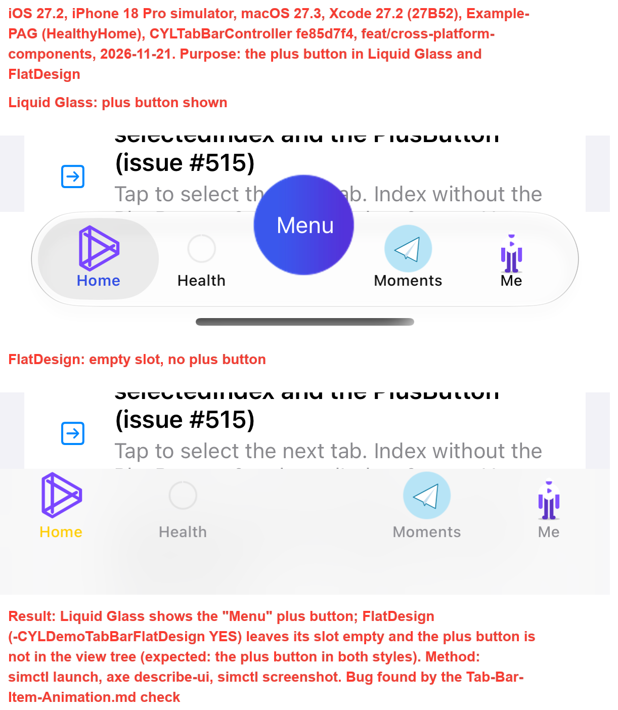

# [CN]PlusButton 的实现：真实按钮、液态玻璃替身与选中态图片
# [EN]How the PlusButton works: the real button, its Liquid Glass stand-in and selected images

<!-- bound-classes: CYLPlusButton, CYLTabBarController -->
<!-- binding:start -->
<!-- Generated by scripts/update-docs-navigation.py; do not edit by hand. -->

| 中文 | English |
|:---|:---|
| 绑定的代码类 `CYLPlusButton`：[`CYLTabBarController/CYLPlusButton.h`](../CYLTabBarController/CYLPlusButton.h) | Bound to the class `CYLPlusButton`: [`CYLTabBarController/CYLPlusButton.h`](../CYLTabBarController/CYLPlusButton.h) |
| 绑定的代码类 `CYLTabBarController`：[`CYLTabBarController/CYLTabBarController.h`](../CYLTabBarController/CYLTabBarController.h) | Bound to the class `CYLTabBarController`: [`CYLTabBarController/CYLTabBarController.h`](../CYLTabBarController/CYLTabBarController.h) |

<!-- binding:end -->

| 中文 | English |
|:---|:---|
| 本文说明 `CYLPlusButton` 的实现，重点是选中态图片在什么场景下会被忽略。修改 PlusButton 的图片、替身或换肤代码之前请先读本文。 | This document explains how `CYLPlusButton` works, above all when a selected image is ignored. Read it before changing the plus button's images, its stand-in or its theming. |

## [CN]目录
## [EN]Contents

<!-- navigation:start -->
<!-- Generated by scripts/update-docs-navigation.py; do not edit by hand. -->

| 中文 | English |
|:---|:---|
| [必须遵守的限制](#cn必须遵守的限制) | [The rule to follow](#enthe-rule-to-follow) |
| [什么场景下选中态图片被忽略](#cn什么场景下选中态图片被忽略) | [When a selected image is ignored](#enwhen-a-selected-image-is-ignored) |
| [实现结构](#cn实现结构) | [Implementation](#enimplementation) |
| [替身的创建时机与布局 block](#cn替身的创建时机与布局-block) | [When the stand-in is made, and the layout blocks](#enwhen-the-stand-in-is-made-and-the-layout-blocks) |
| [液态玻璃下的换肤](#cn液态玻璃下的换肤) | [Theming on Liquid Glass](#entheming-on-liquid-glass) |
| [测试](#cn测试) | [Testing](#entesting) |
| [为什么按图标对齐](#cn为什么按图标对齐) | [Why by icon](#enwhy-by-icon) |

<!-- navigation:end -->

## [CN]必须遵守的限制
## [EN]The rule to follow

| 中文 | English |
|:---|:---|
| **有 `plusChildViewController`，且为液态玻璃样式（不是扁平样式）时，替身忽略选中态图片，只显示真实 PlusButton 普通状态（normal）的图片。** | **With a `plusChildViewController` on the Liquid Glass style (not FlatDesign), the stand-in ignores selected images and shows only the real plus button's normal image.** |
| 这个限制针对的是创建和更新替身，不是 PlusButton 的公开 API：外部仍然可以为 PlusButton 设置选中图片，主题也仍然可以传入 `CYLTabBarItemSelectedImage` / `CYLTabBarItemSelectedImageURL`。扁平样式与经典系统 TabBar（如 iOS 18）照常使用这些图片。 | The rule applies to making and updating the stand-in, not to the plus button's public API: an app can still set a selected image, and a theme can still pass `CYLTabBarItemSelectedImage` / `CYLTabBarItemSelectedImageURL`. FlatDesign and the classic system tab bar (e.g. iOS 18) use those images as before. |
| 原因：真实的 PlusButton 只有一个，替身是它的副本。玻璃把图标分成两部分：玻璃上方由真实按钮绘制，玻璃内由替身绘制。两者的图片不同时，一个图标由两张图各显示一部分，看起来被截断（曾出现在 `Spring Festival>Network` 场景）。 | Why: there is one real plus button, and the stand-in is a copy of it. The glass splits the icon in two: the real button draws the part above the glass, the stand-in the part inside it. With two different images, one icon is drawn half from each and looks cut (seen in the `Spring Festival>Network` scenario). |

| 中文 | English |
|:---|:---|
| **App 主动要求标题对齐（实现 `+alignsTitleWithTabBarItemTitles`）时，替身与真实 PlusButton 只对齐图标**：提取图标的坐标，不考虑其他子视图。其他布局（没有标题、标题画在背景图上）对齐按钮中心。 | **When the app asks for the title to be aligned (it implements `+alignsTitleWithTabBarItemTitles`), the stand-in and the real plus button line up by icon only**: take the icon's coordinates and ignore the other subviews. Other layouts (no title, a title drawn over the background image) align the button centers. |

## [CN]什么场景下选中态图片被忽略
## [EN]When a selected image is ignored

| 样式 / Style | 有 `plusChildViewController` / With a plus child | 没有 `plusChildViewController` / Without a plus child |
|:---|:---|:---|
| 液态玻璃 / Liquid Glass | **替身与真实按钮都只绘制普通状态的图片**；设置的选中图片仍可通过 `-imageForState:` 读取 / **the stand-in and the real button both draw the normal image only**; a selected image it was given stays readable through `-imageForState:` | 不适用此限制 / the rule does not apply |
| 扁平样式 / FlatDesign | 使用选中图片（没有替身）/ selected images are used (no stand-in) | 使用选中图片 / selected images are used |
| 经典系统 TabBar（如 iOS 18、iOS 26 UI 兼容模式）/ Classic system tab bar (e.g. iOS 18, iOS 26 UI compatibility mode) | 使用选中图片（没有替身）/ selected images are used (no stand-in) | 使用选中图片 / selected images are used |

| API | 液态玻璃且有 `plusChildViewController` 时 / On Liquid Glass with a plus child |
|:---|:---|
| `-setImage:forState:`（`UIControlStateSelected`）| 保存在真实按钮上，不绘制，替身也不使用 / kept on the real button, not drawn, not used by the stand-in |
| `-cyl_updateTitle:image:selectedImage:` 的 `selectedImage` | 保存在真实按钮上，不绘制，替身也不使用 / kept on the real button, not drawn, not used by the stand-in |
| `-updatePlusButtonWithAttributes:` 的选中图片 key / its selected image keys | 仍会加载并交给上一行的方法，替身不使用 / still loaded and passed to the method above, not used by the stand-in |
| `-setBackgroundImage:forState:`（换肤之后才设置 / set after a theme）| 主题在按钮只是看起来为空时装上的图标会被撤销，标题回到按钮和替身上，徽标重新显示 / the icon a theme installed while the button only looked empty is taken back; the title returns to the button and the stand-in; the badge is shown again |
| `-setImage:nil forState:UIControlStateNormal` | 真实按钮和替身的选中状态副本一并移除，标题回到两者上；此时没有图标可对齐，替身与真实按钮中心对齐；设置的选中图片仍可通过 `-imageForState:` 读取 / the copies in the selected states go on both, the title returns to both; with no icon to line up, the stand-in takes the plus button's center; a selected image set on the button stays readable through `-imageForState:` |
| `CYLTabBarTheme` 的 `-cyl_plusButtonAttributesForTabBarController:` | 同上 / as above |
| `+selectedContentImage`、`selectedContentImage` 属性 / property | 只作为替身创建时的初始值，随即被普通状态的图片覆盖 / only an initial value when the stand-in is made, replaced at once by the normal image |
| `+selectedContentView` 返回的按钮 / the button it returns | 仍作为替身使用（位置、标题等），但其所有状态的图片都被替换为普通状态的图片 / still the stand-in (position, title...), but its image is replaced by the normal image in every state |

| 中文 | English |
|:---|:---|
| 普通状态的图片取 `configuration.image`，没有时取 `-imageForState:UIControlStateNormal`。限制只涉及图片，不涉及选中标题与背景图片。 | The normal image is `configuration.image`, else `-imageForState:UIControlStateNormal`. The rule covers images only, not the selected title or background images. |

## [CN]实现结构
## [EN]Implementation

| 角色 / Role | 位置 / Where | 说明 / Notes |
|:---|:---|:---|
| 真实 PlusButton / The real plus button | `CYLPlusButton`，位于 `CYLTabBar` 中 / in `CYLTabBar` | 不再被 mask，玻璃下方也会绘制；`-cyl_updateLiquidGlassMask` 目前是空实现，保留为选中态布局的钩子 / no longer masked, so it is drawn under the glass too; `-cyl_updateLiquidGlassMask` is empty for now, kept as a hook for the selected layout TODO (2026-11-13, to verify): PR #793 also keeps the lens on the plus page when the plus title is drawn by its tab item (`CYL_PLUS_BUTTON_TITLE_KEEPS_LENS_ENABLED`; since Swift migration step 62, turned off with the Swift compilation condition `CYL_PLUS_BUTTON_TITLE_KEEPS_LENS_DISABLED`); as risky as the mask, see [Liquid-Glass-Robustness](Liquid-Glass-Robustness.md). |
| 替身 / The stand-in | `-[CYLPlusButton selectedContentView]`，位于选中图层的 Tab 按钮中 / in the tab button of the selected layer | 位置由 `CYLPlusButtonCenterOfStandIn()` 经坐标转换得到：标题对齐时对齐图标，其他布局对齐按钮中心 / placed by `CYLPlusButtonCenterOfStandIn()` through a coordinate conversion: by icon with an aligned title, by button center otherwise |
| 规则判断 / The rule | `-[CYLPlusButton cyl_standInShowsNormalImageOnly]` | 唯一决定替身是否只用普通状态图片的地方：`CYLPlusButtonIsInLiquidGlassTabBar()` 且有 PlusButton 子控制器 / the one place that decides whether the stand-in uses the normal image only: `CYLPlusButtonIsInLiquidGlassTabBar()` and a plus child |
| 图片同步 / Image sync | `-[CYLPlusButton cyl_updateSelectedContentViewImage]` | 本文限制的唯一实现处，可重复调用 / the one place that implements the rule; idempotent |
| 放置替身 / Placing it | `-[CYLPlusButton cyl_placeSelectedContentView]` | 放置替身的唯一方法：图片、中心（`CYLPlusButtonCenterOfStandIn()`，只有 `CYLPlusButtonGetIconCenter()` 读取按钮的图片视图） / the one way to place the stand-in: its image, its center (`CYLPlusButtonCenterOfStandIn()`; only `CYLPlusButtonGetIconCenter()` reads the buttons' image views) |
| 安装替身 / Installing it | `-[CYLTabBarController cyl_layOutPlusButtonInLiquidGlassLayers]` | 液态玻璃专用 / Liquid Glass only |

| 中文 | English |
|:---|:---|
| 每次换肤后（液态玻璃 guard 内）都会请求一次布局，由 `-viewDidLayoutSubviews` 调用 `-cyl_layOutPlusButtonInLiquidGlassLayers`；异步下载的图片到达后再调用一次。 | After every theme change (inside a Liquid Glass guard) a layout pass is requested, and `-viewDidLayoutSubviews` runs `-cyl_layOutPlusButtonInLiquidGlassLayers`; it runs once more when a downloaded image arrives. |
| 图片同步在以下时机执行：设置普通状态图片、更新 `configuration`、`-cyl_updateTitle:image:selectedImage:`、创建替身，以及每次布局。放在每次布局中是为了自愈：`-cyl_layOutPlusButtonInLiquidGlassLayers` 发现替身已在按钮中就会提前返回，图片同步位于这个返回之前。 | The image sync runs when the normal image is set, when `configuration` changes, in `-cyl_updateTitle:image:selectedImage:`, when the stand-in is made, and on every layout pass. Every layout pass, so it heals itself: `-cyl_layOutPlusButtonInLiquidGlassLayers` returns early when the stand-in is already in its button, and the sync comes before that return. |

## [CN]替身的创建时机与布局 block
## [EN]When the stand-in is made, and the layout blocks

| 中文 | English |
|:---|:---|
| 替身由库创建：`-cyl_layOutPlusButtonInLiquidGlassLayers` 读取 `selectedContentView`，该方法由 `-viewDidLayoutSubviews` 与 `-[CYLTabBar layoutSubviews]` 在每次布局时调用。 | The library makes the stand-in: `-cyl_layOutPlusButtonInLiquidGlassLayers` reads `selectedContentView`, and `-viewDidLayoutSubviews` and `-[CYLTabBar layoutSubviews]` call that method on every layout pass. |
| App 在布局 block 中操作替身或 Tab 按钮时，请注意两个方法的区别：`-setViewDidLayoutSubViewsBlockInvokeOnce:block:` 只执行一次（`invokeOnce` 参数未被使用，始终按 YES 处理；换肤、重新加载 Tab 后会再执行一次），`-setViewDidLayoutSubViewsBlock:` 每次布局都执行。需要跟随换肤或按钮重建的逻辑应使用后者，并且必须可重复调用。 | When an app touches the stand-in or the tab buttons in a layout block, mind the difference: `-setViewDidLayoutSubViewsBlockInvokeOnce:block:` runs once (`invokeOnce` is not used and always treated as YES; it runs once more after a theme switch or a tab reload), and `-setViewDidLayoutSubViewsBlock:` runs on every layout pass. Logic that must follow a theme or rebuilt buttons belongs in the latter, and must be idempotent. |
| ObjC Demo 的 `-cyl_demo_decorateTabBarController:` 使用只执行一次的 block，但它只添加角标与封面，带延迟动画，不创建替身，因此没有改为每次执行：那样只会反复播放角标动画。 | The ObjC demo's `-cyl_demo_decorateTabBarController:` uses the once-block, but it only adds badges and a cover, with delayed animations, and makes no stand-in. So it was not moved to the every-layout block: that would only replay the badge animations. |

## [CN]液态玻璃下的换肤
## [EN]Theming on Liquid Glass

| 中文 | English |
|:---|:---|
| 液态玻璃的换肤机制与其他样式完全不同，相关代码必须用 guard 隔离。判断样式时同时检查液态玻璃与 TabBar 样式：iOS 26 上使用扁平样式 TabBar 时 `+[CYLConstants isLiquidGlassActive]` 也为 YES。`CYLPlusButton.m` 中使用 `CYLPlusButtonIsInLiquidGlassTabBar()`，并同时检查 `+plusChildViewControllerForOwner:`。 | Theming on Liquid Glass works quite differently from the other styles, and its code must be isolated with guards. Check both Liquid Glass and the tab bar style: `+[CYLConstants isLiquidGlassActive]` is YES on iOS 26 with the FlatDesign tab bar too. `CYLPlusButton.m` uses `CYLPlusButtonIsInLiquidGlassTabBar()`, together with `+plusChildViewControllerForOwner:`. |
| 液态玻璃有两个图层，修改 `tabBarItem.image` 会让 UIKit 重建 Tab 按钮，并且无法显示在动画图标之上。因此主题图标使用 `-setTabBarItemIcon:selectedIcon:size:atIndex:`，以视图替换图标；替身的安装使用 `-cyl_replaceTabImageViewWithNewView:offset:show:completion:`（标题由 TabBarItem 显示时）或 `-cyl_coverTabImageViewOrTabButton:newView:offset:show:delayIfNeededForSeconds:completion:`。液态玻璃下需要替换图标时，优先考虑 `cyl_replace` 与 `cyl_cover` 系列方法，而不是更新图片。 | Liquid Glass has two layers, and changing `tabBarItem.image` makes UIKit rebuild the tab buttons and does not show over an animated icon. So theme icons use `-setTabBarItemIcon:selectedIcon:size:atIndex:`, a view in place of the icon, and the stand-in is installed with `-cyl_replaceTabImageViewWithNewView:offset:show:completion:` (when the tab item shows the title) or `-cyl_coverTabImageViewOrTabButton:newView:offset:show:delayIfNeededForSeconds:completion:`. To replace an icon on Liquid Glass, prefer the `cyl_replace` and `cyl_cover` methods to updating an image. |

| 中文 | English |
|:---|:---|
| 以背景图为图片、标题画在图上的 PlusButton（`-cyl_drawsTitleOverBackgroundImage`）不接受主题的图片：主题图标会盖在图片上、挤在标题旁边。App 直接调用 `-updatePlusButtonWithAttributes:` 时不受影响。演示列表的“批量下载网络图标”“批量使用本地图标”同样不修改这种按钮。原本没有图片的 PlusButton 从主题恢复时，主题图片会被移除。 | A plus button whose picture is its background image, its title on it (`-cyl_drawsTitleOverBackgroundImage`), takes no image from a theme: a theme's icon would sit over the picture, beside the title. An app calling `-updatePlusButtonWithAttributes:` itself is not affected. The demo rows "Change all network icons" and "Change all local icons" leave such a button alone too. A plus button with no image of its own loses the theme's image when the theme goes. |

## [CN]测试
## [EN]Testing

| 中文 | English |
|:---|:---|
| 方法与场景见 [Plus-Child-Theme-Switching-Test.md](Plus-Child-Theme-Switching-Test.md)：选中第 2 个 Tab（PlusButton 子控制器），切换主题，对比前后 PlusButton 图标是否完整、清晰。Demo 的网络皮肤特意传入两张不同的图片，用来验证替身只使用普通状态的图片。 | For the method and scenarios, see [Plus-Child-Theme-Switching-Test.md](Plus-Child-Theme-Switching-Test.md): select tab 2 (the plus child), switch the theme, and compare the plus button's icon before and after: whole and sharp. The demo's network skin passes two different images on purpose, to check that the stand-in uses only the normal image. |
| 单元测试 `testAPlusButtonOutsideAGlassPlusChildKeepsItsSelectedImage` 覆盖“此场景之外保留选中图片”。替身本身依赖真实的 TabBar 层级，由上面的脚本在模拟器上检查：替身与真实按钮当前显示的图片都必须等于普通状态的图片。 | The unit test `testAPlusButtonOutsideAGlassPlusChildKeepsItsSelectedImage` covers "outside this scenario the selected image stays". The stand-in needs a real tab bar hierarchy, so the script above checks it on a simulator: the stand-in's image and the real button's current image must both be the normal image. |
| 验证（2026-11-06，iPhone 17 Pro，iOS 26.5 模拟器，全新编译）：`Spring Festival>Network`、`Default>Christmas`、`Christmas>Pink Rose` 三个场景的检查全部 PASS，换肤前后替身与真实按钮的图标屏幕位置偏差均为 0。未在真机上验证。 | Verified (2026-11-06, iPhone 17 Pro, iOS 26.5 simulator, a clean build): the checks of `Spring Festival>Network`, `Default>Christmas` and `Christmas>Pink Rose` all pass, and the icons of the stand-in and the real button are at the same place on screen before and after the theme change. Not checked on a device. |

## [CN]为什么按图标对齐
## [EN]Why by icon

| 中文 | English |
|:---|:---|
| PlusButton 曾经替换整个 Tab 按钮；标题由 TabBarItem 显示后（#636），它只替换图标，并按图标定位（`-cyl_alignedCenterForCenter:`）。此时按钮中心不再对应图标位置，两个按钮的图标布局也不同（真实按钮内 y≈7，替身内 y≈13）。只对齐按钮中心时，玻璃上下两部分相差约 5.67 pt。修改这里的坐标转换时，请比较两个图标在屏幕上的位置，而不是按钮的 frame。 | The plus button used to replace the whole tab button. Since the tab item shows the title (#636), it replaces only the icon and is placed by its icon (`-cyl_alignedCenterForCenter:`). So the button's center no longer says where the icon is, and the two buttons lay their icons out differently (y≈7 in the real button, y≈13 in the stand-in). With only the button centers aligned, the parts above and in the glass were about 5.67 pt apart. When changing this conversion, compare where the two icons are on screen, not the buttons' frames. |
| **TODO**（2026-11-21，CYLSearchViewController 会话的请求，低优先级）：`CYLPlusButtonAlignsTitle` 为 false 时（液态玻璃下用 `CYLPlusButtonCenterYMultiplier` 抬高带标题的 PlusButton 需要这样设置），PlusButton 自己绘制标题，未选中与选中自己页面时都使用核心层默认的灰色，而不是 Tab 标题的普通 / 选中颜色；`CYLTabBarItemTitleColor` 只接受十六进制字符串，无法跟随深色模式。请求：不对齐的 PlusButton 标题默认跟随 TabBar 的标题颜色，或配置可接受深浅色两个值。复现：iOS 27.2 模拟器，CYLSearchViewController 固定在 `ace1af0e`，`CYLSearchExample/CYLTabBarConfiguration.json`。 | **TODO** (2026-11-21, requested by the CYLSearchViewController session, low priority): with `CYLPlusButtonAlignsTitle` false (needed so `CYLPlusButtonCenterYMultiplier` raises a titled plus button on Liquid Glass), the plus button draws its own title in the core's default gray, unselected and on its own selected page, not in the tab titles' normal and selected colors; `CYLTabBarItemTitleColor` accepts only a hex string, which cannot follow dark mode. Ask: a non-aligned plus title follows the tab bar's title colors by default, or the configuration accepts a light / dark pair. Repro: iOS 27.2 simulator, CYLSearchViewController pinned to `ace1af0e`, `CYLSearchExample/CYLTabBarConfiguration.json`. |
| **DONE（2026-11-21，已在核心层修复）**：原因：类切换（Swift 迁移第 3 阶段）后 Swift 版 `CYLTabBarController` 不再遵守 `CYLFlatDesignTabBarDelegate`（之前由 `CYLTabBarController.h` 声明），`as? CYLFlatDesignTabBarDelegate` 得到 nil，扁平 TabBar 没有代理，被当作独立 TabBar，因此不显示 PlusButton。修复：`CYLFlatDesignProtocols.swift` 中恢复 `extension CYLTabBarController: CYLFlatDesignTabBarDelegate {}`；新测试 `CYLFlatDesignDelegateTests` 在去掉修复时失败、加上后通过；210 个单元测试通过，`pod lib lint --quick` 与 SwiftPM 扁平示例通过；修复前后截图 `assets/flatdesign-plus-button-fixed-ios.png`。原记录：扁平样式下 PlusButton 不显示。Example-PAG（HealthyHome）在 iOS 27.2 模拟器上以 `-CYLDemoTabBarFlatDesign YES` 启动：PlusButton 的位置是一个空的 Tab 按钮，视图树中没有 `CYLPlusButton`；同一构建在液态玻璃下显示「Menu」PlusButton。复现：`fe85d7f4`，Xcode 27.2，Example-PAG，启动参数 `-CYLDemoTabBarFlatDesign YES`。截图：`assets/flatdesign-plus-button-missing-ios.png`。在核心层修复。 | **DONE (2026-11-21, fixed in the core)**: cause: since the class switch (phase 3 of the Swift migration) the Swift `CYLTabBarController` no longer adopted `CYLFlatDesignTabBarDelegate` (declared before by `CYLTabBarController.h`), so `as? CYLFlatDesignTabBarDelegate` gave nil, the flat-design bar had no delegate, counted as a standalone bar and showed no plus button; bisected: `0caf33e5` (before phase 3) shows it. Fix: `extension CYLTabBarController: CYLFlatDesignTabBarDelegate {}` in `CYLFlatDesignProtocols.swift`; the new `CYLFlatDesignDelegateTests` fails without the fix (4 assertions) and passes with it; 210 unit tests pass on iOS 27.2, `pod lib lint --quick` and the SwiftPM FlatDesign demo pass; before / after screenshot `assets/flatdesign-plus-button-fixed-ios.png`. Was: the plus button is missing in FlatDesign. Example-PAG (HealthyHome) on the iOS 27.2 simulator, launched with `-CYLDemoTabBarFlatDesign YES`: the plus slot is an empty tab button and no `CYLPlusButton` is in the view tree; the same build in Liquid Glass shows the "Menu" plus button. Repro: `fe85d7f4`, Xcode 27.2, Example-PAG, launch argument `-CYLDemoTabBarFlatDesign YES`. Screenshot: `assets/flatdesign-plus-button-missing-ios.png`. Fix in the core. |

