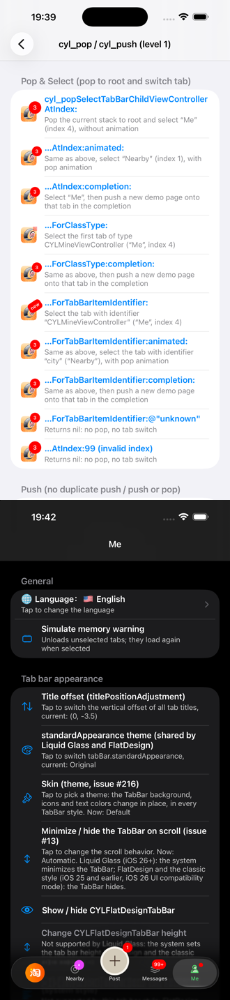

# [CN]在任意位置获取导航控制器并 Push
# [EN]Get the navigation controller and push from anywhere

<!-- bound-classes: CYLTabBarController -->
<!-- binding:start -->
<!-- Generated by scripts/update-docs-navigation.py; do not edit by hand. -->

| 中文 | English |
|:---|:---|
| 绑定的代码类 `CYLTabBarController`：[`CYLTabBarController/CYLTabBarController.h`](../CYLTabBarController/CYLTabBarController.h) | Bound to the class `CYLTabBarController`: [`CYLTabBarController/CYLTabBarController.h`](../CYLTabBarController/CYLTabBarController.h) |

<!-- binding:end -->

| 中文 | English |
|:---|:---|
| 解答 [#283](https://github.com/ChenYilong/CYLTabBarController/issues/283)：把 `CYLTabBarController` 设为根控制器后，如何在任意位置（不在某个页面里，例如收到推送、网络回调、工具类中）拿到当前的导航控制器并 push 一个页面？答案是：库中已有现成的 API，无需自己遍历控制器层级。 | Answers [#283](https://github.com/ChenYilong/CYLTabBarController/issues/283): with `CYLTabBarController` as the root view controller, how do you get the current navigation controller and push a page from anywhere (outside a page: on a push notification, in a network callback, in a helper class)? The library already has the API for it, so there is no need to walk the controller hierarchy yourself. |
| 同时解答 [#232](https://github.com/ChenYilong/CYLTabBarController/issues/232)：像微博一样有 5 个 Tab（中间是 PlusButton），点击最后一个 Tab 时不切换，而是 push 一个页面；点击过中间的 PlusButton 之后，再点击最后一个 Tab 就 push 不出来了。见下文[点击 Tab 时 Push 页面而不切换](#cn点击-tab-时-push-页面而不切换)。 | Also answers [#232](https://github.com/ChenYilong/CYLTabBarController/issues/232): a Weibo-like tab bar with 5 items (the plus button in the middle), where a tap on the last tab pushes a page instead of switching to it; after tapping the plus button, a tap on the last tab no longer pushed. See [Push a page on a tab tap instead of switching](#enpush-a-page-on-a-tab-tap-instead-of-switching) below. |

## [CN]目录
## [EN]Contents

<!-- navigation:start -->
<!-- Generated by scripts/update-docs-navigation.py; do not edit by hand. -->

| 中文 | English |
|:---|:---|
| [API](#cnapi) | [API](#enapi) |
| [用法](#cn用法) | [Usage](#enusage) |
| [点击 Tab 时 Push 页面而不切换](#cn点击-tab-时-push-页面而不切换) | [Push a page on a tab tap instead of switching](#enpush-a-page-on-a-tab-tap-instead-of-switching) |
| [限制](#cn限制) | [Limits](#enlimits) |
| [本次修改](#cn本次修改) | [What changed](#enwhat-changed) |
| [测试与截图](#cn测试与截图) | [Testing and screenshots](#entesting-and-screenshots) |

<!-- navigation:end -->

## [CN]API
## [EN]API

| 中文 | English |
|:---|:---|
| `+[NSObject cyl_currentNavigationController]`：返回当前最顶层可见页面所在的导航控制器。从根控制器开始，沿 present 出来的页面、`UINavigationController` 的栈顶、`UITabBarController`（即 `CYLTabBarController`）选中的 Tab 一路查找。屏幕上的弹窗（`UIAlertController`）和正在 dismiss 的页面会被跳过。 | `+[NSObject cyl_currentNavigationController]`: returns the navigation controller of the topmost visible page. It starts at the root view controller and follows presented pages, the top of each `UINavigationController` and the selected tab of each `UITabBarController` (so of `CYLTabBarController`). An alert on screen (`UIAlertController`) and a page that is being dismissed are skipped. |
| `+[NSObject cyl_topmostViewController]`：返回最顶层可见的页面本身。 | `+[NSObject cyl_topmostViewController]`: returns the topmost visible page itself. |
| `-[UIViewController cyl_pushViewController:animated:]`：在调用者所在的导航栈中 push；栈顶已是同类型页面或该实例已在栈中时忽略，防止快速连点导致重复 push。调用者也可以是导航控制器本身。 | `-[UIViewController cyl_pushViewController:animated:]`: pushes onto the caller's navigation stack; does nothing when the top page is already of the same class or the instance is already in the stack, which prevents double pushes from quick taps. The caller may be the navigation controller itself. |
| `-[UIViewController cyl_pushOrPopToViewController:animated:callback:]`：栈中已有同类型页面时可以选择 Pop 回去，否则 Push；还可以在 Push 之前先切换到指定的 Tab（按下标，或用 `tabBarItemIdentifier:` 版本按标识）。 | `-[UIViewController cyl_pushOrPopToViewController:animated:callback:]`: pops back to a page of the same class when the stack has one, else pushes; it can also select a tab before pushing (by index, or by identifier with the `tabBarItemIdentifier:` variant). |
| 这些方法都声明在 `NSObject+CYLTabBarControllerExtention.h` 与 `UIViewController+CYLTabBarControllerExtention.h` 中，`#import <CYLTabBarController/CYLTabBarController.h>` 即可使用。 | They are declared in `NSObject+CYLTabBarControllerExtention.h` and `UIViewController+CYLTabBarControllerExtention.h`; `#import <CYLTabBarController/CYLTabBarController.h>` is all you need. |

## [CN]用法
## [EN]Usage

| 中文 | English |
|:---|:---|
| 在当前可见的导航栈中 push（Objective-C）： | Push onto the visible navigation stack (Objective-C): |

```objc
#import <CYLTabBarController/CYLTabBarController.h>

UIViewController *detail = [[DetailViewController alloc] init];
detail.hidesBottomBarWhenPushed = YES;

// [EN] Option 1: get the navigation controller, then push.
// [CN] 方式一：先拿到导航控制器，再 push。
UINavigationController *navigationController = [UIViewController cyl_currentNavigationController];
[navigationController pushViewController:detail animated:YES];

// [EN] Option 2: push with the double-push guard of -cyl_pushViewController:animated:.
// [CN] 方式二：用 -cyl_pushViewController:animated:，自带防重复 push。
[[UIViewController cyl_currentNavigationController] cyl_pushViewController:detail animated:YES];
```

| 中文 | English |
|:---|:---|
| Swift： | Swift: |

```swift
import CYLTabBarController

let detail = DetailViewController()
detail.hidesBottomBarWhenPushed = true
UIViewController.cyl_currentNavigationController()?.pushViewController(detail, animated: true)
```

| 中文 | English |
|:---|:---|
| 先切换到某个 Tab 再 push（例如点击推送消息后总是打开“消息”Tab 中的详情页）。`completionHandler` 的第三个参数为 YES 时，会先 Pop 到该 Tab 的栈底并选中它，然后在该 Tab 的导航栈中 push： | Select a tab first, then push (e.g. a tap on a push notification always opens a detail page in the Message tab). With YES as the third argument of `completionHandler`, the tab is popped to its root and selected, then the page is pushed onto that tab's stack: |

```objc
UIViewController *anyViewController = [UIViewController cyl_topmostViewController];
[anyViewController cyl_pushOrPopToViewController:detail
                                        animated:YES
                            tabBarItemIdentifier:@"message"
                                        callback:^(NSArray<__kindof UIViewController *> *viewControllers,
                                                   CYLPushOrPopCompletionHandler completionHandler) {
    // [EN] Never pop; select the tab whose CYLTabBarItemIdentifier is @"message", then push.
    // [CN] 不 Pop；先选中 CYLTabBarItemIdentifier 为 @"message" 的 Tab，再 push。
    completionHandler(NO, nil, YES, 0);
}];
```

## [CN]点击 Tab 时 Push 页面而不切换
## [EN]Push a page on a tab tap instead of switching

| 中文 | English |
|:---|:---|
| 在 `-tabBarController:shouldSelectViewController:` 中判断被点击的 Tab：是“push 用的 Tab”时，push 页面并返回 NO（不切换）。在 `CYLTabBarController` 子类中（`self.delegate = self`，与 Demo 中的 `MainTabBarController` 相同），**先判断，再调用 super**：super 会更新 PlusButton 等的选中状态，而这个 Tab 不会被选中。 | Check the tapped tab in `-tabBarController:shouldSelectViewController:`: for the "push" tab, push the page and return NO (no switch). In a `CYLTabBarController` subclass (`self.delegate = self`, like `MainTabBarController` in the demo), **check first, then call super**: super updates the selection state of the plus button and the tabs, and this tab is not going to be selected. |

```objc
// MainTabBarController.m — a CYLTabBarController subclass whose delegate is itself.
// MainTabBarController.m —— 代理为自身的 CYLTabBarController 子类。
- (BOOL)tabBarController:(CYLTabBarController *)tabBarController shouldSelectViewController:(UIViewController *)viewController {
    // [EN] The tab that pushes a page: identify it by its CYLTabBarItemIdentifier (or by its index).
    // [CN] 用于 push 页面的 Tab：按 CYLTabBarItemIdentifier（或下标）识别。
    if ([viewController.cyl_tabBarItemIdentifier isEqualToString:@"publish-detail"]) {
        UIViewController *detail = [[DetailViewController alloc] init];
        detail.hidesBottomBarWhenPushed = YES;
        UINavigationController *navigationController = [UIViewController cyl_currentNavigationController];
        if (navigationController) {
            [navigationController cyl_pushViewController:detail animated:YES];
        } else {
            // [EN] The visible page is not in a navigation controller (e.g. a plus page that is not wrapped in one):
            //      select the first tab, then push onto its stack.
            // [CN] 当前页面不在导航控制器中（例如没有用导航控制器包裹的 PlusButton 页面）：先选中第一个 Tab，再 push 到它的导航栈。
            [self cyl_pushOrPopToViewController:detail animated:YES callback:^(NSArray<__kindof UIViewController *> *viewControllers,
                                                                               CYLPushOrPopCompletionHandler completionHandler) {
                completionHandler(NO, nil, YES, 0);
            }];
        }
        return NO;
    }
    return [super tabBarController:tabBarController shouldSelectViewController:viewController];
}
```

| 中文 | English |
|:---|:---|
| **“点击过 PlusButton 之后 push 不出来”的原因**：PlusButton 有子控制器（`+plusChildViewController`）时，点击它会选中 PlusButton 的页面。如果这个页面没有用 `UINavigationController` 包裹，最顶层页面就没有导航控制器，`cyl_currentNavigationController` 返回 nil（直接用 `self.selectedViewController.navigationController` 也一样），push 什么都不会做。解决：用导航控制器包裹 `+plusChildViewController` 返回的页面（Demo 中的 `CYLPlusButtonSubclass` 就是这样做的），或者像上面的 `else` 分支一样，先切换到一个有导航控制器的 Tab 再 push。 | **Why it stopped pushing after the plus button was tapped**: a plus button with a child view controller (`+plusChildViewController`) selects its page when tapped. When that page is not wrapped in a `UINavigationController`, the topmost page has no navigation controller, so `cyl_currentNavigationController` returns nil (and so does `self.selectedViewController.navigationController`), and the push does nothing. Fix: wrap the page that `+plusChildViewController` returns in a navigation controller (as `CYLPlusButtonSubclass` in the demo does), or, as in the `else` branch above, select a tab that has a navigation controller, then push. |
| **本次修复的库问题**：经典系统 TabBar 中，`-tabBarController:shouldSelectViewController:` 返回 NO 之后，Tab 按钮的点击事件仍按“已切换”处理：在被点击的按钮上播放当前选中 Tab 的 Lottie 动画、把它显示为选中、回调 `tabBarController:didSelectControl:`，PlusButton 页面仍在显示时还会取消 PlusButton 的选中状态。现在被拒绝的点击不会改变 TabBar（与需要登录的 Tab [#19](https://github.com/ChenYilong/CYLTabBarController/issues/19) 相同）。 | **The library bug fixed here**: in the classic system tab bar, after `-tabBarController:shouldSelectViewController:` returned NO, the tab button's action still acted as if the tab had been selected: it played the selected tab's Lottie animation on the tapped button, showed the tapped button as selected, called `tabBarController:didSelectControl:`, and deselected the plus button while the plus page was still shown. A refused tap now leaves the tab bar unchanged (as for a tab that needs login, [#19](https://github.com/ChenYilong/CYLTabBarController/issues/19)). |
| 代理是其他对象（不是 `CYLTabBarController` 子类）时，在该对象的 `-tabBarController:shouldSelectViewController:` 中同样 push 并返回 NO 即可。 | When the delegate is another object (not a `CYLTabBarController` subclass), push and return NO in that object's `-tabBarController:shouldSelectViewController:` the same way. |
| 扁平样式（FlatDesign）中，被拒绝的点击仍会回调 `tabBarController:didSelectControl:`（[#610](https://github.com/ChenYilong/CYLTabBarController/issues/610) 的设计：每次点击都上报），但不会切换 Tab。 | In FlatDesign, a refused tap is still reported through `tabBarController:didSelectControl:` (by design since [#610](https://github.com/ChenYilong/CYLTabBarController/issues/610): every tap is reported), but the tab does not switch. |

## [CN]限制
## [EN]Limits

| 中文 | English |
|:---|:---|
| 最顶层页面不在导航控制器中时（例如某个 Tab 没有用 `UINavigationController` 包裹，或 present 出来的页面没有导航控制器），`cyl_currentNavigationController` 返回 nil，此时无法 push。请用导航控制器包裹各 Tab 的根页面，或改用 present。 | When the topmost page is not in a navigation controller (e.g. a tab that is not wrapped in a `UINavigationController`, or a presented page without one), `cyl_currentNavigationController` returns nil and nothing can be pushed. Wrap each tab's root page in a navigation controller, or present instead. |
| 屏幕上有 present 出来的带导航的页面时，返回的是该页面的导航控制器，而不是 Tab 中的导航控制器；需要 push 到 Tab 中时，先 dismiss（可用 `+cyl_dismissAll:`），再调用上面的方法。 | While a presented page with its own navigation controller is on screen, its navigation controller is returned, not the tab's; to push into a tab, dismiss first (e.g. with `+cyl_dismissAll:`), then call the methods above. |
| 应用使用多窗口（多个 `UIWindowScene`）时，查找从 `AppDelegate.window`（没有时为第一个前台场景的第一个窗口）开始。 | With several windows (several `UIWindowScene`s), the lookup starts at `AppDelegate.window` (or, without one, the first window of the first foreground scene). |
| 适用于经典系统 TabBar、液态玻璃（Liquid Glass）和扁平样式（FlatDesign）：三种样式中 `CYLTabBarController` 都是 `UITabBarController` 的子类，查找方式相同。 | Works in the classic system tab bar, Liquid Glass and FlatDesign: `CYLTabBarController` is a `UITabBarController` subclass in all three styles, so the lookup is the same. |

## [CN]本次修改
## [EN]What changed

| 中文 | English |
|:---|:---|
| 检查后确认已有 API 能满足 #283 的需求。唯一的问题：屏幕上有弹窗（`UIAlertController`）时，最顶层页面是弹窗本身，它没有导航控制器，`cyl_currentNavigationController` 会返回 nil。现在查找导航控制器时会跳过弹窗和正在 dismiss 的页面。`+cyl_topmostViewController` 的行为不变。 | The existing API covers #283. One gap was fixed: while an alert (`UIAlertController`) is on screen, the topmost page is the alert, which has no navigation controller, so `cyl_currentNavigationController` returned nil. The navigation controller lookup now skips alerts and pages that are being dismissed. `+cyl_topmostViewController` is unchanged. |
| #232：`-tabChangedToControl:`（经典系统 TabBar 的 Tab 按钮点击事件）在点击被 `-tabBarController:shouldSelectViewController:` 拒绝时直接返回，不再播放错误的 Lottie、不再把被点击的按钮设为选中、不再回调 `didSelectControl:`，也不再取消 PlusButton 的选中状态。点击“更多”Tab 不受影响。 | #232: `-tabChangedToControl:` (the tab button action of the classic system tab bar) now returns early when `-tabBarController:shouldSelectViewController:` refused the tap: no wrong Lottie animation, no selected look on the tapped button, no `didSelectControl:` callback, and the plus button stays selected. Taps on the "More" tab are not affected. |

## [CN]测试与截图
## [EN]Testing and screenshots

| 中文 | English |
|:---|:---|
| 已验证（2026-11-10，iOS 26.1，iPhone 17 Pro Max 模拟器，ObjC 示例「cyl_pop / cyl_push method demo」）。上：演示页（第 1 层）列出各个 `cyl_popSelectTabBarChildViewController…` 与 push 方法；下：点击「…AtIndex:completion:」后，当前导航栈 pop 到栈底、选中「Me」，并在 completion 中向「Me」push 了新的演示页，返回后停在「Me」的根页面。 | Verified (2026-11-10, iOS 26.1, iPhone 17 Pro Max simulator, ObjC example "cyl_pop / cyl_push method demo"). Top: the demo page (level 1) lists the `cyl_popSelectTabBarChildViewController…` and push methods; bottom: after "…AtIndex:completion:" the current stack is popped to its root, "Me" is selected and a new demo page is pushed onto "Me" in the completion; going back lands on "Me"'s root page. |


