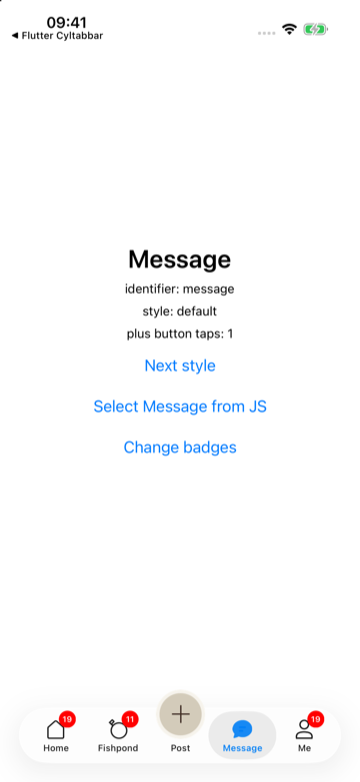
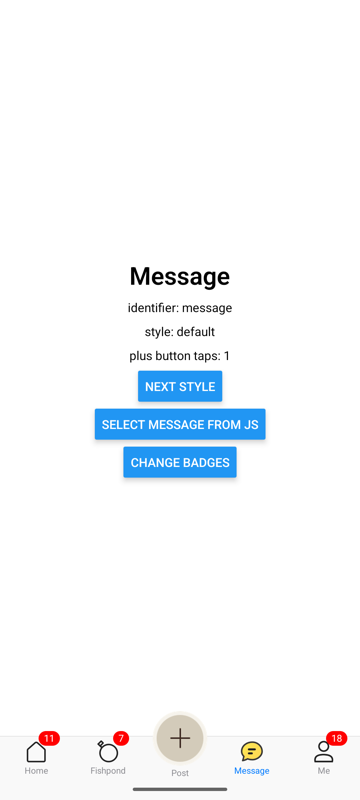
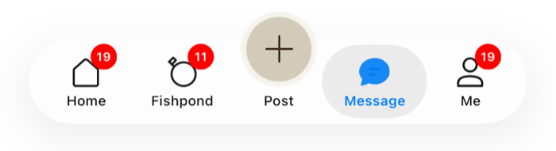
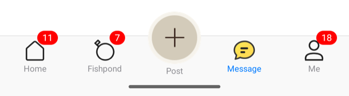

# [CN]React Native 接入：react-native-cyltabbar
# [EN]React Native integration: react-native-cyltabbar

<!-- bound-classes: CYLTabBarHostView -->
<!-- binding:start -->
<!-- Generated by scripts/update-docs-navigation.py; do not edit by hand. -->

| 中文 | English |
|:---|:---|
| 绑定的代码类 `CYLTabBarHostView`：[`CYLTabBarController/CYLTabBarHostView.h`](../CYLTabBarController/CYLTabBarHostView.h) | Bound to the class `CYLTabBarHostView`: [`CYLTabBarController/CYLTabBarHostView.h`](../CYLTabBarController/CYLTabBarHostView.h) |

<!-- binding:end -->

| 中文 | English |
|:---|:---|
| `react-native-cyltabbar` 把 CYLTabBarController（iOS）与它的 Android 版本封装为一个 React Native 组件 `<CYLTabBar>`：TabBar 是原生的（液态玻璃、扁平样式、凸起的 PlusButton、角标都来自原生库），页面由你用 React Native 绘制。本文按步骤说明如何接入。总览与原理见 [React Native 与 Flutter 组件](Cross-Platform-Components.md)。 | `react-native-cyltabbar` wraps CYLTabBarController (iOS) and its Android port as one React Native component, `<CYLTabBar>`: the tab bar is native (Liquid Glass, FlatDesign, the raised plus button and the badges all come from the native libraries) and you draw the pages with React Native. This page walks through the integration step by step. For the overview and how it works, see [React Native and Flutter components](Cross-Platform-Components.md). |

| iOS | Android |
|:---|:---|
|  |  |

## [CN]目录
## [EN]Contents

<!-- navigation:start -->
<!-- Generated by scripts/update-docs-navigation.py; do not edit by hand. -->

| 中文 | English |
|:---|:---|
| [先体验：运行示例](#cn先体验运行示例) | [Try it first: run the example](#entry-it-first-run-the-example) |
| [接入步骤](#cn接入步骤) | [Steps](#ensteps) |
| &nbsp;&nbsp;&nbsp;&nbsp;↳ [1. 添加依赖](#cn1-添加依赖) | &nbsp;&nbsp;&nbsp;&nbsp;↳ [1. Add the dependency](#en1-add-the-dependency) |
| &nbsp;&nbsp;&nbsp;&nbsp;↳ [2. iOS：pod install](#cn2-iospod-install) | &nbsp;&nbsp;&nbsp;&nbsp;↳ [2. iOS: pod install](#en2-ios-pod-install) |
| &nbsp;&nbsp;&nbsp;&nbsp;↳ [3. Android：Gradle](#cn3-androidgradle) | &nbsp;&nbsp;&nbsp;&nbsp;↳ [3. Android: Gradle](#en3-android-gradle) |
| &nbsp;&nbsp;&nbsp;&nbsp;↳ [4. 放到页面底部](#cn4-放到页面底部) | &nbsp;&nbsp;&nbsp;&nbsp;↳ [4. Put it at the bottom of the screen](#en4-put-it-at-the-bottom-of-the-screen) |
| [属性与事件](#cn属性与事件) | [Props and events](#enprops-and-events) |
| [常见问题](#cn常见问题) | [Troubleshooting](#entroubleshooting) |
| [限制](#cn限制) | [Limits](#enlimits) |
| [测试与截图](#cn测试与截图) | [Testing and screenshots](#entesting-and-screenshots) |

<!-- navigation:end -->

## [CN]先体验：运行示例
## [EN]Try it first: run the example

| 中文 | English |
|:---|:---|
| **建议先运行示例，点几个 Tab、点 PlusButton、点 “Change badges” 与 “Next style”。** 示例直接引用本仓库的 iOS 与 Android 库源码，改库代码后重新运行即可调试。 | **Run the example first: tap a few tabs, the plus button, "Change badges" and "Next style".** It uses this repository's iOS and Android library sources: change the library and run it again to debug. |

```sh
cd CrossPlatform/react-native-cyltabbar
yarn                                   # dependencies of the library and the example
cd example/ios && LANG=en_US.UTF-8 pod install && cd ../..
yarn example start                     # Metro
yarn example ios                       # or: yarn example android
```

| 中文 | English |
|:---|:---|
| 环境：React Native 0.88（新架构 / Fabric）、Node 22、Xcode 与 CocoaPods；Android 需要 JDK 17 与 Android SDK 36。`pod install` 需要 UTF-8 locale。 | Requirements: React Native 0.88 (the New Architecture / Fabric), Node 22, Xcode and CocoaPods; Android needs JDK 17 and Android SDK 36. `pod install` needs a UTF-8 locale. |
| PAG 与 Rive 动效图标示例：`example-pag/`、`example-rive/`（`yarn example-pag ios`），见 [动效图标示例](Cross-Platform-Components.md#cn动效图标示例)。 | The PAG and Rive animated-icon demos: `example-pag/`, `example-rive/` (`yarn example-pag ios`); see [Animated-icon demos](Cross-Platform-Components.md#enanimated-icon-demos). |

## [CN]接入步骤
## [EN]Steps

### [CN]1. 添加依赖
### [EN]1. Add the dependency

| 中文 | English |
|:---|:---|
| 组件尚未发布到 npm。在你的 App 中按路径引用本仓库中的组件（或把 `CrossPlatform/react-native-cyltabbar` 复制到你的仓库）： | The component is not on npm yet. Reference it by path from your app (or copy `CrossPlatform/react-native-cyltabbar` into your repository): |

```sh
yarn add react-native-cyltabbar@file:../CYLTabBarController/CrossPlatform/react-native-cyltabbar
```

### [CN]2. iOS：pod install
### [EN]2. iOS: pod install

| 中文 | English |
|:---|:---|
| 组件的 podspec 依赖 `CYLTabBarController` pod，自动链接会把它加入。想调试本地库源码时，在 App 的 Podfile 中指定路径（示例就是这样做的）；否则使用 CocoaPods 上发布的版本。 | The component's podspec depends on the `CYLTabBarController` pod, which autolinking adds. To debug the local library sources, point the app's Podfile at them (as the example does); otherwise the published pod is used. |

```ruby
# ios/Podfile, inside the app target
pod 'CYLTabBarController', :path => '../../CYLTabBarController'   # optional: local sources
```

```sh
cd ios && LANG=en_US.UTF-8 pod install
```

### [CN]3. Android：Gradle
### [EN]3. Android: Gradle

| 中文 | English |
|:---|:---|
| 无需修改。组件发现 `../../../Example-Android`（本仓库中的位置）时直接编译其 `cyltabbar` 与 `tabpages` 源码；否则使用 Maven 上的 `io.github.chenyilong:cyltabbarcontroller`。在 App 的 `android/gradle.properties` 中可以设置 `cylAndroidRoot=<Example-Android 的路径>`（本地源码）或 `cylAndroidVersion=<版本>`。React Native 的 `ReactActivity` 已经是 `FragmentActivity`，满足 Android 库的要求。 | Nothing to change. When the component finds `../../../Example-Android` (its place in this repository), it compiles the `cyltabbar` and `tabpages` sources; otherwise it uses `io.github.chenyilong:cyltabbarcontroller` from Maven. In the app's `android/gradle.properties`, `cylAndroidRoot=<path to Example-Android>` (local sources) or `cylAndroidVersion=<version>` changes that. React Native's `ReactActivity` is already a `FragmentActivity`, which the Android library needs. |

### [CN]4. 放到页面底部
### [EN]4. Put it at the bottom of the screen

```tsx
import { useState } from 'react';
import { View } from 'react-native';
import { CYLTabBar, type CYLTabBarItem } from 'react-native-cyltabbar';

const ITEMS: CYLTabBarItem[] = [
  { title: 'Home', identifier: 'home', image: require('./home.png'), selectedImage: require('./home_selected.png') },
  { title: 'Message', identifier: 'message', image: require('./message.png') },
  { title: 'Me', identifier: 'me', image: 'system:person' },
  { title: 'Settings', identifier: 'settings', image: 'system:gear' },
];

export default function App() {
  const [index, setIndex] = useState(0);
  return (
    <View style={{ flex: 1 }}>
      <View style={{ flex: 1 }}>{/* your page for ITEMS[index] */}</View>
      <CYLTabBar
        items={ITEMS}
        styleType="liquidGlass"
        plusButton={{ title: 'Post', image: require('./post.png') }}
        selectedIndex={index}
        badgeValues={['', 'dot', '3', '']}
        onTabSelect={(i) => setIndex(i)}
        onPlusButtonPress={() => console.log('plus')}
      />
    </View>
  );
}
```

| 中文 | English |
|:---|:---|
| 组件只绘制 TabBar：在它上方绘制当前 Tab 的页面，在 `onTabSelect` 中切换。组件的高度由原生 TabBar 决定（含底部安全区），不需要设置。 | The component draws only the bar: draw the current tab's page above it and switch it in `onTabSelect`. Its height comes from the native tab bar (the bottom safe area included); do not set one. |

## [CN]属性与事件
## [EN]Props and events

| 属性 | Prop | 说明 / Description |
|:---|:---|:---|
| `items` | `items` | Tab 数组，即 `CYLTabBarControllerTabBarItemsAttributes`：`title`、`identifier`、`image`、`selectedImage`，以及[配置文件](Configuration-File.md)中 Tab 的任何其他键（如 `CYLTabBarItemTitlePositionAdjustment`）。 / The tabs, `CYLTabBarControllerTabBarItemsAttributes`: `title`, `identifier`, `image`, `selectedImage`, and any other tab key of [the configuration file](Configuration-File.md) (e.g. `CYLTabBarItemTitlePositionAdjustment`). |
| `styleType` | `styleType` | `default`、`system`、`flatDesign`、`liquidGlass`。修改后 TabBar 重新创建，选中与角标保留。 / Changing it rebuilds the bar; the selection and the badges stay. |
| `plusButton` | `plusButton` | `{ title, image, backgroundImage, titleColor, selectedTitleColor, titleFont, index, centerYMultiplier, centerYOffset, alignsTitle, keepsTitleVisible, showsSelection, size, imageSize, identifier, pageIdentifier }`，即 `CYLTabBarControllerPlusButton` 与其中的键（见[配置文件](Configuration-File.md#cn配置键)）。`pageIdentifier` 给 PlusButton 一个自己的页面。Tab 标题对齐时请给它标题。 / `CYLTabBarControllerPlusButton` and its keys (see [the configuration file](Configuration-File.md#enconfiguration-keys)). `pageIdentifier` gives the plus button its own page. Give it a title when the tab titles are aligned. |
| `userInterfaceStyle`、`tapAnimation`、`swipeToSwitchTab`、`animationSpeed` | `userInterfaceStyle`, `tapAnimation`, `swipeToSwitchTab`, `animationSpeed` | `CYLTabBarControllerUserInterfaceStyle`（`light` / `dark` / `system`，仅 iOS / iOS only）、`CYLTabBarControllerTabButtonTapAnimation`、`CYLTabBarControllerSwipeToSwitchTab`、`CYLTabBarControllerTabBarItemAnimationSpeed`。 |
| `iconRenderingMode`、`iconColor`、`selectedIconColor`（TabBar 与每个 Tab / bar and each tab） | `iconRenderingMode`, `iconColor`, `selectedIconColor` (bar and each tab) | #787：TabBar 上为 `CYLTabBarControllerIconRenderingMode`、`CYLTabBarControllerIconColor`、`CYLTabBarControllerSelectedIconColor`（没有单独设置的所有 Tab 的默认值），`CYLTabBarItem` 上为 `CYLTabBarItemIconRenderingMode`、`CYLTabBarItemIconColor`、`CYLTabBarItemSelectedIconColor`。`'template'` 一张图随状态着色，`'original'` 保持原色，`'automatic'` 为默认。见 [Tab-Item-Colors](Tab-Item-Colors.md)。 / #787: on the bar `CYLTabBarControllerIconRenderingMode`, `CYLTabBarControllerIconColor`, `CYLTabBarControllerSelectedIconColor` (the defaults of every tab without its own), on `CYLTabBarItem` `CYLTabBarItemIconRenderingMode`, `CYLTabBarItemIconColor`, `CYLTabBarItemSelectedIconColor`. `'template'` tints one image per state, `'original'` keeps its colors, `'automatic'` is the default. See [Tab-Item-Colors](Tab-Item-Colors.md). |
| `configurationRoute` | `CYLTabBarControllerConfigurationRoute` | 指向 App 内置或沙盒中配置文件的资源路由（[资源路由](Resource-Routes.md)），例如 `bundle:Configurations?name=tabbar`；先读取文件，其他属性覆盖文件中的键。 / A resource route to a configuration file built into the app or in its sandbox ([Resource routes](Resource-Routes.md)), e.g. `bundle:Configurations?name=tabbar`; the file is read first and the other props win over its keys. |
| `configuration` | `configuration` | 配置文件的其他键，优先于上面的属性，例如 `{ CYLTabBarControllerThemes: … }`。 / Any other configuration key; it wins over the props above, e.g. `{ CYLTabBarControllerThemes: … }`. |
| `selectedIndex` | `selectedIndex` | 选中的 Tab（`items` 中的下标，不含 PlusButton）；不设置时由用户点击决定。 / The selected tab (an index in `items`, the plus button left out); unset, the user's taps decide. |
| `badgeValues` | `badgeValues` | 每个 Tab 一个：`''` 无、`'dot'` 红点、其他为文字。 / One per tab: `''` none, `'dot'` a red dot, anything else a text. |
| `onTabSelect(index, identifier)` | `onTabSelect(index, identifier)` | 用户点击了 Tab。 / The user tapped a tab. |
| `plusButtonBadgeValue`、`badgeAnimation` | `plusButtonBadgeValue`, `badgeAnimation` | PlusButton 的角标（写法同 `badgeValues`）；角标动画：`none`、`scale`、`shake`、`bounce`、`breathe`、`leftRightOnce`、`rightLeftOnce`、`fadeInOnce`、`rollingOnce`、`scaleOnce`。 / The plus button's badge (values as in `badgeValues`); the badge animation. |
| `badgeStyles`、`plusButtonBadge`、`tabCoverImages` | `badgeStyles`, `plusButtonBadge`, `tabCoverImages` | 带样式的角标 `{ value, color, animation, radius, centerOffset }`（每个 Tab 一个，null 表示使用 `badgeValues`）、PlusButton 的带样式角标、覆盖 Tab 的图片。 / Badges with a style, one per tab (null: `badgeValues`), the plus button's, and images covering the tabs. |
| `onPlusButtonPress()` | `onPlusButtonPress()` | 用户点击了 PlusButton。PlusButton 有自己的页面时，选中它还会触发 `onTabSelect(-1, identifier)`。 / The user tapped the plus button. When it has its own page, selecting it also sends `onTabSelect(-1, identifier)`. |
| `onTabLongPress(index, identifier, title)` | `onTabLongPress(index, identifier, title)` | 用户长按了 Tab。 / The user long-pressed a tab. |
| `loggedIn`、`onLoginRequest(index, identifier, title)`、`onLoginStateChange(loggedIn)` | `loggedIn`, `onLoginRequest(index, identifier, title)`, `onLoginStateChange(loggedIn)` | 登录（#19）：未登录时点击配置 `CYLTabBarControllerLoginRequiredTabBarItemIdentifiers` 中的 Tab 不会选中它，而是调用 `onLoginRequest`；登录后设置 `loggedIn` 与 `selectedIndex`。`loggedIn` 为 `undefined` 时使用库缓存的状态（重启后保留），由 `onLoginStateChange` 报告。见[需要登录的 Tab](Login-Required-Tabs.md)。 / Login (#19): while logged out, tapping a tab listed in `CYLTabBarControllerLoginRequiredTabBarItemIdentifiers` calls `onLoginRequest` instead of selecting it; after login set `loggedIn` and `selectedIndex`. Left `undefined`, `loggedIn` uses the state the library cached (kept across launches), reported by `onLoginStateChange`. See [Tabs That Need Login](Login-Required-Tabs.md). |
| `language` | `language` | 库自身文字（角标与 PlusButton 的无障碍文字）与布局方向使用的语言，如 `'ar'`、`'zh-Hans'`；`undefined` 跟随设备。从右到左的语言使 TabBar 从右到左布局。Tab 标题来自 `items`，请在其中翻译。示例：语言行弹出 Objective-C 示例的五种语言与「跟随系统」，用新的 key 重建全部内容，阿拉伯语时根视图使用 `direction: 'rtl'`。 / The language of the library's own texts (badge and plus button accessibility texts) and of the layout direction, e.g. `'ar'`, `'zh-Hans'`; `undefined` follows the device. A right-to-left language lays the tab bar out right to left. The tab titles come from `items`: translate them there. Example: the language row offers the Objective-C example's five languages and "Follow system", rebuilds everything with a new key, and the root view uses `direction: 'rtl'` for Arabic. |
| `tabBarHidden` | `tabBarHidden` | 隐藏或显示 TabBar（带动画），所有样式都生效；隐藏时不接收触摸。示例：列表中的「Show / hide CYLFlatDesignTabBar」行，与 Objective-C 示例相同。 / Hides or shows the tab bar, animated, in every style; a hidden tab bar takes no touches. Example: the "Show / hide CYLFlatDesignTabBar" row, as in the Objective-C example. |
| `memoryWarningRequest`、`onMemoryWarning` | `memoryWarningRequest`, `onMemoryWarning` | 每次增大 `memoryWarningRequest` 模拟一次内存警告（issue #426），`onMemoryWarning` 收到每个 Tab 的结果（每个 Tab 一行，使用库的语言）。示例：「模拟内存警告」行，配置中开启 `CYLTabBarControllerUnloadsUnselectedViewsOnMemoryWarning` 并保留首页（`CYLTabBarControllerKeepsLoadedTabBarItemIdentifiers`），结果显示在弹窗中，与 Objective-C 示例相同。 / Each increase of `memoryWarningRequest` simulates a memory warning once (issue #426); `onMemoryWarning` gets what happened to each tab (one line per tab, in the library's language). Example: the "Simulate memory warning" row, with `CYLTabBarControllerUnloadsUnselectedViewsOnMemoryWarning` on and the home tab kept (`CYLTabBarControllerKeepsLoadedTabBarItemIdentifiers`) in the configuration, the result in an alert, as in the Objective-C example. |
| `playbackSpeed`、`playbackLoops`、`playAllRequest` | `playbackSpeed`, `playbackLoops`, `playAllRequest` | 实时设置所有 Tab 图标动画的播放速度（如 0.25 到 3；undefined 或 ≤ 0 为库的默认值）与是否循环，对正在播放的动画同样生效；每次增大 `playAllRequest`，所有图标动画按该策略从进度 0 重新播放（「全部播放」）。`animationSpeed` 是配置中的速度，创建 TabBar 时读取。 / The playback speed of every tab icon animation, changed live (e.g. 0.25 to 3; undefined or 0 or less: the library's default) and whether they loop, also for the animations already playing; each increase of `playAllRequest` plays every icon animation again from progress 0 with that policy ("Play all"). `animationSpeed` is the speed in the configuration, read when the tab bar is built. |
| `titlePositionAdjustment` | `titlePositionAdjustment` | 所有 Tab 的标题偏移（`[horizontal, vertical]`），运行时设置，不重新创建 TabBar，优先于配置中的值；对齐标题的 PlusButton 随之移动。示例：「标题偏移」行在 0、-4、4 之间切换，与 Objective-C 示例相同。 / The title offset of every tab (`[horizontal, vertical]`), set at runtime without building the tab bar again, winning over the configuration's; a plus button that aligns its title follows. Example: the "Title offset" row cycles through 0, -4 and 4, as in the Objective-C example. |
| `CYLAnimationView` | `CYLAnimationView` | 页面中的 PAG / Rive / Lottie 动画（`file`、`options`、`playing`），见 [CYLAnimationView](Cross-Platform-Components.md#encylanimationview-animations-in-a-page)。 / PAG / Rive / Lottie animations in a page. |

| 图片写法 | Image values | 说明 / Description |
|:---|:---|:---|
| `require('./home.png')` | `require('./home.png')` | 打包的图片，含 `@2x` / `@3x`；原生端先加载为图片再创建 TabBar（调试时来自 Metro，发布版来自 App 包）。 / A bundled image with its `@2x` / `@3x`; the native side loads it before building the bar (from Metro in debug, from the app bundle in release). |
| `'system:house.fill'` | `'system:house.fill'` | iOS 的 SF Symbol（Android 上按 drawable 名称查找）。 / An SF Symbol on iOS (a drawable name on Android). |
| `'home_normal'` | `'home_normal'` | iOS asset catalog 中的图片名、Android drawable 名。 / An iOS asset catalog name, an Android drawable name. |

## [CN]常见问题
## [EN]Troubleshooting

| 现象 | Symptom | 原因与处理 / Cause and fix |
|:---|:---|:---|
| `pod install`：`Unicode Normalization not appropriate for ASCII-8BIT` | `pod install`: `Unicode Normalization not appropriate for ASCII-8BIT` | 需要 UTF-8 locale：`LANG=en_US.UTF-8 pod install`。 / A UTF-8 locale is needed: `LANG=en_US.UTF-8 pod install`. |
| `'CYLTabBarController/CYLTabBarController.h' file not found` | `'CYLTabBarController/CYLTabBarController.h' file not found` | Podfile 中的路径指向了符号链接；CocoaPods 不会在符号链接目录中查找源码。使用真实路径。 / The Podfile path goes through a symlink; CocoaPods does not look for sources through one. Use the real path. |
| Android：`No package name found` | Android: `No package name found` | 组件根目录的 `react-native.config.js` 给出了包名，确认它被一起复制。 / The component's `react-native.config.js` gives the package name; make sure it was copied too. |
| Android 构建缺少 `android-36` | Android build: missing `android-36` | 安装 Android SDK Platform 36，或接受许可后让 Gradle 自动下载。 / Install Android SDK Platform 36, or accept the licenses and let Gradle download it. |
| 开启 R8 的 Android 发布版中 PAG / Rive 图标只显示图片，或启动时崩溃（`ClassNotFoundException: org.libpag.…`） | An R8-minified Android release shows images instead of PAG / Rive icons, or crashes at launch (`ClassNotFoundException: org.libpag.…`) | 库的 R8 规则没有生效。组件的 Gradle 文件通过 `consumerProguardFiles` 带上 `Example-Android/cyltabbar/consumer-rules.pro`；把组件复制到别处并改用源码时也要带上它（使用发布的 Maven 库时自动生效）。 / The library's R8 rules are missing. The component's Gradle file brings `Example-Android/cyltabbar/consumer-rules.pro` with `consumerProguardFiles`; keep it when you copy the component and compile the sources (the published Maven library applies it by itself). |
| Android 模拟器上的 debug 版：`Unable to load script`，连不上 Metro | Android emulator debug build: `Unable to load script`, Metro unreachable | 执行 `adb reverse tcp:8081 tcp:8081`，然后重新打开 App。 / Run `adb reverse tcp:8081 tcp:8081`, then open the app again. |

## [CN]限制
## [EN]Limits

| 中文 | English |
|:---|:---|
| 需要新架构（Fabric）。 | Needs the New Architecture (Fabric). |
| 原生页面中不能放 React Native 内容：组件只提供 TabBar。 | The native pages cannot hold React Native content: the component provides the bar only. |
| 组件尚未发布到 npm。 | The component is not on npm yet. |

## [CN]测试与截图
## [EN]Testing and screenshots

| 中文 | English |
|:---|:---|
| 截图来自 iPhone 17 Pro 模拟器（iOS 26.5）与 Android 模拟器（API 35，arm64）上的示例：点击 Message、点击 PlusButton（计数为 1）、点击 “Change badges” 之后。另外验证了从 JS 设置 `selectedIndex`，以及切换 default、liquidGlass、flatDesign 后保留选中与角标。没有在真机上运行，也没有测试发布版。 | The screenshots come from the example on an iPhone 17 Pro simulator (iOS 26.5) and an Android emulator (API 35, arm64), after tapping Message, the plus button (count 1) and "Change badges". Also checked: `selectedIndex` set from JS, and switching default, liquidGlass and flatDesign keeping the selection and the badges. Not run on a device; release builds not tested. |

| iOS | Android |
|:---|:---|
|  |  |
