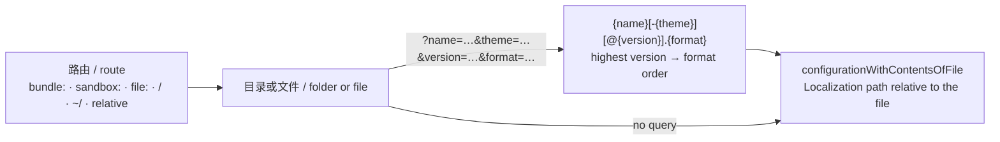
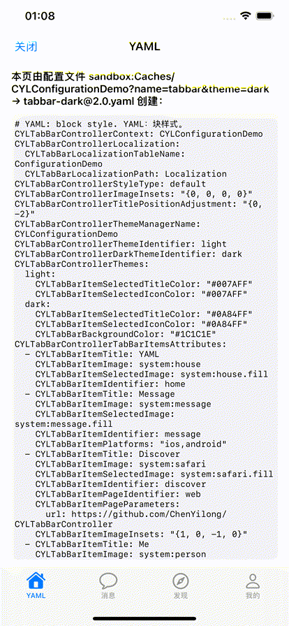

# [CN]资源路由
# [EN]Resource routes

<!-- bound-classes: CYLUtils -->
<!-- binding:start -->
<!-- Generated by scripts/update-docs-navigation.py; do not edit by hand. -->

| 中文 | English |
|:---|:---|
| 绑定的代码类 `CYLUtils`：[`CYLTabBarController/CYLUtils/CYLUtils.h`](../CYLTabBarController/CYLUtils/CYLUtils.h) | Bound to the class `CYLUtils`: [`CYLTabBarController/CYLUtils/CYLUtils.h`](../CYLTabBarController/CYLUtils/CYLUtils.h) |

<!-- binding:end -->

| 中文 | English |
|:---|:---|
| 资源路由用一个字符串说明资源的位置：配置文件，或存放字符串表的文件夹。资源可以内置在 App 中，也可以运行时下载到沙盒。带查询参数时，路由在一个文件夹的多个配置文件中，按名称、主题、版本与格式选出唯一的一个。iOS（`CYLResourceRoute`，属于 CYLUtils）与 Android（`CYLResourceRoute.kt`）规则相同；React Native 与 Flutter 通过宿主视图使用同样的配置。 | A resource route is one string that says where a resource is: a configuration file, or a folder of string tables. The resource can be built into the app or downloaded into its sandbox at run time. With a query, the route picks one file among the configuration files of a folder, by name, theme, version and format. iOS (`CYLResourceRoute`, in CYLUtils) and Android (`CYLResourceRoute.kt`) use the same rules; React Native and Flutter use the same configurations through the host view. |
| 本库不包含任何配置文件或字符串表：它们总是属于 App（示例层）。本库的示例文件在 `Example-Shared/Configurations/`，由各个示例打包。 | The library ships no configuration file and no string table: they always belong to the app (the example layer). The library's sample files are in `Example-Shared/Configurations/`, and each example bundles them. |

## [CN]目录
## [EN]Contents

<!-- navigation:start -->
<!-- Generated by scripts/update-docs-navigation.py; do not edit by hand. -->

| 中文 | English |
|:---|:---|
| [用法](#cn用法) | [Usage](#enusage) |
| [前缀](#cn前缀) | [Prefixes](#enprefixes) |
| [查询参数](#cn查询参数) | [Query](#enquery) |
| [运行时下载](#cn运行时下载) | [Downloaded at run time](#endownloaded-at-run-time) |
| [流程](#cn流程) | [Flow](#enflow) |
| [演示](#cn演示) | [Demo](#endemo) |
| [限制](#cn限制) | [Limits](#enlimits) |
| [测试与截图](#cn测试与截图) | [Testing and screenshots](#entesting-and-screenshots) |

<!-- navigation:end -->

## [CN]用法
## [EN]Usage

```objc
NSError *error = nil;
// [EN] Built into the app: the highest version of tabbar.{json,yaml,…} in the folder "Configurations".
// [CN] App 内置：Configurations 文件夹中最高版本的 tabbar.{json,yaml,…}。
CYLTabBarController *tabBarController =
    [CYLTabBarController tabBarControllerWithConfigurationRoute:@"bundle:Configurations?name=tabbar" error:&error];

// [EN] Downloaded into Caches/tabbar: the dark theme, version 2.1, JSON. [CN] 下载到 Caches/tabbar：深色主题、2.1 版本、JSON。
NSDictionary *configuration =
    [CYLTabBarController configurationWithRoute:@"sandbox:Caches/tabbar?name=tabbar&theme=dark&version=2.1&format=json" error:&error];

// [EN] Only the path. [CN] 只取路径。
NSString *path = [CYLResourceRoute pathForRoute:@"sandbox:Caches/tabbar?name=tabbar" baseDirectory:nil];
```

```kotlin
val controller = CYLTabBarController.tabBarControllerWithConfigurationRoute(activity, "bundle:Configurations?name=tabbar")
val configuration = CYLTabBarController.configurationWithRoute(context, "sandbox:Caches/tabbar?name=tabbar&theme=dark")
val path = CYLResourceRoute.pathForRoute(context, "sandbox:Caches/tabbar?name=tabbar")
```

```objc
CYLTabBarController *tabBarController = [CYLTabBarController tabBarControllerWithConfiguration:@{
    CYLTabBarControllerConfigurationRoute : @"bundle:Configurations?name=tabbar",
    CYLTabBarControllerTitlePositionAdjustment : @"{0, -3}",   // [EN] wins over the file [CN] 覆盖文件中的值
}];
```

```tsx
<CYLTabBar configurationRoute="sandbox:Caches/tabbar?name=tabbar&theme=dark" onTabSelect={onTabSelect} />
```

```dart
CYLTabBar(configurationRoute: 'bundle:Configurations?name=tabbar', onTabSelect: onTabSelect)
```

| 中文 | English |
|:---|:---|
| 字典中的键 `CYLTabBarControllerConfigurationRoute`（iOS 与 Android）：先读取路由指向的文件，再由字典中的其他键覆盖（只比较第一层的键）。React Native 的 `configurationRoute` 属性与 Flutter 的 `configurationRoute` 参数写入这个键，因此可以用内置或沙盒中的配置文件创建 TabBar，并在 JavaScript / Dart 中修改少数值。没有匹配文件的路由会打印日志并被忽略。 | The dictionary key `CYLTabBarControllerConfigurationRoute` (iOS and Android): the routed file is read first, then the dictionary's other keys win over it (top-level keys only). React Native's `configurationRoute` prop and Flutter's `configurationRoute` parameter write this key, so a tab bar can come from a built-in or sandbox configuration file, with a few values changed in JavaScript / Dart. A route that matches no file is logged and ignored. |
| 路由没有匹配的文件时，iOS 返回 nil 并设置 `CYLTabBarConfigurationErrorFileNotFound`；Android 抛出 `FileNotFound`。错误信息中包含该路由。 | When a route matches no file, iOS returns nil with `CYLTabBarConfigurationErrorFileNotFound`, and Android throws `FileNotFound`. The message includes the route. |
| 配置中的 `CYLTabBarLocalizationPath` 也是资源路由（见[配置文件的本地化文本](Configuration-Localization.md)）。相对路径相对于路由选中的配置文件所在目录，因此配置文件与 `Localization/` 文件夹可以一起下载到同一个目录。 | `CYLTabBarLocalizationPath` in a configuration is a resource route too (see [Localized texts in a configuration file](Configuration-Localization.md)). A relative path is relative to the folder of the configuration file the route picked, so a configuration file and its `Localization/` folder can be downloaded into one folder together. |

## [CN]前缀
## [EN]Prefixes

| 中文 | English |
|:---|:---|
| 按下表顺序匹配（左侧为匹配规则的正则表达式）。查询参数（`?` 之后）不参与匹配。 | Matched in the order of the table below (the left column is the rule as a regular expression). The query (after `?`) is not part of the match. |

| 规则 / Rule | 示例 / Example | 中文 | English |
|:---|:---|:---|:---|
| `^bundle:` | `bundle:Configurations` | App 内置资源：iOS main bundle 的资源目录，Android 的 assets。 | Built into the app: the main bundle's resources on iOS, the assets on Android. |
| `^sandbox:Documents/` | `sandbox:Documents/tabbar` | 沙盒：iOS 的 Documents，Android 的 `filesDir`。 | The sandbox: Documents on iOS, `filesDir` on Android. |
| `^sandbox:(Caches\|tmp)/` | `sandbox:Caches/tabbar` | 沙盒缓存：iOS 的 Library/Caches（`tmp` 为临时目录），Android 的 `cacheDir`。适合运行时下载的文件。 | The sandbox caches: Library/Caches on iOS (`tmp`: the temporary folder), `cacheDir` on Android. Suits files downloaded at run time. |
| `^sandbox:` | `sandbox:Library/tabbar` | 沙盒中 App 主目录之下的其他路径（Android：App 数据目录）。 | Any other path below the app's home folder (Android: the app's data folder). |
| `^file:` | `file:///…/tabbar` | 本地文件 URL。 | A local file URL. |
| `^/` | `/var/…/tabbar` | 本地绝对路径。 | An absolute local path. |
| `^~/` | `~/Documents/tabbar` | App 主目录（iOS 沙盒根目录；Android：App 数据目录）。 | The app's home folder (iOS: the sandbox root; Android: the app's data folder). |
| 其他 / anything else | `Localization` | 相对于 `baseDirectory`（配置文件所在目录；Android 也可以是 `asset:<目录>`），没有时相对于 App 内置资源。 | Relative to `baseDirectory` (the configuration file's folder; on Android also `asset:<folder>`), else to the app's built-in resources. |

## [CN]查询参数
## [EN]Query

| 中文 | English |
|:---|:---|
| 文件名格式：`{name}[-{theme}][@{version}].{format}`，例如 `tabbar.json`、`tabbar@2.1.json`、`tabbar-dark@2.1.yaml`。查询参数的键与 `format` 的值不区分大小写，值可以使用百分号编码。 | File names: `{name}[-{theme}][@{version}].{format}`, e.g. `tabbar.json`, `tabbar@2.1.json`, `tabbar-dark@2.1.yaml`. The query keys and the `format` value ignore case; values may be percent-encoded. |

| 键 / Key | 中文 | English |
|:---|:---|:---|
| `name` | 必填。文件名的开头部分。没有 `name` 的查询不匹配任何文件。 | Required: the start of the file name. A query without `name` matches nothing. |
| `theme` | 主题（皮肤），必须一致；不写时只匹配没有主题的文件。 | The theme (skin); must be equal. Without it, only files without a theme match. |
| `version` | 版本，必须一致；不写时取最高版本（数字按数值比较，`1.10` 高于 `1.9`；没有版本的文件最低）。 | The version; must be equal. Without it the highest version wins (numbers compare as numbers, `1.10` is above `1.9`; a file without a version is the lowest). |
| `format` | 格式（扩展名），同一格式的扩展名视为相同（`yaml` / `yml`，`ini` / `cfg` / `conf` 等）；不写时为配置解析器支持的任意格式。 | The format (extension); the extensions of one format are equal (`yaml` / `yml`, `ini` / `cfg` / `conf`…). Without it, any format the configuration parser reads. |

| 中文 | English |
|:---|:---|
| 多个文件都匹配时：先取最高版本，再按格式优先级 JSON、JSON5、JSONC、YAML、plist、XML、TOML、INI、.properties、.env、Protobuf 文本、Protobuf 二进制、.strings。以 `.` 开头的文件（如 `._*`）被忽略。 | When several files match: the highest version first, then the format, in the order JSON, JSON5, JSONC, YAML, plist, XML, TOML, INI, .properties, .env, Protobuf text, Protobuf binary, .strings. Files starting with `.` (such as `._*`) are ignored. |

## [CN]运行时下载
## [EN]Downloaded at run time

| 中文 | English |
|:---|:---|
| 1. 把配置文件按上面的文件名格式保存到沙盒中的一个目录，例如 `Caches/tabbar/tabbar-dark@2.1.json`。 | 1. Save the configuration files into one folder of the sandbox with the names above, e.g. `Caches/tabbar/tabbar-dark@2.1.json`. |
| 2. 字符串表保存到同一目录下的 `Localization/{language}.lproj/{table}.strings`，配置中写 `"CYLTabBarLocalizationPath": "Localization"`。 | 2. Save the string tables into `Localization/{language}.lproj/{table}.strings` of that folder, and write `"CYLTabBarLocalizationPath": "Localization"` in the configuration. |
| 3. 用 `sandbox:Caches/tabbar?name=tabbar&theme=dark` 创建 TabBar。新版本下载后，同一个路由会选中更高的版本，代码不用改。 | 3. Create the tab bar with `sandbox:Caches/tabbar?name=tabbar&theme=dark`. When a newer version is downloaded, the same route picks it, with no change in code. |

## [CN]流程
## [EN]Flow



## [CN]演示
## [EN]Demo

| 中文 | English |
|:---|:---|
| ObjC Example 设置列表中的“从配置文件创建 TabBarController”：`bundle:Configurations?name=cyl_tabbar_configuration` 从 App 内置资源中选出 JSON 文件；`sandbox:Caches/CYLConfigurationDemo?name=tabbar&theme=dark` 先把示例文件复制到 Caches（代替下载：`tabbar@1.0.json`、`tabbar@2.0.json`、`tabbar-dark@1.0.json`、`tabbar-dark@2.0.yaml` 与 `Localization/`），再选出 `tabbar-dark@2.0.yaml`。 | "Create a TabBarController from a configuration file" in the ObjC Example's settings list: `bundle:Configurations?name=cyl_tabbar_configuration` picks the JSON file among the app's built-in resources; `sandbox:Caches/CYLConfigurationDemo?name=tabbar&theme=dark` first copies the samples into Caches (standing in for a download: `tabbar@1.0.json`, `tabbar@2.0.json`, `tabbar-dark@1.0.json`, `tabbar-dark@2.0.yaml` and `Localization/`), then picks `tabbar-dark@2.0.yaml`. |

## [CN]限制
## [EN]Limits

| 中文 | English |
|:---|:---|
| 路由只读取本地文件；网络上的配置请用 `+loadConfigurationWithURL:completion:`，或先下载到沙盒再用路由读取。 | Routes read local files only; for a configuration on the network use `+loadConfigurationWithURL:completion:`, or download it into the sandbox first and read it with a route. |
| 名称中不要使用 `-` 与 `@`：它们分隔主题与版本。 | Do not use `-` or `@` in a name: they separate the theme and the version. |
| 二进制 Protobuf（`.binpb`）没有 `CYLTabBarControllerLocalization` 字段，因此不能指定字符串表。 | Binary Protobuf (`.binpb`) has no `CYLTabBarControllerLocalization` field, so it cannot name string tables. |

## [CN]测试与截图
## [EN]Testing and screenshots

| 中文 | English |
|:---|:---|
| 单元测试：iOS `CYLResourceRouteTests`（前缀、查询参数选择、沙盒路由与相对的字符串表、没有匹配的文件）；Android `CYLResourceRouteTest`（同样的情况）。`scripts/configuration-tests/run-tests.sh` 检查每个示例文件都写明了字符串表。 | Unit tests: iOS `CYLResourceRouteTests` (the prefixes, picking by query, a sandbox route with relative string tables, no matching file); Android `CYLResourceRouteTest` (the same cases). `scripts/configuration-tests/run-tests.sh` checks that every sample file names its string tables. |
| 2026-11-10 在 iPhone 17 Pro Max 模拟器（Xcode 27）上运行 ObjC Example，简体中文（`-AppleLanguages (zh-Hans)`）：沙盒路由选中 `tabbar-dark@2.0.yaml`，Tab 标题“消息 / 发现 / 我的”来自沙盒中的 `Localization/zh-Hans.lproj/ConfigurationDemo.strings`。 | Run on 2026-11-10 with the ObjC Example on an iPhone 17 Pro Max simulator (Xcode 27), in Simplified Chinese (`-AppleLanguages (zh-Hans)`): the sandbox route picks `tabbar-dark@2.0.yaml`, and the tab titles "消息 / 发现 / 我的" come from `Localization/zh-Hans.lproj/ConfigurationDemo.strings` in the sandbox. |
|  |  |
