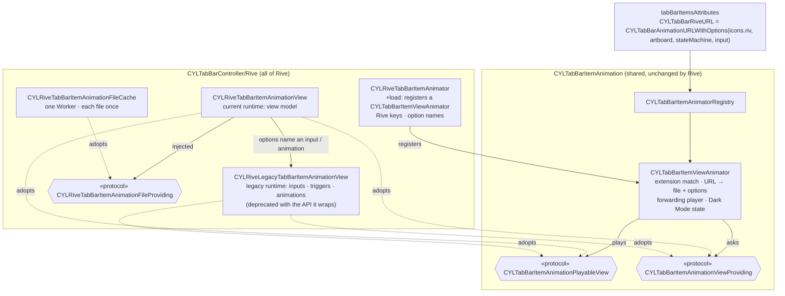

# [CN]Rive 动画 Tab 图标（与 Lottie、PAG 用法相同）
# [EN]Rive animated tab icons (used like Lottie and PAG)

<!-- bound-classes: CYLRiveTabBarItemAnimator, CYLTabBarItemViewAnimator -->
<!-- binding:start -->
<!-- Generated by scripts/update-docs-navigation.py; do not edit by hand. -->

| 中文 | English |
|:---|:---|
| 绑定的代码类 `CYLRiveTabBarItemAnimator`：[`CYLTabBarController/CYLTabBarItemAnimation/Rive/CYLRiveTabBarItemAnimator.h`](../CYLTabBarController/CYLTabBarItemAnimation/Rive/CYLRiveTabBarItemAnimator.h) | Bound to the class `CYLRiveTabBarItemAnimator`: [`CYLTabBarController/CYLTabBarItemAnimation/Rive/CYLRiveTabBarItemAnimator.h`](../CYLTabBarController/CYLTabBarItemAnimation/Rive/CYLRiveTabBarItemAnimator.h) |
| 绑定的代码类 `CYLTabBarItemViewAnimator`：[`CYLTabBarController/CYLTabBarItemAnimation/CYLTabBarItemViewAnimator.h`](../CYLTabBarController/CYLTabBarItemAnimation/CYLTabBarItemViewAnimator.h) | Bound to the class `CYLTabBarItemViewAnimator`: [`CYLTabBarController/CYLTabBarItemAnimation/CYLTabBarItemViewAnimator.h`](../CYLTabBarController/CYLTabBarItemAnimation/CYLTabBarItemViewAnimator.h) |

<!-- binding:end -->

| 中文 | English |
|:---|:---|
| 支持 [Rive](https://rive.app)（`RiveRuntime`）动画作为 Tab 图标。Rive 文件由状态机驱动，一个 `.riv` 文件还可以通过多个画板（artboard）包含很多图标。接入方式与 Lottie、PAG 相同（CocoaPods 子库、同样的 key 与播放流程），适用于经典系统 TabBar、液态玻璃（Liquid Glass）与扁平样式（FlatDesign）。Rive 是 `CYLTabBarItemAnimation` 子库「可播放视图」方式的第一个插件（见 [Tab-Bar-Item-Animation.md](Tab-Bar-Item-Animation.md#cn新增一个动画库)）：**Core、引擎与其他动画库都没有修改**。 | [Rive](https://rive.app) (`RiveRuntime`) animations as tab icons. A Rive file is driven by state machines, and one `.riv` file can hold many icons, one per artboard. It is integrated like Lottie and PAG (a CocoaPods subspec, the same keys and playback pipeline), in the classic system tab bar, Liquid Glass and FlatDesign. Rive is the first plugin of the "playable view" way of the `CYLTabBarItemAnimation` subspec (see [Tab-Bar-Item-Animation.md](Tab-Bar-Item-Animation.md#enadding-an-animation-library)): **Core, the engine and the other libraries are unchanged**. |

## [CN]目录
## [EN]Contents

<!-- navigation:start -->
<!-- Generated by scripts/update-docs-navigation.py; do not edit by hand. -->

| 中文 | English |
|:---|:---|
| [安装](#cn安装) | [Installation](#eninstallation) |
| [Key 与选项](#cnkey-与选项) | [Keys and options](#enkeys-and-options) |
| [没有 view model 的文件（旧版运行时）](#cn没有-view-model-的文件旧版运行时) | [Files without a view model (legacy runtime)](#enfiles-without-a-view-model-legacy-runtime) |
| [实现结构](#cn实现结构) | [Implementation](#enimplementation) |
| [代码演示](#cn代码演示) | [Code](#encode) |
| [Demo：Example-SwiftUI-Rive](#cndemoexample-swiftui-rive) | [Demo: Example-SwiftUI-Rive](#endemo-example-swiftui-rive) |
| [与 Lottie、PAG 的差异](#cn与-lottiepag-的差异) | [Differences from Lottie and PAG](#endifferences-from-lottie-and-pag) |
| [测试与截图](#cn测试与截图) | [Testing and screenshots](#entesting-and-screenshots) |

<!-- navigation:end -->

## [CN]安装
## [EN]Installation

```ruby
pod 'CYLTabBarController/Rive'             # RiveRuntime ~> 6.29, iOS 14+
# Compare / 对照: pod 'CYLTabBarController/LottieSwift' or 'CYLTabBarController/PAG'
```

| 中文 | English |
|:---|:---|
| 子库依赖 CocoaPods 上的 `RiveRuntime`（Rive 官方发布的二进制 `RiveRuntime.xcframework`，[rive-app/rive-ios](https://github.com/rive-app/rive-ios)），需要 6.29 及以上（6.x）与 iOS 14 及以上。未引入 Rive 子库时，`.riv` 文件不会被播放，Tab 显示图片。Swift Package Manager 与 Carthage 暂不提供 Rive。 | The subspec depends on the `RiveRuntime` pod (Rive's official binary `RiveRuntime.xcframework`, [rive-app/rive-ios](https://github.com/rive-app/rive-ios)), 6.29 or later (6.x), iOS 14 or later. Without the Rive subspec no library plays `.riv` files and the tabs show their images. Swift Package Manager and Carthage do not offer Rive yet. |

## [CN]Key 与选项
## [EN]Keys and options

| Lottie | PAG | Rive | 中文 | English |
|:---|:---|:---|:---|:---|
| `CYLTabBarLottieURL` / `…FilePath` | `CYLTabBarPAGURL` / `…FilePath` | `CYLTabBarRiveURL` / `…FilePath` | 动画文件；Rive 的 URL 通常带有画板等选项 | The file; a Rive URL usually carries options such as the artboard |
| `CYLTabBarLottieSize` | `CYLTabBarPAGSize` | `CYLTabBarRiveSize` | 视图尺寸，CGSize 的 NSValue | The view size, an NSValue of CGSize |
| `CYLTabBarLottieDarkURL` / `…DarkFilePath` | `CYLTabBarPAGDarkURL` / `…DarkFilePath` | `CYLTabBarRiveDarkURL` / `…DarkFilePath` | 深色模式版本 | The Dark Mode version |
| `CYLTabBarLottieDarkColors` | — | `CYLTabBarRiveDarkColors` | 一份文件适配深色模式：Rive 按 view model 颜色属性路径替换颜色 | One file for Dark Mode: Rive replaces colors by view model color property path |

| 中文 | English |
|:---|:---|
| Rive 的 key 与选项名称声明在 Rive 子库自己的头文件 `CYLRiveTabBarItemAnimator.h` 中，不在 Core 中；它们是通用 key（`CYLTabBarAnimationURL`…）的别名，两种都可以用。按名称批量添加文件请使用通用的 `CYLTabBarItemsAttributesAddingAnimationFiles(attributes, @[@"tab_home.riv", …], nil)`。选项由通用的 `CYLTabBarAnimationURLWithOptions(fileURL, options)` 写入 URL，因此多个 Tab 可以使用同一个文件的不同画板（文件只加载一次）。 | Rive's keys and option names are declared in the Rive subspec's own header, `CYLRiveTabBarItemAnimator.h`, not in Core; they are aliases of the generic keys (`CYLTabBarAnimationURL`…), and either works. To add files by name, use the generic `CYLTabBarItemsAttributesAddingAnimationFiles(attributes, @[@"tab_home.riv", …], nil)`. The generic `CYLTabBarAnimationURLWithOptions(fileURL, options)` puts the options in the URL, so several tabs can use different artboards of one file (loaded once). |
| 与 Lottie、PAG 同时引入时，使用 `CYLTabBarRiveURL` 等 Rive key 的 Tab 只由 Rive 播放，即使 URL 没有 ".riv" 扩展名，见 [注册与选择动画库](Tab-Bar-Item-Animation.md#cn注册与选择动画库)。 | Installed together with Lottie and PAG, a tab using Rive's keys (`CYLTabBarRiveURL`…) is played by Rive only, even when its URL has no ".riv" extension, see [Registering and choosing a library](Tab-Bar-Item-Animation.md#enregistering-and-choosing-a-library). |
| Rive 图标没有时间线，它的状态机根据数据切换状态。选中 Tab 时如何「播放」取决于文件：使用数据绑定（view model）的文件由 Rive 当前的运行时播放；数据绑定出现之前制作的文件没有 view model，通过状态机输入、trigger 或线性动画播放，由旧版运行时播放（见下一节）。 | A Rive icon has no timeline: its state machine changes state from data. How a selected tab "plays" depends on the file: files with data binding (a view model) play on Rive's current runtime; files made before data binding have no view model and play through state machine inputs, triggers or linear animations, on the legacy runtime (see the next section). |

| 选项 / Option（Swift） | 默认值 / Default | 中文 | English |
|:---|:---|:---|:---|
| `CYLTabBarAnimationOptionRiveArtboard`（`.riveArtboard`） | 文件的默认画板 / the file's default | 画板名称，例如 `HOME` | The artboard, e.g. `HOME` |
| `CYLTabBarAnimationOptionRiveStateMachine`（`.riveStateMachine`） | 画板的默认状态机 / the artboard's default | 状态机名称，例如 `HOME_interactivity` | The state machine, e.g. `HOME_interactivity` |
| `CYLTabBarAnimationOptionRiveActiveProperty`（`.riveActiveProperty`） | `active` | 选中时设为 YES 的 view model 布尔属性 | The view model boolean set to YES on selection |
| `CYLTabBarAnimationOptionRiveActiveDuration`（`.riveActiveDuration`） | `1` | 布尔属性或输入保持 YES 的秒数（最长 60）；`0` 表示保持到停止 | Seconds the boolean or input stays YES (at most 60); `0` keeps it until it stops |
| `CYLTabBarAnimationOptionRiveTriggerProperty`（`.riveTriggerProperty`） | — | 改为触发的 view model trigger | A view model trigger fired instead |
| `CYLTabBarAnimationOptionRiveColor`（`.riveColor`） | 文件中的颜色 / the file's | 加载时设置到 view model 颜色 `color` 的浅色颜色，"#RRGGBB" 或 "#RRGGBBAA" | The light color set on the view model color `color` on load, "#RRGGBB" or "#RRGGBBAA" |
| `CYLTabBarAnimationOptionRiveInput`（`.riveInput`） | — | 旧版：播放时设为 YES 的状态机布尔输入 | Legacy: the state machine boolean input set to YES when it plays |
| `CYLTabBarAnimationOptionRiveTriggerInput`（`.riveTriggerInput`） | — | 旧版：播放时触发的状态机 trigger 输入 | Legacy: the state machine trigger input fired when it plays |
| `CYLTabBarAnimationOptionRiveAnimation`（`.riveAnimation`） | — | 旧版：播放时播放的线性动画 | Legacy: the linear animation played when it plays |
| `CYLTabBarAnimationOptionRiveLegacyRuntime`（`.riveLegacyRuntime`） | — | 旧版：`"1"` 表示没有以上三项也使用旧版运行时，例如没有状态机的文件（默认动画循环播放） | Legacy: `"1"` uses the legacy runtime with none of the three above, e.g. a file without a state machine (its default animation loops) |

## [CN]没有 view model 的文件（旧版运行时）
## [EN]Files without a view model (legacy runtime)

| 中文 | English |
|:---|:---|
| Rive 6.29 只在旧版、已废弃的 API（`RiveViewModel`）中保留了状态机输入与线性动画，并建议改用数据绑定。为了让这类文件（例如很多 2022 年及更早制作的图标）也能直接用作 Tab 图标，Rive 子库提供第二个渲染实现 `CYLRiveLegacyTabBarItemAnimationView`：它与当前运行时的视图实现**同一组共用接口**（策略模式），只在选项中出现 `.riveInput`、`.riveTriggerInput`、`.riveAnimation` 或 `.riveLegacyRuntime` 时被选用。 | Rive 6.29 keeps state machine inputs and linear animations only in its legacy, deprecated API (`RiveViewModel`), and recommends data binding instead. So that such files (e.g. many icons made in 2022 or earlier) work as tab icons too, the Rive subspec has a second renderer, `CYLRiveLegacyTabBarItemAnimationView`: it implements **the same shared interfaces** as the current-runtime view (the strategy pattern) and is chosen only when the options contain `.riveInput`, `.riveTriggerInput`, `.riveAnimation` or `.riveLegacyRuntime`. |
| **不产生警告**：该类与其包装的旧版 API 一起标记为废弃，因此其内部对旧版 API 的调用不会产生警告；其他代码都不直接引用它，而是按 Objective-C 名称通过 `CYLTabBarItemAnimationViewProviding` 解析。Rive 将来移除旧版 API 时，只有这一个文件需要处理。 | **No warnings**: the class is deprecated together with the legacy API it wraps, so its own uses of that API add no warning; no other code names it, it is resolved by its Objective-C name through `CYLTabBarItemAnimationViewProviding`. When Rive removes the legacy API, this one file is all that needs attention. |
| 旧版运行时同步加载文件；画板、状态机或动画名称错误时不显示动画（DEBUG 下打印原因），而不会像 `RiveViewModel` 那样崩溃。旧版文件不支持 `CYLTabBarRiveDarkColors`，请使用深色文件 `CYLTabBarRiveDarkURL`。 | The legacy runtime loads files synchronously; a wrong artboard, state machine or animation name shows no animation (logged in DEBUG) instead of crashing as `RiveViewModel` would. Legacy files do not support `CYLTabBarRiveDarkColors`; use a dark file, `CYLTabBarRiveDarkURL`. |

## [CN]实现结构
## [EN]Implementation



| 中文 | English |
|:---|:---|
| Rive 自己只有三部分：**注册**（`Rive/CYLRiveTabBarItemAnimator.m`：声明 key 与选项名称，在 `+load` 中注册一个 `CYLTabBarItemViewAnimator`）、**当前运行时的视图**与**旧版运行时的视图**（`RiveSwift/`，都遵守共用协议 `CYLTabBarItemAnimationPlayableView` 与 `CYLTabBarItemAnimationViewProviding`）。按扩展名匹配、拆分 URL 与选项、播放器、深色模式状态与视图注入都由共用的 `CYLTabBarItemViewAnimator` 完成。任意遵守协议的类都可以通过 `CYLRiveTabBarItemAnimator.animator.viewProvider` 注入（例如测试替身），设为 nil 恢复默认。 | Rive itself is three parts: the **registration** (`Rive/CYLRiveTabBarItemAnimator.m`: declares the keys and option names, and registers a `CYLTabBarItemViewAnimator` in `+load`), the **current-runtime view** and the **legacy-runtime view** (`RiveSwift/`, both adopting the shared `CYLTabBarItemAnimationPlayableView` and `CYLTabBarItemAnimationViewProviding`). Matching by extension, splitting the URL into the file and options, the player, the Dark Mode state and view injection are done by the shared `CYLTabBarItemViewAnimator`. Any class adopting the protocols can be injected through `CYLRiveTabBarItemAnimator.animator.viewProvider` (e.g. a test double); nil goes back to the default. |

## [CN]代码演示
## [EN]Code

```swift
// Swift — from Example-SwiftUI-Rive/AnimatedApp/Navigation/TabItems.swift (shared by both demos): one file, one artboard per tab.
// 一个文件，每个 Tab 一个画板。icons.riv has no view model: `.riveInput` plays its state machine input "active".
let iconsURL = Bundle.main.url(forResource: "icons", withExtension: "riv")
attributes[CYLTabBarRiveURL] = CYLTabBarAnimationURLWithOptions(iconsURL, [
    .riveArtboard: "CHAT",
    .riveStateMachine: "CHAT_Interactivity",
    .riveInput: "active",
])
attributes[CYLTabBarRiveSize] = NSValue(cgSize: CGSize(width: 32, height: 32))
```

```objc
// Objective-C — a file with a view model, and Dark Mode with the same file.
// 带 view model 的文件，同一份文件适配深色模式。
NSDictionary *home = @{
    CYLTabBarItemTitle      : @"Home",
    CYLTabBarItemImage      : @"home_normal",            // shown without the Rive subspec 未引入 Rive 子库时显示
    CYLTabBarRiveURL        : CYLTabBarAnimationURLWithOptions(iconSetURL, @{
                                  CYLTabBarAnimationOptionRiveArtboard : @"HOME",
                                  CYLTabBarAnimationOptionRiveStateMachine : @"HOME_interactivity",
                              }),
    CYLTabBarRiveDarkColors : @{ @"color" : UIColor.whiteColor },
};
```

| 中文 | English |
|:---|:---|
| 与 Lottie、PAG 一样：`-[UIControl cyl_lottieAnimationView]` 返回 Tab 按钮上的 Rive 视图；`-[UIControl cyl_tabBarItemAnimationPlayer]` 返回其播放器；`-lottieAnimationViewContentMode` 映射为 Rive 的 fit。Tab 之外的任意 Rive 动画也可以通过 `CYLTabBarItemAnimationFactory`（Swift：`animationView(url:size:contentMode:)`、`player(for:)`）创建与播放，见下面 Demo 中的 `RiveAnimation`。 | As with Lottie and PAG: `-[UIControl cyl_lottieAnimationView]` returns the tab button's Rive view; `-[UIControl cyl_tabBarItemAnimationPlayer]` returns its player; `-lottieAnimationViewContentMode` maps to Rive's fit. Any Rive animation outside the tab bar can be made and played through `CYLTabBarItemAnimationFactory` too (Swift: `animationView(url:size:contentMode:)`, `player(for:)`), see `RiveAnimation` in the demo below. |

## [CN]Demo：Example-SwiftUI-Rive
## [EN]Demo: Example-SwiftUI-Rive

| 中文 | English |
|:---|:---|
| [`Example-SwiftUI-Rive`](../Example-SwiftUI-Rive) 由 Design+Code 课程「SwiftUI Animations」的最终工程改造而来：课程中手写的 SwiftUI TabBar 换成了嵌入 SwiftUI 的 `CYLTabBarController`，5 个 Tab 使用课程 `icons.riv` 中的画板 `CHAT`、`SEARCH`、`TIMER`、`BELL`、`USER`（`.riveInput: "active"`，与课程中手写的「设为 YES 一秒」相同）。 | [`Example-SwiftUI-Rive`](../Example-SwiftUI-Rive) is the final project of Design+Code's "SwiftUI Animations" course, reworked: the course's hand-made SwiftUI tab bar is now a `CYLTabBarController` embedded in SwiftUI, whose 5 tabs use the artboards `CHAT`, `SEARCH`, `TIMER`, `BELL` and `USER` of the course's `icons.riv` (`.riveInput: "active"`, the same "YES for a second" the course wrote by hand). |
| App 中其余的 Rive 动画也都通过本库播放（`Components/RiveAnimation.swift` 包装 `CYLTabBarItemAnimationFactory`），App 本身不调用任何 Rive API：菜单按钮（`.riveInput: "isOpen"`，`.riveActiveDuration: "0"`）、侧边菜单图标、引导页按钮（`.riveAnimation: "active"`）与背景（`.riveLegacyRuntime: "1"`）、登录结果（`.riveTriggerInput: "Check"` / `"Error"`）与彩带（`"Trigger explosion"`）。原工程的 Swift Package 已移除，RiveRuntime 由 `pod 'CYLTabBarController/Rive'` 引入。运行：在该目录执行 `pod install`，打开 `AnimatedApp.xcworkspace`。 | Every other Rive animation of the app plays through this library too (`Components/RiveAnimation.swift` wraps `CYLTabBarItemAnimationFactory`), so the app calls no Rive API itself: the menu button (`.riveInput: "isOpen"`, `.riveActiveDuration: "0"`), the side menu icons, the onboarding button (`.riveAnimation: "active"`) and background (`.riveLegacyRuntime: "1"`), the sign-in result (`.riveTriggerInput: "Check"` / `"Error"`) and the confetti (`"Trigger explosion"`). The original project's Swift package was removed; RiveRuntime comes with `pod 'CYLTabBarController/Rive'`. To run: `pod install` in that folder, then open `AnimatedApp.xcworkspace`. |
| **UIKit 版本**：[`Example-Rive`](../Example-Rive) 是同一个 Demo 的 UIKit App：没有 SwiftUI `App`，`AppDelegate` 直接把 `CYLTabBarController` 设为 window 的根控制器，同样通过 `pod 'CYLTabBarController/Rive'` 集成。它只有自己的 `RiveApp/` 三个文件，Tab 的定义与 Rive 属性（共用的 `Navigation/TabItems.swift`）、课程页面与资源都直接引用 `Example-SwiftUI-Rive`；其中 [`RiveUIKitViewController`](../Example-Rive/RiveApp/RiveUIKitViewController.swift) 演示在纯 UIKit 中用 `CYLTabBarItemAnimationFactory` 播放 Rive 动画。 | **UIKit version**: [`Example-Rive`](../Example-Rive) is the same demo as a UIKit app: no SwiftUI `App`; `AppDelegate` makes a `CYLTabBarController` the window's root view controller, integrated the same way with `pod 'CYLTabBarController/Rive'`. Its own files are the three in `RiveApp/`; the tab definitions and Rive attributes (the shared `Navigation/TabItems.swift`), the course's screens and resources are referenced from `Example-SwiftUI-Rive`. [`RiveUIKitViewController`](../Example-Rive/RiveApp/RiveUIKitViewController.swift) shows a Rive animation in plain UIKit through `CYLTabBarItemAnimationFactory`. |
| **来源与许可**：课程代码、图片与 `.riv` 文件来自 Design+Code 公开下载的课程附件，压缩包中没有许可文件，版权归原作者（Meng To）所有；本仓库只保留其最终工程（不含 15 个课程步骤的副本），并做了上述修改。 | **Source and license**: the course's code, images and `.riv` files come from Design+Code's publicly downloadable course attachment, whose archive has no license file; the copyright stays with its author (Meng To). This repository keeps only its final project (not the 15 course-step copies), with the changes above. |

## [CN]与 Lottie、PAG 的差异
## [EN]Differences from Lottie and PAG

| 中文 | English |
|:---|:---|
| **播放方式**：状态机没有播放进度，选中时通过 view model 属性或状态机输入播放；启动时选中的 Tab（#389）保持静止状态。 | **Playback**: a state machine has no playback position; a selected tab plays through a view model property or a state machine input; the tab selected at launch (#389) stays in its resting state. |
| **播放速度**：`lottieAnimationSpeed` 对 Rive 无效，请用 `.riveActiveDuration` 或在 Rive 编辑器中调整。 | **Speed**: `lottieAnimationSpeed` does not apply to Rive; use `.riveActiveDuration`, or change it in the Rive editor. |
| **异步加载**：当前运行时异步加载文件，完成前图标区域为空，期间的播放请求会在加载后执行。 | **Asynchronous loading**: the current runtime loads files asynchronously; the icon is empty until then, and a play request made meanwhile runs once it has loaded. |

## [CN]测试与截图
## [EN]Testing and screenshots

| 中文 | English |
|:---|:---|
| 本次修改在 Linux 环境中完成，无法运行 Xcode 与 iOS 模拟器，因此**没有截图**，也没有真正编译或运行 Demo。两个 Swift 视图按 RiveRuntime 6.29.0 的源码编写（逐一核对了所用的每个 API 签名，包括旧版 API），但这里没有 Swift 编译器，**未做类型检查**；Demo 中的 Swift 代码同样未编译。已做的检查：用最小的 UIKit / Foundation / RiveRuntime 桩头文件对共用的 `CYLTabBarItemViewAnimator.m`、`CYLRiveTabBarItemAnimator.m`、Core 的 `CYLTabBarAnimationURLWithOptions()` 与一个注入 `viewProvider` 的测试替身执行 `clang -fsyntax-only -Wall -Wextra -Wprotocol`，无错误与警告；`pod lib lint --quick` 通过；`xcodeproj` 能正常解析 Demo 工程，没有缺失的文件引用；Demo 中不再有对 Rive API 的直接调用；用 `strings` 核对了课程 `.riv` 文件中的画板、状态机与输入名称。 | This change was made on Linux, where Xcode and the iOS simulator cannot run, so there are **no screenshots**, and the demo was neither built nor run. Both Swift views were written against RiveRuntime 6.29.0's source (every API signature they use was checked, the legacy ones too), but there is no Swift compiler here, so they **have not been type-checked**; neither has the demo's Swift. Checks done: `clang -fsyntax-only -Wall -Wextra -Wprotocol` with minimal UIKit / Foundation / RiveRuntime stub headers on the shared `CYLTabBarItemViewAnimator.m`, `CYLRiveTabBarItemAnimator.m`, Core's `CYLTabBarAnimationURLWithOptions()` and a test double injected as `viewProvider`, with no error and no warning; `pod lib lint --quick` passes; `xcodeproj` parses the demo project with no missing file reference; the demo makes no direct Rive API call any more; the artboard, state machine and input names were checked against the course's `.riv` files with `strings`. |
| 请运行 `Example-SwiftUI-Rive` 并检查：构建无警告；Tab 显示课程的 Rive 图标，选中时播放、切换后上一个停止；菜单按钮、侧边菜单图标、引导页按钮与背景、登录结果与彩带都正常播放；三种 TabBar 样式均正常。验证后的截图请放在 `docs/assets/` 中，并用 `` 引用。 | Please run `Example-SwiftUI-Rive` and check: it builds with no warning; the tabs show the course's Rive icons, a selected one plays and the previous one stops; the menu button, side menu icons, onboarding button and background, sign-in result and confetti all play; and all three tab bar styles work. Put screenshots from these checks in `docs/assets/` and reference them as ``. |
