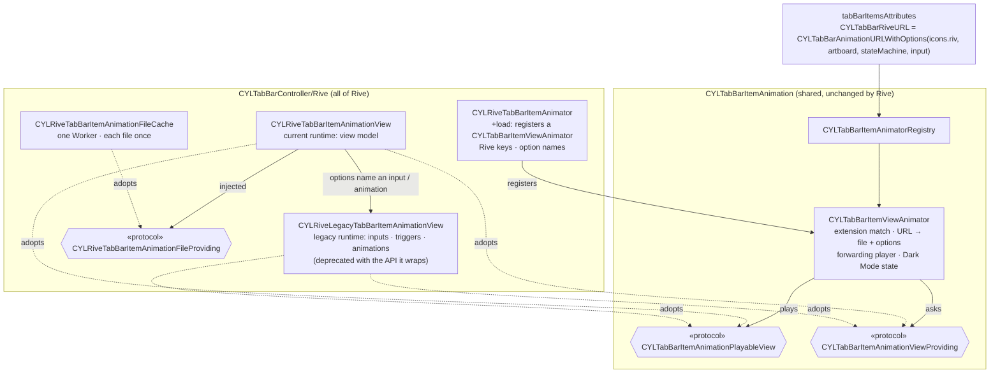
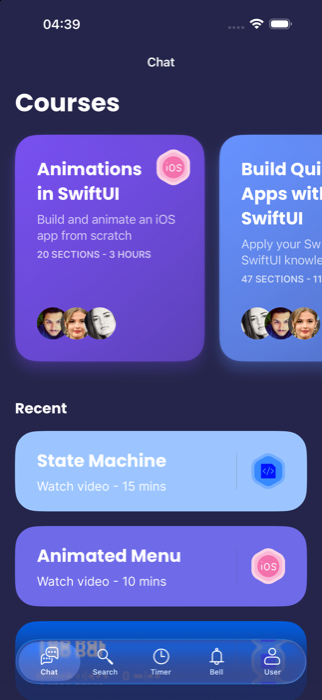
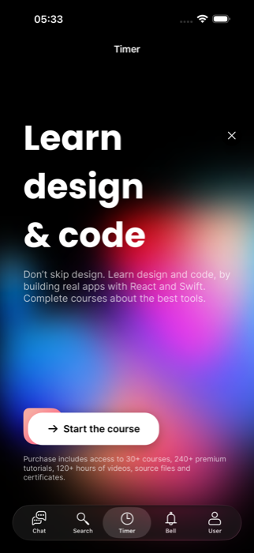
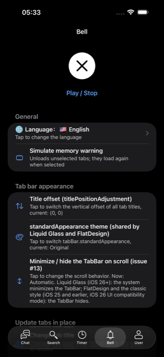
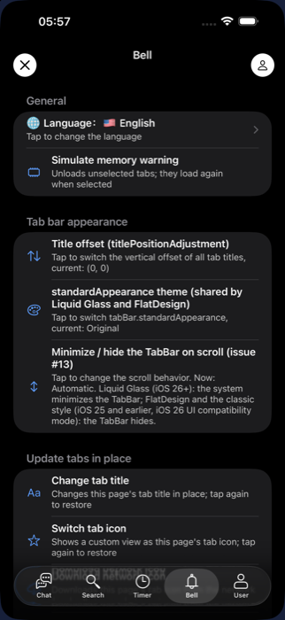
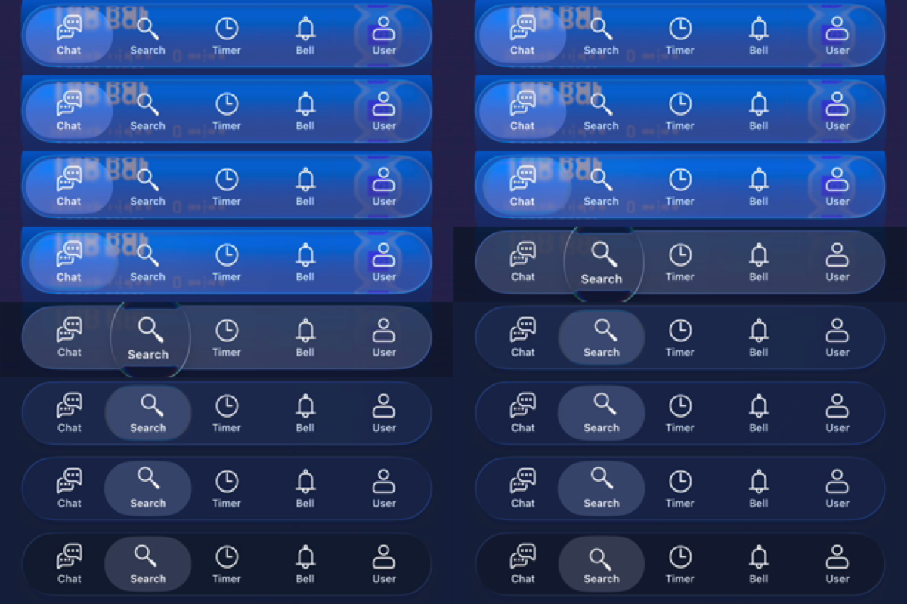
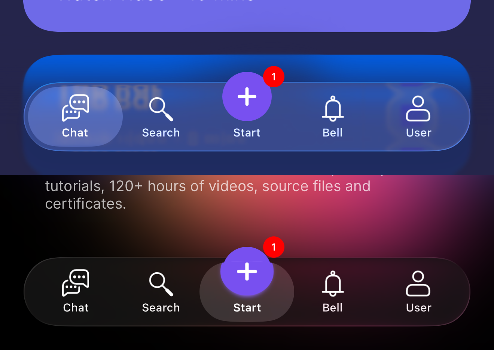
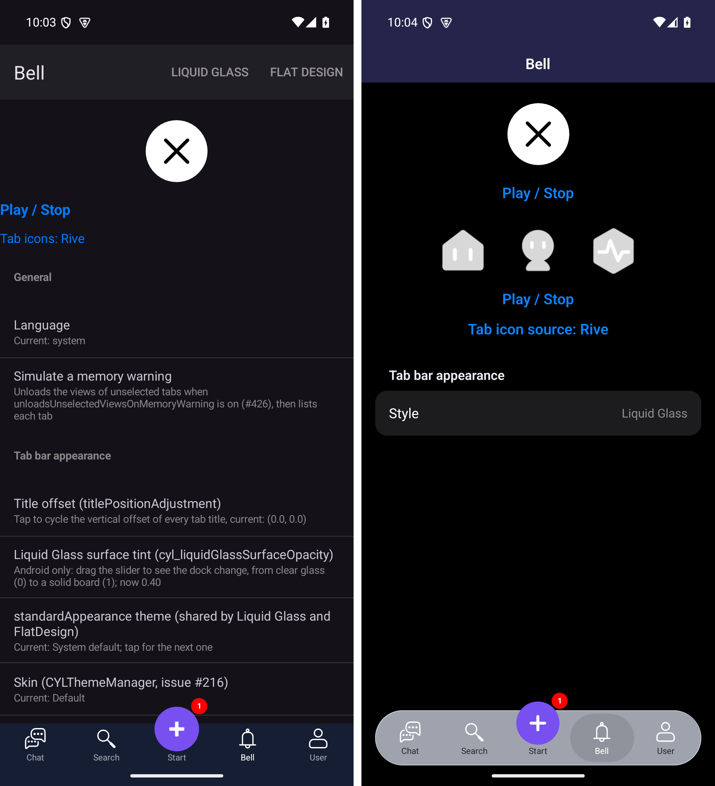
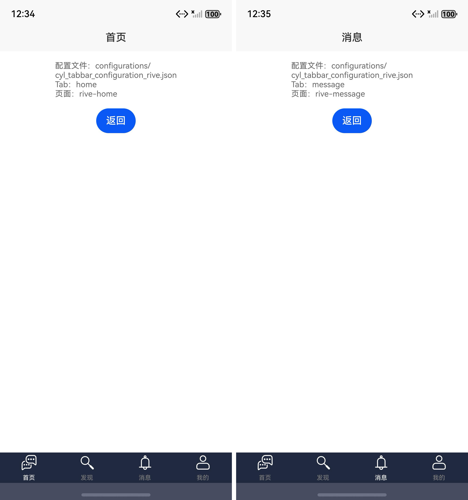

# [CN]Rive 动画 Tab 图标（与 Lottie、PAG 用法相同）
# [EN]Rive animated tab icons (used like Lottie and PAG)

<!-- bound-classes: CYLRiveTabBarItemAnimator, CYLTabBarItemViewAnimator -->
<!-- binding:start -->
<!-- Generated by scripts/update-docs-navigation.py; do not edit by hand. -->

| 中文 | English |
|:---|:---|
| 绑定的代码类 `CYLRiveTabBarItemAnimator`：[`CYLTabBarController/CYLTabBarItemAnimation/Rive/CYLRiveTabBarItemAnimator.h`](../CYLTabBarController/CYLTabBarItemAnimation/Rive/CYLRiveTabBarItemAnimator.h) | Bound to the class `CYLRiveTabBarItemAnimator`: [`CYLTabBarController/CYLTabBarItemAnimation/Rive/CYLRiveTabBarItemAnimator.h`](../CYLTabBarController/CYLTabBarItemAnimation/Rive/CYLRiveTabBarItemAnimator.h) |
| 绑定的代码类 `CYLTabBarItemViewAnimator`：[`CYLTabBarController/CYLTabBarItemAnimation/CYLTabBarItemViewAnimator.h`](../CYLTabBarController/CYLTabBarItemAnimation/CYLTabBarItemViewAnimator.h) | Bound to the class `CYLTabBarItemViewAnimator`: [`CYLTabBarController/CYLTabBarItemAnimation/CYLTabBarItemViewAnimator.h`](../CYLTabBarController/CYLTabBarItemAnimation/CYLTabBarItemViewAnimator.h) |

<!-- binding:end -->

| 中文 | English |
|:---|:---|
| 支持 [Rive](https://rive.app)（`RiveRuntime`）动画作为 Tab 图标。Rive 文件由状态机驱动，一个 `.riv` 文件还可以通过多个画板（artboard）包含很多图标。接入方式与 Lottie、PAG 相同（CocoaPods 子库、同样的 key 与播放流程），适用于经典系统 TabBar、液态玻璃（Liquid Glass）与扁平样式（FlatDesign）。Rive 是 `CYLTabBarItemAnimation` 子库「可播放视图」方式的第一个插件（见 [Tab-Bar-Item-Animation.md](Tab-Bar-Item-Animation.md#cn新增一个动画库)）：**Core、引擎与其他动画库都没有修改**。 | [Rive](https://rive.app) (`RiveRuntime`) animations as tab icons. A Rive file is driven by state machines, and one `.riv` file can hold many icons, one per artboard. It is integrated like Lottie and PAG (a CocoaPods subspec, the same keys and playback pipeline), in the classic system tab bar, Liquid Glass and FlatDesign. Rive is the first plugin of the "playable view" way of the `CYLTabBarItemAnimation` subspec (see [Tab-Bar-Item-Animation.md](Tab-Bar-Item-Animation.md#enadding-an-animation-library)): **Core, the engine and the other libraries are unchanged**. |

## [CN]目录
## [EN]Contents

<!-- navigation:start -->
<!-- Generated by scripts/update-docs-navigation.py; do not edit by hand. -->

| 中文 | English |
|:---|:---|
| [安装](#cn安装) | [Installation](#eninstallation) |
| [Key 与选项](#cnkey-与选项) | [Keys and options](#enkeys-and-options) |
| [没有 view model 的文件（旧版运行时）](#cn没有-view-model-的文件旧版运行时) | [Files without a view model (legacy runtime)](#enfiles-without-a-view-model-legacy-runtime) |
| [实现结构](#cn实现结构) | [Implementation](#enimplementation) |
| [代码演示](#cn代码演示) | [Code](#encode) |
| [Demo：Example-SwiftUI-Rive](#cndemoexample-swiftui-rive) | [Demo: Example-SwiftUI-Rive](#endemo-example-swiftui-rive) |
| [与 Lottie、PAG 的差异](#cn与-lottiepag-的差异) | [Differences from Lottie and PAG](#endifferences-from-lottie-and-pag) |
| [测试与截图](#cn测试与截图) | [Testing and screenshots](#entesting-and-screenshots) |
| [鸿蒙 Rive 崩溃与各平台核对（2026-11-16）](#cn鸿蒙-rive-崩溃与各平台核对2026-11-16) | [HarmonyOS Rive crashes and the check of every platform (2026-11-16)](#enharmonyos-rive-crashes-and-the-check-of-every-platform-2026-11-16) |
| [各平台的 Rive 引擎与鸿蒙崩溃修复状态（2026-11-16）](#cn各平台的-rive-引擎与鸿蒙崩溃修复状态2026-11-16) | [The Rive engine of each platform and the status of the HarmonyOS crash fix (2026-11-16)](#enthe-rive-engine-of-each-platform-and-the-status-of-the-harmonyos-crash-fix-2026-11-16) |

<!-- navigation:end -->

## [CN]安装
## [EN]Installation

```ruby
pod 'CYLTabBarController/Rive'             # RiveRuntime ~> 6.29, iOS 14+
# Compare / 对照: pod 'CYLTabBarController/LottieSwift' or 'CYLTabBarController/PAG'
```

| 中文 | English |
|:---|:---|
| 子库依赖 CocoaPods 上的 `RiveRuntime`（Rive 官方发布的二进制 `RiveRuntime.xcframework`，[rive-app/rive-ios](https://github.com/rive-app/rive-ios)），需要 6.29 及以上（6.x）与 iOS 14 及以上。未引入 Rive 子库时，`.riv` 文件不会被播放，Tab 显示图片。Swift Package Manager 与 Carthage 暂不提供 Rive。 | The subspec depends on the `RiveRuntime` pod (Rive's official binary `RiveRuntime.xcframework`, [rive-app/rive-ios](https://github.com/rive-app/rive-ios)), 6.29 or later (6.x), iOS 14 or later. Without the Rive subspec no library plays `.riv` files and the tabs show their images. Swift Package Manager and Carthage do not offer Rive yet. |

## [CN]Key 与选项
## [EN]Keys and options

| Lottie | PAG | Rive | 中文 | English |
|:---|:---|:---|:---|:---|
| `CYLTabBarLottieURL` / `…FilePath` | `CYLTabBarPAGURL` / `…FilePath` | `CYLTabBarRiveURL` / `…FilePath` | 动画文件；Rive 的 URL 通常带有画板等选项 | The file; a Rive URL usually carries options such as the artboard |
| `CYLTabBarLottieSize` | `CYLTabBarPAGSize` | `CYLTabBarRiveSize` | 视图尺寸，CGSize 的 NSValue | The view size, an NSValue of CGSize |
| `CYLTabBarLottieDarkURL` / `…DarkFilePath` | `CYLTabBarPAGDarkURL` / `…DarkFilePath` | `CYLTabBarRiveDarkURL` / `…DarkFilePath` | 深色模式版本 | The Dark Mode version |
| `CYLTabBarLottieDarkColors` | — | `CYLTabBarRiveDarkColors` | 一份文件适配深色模式：Rive 按 view model 颜色属性路径替换颜色 | One file for Dark Mode: Rive replaces colors by view model color property path |

| 中文 | English |
|:---|:---|
| Rive 的 key 与选项名称声明在 Rive 子库自己的头文件 `CYLRiveTabBarItemAnimator.h` 中，不在 Core 中；它们是通用 key（`CYLTabBarAnimationURL`…）的别名，两种都可以用。按名称批量添加文件请使用通用的 `CYLTabBarItemsAttributesAddingAnimationFiles(attributes, @[@"tab_home.riv", …], nil)`。选项由通用的 `CYLTabBarAnimationURLWithOptions(fileURL, options)` 写入 URL，因此多个 Tab 可以使用同一个文件的不同画板（文件只加载一次）。 | Rive's keys and option names are declared in the Rive subspec's own header, `CYLRiveTabBarItemAnimator.h`, not in Core; they are aliases of the generic keys (`CYLTabBarAnimationURL`…), and either works. To add files by name, use the generic `CYLTabBarItemsAttributesAddingAnimationFiles(attributes, @[@"tab_home.riv", …], nil)`. The generic `CYLTabBarAnimationURLWithOptions(fileURL, options)` puts the options in the URL, so several tabs can use different artboards of one file (loaded once). |
| 与 Lottie、PAG 同时引入时，使用 `CYLTabBarRiveURL` 等 Rive key 的 Tab 只由 Rive 播放，即使 URL 没有 ".riv" 扩展名，见 [注册与选择动画库](Tab-Bar-Item-Animation.md#cn注册与选择动画库)。 | Installed together with Lottie and PAG, a tab using Rive's keys (`CYLTabBarRiveURL`…) is played by Rive only, even when its URL has no ".riv" extension, see [Registering and choosing a library](Tab-Bar-Item-Animation.md#enregistering-and-choosing-a-library). |
| Rive 图标没有时间线，它的状态机根据数据切换状态。选中 Tab 时如何「播放」取决于文件：使用数据绑定（view model）的文件由 Rive 当前的运行时播放；数据绑定出现之前制作的文件没有 view model，通过状态机输入、trigger 或线性动画播放，由旧版运行时播放（见下一节）。 | A Rive icon has no timeline: its state machine changes state from data. How a selected tab "plays" depends on the file: files with data binding (a view model) play on Rive's current runtime; files made before data binding have no view model and play through state machine inputs, triggers or linear animations, on the legacy runtime (see the next section). |

| 选项 / Option（Swift） | 默认值 / Default | 中文 | English |
|:---|:---|:---|:---|
| `CYLTabBarAnimationOptionRiveArtboard`（`.riveArtboard`） | 文件的默认画板 / the file's default | 画板名称，例如 `HOME` | The artboard, e.g. `HOME` |
| `CYLTabBarAnimationOptionRiveStateMachine`（`.riveStateMachine`） | 画板的默认状态机 / the artboard's default | 状态机名称，例如 `HOME_interactivity` | The state machine, e.g. `HOME_interactivity` |
| `CYLTabBarAnimationOptionRiveActiveProperty`（`.riveActiveProperty`） | `active` | 选中时设为 YES 的 view model 布尔属性 | The view model boolean set to YES on selection |
| `CYLTabBarAnimationOptionRiveActiveDuration`（`.riveActiveDuration`） | `1` | 布尔属性或输入保持 YES 的秒数（最长 60）；`0` 表示保持到停止 | Seconds the boolean or input stays YES (at most 60); `0` keeps it until it stops |
| `CYLTabBarAnimationOptionRiveTriggerProperty`（`.riveTriggerProperty`） | — | 改为触发的 view model trigger | A view model trigger fired instead |
| `CYLTabBarAnimationOptionRiveColor`（`.riveColor`） | 文件中的颜色 / the file's | 加载时设置到 view model 颜色 `color` 的浅色颜色，"#RRGGBB" 或 "#RRGGBBAA" | The light color set on the view model color `color` on load, "#RRGGBB" or "#RRGGBBAA" |
| `CYLTabBarAnimationOptionRiveInput`（`.riveInput`） | — | 旧版：播放时设为 YES 的状态机布尔输入 | Legacy: the state machine boolean input set to YES when it plays |
| `CYLTabBarAnimationOptionRiveTriggerInput`（`.riveTriggerInput`） | — | 旧版：播放时触发的状态机 trigger 输入 | Legacy: the state machine trigger input fired when it plays |
| `CYLTabBarAnimationOptionRiveAnimation`（`.riveAnimation`） | — | 旧版：播放时播放的线性动画 | Legacy: the linear animation played when it plays |
| `CYLTabBarAnimationOptionRiveLegacyRuntime`（`.riveLegacyRuntime`） | — | 旧版：`"1"` 表示没有以上三项也使用旧版运行时，例如没有状态机的文件（默认动画循环播放） | Legacy: `"1"` uses the legacy runtime with none of the three above, e.g. a file without a state machine (its default animation loops) |
| `CYLTabBarAnimationOptionRiveNumberInput`（`.riveNumberInput`，`"numberInput"`） | — | 旧版：每次播放设为下一个值的状态机数字输入，用于只在数字变化时运动的文件（house.riv：`Rooms`）；iOS、Android、鸿蒙、微信小程序 `cyl-rive`（也支持数据绑定的 view model 数字属性 `number`），React Native 与 Flutter 通过文件路径的 fragment 传给宿主视图 | Legacy: a state machine number input set to the next value on each play, for files that move only when a number changes (house.riv: `Rooms`); iOS, Android, HarmonyOS and the WeChat Mini Program `cyl-rive` (which also takes a data-binding view model number property, `number`); React Native and Flutter pass it in the file path's fragment to the host views |
| `CYLTabBarAnimationOptionRiveNumberValues`（`.riveNumberValues`，`"values"`） | 当前值 + 1 / current + 1 | 依次使用的值，`"3,4,5,6"`，每次取下一个，循环 | The values stepped through, `"3,4,5,6"`, the next one each time, cycling |
| `CYLTabBarAnimationOptionTint`（`.tint`，`"tint"`） | 无 / none | 像模板图片一样着色：`"title"` 选中时用 TabBar 的 `tintColor`（或外观的选中图标颜色），未选中时用 `unselectedItemTintColor`（或外观的普通图标颜色，否则 UIKit 默认值），选中切换时随之变化；`"#RRGGBB"`/`"#RRGGBBAA"` 为固定颜色。用于单色图标（icons.riv）。iOS（2026-11-18，[截图](assets/ios-rive-tint-template.png)）与 Android；React Native 与 Flutter 通过文件路径的 fragment 传给宿主视图；微信小程序（2026-11-19）从 fragment 或 `CYLTabBarAnimationOptions` 读取 `tint` 与 `darkTint`（深色 TabBar 的颜色），`"title"` 取各状态的标题颜色，`cyl-rive` 以 `tint` 属性绘制（source-atop 填充） | Tinted like a template image: `"title"` draws the icon in the tab bar's `tintColor` (or the appearance's selected icon color) when selected and in `unselectedItemTintColor` (or the appearance's normal icon color, else UIKit's default) otherwise, following the selection; `"#RRGGBB"` / `"#RRGGBBAA"` is a fixed color. For one-color icons (icons.riv). iOS (2026-11-18, [screenshot](assets/ios-rive-tint-template.png)) and Android; React Native and Flutter pass it in the file path's fragment to the host views; the WeChat Mini Program (2026-11-19) reads `tint` and `darkTint` (the color on a dark bar) from the fragment or `CYLTabBarAnimationOptions`, `"title"` takes each state's title color, and `cyl-rive` draws it through its `tint` property (a source-atop fill) |

## [CN]没有 view model 的文件（旧版运行时）
## [EN]Files without a view model (legacy runtime)

| 中文 | English |
|:---|:---|
| Rive 6.29 只在旧版、已废弃的 API（`RiveViewModel`）中保留了状态机输入与线性动画，并建议改用数据绑定。为了让这类文件（例如很多 2022 年及更早制作的图标）也能直接用作 Tab 图标，Rive 子库提供第二个渲染实现 `CYLRiveLegacyTabBarItemAnimationView`：它与当前运行时的视图实现**同一组共用接口**（策略模式），只在选项中出现 `.riveInput`、`.riveTriggerInput`、`.riveAnimation` 或 `.riveLegacyRuntime` 时被选用。 | Rive 6.29 keeps state machine inputs and linear animations only in its legacy, deprecated API (`RiveViewModel`), and recommends data binding instead. So that such files (e.g. many icons made in 2022 or earlier) work as tab icons too, the Rive subspec has a second renderer, `CYLRiveLegacyTabBarItemAnimationView`: it implements **the same shared interfaces** as the current-runtime view (the strategy pattern) and is chosen only when the options contain `.riveInput`, `.riveTriggerInput`, `.riveAnimation` or `.riveLegacyRuntime`. |
| **不产生警告**：该类与其包装的旧版 API 一起标记为废弃，因此其内部对旧版 API 的调用不会产生警告；只有 Rive 子库的组合根（`CYLRiveTabBarItemAnimator.m`）通过生成的 `CYLTabBarController-Swift.h` 按类引用它（在一处局部关闭废弃警告），并注入到 `CYLRiveTabBarItemAnimationView.legacyViewProvider`；当前运行时的视图也按类传给 `CYLTabBarItemViewAnimator`，整个 Rive 集成不再按字符串查找类。Rive 将来移除旧版 API 时，只有这一个文件需要处理。 | **No warnings**: the class is deprecated together with the legacy API it wraps, so its own uses of that API add no warning; only the Rive subspec's composition root (`CYLRiveTabBarItemAnimator.m`) names it, by class through the generated `CYLTabBarController-Swift.h` (with the deprecation warning silenced at that one place), and injects it into `CYLRiveTabBarItemAnimationView.legacyViewProvider`; the current-runtime view is passed to `CYLTabBarItemViewAnimator` by class too, so the Rive integration no longer looks up any class by string. When Rive removes the legacy API, this one file is all that needs attention. |
| 旧版运行时同步加载文件；画板、状态机或动画名称错误时不显示动画（DEBUG 下打印原因），而不会像 `RiveViewModel` 那样崩溃。旧版文件不支持 `CYLTabBarRiveDarkColors`，请使用深色文件 `CYLTabBarRiveDarkURL`。 | The legacy runtime loads files synchronously; a wrong artboard, state machine or animation name shows no animation (logged in DEBUG) instead of crashing as `RiveViewModel` would. Legacy files do not support `CYLTabBarRiveDarkColors`; use a dark file, `CYLTabBarRiveDarkURL`. |

## [CN]实现结构
## [EN]Implementation



| 中文 | English |
|:---|:---|
| Rive 自己只有三部分：**注册**（`Rive/CYLRiveTabBarItemAnimator.m`：声明 key 与选项名称，在 `+load` 中注册一个 `CYLTabBarItemViewAnimator`）、**当前运行时的视图**与**旧版运行时的视图**（`RiveSwift/`，都遵守共用协议 `CYLTabBarItemAnimationPlayableView` 与 `CYLTabBarItemAnimationViewProviding`）。按扩展名匹配、拆分 URL 与选项、播放器、深色模式状态与视图注入都由共用的 `CYLTabBarItemViewAnimator` 完成。任意遵守协议的类都可以通过 `CYLRiveTabBarItemAnimator.animator.viewProvider` 注入（例如测试替身），设为 nil 恢复默认。 | Rive itself is three parts: the **registration** (`Rive/CYLRiveTabBarItemAnimator.m`: declares the keys and option names, and registers a `CYLTabBarItemViewAnimator` in `+load`), the **current-runtime view** and the **legacy-runtime view** (`RiveSwift/`, both adopting the shared `CYLTabBarItemAnimationPlayableView` and `CYLTabBarItemAnimationViewProviding`). Matching by extension, splitting the URL into the file and options, the player, the Dark Mode state and view injection are done by the shared `CYLTabBarItemViewAnimator`. Any class adopting the protocols can be injected through `CYLRiveTabBarItemAnimator.animator.viewProvider` (e.g. a test double); nil goes back to the default. |

## [CN]代码演示
## [EN]Code

```swift
// Swift — from Example-SwiftUI-Rive/AnimatedApp/Navigation/TabItems.swift (shared by both demos): one file, one artboard per tab.
// 一个文件，每个 Tab 一个画板。icons.riv has no view model: `.riveInput` plays its state machine input "active".
let iconsURL = Bundle.main.url(forResource: "icons", withExtension: "riv")
attributes[CYLTabBarRiveURL] = CYLTabBarAnimationURLWithOptions(iconsURL, [
    .riveArtboard: "CHAT",
    .riveStateMachine: "CHAT_Interactivity",
    .riveInput: "active",
])
attributes[CYLTabBarRiveSize] = NSValue(cgSize: CGSize(width: 32, height: 32))
```

```objc
// Objective-C — a file with a view model, and Dark Mode with the same file.
// 带 view model 的文件，同一份文件适配深色模式。
NSDictionary *home = @{
    CYLTabBarItemTitle      : @"Home",
    CYLTabBarItemImage      : @"home_normal",            // shown without the Rive subspec 未引入 Rive 子库时显示
    CYLTabBarRiveURL        : CYLTabBarAnimationURLWithOptions(iconSetURL, @{
                                  CYLTabBarAnimationOptionRiveArtboard : @"HOME",
                                  CYLTabBarAnimationOptionRiveStateMachine : @"HOME_interactivity",
                              }),
    CYLTabBarRiveDarkColors : @{ @"color" : UIColor.whiteColor },
};
```

| 中文 | English |
|:---|:---|
| 与 Lottie、PAG 一样：`-[UIControl cyl_lottieAnimationView]` 返回 Tab 按钮上的 Rive 视图；`-[UIControl cyl_tabBarItemAnimationPlayer]` 返回其播放器；`-lottieAnimationViewContentMode` 映射为 Rive 的 fit。Tab 之外的任意 Rive 动画也可以通过 `CYLTabBarItemAnimationFactory`（Swift：`animationView(url:size:contentMode:)`、`player(for:)`）创建与播放，见下面 Demo 中的 `RiveAnimation`。 | As with Lottie and PAG: `-[UIControl cyl_lottieAnimationView]` returns the tab button's Rive view; `-[UIControl cyl_tabBarItemAnimationPlayer]` returns its player; `-lottieAnimationViewContentMode` maps to Rive's fit. Any Rive animation outside the tab bar can be made and played through `CYLTabBarItemAnimationFactory` too (Swift: `animationView(url:size:contentMode:)`, `player(for:)`), see `RiveAnimation` in the demo below. |

## [CN]Demo：Example-SwiftUI-Rive
## [EN]Demo: Example-SwiftUI-Rive

| 中文 | English |
|:---|:---|
| [`Example-SwiftUI-Rive`](../Example-SwiftUI-Rive) 由 Design+Code 课程「SwiftUI Animations」的最终工程改造而来：课程中手写的 SwiftUI TabBar 换成了嵌入 SwiftUI 的 `CYLTabBarController`，5 个 Tab 使用课程 `icons.riv` 中的画板 `CHAT`、`SEARCH`、`TIMER`、`BELL`、`USER`（`.riveInput: "active"`，与课程中手写的「设为 YES 一秒」相同）。 | [`Example-SwiftUI-Rive`](../Example-SwiftUI-Rive) is the final project of Design+Code's "SwiftUI Animations" course, reworked: the course's hand-made SwiftUI tab bar is now a `CYLTabBarController` embedded in SwiftUI, whose 5 tabs use the artboards `CHAT`, `SEARCH`, `TIMER`, `BELL` and `USER` of the course's `icons.riv` (`.riveInput: "active"`, the same "YES for a second" the course wrote by hand). |
| App 中其余的 Rive 动画也都通过本库播放（`Components/RiveAnimation.swift` 包装 `CYLTabBarItemAnimationFactory`），App 本身不调用任何 Rive API：菜单按钮（`.riveInput: "isOpen"`，`.riveActiveDuration: "0"`）、侧边菜单图标、引导页按钮（`.riveAnimation: "active"`）与背景（`.riveLegacyRuntime: "1"`）、登录结果（`.riveTriggerInput: "Check"` / `"Error"`）与彩带（`"Trigger explosion"`）。原工程的 Swift Package 已移除，RiveRuntime 由 `pod 'CYLTabBarController/Rive'` 引入。运行：在该目录执行 `pod install`，打开 `AnimatedApp.xcworkspace`。 | Every other Rive animation of the app plays through this library too (`Components/RiveAnimation.swift` wraps `CYLTabBarItemAnimationFactory`), so the app calls no Rive API itself: the menu button (`.riveInput: "isOpen"`, `.riveActiveDuration: "0"`), the side menu icons, the onboarding button (`.riveAnimation: "active"`) and background (`.riveLegacyRuntime: "1"`), the sign-in result (`.riveTriggerInput: "Check"` / `"Error"`) and the confetti (`"Trigger explosion"`). The original project's Swift package was removed; RiveRuntime comes with `pod 'CYLTabBarController/Rive'`. To run: `pod install` in that folder, then open `AnimatedApp.xcworkspace`. |
| **UIKit 版本**：[`Example-Rive`](../Example-Rive) 是同一个 Demo 的 UIKit App：没有 SwiftUI `App`，`SceneDelegate` 直接把 `CYLTabBarController` 设为 window 的根控制器，同样通过 `pod 'CYLTabBarController/Rive'` 集成。它只有自己的 `RiveApp/` 五个文件，Tab 的定义与 Rive 属性（共用的 `Navigation/TabItems.swift`）、课程页面与资源都直接引用 `Example-SwiftUI-Rive`；Bell Tab 是所有 Swift Demo 共用的测试列表（[`CYLSettingsDemoTableViewController`](../Example-Shared/CYLSettingsDemoTableViewController.swift)），其上方的 [`RiveMenuButtonDemoView`](../Example-Rive/RiveApp/RiveMenuButtonDemoView.swift) 演示在纯 UIKit 中用 `CYLTabBarItemAnimationFactory` 播放 Rive 动画。 | **UIKit version**: [`Example-Rive`](../Example-Rive) is the same demo as a UIKit app: no SwiftUI `App`; `SceneDelegate` makes a `CYLTabBarController` the window's root view controller, integrated the same way with `pod 'CYLTabBarController/Rive'`. Its own files are the five in `RiveApp/`; the tab definitions and Rive attributes (the shared `Navigation/TabItems.swift`), the course's screens and resources are referenced from `Example-SwiftUI-Rive`. The Bell tab is the test list shared by every Swift demo ([`CYLSettingsDemoTableViewController`](../Example-Shared/CYLSettingsDemoTableViewController.swift)); above it, [`RiveMenuButtonDemoView`](../Example-Rive/RiveApp/RiveMenuButtonDemoView.swift) plays a Rive animation in plain UIKit through `CYLTabBarItemAnimationFactory`. |
| **PlusButton**：Example-Rive 在 Search 与 Bell 之间有一个 PlusButton（[`RivePlusButton.swift`](../Example-Rive/RiveApp/RivePlusButton.swift)）：紫色圆形加号图片、标题 "Start"、标识 `plus`，页面是课程的引导页（Rive 按钮与背景）。iPhone 的 TabBar 最多显示 5 项，因此它占用 Timer Tab 的位置。液态玻璃下标题由其下方的 TabBarItem 显示（`+alignsTitleWithTabBarItemTitles`，#636）；图片按原图绘制，不被 TabBar 的白色 tint 染色；所有 Swift Demo 共用的角标演示启动后显示 1，每次点击加 1；左右滑动可以切换到它的页面。 | **PlusButton**: Example-Rive has a plus button between Search and Bell ([`RivePlusButton.swift`](../Example-Rive/RiveApp/RivePlusButton.swift)): a purple circle with a plus, the title "Start" and the identifier `plus`; its page is the course's onboarding (Rive button and background). An iPhone tab bar shows at most 5 items, so it takes the Timer tab's place. On Liquid Glass the tab item under it shows the title (`+alignsTitleWithTabBarItemTitles`, #636); the image is drawn as is, not tinted by the tab bar's white tint; the badge demo shared by every Swift demo shows 1 at launch and adds 1 per tap; swiping reaches its page too. |
| **来源与许可**：课程代码、图片与 `.riv` 文件来自 Design+Code 公开下载的课程附件，压缩包中没有许可文件，版权归原作者（Meng To）所有；本仓库只保留其最终工程（不含 15 个课程步骤的副本），并做了上述修改。 | **Source and license**: the course's code, images and `.riv` files come from Design+Code's publicly downloadable course attachment, whose archive has no license file; the copyright stays with its author (Meng To). This repository keeps only its final project (not the 15 course-step copies), with the changes above. |

## [CN]与 Lottie、PAG 的差异
## [EN]Differences from Lottie and PAG

| 中文 | English |
|:---|:---|
| **播放方式**：状态机没有播放进度，选中时通过 view model 属性或状态机输入播放；启动时选中的 Tab（#389）保持静止状态。 | **Playback**: a state machine has no playback position; a selected tab plays through a view model property or a state machine input; the tab selected at launch (#389) stays in its resting state. |
| **播放速度**：`lottieAnimationSpeed` 对 Rive 无效，请用 `.riveActiveDuration` 或在 Rive 编辑器中调整。 | **Speed**: `lottieAnimationSpeed` does not apply to Rive; use `.riveActiveDuration`, or change it in the Rive editor. |
| **异步加载**：当前运行时异步加载文件，完成前图标区域为空，期间的播放请求会在加载后执行。 | **Asynchronous loading**: the current runtime loads files asynchronously; the icon is empty until then, and a play request made meanwhile runs once it has loaded. |

## [CN]测试与截图
## [EN]Testing and screenshots

| 中文 | English |
|:---|:---|
| 已在 iOS 26.5 模拟器（液态玻璃）上运行 `Example-Rive` 与 `Example-SwiftUI-Rive`，两个 Demo 都引用本地仓库（`pod 'CYLTabBarController/Rive', :path => '../'`），构建无警告：各 Tab 显示课程 `icons.riv` 中的 Rive 图标，选中时播放（下图为点击 Search 后逐帧的 TabBar）；引导页按钮与背景、菜单按钮、侧边菜单图标正常播放。 | `Example-Rive` and `Example-SwiftUI-Rive` were run on the iOS 26.5 simulator (Liquid Glass), both using the local repository (`pod 'CYLTabBarController/Rive', :path => '../'`), and build with no warnings: the tabs show Rive icons from the course's `icons.riv` and play when selected (below: the tab bar frame by frame after a tap on Search); the onboarding button and background, the menu button and the side menu icons play. |
| 测试中修复：Example-Rive 的菜单按钮显示为两倍大小并遮住按钮（88 pt 的视图带可变尺寸放在零尺寸容器中）；Example-SwiftUI-Rive 引导页按钮与头像按钮在暗黑模式下白底白字；菜单按钮启动时显示关闭图标（运行中的状态机停在关闭状态，现在启动时显示菜单图标）；共用测试列表没有表头时在每次布局时设置 `tableHeaderView`，导致无限布局（App 卡死）。 | Fixed during testing: Example-Rive's menu button showed at twice its size and covered its button (an 88 pt view with flexible size in a zero-sized container); in Example-SwiftUI-Rive, the onboarding button's label and the profile button were white on white in Dark Mode, and the menu button started on its close icon (the running state machine rests there; it now starts on the menu icon); the shared test list without a header set `tableHeaderView` on every layout pass, laying itself out forever (a frozen app). |
| 两个 Demo 的 Bell Tab 是所有 Swift Demo 共用的测试列表（`CYLSettingsDemoTableViewController`），Example-Rive 在其上方用 `CYLTabBarItemAnimationFactory` 在纯 UIKit 中播放 `menu_button.riv`。 | In both demos, the Bell tab is the test list shared by every Swift demo (`CYLSettingsDemoTableViewController`); above it, Example-Rive plays `menu_button.riv` in plain UIKit through `CYLTabBarItemAnimationFactory`. |

   



| 中文 | English |
|:---|:---|
| Example-Rive 的 PlusButton（上：首页；下：选中 PlusButton 后，显示引导页）：紫色图片按原图绘制，标题 "Start" 与其他 Tab 标题在同一条线上，放大镜中的副本与按钮对齐；启动 5 次均无崩溃。 | Example-Rive's plus button (top: home; bottom: the plus button selected, showing the onboarding page): the purple image is drawn as is, the title "Start" sits on the other tab titles' line, and the copy in the lens lines up with the button; no crash in 5 launches. |



| 中文 | English |
|:---|:---|
| Android：点按 Rive 图标不切换 Tab（2026-11-16 修复）：rive-android 的 `RiveAnimationView` 为状态机的指针事件消费触摸，Tab 按钮收不到点按，Example-Android 的 example-rive 在 Rive 模式下点 Tab 无反应（SVGA 模式正常）。修复：`CYLRiveTabBarItemAnimationView.dispatchTouchEvent` 返回 false，触摸交给 Tab 按钮；图标对无障碍隐藏，由 Tab 按钮朗读。验证：emulator-5554（Android 15，API 35）Rive 模式点 Bell 切到 Bell 页，Bell 页的 Rive 菜单按钮正常显示；`:cyltabbar:testDebugUnitTest` 通过。React Native 的 Bell 页菜单按钮此前空白是主机负载所致，负载下降后正常显示（右图，未改 RN 代码）。 | Android: tapping a Rive icon did not switch tabs (fixed 2026-11-16): rive-android's `RiveAnimationView` consumes touches for its state machines' pointer events, so the tab button never got the tap; Example-Android's example-rive ignored tab taps in Rive mode (SVGA mode worked). Fix: `CYLRiveTabBarItemAnimationView.dispatchTouchEvent` returns false and leaves the touch to the tab button; the icon is hidden from accessibility, the tab button reads. Checked: on emulator-5554 (Android 15, API 35) in Rive mode a tap on Bell shows the Bell page, whose Rive menu button shows; `:cyltabbar:testDebugUnitTest` passes. The React Native Bell page's blank menu button earlier was the host load: once it dropped, it shows (right, no RN code changed). |



## [CN]鸿蒙 Rive 崩溃与各平台核对（2026-11-16）
## [EN]HarmonyOS Rive crashes and the check of every platform (2026-11-16)

| 中文 | English |
|:---|:---|
| 本节按用户要求使用英文（见右列）。用户提示词：「CYLTabBarController andCollectionViewClassifyMenu文件夹CYLTableViewPlaceHolder 文件夹has Writing the Rive tab icon component.please learn from it update our 鸿蒙os core component library to fix crash on 鸿蒙os。please learn from it double check this is also fixed on other platform like iOS Android rect native and flutter 微信小程序」 | User prompt (translation of the Chinese parts): "CYLTabBarController, CollectionViewClassifyMenu and CYLTableViewPlaceHolder have written the Rive tab icon component; learn from them and update our HarmonyOS core component library to fix the crash on HarmonyOS; double-check that it is also fixed on the other platforms: iOS, Android, React Native, Flutter and the WeChat mini program." |
| 本节按用户要求使用英文（见右列）。 | **The two HarmonyOS crashes** (`@ohos/rive` 1.0.4): (1) the default GPU renderer crashes the emulator (`eglDestroySurface` on the EGL worker thread, a null pointer); (2) disposing and creating `RiveAnimationView`s many times a second (a list that rebuilds its items) reaches that crash quickly. **The fixes of the sibling projects**: CYLTableViewPlaceHolder `cylRiveRendererType()` (1902852): `RendererType.Canvas` when `deviceInfo.productModel === 'emulator'`, `RendererType.Rive` on devices; CollectionViewClassifyMenu (`feat/harmony`) first kept Rive views alive in a pool (`CYLRiveNodePool`) and reverted it in cb52204 (keeping every EGL surface alive crashed the emulator host in dark mode, and the list got stuck at a width-0 layout); its final fix, 3417e7e, is the Canvas renderer on the emulator plus fewer rebuilds. **CYLTabBarController's HarmonyOS library**: `CYLRiveIcon` (`cyltabbar/src/main/ets/CYLRiveTabBarItemAnimator.ets`, written by the HarmonyOS session) uses the same renderer choice and is built once per tab in a stably keyed `ForEach`, driven by `@Prop` / `@Watch` on the selection and the replay token, so a selection or badge change does not recreate it; no pool (see the revert above). Remaining risk, to verify on a device: a full tab bar rebuild (style switch, `tabBarKey`) still disposes the Rive views with the GPU renderer. |
| 本节按用户要求使用英文（见右列）。 | **Other platforms, checked in the code (no change needed)**: **iOS** (`CYLRiveTabBarItemAnimator`, RiveRuntime, Metal): one Rive view per tab button, kept across selection and badge changes; the simulator renders with Metal (screenshots in this document), no EGL path. **Android** (`CYLRiveTabBarItemAnimationView`, rive-android 10.3.0): one `RiveAnimationView` per tab, driven through state machine inputs (missing inputs are skipped, `CYLRiveInputs.hasInput`, so the render thread never throws), rive-android releases its surface when the view detaches; the Android emulator (API 35) runs the Rive examples (screenshots in this document). **React Native**: the tab bar is the native host view (iOS and Android above); the standalone `CYLAnimationView` (`CyltabbarAnimationView.kt`) rebuilds its view only when its source changes or on its first layout, not on every render. **Flutter**: the tab bar and `CYLAnimationView` are native platform views (iOS and Android above), created once per widget. **WeChat mini program** (`cyl-rive`): `@rive-app/canvas-advanced` on a `<canvas type="2d">`, already a Canvas (CPU) renderer with no GPU surface; `detached()` cancels its frame and deletes the instance, artboard, file and renderer. |

| 中文 | English |
|:---|:---|
| **DONE**（2026-11-16，分支 `feat/cross-platform-components`，#788）：鸿蒙版加入 Rive Tab 图标，逻辑与 iOS `CYLRiveTabBarItemAnimator` 一致。用户原话：「为本项目加入rive相关代码，复刻与iOS 代码逻辑保持一致。并注意规避以上提到的问题」。新文件 `cyltabbar/src/main/ets/CYLRiveTabBarItemAnimator.ets`：iOS 的 key（`CYLTabBarRiveURL`、`CYLTabBarRiveFilePath`、`CYLTabBarRiveSize`、深色版本）与选项（`artboard`、`stateMachine`、`active`、`duration`、`trigger`、`input`、`triggerInput`、`animation`、`legacy`），`CYLTabBarAnimationURLWithOptions`，`CYLRiveIcon`：选中 Tab 时设置 view model 布尔属性 / 触发 trigger，旧版文件设置状态机输入或播放线性动画，`duration` 秒后恢复；未选中时恢复为 false；加载失败显示图片。规避的问题：(1) 模拟器上 GPU 渲染器会让整个模拟器崩溃（CYLTableViewPlaceHolder E7、ClassifyMenu 3417e7e），模拟器改用 Canvas 渲染器，真机保留 GPU；(2) 不在列表中重复创建、不因选中变化重建 Rive 视图：每个 Tab 一个，放在按 `tab-${i}` 固定 key 的 ForEach 中，通过 `selected` / `replayToken` 驱动；没有采用 Rive 视图池（ClassifyMenu 已因 B11 回归撤销，cb52204）；(3) 图标不拦截 Tab 点击（Android 的 Rive 视图曾吞掉点击），对无障碍隐藏。示例：首页 “Rive Tab 图标（配置文件）” 行，`configurations/cyl_tabbar_configuration_rive.json`，课程的 `icons.riv`（与 iOS、Android Rive 演示相同），深色课程主题。验证：`hvigorw` 构建通过；模拟器 “CYL TabBar Test”（Mate 70 Pro，API 21）上 4 个 Rive 图标显示，切换 Tab 时 Rive 视图始终为 4 个（`uitest dumpLayout` 中的 XComponent），点按 Tab 能切换，无崩溃。仍为 TODO：http(s) 的 Rive 地址、`CYLTabBarRiveDarkColors` 与 `color` 选项、图标是否在选中时实际运动（截图看不出）、整条 TabBar 重建（样式切换）时在真机 GPU 渲染器上的销毁风险。 | **DONE** (2026-11-16, branch `feat/cross-platform-components`, #788): Rive tab icons on HarmonyOS with the logic of iOS `CYLRiveTabBarItemAnimator`. New file `cyltabbar/src/main/ets/CYLRiveTabBarItemAnimator.ets`: the iOS keys (`CYLTabBarRiveURL`, `CYLTabBarRiveFilePath`, `CYLTabBarRiveSize`, dark variants) and options (`artboard`, `stateMachine`, `active`, `duration`, `trigger`, `input`, `triggerInput`, `animation`, `legacy`), `CYLTabBarAnimationURLWithOptions`, and `CYLRiveIcon`: selecting a tab sets the view model boolean or fires the trigger, for legacy files the state machine input or the linear animation, back after `duration` seconds; deselecting resets it; a file that cannot load shows the image. Problems avoided: (1) the GPU renderer crashes the whole emulator (CYLTableViewPlaceHolder E7, ClassifyMenu 3417e7e), so the emulator uses the Canvas renderer, devices keep the GPU; (2) Rive views are not created per list row or rebuilt on selection: one per tab in a ForEach keyed `tab-${i}`, driven by `selected` / `replayToken`; no Rive view pool (ClassifyMenu reverted it for regression B11, cb52204); (3) the icon never takes the tab's taps (the Android Rive view swallowed them) and is hidden from accessibility. Example: the Home row "Rive Tab 图标（配置文件）", `configurations/cyl_tabbar_configuration_rive.json`, the course's `icons.riv` (as the iOS and Android Rive demos), a dark course theme. Checked: `hvigorw` builds; on emulator "CYL TabBar Test" (Mate 70 Pro, API 21) the 4 Rive icons draw, the number of Rive views stays 4 across tab switches (XComponent nodes in `uitest dumpLayout`), taps switch tabs, no crash. Still TODO: http(s) Rive URLs, `CYLTabBarRiveDarkColors` and the `color` option, whether the icons visibly move on select (screenshots cannot tell), and the dispose risk of a full tab bar rebuild (style switch) with the device GPU renderer. |



| 中文 | English |
|:---|:---|
| **TODO（需在 Mac 上构建验证）**（2026-11-16，分支 `feat/cross-platform-components`，#788）：Flutter 与 React Native 的基础示例在 iOS 与 Android 上链接 Rive，使 Rive Tab 图标（`CYLTabBarRive*` 键）在这两个示例中也能播放，而不只在 `example_rive` / `example-rive` 中。用户原话：「加上 Rive" for Flutter and React Native on iOS and Android should include Rive, so those tags animate there too.」，选择「Basic examples link Rive」。改动：Flutter `example`：iOS 改用 CocoaPods（`pubspec.yaml` 的 `enable-swift-package-manager: false`、新 `ios/Podfile`（`CYLTabBarController/Rive`，取自 `example_rive`，不含 SVGA）、`Debug` / `Release.xcconfig` 引入 Pods），Android `implementation(libs.rive.android)`（10.3.0）；React Native `example`：Podfile 加 `CYLTabBarController/Rive`，Android 加 `app.rive:rive-android:10.3.0`。注意：基础示例目前没有使用任何 Rive 文件（Tab 为 Lottie，配置文件也不含 Rive 键），所以界面暂时没有变化，只是 Rive 键现在能播放。未验证（Windows 上没有 Flutter 与 CocoaPods）：`flutter pub get && pod install`、两个示例在 iOS 模拟器与 Android 模拟器上构建运行；Android 依赖锁为宽松模式，需用 `--write-locks` 更新 `gradle.lockfile`。 | **TODO (needs a build on a Mac)** (2026-11-16, branch `feat/cross-platform-components`, #788): the Flutter and React Native basic examples link Rive on iOS and Android, so Rive tab icons (the `CYLTabBarRive*` keys) animate in them too, not only in `example_rive` / `example-rive`. User request (verbatim): "加上 Rive" for Flutter and React Native on iOS and Android should include Rive, so those tags animate there too.", answered "Basic examples link Rive". Changes: Flutter `example`: iOS uses CocoaPods (`enable-swift-package-manager: false` in `pubspec.yaml`, a new `ios/Podfile` with `CYLTabBarController/Rive`, from `example_rive` without SVGA, and the Pods includes in `Debug` / `Release.xcconfig`); Android `implementation(libs.rive.android)` (10.3.0). React Native `example`: `CYLTabBarController/Rive` in the Podfile, `app.rive:rive-android:10.3.0` on Android. Note: the basic examples use no Rive file yet (Lottie tabs, no Rive keys in their configurations), so nothing on screen changes until something uses Rive keys. Not verified (no Flutter or CocoaPods on Windows): `flutter pub get && pod install`, building and running both examples on the iOS simulator and an Android emulator; Android dependency locking is lenient, so `gradle.lockfile` needs `--write-locks`. |
| 本条按用户要求使用英文（见右列）。 | **DONE (re-checked 2026-11-16, issue list row 37, screenshot `harmonyos-verify-rive-mate70pro-api21.png`): the Rive demo opened and its Messages tab tapped with no crash; the emulator stayed up.** Earlier note: on the emulator "CYL TabBar Test" (127.0.0.1:5559) with the HAP of df8664f, opening the Rive demo row and tapping its Messages tab was followed by the emulator going down (a fresh boot at ~17:48, hdc not reconnecting for 3+ minutes), although `cylRiveRendererType()` already picks the Canvas renderer there. Update: after a restart the emulator dropped twice more on the Home page (Lottie, no Rive), with no app crash log and only sceneboard sysfreeze logs, on a host running 4 emulators at ~130% CPU each: most likely the host, not Rive. HarmonyOS issue list row 37. |

## [CN]各平台的 Rive 引擎与鸿蒙崩溃修复状态（2026-11-16）
## [EN]The Rive engine of each platform and the status of the HarmonyOS crash fix (2026-11-16)

| 中文 | English |
|:---|:---|
| 本节按用户要求使用英文（见下表）。 | The crash fix is the HarmonyOS one (see the section above). Status as of 2026-11-16, checked against this repository's code. |

| Platform | Rive engine (runtime and renderer) | Status |
|:---|:---|:---|
| HarmonyOS core library (`CrossPlatform/harmonyos-cyltabbar/cyltabbar`, `CYLRiveIcon`) | `@ohos/rive` 1.0.4 (Rive's C++ runtime for OpenHarmony); `cylRiveRendererType()`: `RendererType.Canvas` on the emulator, `RendererType.Rive` (GPU, EGL) on devices | ✅ fix in the code (df8664f): Canvas on the emulator, one view per tab driven by props, no pool; the Rive demo page and 3 tab switches ran on the emulator without a crash (screenshots in this document). Earlier drops of the emulator (~17:47) also happened on the Home page without Rive, on an overloaded host; the re-check opened the Rive demo and tapped Messages with no crash (issue list rows 36 and 37 DONE, `harmonyos-verify-rive-mate70pro-api21.png`). Not tested on a device |
| HarmonyOS example (`entry`) | uses the core library above | ✅ same as the core library (row "Rive Tab 图标（配置文件）") |
| Flutter on HarmonyOS | — | ➖ not in this repository: `flutter_cyltabbar` has no HarmonyOS (ohos) target |
| React Native on HarmonyOS | — | ➖ not in this repository: `react-native-cyltabbar` has no HarmonyOS target |
| iOS (library and examples) | RiveRuntime ~> 6.29 (rive-ios, official), Metal | ➖ not affected: the official runtime, one Rive view per tab button kept across selection and badge changes |
| Android (library and examples) | rive-android 10.3.0 (official), its default renderer | ➖ not affected: the official runtime, one view per tab, surface released on detach, missing inputs skipped |
| React Native on iOS / Android | the native tab bar above (RiveRuntime on iOS, rive-android on Android) | ➖ not affected: uses the official runtimes through the native host view |
| Flutter on iOS / Android | the native tab bar above, as platform views | ➖ not affected: uses the official runtimes through the native host view |
| WeChat mini program (`cyl-rive`) | `@rive-app/canvas-advanced` 2.39.1, WebAssembly on a `<canvas type="2d">` (CPU renderer) | ➖ not affected: a separate WebAssembly runtime with no GPU surface; `detached()` cancels the frame and deletes the Rive objects |


| 中文 | English |
|:---|:---|
| **鸿蒙：只在有原生库的设备上使用 Rive（2026-11-17）**：@ohos/rive 1.0.4 只为 `arm64-v8a` 提供 `libohos_rive.so`，在 x86_64 模拟器上 Rive 视图稍后会使 App 崩溃（CYLTableViewPlaceHolder 鸿蒙问题 E15）。`cylRiveIsSupported()` 检查 `deviceInfo.abiList`；没有 `arm64-v8a` 时 Rive Tab 显示图片，`cylEnsureRiveInitialized()` 抛出异常。arm64 模拟器（Mate 70 Pro，API 21）上 Rive Tab 图标照常显示。 | **HarmonyOS: Rive only where its native library exists (2026-11-17)**: @ohos/rive 1.0.4 ships `libohos_rive.so` for `arm64-v8a` only, and on an x86_64 emulator a Rive view crashed the app later (CYLTableViewPlaceHolder HarmonyOS issue E15). `cylRiveIsSupported()` checks `deviceInfo.abiList`; without `arm64-v8a` a Rive tab shows its image and `cylEnsureRiveInitialized()` throws. On the arm64 emulator (Mate 70 Pro, API 21) the Rive tab icons draw as before. |
