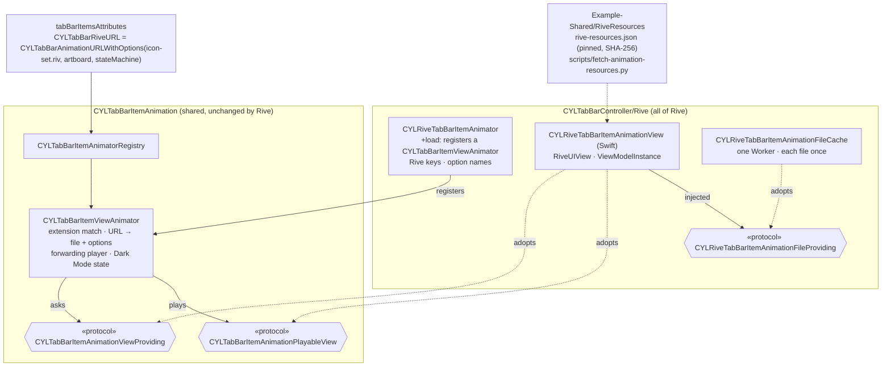

# [CN]Rive 动画 Tab 图标（与 Lottie、PAG 用法相同）
# [EN]Rive animated tab icons (used like Lottie and PAG)

<!-- bound-classes: CYLRiveTabBarItemAnimator, CYLTabBarItemViewAnimator -->
<!-- binding:start -->
<!-- Generated by scripts/update-docs-navigation.py; do not edit by hand. -->

| 中文 | English |
|:---|:---|
| 绑定的代码类 `CYLRiveTabBarItemAnimator`：[`CYLTabBarController/CYLTabBarItemAnimation/Rive/CYLRiveTabBarItemAnimator.h`](../CYLTabBarController/CYLTabBarItemAnimation/Rive/CYLRiveTabBarItemAnimator.h) | Bound to the class `CYLRiveTabBarItemAnimator`: [`CYLTabBarController/CYLTabBarItemAnimation/Rive/CYLRiveTabBarItemAnimator.h`](../CYLTabBarController/CYLTabBarItemAnimation/Rive/CYLRiveTabBarItemAnimator.h) |
| 绑定的代码类 `CYLTabBarItemViewAnimator`：[`CYLTabBarController/CYLTabBarItemAnimation/CYLTabBarItemViewAnimator.h`](../CYLTabBarController/CYLTabBarItemAnimation/CYLTabBarItemViewAnimator.h) | Bound to the class `CYLTabBarItemViewAnimator`: [`CYLTabBarController/CYLTabBarItemAnimation/CYLTabBarItemViewAnimator.h`](../CYLTabBarController/CYLTabBarItemAnimation/CYLTabBarItemViewAnimator.h) |

<!-- binding:end -->

| 中文 | English |
|:---|:---|
| 支持 [Rive](https://rive.app)（`RiveRuntime`）动画作为 Tab 图标。Rive 文件由状态机驱动，一个 `.riv` 文件还可以通过多个画板（artboard）包含很多图标。接入方式与 Lottie、PAG 相同（CocoaPods 子库、同样的 key 与播放流程），适用于经典系统 TabBar、液态玻璃（Liquid Glass）与扁平样式（FlatDesign）。Rive 是 `CYLTabBarItemAnimation` 子库「可播放视图」方式的第一个插件（见 [Tab-Bar-Item-Animation.md](Tab-Bar-Item-Animation.md#cn新增一个动画库)）：**Core、引擎与其他动画库都没有修改**，Rive 自己只有一个 Swift 视图与一段注册代码。 | [Rive](https://rive.app) (`RiveRuntime`) animations as tab icons. A Rive file is driven by state machines, and one `.riv` file can hold many icons, one per artboard. It is integrated like Lottie and PAG (a CocoaPods subspec, the same keys and playback pipeline), in the classic system tab bar, Liquid Glass and FlatDesign. Rive is the first plugin of the "playable view" way of the `CYLTabBarItemAnimation` subspec (see [Tab-Bar-Item-Animation.md](Tab-Bar-Item-Animation.md#enadding-an-animation-library)): **Core, the engine and the other libraries are unchanged**, and Rive itself is one Swift view plus a registration. |

## [CN]目录
## [EN]Contents

<!-- navigation:start -->
<!-- Generated by scripts/update-docs-navigation.py; do not edit by hand. -->

| 中文 | English |
|:---|:---|
| [安装](#cn安装) | [Installation](#eninstallation) |
| [Key 与选项](#cnkey-与选项) | [Keys and options](#enkeys-and-options) |
| [实现结构](#cn实现结构) | [Implementation](#enimplementation) |
| [代码演示](#cn代码演示) | [Code](#encode) |
| [Demo 与动效资源](#cndemo-与动效资源) | [Demo and animation files](#endemo-and-animation-files) |
| [与 Lottie、PAG 的差异](#cn与-lottiepag-的差异) | [Differences from Lottie and PAG](#endifferences-from-lottie-and-pag) |
| [测试与截图](#cn测试与截图) | [Testing and screenshots](#entesting-and-screenshots) |

<!-- navigation:end -->

## [CN]安装
## [EN]Installation

```ruby
pod 'CYLTabBarController/Rive'             # RiveRuntime ~> 6.29, iOS 14+
# Compare / 对照: pod 'CYLTabBarController/LottieSwift' or 'CYLTabBarController/PAG'
```

| 中文 | English |
|:---|:---|
| 子库依赖 CocoaPods 上的 `RiveRuntime`（Rive 官方发布的二进制 `RiveRuntime.xcframework`，[rive-app/rive-ios](https://github.com/rive-app/rive-ios)），需要 6.29 及以上（6.x）与 iOS 14 及以上。6.29 起 Rive 把 `RiveViewModel` / `RiveView` 标记为废弃；本库只使用新的 API（`Worker`、`File`、`Rive`、`RiveUIView`），不会产生废弃警告。未引入 Rive 子库时，`.riv` 文件不会被播放，Tab 显示图片。Swift Package Manager 与 Carthage 暂不提供 Rive。 | The subspec depends on the `RiveRuntime` pod (Rive's official binary `RiveRuntime.xcframework`, [rive-app/rive-ios](https://github.com/rive-app/rive-ios)), 6.29 or later (6.x), iOS 14 or later. Since 6.29 Rive deprecates `RiveViewModel` / `RiveView`; this library uses only the new API (`Worker`, `File`, `Rive`, `RiveUIView`), so it adds no deprecation warning. Without the Rive subspec no library plays `.riv` files and the tabs show their images. Swift Package Manager and Carthage do not offer Rive yet. |

## [CN]Key 与选项
## [EN]Keys and options

| Lottie | PAG | Rive | 中文 | English |
|:---|:---|:---|:---|:---|
| `CYLTabBarLottieURL` / `…FilePath` | `CYLTabBarPAGURL` / `…FilePath` | `CYLTabBarRiveURL` / `…FilePath` | 动画文件；Rive 的 URL 通常带有画板等选项 | The file; a Rive URL usually carries options such as the artboard |
| `CYLTabBarLottieSize` | `CYLTabBarPAGSize` | `CYLTabBarRiveSize` | 视图尺寸，CGSize 的 NSValue | The view size, an NSValue of CGSize |
| `CYLTabBarLottieDarkURL` / `…DarkFilePath` | `CYLTabBarPAGDarkURL` / `…DarkFilePath` | `CYLTabBarRiveDarkURL` / `…DarkFilePath` | 深色模式版本 | The Dark Mode version |
| `CYLTabBarLottieDarkColors` | — | `CYLTabBarRiveDarkColors` | 一份文件适配深色模式：Rive 按 view model 颜色属性路径替换颜色 | One file for Dark Mode: Rive replaces colors by view model color property path |

| 中文 | English |
|:---|:---|
| Rive 的 key 与选项名称声明在 Rive 子库自己的头文件 `CYLRiveTabBarItemAnimator.h` 中，不在 Core 中；它们是通用 key（`CYLTabBarAnimationURL`…）的别名，两种都可以用。按名称批量添加文件请使用通用的 `CYLTabBarItemsAttributesAddingAnimationFiles(attributes, @[@"tab_home.riv", …], nil)`。 | Rive's keys and option names are declared in the Rive subspec's own header, `CYLRiveTabBarItemAnimator.h`, not in Core; they are aliases of the generic keys (`CYLTabBarAnimationURL`…), and either works. To add files by name, use the generic `CYLTabBarItemsAttributesAddingAnimationFiles(attributes, @[@"tab_home.riv", …], nil)`. |
| Rive 图标没有时间线，它的状态机根据 **view model** 切换状态。选中 Tab 时，本库把 view model 布尔属性（默认 `active`）设为 YES，1 秒后恢复为 NO，与 [rive_animated_icon](https://pub.dev/packages/rive_animated_icon) 中图标被点击时相同；也可以改为触发一个 trigger。选项由通用的 `CYLTabBarAnimationURLWithOptions(fileURL, options)` 写入 URL，因此多个 Tab 可以使用同一个文件的不同画板（文件只加载一次）。 | A Rive icon has no timeline: its state machine follows its **view model**. When a tab is selected, the view model boolean (default `active`) is set to YES, then back to NO a second later, as [rive_animated_icon](https://pub.dev/packages/rive_animated_icon) does on a tap; a trigger can be fired instead. The generic `CYLTabBarAnimationURLWithOptions(fileURL, options)` puts the options in the URL, so several tabs can use different artboards of one file (loaded once). |

| 选项 / Option（Swift） | 默认值 / Default | 中文 | English |
|:---|:---|:---|:---|
| `CYLTabBarAnimationOptionRiveArtboard`（`.riveArtboard`） | 文件的默认画板 / the file's default | 画板名称，例如 `HOME` | The artboard, e.g. `HOME` |
| `CYLTabBarAnimationOptionRiveStateMachine`（`.riveStateMachine`） | 画板的默认状态机 / the artboard's default | 状态机名称，例如 `HOME_interactivity` | The state machine, e.g. `HOME_interactivity` |
| `CYLTabBarAnimationOptionRiveActiveProperty`（`.riveActiveProperty`） | `active` | 选中时设为 YES 的 view model 布尔属性 | The view model boolean set to YES on selection |
| `CYLTabBarAnimationOptionRiveActiveDuration`（`.riveActiveDuration`） | `1` | 布尔属性保持 YES 的秒数（最长 60） | Seconds the boolean stays YES (at most 60) |
| `CYLTabBarAnimationOptionRiveTriggerProperty`（`.riveTriggerProperty`） | — | 改为触发的 view model trigger | A view model trigger fired instead |
| `CYLTabBarAnimationOptionRiveColor`（`.riveColor`） | 文件中的颜色 / the file's | 加载时设置到 view model 颜色 `color` 的浅色颜色，"#RRGGBB" 或 "#RRGGBBAA" | The light color set on the view model color `color` on load, "#RRGGBB" or "#RRGGBBAA" |

## [CN]实现结构
## [EN]Implementation



| 中文 | English |
|:---|:---|
| Rive 自己只有两部分：**注册**（`Rive/CYLRiveTabBarItemAnimator.m`：声明 key 与选项名称，在 `+load` 中注册一个 `CYLTabBarItemViewAnimator`）与 **Swift 视图**（`RiveSwift/CYLRiveTabBarItemAnimationView.swift`：遵守共用协议 `CYLTabBarItemAnimationPlayableView` 与 `CYLTabBarItemAnimationViewProviding`，调用 Rive 的 API）。按扩展名匹配、拆分 URL 与选项、播放器、深色模式状态与视图注入都由共用的 `CYLTabBarItemViewAnimator` 完成，以后自己会播放的动画库可以直接复用。 | Rive itself is two parts: the **registration** (`Rive/CYLRiveTabBarItemAnimator.m`: declares the keys and option names, and registers a `CYLTabBarItemViewAnimator` in `+load`) and the **Swift view** (`RiveSwift/CYLRiveTabBarItemAnimationView.swift`: adopts the shared `CYLTabBarItemAnimationPlayableView` and `CYLTabBarItemAnimationViewProviding`, and calls Rive's API). Matching by extension, splitting the URL into the file and options, the player, the Dark Mode state and view injection are all done by the shared `CYLTabBarItemViewAnimator`, which later libraries whose view plays itself reuse as is. |
| **面向接口**：注册表只认识 `CYLTabBarItemAnimator`；视图 animator 只认识两个共用协议，默认视图类只在注册时指定一次（Swift 没有 `+load`），且仅在遵守协议时使用；Swift 视图通过注入的 `CYLRiveTabBarItemAnimationFileProviding` 获取文件。任意遵守协议的类都可以通过 `CYLRiveTabBarItemAnimator.animator.viewProvider` 注入（例如测试替身），设为 nil 恢复默认。 | **Programmed to interfaces**: the registry knows only `CYLTabBarItemAnimator`; the view animator knows only the two shared protocols, and the default view class is named once, at registration (Swift has no `+load`), and used only when it adopts them; the Swift view gets its files through the injected `CYLRiveTabBarItemAnimationFileProviding`. Any class adopting the protocols can be injected through `CYLRiveTabBarItemAnimator.animator.viewProvider` (e.g. a test double); nil goes back to the default. |

## [CN]代码演示
## [EN]Code

```objc
// Objective-C — one file, one artboard per tab. 一个文件，每个 Tab 一个画板。
NSURL *iconSet = [[NSBundle mainBundle] URLForResource:@"icon-set" withExtension:@"riv"];
NSDictionary *home = @{
    CYLTabBarItemTitle      : @"Home",
    CYLTabBarItemImage      : @"home_normal",            // shown without the Rive subspec 未引入 Rive 子库时显示
    CYLTabBarRiveURL        : CYLTabBarAnimationURLWithOptions(iconSet, @{
                                  CYLTabBarAnimationOptionRiveArtboard : @"HOME",
                                  CYLTabBarAnimationOptionRiveStateMachine : @"HOME_interactivity",
                                  CYLTabBarAnimationOptionRiveColor : @"#1F1F1F",
                              }),
    CYLTabBarRiveSize       : [NSValue valueWithCGSize:CGSizeMake(30, 30)],
    CYLTabBarRiveDarkColors : @{ @"color" : UIColor.whiteColor },   // Dark Mode with the same file 同一份文件适配深色模式
};
```

```swift
// Swift — from Example-Rive/HealthyHome/Tool/TabBarAnimationDemo.swift
let iconSet = Bundle.main.url(forResource: "icon-set", withExtension: "riv")
item[CYLTabBarRiveURL] = CYLTabBarAnimationURLWithOptions(iconSet, [
    .riveArtboard: "HOME",
    .riveStateMachine: "HOME_interactivity",
    .riveColor: "#1F1F1F",
])
item[CYLTabBarRiveSize] = NSValue(cgSize: CGSize(width: 30, height: 30))
item[CYLTabBarRiveDarkColors] = ["color": UIColor.white]
```

| 中文 | English |
|:---|:---|
| 与 Lottie、PAG 一样：`-[UIControl cyl_lottieAnimationView]` 返回 Tab 按钮上的 Rive 视图；`-[UIControl cyl_tabBarItemAnimationPlayer]` 返回其播放器；`CYLTabBarItemLottieAnimationViewDidAddNotification` 同样发送；`-lottieAnimationViewContentMode` 映射为 Rive 的 fit（AspectFit → contain，AspectFill → cover，ScaleToFill → fill）。 | As with Lottie and PAG: `-[UIControl cyl_lottieAnimationView]` returns the tab button's Rive view; `-[UIControl cyl_tabBarItemAnimationPlayer]` returns its player; `CYLTabBarItemLottieAnimationViewDidAddNotification` is posted; `-lottieAnimationViewContentMode` maps to Rive's fit (AspectFit → contain, AspectFill → cover, ScaleToFill → fill). |

## [CN]Demo 与动效资源
## [EN]Demo and animation files

| 中文 | English |
|:---|:---|
| `Example-Rive` **复用 `Example-PAG` 的全部源文件与资源**，只有 `HealthyHome/Tool/TabBarAnimationDemo.swift` 是自己的：第 1、3、4 个 Tab 使用 `icon-set.riv` 中的画板 `HOME`、`BELL`、`USER`，第 2 个 Tab 保持图片（#477）；深色模式下图标通过 `CYLTabBarRiveDarkColors` 变为白色。在该目录执行 `pod install`，打开 `HealthyHome.xcworkspace` 运行。 | `Example-Rive` **reuses every source and resource of `Example-PAG`**; only `HealthyHome/Tool/TabBarAnimationDemo.swift` is its own: tabs 1, 3 and 4 use the artboards `HOME`, `BELL` and `USER` of `icon-set.riv`, tab 2 keeps its images (#477), and in Dark Mode the icons turn white through `CYLTabBarRiveDarkColors`. Run `pod install` in that folder and open `HealthyHome.xcworkspace`. |
| `icon-set.riv` 取自 [rive_animated_icon](https://pub.dev/packages/rive_animated_icon) 2.1.1（MIT，60 个图标，每个图标一个画板），不保存在仓库中：[`Example-Shared/RiveResources/rive-resources.json`](../Example-Shared/RiveResources/rive-resources.json) 记录其 pub.dev 归档与文件的 SHA-256，`pod install` 时由所有动画库共用的 [`scripts/fetch-animation-resources.py`](../scripts/fetch-animation-resources.py) 下载、校验，并只解压列出的文件。画板与状态机名称见该包的 `lib/src/config.dart`（如 `SETTINGS` / `SETTINGS_Interactivity`）；它们的 view model 都有 `active`、`color`、`strokeWidth` 属性。 | `icon-set.riv` comes from [rive_animated_icon](https://pub.dev/packages/rive_animated_icon) 2.1.1 (MIT, 60 icons, one artboard each) and is not in the repository: [`Example-Shared/RiveResources/rive-resources.json`](../Example-Shared/RiveResources/rive-resources.json) records the SHA-256 of its pub.dev archive and files, and `pod install` runs [`scripts/fetch-animation-resources.py`](../scripts/fetch-animation-resources.py), shared by every library, to download, verify and extract only the listed files. The artboard and state machine names are in the package's `lib/src/config.dart` (e.g. `SETTINGS` / `SETTINGS_Interactivity`); their view models all have `active`, `color` and `strokeWidth` properties. |

## [CN]与 Lottie、PAG 的差异
## [EN]Differences from Lottie and PAG

| 中文 | English |
|:---|:---|
| **播放方式**：状态机没有播放进度，选中时通过 view model 属性播放；启动时选中的 Tab（#389）保持静止状态；没有 view model 的画板只显示、不播放。旧式的状态机输入（SMI input）不在 Rive 新 API 中，请使用 view model 属性。 | **Playback**: a state machine has no playback position; a selected tab plays through a view model property; the tab selected at launch (#389) stays in its resting state; an artboard without a view model is shown but does not play. Old-style state machine inputs (SMI inputs) are not part of Rive's new API; use view model properties. |
| **播放速度**：`lottieAnimationSpeed` 对 Rive 无效，请用 `CYLTabBarAnimationOptionRiveActiveDuration` 或在 Rive 编辑器中调整。 | **Speed**: `lottieAnimationSpeed` does not apply to Rive; use `CYLTabBarAnimationOptionRiveActiveDuration`, or change it in the Rive editor. |
| **异步加载**：文件异步加载，完成前图标区域为空，期间的播放请求会在加载后执行。 | **Asynchronous loading**: files load asynchronously; the icon is empty until then, and a play request made meanwhile runs once it has loaded. |

## [CN]测试与截图
## [EN]Testing and screenshots

| 中文 | English |
|:---|:---|
| 本次修改在 Linux 环境中完成，无法运行 Xcode 与 iOS 模拟器，因此**没有截图**，也没有真正编译。Swift 视图按 RiveRuntime 6.29.0 的源码编写（逐一核对了所用的每个 API 签名），但这里没有 Swift 编译器，**未做类型检查**。已做的检查：用最小的 UIKit / Foundation / RiveRuntime 桩头文件，对 `CYLTabBarItemViewAnimator.m`、`CYLRiveTabBarItemAnimator.m`、`CYLPAGTabBarItemAnimator.m`（不含 libpag）、Core 的 `CYLTabBarAnimationURLWithOptions()`，以及一个只遵守共用协议并注入 `viewProvider` 的测试替身执行 `clang -fsyntax-only -Wall -Wextra -Wprotocol`，无错误与警告；`pod lib lint --quick` 通过；`scripts/fetch-animation-resources.py` 下载并校验了 PAG 与 Rive 的全部文件，并拒绝了被篡改的清单。 | This change was made on Linux, where Xcode and the iOS simulator cannot run, so there are **no screenshots** and nothing was really compiled. The Swift view was written against RiveRuntime 6.29.0's source (every API signature it uses was checked), but there is no Swift compiler here, so it **has not been type-checked**. Checks done: `clang -fsyntax-only -Wall -Wextra -Wprotocol` with minimal UIKit / Foundation / RiveRuntime stub headers on `CYLTabBarItemViewAnimator.m`, `CYLRiveTabBarItemAnimator.m`, `CYLPAGTabBarItemAnimator.m` (without libpag), Core's `CYLTabBarAnimationURLWithOptions()`, and a test double that adopts only the shared protocols and is injected as `viewProvider`, with no error and no warning; `pod lib lint --quick` passes; `scripts/fetch-animation-resources.py` downloaded and verified every PAG and Rive file, and rejected tampered manifests. |
| 请运行 `Example-Rive` 与 `Example-PAG`，在三种样式下检查：Tab 显示动画、选中时播放一次、切换后上一个 Tab 停止、第 2 个 Tab 显示图片、深色模式正常。验证后的截图请放在 `docs/assets/` 中，并用 `` 引用。 | Please run `Example-Rive` and `Example-PAG` in all three styles and check: the tabs animate, a selected tab plays once, the previous tab stops, the 2nd tab shows its images, and Dark Mode works. Put screenshots from these checks in `docs/assets/` and reference them as ``. |
